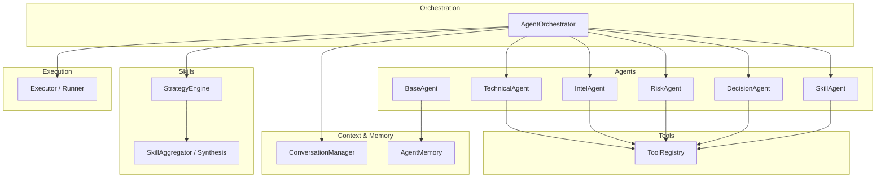
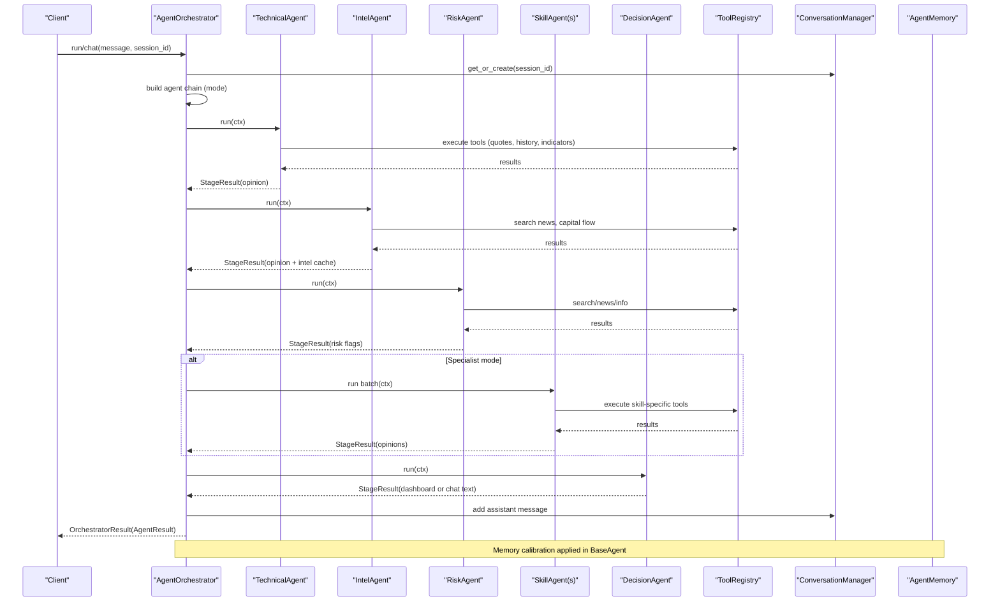
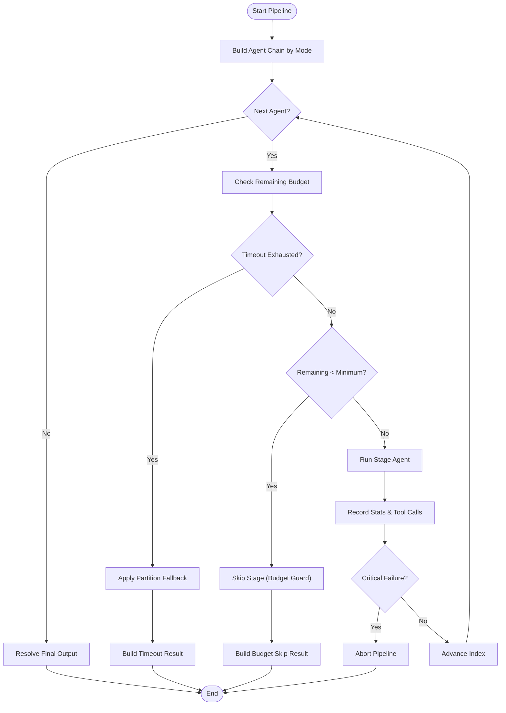
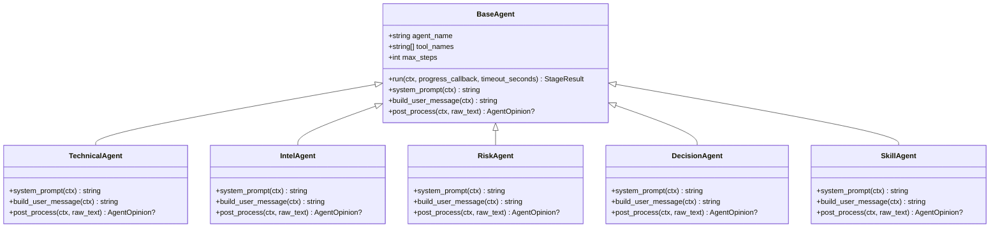
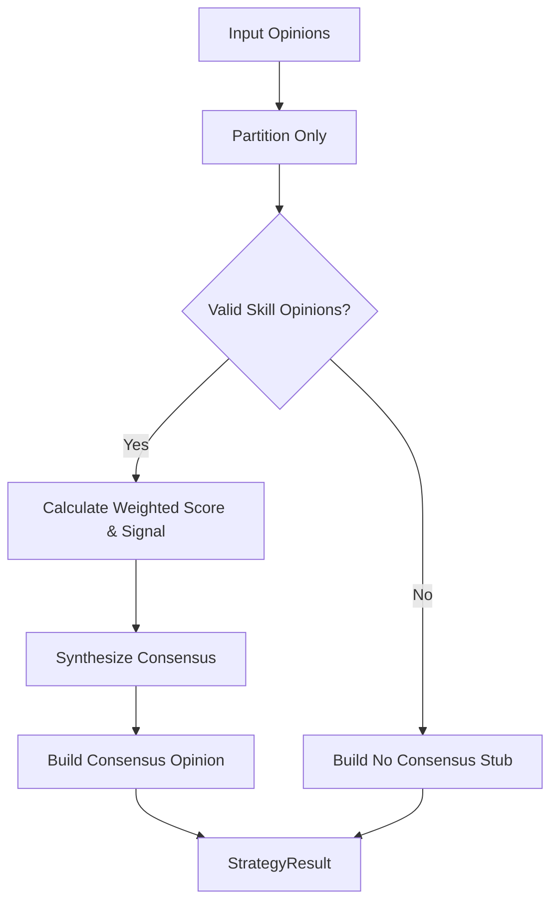
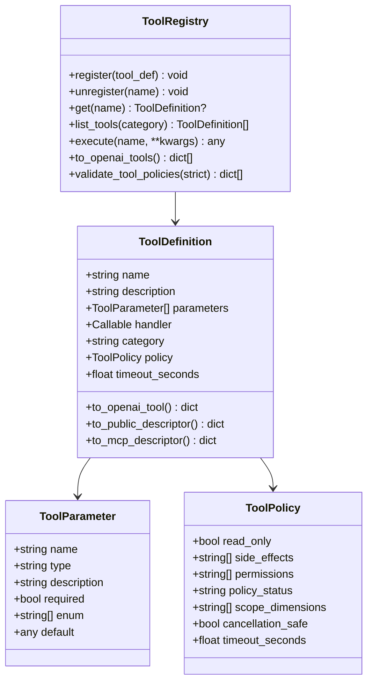
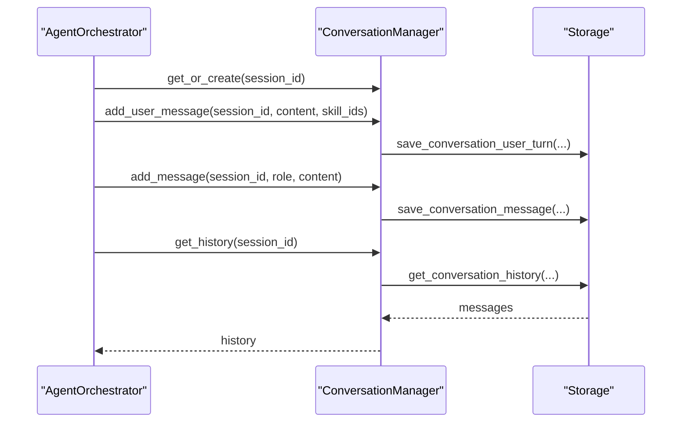
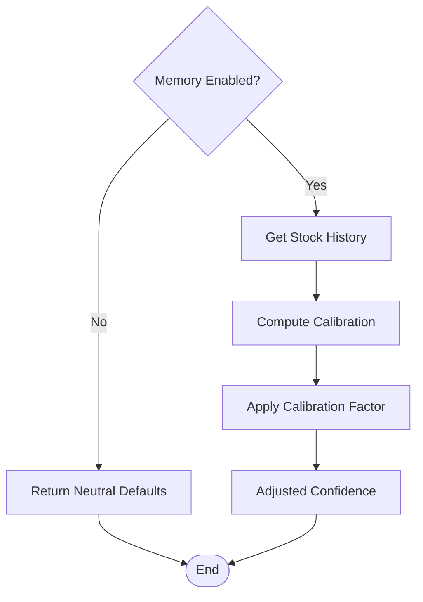
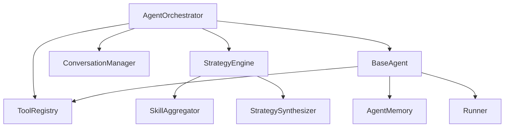

# AI Agent System

<cite>
**Referenced Files in This Document**
- [orchestrator.py](file://src/agent/orchestrator.py)
- [base_agent.py](file://src/agent/agents/base_agent.py)
- [technical_agent.py](file://src/agent/agents/technical_agent.py)
- [intel_agent.py](file://src/agent/agents/intel_agent.py)
- [risk_agent.py](file://src/agent/agents/risk_agent.py)
- [decision_agent.py](file://src/agent/agents/decision_agent.py)
- [engine.py](file://src/agent/skills/engine.py)
- [skill_agent.py](file://src/agent/skills/skill_agent.py)
- [registry.py](file://src/agent/tools/registry.py)
- [conversation.py](file://src/agent/conversation.py)
- [memory.py](file://src/agent/memory.py)
- [executor.py](file://src/agent/executor.py)
</cite>

## Table of Contents
1. [Introduction](#introduction)
2. [Project Structure](#project-structure)
3. [Core Components](#core-components)
4. [Architecture Overview](#architecture-overview)
5. [Detailed Component Analysis](#detailed-component-analysis)
6. [Dependency Analysis](#dependency-analysis)
7. [Performance Considerations](#performance-considerations)
8. [Troubleshooting Guide](#troubleshooting-guide)
9. [Conclusion](#conclusion)
10. [Appendices](#appendices)

## Introduction
This document explains the multi-agent architecture that powers intelligent stock analysis. It focuses on:
- The orchestrator pattern coordinating specialized agents (technical, intelligence, risk, decision, and skill-based specialists).
- The skills framework for pluggable analysis capabilities.
- The tools registry enabling market data access, calculations, and trade execution.
- The agent lifecycle from initialization through execution to result aggregation.
- Conversation context management, memory persistence, and inter-agent communication patterns.
- Performance optimization, error handling, and debugging techniques for agent-based workflows.

## Project Structure
The AI Agent System is implemented under src/agent with clear separation of concerns:
- Orchestrator: pipeline control and mode selection.
- Agents: base class and specialized implementations.
- Skills: strategy engine, aggregator, synthesis, and skill agent adapter.
- Tools: registry and tool definitions used by agents.
- Memory and conversation: persistent context and session history.
- Executor: ReAct loop and shared runner integration.

**Diagram sources**
- [orchestrator.py:107-136](file://src/agent/orchestrator.py#L107-L136)
- [base_agent.py:38-69](file://src/agent/agents/base_agent.py#L38-L69)
- [engine.py:54-59](file://src/agent/skills/engine.py#L54-L59)
- [registry.py:169-181](file://src/agent/tools/registry.py#L169-L181)
- [conversation.py:56-76](file://src/agent/conversation.py#L56-L76)
- [memory.py:62-87](file://src/agent/memory.py#L62-L87)
- [executor.py:1-15](file://src/agent/executor.py#L1-L15)

**Section sources**
- [orchestrator.py:107-136](file://src/agent/orchestrator.py#L107-L136)
- [base_agent.py:38-69](file://src/agent/agents/base_agent.py#L38-L69)
- [engine.py:54-59](file://src/agent/skills/engine.py#L54-L59)
- [registry.py:169-181](file://src/agent/tools/registry.py#L169-L181)
- [conversation.py:56-76](file://src/agent/conversation.py#L56-L76)
- [memory.py:62-87](file://src/agent/memory.py#L62-L87)
- [executor.py:1-15](file://src/agent/executor.py#L1-L15)

## Core Components
- Orchestrator: Builds an ordered chain of agents based on mode (quick, standard, full, specialist), enforces timeouts and budgets, runs stages, aggregates results, and produces a final dashboard or chat response.
- BaseAgent: Provides common execution flow, message building, tool filtering, memory injection, and structured opinion post-processing hooks.
- Specialized Agents: Technical (price/trend/volume/pattern), Intel (news/sentiment/capital flow), Risk (screening flags and veto logic), Decision (synthesis into dashboard), Skill (dynamic evaluation per skill).
- Strategy Engine: Partitions opinions, validates signals, aggregates via weights, synthesizes consensus, and builds a unified opinion for downstream use.
- Tool Registry: Central registry for agent-callable tools with schema generation, policy enforcement, category-level timeouts, and execution dispatch.
- Conversation Manager: Multi-turn session storage with TTL, message persistence, and user turn tracking.
- Agent Memory: Persistent learning from past analyses, confidence calibration, and skill performance weighting.
- Executor/Runner: ReAct loop integrating LLM calls, tool invocation, and structured parsing; shared across single and multi-agent paths.

**Section sources**
- [orchestrator.py:107-136](file://src/agent/orchestrator.py#L107-L136)
- [base_agent.py:38-69](file://src/agent/agents/base_agent.py#L38-L69)
- [engine.py:54-59](file://src/agent/skills/engine.py#L54-L59)
- [registry.py:169-181](file://src/agent/tools/registry.py#L169-L181)
- [conversation.py:56-76](file://src/agent/conversation.py#L56-L76)
- [memory.py:62-87](file://src/agent/memory.py#L62-L87)
- [executor.py:1-15](file://src/agent/executor.py#L1-L15)

## Architecture Overview
The system uses an orchestrator-driven pipeline where each stage contributes evidence (opinions) to a shared context. The DecisionAgent synthesizes these into a final dashboard or natural-language answer. Skills can be injected as additional specialist evaluations before decision-making.

**Diagram sources**
- [orchestrator.py:479-766](file://src/agent/orchestrator.py#L479-L766)
- [base_agent.py:99-171](file://src/agent/agents/base_agent.py#L99-L171)
- [engine.py:134-217](file://src/agent/skills/engine.py#L134-L217)
- [registry.py:302-315](file://src/agent/tools/registry.py#L302-L315)
- [conversation.py:64-96](file://src/agent/conversation.py#L64-L96)
- [memory.py:299-321](file://src/agent/agents/base_agent.py#L299-L321)

## Detailed Component Analysis

### Orchestrator Pattern
- Modes: quick (technical → decision), standard (technical → intel → decision), full (technical → intel → risk → decision), specialist (inserts skill agents before decision).
- Pipeline execution:
  - Builds agent chain based on mode.
  - Enforces global timeout and per-stage minimum budget guard.
  - Runs each stage with optional per-agent timeout clamping.
  - Collects StageResult, tool_calls_log, models_used, and updates AgentRunStats.
  - Handles non-critical failures gracefully (intel/risk degrade without aborting).
  - Applies partition fallback when budget/time exceeded.
  - Final output resolution: dashboard JSON or chat text.

**Diagram sources**
- [orchestrator.py:479-766](file://src/agent/orchestrator.py#L479-L766)

**Section sources**
- [orchestrator.py:772-800](file://src/agent/orchestrator.py#L772-L800)
- [orchestrator.py:479-766](file://src/agent/orchestrator.py#L479-L766)

### BaseAgent and Specialized Agents
- BaseAgent provides:
  - Message assembly with system prompt, conversation history, market phase/context sections, pre-fetched data injection, and memory context.
  - Tool subset filtering via tool_names and filtered registry.
  - Execution via run_agent_loop with max_steps and wall-clock timeout.
  - Post-processing hook to produce AgentOpinion and append to ctx.opinions.
  - Memory calibration adjusting confidence based on historical accuracy.

Specialized agents:
- TechnicalAgent: Focuses on price, trend, volume, chip distribution, patterns; outputs structured technical opinion.
- IntelAgent: Gathers news, announcements, risk events, sentiment, capital flow; caches intel_opinion for reuse.
- RiskAgent: Screens risks (insider activity, earnings warnings, regulatory, valuation extremes); maps risk level to signal and adds risk flags.
- DecisionAgent: Synthesizes all inputs into dashboard JSON or chat response; no tool access; consumes ctx.opinions and risk flags.
- SkillAgent: Dynamic specialist adapter loading skill instructions and required tools; evaluates conditions and returns structured opinion.

**Diagram sources**
- [base_agent.py:38-69](file://src/agent/agents/base_agent.py#L38-L69)
- [technical_agent.py:23-104](file://src/agent/agents/technical_agent.py#L23-L104)
- [intel_agent.py:24-119](file://src/agent/agents/intel_agent.py#L24-L119)
- [risk_agent.py:29-129](file://src/agent/agents/risk_agent.py#L29-L129)
- [decision_agent.py:24-290](file://src/agent/agents/decision_agent.py#L24-L290)
- [skill_agent.py:25-133](file://src/agent/skills/skill_agent.py#L25-L133)

**Section sources**
- [base_agent.py:99-171](file://src/agent/agents/base_agent.py#L99-L171)
- [technical_agent.py:23-104](file://src/agent/agents/technical_agent.py#L23-L104)
- [intel_agent.py:24-119](file://src/agent/agents/intel_agent.py#L24-L119)
- [risk_agent.py:29-129](file://src/agent/agents/risk_agent.py#L29-L129)
- [decision_agent.py:24-290](file://src/agent/agents/decision_agent.py#L24-L290)
- [skill_agent.py:25-133](file://src/agent/skills/skill_agent.py#L25-L133)

### Skills Framework
- StrategyEngine partitions opinions into valid skill opinions, invalid records, and non-skill opinions.
- Aggregation calculates weighted scores and final signal; synthesis consolidates conflicts and consensus level.
- Consensus opinion is built with reasoning including skill names, weights, and conflict details.
- SkillAgent adapts a selected skill at runtime, injecting instructions and required tools, validating confidence, and returning structured opinion.

**Diagram sources**
- [engine.py:60-132](file://src/agent/skills/engine.py#L60-L132)
- [engine.py:134-217](file://src/agent/skills/engine.py#L134-L217)
- [skill_agent.py:25-133](file://src/agent/skills/skill_agent.py#L25-L133)

**Section sources**
- [engine.py:54-217](file://src/agent/skills/engine.py#L54-L217)
- [skill_agent.py:25-133](file://src/agent/skills/skill_agent.py#L25-L133)

### Tools Registry
- ToolDefinition encapsulates name, description, parameters, handler, category, policy, and timeout.
- ToolRegistry supports registration, querying, listing, schema generation (OpenAI/MCP descriptors), policy validation, and execution dispatch.
- @tool decorator infers parameters from type hints, registers tools, and attaches metadata.
- Category-level default timeouts allow per-category ceilings; filtered registries preserve category-timeout map.

**Diagram sources**
- [registry.py:26-94](file://src/agent/tools/registry.py#L26-L94)
- [registry.py:169-181](file://src/agent/tools/registry.py#L169-L181)
- [registry.py:334-392](file://src/agent/tools/registry.py#L334-L392)

**Section sources**
- [registry.py:169-315](file://src/agent/tools/registry.py#L169-L315)
- [registry.py:334-392](file://src/agent/tools/registry.py#L334-L392)

### Conversation Context Management
- ConversationManager maintains sessions with TTL, persists messages and user turns, and retrieves history.
- Orchestrator integrates conversation manager to persist user messages and assistant responses, and injects visible chat history into agent prompts.

**Diagram sources**
- [conversation.py:56-96](file://src/agent/conversation.py#L56-L96)
- [orchestrator.py:401-435](file://src/agent/orchestrator.py#L401-L435)

**Section sources**
- [conversation.py:56-96](file://src/agent/conversation.py#L56-L96)
- [orchestrator.py:401-435](file://src/agent/orchestrator.py#L401-L435)

### Memory Persistence and Calibration
- AgentMemory stores recent analysis history and computes calibration factors based on historical accuracy.
- BaseAgent injects memory context into prompts and applies calibrated confidence adjustments.

**Diagram sources**
- [memory.py:74-87](file://src/agent/memory.py#L74-L87)
- [memory.py:145-200](file://src/agent/memory.py#L145-L200)
- [base_agent.py:299-321](file://src/agent/agents/base_agent.py#L299-L321)

**Section sources**
- [memory.py:74-87](file://src/agent/memory.py#L74-L87)
- [memory.py:145-200](file://src/agent/memory.py#L145-L200)
- [base_agent.py:299-321](file://src/agent/agents/base_agent.py#L299-L321)

### Inter-Agent Communication Patterns
- Shared AgentContext carries query, stock scope, meta, data, opinions, and risk flags.
- Agents append structured AgentOpinion to ctx.opinions; DecisionAgent consumes them.
- IntelAgent caches intel_opinion in ctx.data for reuse by RiskAgent and others.
- StrategyEngine partitions and aggregates skill opinions into consensus for DecisionAgent.

**Section sources**
- [intel_agent.py:95-119](file://src/agent/agents/intel_agent.py#L95-L119)
- [engine.py:134-217](file://src/agent/skills/engine.py#L134-L217)
- [decision_agent.py:159-246](file://src/agent/agents/decision_agent.py#L159-L246)

## Dependency Analysis
- Orchestrator depends on:
  - ToolRegistry for tool execution and schema generation.
  - LLMToolAdapter for LLM interactions.
  - StrategyEngine for skill-based specialist evaluation.
  - ConversationManager for session persistence.
  - BaseAgent and specialized agents for pipeline stages.
- BaseAgent depends on:
  - ToolRegistry (filtered subset).
  - AgentMemory for context injection and calibration.
  - Runner for ReAct loop execution.
- Skills depend on:
  - SkillAggregator and StrategySynthesizer for consensus building.
- Tools depend on:
  - Policy enforcement and parameter inference.

**Diagram sources**
- [orchestrator.py:107-136](file://src/agent/orchestrator.py#L107-L136)
- [base_agent.py:99-171](file://src/agent/agents/base_agent.py#L99-L171)
- [engine.py:54-59](file://src/agent/skills/engine.py#L54-L59)
- [registry.py:169-181](file://src/agent/tools/registry.py#L169-L181)
- [conversation.py:56-76](file://src/agent/conversation.py#L56-L76)
- [memory.py:62-87](file://src/agent/memory.py#L62-L87)

**Section sources**
- [orchestrator.py:107-136](file://src/agent/orchestrator.py#L107-L136)
- [base_agent.py:99-171](file://src/agent/agents/base_agent.py#L99-L171)
- [engine.py:54-59](file://src/agent/skills/engine.py#L54-L59)
- [registry.py:169-181](file://src/agent/tools/registry.py#L169-L181)
- [conversation.py:56-76](file://src/agent/conversation.py#L56-L76)
- [memory.py:62-87](file://src/agent/memory.py#L62-L87)

## Performance Considerations
- Pipeline timeout and budget guard:
  - Global timeout enforced; per-stage minimum budget prevents wasteful starts.
  - Per-agent timeout clamping via configuration; cooperative budget checks.
- Concurrency:
  - Specialist mode runs skill agents in batches with configurable concurrency.
- Tool category timeouts:
  - Category-level defaults prevent runaway tool calls; preserved in filtered registries.
- Memory calibration:
  - Reduces overconfidence and improves reliability using historical accuracy.
- Pre-fetched data injection:
  - Avoids redundant tool calls by reusing ctx.data across stages.

[No sources needed since this section provides general guidance]

## Troubleshooting Guide
Common issues and diagnostics:
- Stage failure:
  - Non-critical stages (intel/risk) degrade gracefully; critical stages abort pipeline.
  - Logs include stage name, error, and failure reason.
- Timeout and budget skip:
  - Orchestrator emits stream events for pipeline_timeout and pipeline_budget_skipped.
  - Partial dashboards are marked with notes indicating degradation.
- Invalid skill opinions:
  - StrategyEngine records invalid reasons (missing_signal, unrecognized_signal) and moves them to diagnostics.
- Tool errors:
  - ToolRegistry.execute raises exceptions; ensure proper error handling in tool handlers.
- Memory calibration failures:
  - Gracefully returns neutral defaults if database or backtest service unavailable.

**Section sources**
- [orchestrator.py:521-588](file://src/agent/orchestrator.py#L521-L588)
- [orchestrator.py:677-695](file://src/agent/orchestrator.py#L677-L695)
- [engine.py:78-124](file://src/agent/skills/engine.py#L78-L124)
- [registry.py:302-315](file://src/agent/tools/registry.py#L302-L315)
- [memory.py:186-189](file://src/agent/memory.py#L186-L189)

## Conclusion
The AI Agent System implements a robust multi-agent architecture centered around an orchestrator that coordinates specialized agents for technical analysis, intelligence gathering, risk assessment, and decision synthesis. The skills framework enables pluggable analysis capabilities, while the tools registry provides secure, typed, and policy-enforced access to market data and execution functions. Conversation context and memory persistence support continuous learning and improved confidence calibration. The system balances performance with resilience through timeouts, budget guards, and graceful degradation, ensuring reliable agent-based analysis workflows.

[No sources needed since this section summarizes without analyzing specific files]

## Appendices

### Custom Agent Development
- Create a new agent by subclassing BaseAgent and implementing:
  - agent_name: unique identifier.
  - system_prompt(ctx): define persona and instructions.
  - build_user_message(ctx): construct task-specific prompt.
  - post_process(ctx, raw_text): parse structured output into AgentOpinion.
- Restrict tools via tool_names to limit agent capabilities.
- Use BaseAgent.run to leverage shared execution, memory, and tool filtering.

**Section sources**
- [base_agent.py:38-69](file://src/agent/agents/base_agent.py#L38-L69)
- [base_agent.py:99-171](file://src/agent/agents/base_agent.py#L99-L171)

### Skill Creation
- Define a skill with instructions and required tools; load via SkillManager.
- Use SkillAgent to evaluate the skill dynamically in specialist mode.
- Ensure skill outputs include signal, confidence, conditions, and reasoning.

**Section sources**
- [skill_agent.py:25-133](file://src/agent/skills/skill_agent.py#L25-L133)
- [engine.py:134-217](file://src/agent/skills/engine.py#L134-L217)

### Tool Implementation
- Implement a function and register it using @tool decorator with name, description, category, and parameters.
- Optionally declare ToolPolicy for read-only, side effects, permissions, scope dimensions, and timeout.
- Use ToolRegistry.execute to invoke tools; ensure error handling and JSON-serializable results.

**Section sources**
- [registry.py:334-392](file://src/agent/tools/registry.py#L334-L392)
- [registry.py:169-181](file://src/agent/tools/registry.py#L169-L181)