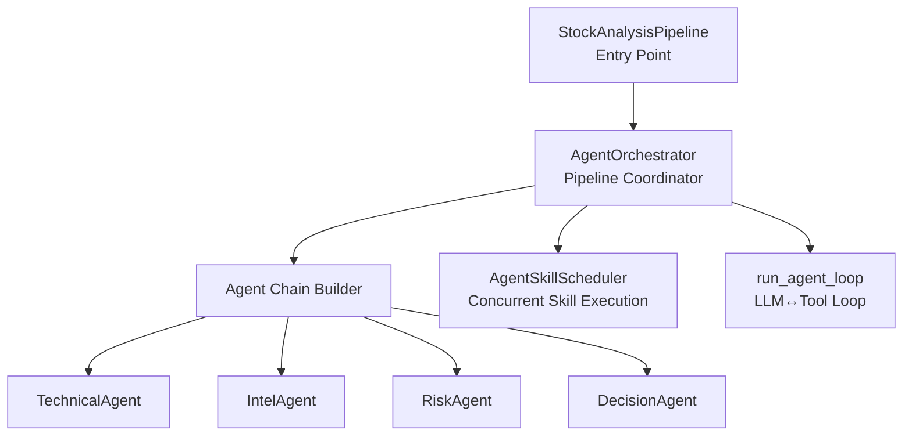
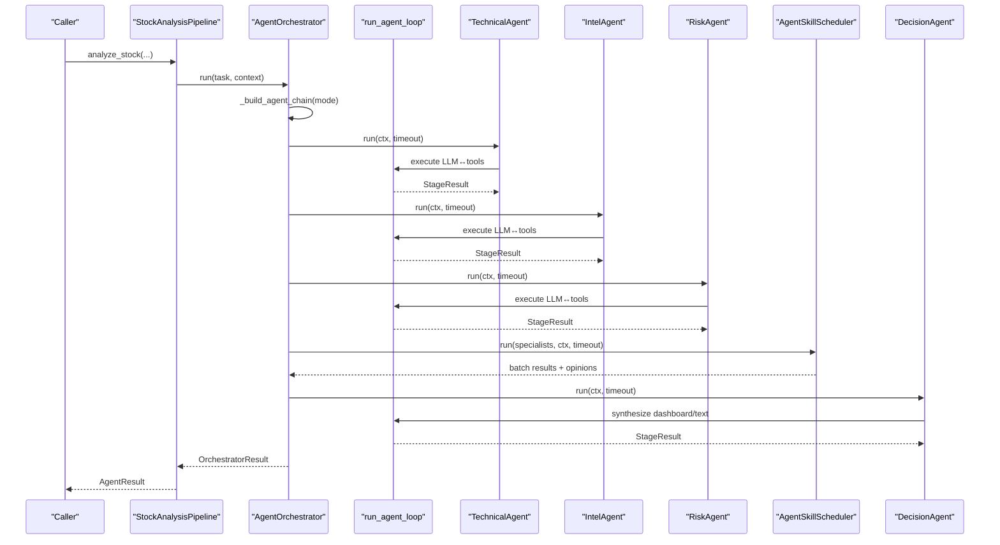
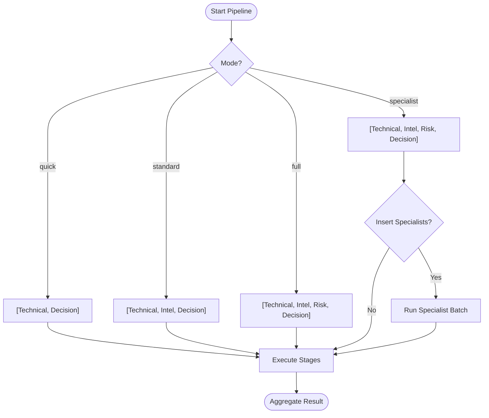
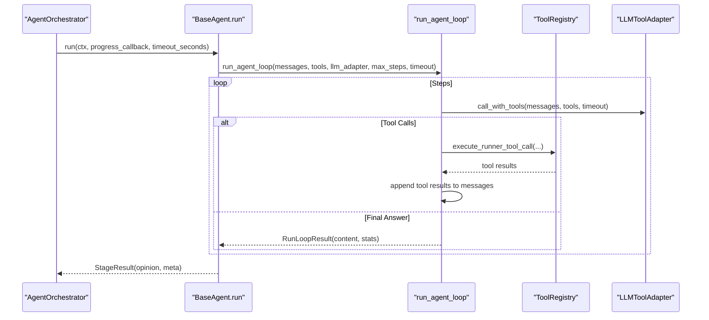
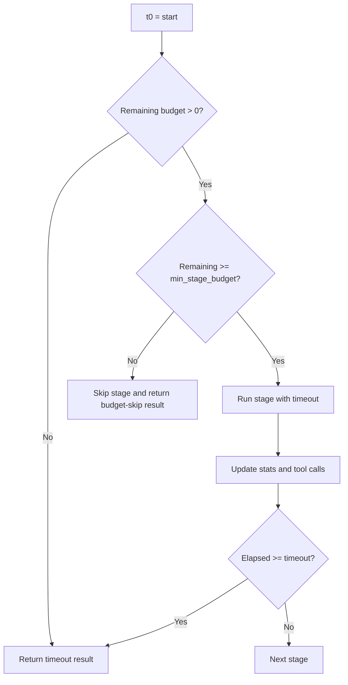
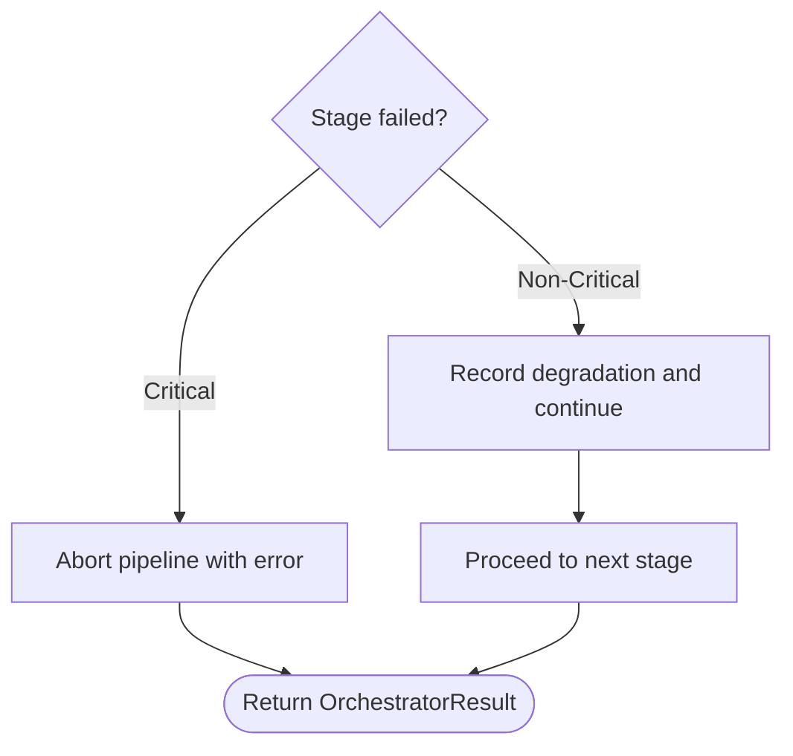
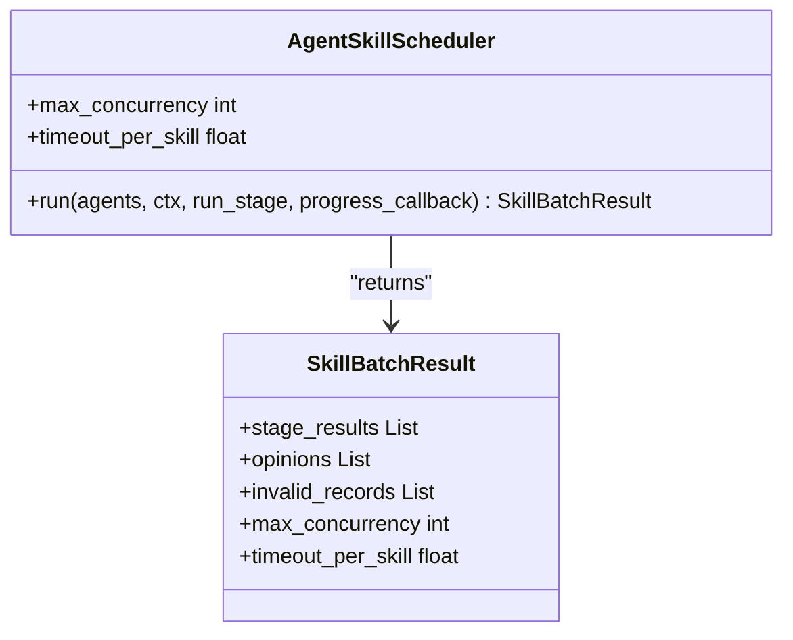
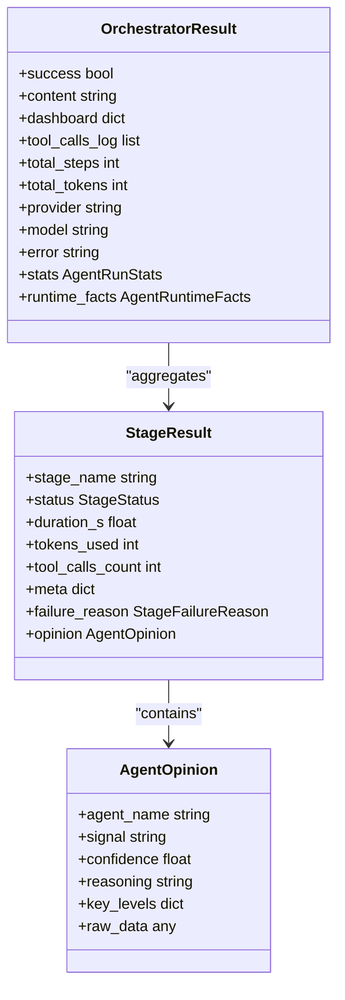
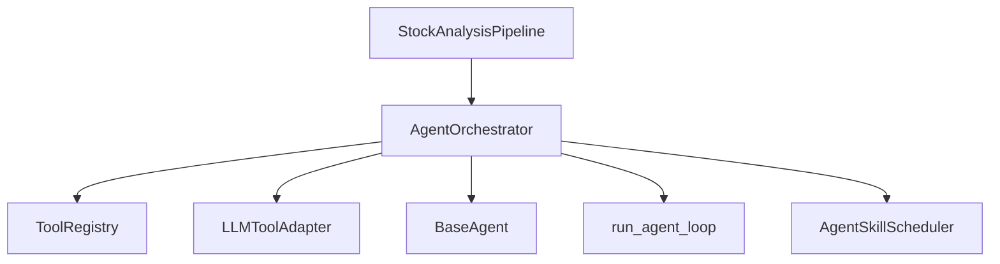

# Agent Orchestration

<cite>
**Referenced Files in This Document**
- [orchestrator.py](file://src/agent/orchestrator.py)
- [base_agent.py](file://src/agent/agents/base_agent.py)
- [technical_agent.py](file://src/agent/agents/technical_agent.py)
- [intel_agent.py](file://src/agent/agents/intel_agent.py)
- [risk_agent.py](file://src/agent/agents/risk_agent.py)
- [decision_agent.py](file://src/agent/agents/decision_agent.py)
- [runner.py](file://src/agent/runner.py)
- [scheduler.py](file://src/agent/skills/scheduler.py)
- [pipeline.py](file://src/core/pipeline.py)
</cite>

## Table of Contents
1. [Introduction](#introduction)
2. [Project Structure](#project-structure)
3. [Core Components](#core-components)
4. [Architecture Overview](#architecture-overview)
5. [Detailed Component Analysis](#detailed-component-analysis)
6. [Dependency Analysis](#dependency-analysis)
7. [Performance Considerations](#performance-considerations)
8. [Troubleshooting Guide](#troubleshooting-guide)
9. [Conclusion](#conclusion)
10. [Appendices](#appendices)

## Introduction
This document explains the multi-agent pipeline coordinator that orchestrates specialized agents for stock analysis: technical analysis, intelligence gathering, risk assessment, and decision-making. It covers the orchestrator pattern implementation, execution modes (quick, standard, full, specialist), lifecycle management from initialization to result aggregation, pipeline execution flow, timeout and budget controls, error handling strategies, configuration examples, performance optimization techniques, and debugging approaches for complex workflows.

## Project Structure
The orchestration system is centered around a coordinator that composes a chain of agents based on a selected mode. Each agent encapsulates its own prompt, tool access, and structured output parsing. A shared runner executes the LLM ↔ tool loop with robust timeout and budget guards. Specialist skills can be executed concurrently before the final decision synthesis.

**Diagram sources**
- [orchestrator.py:107-136](file://src/agent/orchestrator.py#L107-L136)
- [orchestrator.py:772-804](file://src/agent/orchestrator.py#L772-L804)
- [scheduler.py:29-112](file://src/agent/skills/scheduler.py#L29-L112)
- [runner.py:326-601](file://src/agent/runner.py#L326-L601)
- [pipeline.py:209-610](file://src/core/pipeline.py#L209-L610)

**Section sources**
- [orchestrator.py:107-136](file://src/agent/orchestrator.py#L107-L136)
- [pipeline.py:209-610](file://src/core/pipeline.py#L209-L610)

## Core Components
- AgentOrchestrator: Multi-agent pipeline coordinator implementing the orchestrator pattern. It builds an ordered agent chain based on mode, enforces timeouts and budgets, runs specialists concurrently when applicable, and aggregates results into a unified dashboard or chat response.
- BaseAgent: Abstract base providing message assembly, tool filtering, memory injection, and structured opinion post-processing.
- Specialized Agents:
  - TechnicalAgent: Technical indicators, trend, volume, patterns.
  - IntelAgent: News, announcements, sentiment, capital flow.
  - RiskAgent: Risk screening and flags; can veto or downgrade signals.
  - DecisionAgent: Final synthesis into a Decision Dashboard JSON or natural language answer.
- Shared Runner: ReAct-style LLM ↔ tool loop with step-level budget guards, per-tool timeout resolution, and parallel tool execution.
- Skill Scheduler: Concurrent execution of specialist skill agents with isolated contexts and ordered result collection.

**Section sources**
- [orchestrator.py:107-136](file://src/agent/orchestrator.py#L107-L136)
- [base_agent.py:38-171](file://src/agent/agents/base_agent.py#L38-L171)
- [technical_agent.py:23-104](file://src/agent/agents/technical_agent.py#L23-L104)
- [intel_agent.py:24-119](file://src/agent/agents/intel_agent.py#L24-L119)
- [risk_agent.py:29-129](file://src/agent/agents/risk_agent.py#L29-L129)
- [decision_agent.py:24-290](file://src/agent/agents/decision_agent.py#L24-L290)
- [runner.py:326-601](file://src/agent/runner.py#L326-L601)
- [scheduler.py:29-112](file://src/agent/skills/scheduler.py#L29-L112)

## Architecture Overview
The orchestrator coordinates a sequential pipeline of agents with optional concurrent specialist evaluation. The flow includes:
- Mode selection determines which agents are included.
- Budget-aware stage gating prevents starting stages that cannot complete within remaining time.
- Specialist skills are inserted lazily before decision-making and run concurrently.
- Results are aggregated into a final dashboard or chat text.

**Diagram sources**
- [pipeline.py:414-610](file://src/core/pipeline.py#L414-L610)
- [orchestrator.py:352-374](file://src/agent/orchestrator.py#L352-L374)
- [orchestrator.py:479-766](file://src/agent/orchestrator.py#L479-L766)
- [runner.py:326-601](file://src/agent/runner.py#L326-L601)
- [scheduler.py:36-112](file://src/agent/skills/scheduler.py#L36-L112)

## Detailed Component Analysis

### Orchestrator Pattern and Execution Modes
- Modes:
  - quick: Technical → Decision
  - standard: Technical → Intel → Decision
  - full: Technical → Intel → Risk → Decision
  - specialist: Technical → Intel → Risk → Specialist Skills → Decision
- The orchestrator constructs the agent chain based on mode and inserts specialist agents lazily before decision synthesis.

**Diagram sources**
- [orchestrator.py:772-804](file://src/agent/orchestrator.py#L772-L804)
- [orchestrator.py:590-627](file://src/agent/orchestrator.py#L590-L627)

**Section sources**
- [orchestrator.py:77-79](file://src/agent/orchestrator.py#L77-L79)
- [orchestrator.py:772-804](file://src/agent/orchestrator.py#L772-L804)

### Agent Lifecycle and Execution Flow
- Initialization:
  - Tool registry and LLM adapter injected.
  - Max steps and mode configured.
  - Strategy engine prepared for specialist aggregation.
- Execution:
  - Build agent chain based on mode.
  - For each stage:
    - Compute remaining budget and enforce minimum stage budget guard.
    - If specialist mode and at decision stage, insert and run specialist batch concurrently.
    - Run stage via BaseAgent.run, which delegates to run_agent_loop.
    - Record stats, tool calls, models used.
    - Handle critical vs non-critical failures.
  - Assemble final output: dashboard JSON or chat text.

**Diagram sources**
- [base_agent.py:99-171](file://src/agent/agents/base_agent.py#L99-L171)
- [runner.py:326-601](file://src/agent/runner.py#L326-L601)

**Section sources**
- [orchestrator.py:479-766](file://src/agent/orchestrator.py#L479-L766)
- [base_agent.py:99-171](file://src/agent/agents/base_agent.py#L99-L171)
- [runner.py:326-601](file://src/agent/runner.py#L326-L601)

### Timeout Management and Budget Allocation
- Pipeline-level timeout:
  - Read from config; cooperative budget across the whole pipeline.
  - Enforced before starting each stage and after each stage completes.
- Per-stage minimum budget guard:
  - Prevents starting a stage if remaining time is below a threshold to avoid wasted LLM billing cycles.
- Per-agent sub-timeouts:
  - Optional per-agent limits applied when configured; clamped against pipeline budget.
- Step-level budget guard in runner:
  - Prevents starting new LLM steps if remaining time is too low.
- Specialist batch slicing:
  - Remaining budget divided across waves of concurrent skill executions.

**Diagram sources**
- [orchestrator.py:479-766](file://src/agent/orchestrator.py#L479-L766)
- [runner.py:326-601](file://src/agent/runner.py#L326-L601)

**Section sources**
- [orchestrator.py:137-166](file://src/agent/orchestrator.py#L137-L166)
- [orchestrator.py:479-766](file://src/agent/orchestrator.py#L479-L766)
- [runner.py:256-319](file://src/agent/runner.py#L256-L319)

### Error Handling Strategies
- Critical vs non-critical stages:
  - intel and risk are non-critical; failure degrades gracefully.
  - technical and decision are critical; failure aborts pipeline.
- Degradation markers:
  - Records degraded stages and events for downstream synthesis.
- Partition fallback:
  - On timeout/budget skip, partitions skill opinions to preserve diagnostics.
- Runner-level errors:
  - Timeouts and budget skips produce explicit failure reasons.
  - Tool execution timeouts marked non-retriable to avoid duplicate work.

**Diagram sources**
- [orchestrator.py:673-695](file://src/agent/orchestrator.py#L673-L695)
- [orchestrator.py:1067-1141](file://src/agent/orchestrator.py#L1067-L1141)

**Section sources**
- [orchestrator.py:673-695](file://src/agent/orchestrator.py#L673-L695)
- [orchestrator.py:1042-1141](file://src/agent/orchestrator.py#L1042-L1141)
- [runner.py:266-319](file://src/agent/runner.py#L266-L319)

### Specialist Skills Coordination
- Selection:
  - Skill router selects applicable skills based on context.
- Concurrency:
  - ThreadPoolExecutor runs skill agents concurrently with isolated contexts.
- Budget slicing:
  - Remaining pipeline budget divided across waves to cap per-skill timeouts.
- Aggregation:
  - Valid skill opinions merged into evidence chain; invalid ones moved to diagnostics.
  - Consensus opinion optionally added for decision synthesis.

**Diagram sources**
- [scheduler.py:20-112](file://src/agent/skills/scheduler.py#L20-L112)

**Section sources**
- [orchestrator.py:806-894](file://src/agent/orchestrator.py#L806-L894)
- [orchestrator.py:921-1041](file://src/agent/orchestrator.py#L921-L1041)
- [scheduler.py:29-112](file://src/agent/skills/scheduler.py#L29-L112)

### Data Models and Aggregation
- OrchestratorResult: Unified result including success flag, content, dashboard, tool calls log, steps, tokens, provider/model info, error, stats, and runtime facts.
- StageResult and AgentOpinion: Structured outputs from each agent stage.
- DecisionDashboard: Parsed and sanitized by runner utilities; normalized decision types and signal attribution.

**Diagram sources**
- [orchestrator.py:82-97](file://src/agent/orchestrator.py#L82-L97)
- [base_agent.py:99-171](file://src/agent/agents/base_agent.py#L99-L171)

**Section sources**
- [orchestrator.py:82-97](file://src/agent/orchestrator.py#L82-L97)
- [base_agent.py:99-171](file://src/agent/agents/base_agent.py#L99-L171)

## Dependency Analysis
- Orchestrator depends on:
  - ToolRegistry for available tools.
  - LLMToolAdapter for LLM calls with tool support.
  - BaseAgent implementations for each stage.
  - Runner for LLM↔tool loop and timeout/budget enforcement.
  - Skill scheduler for concurrent specialist execution.
- Pipeline integrates orchestrator as an alternative analysis path when agent mode is enabled or specific skills are requested.

**Diagram sources**
- [orchestrator.py:107-136](file://src/agent/orchestrator.py#L107-L136)
- [pipeline.py:512-610](file://src/core/pipeline.py#L512-L610)

**Section sources**
- [orchestrator.py:107-136](file://src/agent/orchestrator.py#L107-L136)
- [pipeline.py:512-610](file://src/core/pipeline.py#L512-L610)

## Performance Considerations
- Mode selection:
  - Use quick mode for fast decisions with minimal LLM calls.
  - Use standard mode for balanced coverage.
  - Use full mode for comprehensive risk integration.
  - Use specialist mode for strategy-driven evaluations with concurrency.
- Concurrency:
  - Specialist skills run concurrently with bounded worker count.
  - Tool calls within a single step may execute in parallel with capped threads.
- Budget slicing:
  - Divide remaining pipeline budget across waves of skill executions to prevent overcommitment.
- Minimum stage and step budgets:
  - Avoid starting stages/steps that cannot complete within remaining time to reduce wasted LLM requests.
- Tool timeout resolution:
  - First-wins precedence ensures predictable per-tool timeouts while respecting outer wall-clock budget.

[No sources needed since this section provides general guidance]

## Troubleshooting Guide
- Common issues:
  - Pipeline timeout: Check total timeout configuration and adjust per-agent timeouts.
  - Budget skip: Increase pipeline timeout or reduce number of stages/skills.
  - Failed critical stage: Inspect technical or decision agent logs for errors.
  - Invalid skill opinions: Review diagnostics bucket for missing or unrecognized signals.
- Debugging approaches:
  - Enable progress callbacks to observe stage_start/stage_done events.
  - Inspect tool_calls_log for tool execution details and timeouts.
  - Use degraded_events and pipeline_termination metadata to understand where the pipeline stopped.
  - Validate dashboard JSON parsing; fallback to raw text if parsing fails.

**Section sources**
- [orchestrator.py:521-588](file://src/agent/orchestrator.py#L521-L588)
- [orchestrator.py:673-726](file://src/agent/orchestrator.py#L673-L726)
- [runner.py:448-586](file://src/agent/runner.py#L448-L586)

## Conclusion
The Agent Orchestration system implements a robust orchestrator pattern that coordinates specialized agents through configurable execution modes. It enforces strict timeout and budget controls, handles errors gracefully with degradation paths, and supports concurrent specialist evaluation for strategy-driven insights. The shared runner ensures consistent LLM↔tool execution with reliable timeout management. By tuning modes, budgets, and concurrency, users can optimize performance and reliability for diverse analysis scenarios.

[No sources needed since this section summarizes without analyzing specific files]

## Appendices

### Custom Orchestration Configuration Examples
- Quick mode:
  - Set orchestrator mode to quick to run only technical and decision agents.
- Standard mode:
  - Default mode includes technical, intel, and decision agents.
- Full mode:
  - Include risk agent for comprehensive risk assessment.
- Specialist mode:
  - Enable skill-based specialist evaluation with concurrent execution.

Configuration keys referenced:
- agent_orchestrator_timeout_s: Pipeline-level timeout.
- agent_technical_agent_timeout_s, agent_intel_agent_timeout_s, agent_risk_agent_timeout_s, agent_decision_agent_timeout_s, agent_portfolio_agent_timeout_s, agent_skill_agent_timeout_s: Per-agent timeouts.
- agent_skill_concurrency: Maximum concurrent skill workers.

**Section sources**
- [orchestrator.py:137-166](file://src/agent/orchestrator.py#L137-L166)
- [orchestrator.py:168-174](file://src/agent/orchestrator.py#L168-L174)

### Performance Optimization Techniques
- Choose appropriate mode based on latency and depth requirements.
- Tune per-agent timeouts to match expected complexity.
- Adjust skill concurrency to balance throughput and resource usage.
- Leverage minimum budget guards to avoid wasteful LLM calls.

[No sources needed since this section provides general guidance]

### Debugging Complex Multi-Agent Workflows
- Monitor stage events and tool execution logs.
- Inspect degraded_stages and degraded_events for partial completions.
- Validate skill opinion validity and review invalid_opinions diagnostics.
- Use fallback summaries when dashboard JSON parsing fails.

**Section sources**
- [orchestrator.py:1042-1141](file://src/agent/orchestrator.py#L1042-L1141)
- [runner.py:117-172](file://src/agent/runner.py#L117-L172)