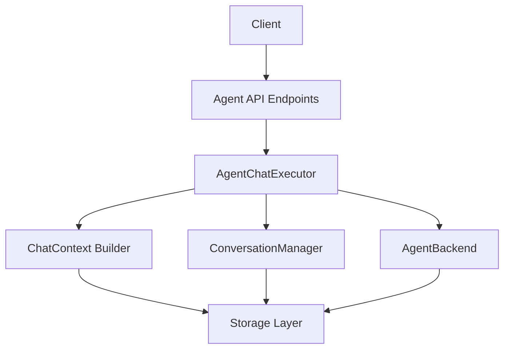
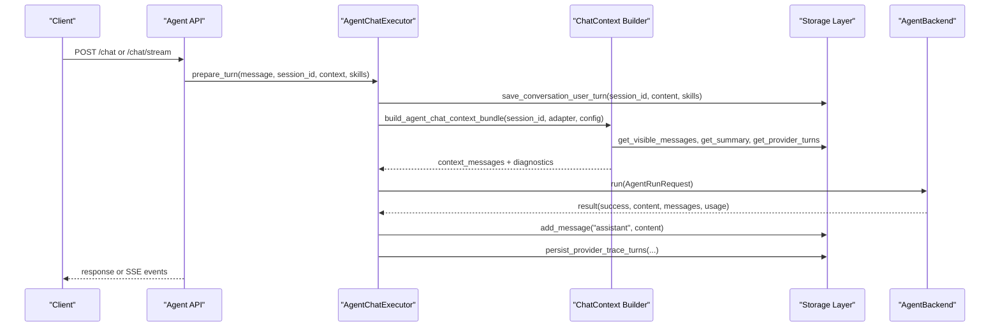
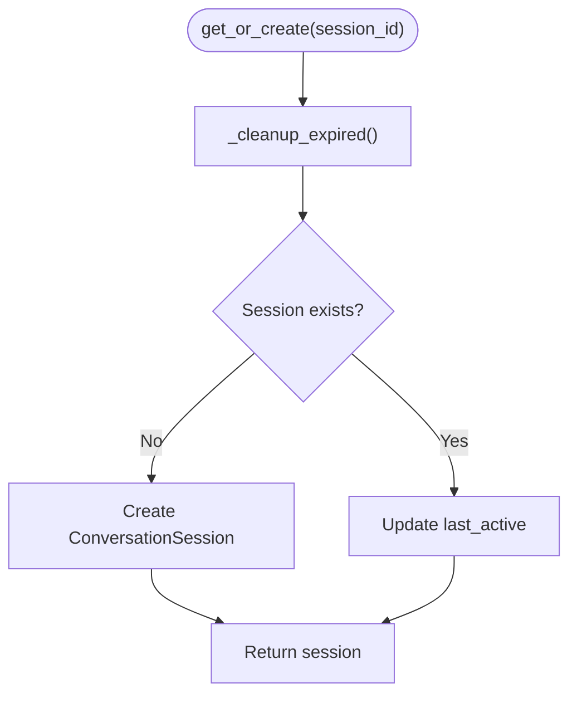
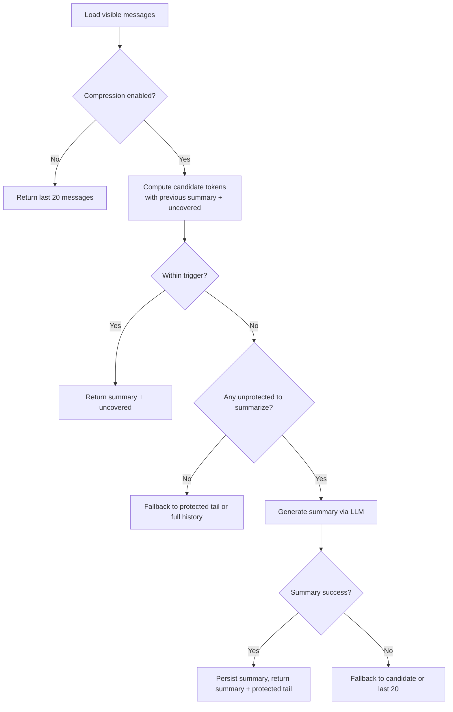
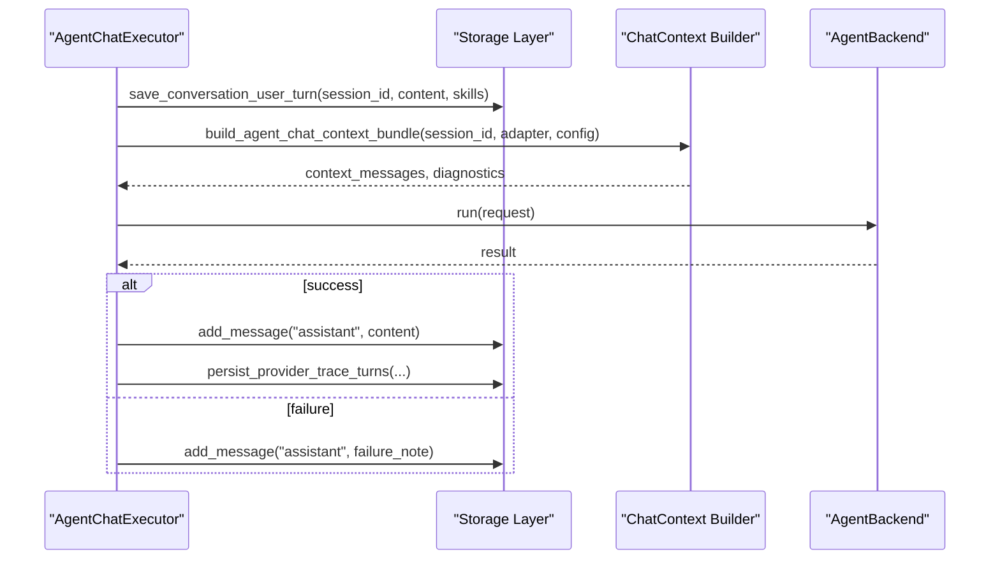
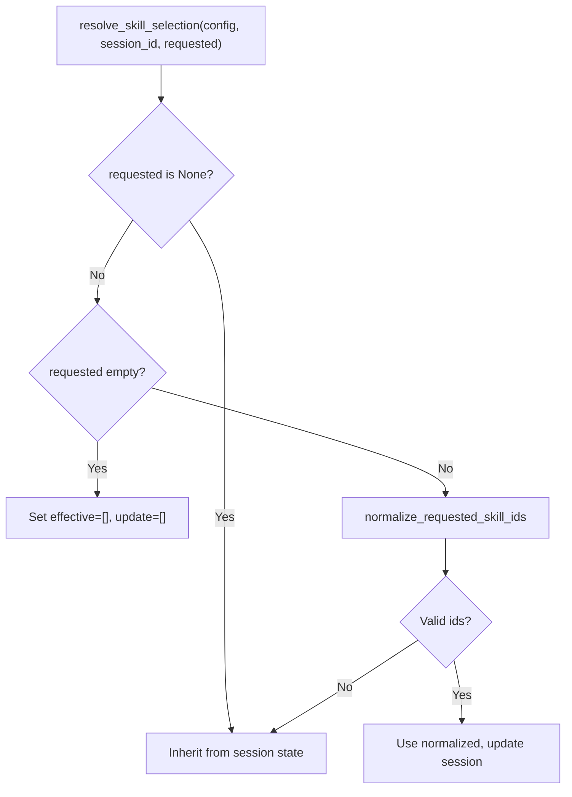
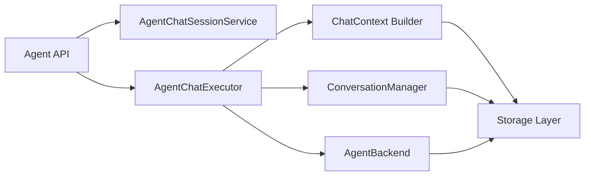

# Conversation Management

<cite>
**Referenced Files in This Document**
- [conversation.py](file://src/agent/conversation.py)
- [chat_context.py](file://src/agent/chat_context.py)
- [memory.py](file://src/agent/memory.py)
- [agent_chat_session_service.py](file://src/services/agent_chat_session_service.py)
- [chat_executor.py](file://src/agent/chat_executor.py)
- [storage.py](file://src/storage.py)
- [agent.py](file://api/v1/endpoints/agent.py)
- [test_conversation_manager.py](file://tests/test_conversation_manager.py)
- [test_chat_context.py](file://tests/test_chat_context.py)
- [test_agent_chat_session_service.py](file://tests/test_agent_chat_session_service.py)
</cite>

## Table of Contents
1. [Introduction](#introduction)
2. [Project Structure](#project-structure)
3. [Core Components](#core-components)
4. [Architecture Overview](#architecture-overview)
5. [Detailed Component Analysis](#detailed-component-analysis)
6. [Dependency Analysis](#dependency-analysis)
7. [Performance Considerations](#performance-considerations)
8. [Troubleshooting Guide](#troubleshooting-guide)
9. [Conclusion](#conclusion)
10. [Appendices](#appendices)

## Introduction
This document explains the Conversation Management system that powers multi-agent chat sessions with persistent history, context building for agent inputs, and memory strategies for long-running conversations. It covers session lifecycle management, message history tracking, conversation compression and summarization, provider trace injection for tool-call roundtrips, skill selection persistence, and cleanup procedures. It also provides examples for implementing conversational AI features, managing state across multiple agents, and optimizing memory usage.

## Project Structure
The conversation system spans several modules:
- Session and message persistence: storage layer and in-memory session manager
- Context builder: constructs visible history and optional summaries
- Executor: orchestrates preparation, execution, and persistence of turns
- Service: resolves per-session skill selections and exposes session queries
- API endpoints: expose chat, streaming chat, session listing, and deletion

**Diagram sources**
- [agent.py:197-321](file://api/v1/endpoints/agent.py#L197-L321)
- [chat_executor.py:52-178](file://src/agent/chat_executor.py#L52-L178)
- [conversation.py:56-120](file://src/agent/conversation.py#L56-L120)
- [chat_context.py:120-364](file://src/agent/chat_context.py#L120-L364)
- [storage.py:724-785](file://src/storage.py#L724-L785)

**Section sources**
- [agent.py:197-321](file://api/v1/endpoints/agent.py#L197-L321)
- [chat_executor.py:52-178](file://src/agent/chat_executor.py#L52-L178)
- [conversation.py:56-120](file://src/agent/conversation.py#L56-L120)
- [chat_context.py:120-364](file://src/agent/chat_context.py#L120-L364)
- [storage.py:724-785](file://src/storage.py#L724-L785)

## Core Components
- ConversationManager: thread-safe in-memory session registry with TTL-based cleanup; delegates message writes to the database.
- ChatContext Builder: builds visible history for agent requests, optionally compresses older messages into a rolling summary, and injects provider traces when safe.
- AgentChatSessionService: resolves effective skill selections per session and exposes session listing/detail/delete operations.
- AgentChatExecutor: prepares a turn (context + persistence), executes via backend, and persists assistant responses and provider traces.
- Storage Layer: defines tables for conversation messages, session states, summaries, and provider turns; implements query and write methods used by all components.

**Section sources**
- [conversation.py:18-120](file://src/agent/conversation.py#L18-L120)
- [chat_context.py:49-364](file://src/agent/chat_context.py#L49-L364)
- [agent_chat_session_service.py:29-93](file://src/services/agent_chat_session_service.py#L29-L93)
- [chat_executor.py:16-178](file://src/agent/chat_executor.py#L16-L178)
- [storage.py:724-785](file://src/storage.py#L724-L785)

## Architecture Overview
The end-to-end flow for a chat request:
1. API endpoint receives a chat request, selects backend, and resolves skill selection from session state.
2. Executor prepares a turn: builds context via the chat context builder, persists user message and selected skills atomically.
3. Backend runs the agent pipeline and returns results.
4. On success, executor persists assistant content and provider traces; on failure, it records a failure note.
5. The context builder may generate or update a rolling summary to keep token budgets manageable.

**Diagram sources**
- [agent.py:197-321](file://api/v1/endpoints/agent.py#L197-L321)
- [agent.py:476-660](file://api/v1/endpoints/agent.py#L476-L660)
- [chat_executor.py:52-178](file://src/agent/chat_executor.py#L52-L178)
- [chat_context.py:137-225](file://src/agent/chat_context.py#L137-L225)
- [storage.py:724-785](file://src/storage.py#L724-L785)

## Detailed Component Analysis

### Conversation Manager and Session Lifecycle
- In-memory sessions are keyed by session_id with last_active timestamps.
- TTL cleanup removes expired sessions on access.
- Message persistence is delegated to the database; user turns include optional skill selection updates.
- Thread safety is ensured via a reentrant lock around session creation and cleanup.

**Diagram sources**
- [conversation.py:64-76](file://src/agent/conversation.py#L64-L76)
- [conversation.py:107-117](file://src/agent/conversation.py#L107-L117)

**Section sources**
- [conversation.py:18-120](file://src/agent/conversation.py#L18-L120)
- [test_conversation_manager.py:11-55](file://tests/test_conversation_manager.py#L11-L55)

### Chat Context Builder: Visible History and Compression
- Loads visible messages (user/assistant) and determines whether to use raw recent history or a rolling summary.
- Protected tail preserves the most recent N user turns to maintain conversational continuity.
- When token budget exceeds trigger, an LLM call summarizes uncovered messages; the summary is persisted with covered_message_id to enable incremental updates.
- Provider traces (reasoning, tool calls) are spliced into the visible history only when model/provider matches current configuration and anchor messages remain visible.

**Diagram sources**
- [chat_context.py:228-364](file://src/agent/chat_context.py#L228-L364)
- [chat_context.py:103-117](file://src/agent/chat_context.py#L103-L117)
- [chat_context.py:367-403](file://src/agent/chat_context.py#L367-L403)

**Section sources**
- [chat_context.py:49-364](file://src/agent/chat_context.py#L49-L364)
- [test_chat_context.py:59-732](file://tests/test_chat_context.py#L59-L732)

### Agent Chat Executor: Turn Preparation and Persistence
- prepare_turn ensures session existence, builds context bundle, and persists the user message along with skill selection changes.
- execute_turn runs the backend, then persists assistant output and provider traces on success; records a failure note on error.
- Baseline length tracks initial message count to correctly associate provider traces with the right assistant message.

**Diagram sources**
- [chat_executor.py:73-178](file://src/agent/chat_executor.py#L73-L178)

**Section sources**
- [chat_executor.py:16-178](file://src/agent/chat_executor.py#L16-L178)

### Session State Service: Skill Selection and Session Queries
- Resolves effective skill_ids per request: inherit from session if none provided, clear if empty list, normalize and persist if explicit.
- Exposes listing sessions, retrieving session detail (messages + selected skills), and deleting sessions.

**Diagram sources**
- [agent_chat_session_service.py:35-65](file://src/services/agent_chat_session_service.py#L35-L65)

**Section sources**
- [agent_chat_session_service.py:29-93](file://src/services/agent_chat_session_service.py#L29-L93)
- [test_agent_chat_session_service.py:11-116](file://tests/test_agent_chat_session_service.py#L11-L116)

### Storage Layer: Conversation Tables and Methods
- conversation_messages: stores role/content per session with timestamps.
- conversation_session_states: persists selected_skill_ids_json per session.
- conversation_summaries: rolling summaries with covered_message_id and estimated_tokens.
- agent_provider_turns: stores provider protocol traces for reasoning/tool-call roundtrip injection.
- Methods support saving user turns, reading visible messages, listing sessions, and deleting sessions.

**Section sources**
- [storage.py:724-785](file://src/storage.py#L724-L785)
- [storage.py:4009-4041](file://src/storage.py#L4009-L4041)

### Memory System: Structured Learning and Calibration
- AgentMemory provides analysis history retrieval, confidence calibration based on historical accuracy, and skill performance metrics.
- Features are gated by configuration; when disabled, neutral defaults are returned.
- Used to inform agent behavior beyond immediate conversation context.

**Section sources**
- [memory.py:1-313](file://src/agent/memory.py#L1-L313)

## Dependency Analysis
- API endpoints depend on AgentChatSessionService and build_agent_chat_executor, which internally uses ConversationManager and ChatContext Builder.
- ChatContext Builder depends on Storage Layer for messages, summaries, and provider turns; integrates with LLM adapter for summarization and usage telemetry.
- AgentChatExecutor depends on ConversationManager for persistence and on AgentBackend for execution.
- Storage Layer is central and shared across components.

**Diagram sources**
- [agent.py:197-321](file://api/v1/endpoints/agent.py#L197-L321)
- [chat_executor.py:52-178](file://src/agent/chat_executor.py#L52-L178)
- [chat_context.py:137-225](file://src/agent/chat_context.py#L137-L225)
- [storage.py:724-785](file://src/storage.py#L724-L785)

**Section sources**
- [agent.py:197-321](file://api/v1/endpoints/agent.py#L197-L321)
- [chat_executor.py:52-178](file://src/agent/chat_executor.py#L52-L178)
- [chat_context.py:137-225](file://src/agent/chat_context.py#L137-L225)
- [storage.py:724-785](file://src/storage.py#L724-L785)

## Performance Considerations
- Token-aware compression: Uses configurable trigger thresholds and protected turns to balance context richness with token limits.
- Summary fallback: If summarization fails or is disabled, falls back to recent messages to avoid blocking.
- Provider trace injection: Only included when model/provider matches current configuration and within budget; otherwise dropped to prevent context bloat.
- TTL cleanup: In-memory sessions are pruned to free resources; database retains history for recovery.
- Streaming endpoints: Offload blocking work to threads and manage timeouts to keep API responsive.

[No sources needed since this section provides general guidance]

## Troubleshooting Guide
- Missing or invalid skill selection: Ensure normalize_requested_skill_ids returns valid ids; otherwise session state is inherited without clearing.
- Summarization failures: Logs warnings and falls back to candidate or recent messages; check LLM adapter and timeout settings.
- Provider trace not injected: Verify model/provider match and anchor visibility; check diagnostics fields for reasons like model_mismatch or budget_exceeded.
- Session not found: Confirm session_id consistency across client and server; use session listing to verify active sessions.
- Long-running conversations: Adjust agent_context_compression_trigger_tokens and agent_context_protected_turns to control context size and protection.

**Section sources**
- [test_chat_context.py:124-237](file://tests/test_chat_context.py#L124-L237)
- [test_agent_chat_session_service.py:11-116](file://tests/test_agent_chat_session_service.py#L11-L116)
- [chat_context.py:294-364](file://src/agent/chat_context.py#L294-L364)

## Conclusion
The Conversation Management system provides robust session lifecycle handling, efficient context construction with compression and protection, and reliable persistence for multi-agent conversations. It supports provider trace injection for advanced tool-call workflows, skill selection persistence, and scalable memory strategies for long-running sessions. Proper configuration of compression triggers and protected turns ensures optimal performance and context quality.

[No sources needed since this section summarizes without analyzing specific files]

## Appendices

### Example: Implementing Conversational AI Features
- Use the chat endpoint to send messages and receive responses; leverage streaming for progress events.
- Manage sessions by passing session_id to maintain continuity across requests.
- Persist and retrieve session details to restore UI state.

**Section sources**
- [agent.py:197-321](file://api/v1/endpoints/agent.py#L197-L321)
- [agent.py:476-660](file://api/v1/endpoints/agent.py#L476-L660)

### Example: Managing Conversation State Across Multiple Agents
- Resolve skill selections per request to tailor agent behavior.
- Use provider traces to understand tool-call sequences and reasoning steps.
- Monitor diagnostics to detect mismatches or budget constraints affecting trace injection.

**Section sources**
- [agent_chat_session_service.py:35-65](file://src/services/agent_chat_session_service.py#L35-L65)
- [chat_context.py:137-225](file://src/agent/chat_context.py#L137-L225)

### Example: Optimizing Memory Usage for Long-Running Conversations
- Tune agent_context_compression_enabled, agent_context_compression_trigger_tokens, and agent_context_protected_turns.
- Leverage rolling summaries to reduce token usage while preserving key context.
- Monitor diagnostics to ensure summaries are generated and traces are injected appropriately.

**Section sources**
- [chat_context.py:228-364](file://src/agent/chat_context.py#L228-L364)
- [test_chat_context.py:468-732](file://tests/test_chat_context.py#L468-L732)