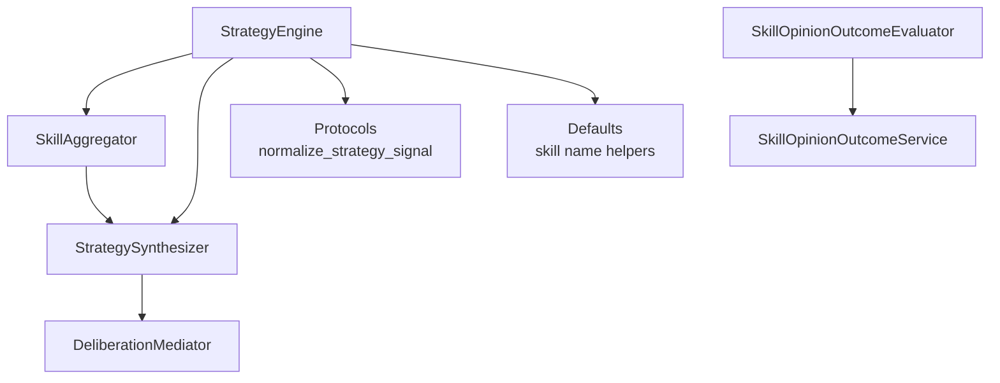
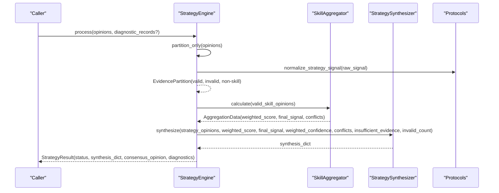
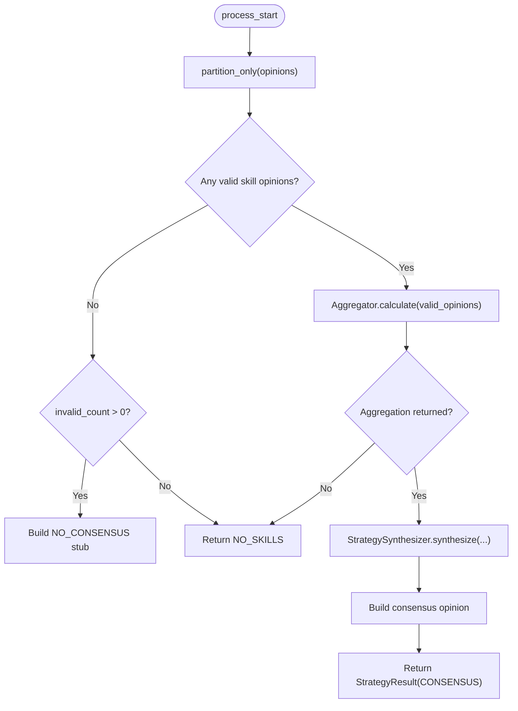
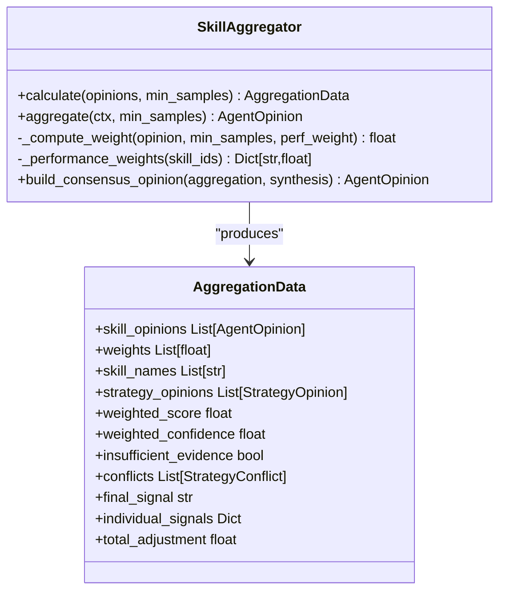
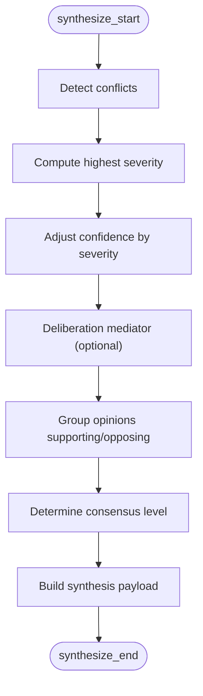
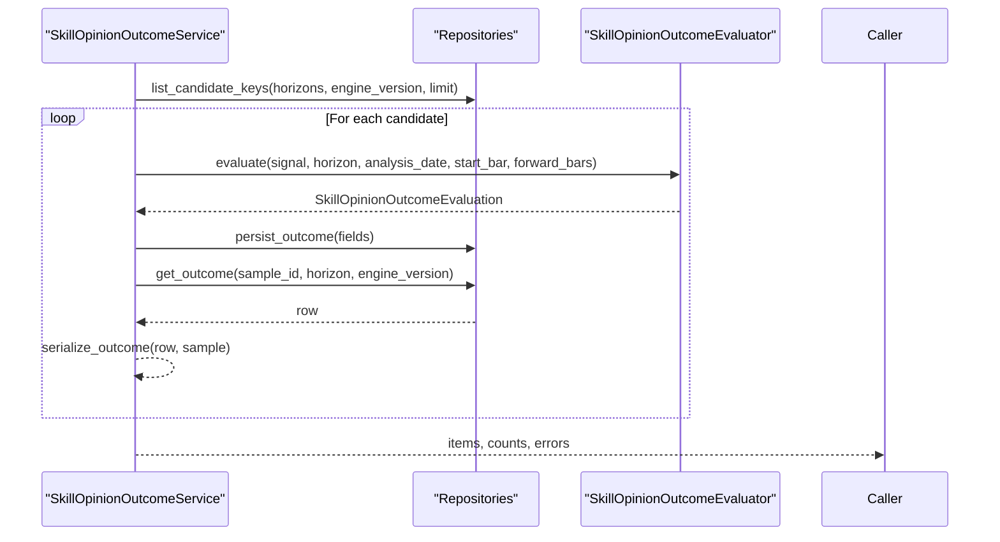
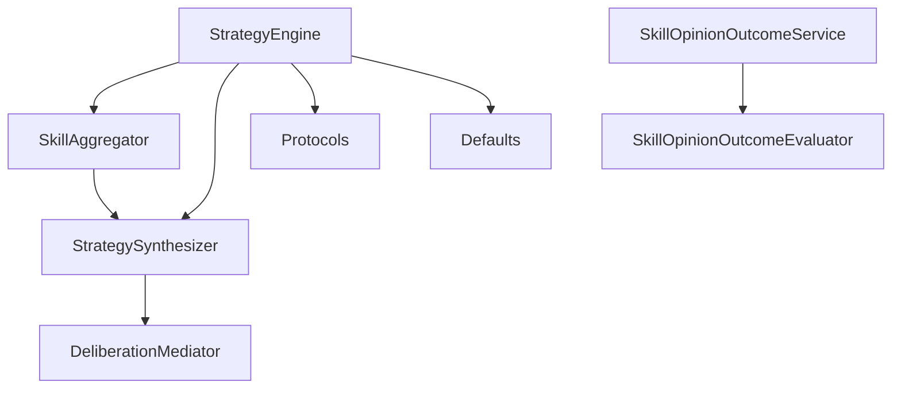

# Skill Engine

<cite>
**Referenced Files in This Document**
- [engine.py](file://src/agent/skills/engine.py)
- [aggregator.py](file://src/agent/skills/aggregator.py)
- [synthesis.py](file://src/agent/skills/synthesis.py)
- [protocols.py](file://src/agent/protocols.py)
- [defaults.py](file://src/agent/skills/defaults.py)
- [skill_opinion_outcome_evaluator.py](file://src/core/skill_opinion_outcome_evaluator.py)
- [skill_opinion_outcome_service.py](file://src/services/skill_opinion_outcome_service.py)
</cite>

## Table of Contents
1. [Introduction](#introduction)
2. [Project Structure](#project-structure)
3. [Core Components](#core-components)
4. [Architecture Overview](#architecture-overview)
5. [Detailed Component Analysis](#detailed-component-analysis)
6. [Dependency Analysis](#dependency-analysis)
7. [Performance Considerations](#performance-considerations)
8. [Troubleshooting Guide](#troubleshooting-guide)
9. [Conclusion](#conclusion)

## Introduction
The Skill Engine is the central orchestrator for multi-strategy analysis. It takes raw agent outputs (opinions), validates and normalizes them, partitions them into valid skill opinions and diagnostic records, aggregates weighted signals across skills, detects conflicts, synthesizes a consensus signal with confidence, and returns a complete evidence chain suitable for downstream decision-making and reporting.

Key responsibilities:
- Normalize and validate skill signals from diverse agents.
- Partition inputs into valid skill opinions and invalid/diagnostic records.
- Aggregate skill opinions using performance-aware weights.
- Detect deterministic conflicts among strategies.
- Synthesize a final consensus signal with explainable reasoning and confidence adjustments.
- Provide both end-to-end processing and pre-partitioned processing paths.

## Project Structure
The Skill Engine spans several modules that collaborate to form a robust pipeline:
- Entry facade: StrategyEngine coordinates partitioning, aggregation, synthesis, and result assembly.
- Aggregation: SkillAggregator computes weighted scores and final signals from validated skill opinions.
- Synthesis: StrategySynthesizer builds an explainable payload including conflict detection, consensus level, and optional deliberation projections.
- Protocols: Shared data structures and normalization utilities ensure consistent signal handling across components.
- Defaults: Common naming conventions and helpers for skill identification and filtering.
- Outcome evaluation: Deterministic forward-outcome evaluation for persisted skill opinions against historical bars.
- Outcome service: Orchestrates batch evaluation and persistence of outcomes for missing or pending keys.

**Diagram sources**
- [engine.py:54-217](file://src/agent/skills/engine.py#L54-L217)
- [aggregator.py:59-171](file://src/agent/skills/aggregator.py#L59-L171)
- [synthesis.py:203-276](file://src/agent/skills/synthesis.py#L203-L276)
- [protocols.py:56-101](file://src/agent/protocols.py#L56-L101)
- [defaults.py:21-24](file://src/agent/skills/defaults.py#L21-L24)
- [skill_opinion_outcome_evaluator.py:44-129](file://src/core/skill_opinion_outcome_evaluator.py#L44-L129)
- [skill_opinion_outcome_service.py:36-141](file://src/services/skill_opinion_outcome_service.py#L36-L141)

**Section sources**
- [engine.py:54-217](file://src/agent/skills/engine.py#L54-L217)
- [aggregator.py:59-171](file://src/agent/skills/aggregator.py#L59-L171)
- [synthesis.py:203-276](file://src/agent/skills/synthesis.py#L203-L276)
- [protocols.py:56-101](file://src/agent/protocols.py#L56-L101)
- [defaults.py:21-24](file://src/agent/skills/defaults.py#L21-L24)
- [skill_opinion_outcome_evaluator.py:44-129](file://src/core/skill_opinion_outcome_evaluator.py#L44-L129)
- [skill_opinion_outcome_service.py:36-141](file://src/services/skill_opinion_outcome_service.py#L36-L141)

## Core Components
- StrategyEngine: Facade that orchestrates the full pipeline from raw opinions to consolidated strategy signals.
- EvidencePartition: Holds valid skill opinions, non-skill opinions, evidence opinions, and invalid diagnostic records.
- StrategyResult: Final output containing status, synthesis payload, consensus opinion, and diagnostics.
- SkillAggregator: Computes weighted scores, final signals, and individual contributions; integrates outcome-based autoweighting when available.
- StrategySynthesizer: Builds explainable synthesis, detects conflicts, adjusts confidence, and determines consensus level.
- Protocols: Define AgentOpinion, StrategyOpinion, StrategyConflict, and normalize_strategy_signal used throughout the pipeline.
- Defaults: Provide skill naming conventions and helper functions to identify skill vs consensus agents.
- Outcome Evaluator and Service: Evaluate and persist forward outcomes for skill opinions over supported horizons.

**Section sources**
- [engine.py:32-52](file://src/agent/skills/engine.py#L32-L52)
- [engine.py:54-217](file://src/agent/skills/engine.py#L54-L217)
- [aggregator.py:44-57](file://src/agent/skills/aggregator.py#L44-L57)
- [aggregator.py:59-171](file://src/agent/skills/aggregator.py#L59-L171)
- [synthesis.py:81-201](file://src/agent/skills/synthesis.py#L81-L201)
- [synthesis.py:203-276](file://src/agent/skills/synthesis.py#L203-L276)
- [protocols.py:215-275](file://src/agent/protocols.py#L215-L275)
- [defaults.py:21-24](file://src/agent/skills/defaults.py#L21-L24)
- [skill_opinion_outcome_evaluator.py:44-129](file://src/core/skill_opinion_outcome_evaluator.py#L44-L129)
- [skill_opinion_outcome_service.py:36-141](file://src/services/skill_opinion_outcome_service.py#L36-L141)

## Architecture Overview
The Skill Engine implements a clear evidence chain:
1. Input: List of AgentOpinion objects from various agents/skills.
2. Partitioning: Separate valid skill opinions from non-skill and invalid records; normalize signals and preserve original values for diagnostics.
3. Aggregation: Compute weighted score and final signal based on skill opinions and optional performance weights.
4. Conflict Detection: Identify directional opposition, wide dispersion, high-confidence dissent, and adjustment contradictions.
5. Synthesis: Build consensus-level, confidence adjustments, supporting/opposing skill groups, and summary parameters.
6. Output: StrategyResult with status, synthesis_dict, consensus_opinion, and diagnostics.

**Diagram sources**
- [engine.py:134-217](file://src/agent/skills/engine.py#L134-L217)
- [aggregator.py:86-171](file://src/agent/skills/aggregator.py#L86-L171)
- [synthesis.py:212-276](file://src/agent/skills/synthesis.py#L212-L276)
- [protocols.py:56-88](file://src/agent/protocols.py#L56-L88)

## Detailed Component Analysis

### StrategyEngine: End-to-End Orchestration
Responsibilities:
- partition_only: Validates and normalizes signals, separates valid skill opinions from non-skill and invalid records, and logs diagnostics.
- process: Combines partitioning with optional pre-existing diagnostics and delegates to process_partition.
- process_partition: Handles no-valid-opinions cases, performs aggregation, synthesis, and constructs consensus opinion and result.

Signal validation and normalization:
- Uses normalize_strategy_signal to map aliases to canonical labels and mark invalid signals.
- Records reasons like missing_signal or unrecognized_signal for invalid entries.
- Normalizes raw_data to include original_signal and normalized_signal for traceability.

Consensus building:
- Aggregates weighted scores and final signals via SkillAggregator.
- Synthesizes explanation, confidence adjustments, conflict severity, and consensus level.
- Produces a consensus AgentOpinion with detailed reasoning and metadata.

Error handling:
- When no valid skill opinions exist but there are invalid records, returns NO_CONSENSUS with a stub synthesis indicating insufficient evidence.
- When no skill opinions exist at all, returns NO_SKILLS without synthesis.

**Diagram sources**
- [engine.py:60-132](file://src/agent/skills/engine.py#L60-L132)
- [engine.py:134-217](file://src/agent/skills/engine.py#L134-L217)

**Section sources**
- [engine.py:60-132](file://src/agent/skills/engine.py#L60-L132)
- [engine.py:134-217](file://src/agent/skills/engine.py#L134-L217)
- [engine.py:219-271](file://src/agent/skills/engine.py#L219-L271)

### SkillAggregator: Weighted Aggregation and Final Signal
Responsibilities:
- Filter skill opinions by agent name prefix and extract skill IDs.
- Compute per-skill weights using confidence and optional performance-based factors.
- Convert AgentOpinions to StrategyOpinions and compute weighted score/confidence.
- Determine final signal from thresholds and detect conflicts.
- Build consensus opinion with reasoning and metadata.

Autoweight integration:
- Optionally uses SkillOpinionWeightService to adjust weights based on past outcomes.
- Falls back to neutral weights if configuration or computation fails.

**Diagram sources**
- [aggregator.py:44-57](file://src/agent/skills/aggregator.py#L44-L57)
- [aggregator.py:59-171](file://src/agent/skills/aggregator.py#L59-L171)
- [aggregator.py:173-203](file://src/agent/skills/aggregator.py#L173-L203)
- [aggregator.py:205-266](file://src/agent/skills/aggregator.py#L205-L266)

**Section sources**
- [aggregator.py:86-171](file://src/agent/skills/aggregator.py#L86-L171)
- [aggregator.py:173-203](file://src/agent/skills/aggregator.py#L173-L203)
- [aggregator.py:205-266](file://src/agent/skills/aggregator.py#L205-L266)

### StrategySynthesizer: Conflict Detection and Consensus Level
Responsibilities:
- Detect conflicts: directional opposition, wide score dispersion, high-confidence dissent, adjustment contradiction.
- Adjust confidence based on conflict severity and optional deliberation mediation.
- Group opinions into supporting/opposing relative to final signal.
- Determine consensus level according to rules (insufficient, low, medium, high).
- Build synthesis payload with summary parameters and optional revision projection.

**Diagram sources**
- [synthesis.py:81-201](file://src/agent/skills/synthesis.py#L81-L201)
- [synthesis.py:212-276](file://src/agent/skills/synthesis.py#L212-L276)
- [synthesis.py:278-377](file://src/agent/skills/synthesis.py#L278-L377)

**Section sources**
- [synthesis.py:81-201](file://src/agent/skills/synthesis.py#L81-L201)
- [synthesis.py:212-276](file://src/agent/skills/synthesis.py#L212-L276)
- [synthesis.py:278-377](file://src/agent/skills/synthesis.py#L278-L377)

### Protocols and Defaults: Signal Normalization and Naming
- normalize_strategy_signal: Maps aliases to canonical labels and flags invalid inputs.
- is_valid_strategy_signal: Single source of truth for validity checks.
- strategy_signal_score: Numeric mapping for signals used in aggregation and synthesis.
- Defaults: Provide SKILL_AGENT_PREFIX, consensus names, and helpers to identify skill agents and extract skill IDs.

Examples of normalization behavior:
- Aliases like "strong buy", "neutral", "strong-sell" are mapped to canonical labels.
- None or unrecognized signals are marked invalid and fall back to default.

**Section sources**
- [protocols.py:56-101](file://src/agent/protocols.py#L56-L101)
- [defaults.py:21-24](file://src/agent/skills/defaults.py#L21-L24)
- [defaults.py:298-317](file://src/agent/skills/defaults.py#L298-L317)

### Outcome Evaluation: Forward Outcomes for Skill Opinions
- SkillOpinionOutcomeEvaluator: Evaluates one skill signal against stored daily bars for supported horizons (1d, 3d, 5d, 10d).
- Returns eval_status (evaluated, pending, unable), direction correctness, and return metrics.
- SkillOpinionOutcomeService: Orchestrates batch evaluation and persistence, handles retries, and serializes results.

**Diagram sources**
- [skill_opinion_outcome_service.py:49-141](file://src/services/skill_opinion_outcome_service.py#L49-L141)
- [skill_opinion_outcome_evaluator.py:47-129](file://src/core/skill_opinion_outcome_evaluator.py#L47-L129)

**Section sources**
- [skill_opinion_outcome_evaluator.py:44-129](file://src/core/skill_opinion_outcome_evaluator.py#L44-L129)
- [skill_opinion_outcome_service.py:36-141](file://src/services/skill_opinion_outcome_service.py#L36-L141)

## Dependency Analysis
- StrategyEngine depends on:
  - SkillAggregator for weighted aggregation and final signal determination.
  - StrategySynthesizer for conflict detection, consensus level, and synthesis payload.
  - Protocols for signal normalization and shared data structures.
  - Defaults for skill naming and filtering.
- SkillAggregator depends on:
  - StrategySynthesizer for conflict detection and synthesis.
  - SkillOpinionWeightService (optional) for outcome-based autoweighting.
- StrategySynthesizer depends on:
  - DeliberationMediator (optional) for softening responses and projecting revisions.
  - Protocols for StrategyOpinion and signal scoring.
- Outcome services depend on repositories and storage for candidate keys and persistence.

**Diagram sources**
- [engine.py:54-217](file://src/agent/skills/engine.py#L54-L217)
- [aggregator.py:59-171](file://src/agent/skills/aggregator.py#L59-L171)
- [synthesis.py:203-276](file://src/agent/skills/synthesis.py#L203-L276)
- [skill_opinion_outcome_service.py:36-141](file://src/services/skill_opinion_outcome_service.py#L36-L141)

**Section sources**
- [engine.py:54-217](file://src/agent/skills/engine.py#L54-L217)
- [aggregator.py:59-171](file://src/agent/skills/aggregator.py#L59-L171)
- [synthesis.py:203-276](file://src/agent/skills/synthesis.py#L203-L276)
- [skill_opinion_outcome_service.py:36-141](file://src/services/skill_opinion_outcome_service.py#L36-L141)

## Performance Considerations
- Partition-only path: Efficiently filters and validates opinions before aggregation; useful for pre-partitioned scenarios or testing.
- Aggregation complexity: Linear in number of skill opinions; weight computation and conflict detection scale with opinion count.
- Autoweighting: Optional outcome-based weights may add overhead; falls back gracefully on failure.
- Batch outcome evaluation: Limits processed keys and persists incrementally; handles transient failures and retries.
- Logging and diagnostics: Invalid records are captured with reasons for traceability without halting processing.

Recommendations:
- Use process_partition when upstream systems already partitioned opinions to avoid re-validation overhead.
- Tune min_samples and autoweight configuration based on available backtest history.
- Monitor invalid_record rates to improve skill outputs and reduce diagnostics noise.

[No sources needed since this section provides general guidance]

## Troubleshooting Guide
Common issues and resolutions:
- Missing signal: If raw_signal is None or empty, the opinion is moved to diagnostics with reason "missing_signal". Ensure skills produce explicit signals.
- Unrecognized signal: If normalize_strategy_signal cannot map input to canonical labels, record reason "unrecognized_signal". Update skill prompts or alias mappings.
- No valid skill opinions: If all opinions are invalid or non-skill, StrategyEngine returns NO_CONSENSUS or NO_SKILLS. Review skill activation and agent outputs.
- Insufficient evidence: Aggregation may return insufficient_evidence when valid_weight_sum <= 0; synthesis will set consensus_level to "insufficient". Increase valid opinions or confidence.
- High conflict severity: Confidence is adjusted downward; review conflicting skills and consider deliberation mediation to soften disagreements.
- Outcome evaluation failures: Pending or unable statuses indicate missing data or unsupported horizons; check stock window resolution and forward bars availability.

Diagnostic record management:
- Invalid records include agent_name, raw_signal, confidence, and reason for audit and improvement.
- Existing diagnostic_records can be prepended to partition.invalid_records for continuity.

**Section sources**
- [engine.py:60-132](file://src/agent/skills/engine.py#L60-L132)
- [engine.py:134-217](file://src/agent/skills/engine.py#L134-L217)
- [skill_opinion_outcome_service.py:105-141](file://src/services/skill_opinion_outcome_service.py#L105-L141)

## Conclusion
The Skill Engine provides a robust, extensible framework for multi-strategy analysis. It standardizes signal normalization, partitions and validates inputs, aggregates weighted opinions, detects conflicts, and synthesizes consensus signals with explainable reasoning. The inclusion of outcome evaluation and persistence enables continuous learning and performance tracking. By leveraging partition_only, process, and process_partition, teams can integrate skill pipelines flexibly while maintaining diagnostic transparency and performance scalability.

[No sources needed since this section summarizes without analyzing specific files]