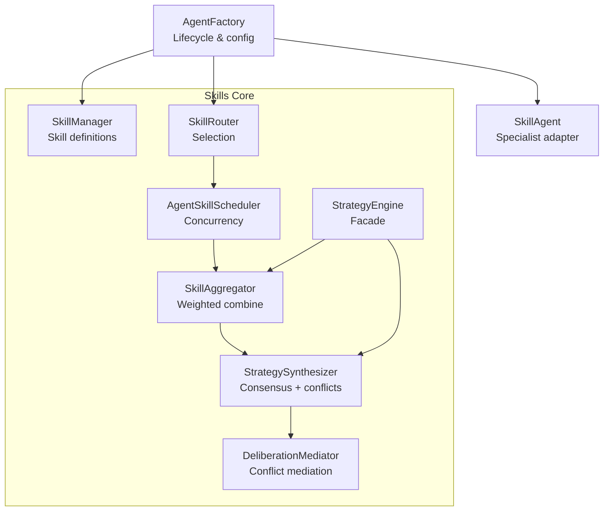
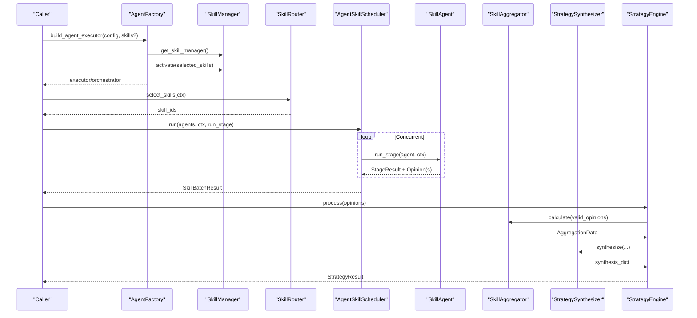
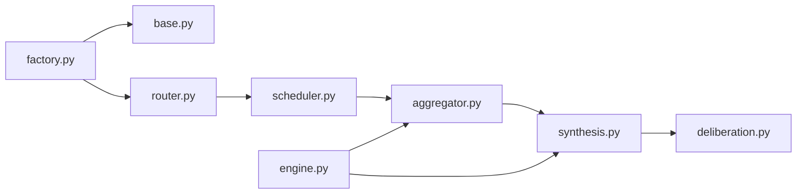

# Skills Framework

<cite>
**Referenced Files in This Document**
- [base.py](file://src/agent/skills/base.py)
- [engine.py](file://src/agent/skills/engine.py)
- [router.py](file://src/agent/skills/router.py)
- [scheduler.py](file://src/agent/skills/scheduler.py)
- [aggregator.py](file://src/agent/skills/aggregator.py)
- [skill_agent.py](file://src/agent/skills/skill_agent.py)
- [defaults.py](file://src/agent/skills/defaults.py)
- [synthesis.py](file://src/agent/skills/synthesis.py)
- [deliberation.py](file://src/agent/skills/deliberation.py)
- [factory.py](file://src/agent/factory.py)
</cite>

## Table of Contents
1. [Introduction](#introduction)
2. [Project Structure](#project-structure)
3. [Core Components](#core-components)
4. [Architecture Overview](#architecture-overview)
5. [Detailed Component Analysis](#detailed-component-analysis)
6. [Dependency Analysis](#dependency-analysis)
7. [Performance Considerations](#performance-considerations)
8. [Troubleshooting Guide](#troubleshooting-guide)
9. [Conclusion](#conclusion)
10. [Appendices](#appendices)

## Introduction
This document explains the Skills Framework that provides pluggable analysis capabilities to agents. It covers skill discovery, registration, routing, concurrent execution, and result aggregation. It also documents the skill engine that coordinates multiple skills, the scheduler for managing concurrency, and the aggregator that combines outputs into a consensus decision. You will find guidance on creating custom skills, configuring skill policies, optimizing performance, and handling errors.

## Project Structure
The Skills Framework is implemented under src/agent/skills with supporting modules in src/agent/factory for lifecycle and configuration wiring. Key responsibilities:
- Skill definition and loading from YAML or SKILL.md bundles
- Skill manager for registration and activation
- Router for selecting applicable skills based on context and policy
- Scheduler for concurrent execution of specialist skill agents
- Aggregator for weighted opinion combination
- Synthesizer and deliberation for conflict-aware consensus building
- Engine as the facade orchestrating partitioning, aggregation, and synthesis

**Diagram sources**
- [base.py:315-482](file://src/agent/skills/base.py#L315-L482)
- [router.py:25-165](file://src/agent/skills/router.py#L25-L165)
- [scheduler.py:29-177](file://src/agent/skills/scheduler.py#L29-L177)
- [aggregator.py:59-270](file://src/agent/skills/aggregator.py#L59-L270)
- [synthesis.py:203-276](file://src/agent/skills/synthesis.py#L203-L276)
- [deliberation.py:89-146](file://src/agent/skills/deliberation.py#L89-L146)
- [engine.py:54-272](file://src/agent/skills/engine.py#L54-L272)
- [factory.py:452-548](file://src/agent/factory.py#L452-L548)

**Section sources**
- [base.py:1-482](file://src/agent/skills/base.py#L1-L482)
- [factory.py:1-716](file://src/agent/factory.py#L1-L716)

## Core Components
- Skill and SkillManager: Define and manage skills loaded from YAML or SKILL.md bundles; support activation and instruction generation.
- SkillRouter: Selects which skills to run based on user request, market regime detection, or defaults.
- AgentSkillScheduler: Runs selected skill agents concurrently with isolation and timeouts.
- SkillAggregator: Computes weighted scores and confidence across skill opinions; maps to final signal.
- StrategySynthesizer and DeliberationMediator: Build explainable consensus, detect conflicts, and optionally mediate disagreements.
- StrategyEngine: Facade that partitions opinions, delegates to aggregator and synthesizer, and returns a unified result.
- SkillAgent: Specialist agent adapter that loads a skill’s instructions and produces structured opinions.
- AgentFactory: Builds SkillManager instances, resolves active skills, and wires components into executors/orchestrators.

**Section sources**
- [base.py:26-482](file://src/agent/skills/base.py#L26-L482)
- [router.py:25-165](file://src/agent/skills/router.py#L25-L165)
- [scheduler.py:29-177](file://src/agent/skills/scheduler.py#L29-L177)
- [aggregator.py:59-270](file://src/agent/skills/aggregator.py#L59-L270)
- [synthesis.py:203-276](file://src/agent/skills/synthesis.py#L203-L276)
- [deliberation.py:89-146](file://src/agent/skills/deliberation.py#L89-L146)
- [engine.py:54-272](file://src/agent/skills/engine.py#L54-L272)
- [skill_agent.py:25-133](file://src/agent/skills/skill_agent.py#L25-L133)
- [factory.py:452-548](file://src/agent/factory.py#L452-L548)

## Architecture Overview
The framework follows a pipeline:
1. Discovery and Registration: SkillManager loads built-in and custom skills from strategies directory and optional custom directory.
2. Routing: SkillRouter selects a subset of skills per request using explicit selection, regime detection, or defaults.
3. Execution: AgentSkillScheduler runs selected skill agents concurrently with isolated contexts and optional timeouts.
4. Aggregation: SkillAggregator computes weighted scores and confidence, identifies conflicts, and determines a final signal.
5. Synthesis and Deliberation: StrategySynthesizer builds an explainable consensus payload; DeliberationMediator can refine outcomes when conflicts arise.
6. Facade: StrategyEngine coordinates partitioning, aggregation, and synthesis, returning a unified result.

**Diagram sources**
- [factory.py:452-548](file://src/agent/factory.py#L452-L548)
- [router.py:25-165](file://src/agent/skills/router.py#L25-L165)
- [scheduler.py:36-112](file://src/agent/skills/scheduler.py#L36-L112)
- [skill_agent.py:56-129](file://src/agent/skills/skill_agent.py#L56-L129)
- [aggregator.py:86-171](file://src/agent/skills/aggregator.py#L86-L171)
- [synthesis.py:212-276](file://src/agent/skills/synthesis.py#L212-L276)
- [engine.py:134-217](file://src/agent/skills/engine.py#L134-L217)

## Detailed Component Analysis

### Skill Definition and Management
- Skill dataclass captures metadata such as name, display_name, description, instructions, category, required_tools, allowed_tools, aliases, and flags controlling activation and invocation behavior.
- SkillManager supports:
  - Loading built-in skills from the strategies directory
  - Loading custom skills from a configurable directory (overrides built-ins by name)
  - Programmatic registration
  - Activation of specific skills and generating combined prompt instructions grouped by category
  - Tool requirement extraction for active skills

Key behaviors:
- YAML and SKILL.md bundle parsing with frontmatter normalization
- Safe coercion of list and boolean fields
- Logging of load and activation events

**Section sources**
- [base.py:26-80](file://src/agent/skills/base.py#L26-L80)
- [base.py:118-202](file://src/agent/skills/base.py#L118-L202)
- [base.py:205-312](file://src/agent/skills/base.py#L205-L312)
- [base.py:315-482](file://src/agent/skills/base.py#L315-L482)

### Skill Discovery and Registration
- Built-in skills are discovered from the strategies directory; custom skills can be added via a configured directory.
- The factory caches a SkillManager prototype and returns deep copies per request to avoid shared mutable state while minimizing disk I/O.
- Unknown requested skill IDs are ignored with warnings; fallback to defaults occurs if no valid skills remain after validation.

Configuration hooks:
- agent_skill_dir controls custom skill directory
- agent_skills allows explicit skill selection at runtime or via config
- Defaults and regime-based selection are centralized in defaults module

**Section sources**
- [factory.py:452-491](file://src/agent/factory.py#L452-L491)
- [factory.py:112-196](file://src/agent/factory.py#L112-L196)
- [defaults.py:92-139](file://src/agent/skills/defaults.py#L92-L139)
- [defaults.py:198-295](file://src/agent/skills/defaults.py#L198-L295)

### Routing Mechanisms
SkillRouter selects skills in this order:
1. User-explicit request (highest priority)
2. Market regime detection from technical opinions (e.g., trending_up, sideways, volatile)
3. Manual mode from configuration
4. Default fallback derived from skill catalog and default_router/default_active flags

Regime detection uses technical agent output fields like ma_alignment, trend_score, volume_status, and sector_hot flag.

**Section sources**
- [router.py:25-165](file://src/agent/skills/router.py#L25-L165)
- [defaults.py:214-267](file://src/agent/skills/defaults.py#L214-L267)

### Concurrent Execution and Isolation
AgentSkillScheduler executes selected skill agents concurrently using a thread pool with bounded workers. For each agent:
- A cloned AgentContext is used to prevent cross-agent mutation
- Optional timeout per skill is enforced
- Results are collected in original order
- Failures produce diagnostic invalid records with reasons like skill_timeout or skill_error

Concurrency characteristics:
- max_concurrency clamped between 1 and 4
- Progress callbacks supported
- Executor shutdown ensures cleanup even on exceptions

**Section sources**
- [scheduler.py:29-177](file://src/agent/skills/scheduler.py#L29-L177)

### Aggregation and Consensus
SkillAggregator:
- Filters skill-specific opinions and computes weights combining confidence and optional outcome-based performance weights
- Calculates weighted score and confidence over valid signals
- Maps weighted score to final signal using thresholds
- Detects conflicts among strategy opinions
- Produces individual signal metadata for transparency

StrategySynthesizer:
- Adjusts confidence based on conflict severity
- Groups opinions into supporting/opposing relative to final signal
- Determines consensus level (insufficient/low/medium/high)
- Optionally integrates deliberation results to refine confidence and provide revision projections

DeliberationMediator:
- Identifies material conflicts (directional opposition, wide dispersion, high-confidence dissent, adjustment contradiction)
- Generates deterministic one-round mediation with softened revisions where appropriate
- Provides schema-guarded LLM-mediated variants with robust fallbacks

**Section sources**
- [aggregator.py:59-270](file://src/agent/skills/aggregator.py#L59-L270)
- [synthesis.py:81-276](file://src/agent/skills/synthesis.py#L81-L276)
- [synthesis.py:278-440](file://src/agent/skills/synthesis.py#L278-L440)
- [deliberation.py:89-281](file://src/agent/skills/deliberation.py#L89-L281)
- [deliberation.py:284-781](file://src/agent/skills/deliberation.py#L284-L781)

### Skill Engine Facade
StrategyEngine:
- Partitions raw opinions into valid skill opinions, non-skill opinions, and invalid records
- Normalizes signals and tracks original vs normalized values
- Delegates to SkillAggregator and StrategySynthesizer
- Returns a comprehensive StrategyResult including status, synthesis, consensus opinion, and diagnostics

Error handling:
- Missing or unrecognized signals move to diagnostics
- No valid skill opinions yields NO_CONSENSUS or NO_SKILLS status with stub payloads

**Section sources**
- [engine.py:32-52](file://src/agent/skills/engine.py#L32-L52)
- [engine.py:60-132](file://src/agent/skills/engine.py#L60-L132)
- [engine.py:134-217](file://src/agent/skills/engine.py#L134-L217)
- [engine.py:219-272](file://src/agent/skills/engine.py#L219-L272)

### Skill Agent Adapter
SkillAgent:
- Loads a skill by ID from SkillManager
- Builds system prompts injecting skill instructions and task details
- Parses JSON responses into AgentOpinion with strict confidence validation
- Supports tool requirements declared by skills

Usage pattern:
- Orchestrator or executor constructs SkillAgent instances for selected skills
- Scheduler invokes run_stage for each agent concurrently

**Section sources**
- [skill_agent.py:25-133](file://src/agent/skills/skill_agent.py#L25-L133)

### Configuration and Policies
- Default trading and technical skill policies are provided for implicit runs; they can be suppressed when explicit skill selection is used
- Policy strings guide risk control and entry rhythm expectations
- Factory resolves active skills and injects policies into executors/orchestrators

**Section sources**
- [defaults.py:26-90](file://src/agent/skills/defaults.py#L26-L90)
- [factory.py:494-548](file://src/agent/factory.py#L494-L548)

## Dependency Analysis
High-level dependencies:
- SkillManager depends on YAML/SKILL.md loaders and directories
- SkillRouter depends on AgentContext and defaults for regime mapping
- AgentSkillScheduler depends on protocols and ThreadPoolExecutor
- SkillAggregator depends on protocols, defaults, and weight service
- StrategySynthesizer depends on protocols and deliberation mediators
- StrategyEngine composes aggregator and synthesizer
- AgentFactory wires SkillManager, router, and executors, caching prototypes and deep-copying per request

Potential coupling points:
- Router reads technical agent outputs; changes there affect regime detection
- Aggregator relies on outcome autoweight service; failures degrade gracefully to neutral weights
- Synthesizer’s conflict detection rules influence consensus levels and confidence adjustments

**Diagram sources**
- [base.py:315-482](file://src/agent/skills/base.py#L315-L482)
- [router.py:25-165](file://src/agent/skills/router.py#L25-L165)
- [scheduler.py:29-177](file://src/agent/skills/scheduler.py#L29-L177)
- [aggregator.py:59-270](file://src/agent/skills/aggregator.py#L59-L270)
- [synthesis.py:203-276](file://src/agent/skills/synthesis.py#L203-L276)
- [deliberation.py:89-146](file://src/agent/skills/deliberation.py#L89-L146)
- [engine.py:54-272](file://src/agent/skills/engine.py#L54-L272)
- [factory.py:452-548](file://src/agent/factory.py#L452-L548)

**Section sources**
- [factory.py:1-716](file://src/agent/factory.py#L1-L716)

## Performance Considerations
- Caching: SkillManager prototype is cached and deep-copied per request to avoid repeated disk reads.
- Concurrency: Scheduler limits worker count and isolates contexts to prevent contention.
- Timeouts: Per-skill timeouts prevent long-running tasks from blocking pipelines.
- Weight computation: Outcome-based autoweights are optional and guarded; failures fall back to neutral weights.
- Conflict impact: High-severity conflicts reduce confidence; consider tuning skill quality to minimize unnecessary conflicts.

[No sources needed since this section provides general guidance]

## Troubleshooting Guide
Common issues and resolutions:
- Unknown skill IDs: Ensure requested skills exist in the catalog; unknown IDs are ignored with warnings.
- Missing signals: Opinions without valid signals are moved to diagnostics; check skill outputs and parsers.
- Timeout errors: Increase timeout_per_skill or optimize skill logic; review network-bound tools.
- Conflicts and low consensus: Review conflicting skills’ criteria; adjust skill parameters or rely on deliberation to soften extreme positions.
- Custom skill load failures: Validate YAML/SKILL.md frontmatter and required fields; logs indicate parse errors.

Operational tips:
- Use explicit skill selection to isolate problematic skills during debugging
- Inspect invalid_records in StrategyResult for root causes
- Leverage regime-based routing to ensure relevant skills are selected

**Section sources**
- [engine.py:60-132](file://src/agent/skills/engine.py#L60-L132)
- [scheduler.py:114-154](file://src/agent/skills/scheduler.py#L114-L154)
- [base.py:140-202](file://src/agent/skills/base.py#L140-L202)
- [defaults.py:198-295](file://src/agent/skills/defaults.py#L198-L295)

## Conclusion
The Skills Framework provides a robust, extensible system for pluggable analysis capabilities. It separates concerns across discovery, routing, execution, aggregation, and synthesis, enabling flexible skill composition with strong error handling and performance safeguards. By leveraging default policies, regime-based routing, and deliberation, teams can maintain consistent risk controls while adapting to diverse market conditions.

[No sources needed since this section summarizes without analyzing specific files]

## Appendices

### Creating Custom Skills
- Add YAML files in the strategies directory or create SKILL.md bundles in a custom directory configured via agent_skill_dir
- Required fields include name, display_name, description, and instructions
- Optional fields allow specifying category, core_rules, required_tools, allowed_tools, aliases, and flags like disable_model_invocation, user_invocable, default_active, default_router, default_priority, market_regimes, execution_context, subagent_type, preferred_model
- Custom skills override built-ins by name

**Section sources**
- [base.py:140-202](file://src/agent/skills/base.py#L140-L202)
- [base.py:205-312](file://src/agent/skills/base.py#L205-L312)
- [factory.py:452-491](file://src/agent/factory.py#L452-L491)

### Configuring Skill Policies
- Default trading and technical skill policies are injected for implicit runs; explicit selections suppress legacy baselines
- Policies enforce risk controls and entry rhythms
- Configure via agent_skills and agent_skill_routing to control manual or automatic selection

**Section sources**
- [defaults.py:26-90](file://src/agent/skills/defaults.py#L26-L90)
- [factory.py:494-548](file://src/agent/factory.py#L494-L548)

### Optimizing Skill Performance
- Tune max_concurrency and timeout_per_skill in the scheduler
- Reduce tool calls within skills; leverage required_tools judiciously
- Use regime-based routing to limit irrelevant skills
- Monitor conflict severity and adjust skill criteria to improve consensus

**Section sources**
- [scheduler.py:29-112](file://src/agent/skills/scheduler.py#L29-L112)
- [synthesis.py:278-285](file://src/agent/skills/synthesis.py#L278-L285)