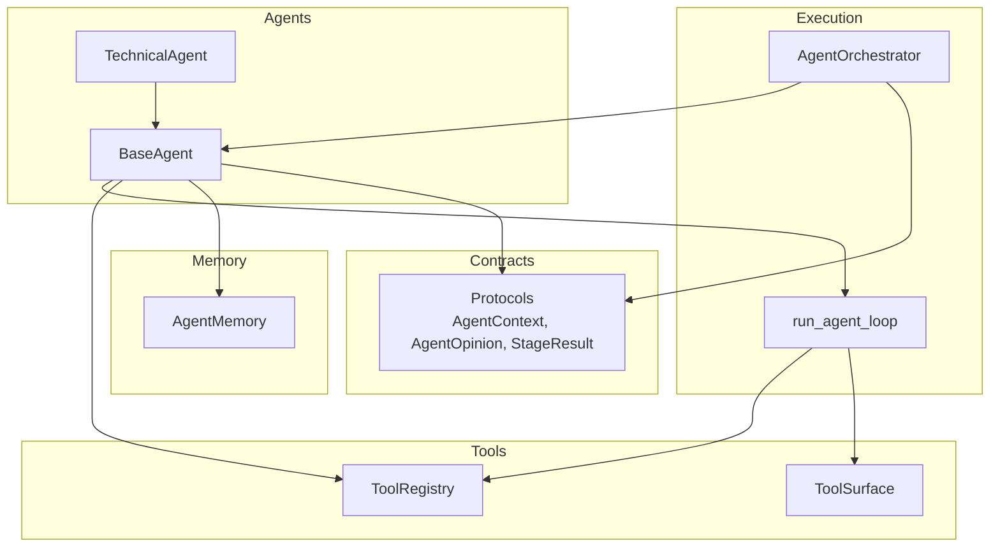
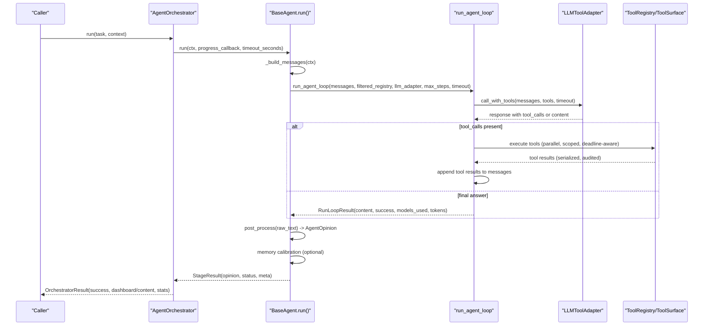
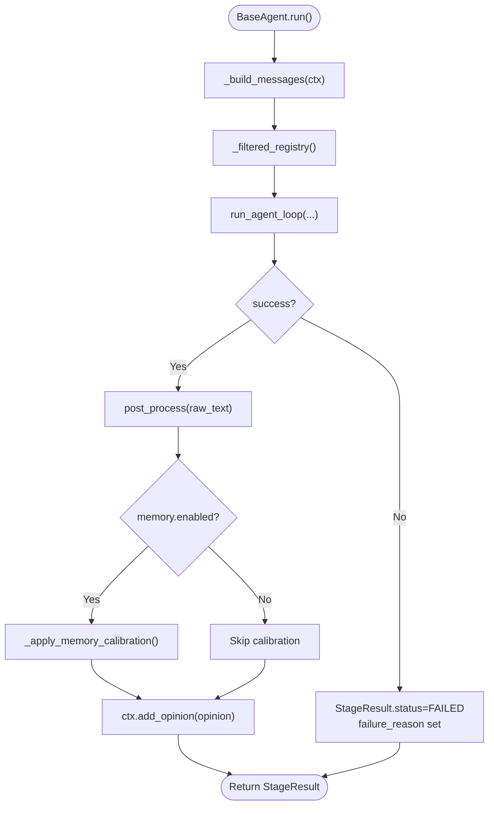
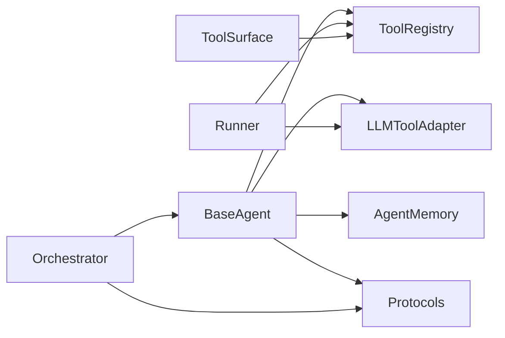

# Base Agent Framework

<cite>
**Referenced Files in This Document**
- [base_agent.py](file://src/agent/agents/base_agent.py)
- [protocols.py](file://src/agent/protocols.py)
- [runner.py](file://src/agent/runner.py)
- [orchestrator.py](file://src/agent/orchestrator.py)
- [memory.py](file://src/agent/memory.py)
- [tool_surface.py](file://src/agent/tool_surface.py)
- [registry.py](file://src/agent/tools/registry.py)
- [technical_agent.py](file://src/agent/agents/technical_agent.py)
</cite>

## Table of Contents
1. [Introduction](#introduction)
2. [Project Structure](#project-structure)
3. [Core Components](#core-components)
4. [Architecture Overview](#architecture-overview)
5. [Detailed Component Analysis](#detailed-component-analysis)
6. [Dependency Analysis](#dependency-analysis)
7. [Performance Considerations](#performance-considerations)
8. [Troubleshooting Guide](#troubleshooting-guide)
9. [Conclusion](#conclusion)
10. [Appendices](#appendices)

## Introduction
This document explains the BaseAgent framework that underpins all specialized agents in the system. It covers:
- The abstract interface every agent must implement (agent_name, system_prompt, build_user_message).
- The execution lifecycle from run() through message building, tool registry filtering, LLM invocation via run_agent_loop, and structured opinion processing.
- Memory integration for context injection and confidence calibration.
- Timeout handling at both pipeline and step levels.
- Error management patterns across stages and tools.
- Practical guidance for implementing custom agents, configuring tool access, and adding post-processing logic.

## Project Structure
The BaseAgent framework is centered around a small set of cohesive modules:
- BaseAgent defines the common contract and execution flow for all agents.
- Protocols define shared data structures like AgentContext, AgentOpinion, StageResult, and enums.
- Runner implements the ReAct-style loop that drives LLM calls and tool usage.
- Orchestrator coordinates multi-agent pipelines and enforces timeouts and budgets.
- Memory provides historical context injection and confidence calibration.
- Tool surface and registry manage tool schemas, validation, scope enforcement, and execution policies.
- Concrete agents (e.g., TechnicalAgent) demonstrate how to extend BaseAgent with domain-specific prompts and post-processing.

**Diagram sources**
- [base_agent.py:38-171](file://src/agent/agents/base_agent.py#L38-L171)
- [runner.py:326-601](file://src/agent/runner.py#L326-L601)
- [orchestrator.py:107-766](file://src/agent/orchestrator.py#L107-L766)
- [registry.py:169-315](file://src/agent/tools/registry.py#L169-L315)
- [tool_surface.py:42-267](file://src/agent/tool_surface.py#L42-L267)
- [memory.py:62-189](file://src/agent/memory.py#L62-L189)
- [protocols.py:149-317](file://src/agent/protocols.py#L149-L317)

**Section sources**
- [base_agent.py:38-171](file://src/agent/agents/base_agent.py#L38-L171)
- [protocols.py:149-317](file://src/agent/protocols.py#L149-L317)
- [runner.py:326-601](file://src/agent/runner.py#L326-L601)
- [orchestrator.py:107-766](file://src/agent/orchestrator.py#L107-L766)
- [memory.py:62-189](file://src/agent/memory.py#L62-L189)
- [registry.py:169-315](file://src/agent/tools/registry.py#L169-L315)
- [tool_surface.py:42-267](file://src/agent/tool_surface.py#L42-L267)

## Core Components
- BaseAgent: Abstract base defining agent_name, system_prompt(ctx), build_user_message(ctx), optional tool_names subset, max_steps, and post_process(ctx, raw_text). Provides run(ctx, progress_callback, timeout_seconds) orchestrating message assembly, tool filtering, LLM loop, and opinion creation.
- Protocols: Shared types including AgentContext (shared state bag), AgentOpinion (structured output), StageResult (stage outcome), StageStatus and StageFailureReason enums, and AgentRunStats (aggregate stats).
- Runner: run_agent_loop implements the ReAct loop: LLM call with tools, parallel tool execution, result appending to messages, budget checks, and final answer extraction. Includes JSON parsing helpers and timeout/budget guards.
- Orchestrator: Multi-agent pipeline coordinator that builds agent chains by mode, enforces per-stage and pipeline timeouts, handles non-critical stage failures, and aggregates results into a unified output.
- Memory: AgentMemory enables injecting recent analysis history into prompts and calibrating confidence based on historical accuracy when enabled.
- Tool Surface & Registry: ToolRegistry centralizes tool definitions, schema generation, and category-level defaults; ToolSurface validates arguments, enforces stock scope contracts, applies cancellation/deadline controls, and serializes results safely.

**Section sources**
- [base_agent.py:38-171](file://src/agent/agents/base_agent.py#L38-L171)
- [protocols.py:149-317](file://src/agent/protocols.py#L149-L317)
- [runner.py:326-601](file://src/agent/runner.py#L326-L601)
- [orchestrator.py:107-766](file://src/agent/orchestrator.py#L107-L766)
- [memory.py:62-189](file://src/agent/memory.py#L62-L189)
- [registry.py:169-315](file://src/agent/tools/registry.py#L169-L315)
- [tool_surface.py:42-267](file://src/agent/tool_surface.py#L42-L267)

## Architecture Overview
The BaseAgent framework composes a layered architecture:
- Agents declare capabilities via tool_names subsets and produce structured opinions.
- The runner executes a controlled ReAct loop with strict budgeting and error propagation.
- The orchestrator sequences agents, enforces global and per-stage timeouts, and degrades gracefully when non-critical stages fail.
- Tools are validated and executed with scope and cancellation safety, producing standardized audit logs.
- Memory augments prompts and adjusts confidence using historical performance.

**Diagram sources**
- [orchestrator.py:352-766](file://src/agent/orchestrator.py#L352-L766)
- [base_agent.py:99-171](file://src/agent/agents/base_agent.py#L99-L171)
- [runner.py:326-601](file://src/agent/runner.py#L326-L601)
- [registry.py:169-315](file://src/agent/tools/registry.py#L169-L315)
- [tool_surface.py:71-267](file://src/agent/tool_surface.py#L71-L267)

## Detailed Component Analysis

### BaseAgent Execution Lifecycle
- Abstract interface requirements:
  - agent_name: unique identifier used for logging, tool filtering, and memory calibration keys.
  - system_prompt(ctx): returns the system prompt tailored to the agent’s role.
  - build_user_message(ctx): constructs the user message that drives the LLM task.
- Optional overrides:
  - tool_names: restricts which tools the agent can use; None means full registry.
  - max_steps: per-agent step limit controlling LLM round-trips.
  - post_process(ctx, raw_text): transforms raw LLM text into an AgentOpinion.
- run() lifecycle:
  - Builds initial messages via _build_messages, injecting conversation history, market phase/context sections, pre-fetched data, and memory context.
  - Filters tool registry to allowed tools via _filtered_registry.
  - Invokes run_agent_loop with messages, filtered registry, llm_adapter, max_steps, and timeout_seconds.
  - Populates StageResult with tokens, tool calls, raw text, models used, and failure reason if any.
  - Calls post_process to create AgentOpinion; applies memory calibration; appends to ctx.opinions.
  - Handles TimeoutError and general exceptions, setting StageStatus.FAILED with appropriate failure reasons.

**Diagram sources**
- [base_agent.py:99-171](file://src/agent/agents/base_agent.py#L99-L171)
- [base_agent.py:177-269](file://src/agent/agents/base_agent.py#L177-L269)
- [base_agent.py:271-321](file://src/agent/agents/base_agent.py#L271-L321)

**Section sources**
- [base_agent.py:38-171](file://src/agent/agents/base_agent.py#L38-L171)
- [base_agent.py:177-269](file://src/agent/agents/base_agent.py#L177-L269)
- [base_agent.py:271-321](file://src/agent/agents/base_agent.py#L271-L321)

### Message Building and Context Injection
- _build_messages constructs the initial messages list:
  - System prompt from system_prompt(ctx).
  - Conversation history from ctx.meta["conversation_history"], filtered to valid roles and string contents.
  - Market phase section via format_market_phase_prompt_section.
  - Daily market context section via format_daily_market_context_prompt_section.
  - Market structure section via format_market_structure_prompt_section.
  - Pre-fetched data from ctx.data serialized and capped per field size.
  - Memory context via _build_memory_context when enabled.
  - Final user message from build_user_message(ctx).
- _inject_cached_data serializes ctx.data entries and caps large payloads to avoid overwhelming context windows.
- _build_memory_context retrieves recent analysis history for the stock and formats it as contextual lines.

**Section sources**
- [base_agent.py:177-226](file://src/agent/agents/base_agent.py#L177-L226)
- [base_agent.py:228-249](file://src/agent/agents/base_agent.py#L228-L249)
- [base_agent.py:271-297](file://src/agent/agents/base_agent.py#L271-L297)

### Tool Registry Filtering
- _filtered_registry creates a restricted ToolRegistry based on agent.tool_names:
  - If tool_names is None, returns the full registry.
  - Otherwise, creates a new registry carrying the original category-timeout map so per-category ceilings remain enforced.
  - Registers only requested tools; logs warnings for missing tools.

**Section sources**
- [base_agent.py:251-269](file://src/agent/agents/base_agent.py#L251-L269)
- [registry.py:169-239](file://src/agent/tools/registry.py#L169-L239)

### LLM Invocation via run_agent_loop
- run_agent_loop implements the ReAct loop:
  - Prepares tool declarations from ToolRegistry.to_openai_tools().
  - Iterates up to max_steps with budget checks (_MIN_STEP_BUDGET_S) and wall-clock timeout.
  - Calls llm_adapter.call_with_tools with remaining timeout.
  - Executes tool calls in parallel with per-tool timeouts resolved via precedence rules (explicit > per-tool > category default, capped by wall-clock budget).
  - Appends assistant messages and tool results to messages.
  - Returns RunLoopResult with success, content, models_used, total_tokens, and failure reasons.
- JSON parsing helpers:
  - parse_dashboard_json extracts decision dashboard JSON from various formats.
  - try_parse_json robustly parses LLM responses containing markdown fences or brace-delimited JSON.

**Section sources**
- [runner.py:326-601](file://src/agent/runner.py#L326-L601)
- [runner.py:117-241](file://src/agent/runner.py#L117-L241)

### Structured Opinion Processing
- post_process converts raw LLM text into AgentOpinion:
  - Default implementation returns None; subclasses should override to parse structured outputs.
  - Example: TechnicalAgent uses try_parse_json to extract signal, confidence, reasoning, key_levels, and raw_data.
- Confidence calibration:
  - _apply_memory_calibration retrieves CalibrationResult from AgentMemory and scales confidence by calibration_factor when calibrated.
  - Stores metadata about raw vs calibrated confidence and sample count in StageResult.meta.

**Section sources**
- [base_agent.py:86-93](file://src/agent/agents/base_agent.py#L86-L93)
- [base_agent.py:299-321](file://src/agent/agents/base_agent.py#L299-L321)
- [technical_agent.py:85-102](file://src/agent/agents/technical_agent.py#L85-L102)
- [memory.py:145-189](file://src/agent/memory.py#L145-L189)

### Memory Integration
- AgentMemory provides:
  - get_stock_history: retrieves recent analysis entries for a stock to inject into prompts.
  - get_calibration: computes calibration factor based on historical accuracy and average confidence when sufficient samples exist.
  - calibrate_confidence: applies calibration to raw confidence values.
- Enabled via configuration; disabled mode returns neutral defaults.

**Section sources**
- [memory.py:62-189](file://src/agent/memory.py#L62-L189)
- [base_agent.py:271-321](file://src/agent/agents/base_agent.py#L271-L321)

### Timeout Handling and Error Management
- Pipeline-level timeouts:
  - Orchestrator enforces global timeout and minimum stage budget to avoid wasteful starts.
  - On timeout or insufficient budget, orchestrator builds partial results and records degradation events.
- Step-level timeouts:
  - run_agent_loop enforces per-step budget guard and overall wall-clock timeout.
  - Tool execution respects per-tool timeouts resolved via precedence and outer wall-clock cap.
- Error propagation:
  - BaseAgent catches TimeoutError and generic exceptions, setting StageStatus.FAILED and failure reasons.
  - ToolSurface standardizes error responses with codes, messages, and audit logs.

**Section sources**
- [orchestrator.py:137-262](file://src/agent/orchestrator.py#L137-L262)
- [orchestrator.py:479-766](file://src/agent/orchestrator.py#L479-L766)
- [runner.py:256-319](file://src/agent/runner.py#L256-L319)
- [runner.py:404-601](file://src/agent/runner.py#L404-L601)
- [base_agent.py:158-171](file://src/agent/agents/base_agent.py#L158-L171)
- [tool_surface.py:71-267](file://src/agent/tool_surface.py#L71-L267)

### Implementing Custom Agents
To implement a custom agent extending BaseAgent:
- Define agent_name and optionally tool_names to restrict tool access.
- Implement system_prompt(ctx) to provide role-specific instructions and output format expectations.
- Implement build_user_message(ctx) to construct the task prompt using ctx fields like stock_code and stock_name.
- Optionally override post_process(ctx, raw_text) to parse structured outputs into AgentOpinion.
- Configure max_steps to control LLM round-trip limits.
- Leverage memory and calibration automatically via BaseAgent’s run() flow.

Example reference:
- TechnicalAgent demonstrates tool restriction, system prompt composition, user message construction, and JSON-based opinion parsing.

**Section sources**
- [technical_agent.py:23-104](file://src/agent/agents/technical_agent.py#L23-L104)
- [base_agent.py:38-93](file://src/agent/agents/base_agent.py#L38-L93)

## Dependency Analysis
Key dependencies and relationships:
- BaseAgent depends on ToolRegistry, LLMToolAdapter, AgentMemory, and protocols.
- Runner depends on ToolRegistry, LLMToolAdapter, and tool execution utilities.
- Orchestrator composes multiple agents and enforces pipeline-level constraints.
- ToolSurface relies on ToolRegistry and execution policies for safe tool invocation.
- Memory integrates with storage and backtest services for calibration and performance metrics.

**Diagram sources**
- [base_agent.py:38-171](file://src/agent/agents/base_agent.py#L38-L171)
- [runner.py:326-601](file://src/agent/runner.py#L326-L601)
- [orchestrator.py:107-766](file://src/agent/orchestrator.py#L107-L766)
- [tool_surface.py:42-267](file://src/agent/tool_surface.py#L42-L267)
- [memory.py:62-189](file://src/agent/memory.py#L62-L189)
- [protocols.py:149-317](file://src/agent/protocols.py#L149-L317)

**Section sources**
- [base_agent.py:38-171](file://src/agent/agents/base_agent.py#L38-L171)
- [runner.py:326-601](file://src/agent/runner.py#L326-L601)
- [orchestrator.py:107-766](file://src/agent/orchestrator.py#L107-L766)
- [tool_surface.py:42-267](file://src/agent/tool_surface.py#L42-L267)
- [memory.py:62-189](file://src/agent/memory.py#L62-L189)
- [protocols.py:149-317](file://src/agent/protocols.py#L149-L317)

## Performance Considerations
- Limit tool exposure per agent via tool_names to reduce LLM confusion and tool call overhead.
- Use max_steps judiciously; higher steps increase token usage and latency.
- Enable memory only when beneficial; context injection adds prompt length but can improve relevance.
- Configure per-tool timeouts to prevent long-running tools from blocking the pipeline.
- Monitor models_used and total_tokens to optimize provider selection and cost.

[No sources needed since this section provides general guidance]

## Troubleshooting Guide
Common issues and resolutions:
- Agent fails to parse opinion JSON:
  - Ensure post_process uses try_parse_json and handles malformed responses gracefully.
  - Check system_prompt output format expectations.
- Tool execution errors:
  - Verify tool names match registered names exactly.
  - Inspect ToolSurface error codes (invalid_arguments, stock_scope_violation, handler_error).
- Timeouts:
  - Increase AGENT_MAX_STEPS or adjust per-agent max_steps.
  - Review pipeline timeout and minimum stage budget settings in Orchestrator.
- Memory not applied:
  - Confirm AGENT_MEMORY_ENABLED and ensure stock_code is set in ctx.
  - Check calibration thresholds and sample counts.

**Section sources**
- [runner.py:175-241](file://src/agent/runner.py#L175-L241)
- [tool_surface.py:71-267](file://src/agent/tool_surface.py#L71-L267)
- [orchestrator.py:137-262](file://src/agent/orchestrator.py#L137-L262)
- [memory.py:78-87](file://src/agent/memory.py#L78-L87)

## Conclusion
The BaseAgent framework provides a robust, extensible foundation for specialized agents. By enforcing a clear abstract interface, integrating memory and calibration, and centralizing execution via a controlled ReAct loop, it ensures consistent behavior, reliable error handling, and scalable performance. Custom agents can be implemented by extending BaseAgent, configuring tool access, and adding domain-specific post-processing logic while leveraging shared infrastructure for timeouts, budgets, and tool safety.

[No sources needed since this section summarizes without analyzing specific files]

## Appendices
- Example agent implementation path: [technical_agent.py:23-104](file://src/agent/agents/technical_agent.py#L23-L104)
- Core execution loop path: [runner.py:326-601](file://src/agent/runner.py#L326-L601)
- Protocol definitions path: [protocols.py:149-317](file://src/agent/protocols.py#L149-L317)
- Memory calibration path: [memory.py:145-189](file://src/agent/memory.py#L145-L189)
- Tool registry path: [registry.py:169-315](file://src/agent/tools/registry.py#L169-L315)
- Tool surface execution path: [tool_surface.py:71-267](file://src/agent/tool_surface.py#L71-L267)