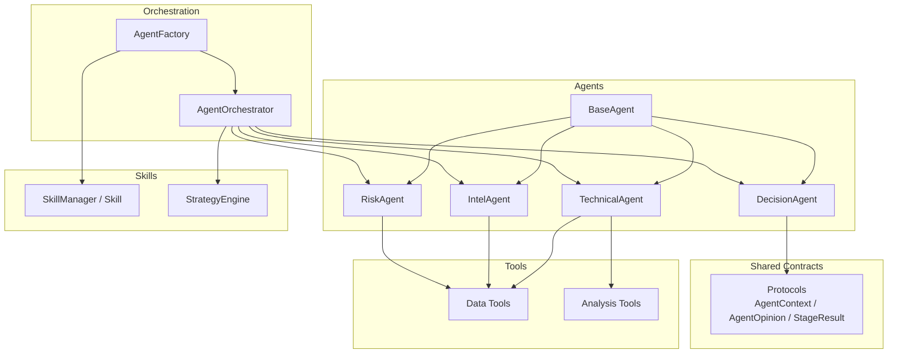
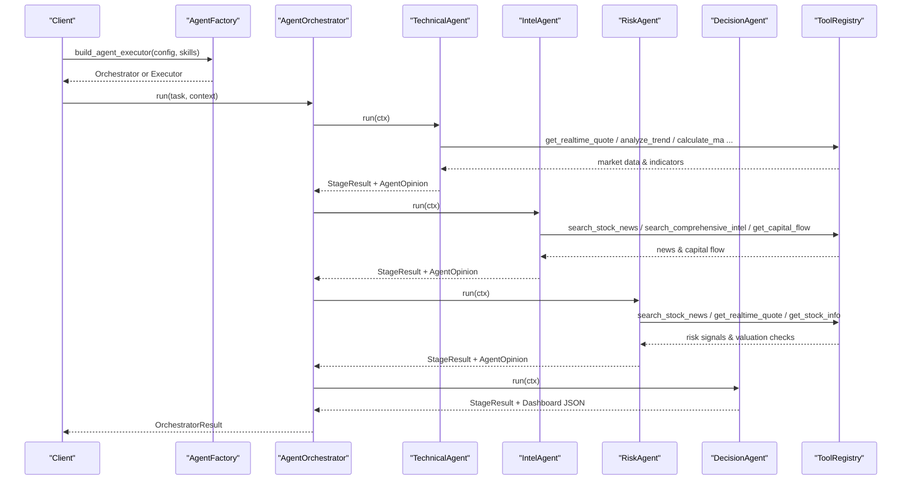
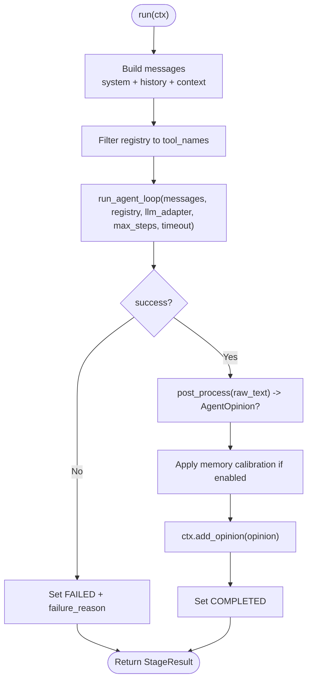
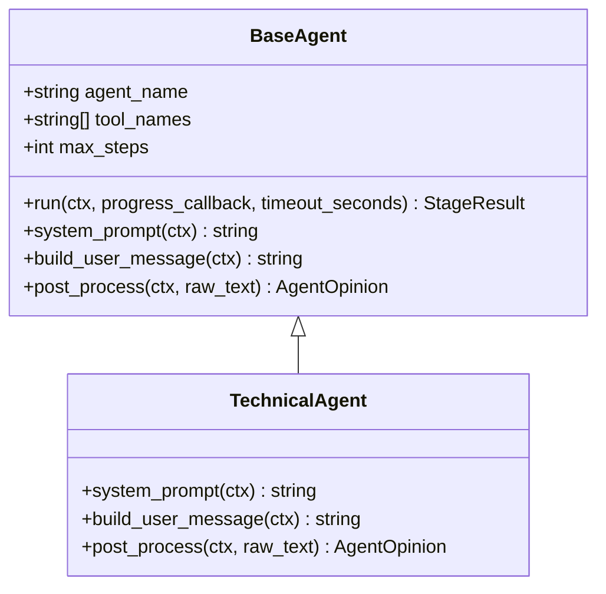
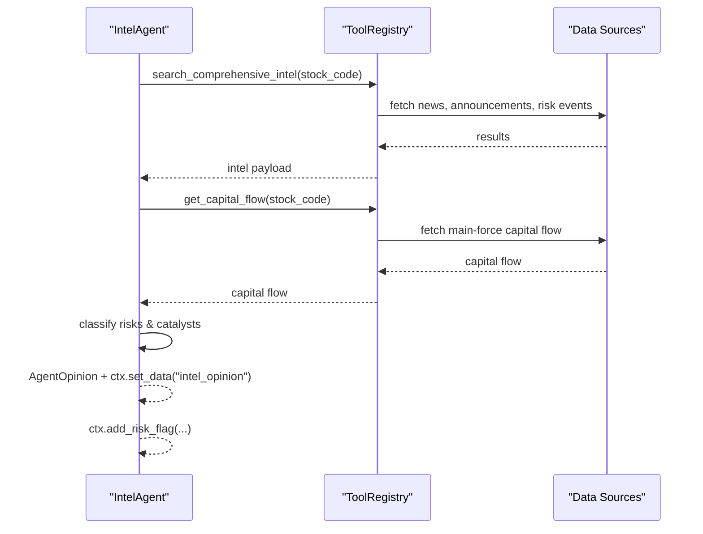
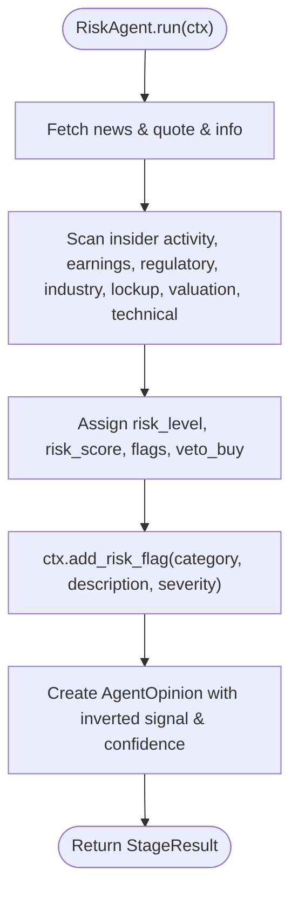
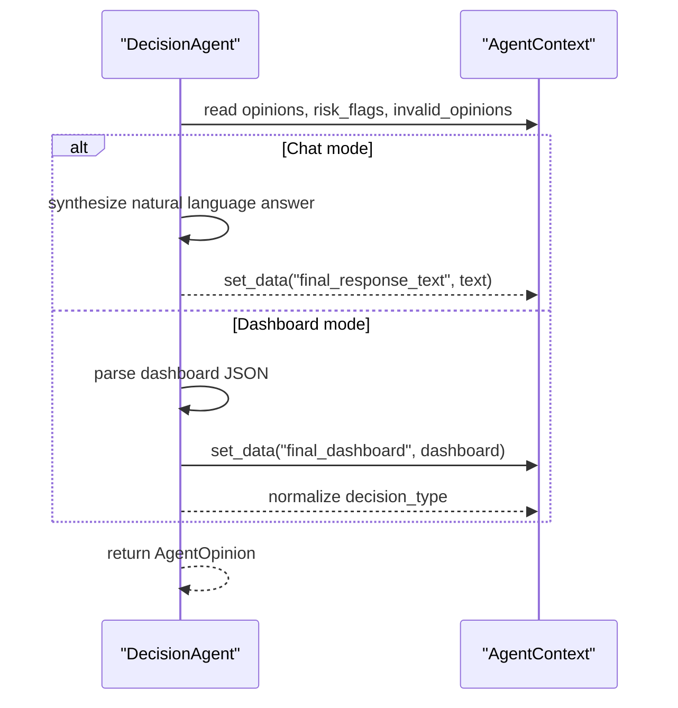
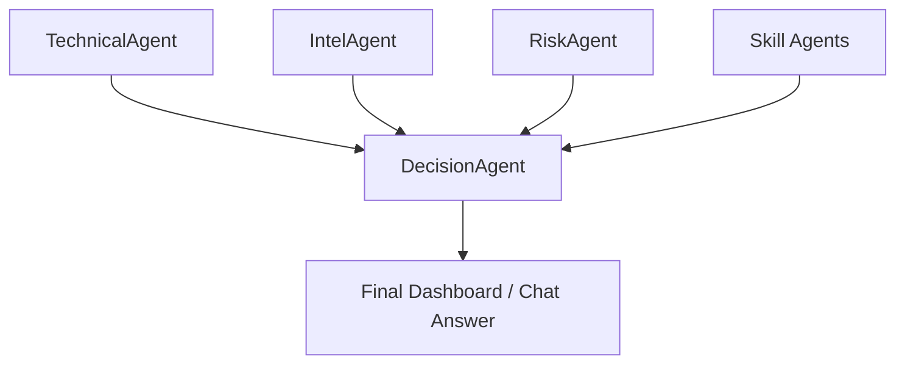
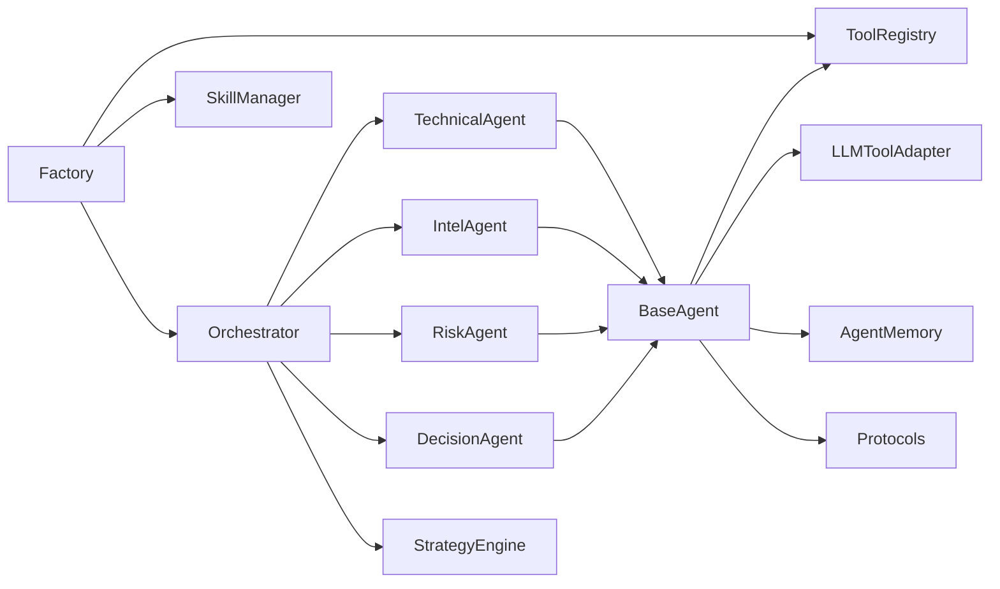

# Specialized Agents

<cite>
**Referenced Files in This Document**
- [base_agent.py](file://src/agent/agents/base_agent.py)
- [technical_agent.py](file://src/agent/agents/technical_agent.py)
- [intel_agent.py](file://src/agent/agents/intel_agent.py)
- [risk_agent.py](file://src/agent/agents/risk_agent.py)
- [decision_agent.py](file://src/agent/agents/decision_agent.py)
- [protocols.py](file://src/agent/protocols.py)
- [orchestrator.py](file://src/agent/orchestrator.py)
- [factory.py](file://src/agent/factory.py)
- [data_tools.py](file://src/agent/tools/data_tools.py)
- [analysis_tools.py](file://src/agent/tools/analysis_tools.py)
- [skills_base.py](file://src/agent/skills/base.py)
- [skills_engine.py](file://src/agent/skills/engine.py)
</cite>

## Table of Contents
1. [Introduction](#introduction)
2. [Project Structure](#project-structure)
3. [Core Components](#core-components)
4. [Architecture Overview](#architecture-overview)
5. [Detailed Component Analysis](#detailed-component-analysis)
6. [Dependency Analysis](#dependency-analysis)
7. [Performance Considerations](#performance-considerations)
8. [Troubleshooting Guide](#troubleshooting-guide)
9. [Conclusion](#conclusion)
10. [Appendices](#appendices)

## Introduction
This document explains the specialized agents system used for stock analysis and investment decision-making. It focuses on four core agent types:
- TechnicalAgent: market data analysis and indicator calculations
- IntelAgent: news and sentiment gathering
- RiskAgent: portfolio risk assessment and red-flag screening
- DecisionAgent: final synthesis and investment recommendations

It also documents the base agent interface, shared patterns, integration points with tools and skills, configuration options, and how to create custom specialized agents.

## Project Structure
The specialized agents live under src/agent/agents and are orchestrated by a multi-agent pipeline coordinator. They share common protocols, tooling, and skill injection mechanisms.

**Diagram sources**
- [base_agent.py:38-93](file://src/agent/agents/base_agent.py#L38-L93)
- [technical_agent.py:23-35](file://src/agent/agents/technical_agent.py#L23-L35)
- [intel_agent.py:24-32](file://src/agent/agents/intel_agent.py#L24-L32)
- [risk_agent.py:29-36](file://src/agent/agents/risk_agent.py#L29-L36)
- [decision_agent.py:24-29](file://src/agent/agents/decision_agent.py#L24-L29)
- [orchestrator.py:772-799](file://src/agent/orchestrator.py#L772-L799)
- [factory.py:551-611](file://src/agent/factory.py#L551-L611)
- [protocols.py:149-231](file://src/agent/protocols.py#L149-L231)
- [data_tools.py:1-46](file://src/agent/tools/data_tools.py#L1-L46)
- [analysis_tools.py:1-21](file://src/agent/tools/analysis_tools.py#L1-L21)
- [skills_base.py:26-80](file://src/agent/skills/base.py#L26-L80)
- [skills_engine.py:54-132](file://src/agent/skills/engine.py#L54-L132)

**Section sources**
- [base_agent.py:38-93](file://src/agent/agents/base_agent.py#L38-L93)
- [orchestrator.py:772-799](file://src/agent/orchestrator.py#L772-L799)
- [factory.py:551-611](file://src/agent/factory.py#L551-L611)
- [protocols.py:149-231](file://src/agent/protocols.py#L149-L231)

## Core Components
- BaseAgent defines the contract all specialized agents implement:
  - Required: agent_name, system_prompt(ctx), build_user_message(ctx)
  - Optional: tool_names (subset of available tools), max_steps, post_process(ctx, raw_text)
  - Execution: run(ctx, progress_callback, timeout_seconds) returns StageResult
  - Shared features: message assembly, pre-fetched data injection, memory calibration, tool filtering

- Protocols define shared data structures:
  - AgentContext: query, stock_code, stock_name, data, opinions, risk_flags, meta
  - AgentOpinion: signal, confidence, reasoning, key_levels, raw_data, timestamp
  - StageResult: stage_name, status, opinion, error, failure_reason, duration_s, tokens_used, tool_calls_count, meta
  - Signal normalization helpers and enums

- Orchestrator coordinates the pipeline modes:
  - quick: Technical → Decision
  - standard: Technical → Intel → Decision
  - full: Technical → Intel → Risk → Decision
  - specialist: includes skill-based specialist evaluation before Decision

- Factory builds ToolRegistry and SkillManager once, then creates orchestrators or executors with consistent configuration and timeouts.

**Section sources**
- [base_agent.py:38-171](file://src/agent/agents/base_agent.py#L38-L171)
- [protocols.py:23-142](file://src/agent/protocols.py#L23-L142)
- [protocols.py:149-231](file://src/agent/protocols.py#L149-L231)
- [orchestrator.py:77-136](file://src/agent/orchestrator.py#L77-L136)
- [factory.py:377-449](file://src/agent/factory.py#L377-L449)
- [factory.py:551-611](file://src/agent/factory.py#L551-L611)

## Architecture Overview
The multi-agent pipeline runs sequentially with shared context. Each agent can call tools to fetch data, perform analysis, search intelligence, and produce structured opinions. The DecisionAgent synthesizes outputs into a final dashboard or chat response.

**Diagram sources**
- [orchestrator.py:772-799](file://src/agent/orchestrator.py#L772-L799)
- [technical_agent.py:23-35](file://src/agent/agents/technical_agent.py#L23-L35)
- [intel_agent.py:24-32](file://src/agent/agents/intel_agent.py#L24-L32)
- [risk_agent.py:29-36](file://src/agent/agents/risk_agent.py#L29-L36)
- [decision_agent.py:24-29](file://src/agent/agents/decision_agent.py#L24-L29)
- [data_tools.py:1-46](file://src/agent/tools/data_tools.py#L1-L46)
- [analysis_tools.py:1-21](file://src/agent/tools/analysis_tools.py#L1-L21)

## Detailed Component Analysis

### BaseAgent
- Responsibilities:
  - Build messages from system prompt, conversation history, market phase/context, and pre-fetched data
  - Execute LLM loop with tool access restricted to agent’s tool_names
  - Post-process raw text into AgentOpinion
  - Apply memory calibration to confidence when enabled
- Input/Output contracts:
  - Input: AgentContext, optional progress callback, optional timeout
  - Output: StageResult with status, opinion, tokens, tool calls, and metadata
- Configuration:
  - agent_name, tool_names, max_steps
  - skill_instructions and technical_skill_policy injected via constructor
- Integration patterns:
  - Uses ToolRegistry filtered to allowed tools
  - Uses LLMToolAdapter for model invocation
  - Injects cached data from ctx.data to avoid redundant tool calls

**Diagram sources**
- [base_agent.py:99-171](file://src/agent/agents/base_agent.py#L99-L171)
- [base_agent.py:177-226](file://src/agent/agents/base_agent.py#L177-L226)
- [base_agent.py:228-269](file://src/agent/agents/base_agent.py#L228-L269)
- [base_agent.py:271-321](file://src/agent/agents/base_agent.py#L271-L321)

**Section sources**
- [base_agent.py:38-171](file://src/agent/agents/base_agent.py#L38-L171)
- [base_agent.py:177-321](file://src/agent/agents/base_agent.py#L177-L321)

### TechnicalAgent
- Responsibilities:
  - Fetch realtime quotes and daily history
  - Run trend analysis (MA alignment, MACD, RSI)
  - Analyze volume and chip distribution
  - Identify chart patterns
  - Produce structured JSON opinion with signal, confidence, key levels, trend score, MA alignment, volume status, pattern
- Inputs:
  - AgentContext with stock_code, stock_name, optional pre-fetched data
- Outputs:
  - AgentOpinion with signal, confidence, reasoning, key_levels, raw_data
- Tools:
  - get_realtime_quote, get_daily_history, analyze_trend, calculate_ma, get_volume_analysis, analyze_pattern, get_chip_distribution, get_analysis_context
- Performance tuning:
  - max_steps = 6
  - tool_names restricts scope to technical tools only

**Diagram sources**
- [base_agent.py:38-93](file://src/agent/agents/base_agent.py#L38-L93)
- [technical_agent.py:23-104](file://src/agent/agents/technical_agent.py#L23-L104)

**Section sources**
- [technical_agent.py:23-104](file://src/agent/agents/technical_agent.py#L23-L104)
- [analysis_tools.py:24-107](file://src/agent/tools/analysis_tools.py#L24-L107)
- [data_tools.py:1-46](file://src/agent/tools/data_tools.py#L1-L46)

### IntelAgent
- Responsibilities:
  - Search latest stock news and announcements
  - Run comprehensive intelligence search covering news, company announcements, risk checks, earnings outlook
  - For A-shares, obtain main-force capital inflow/outflow data
  - Classify positive catalysts and risk alerts
  - Assess overall sentiment and output structured JSON opinion
- Inputs:
  - AgentContext with stock_code, stock_name, optional pre-fetched intel data
- Outputs:
  - AgentOpinion with signal, confidence, reasoning, risk_alerts propagated to ctx.risk_flags, raw_data
- Tools:
  - search_stock_news, search_comprehensive_intel, get_stock_info, get_capital_flow
- Integration:
  - Caches parsed intel in ctx.data["intel_opinion"] for downstream reuse
  - Adds risk flags to ctx.risk_flags for RiskAgent and DecisionAgent consumption

**Diagram sources**
- [intel_agent.py:24-119](file://src/agent/agents/intel_agent.py#L24-L119)
- [data_tools.py:1-46](file://src/agent/tools/data_tools.py#L1-L46)

**Section sources**
- [intel_agent.py:24-119](file://src/agent/agents/intel_agent.py#L24-L119)

### RiskAgent
- Responsibilities:
  - Screen for insider sell-downs, earnings warnings, regulatory actions
  - Check valuation anomalies (PE/PB extremes)
  - Evaluate lock-up expiration risks
  - Produce risk flags with severity and veto logic
- Inputs:
  - AgentContext with stock_code, stock_name, optional existing intel data
- Outputs:
  - AgentOpinion with inverted signal mapping from risk_level, confidence from risk_score, reasoning, raw_data
  - Propagates structured risk flags to ctx.risk_flags
- Tools:
  - search_stock_news, get_realtime_quote, get_stock_info
- Severity levels:
  - high: existential or material risk
  - medium: significant concern
  - low: minor or informational
- Signal adjustment:
  - Maps risk_level to trading signal; veto_buy flag indicates buy veto when enabled

**Diagram sources**
- [risk_agent.py:29-129](file://src/agent/agents/risk_agent.py#L29-L129)

**Section sources**
- [risk_agent.py:29-129](file://src/agent/agents/risk_agent.py#L29-L129)

### DecisionAgent
- Responsibilities:
  - Aggregate opinions from Technical, Intel, Risk, and skill agents
  - Produce final Decision Dashboard JSON or natural-language chat answer
  - Enforce actionability guardrails and risk priority
  - Normalize decision_type to stable enum
- Inputs:
  - AgentContext with ctx.opinions, ctx.risk_flags, invalid_opinions diagnostics, requested skills
- Outputs:
  - AgentOpinion with normalized decision_type, confidence derived from sentiment_score, reasoning from analysis_summary
  - Stores final_dashboard in ctx.data for downstream use
- Modes:
  - Chat mode: natural language answer without JSON unless explicitly requested
  - Dashboard mode: structured JSON with phase_decision, dashboard, analysis_summary, key_points, risk_warning
- Tools:
  - None (tool_names = []) — works purely from context

**Diagram sources**
- [decision_agent.py:24-290](file://src/agent/agents/decision_agent.py#L24-L290)

**Section sources**
- [decision_agent.py:24-290](file://src/agent/agents/decision_agent.py#L24-L290)

### Conceptual Overview
The specialized agents form a layered analysis pipeline:
- TechnicalAgent provides quantitative market structure and indicator insights
- IntelAgent supplies qualitative news and sentiment evidence
- RiskAgent enforces downside protection and red-flag vetoes
- DecisionAgent synthesizes all inputs into actionable recommendations

[No sources needed since this diagram shows conceptual workflow, not actual code structure]

## Dependency Analysis
- BaseAgent depends on:
  - ToolRegistry for tool execution
  - LLMToolAdapter for model invocation
  - AgentMemory for historical calibration
  - Protocols for shared data structures
- Specialized agents depend on:
  - BaseAgent for execution framework
  - Tool subsets defined per agent
  - Protocols for opinion and context handling
- Orchestrator depends on:
  - All specialized agents
  - StrategyEngine for skill-based specialist evaluation
  - Protocols for stage results and statistics
- Factory depends on:
  - ToolRegistry and SkillManager caching
  - Config for timeouts and skill activation

**Diagram sources**
- [base_agent.py:18-34](file://src/agent/agents/base_agent.py#L18-L34)
- [orchestrator.py:36-70](file://src/agent/orchestrator.py#L36-L70)
- [factory.py:377-449](file://src/agent/factory.py#L377-L449)
- [skills_engine.py:54-132](file://src/agent/skills/engine.py#L54-L132)

**Section sources**
- [base_agent.py:18-34](file://src/agent/agents/base_agent.py#L18-L34)
- [orchestrator.py:36-70](file://src/agent/orchestrator.py#L36-L70)
- [factory.py:377-449](file://src/agent/factory.py#L377-L449)
- [skills_engine.py:54-132](file://src/agent/skills/engine.py#L54-L132)

## Performance Considerations
- ToolRegistry caching:
  - Built once and reused across requests; rebuilds only when category timeout map changes
  - Prevents repeated imports and registrations
- SkillManager caching:
  - Prototype built on first use; deepcopies returned per request for thread safety
  - Avoids expensive YAML loading on every call
- Timeouts:
  - Per-category tool timeouts configurable via AGENT_*_TOOL_TIMEOUT_S
  - Global orchestrator timeout via agent_orchestrator_timeout_s
  - Per-agent timeouts via agent_{technical,intel,risk,decision,portfolio,skill}_agent_timeout_s
- Step limits:
  - max_steps per agent controls LLM tool-call loops
  - Orchestrator adjusts per-agent limits based on global setting
- Data compactness:
  - Tool responses compacted to reduce token usage (e.g., fundamental context, portfolio snapshots)

**Section sources**
- [factory.py:377-449](file://src/agent/factory.py#L377-L449)
- [factory.py:452-491](file://src/agent/factory.py#L452-L491)
- [factory.py:551-611](file://src/agent/factory.py#L551-L611)
- [orchestrator.py:137-175](file://src/agent/orchestrator.py#L137-L175)
- [data_tools.py:135-200](file://src/agent/tools/data_tools.py#L135-L200)

## Troubleshooting Guide
Common issues and resolutions:
- JSON parsing failures:
  - TechnicalAgent, IntelAgent, RiskAgent log warnings when opinion JSON cannot be parsed
  - DecisionAgent stores raw text when dashboard JSON fails and logs warning
- Timeout handling:
  - BaseAgent catches TimeoutError and sets StageStatus.FAILED with failure_reason TIMEOUT
  - Orchestrator enforces pipeline budget and skips non-critical stages when insufficient time remains
- Tool errors:
  - Tools return structured error dicts; agents should handle missing data gracefully
- Risk flags propagation:
  - Ensure IntelAgent and RiskAgent add risk flags to ctx.risk_flags for downstream visibility
- Invalid skill opinions:
  - StrategyEngine partitions invalid skill opinions into diagnostics; DecisionAgent surfaces counts and reasons

**Section sources**
- [technical_agent.py:85-104](file://src/agent/agents/technical_agent.py#L85-L104)
- [intel_agent.py:95-119](file://src/agent/agents/intel_agent.py#L95-L119)
- [risk_agent.py:95-129](file://src/agent/agents/risk_agent.py#L95-L129)
- [decision_agent.py:248-290](file://src/agent/agents/decision_agent.py#L248-L290)
- [base_agent.py:158-171](file://src/agent/agents/base_agent.py#L158-L171)
- [orchestrator.py:479-766](file://src/agent/orchestrator.py#L479-L766)
- [skills_engine.py:60-132](file://src/agent/skills/engine.py#L60-L132)

## Conclusion
The specialized agents system provides a modular, extensible framework for stock analysis and investment decisions. BaseAgent standardizes execution, while TechnicalAgent, IntelAgent, RiskAgent, and DecisionAgent specialize in distinct responsibilities. The Orchestrator coordinates pipeline modes, and the Factory ensures efficient resource usage through caching and configuration. Skills and tools integrate seamlessly, enabling customizable analysis strategies and robust performance tuning.

## Appendices

### Creating Custom Specialized Agents
Steps to create a new agent:
1. Subclass BaseAgent
2. Implement required methods:
   - system_prompt(ctx): define role, workflow, and output format
   - build_user_message(ctx): construct user instruction with stock context
3. Optionally override:
   - tool_names: restrict tool access
   - max_steps: adjust LLM loop limit
   - post_process(ctx, raw_text): parse raw text into AgentOpinion
4. Use ctx.data to read/write shared state
5. Add risk flags via ctx.add_risk_flag when applicable
6. Register in Orchestrator chain if needed

**Section sources**
- [base_agent.py:38-93](file://src/agent/agents/base_agent.py#L38-L93)
- [base_agent.py:99-171](file://src/agent/agents/base_agent.py#L99-L171)
- [protocols.py:149-231](file://src/agent/protocols.py#L149-L231)

### Agent-Specific Tools and Integrations
- TechnicalAgent tools:
  - get_realtime_quote, get_daily_history, analyze_trend, calculate_ma, get_volume_analysis, analyze_pattern, get_chip_distribution, get_analysis_context
- IntelAgent tools:
  - search_stock_news, search_comprehensive_intel, get_stock_info, get_capital_flow
- RiskAgent tools:
  - search_stock_news, get_realtime_quote, get_stock_info
- DecisionAgent:
  - No tools; consumes ctx.opinions and ctx.risk_flags

**Section sources**
- [technical_agent.py:23-35](file://src/agent/agents/technical_agent.py#L23-L35)
- [intel_agent.py:24-32](file://src/agent/agents/intel_agent.py#L24-L32)
- [risk_agent.py:29-36](file://src/agent/agents/risk_agent.py#L29-L36)
- [decision_agent.py:24-29](file://src/agent/agents/decision_agent.py#L24-L29)
- [data_tools.py:1-46](file://src/agent/tools/data_tools.py#L1-L46)
- [analysis_tools.py:1-21](file://src/agent/tools/analysis_tools.py#L1-L21)

### Configuration Options and Performance Tuning
- Global:
  - agent_max_steps: default step limit for agents
  - agent_orchestrator_timeout_s: pipeline-wide timeout
  - agent_skill_concurrency: skill agent concurrency
- Per-category tool timeouts:
  - agent_data_tool_timeout_s
  - agent_search_tool_timeout_s
  - agent_analysis_tool_timeout_s
  - agent_action_tool_timeout_s
- Per-agent timeouts:
  - agent_technical_agent_timeout_s
  - agent_intel_agent_timeout_s
  - agent_risk_agent_timeout_s
  - agent_decision_agent_timeout_s
  - agent_portfolio_agent_timeout_s
  - agent_skill_agent_timeout_s
- Skill activation:
  - agent_skills: list of skill ids to activate
  - agent_skill_dir: custom skill directory

**Section sources**
- [factory.py:220-325](file://src/agent/factory.py#L220-L325)
- [factory.py:551-611](file://src/agent/factory.py#L551-L611)
- [orchestrator.py:137-175](file://src/agent/orchestrator.py#L137-L175)

### Data Models and Contracts
- AgentContext fields:
  - query, stock_code, stock_name, session_id
  - data: Dict[str, Any] for shared payloads
  - opinions: List[AgentOpinion]
  - risk_flags: List[Dict[str, Any]]
  - meta: Dict[str, Any]
- AgentOpinion fields:
  - agent_name, signal, confidence, reasoning, key_levels, raw_data, timestamp
- StageResult fields:
  - stage_name, status, opinion, error, failure_reason, duration_s, tokens_used, tool_calls_count, meta

**Section sources**
- [protocols.py:149-231](file://src/agent/protocols.py#L149-L231)
- [protocols.py:296-317](file://src/agent/protocols.py#L296-L317)