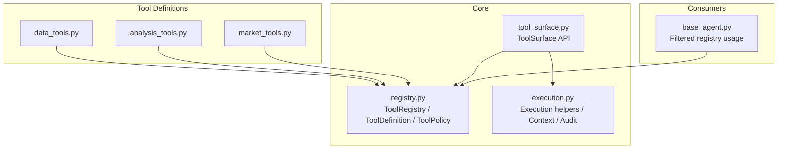
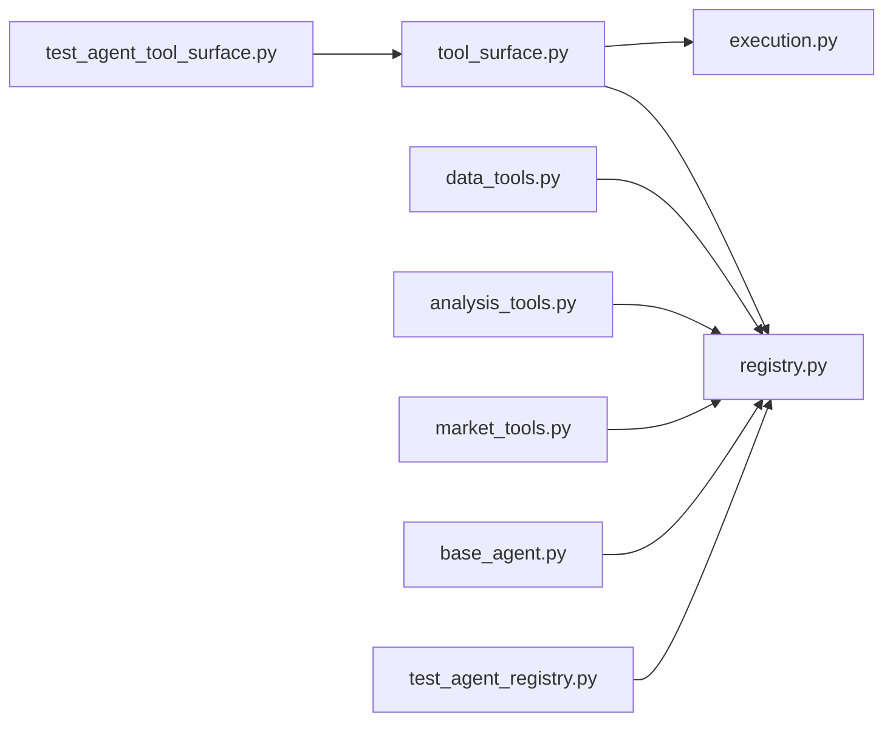

# Tool Registry System

<cite>
**Referenced Files in This Document**
- [registry.py](file://src/agent/tools/registry.py)
- [execution.py](file://src/agent/tools/execution.py)
- [tool_surface.py](file://src/agent/tool_surface.py)
- [data_tools.py](file://src/agent/tools/data_tools.py)
- [analysis_tools.py](file://src/agent/tools/analysis_tools.py)
- [market_tools.py](file://src/agent/tools/market_tools.py)
- [test_agent_registry.py](file://tests/test_agent_registry.py)
- [test_agent_tool_surface.py](file://tests/test_agent_tool_surface.py)
- [base_agent.py](file://src/agent/agents/base_agent.py)
</cite>

## Table of Contents
1. Introduction
2. Project Structure
3. Core Components
4. Architecture Overview
5. Detailed Component Analysis
6. Dependency Analysis
7. Performance Considerations
8. Troubleshooting Guide
9. Conclusion

## Introduction
This document explains the Tool Registry System that powers tool discovery, registration, and execution for the agent framework. It covers:
- The ToolRegistry class and its lifecycle operations
- The @tool decorator pattern and automatic parameter inference from type hints
- ToolDefinition structure with metadata, parameters, and policies
- ToolPolicy system for security, permissions, scope dimensions, cancellation safety, and timeouts
- Multi-provider schema generation (OpenAI function format used by litellm for all providers)
- Validation of tool policies, scope contracts, and permission controls
- Production guidance for error handling, timeout management, and performance optimization

## Project Structure
The tooling subsystem is organized around a small set of core modules:
- registry.py defines data models and the central registry
- execution.py provides runtime-neutral execution helpers, context, and auditing
- tool_surface.py exposes a stable Python API for listing tools and executing them safely
- data_tools.py, analysis_tools.py, market_tools.py define concrete tools with handlers and policies
- base_agent.py shows how agents consume filtered registries
- tests validate schemas, decorators, and surface behavior



**Diagram sources**
- [registry.py:169-315](file://src/agent/tools/registry.py#L169-L315)
- [execution.py:91-150](file://src/agent/tools/execution.py#L91-L150)
- [tool_surface.py:42-76](file://src/agent/tool_surface.py#L42-L76)
- [data_tools.py:22-46](file://src/agent/tools/data_tools.py#L22-L46)
- [analysis_tools.py:16-21](file://src/agent/tools/analysis_tools.py#L16-L21)
- [market_tools.py:16-20](file://src/agent/tools/market_tools.py#L16-L20)
- [base_agent.py:251-269](file://src/agent/agents/base_agent.py#L251-L269)

**Section sources**
- [registry.py:1-446](file://src/agent/tools/registry.py#L1-L446)
- [execution.py:1-438](file://src/agent/tools/execution.py#L1-L438)
- [tool_surface.py:1-442](file://src/agent/tool_surface.py#L1-L442)
- [data_tools.py:1-731](file://src/agent/tools/data_tools.py#L1-L731)
- [analysis_tools.py:1-532](file://src/agent/tools/analysis_tools.py#L1-L532)
- [market_tools.py:1-117](file://src/agent/tools/market_tools.py#L1-L117)
- [base_agent.py:251-269](file://src/agent/agents/base_agent.py#L251-L269)

## Core Components
- ToolParameter: describes a single input parameter including name, JSON type, description, required flag, enum, and default.
- ToolPolicy: declares read-only status, side effects, permissions, policy status, scope dimensions, cancellation safety, and per-tool timeout.
- ToolDefinition: bundles name, description, parameters, handler callable, category, policy, and optional per-tool timeout; provides multi-provider schema converters.
- ToolRegistry: central store for ToolDefinition instances with register/unregister/query/list/execute and bulk schema generation.
- ToolSurface: stable Python API to list tools in multiple formats and execute tools with validation, scope enforcement, timeouts, cancellation, serialization, redaction, and audit.
- Execution helpers: cooperative cancellation, deadline enforcement, stock scope guards, result serialization, secret redaction, and audit record building.

Key behaviors:
- Parameter inference from function signatures and type hints when using the @tool decorator.
- OpenAI function schema generation used by litellm for all LLM providers.
- Strict policy validation for production readiness, including unsupported scope dimensions and stock scope contract checks.
- Safe execution via ToolSurface with bounded cancellation and result size limits.

**Section sources**
- [registry.py:26-163](file://src/agent/tools/registry.py#L26-L163)
- [registry.py:169-315](file://src/agent/tools/registry.py#L169-L315)
- [registry.py:334-446](file://src/agent/tools/registry.py#L334-L446)
- [tool_surface.py:42-76](file://src/agent/tool_surface.py#L42-L76)
- [execution.py:91-150](file://src/agent/tools/execution.py#L91-L150)

## Architecture Overview
The system separates concerns between definition, execution, and consumption:
- Tools are defined as ToolDefinition objects with explicit parameters and policies.
- ToolRegistry stores definitions and can generate provider-specific schemas.
- ToolSurface orchestrates safe execution, enforcing argument validation, scope contracts, cancellation/deadline, and output sanitization.
- Agents request filtered registries to limit available tools per task or skill.

```mermaid
sequenceDiagram
participant Agent as "Agent"
participant Surface as "ToolSurface"
participant Reg as "ToolRegistry"
participant Exec as "Execution Helpers"
participant Handler as "Tool Handler"
Agent->>Surface : execute_tool(name, arguments, context)
Surface->>Reg : resolve(name)
alt Tool not found
Surface-->>Agent : error {code : "tool_not_found"}
else Found
Surface->>Surface : validate_arguments()
Surface->>Surface : validate_scope_contract()
opt Stock-scoped tool
Surface->>Exec : _guard_tool_stock_scope(...)
alt Scope violation
Surface-->>Agent : error {code : "stock_scope_violation"}
end
end
opt Controlled execution
Surface->>Exec : bind_tool_execution_context()
Surface->>Handler : handler(**arguments)
Handler-->>Surface : result or raises
Surface->>Exec : check_tool_execution() at boundaries
else Uncontrolled execution
Surface->>Handler : handler(**arguments)
end
Surface->>Exec : serialize_tool_result()
Surface->>Exec : redact_external_tool_result() if needed
Surface-->>Agent : {ok, result, audit, diagnostics}
end
```

**Diagram sources**
- [tool_surface.py:71-267](file://src/agent/tool_surface.py#L71-L267)
- [execution.py:123-150](file://src/agent/tools/execution.py#L123-L150)
- [execution.py:251-281](file://src/agent/tools/execution.py#L251-L281)
- [registry.py:198-215](file://src/agent/tools/registry.py#L198-L215)

**Section sources**
- [tool_surface.py:71-267](file://src/agent/tool_surface.py#L71-L267)
- [execution.py:123-150](file://src/agent/tools/execution.py#L123-L150)
- [execution.py:251-281](file://src/agent/tools/execution.py#L251-L281)
- [registry.py:198-215](file://src/agent/tools/registry.py#L198-L215)

## Detailed Component Analysis

### ToolRegistry
Responsibilities:
- Store and manage ToolDefinition instances
- Provide lookup, filtering by category, and listing
- Generate OpenAI-format tools lists for litellm-based providers
- Validate tool policies in strict mode for production readiness
- Execute tools directly by name (lower-level path without surface protections)

Important methods:
- register/unregister/get/resolve/list_tools/list_names
- to_openai_tools for provider schema generation
- validate_tool_policies(strict) for policy compliance checks
- execute for direct invocation

Notes:
- Category-level default timeouts can be configured and propagated to filtered registries.
- Overwriting an existing tool name logs a warning.

**Section sources**
- [registry.py:169-245](file://src/agent/tools/registry.py#L169-L245)
- [registry.py:247-298](file://src/agent/tools/registry.py#L247-L298)
- [registry.py:302-315](file://src/agent/tools/registry.py#L302-L315)

### ToolDefinition and Multi-Provider Schema Generation
- Parameters are converted into a JSON Schema object shared by OpenAI and other providers.
- to_openai_tool produces the function schema consumed by litellm across providers.
- to_public_descriptor exposes non-sensitive metadata and policy/scope information for external consumers.
- to_mcp_descriptor provides MCP-compatible input schema.
- accepts_extra_arguments inspects handler signature for **kwargs support.

**Section sources**
- [registry.py:84-163](file://src/agent/tools/registry.py#L84-L163)

### ToolPolicy and Validation
Policy fields:
- read_only: whether the tool performs only reads
- side_effects: declared side effects like network_read, db_read, db_write_cache
- permissions: access control tokens such as market_data:read
- policy_status: unknown vs declared
- scope_dimensions: currently supports "stock"
- cancellation_safe: whether the tool can be cancelled safely
- timeout_seconds: per-tool timeout override

Validation rules enforced in strict mode:
- Policy must be declared
- read_only must be explicitly set
- Unsupported scope dimensions are flagged
- If a tool has a stock_code parameter, it must declare stock scope
- If a tool declares stock scope, it must include stock_code parameter

**Section sources**
- [registry.py:37-82](file://src/agent/tools/registry.py#L37-L82)
- [registry.py:247-298](file://src/agent/tools/registry.py#L247-L298)

### @tool Decorator and Parameter Inference
- The decorator registers a function as a tool with name, description, category, parameters, policy, and optional timeout.
- If parameters are not provided, they are inferred from the function signature and type hints.
- Supports basic types, Optional, List, Dict, and defaults.
- Attaches metadata to the wrapped function for introspection.

Inference details:
- Maps Python types to JSON schema types
- Skips self/cls parameters
- Handles typing generics to infer array/object types
- Marks parameters as required unless a default is present

**Section sources**
- [registry.py:334-446](file://src/agent/tools/registry.py#L334-L446)

### ToolSurface: Safe Execution and Output Control
- Lists tools in public, OpenAI, or MCP descriptor formats
- Executes tools with:
  - Argument validation against ToolParameter definitions
  - Scope contract validation and enforcement for stock-scoped tools
  - Cancellation and deadline enforcement via cooperative checkpoints
  - Result serialization and optional redaction
  - Result truncation by byte size
  - Structured audit records

Error handling:
- Returns structured errors with codes like invalid_arguments, scope_contract_violation, stock_scope_violation, cancellation_unsupported, cancelled, timeout, handler_error, serialization_error
- Non-retriable results are tracked to prevent retry loops

**Section sources**
- [tool_surface.py:42-76](file://src/agent/tool_surface.py#L42-L76)
- [tool_surface.py:71-267](file://src/agent/tool_surface.py#L71-L267)
- [tool_surface.py:333-442](file://src/agent/tool_surface.py#L333-L442)

### Execution Helpers: Context, Timeouts, and Auditing
- ToolAccessContext carries stock scope, time range, backend, session, timeouts, cancellation events, result size limits, and audit context
- Cooperative cancellation uses a contextvar event so long-running handlers can abort early
- check_tool_execution raises specific exceptions at safe boundaries
- Stock scope guard normalizes stock codes and enforces allowed sets
- Serialization and redaction protect secrets and sensitive paths
- build_tool_audit creates sanitized audit payloads

**Section sources**
- [execution.py:91-150](file://src/agent/tools/execution.py#L91-L150)
- [execution.py:172-281](file://src/agent/tools/execution.py#L172-L281)
- [execution.py:297-341](file://src/agent/tools/execution.py#L297-L341)
- [execution.py:343-438](file://src/agent/tools/execution.py#L343-L438)

### Concrete Tool Examples
Data tools:
- get_realtime_quote: fetches live quotes via DataFetcherManager
- get_daily_history: returns OHLCV history with caching and persistence
- get_chip_distribution: chip distribution metrics
- get_analysis_context: historical analysis context from DB
- get_stock_info: fundamental context and sector memberships
- get_portfolio_snapshot: portfolio summary and optional risk block
- get_capital_flow: main-force capital flow for A-shares

Analysis tools:
- analyze_trend: technical trend analysis with indicators and signals
- calculate_ma: moving averages for configurable periods
- get_volume_analysis: volume-price relationship patterns
- analyze_pattern: candlestick and chart pattern detection

Market tools:
- get_market_indices: major indices by region
- get_sector_rankings: top/bottom sectors by daily change

Each tool includes:
- Explicit ToolParameter definitions
- A handler function implementing business logic
- A ToolPolicy declaring read-only status, side effects, permissions, and scope
- A category grouping for organization and filtering

**Section sources**
- [data_tools.py:22-46](file://src/agent/tools/data_tools.py#L22-L46)
- [data_tools.py:261-310](file://src/agent/tools/data_tools.py#L261-L310)
- [data_tools.py:317-392](file://src/agent/tools/data_tools.py#L317-L392)
- [data_tools.py:399-437](file://src/agent/tools/data_tools.py#L399-L437)
- [data_tools.py:444-482](file://src/agent/tools/data_tools.py#L444-L482)
- [data_tools.py:489-540](file://src/agent/tools/data_tools.py#L489-L540)
- [data_tools.py:547-648](file://src/agent/tools/data_tools.py#L547-L648)
- [data_tools.py:669-727](file://src/agent/tools/data_tools.py#L669-L727)
- [analysis_tools.py:16-21](file://src/agent/tools/analysis_tools.py#L16-L21)
- [analysis_tools.py:90-107](file://src/agent/tools/analysis_tools.py#L90-L107)
- [analysis_tools.py:169-199](file://src/agent/tools/analysis_tools.py#L169-L199)
- [analysis_tools.py:293-316](file://src/agent/tools/analysis_tools.py#L293-L316)
- [analysis_tools.py:500-523](file://src/agent/tools/analysis_tools.py#L500-L523)
- [market_tools.py:16-20](file://src/agent/tools/market_tools.py#L16-L20)
- [market_tools.py:48-65](file://src/agent/tools/market_tools.py#L48-L65)
- [market_tools.py:94-110](file://src/agent/tools/market_tools.py#L94-L110)

### Agent Consumption and Filtered Registries
Agents can request a filtered ToolRegistry restricted to a subset of tools while preserving category-level timeout ceilings. This enables scoped execution contexts per skill or strategy.

**Section sources**
- [base_agent.py:251-269](file://src/agent/agents/base_agent.py#L251-L269)

## Dependency Analysis
- ToolSurface depends on ToolRegistry for resolution and on execution helpers for context binding, validation, and auditing.
- Concrete tools depend on registry primitives to define their metadata and policies.
- Agents depend on ToolRegistry to obtain filtered subsets for controlled execution.
- Tests validate schema generation, decorator behavior, and surface outputs.



**Diagram sources**
- [registry.py:169-315](file://src/agent/tools/registry.py#L169-L315)
- [execution.py:91-150](file://src/agent/tools/execution.py#L91-L150)
- [tool_surface.py:42-76](file://src/agent/tool_surface.py#L42-L76)
- [data_tools.py:22-46](file://src/agent/tools/data_tools.py#L22-L46)
- [analysis_tools.py:16-21](file://src/agent/tools/analysis_tools.py#L16-L21)
- [market_tools.py:16-20](file://src/agent/tools/market_tools.py#L16-L20)
- [base_agent.py:251-269](file://src/agent/agents/base_agent.py#L251-L269)
- [test_agent_registry.py:26-33](file://tests/test_agent_registry.py#L26-L33)
- [test_agent_tool_surface.py:40-76](file://tests/test_agent_tool_surface.py#L40-L76)

**Section sources**
- [test_agent_registry.py:186-249](file://tests/test_agent_registry.py#L186-L249)
- [test_agent_tool_surface.py:40-76](file://tests/test_agent_tool_surface.py#L40-L76)

## Performance Considerations
- Use ToolSurface.execute_tool for bounded execution with deadlines and cancellation to avoid runaway tool calls.
- Prefer category-level default timeouts in ToolRegistry to cap expensive categories consistently.
- Leverage cooperative cancellation checkpoints in long-running handlers to abort promptly.
- Reduce payload sizes:
  - Compact responses where possible (e.g., portfolio snapshots, fundamental context)
  - Use max_result_bytes to truncate large outputs
  - Rely on built-in secret redaction to avoid leaking sensitive data
- Cache reusable resources (e.g., DataFetcherManager singleton) to reduce initialization overhead.
- Persist frequently accessed data (e.g., daily history) to minimize repeated network calls.

[No sources needed since this section provides general guidance]

## Troubleshooting Guide
Common issues and resolutions:
- Tool not found: Ensure the tool name exactly matches a registered tool; ToolSurface returns a clear error code.
- Invalid arguments: Validate inputs against ToolParameter definitions; missing required or unexpected arguments produce descriptive errors.
- Scope contract violations: If a tool declares stock scope but lacks stock_code, or vice versa, fix the policy or parameters.
- Stock scope violations: When a tool requires stock scope, ensure the execution context includes a valid stock scope and the requested stock is allowed.
- Cancellation unsupported: Tools marked not cancellation-safe cannot run under bounded cancellation; mark them cancellation-safe if they can abort cooperatively.
- Timeout exceeded: Set per-tool timeout_seconds or rely on global budgets; add checkpoints in long-running handlers.
- Serialization errors: Ensure handlers return JSON-serializable structures; ToolSurface handles fallbacks but may report serialization errors.
- Secret leakage: Use built-in redaction; avoid returning raw credentials or tokens in tool results.

**Section sources**
- [tool_surface.py:71-267](file://src/agent/tool_surface.py#L71-L267)
- [execution.py:123-150](file://src/agent/tools/execution.py#L123-L150)
- [execution.py:251-281](file://src/agent/tools/execution.py#L251-L281)
- [execution.py:297-341](file://src/agent/tools/execution.py#L297-L341)

## Conclusion
The Tool Registry System provides a robust foundation for defining, discovering, validating, and executing tools across LLM providers. By combining explicit metadata, strong policy declarations, and a safe execution surface, it enables secure, auditable, and performant tool use in production environments. Adopting the recommended practices—declared policies, stock scope contracts, cooperative cancellation, and compact outputs—ensures reliable operation and protects sensitive data.

[No sources needed since this section summarizes without analyzing specific files]