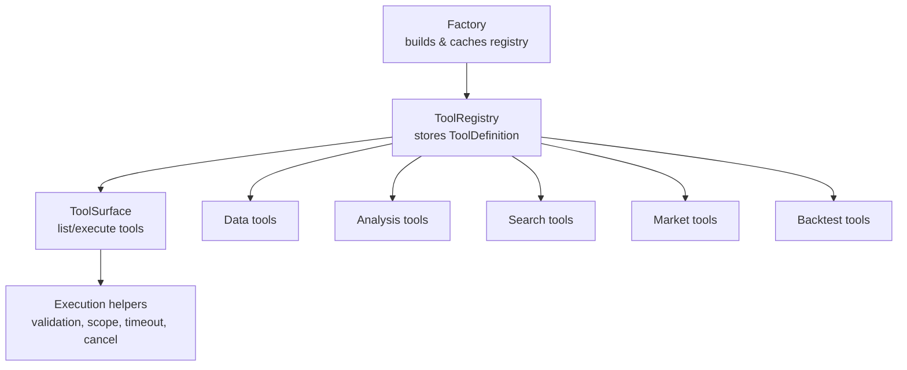
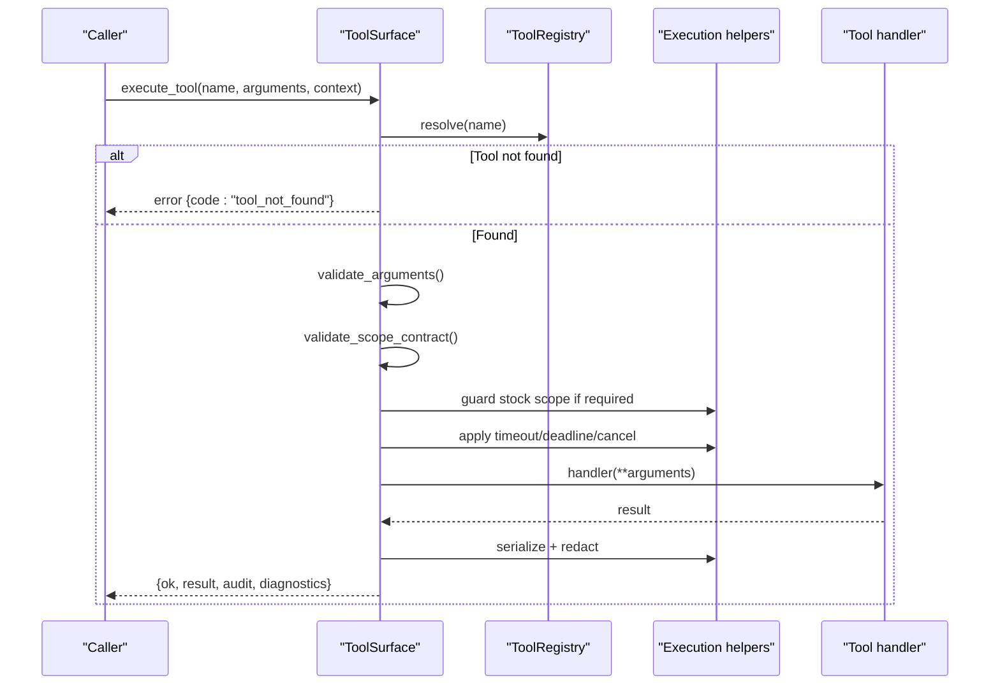
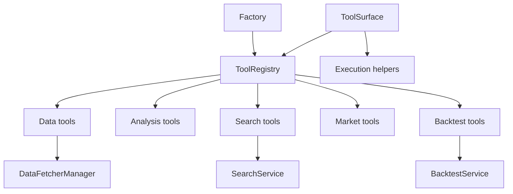

# Tools System

<cite>
**Referenced Files in This Document**
- [registry.py](file://src/agent/tools/registry.py)
- [execution.py](file://src/agent/tools/execution.py)
- [tool_surface.py](file://src/agent/tool_surface.py)
- [factory.py](file://src/agent/factory.py)
- [data_tools.py](file://src/agent/tools/data_tools.py)
- [analysis_tools.py](file://src/agent/tools/analysis_tools.py)
- [search_tools.py](file://src/agent/tools/search_tools.py)
- [market_tools.py](file://src/agent/tools/market_tools.py)
- [backtest_tools.py](file://src/agent/tools/backtest_tools.py)
</cite>

## Table of Contents
1. [Introduction](#introduction)
2. [Project Structure](#project-structure)
3. [Core Components](#core-components)
4. [Architecture Overview](#architecture-overview)
5. [Detailed Component Analysis](#detailed-component-analysis)
6. [Dependency Analysis](#dependency-analysis)
7. [Performance Considerations](#performance-considerations)
8. [Troubleshooting Guide](#troubleshooting-guide)
9. [Conclusion](#conclusion)
10. [Appendices](#appendices)

## Introduction
The Tools System provides a unified, typed, and policy-gated interface for agents to access market data, perform calculations, search intelligence, and review backtests. It centers around a registry mechanism that discovers and registers tools, enforces parameter validation and scope contracts, and exposes consistent execution semantics including timeouts, cancellation, caching, and result redaction. Built-in tool categories include data fetching, technical analysis, search operations, market overview, and backtest summaries. The system also defines clear patterns for creating custom tools and integrating external APIs safely and efficiently.

## Project Structure
The Tools System is organized into:
- Registry and decorator: core definitions for tool metadata, policies, and registration
- Execution helpers: shared runtime controls (timeouts, cancellation), argument normalization, non-retriable result caching, and audit/redaction
- Tool surface: a stable Python API for listing tools, validating arguments, enforcing scope contracts, and executing tools with bounded control
- Factory: builds and caches the global ToolRegistry from all built-in tool modules
- Tool modules: categorized implementations for data, analysis, search, market, and backtest capabilities

**Diagram sources**
- [factory.py:350-449](file://src/agent/factory.py#L350-L449)
- [registry.py:169-315](file://src/agent/tools/registry.py#L169-L315)
- [tool_surface.py:42-267](file://src/agent/tool_surface.py#L42-L267)
- [execution.py:343-388](file://src/agent/tools/execution.py#L343-L388)

**Section sources**
- [factory.py:350-449](file://src/agent/factory.py#L350-L449)
- [registry.py:169-315](file://src/agent/tools/registry.py#L169-L315)
- [tool_surface.py:42-267](file://src/agent/tool_surface.py#L42-L267)
- [execution.py:343-388](file://src/agent/tools/execution.py#L343-L388)

## Core Components
- ToolDefinition and ToolParameter: describe tool name, description, parameters, handler function, category, and policy metadata
- ToolPolicy: declares read-only status, side effects, permissions, scope dimensions, cancellation safety, and per-tool timeout hints
- ToolRegistry: central store for tools; supports registration, lookup, listing by category, schema generation (OpenAI/public/MCP), and execution
- ToolSurface: public execution surface that validates arguments, enforces scope contracts, applies timeouts/cancellation, serializes results, and returns structured responses with audit and diagnostics
- Execution helpers: cooperative cancellation signals, deadline enforcement via checkpoints, stock code normalization, non-retriable result caching, secret redaction, and audit record building
- Factory: constructs and caches ToolRegistry from all built-in tool modules, applying per-category timeout ceilings derived from configuration

Key behaviors:
- Parameter inference from type hints or explicit declarations
- JSON Schema conversion for provider compatibility
- Scope enforcement for tools requiring a stock context
- Non-retriable error caching to prevent LLM retry loops on known failures
- Result serialization and optional truncation to limit payload size

**Section sources**
- [registry.py:26-163](file://src/agent/tools/registry.py#L26-L163)
- [registry.py:169-315](file://src/agent/tools/registry.py#L169-L315)
- [tool_surface.py:42-267](file://src/agent/tool_surface.py#L42-L267)
- [execution.py:91-170](file://src/agent/tools/execution.py#L91-L170)
- [execution.py:202-235](file://src/agent/tools/execution.py#L202-L235)
- [factory.py:350-449](file://src/agent/factory.py#L350-L449)

## Architecture Overview
The Tools System follows a layered architecture:
- Registration layer: ToolRegistry stores ToolDefinition objects created via decorators or direct instantiation
- Surface layer: ToolSurface exposes list and execute methods with strict validation and controlled execution
- Execution layer: Shared helpers enforce deadlines, cancellation, scope guards, and result sanitization
- Tool modules: Implement handlers for specific domains (data, analysis, search, market, backtest)

**Diagram sources**
- [tool_surface.py:71-267](file://src/agent/tool_surface.py#L71-L267)
- [execution.py:343-388](file://src/agent/tools/execution.py#L343-L388)
- [registry.py:198-215](file://src/agent/tools/registry.py#L198-L215)

**Section sources**
- [tool_surface.py:71-267](file://src/agent/tool_surface.py#L71-L267)
- [execution.py:343-388](file://src/agent/tools/execution.py#L343-L388)
- [registry.py:198-215](file://src/agent/tools/registry.py#L198-L215)

## Detailed Component Analysis

### Tool Registry Mechanism
- ToolDefinition encapsulates metadata and handler, plus multi-provider schema converters (OpenAI, public descriptor, MCP)
- ToolPolicy declares operational constraints: read-only, side effects, permissions, scope dimensions, cancellation safety, and per-tool timeout hints
- ToolRegistry manages registration, lookup, listing, and execution; supports category-based filtering and default per-category timeouts
- @tool decorator simplifies registration by inferring parameters from type hints and attaching metadata to functions

Patterns:
- Use ToolPolicy.declared to explicitly declare policy attributes for production-grade tools
- Define parameters explicitly when complex types or enums are involved; otherwise rely on inference
- Attach category to group tools for discovery and timeout mapping

**Section sources**
- [registry.py:26-163](file://src/agent/tools/registry.py#L26-L163)
- [registry.py:169-315](file://src/agent/tools/registry.py#L169-L315)
- [registry.py:334-446](file://src/agent/tools/registry.py#L334-L446)

### Built-in Data Tools
Capabilities:
- Real-time quotes, daily history, chip distribution, analysis context retrieval, stock info, portfolio snapshot, capital flow

Key behaviors:
- Fetcher manager singleton avoids repeated initialization overhead and preserves circuit-breaker state across calls
- Daily history normalizes days, persists new records to DB cache, and returns compact payloads with metadata
- Portfolio snapshot and risk reports are compacted to reduce token usage while preserving key metrics
- Capital flow tool returns structured sector rankings and errors, with support gating for A-share stocks only

Caching strategy:
- History loader uses DB cache first; new data persisted after successful fetch
- Stock code normalization ensures consistent cache keys across HK variants

Error handling:
- Graceful fallbacks when network or sources unavailable
- Explicit retriable flags to prevent LLM retry loops on permanent failures

**Section sources**
- [data_tools.py:22-74](file://src/agent/tools/data_tools.py#L22-L74)
- [data_tools.py:82-132](file://src/agent/tools/data_tools.py#L82-L132)
- [data_tools.py:261-392](file://src/agent/tools/data_tools.py#L261-L392)
- [data_tools.py:444-540](file://src/agent/tools/data_tools.py#L444-L540)
- [data_tools.py:547-648](file://src/agent/tools/data_tools.py#L547-L648)
- [data_tools.py:669-731](file://src/agent/tools/data_tools.py#L669-L731)

### Built-in Analysis Tools
Capabilities:
- Trend analysis using historical data and indicators (MA alignment, MACD, RSI, volume status)
- Moving average calculation for arbitrary periods with bias and alignment summary
- Volume-price relationship analysis including correlation, trends, and pattern interpretation
- Candlestick and chart pattern detection (Doji, Hammer, Engulfing, Double Bottom, breakout, consolidation)

Processing logic:
- Load history via DB-first approach; ensure minimum data windows for reliable analysis
- Compute indicators and derive signals with thresholds and contextual summaries
- Pattern detection uses recent OHLCV windows with deduplication and strength classification

Error handling:
- Insufficient data returns informative errors with required thresholds
- Analyzer exceptions logged and converted to safe error responses

**Section sources**
- [analysis_tools.py:24-107](file://src/agent/tools/analysis_tools.py#L24-L107)
- [analysis_tools.py:114-199](file://src/agent/tools/analysis_tools.py#L114-L199)
- [analysis_tools.py:206-316](file://src/agent/tools/analysis_tools.py#L206-L316)
- [analysis_tools.py:323-523](file://src/agent/tools/analysis_tools.py#L323-L523)

### Built-in Search Tools
Capabilities:
- Latest news search for a stock with title, snippet, source, URL, and publication date
- Multi-dimensional intelligence search aggregating news, market analysis, risk checks, earnings outlook, and industry trends

Integration points:
- Uses SearchService singleton; persists results to DB for evidence tracking
- Records evidence counts even on failed searches to avoid misreporting unconfigured channels

Error handling:
- Returns structured error messages when no search engine available or results empty
- Persists best-effort news intel and logs failures without blocking agent flow

**Section sources**
- [search_tools.py:17-47](file://src/agent/tools/search_tools.py#L17-L47)
- [search_tools.py:49-151](file://src/agent/tools/search_tools.py#L49-L151)
- [search_tools.py:158-241](file://src/agent/tools/search_tools.py#L158-L241)

### Built-in Market Tools
Capabilities:
- Major market indices retrieval for regions (China, Hong Kong, US)
- Sector performance rankings returning top and bottom sectors

Behavior:
- Wraps DataFetcherManager to fetch region-specific indices and sector rankings
- Normalizes output structure for consistent consumption

**Section sources**
- [market_tools.py:16-65](file://src/agent/tools/market_tools.py#L16-L65)
- [market_tools.py:72-117](file://src/agent/tools/market_tools.py#L72-L117)

### Built-in Backtest Tools
Capabilities:
- Overall backtest summary across analysis corpus
- Skill-scoped backtest summaries when available
- Per-stock backtest results with recent evaluations

Behavior:
- Lazy loading of BacktestService singleton to avoid circular dependencies
- Serializes summaries to public payloads with essential fields
- Cooperative cancellation and deadline checkpoints integrated into handlers

Error handling:
- Returns informational responses when backtest data is unavailable
- Logs warnings and converts exceptions to safe error structures

**Section sources**
- [backtest_tools.py:22-47](file://src/agent/tools/backtest_tools.py#L22-L47)
- [backtest_tools.py:53-175](file://src/agent/tools/backtest_tools.py#L53-L175)
- [backtest_tools.py:182-283](file://src/agent/tools/backtest_tools.py#L182-L283)

### Custom Tool Creation Patterns
To create a custom tool:
- Define a handler function with typed parameters
- Create a ToolDefinition with name, description, parameters, handler, category, and policy
- Register via ToolRegistry or use the @tool decorator for automatic registration
- Declare policy attributes for permissions, side effects, scope dimensions, and cancellation safety

Best practices:
- Use ToolPolicy.declared to explicitly set read_only, side_effects, permissions, scope_dimensions, cancellation_safe, and timeout_seconds
- Normalize inputs (e.g., stock codes) to ensure consistent behavior and caching
- Return compact, serializable results; include metadata for debugging and tracing
- Handle errors gracefully and mark non-retriable failures to prevent LLM retry loops

**Section sources**
- [registry.py:334-446](file://src/agent/tools/registry.py#L334-L446)
- [execution.py:202-235](file://src/agent/tools/execution.py#L202-L235)

### Tool Invocation Protocols
Invocation paths:
- Direct registry.execute(name, **kwargs) for programmatic calls
- ToolSurface.execute_tool(name, arguments, context) for validated, controlled execution with audit and diagnostics

Protocol features:
- Argument validation against declared parameters and types
- Scope contract enforcement for stock-scoped tools
- Timeout and deadline enforcement with cooperative cancellation
- Result serialization, optional redaction, and truncation
- Structured response with ok flag, result, error details, audit, and diagnostics

**Section sources**
- [registry.py:302-315](file://src/agent/tools/registry.py#L302-L315)
- [tool_surface.py:71-267](file://src/agent/tool_surface.py#L71-L267)
- [execution.py:343-388](file://src/agent/tools/execution.py#L343-L388)

### Parameter Validation and Error Handling
Validation:
- Required parameters enforced; unexpected arguments rejected unless handler accepts extra kwargs
- Type checking for string, integer, number, boolean, array, object; enum constraints supported
- Null values rejected for arguments

Error handling:
- ToolSurface returns structured errors with codes like invalid_arguments, scope_contract_violation, cancelled, timeout, handler_error
- Non-retriable results cached to prevent LLM retry loops
- Secret redaction applied to results and diagnostics to protect sensitive data

**Section sources**
- [tool_surface.py:333-420](file://src/agent/tool_surface.py#L333-L420)
- [execution.py:221-235](file://src/agent/tools/execution.py#L221-L235)
- [execution.py:329-341](file://src/agent/tools/execution.py#L329-L341)

### Caching Strategies
Strategies:
- DataFetcherManager singleton avoids repeated initialization and preserves circuit-breaker state
- Daily history persistence to DB cache; subsequent reads served from cache with metadata indicating source
- Stock code normalization ensures consistent cache keys across variants (e.g., HK formats)
- Non-retriable tool result caching prevents LLM retry loops on known failures

Optimization:
- Compact payloads for fundamental context and portfolio snapshots to reduce token usage
- Limit results (e.g., top positions, recent evaluations) to balance detail and efficiency

**Section sources**
- [data_tools.py:47-74](file://src/agent/tools/data_tools.py#L47-L74)
- [data_tools.py:116-132](file://src/agent/tools/data_tools.py#L116-L132)
- [execution.py:202-235](file://src/agent/tools/execution.py#L202-L235)

### Integrating External APIs
Patterns:
- Wrap external services behind a service class (e.g., SearchService, DataFetcherManager)
- Use lazy imports to avoid circular dependencies and reduce startup cost
- Persist results where appropriate (e.g., news intel) for traceability and reuse
- Handle availability checks and return structured errors when services are unavailable

Examples:
- Search tools integrate with SearchService for news and comprehensive intel
- Data tools integrate with DataFetcherManager for market data and fundamentals
- Backtest tools integrate with BacktestService for performance summaries

**Section sources**
- [search_tools.py:37-47](file://src/agent/tools/search_tools.py#L37-L47)
- [data_tools.py:53-74](file://src/agent/tools/data_tools.py#L53-L74)
- [backtest_tools.py:40-47](file://src/agent/tools/backtest_tools.py#L40-L47)

### Optimizing Tool Performance for High-Frequency Usage
Recommendations:
- Use singleton managers (DataFetcherManager, BacktestService) to avoid repeated initialization
- Normalize inputs to leverage caching and reduce redundant computations
- Return compact results and limit lists to top N items where appropriate
- Apply timeouts and deadlines to bound execution time and prevent resource exhaustion
- Mark non-retriable failures to prevent LLM retry storms

High-frequency patterns:
- Daily history with DB cache and persistence
- Portfolio snapshot with compacted accounts and positions
- Backtest summaries with limited recent evaluations

**Section sources**
- [data_tools.py:47-74](file://src/agent/tools/data_tools.py#L47-L74)
- [data_tools.py:135-255](file://src/agent/tools/data_tools.py#L135-L255)
- [backtest_tools.py:182-283](file://src/agent/tools/backtest_tools.py#L182-L283)

## Dependency Analysis
The Tools System has clear dependency boundaries:
- Tool modules depend on registry and execution helpers for metadata and runtime controls
- ToolSurface depends on registry and execution helpers for validation and execution
- Factory depends on tool modules to build and cache the registry
- Data tools depend on DataFetcherManager and storage services
- Search tools depend on SearchService and storage services
- Backtest tools depend on BacktestService

**Diagram sources**
- [factory.py:350-449](file://src/agent/factory.py#L350-L449)
- [tool_surface.py:42-267](file://src/agent/tool_surface.py#L42-L267)
- [execution.py:343-388](file://src/agent/tools/execution.py#L343-L388)
- [data_tools.py:53-74](file://src/agent/tools/data_tools.py#L53-L74)
- [search_tools.py:37-47](file://src/agent/tools/search_tools.py#L37-L47)
- [backtest_tools.py:40-47](file://src/agent/tools/backtest_tools.py#L40-L47)

**Section sources**
- [factory.py:350-449](file://src/agent/factory.py#L350-L449)
- [tool_surface.py:42-267](file://src/agent/tool_surface.py#L42-L267)
- [execution.py:343-388](file://src/agent/tools/execution.py#L343-L388)

## Performance Considerations
- Singleton managers reduce initialization overhead and preserve circuit-breaker state
- DB caching for daily history minimizes network calls and improves latency
- Compact payloads reduce token usage and improve throughput
- Timeouts and deadlines prevent long-running tools from blocking resources
- Non-retriable result caching prevents LLM retry loops on known failures
- Lazy imports avoid circular dependencies and reduce startup cost

[No sources needed since this section provides general guidance]

## Troubleshooting Guide
Common issues and resolutions:
- Tool not found: Ensure tool name matches registered name exactly; check registry contents
- Invalid arguments: Verify parameter types and required fields; use ToolSurface validation
- Scope violations: Provide correct stock scope for stock-scoped tools; ensure stock_code matches expected or allowed codes
- Timeouts and cancellations: Check tool policy cancellation safety; adjust timeouts and deadlines; implement cooperative checkpoints in long-running handlers
- Network failures: Verify data source availability; handle retriable vs non-retriable errors appropriately
- Cache misses: Normalize stock codes; verify DB persistence; check canonical code mappings

Diagnostic tools:
- Audit records provide tool name, arguments summary, duration, result summary, and error codes
- Diagnostics include redacted previews, result length, and truncation status
- Logging captures warnings and errors for tool execution failures

**Section sources**
- [tool_surface.py:269-315](file://src/agent/tool_surface.py#L269-L315)
- [execution.py:391-438](file://src/agent/tools/execution.py#L391-L438)
- [data_tools.py:261-392](file://src/agent/tools/data_tools.py#L261-L392)
- [search_tools.py:85-151](file://src/agent/tools/search_tools.py#L85-L151)
- [backtest_tools.py:71-175](file://src/agent/tools/backtest_tools.py#L71-L175)

## Conclusion
The Tools System provides a robust, extensible framework for enabling agents to access market data, perform analysis, search intelligence, and review backtests. Its registry mechanism, parameter validation, scope enforcement, and execution controls ensure safe and efficient tool usage. Built-in tools cover key domains with optimized caching and compact payloads. Custom tools can be created following established patterns for metadata, policy declaration, and error handling. The system’s design supports high-frequency usage through singleton managers, DB caching, timeouts, and non-retriable result caching.

[No sources needed since this section summarizes without analyzing specific files]

## Appendices

### Tool Categories and Examples
- Data: get_realtime_quote, get_daily_history, get_chip_distribution, get_analysis_context, get_stock_info, get_portfolio_snapshot, get_capital_flow
- Analysis: analyze_trend, calculate_ma, get_volume_analysis, analyze_pattern
- Search: search_stock_news, search_comprehensive_intel
- Market: get_market_indices, get_sector_rankings
- Backtest: get_skill_backtest_summary, get_strategy_backtest_summary, get_stock_backtest_summary

**Section sources**
- [data_tools.py:655-731](file://src/agent/tools/data_tools.py#L655-L731)
- [analysis_tools.py:526-532](file://src/agent/tools/analysis_tools.py#L526-L532)
- [search_tools.py:237-241](file://src/agent/tools/search_tools.py#L237-L241)
- [market_tools.py:113-117](file://src/agent/tools/market_tools.py#L113-L117)
- [backtest_tools.py:278-283](file://src/agent/tools/backtest_tools.py#L278-L283)