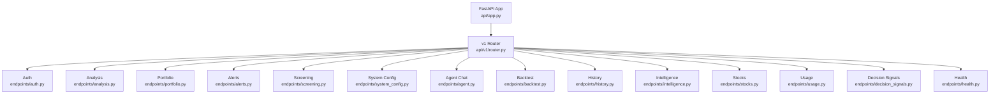
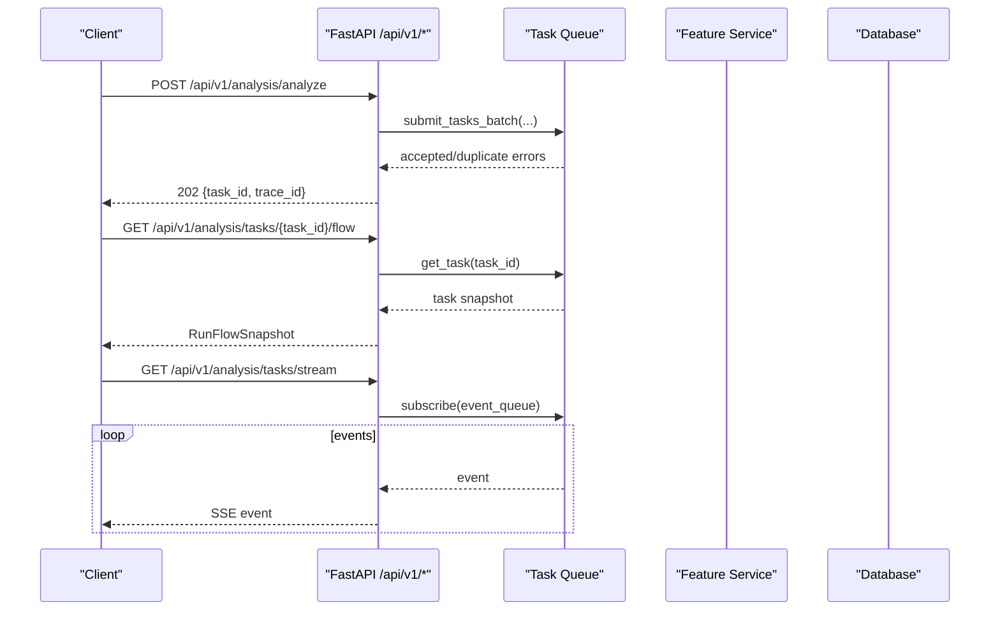
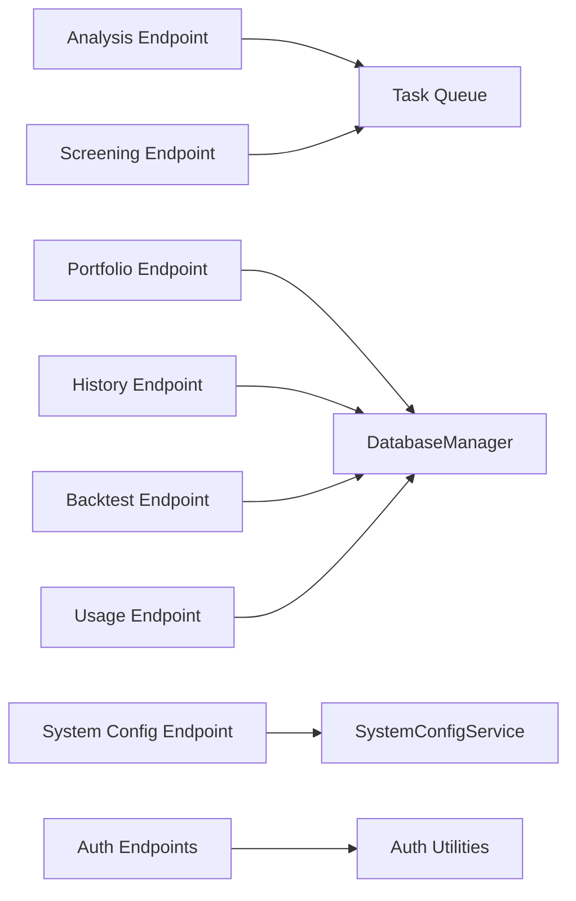

# API Reference

<cite>
**Referenced Files in This Document**
- [app.py](file://api/app.py)
- [router.py](file://api/v1/router.py)
- [analysis.py](file://api/v1/endpoints/analysis.py)
- [auth.py](file://api/v1/endpoints/auth.py)
- [portfolio.py](file://api/v1/endpoints/portfolio.py)
- [alerts.py](file://api/v1/endpoints/alerts.py)
- [screening.py](file://api/v1/endpoints/screening.py)
- [system_config.py](file://api/v1/endpoints/system_config.py)
- [agent.py](file://api/v1/endpoints/agent.py)
- [backtest.py](file://api/v1/endpoints/backtest.py)
- [history.py](file://api/v1/endpoints/history.py)
- [intelligence.py](file://api/v1/endpoints/intelligence.py)
- [stocks.py](file://api/v1/endpoints/stocks.py)
- [usage.py](file://api/v1/endpoints/usage.py)
- [decision_signals.py](file://api/v1/endpoints/decision_signals.py)
- [health.py](file://api/v1/endpoints/health.py)
</cite>

## Table of Contents
1. Introduction
2. Project Structure
3. Core Components
4. Architecture Overview
5. Detailed Component Analysis
6. Dependency Analysis
7. Performance Considerations
8. Troubleshooting Guide
9. Conclusion
10. Appendices

## Introduction
This document provides a comprehensive API reference for the DailyStockAnalysis REST API. It covers all public endpoints grouped by feature: analysis, authentication, portfolio, alerts, screening, system configuration, agent chat, backtesting, history, intelligence, stocks, usage, decision signals, and health. For each endpoint group, you will find HTTP methods, URL patterns, request/response schemas, error codes, rate limiting notes, and real-time streaming details where applicable. Authentication flows, token management, security best practices, and client implementation guidelines are included to help consumers integrate safely and efficiently.

## Project Structure
The API is built with FastAPI. The application factory configures CORS, mounts the v1 router under /api/v1, registers error handlers, and serves optional static assets. Each feature area is implemented as a separate router module under api/v1/endpoints.

**Diagram sources**
- [app.py:313-384](file://api/app.py#L313-L384)
- [router.py:35-116](file://api/v1/router.py#L35-L116)

**Section sources**
- [app.py:313-384](file://api/app.py#L313-L384)
- [router.py:35-116](file://api/v1/router.py#L35-L116)

## Core Components
- Application lifecycle and middleware: CORS, auth middleware injection, error handlers, SPA/static asset serving, stock index file serving.
- Versioned routing: All features are mounted under /api/v1 via a central router that includes sub-routers per feature.
- Task queue integration: Long-running tasks (analysis, screening, market review) submit to an in-process task queue and expose status/streaming endpoints.
- Schemas: Pydantic models define request/response contracts across modules.

Key responsibilities:
- Health checks at both root and /api/health.
- Optional admin session-based authentication for protected routes.
- SSE streams for agent chat progress and analysis task updates.

**Section sources**
- [app.py:157-170](file://api/app.py#L157-L170)
- [app.py:313-384](file://api/app.py#L313-L384)
- [router.py:35-116](file://api/v1/router.py#L35-L116)

## Architecture Overview
The API exposes REST endpoints grouped by domain. Some operations are synchronous; others are asynchronous and return a task identifier for polling or streaming. Real-time updates use Server-Sent Events (SSE).

**Diagram sources**
- [analysis.py:263-351](file://api/v1/endpoints/analysis.py#L263-L351)
- [analysis.py:591-659](file://api/v1/endpoints/analysis.py#L591-L659)
- [analysis.py:666-730](file://api/v1/endpoints/analysis.py#L666-L730)

## Detailed Component Analysis

### Authentication
Authentication uses an optional admin session cookie. When enabled, most endpoints require a valid session cookie; otherwise, they are open. Login sets a secure, HttpOnly, SameSite=Lax cookie. Rate limiting protects login and sensitive settings changes.

Endpoints
- GET /api/v1/auth/status
  - Purpose: Read auth state without requiring authentication.
  - Response fields: authEnabled, loggedIn, passwordSet, passwordChangeable, setupState.
- POST /api/v1/auth/login
  - Purpose: Set initial password or authenticate and set session cookie.
  - Request body: password, passwordConfirm (first-time only).
  - Responses: 200 on success, 400 if auth disabled or validation fails, 401 invalid password, 429 rate limited.
- POST /api/v1/auth/change-password
  - Purpose: Change password (requires current password and valid session when applicable).
  - Status: 204 on success.
- POST /api/v1/auth/logout
  - Purpose: Clear session cookie.
  - Status: 204 on success.
- POST /api/v1/auth/settings
  - Purpose: Enable/disable admin authentication and manage initial password.
  - Security: Disabling/enabling may require current password re-authentication.

Security and rate limiting
- Cookie attributes: httponly, samesite=lax, secure based on scheme/proxy headers, configurable max age.
- Rate limiting applied to login and high-risk settings changes.

Example flow
- Client calls POST /api/v1/auth/login with password. On success, server sets a session cookie. Subsequent requests include the cookie automatically.

**Section sources**
- [auth.py:42-69](file://api/v1/endpoints/auth.py#L42-L69)
- [auth.py:72-94](file://api/v1/endpoints/auth.py#L72-L94)
- [auth.py:157-192](file://api/v1/endpoints/auth.py#L157-L192)
- [auth.py:195-358](file://api/v1/endpoints/auth.py#L195-L358)
- [auth.py:362-483](file://api/v1/endpoints/auth.py#L362-L483)

### Analysis
Triggers AI-driven stock analysis with support for single-stock sync mode and async batch mode. Returns immediate results in sync mode or a task ID in async mode. Provides task listing, run-flow snapshots, and SSE stream for live progress.

Endpoints
- POST /api/v1/analysis/analyze
  - Request: stock_code or stock_codes, report_type, analysis_phase, force_refresh, notify, skills, report_language, async_mode.
  - Behavior: Sync returns full result; async submits tasks and returns 202 with task identifiers. Duplicate submissions for the same stock are rejected with 409.
  - Limits: Max batch size enforced.
- GET /api/v1/analysis/tasks
  - Query: status (comma-separated), limit.
  - Response: aggregated stats and task list.
- GET /api/v1/analysis/tasks/stream
  - SSE: connected, task_created, task_started, task_progress, task_completed, task_failed, heartbeat every ~30s.
- GET /api/v1/analysis/tasks/{task_id}/flow
  - Response: RunFlowSnapshot for active/completed tasks.
- POST /api/v1/analysis/market-review
  - Async background market review submission with region and notification options.

Common parameters
- stock_code: Single stock code or name (resolved to canonical code).
- stock_codes: Array for batch analysis.
- report_type: e.g., detailed.
- analysis_phase: premarket/intraday/postmarket.
- force_refresh: boolean.
- notify: boolean.
- skills: optional skill IDs.
- report_language: optional language override.

Error codes
- 400 validation_error: invalid input or constraints.
- 409 duplicate_task: stock already being analyzed.
- 500 internal_error: processing failure.

Example usage
- Trigger async analysis for multiple stocks and poll /tasks or connect to /tasks/stream for progress.

**Section sources**
- [analysis.py:263-351](file://api/v1/endpoints/analysis.py#L263-L351)
- [analysis.py:354-451](file://api/v1/endpoints/analysis.py#L354-L451)
- [analysis.py:454-516](file://api/v1/endpoints/analysis.py#L454-L516)
- [analysis.py:522-584](file://api/v1/endpoints/analysis.py#L522-L584)
- [analysis.py:591-659](file://api/v1/endpoints/analysis.py#L591-L659)
- [analysis.py:666-730](file://api/v1/endpoints/analysis.py#L666-L730)
- [analysis.py:775-800](file://api/v1/endpoints/analysis.py#L775-L800)

### Portfolio
Manage accounts, trades, cash ledger, corporate actions, snapshots, risk reports, CSV imports, and FX rates.

Endpoints
- Accounts: POST /accounts, GET /accounts, PUT /accounts/{id}, DELETE /accounts/{id}
- Trades: POST /trades, GET /trades, DELETE /trades/{id}
- Cash Ledger: POST /cash-ledger, GET /cash-ledger, DELETE /cash-ledger/{id}
- Corporate Actions: POST /corporate-actions, GET /corporate-actions, DELETE /corporate-actions/{id}
- Snapshot: GET /snapshot?account_id&as_of&cost_method&include_realtime
- Position Analysis: POST /positions/{symbol}/analysis (async, 202)
- CSV Import: POST /imports/csv/parse, GET /imports/csv/brokers, POST /imports/csv/commit
- FX Refresh: POST /fx/refresh
- Risk Report: GET /risk

Notes
- Many mutations return conflict errors (e.g., portfolio_busy, oversell, conflict).
- Pagination supported on list endpoints with page/page_size.

**Section sources**
- [portfolio.py:76-160](file://api/v1/endpoints/portfolio.py#L76-L160)
- [portfolio.py:163-250](file://api/v1/endpoints/portfolio.py#L163-L250)
- [portfolio.py:253-328](file://api/v1/endpoints/portfolio.py#L253-L328)
- [portfolio.py:331-411](file://api/v1/endpoints/portfolio.py#L331-L411)
- [portfolio.py:414-492](file://api/v1/endpoints/portfolio.py#L414-L492)
- [portfolio.py:558-677](file://api/v1/endpoints/portfolio.py#L558-L677)

### Alerts
Create, update, enable/disable, test alert rules; view triggers and notifications.

Endpoints
- Rules: POST /rules, GET /rules, GET /rules/{id}, PATCH /rules/{id}, DELETE /rules/{id}
- Control: POST /rules/{id}/enable, POST /rules/{id}/disable
- Test: POST /rules/{id}/test
- Triggers: GET /triggers
- Notifications: GET /notifications

Filters and pagination
- Rule list supports enabled, alert_type, target_scope, target, source filters.
- Triggers and notifications support filtering and pagination.

**Section sources**
- [alerts.py:56-158](file://api/v1/endpoints/alerts.py#L56-L158)
- [alerts.py:161-206](file://api/v1/endpoints/alerts.py#L161-L206)
- [alerts.py:209-263](file://api/v1/endpoints/alerts.py#L209-L263)

### Screening
Run stock screening strategies asynchronously or synchronously; query hotspots, strategies, and history.

Endpoints
- Status: GET /status
- Strategies: GET /strategies
- Hotspots: GET /hotspots, GET /hotspots/{topic}
- Async task: POST /screen/tasks (202)
- Task status: GET /screen/tasks/{task_id}
- Sync screen: POST /screen
- History: GET /history, GET /history/{run_id}
- Source history: GET /source-history

Request shape
- market, strategy, max_results, variant_seed.

Progress reporting
- Background tasks update progress via the task queue; poll status endpoint for completion and result.

**Section sources**
- [screening.py:76-130](file://api/v1/endpoints/screening.py#L76-L130)
- [screening.py:133-202](file://api/v1/endpoints/screening.py#L133-L202)
- [screening.py:205-251](file://api/v1/endpoints/screening.py#L205-L251)

### System Configuration
Read, validate, update, export/import configuration; test generation backends and channels; discover models; get schema.

Endpoints
- Scheduler: GET /scheduler/status, POST /scheduler/run-now
- Config: GET /config, PUT /config, GET /config/schema
- Setup: GET /config/setup/status
- Generation Backends: GET /config/generation-backends/status, POST /config/generation-backends/status/preview, POST /config/generation-backends/smoke-test
- Agent Backends: GET /config/agent-backends/status, POST /config/agent-backends/status/preview
- Export/Import: GET /config/export, POST /config/import (protected by session in non-desktop mode)
- Validation: POST /config/validate
- LLM Channel: POST /config/llm/test-channel, POST /config/llm/discover-models
- Notification Channel: POST /config/notification/test-channel

Security
- Export/import gated by admin session unless running in desktop mode.

**Section sources**
- [system_config.py:51-82](file://api/v1/endpoints/system_config.py#L51-L82)
- [system_config.py:94-127](file://api/v1/endpoints/system_config.py#L94-L127)
- [system_config.py:130-190](file://api/v1/endpoints/system_config.py#L130-L190)
- [system_config.py:193-263](file://api/v1/endpoints/system_config.py#L193-L263)
- [system_config.py:266-317](file://api/v1/endpoints/system_config.py#L266-L317)
- [system_config.py:320-361](file://api/v1/endpoints/system_config.py#L320-L361)
- [system_config.py:364-415](file://api/v1/endpoints/system_config.py#L364-L415)
- [system_config.py:418-534](file://api/v1/endpoints/system_config.py#L418-L534)
- [system_config.py:537-729](file://api/v1/endpoints/system_config.py#L537-L729)

### Agent Chat
Chat with the AI agent, retrieve available models/skills, and stream progress via SSE.

Endpoints
- Models: GET /agent/models
- Skills: GET /agent/skills
- Status: GET /agent/status
- Chat (sync): POST /agent/chat
- Research: POST /agent/research
- Chat (stream): POST /agent/chat/stream (SSE)
- Cancel stream: POST /agent/chat/stream/{request_id}/cancel
- Sessions: GET /agent/chat/sessions, GET /agent/chat/sessions/{session_id}, DELETE /agent/chat/sessions/{session_id}
- Send to notifications: POST /agent/chat/send

Streaming events
- accepted, thinking, stage_start, stage_done, tool_start, tool_done, generating, pipeline_timeout, pipeline_budget_skipped, done, error.

Notes
- Codex backend requires streaming interface; cancellation supported.

**Section sources**
- [agent.py:118-195](file://api/v1/endpoints/agent.py#L118-L195)
- [agent.py:197-252](file://api/v1/endpoints/agent.py#L197-L252)
- [agent.py:274-321](file://api/v1/endpoints/agent.py#L274-L321)
- [agent.py:331-357](file://api/v1/endpoints/agent.py#L331-L357)
- [agent.py:414-473](file://api/v1/endpoints/agent.py#L414-L473)
- [agent.py:476-678](file://api/v1/endpoints/agent.py#L476-L678)

### Backtest
Run backtests over historical analysis records and retrieve results/performance summaries.

Endpoints
- Run: POST /backtest/run
- Results: GET /backtest/results (filters: code, eval_window_days, date range, phase, pagination)
- Overall performance: GET /backtest/performance
- Stock performance: GET /backtest/performance/{code}

Parameters
- analysis_date_from/to must be ordered; phase filter accepts premarket/intraday/postmarket/unknown.

**Section sources**
- [backtest.py:45-85](file://api/v1/endpoints/backtest.py#L45-L85)
- [backtest.py:88-140](file://api/v1/endpoints/backtest.py#L88-L140)
- [backtest.py:143-242](file://api/v1/endpoints/backtest.py#L143-L242)

### History
List, retrieve, and delete historical analysis reports; fetch news and diagnostics; get stock bar summary.

Endpoints
- List: GET /history (filters: stock_code, report_type, start_date, end_date, pagination)
- Detail: GET /history/{record_id}
- Diagnostics: GET /history/{record_id}/diagnostics
- Run flow: GET /history/{record_id}/flow
- News: GET /history/{record_id}/news
- Delete by code: DELETE /history/by-code/{stock_code}
- Delete by ids: DELETE /history (body: record_ids)
- Stock bar: GET /history/stocks

Notes
- Supports normalized stock code grouping for deduplication.

**Section sources**
- [history.py:206-296](file://api/v1/endpoints/history.py#L206-L296)
- [history.py:299-394](file://api/v1/endpoints/history.py#L299-L394)
- [history.py:397-489](file://api/v1/endpoints/history.py#L397-L489)
- [history.py:502-669](file://api/v1/endpoints/history.py#L502-L669)
- [history.py:672-755](file://api/v1/endpoints/history.py#L672-L755)
- [history.py:758-800](file://api/v1/endpoints/history.py#L758-L800)

### Intelligence
Manage intelligence sources, templates, fetch data, and list persisted items.

Endpoints
- Sources: POST /intelligence/sources, GET /intelligence/sources
- Templates: GET /intelligence/sources/templates, POST /intelligence/sources/templates/{template_id}
- Defaults: POST /intelligence/sources/defaults
- Test payload: POST /intelligence/sources/test
- Fetch: POST /intelligence/sources/{source_id}/fetch, POST /intelligence/sources/fetch-enabled
- Items: GET /intelligence/items

Filters
- Enabled/source_type/scope_type/market/pagination for lists; days/query for items.

**Section sources**
- [intelligence.py:48-106](file://api/v1/endpoints/intelligence.py#L48-L106)
- [intelligence.py:109-151](file://api/v1/endpoints/intelligence.py#L109-L151)
- [intelligence.py:154-171](file://api/v1/endpoints/intelligence.py#L154-L171)

### Stocks
Extract stock codes from images, parse imports, manage watchlist, and fetch quotes/history.

Endpoints
- Image extraction: POST /stocks/extract-from-image
- Parse import: POST /stocks/parse-import (multipart or JSON text)
- Watchlist: GET /stocks/watchlist, POST /stocks/watchlist/add, POST /stocks/watchlist/remove
- Quote: GET /stocks/{stock_code}/quote
- History: GET /stocks/{stock_code}/history?period=daily|weekly|monthly&days

Validation
- Stock codes validated against supported formats and normalized.

**Section sources**
- [stocks.py:121-195](file://api/v1/endpoints/stocks.py#L121-L195)
- [stocks.py:198-313](file://api/v1/endpoints/stocks.py#L198-L313)
- [stocks.py:316-405](file://api/v1/endpoints/stocks.py#L316-L405)
- [stocks.py:408-556](file://api/v1/endpoints/stocks.py#L408-L556)

### Usage
LLM token usage summaries and dashboard.

Endpoints
- Summary: GET /usage/summary?period=today|month|all
- Dashboard: GET /usage/dashboard?period&limit

Output
- Aggregated totals, breakdowns by call type/model, recent calls.

**Section sources**
- [usage.py:67-101](file://api/v1/endpoints/usage.py#L67-L101)

### Decision Signals
Admin-protected endpoints for creating, querying, and managing decision signals and outcomes.

Protection
- Requires admin session cookie when auth is enabled.

Endpoints
- Create/list: POST /decision-signals, GET /decision-signals
- Outcomes: POST /decision-signals/outcomes/run, GET /decision-signals/outcomes, GET /decision-signals/outcomes/stats
- Reassess: POST /decision-signals/reassess
- Latest active: GET /decision-signals/latest/{stock_code}
- Get signal: GET /decision-signals/{signal_id}
- Signal outcomes: GET /decision-signals/{signal_id}/outcomes
- Feedback: GET /decision-signals/{signal_id}/feedback, PUT /decision-signals/{signal_id}/feedback
- Status update: PATCH /decision-signals/{signal_id}/status

**Section sources**
- [decision_signals.py:47-52](file://api/v1/endpoints/decision_signals.py#L47-L52)
- [decision_signals.py:101-130](file://api/v1/endpoints/decision_signals.py#L101-L130)
- [decision_signals.py:133-207](file://api/v1/endpoints/decision_signals.py#L133-L207)
- [decision_signals.py:210-323](file://api/v1/endpoints/decision_signals.py#L210-L323)
- [decision_signals.py:326-397](file://api/v1/endpoints/decision_signals.py#L326-L397)
- [decision_signals.py:400-542](file://api/v1/endpoints/decision_signals.py#L400-L542)

### Health
- GET /health and GET /api/health return service status and timestamp.

**Section sources**
- [app.py:435-454](file://api/app.py#L435-L454)
- [health.py:21-34](file://api/v1/endpoints/health.py#L21-L34)

## Dependency Analysis
- Feature routers depend on services and shared components:
  - Task queue for long-running jobs (analysis, screening, market review).
  - Database manager for persistence (history, backtest, usage, portfolio).
  - System config service for dynamic settings and environment-backed configuration.
  - Auth utilities for session handling and rate limiting.

**Diagram sources**
- [analysis.py:81-86](file://api/v1/endpoints/analysis.py#L81-L86)
- [screening.py:12-18](file://api/v1/endpoints/screening.py#L12-L18)
- [portfolio.py:38-46](file://api/v1/endpoints/portfolio.py#L38-L46)
- [history.py:18-38](file://api/v1/endpoints/history.py#L18-L38)
- [backtest.py:12-22](file://api/v1/endpoints/backtest.py#L12-L22)
- [usage.py:12-14](file://api/v1/endpoints/usage.py#L12-L14)
- [system_config.py:8-44](file://api/v1/endpoints/system_config.py#L8-L44)
- [auth.py:14-35](file://api/v1/endpoints/auth.py#L14-L35)

**Section sources**
- [analysis.py:81-86](file://api/v1/endpoints/analysis.py#L81-L86)
- [screening.py:12-18](file://api/v1/endpoints/screening.py#L12-L18)
- [portfolio.py:38-46](file://api/v1/endpoints/portfolio.py#L38-L46)
- [history.py:18-38](file://api/v1/endpoints/history.py#L18-L38)
- [backtest.py:12-22](file://api/v1/endpoints/backtest.py#L12-L22)
- [usage.py:12-14](file://api/v1/endpoints/usage.py#L12-L14)
- [system_config.py:8-44](file://api/v1/endpoints/system_config.py#L8-L44)
- [auth.py:14-35](file://api/v1/endpoints/auth.py#L14-L35)

## Performance Considerations
- Prefer async_mode=true for analysis to avoid blocking requests; poll tasks or use SSE.
- Use pagination on list endpoints to limit payload sizes.
- Batch analysis supports up to a defined maximum; respect limits to prevent overload.
- SSE streams send heartbeats; handle timeouts gracefully on the client side.
- Screening background tasks update progress; poll status endpoints for completion.

[No sources needed since this section provides general guidance]

## Troubleshooting Guide
Common issues and resolutions
- 400 validation_error: Check required fields and value constraints (e.g., stock code format, date ranges).
- 409 duplicate_task: A task for the same stock is already running; wait or cancel if supported.
- 404 not_found: Ensure resource IDs exist; verify normalization of stock codes.
- 429 rate_limited: Too many failed attempts on login or sensitive settings; retry after delay.
- SSE disconnects: Implement reconnect logic; consume heartbeat events to detect liveness.

Diagnostics
- Use /history/{record_id}/diagnostics and /history/{record_id}/flow to inspect past runs.
- Use /usage/dashboard to monitor token usage and recent calls.

**Section sources**
- [analysis.py:263-351](file://api/v1/endpoints/analysis.py#L263-L351)
- [history.py:672-755](file://api/v1/endpoints/history.py#L672-L755)
- [usage.py:83-101](file://api/v1/endpoints/usage.py#L83-L101)

## Conclusion
The DailyStockAnalysis API offers a robust set of endpoints for stock analysis, portfolio management, alerts, screening, system configuration, agent chat, backtesting, history, intelligence, stocks, usage, decision signals, and health monitoring. Use async modes and SSE for long-running operations, adhere to authentication and rate limiting, and leverage diagnostics and usage endpoints for observability.

[No sources needed since this section summarizes without analyzing specific files]

## Appendices

### WebSocket vs SSE Note
- The API uses Server-Sent Events (SSE) for real-time streaming rather than WebSockets.
- Key SSE endpoints:
  - /api/v1/analysis/tasks/stream for analysis task updates.
  - /api/v1/agent/chat/stream for agent chat progress.

[No sources needed since this section provides general guidance]

### Example Requests and Responses

- Trigger stock analysis (async)
  - Method: POST
  - Path: /api/v1/analysis/analyze
  - Body: { stock_codes: ["600519.SH"], report_type: "detailed", async_mode: true }
  - Success response (202): { task_id, trace_id, status: "pending", message, analysis_phase }
  - Error (409): { error: "duplicate_task", existing_task_id }

- Retrieve task run flow
  - Method: GET
  - Path: /api/v1/analysis/tasks/{task_id}/flow
  - Success response (200): RunFlowSnapshot object

- Connect to analysis task stream
  - Method: GET
  - Path: /api/v1/analysis/tasks/stream
  - Events: connected, task_created, task_progress, task_completed, heartbeat

- Get portfolio snapshot
  - Method: GET
  - Path: /api/v1/portfolio/snapshot?account_id=1&as_of=2025-01-01&cost_method=fifo&include_realtime=true
  - Success response (200): PortfolioSnapshotResponse

- Manage alerts
  - Create rule: POST /api/v1/alerts/rules
  - List triggers: GET /api/v1/alerts/triggers?rule_id=...&page=1&page_size=20

- Screening task
  - Start: POST /api/v1/screening/screen/tasks with { market: "cn", strategy: "dual_low", max_results: 20 }
  - Status: GET /api/v1/screening/screen/tasks/{task_id}

- System configuration
  - Update: PUT /api/v1/system/config with versioned items
  - Validate: POST /api/v1/system/config/validate

- Agent chat stream
  - Start: POST /api/v1/agent/chat/stream
  - Events: accepted, thinking, tool_start, tool_done, generating, done, error
  - Cancel: POST /api/v1/agent/chat/stream/{request_id}/cancel

[No sources needed since this section provides example usage patterns]