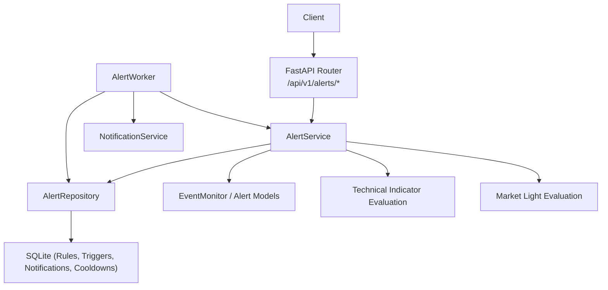
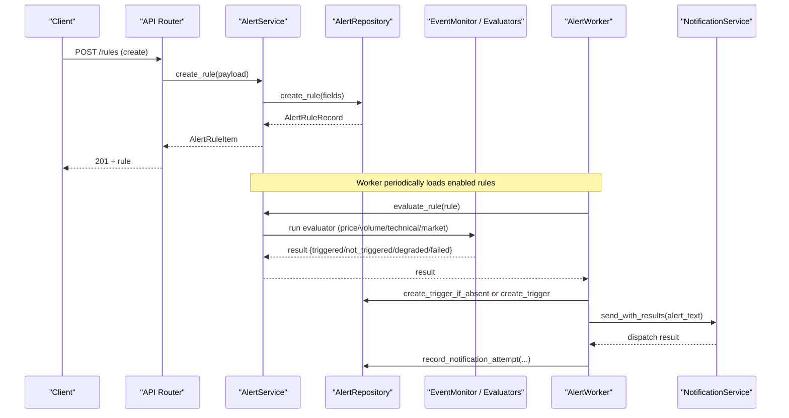
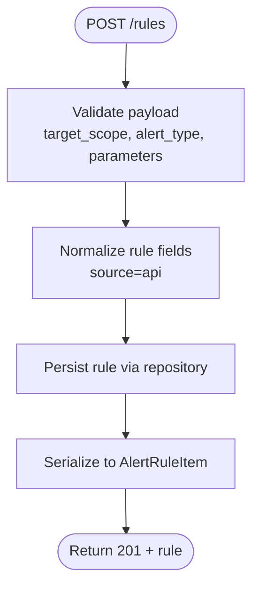
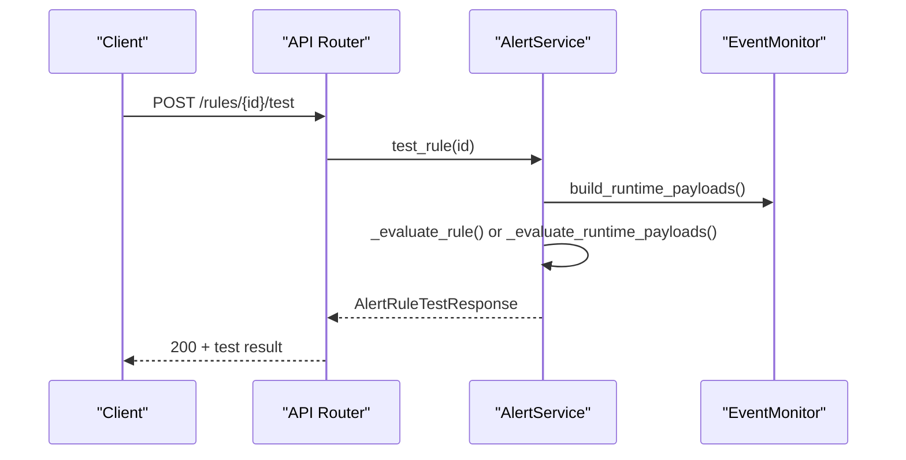
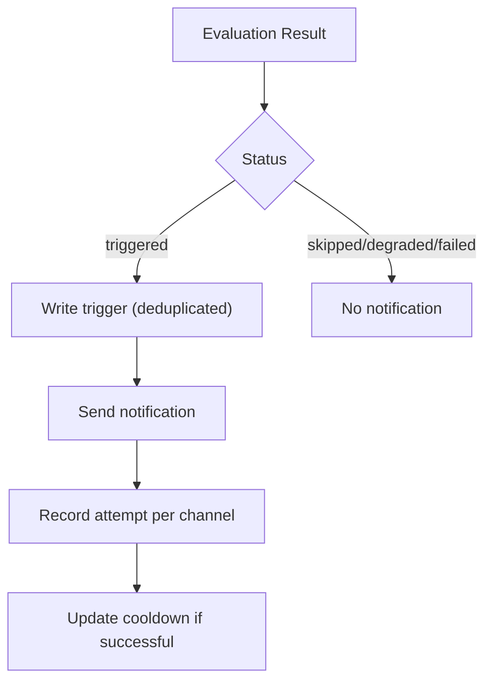
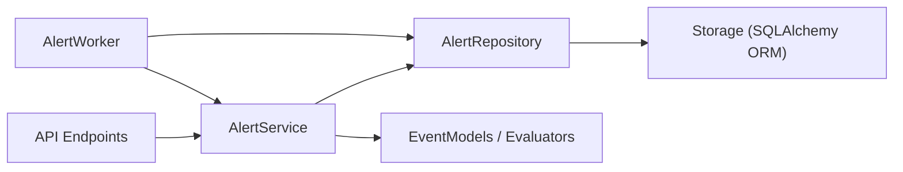

# Alerts API

<cite>
**Referenced Files in This Document**
- [alerts.py](file://api/v1/endpoints/alerts.py)
- [alerts.py](file://api/v1/schemas/alerts.py)
- [alert_service.py](file://src/services/alert_service.py)
- [alert_worker.py](file://src/services/alert_worker.py)
- [events.py](file://src/agent/events.py)
- [alert_repo.py](file://src/repositories/alert_repo.py)
- [storage.py](file://src/storage.py)
- [alerts.md](file://docs/alerts.md)
</cite>

## Table of Contents
1. [Introduction](#introduction)
2. [Project Structure](#project-structure)
3. [Core Components](#core-components)
4. [Architecture Overview](#architecture-overview)
5. [Detailed Component Analysis](#detailed-component-analysis)
6. [Dependency Analysis](#dependency-analysis)
7. [Performance Considerations](#performance-considerations)
8. [Troubleshooting Guide](#troubleshooting-guide)
9. [Conclusion](#conclusion)
10. [Appendices](#appendices)

## Introduction
This document provides comprehensive API documentation for the DailyStockAnalysis Alerts subsystem, focusing on alert management and notification endpoints. It covers creating, updating, deleting, enabling/disabling, testing, and monitoring alerts, as well as alert types (price, volume spikes, technical signals, market light), request/response schemas, evaluation engine behavior, trigger history, notification attempts, rate limiting considerations, and delivery reliability.

The Alerts API is implemented under FastAPI with a service/repository layer and a background worker that evaluates rules and records triggers and notifications.

## Project Structure
The Alerts feature spans several layers:
- API endpoints define REST routes for rule CRUD, enable/disable, dry-run test, trigger history, and notification attempts.
- Schemas define Pydantic models for requests and responses.
- Service layer implements validation, normalization, evaluation orchestration, and response serialization.
- Repository layer persists rules, triggers, notifications, and cooldown state to SQLite via SQLAlchemy.
- Background worker periodically evaluates enabled rules, writes trigger history, sends notifications, and manages cooldowns.

**Diagram sources**
- [alerts.py:56-263](file://api/v1/endpoints/alerts.py#L56-L263)
- [alert_service.py:103-226](file://src/services/alert_service.py#L103-L226)
- [alert_repo.py:23-328](file://src/repositories/alert_repo.py#L23-L328)
- [alert_worker.py:78-201](file://src/services/alert_worker.py#L78-L201)
- [events.py:39-155](file://src/agent/events.py#L39-L155)

**Section sources**
- [alerts.py:56-263](file://api/v1/endpoints/alerts.py#L56-L263)
- [alerts.py:20-148](file://api/v1/schemas/alerts.py#L20-L148)
- [alert_service.py:103-226](file://src/services/alert_service.py#L103-L226)
- [alert_worker.py:78-201](file://src/services/alert_worker.py#L78-L201)
- [alert_repo.py:23-328](file://src/repositories/alert_repo.py#L23-L328)

## Core Components
- Alert API endpoints:
  - POST /api/v1/alerts/rules — create alert rule
  - GET /api/v1/alerts/rules — list alert rules with filters and pagination
  - GET /api/v1/alerts/rules/{rule_id} — get alert rule by ID
  - PATCH /api/v1/alerts/rules/{rule_id} — update alert rule fields
  - DELETE /api/v1/alerts/rules/{rule_id} — delete alert rule
  - POST /api/v1/alerts/rules/{rule_id}/enable — enable rule
  - POST /api/v1/alerts/rules/{rule_id}/disable — disable rule
  - POST /api/v1/alerts/rules/{rule_id}/test — dry-run evaluation
  - GET /api/v1/alerts/triggers — list trigger history
  - GET /api/v1/alerts/notifications — list notification attempts
- Schemas:
  - Rule creation/update payloads include name, target_scope, target, alert_type, parameters, severity, enabled, cooldown_policy, notification_policy.
  - Responses include rule metadata, last_triggered_at, cooldown_until, cooldown_active, timestamps.
  - Trigger items include observed_value, threshold, reason, data_source, data_timestamp, status, diagnostics, optional phase/pack summaries.
  - Notification items include channel, attempt, success, error_code, retryable, latency_ms, diagnostics.
- Service:
  - Validates and normalizes rule payloads.
  - Builds runtime rule objects (price, price change percent, volume spike, technical indicators, portfolio risk, market light).
  - Orchestrates evaluation and aggregates dry-run results.
  - Serializes rule rows into API responses.
- Repository:
  - Persists rules, triggers, notifications, and cooldowns.
  - Supports filtering and pagination for lists.
  - Deduplicates triggered events using rule_id + target + data_source + data_timestamp.
- Worker:
  - Loads enabled rules from DB and legacy JSON.
  - Evaluates each rule, writes trigger history for non-normal states, sends notifications, and updates cooldowns.

**Section sources**
- [alerts.py:56-263](file://api/v1/endpoints/alerts.py#L56-L263)
- [alerts.py:20-148](file://api/v1/schemas/alerts.py#L20-L148)
- [alert_service.py:103-226](file://src/services/alert_service.py#L103-L226)
- [alert_repo.py:23-328](file://src/repositories/alert_repo.py#L23-L328)
- [alert_worker.py:78-201](file://src/services/alert_worker.py#L78-L201)

## Architecture Overview
The Alerts system follows a layered architecture:
- API layer exposes REST endpoints for CRUD and monitoring.
- Service layer handles business logic, rule normalization, evaluation orchestration, and response formatting.
- Repository layer abstracts database operations for rules, triggers, notifications, and cooldowns.
- Background worker runs periodic evaluations, writes histories, dispatches notifications, and enforces cooldowns.
- Event models and indicator/market-light evaluators provide domain-specific alert logic.

**Diagram sources**
- [alerts.py:56-206](file://api/v1/endpoints/alerts.py#L56-L206)
- [alert_service.py:110-226](file://src/services/alert_service.py#L110-L226)
- [alert_repo.py:29-161](file://src/repositories/alert_repo.py#L29-L161)
- [alert_worker.py:107-201](file://src/services/alert_worker.py#L107-L201)

## Detailed Component Analysis

### Alert Rules API
- Create rule:
  - Endpoint: POST /api/v1/alerts/rules
  - Request body: AlertRuleCreateRequest with name, target_scope, target, alert_type, parameters, severity, enabled, cooldown_policy, notification_policy.
  - Response: AlertRuleItem including id, source, timestamps, cooldown fields.
  - Errors: 400 for unsupported alert type or validation errors; 500 for internal errors.
- List rules:
  - Endpoint: GET /api/v1/alerts/rules
  - Query params: enabled, alert_type, target_scope, target, source, page, page_size.
  - Response: AlertRuleListResponse with items, total, page, page_size.
- Get rule:
  - Endpoint: GET /api/v1/alerts/rules/{rule_id}
  - Response: AlertRuleItem or 404 if not found.
- Update rule:
  - Endpoint: PATCH /api/v1/alerts/rules/{rule_id}
  - Request body: AlertRuleUpdateRequest with partial fields.
  - Response: Updated AlertRuleItem or 404/400 for errors.
- Delete rule:
  - Endpoint: DELETE /api/v1/alerts/rules/{rule_id}
  - Response: AlertDeleteResponse with deleted count or 404/500.
- Enable/Disable rule:
  - Endpoints: POST /api/v1/alerts/rules/{rule_id}/enable, /disable
  - Response: Updated AlertRuleItem or 404/500.
- Test rule (dry-run):
  - Endpoint: POST /api/v1/alerts/rules/{rule_id}/test
  - Response: AlertRuleTestResponse with aggregated counts and target_results for batch scopes.

**Diagram sources**
- [alerts.py:56-71](file://api/v1/endpoints/alerts.py#L56-L71)
- [alert_service.py:110-118](file://src/services/alert_service.py#L110-L118)
- [alert_repo.py:29-35](file://src/repositories/alert_repo.py#L29-L35)

**Section sources**
- [alerts.py:56-206](file://api/v1/endpoints/alerts.py#L56-L206)
- [alerts.py:20-148](file://api/v1/schemas/alerts.py#L20-L148)

### Alert Types and Conditions
Supported alert types include:
- Price cross: direction above/below, threshold price.
- Price change percent: direction up/down, threshold percentage.
- Volume spike: multiplier relative to average daily volume.
- Technical indicators: MA crosses, RSI thresholds, MACD crosses, KDJ crosses, CCI thresholds.
- Portfolio risk: stop loss, concentration, drawdown, stale prices.
- Market light: status changes and score drops across regions.

Conditions are defined per alert type through parameters and validated during rule creation/update. The service builds runtime rule objects and evaluates them against live or historical data.

**Section sources**
- [events.py:39-155](file://src/agent/events.py#L39-L155)
- [alert_service.py:206-226](file://src/services/alert_service.py#L206-L226)
- [alerts.md:14-23](file://docs/alerts.md#L14-L23)
- [alerts.md:226-249](file://docs/alerts.md#L226-L249)
- [alerts.md:357-387](file://docs/alerts.md#L357-L387)

### Dry-Run Evaluation and Aggregation
- Dry-run endpoint performs one-time evaluation without sending notifications or writing real trigger records.
- For single-symbol rules, returns a compact response with status, triggered flag, observed value, message, and counts.
- For batch scopes (watchlist, holdings, accounts), aggregates evaluated_count, triggered_count, degraded_count, skipped_count, and target_results (up to 20 shown).
- Concurrency limits and timeouts protect evaluation performance.

**Diagram sources**
- [alerts.py:193-206](file://api/v1/endpoints/alerts.py#L193-L206)
- [alert_service.py:172-184](file://src/services/alert_service.py#L172-L184)
- [alert_service.py:228-291](file://src/services/alert_service.py#L228-L291)

**Section sources**
- [alerts.py:193-206](file://api/v1/endpoints/alerts.py#L193-L206)
- [alert_service.py:172-309](file://src/services/alert_service.py#L172-L309)

### Trigger History and Monitoring
- List triggers:
  - Endpoint: GET /api/v1/alerts/triggers
  - Filters: rule_id, target, status; pagination supported.
  - Response: AlertTriggerListResponse with items, total, page, page_size.
- Each trigger includes observed_value, threshold, reason, data_source, data_timestamp, status, diagnostics, and optional market phase summary and analysis context pack overview.

**Section sources**
- [alerts.py:209-234](file://api/v1/endpoints/alerts.py#L209-L234)
- [alerts.py:99-127](file://api/v1/schemas/alerts.py#L99-L127)
- [alert_repo.py:263-293](file://src/repositories/alert_repo.py#L263-L293)

### Notification Attempts and Delivery Reliability
- List notifications:
  - Endpoint: GET /api/v1/alerts/notifications
  - Filters: trigger_id, channel, success; pagination supported.
  - Response: AlertNotificationListResponse with items, total, page, page_size.
- Each notification includes channel, attempt number, success flag, error_code, retryable flag, latency_ms, and sanitized diagnostics.
- Worker records per-channel attempts and synthetic channels for suppressed or failed dispatch.

**Diagram sources**
- [alert_worker.py:163-201](file://src/services/alert_worker.py#L163-L201)
- [alert_repo.py:170-179](file://src/repositories/alert_repo.py#L170-L179)
- [alerts.py:237-263](file://api/v1/endpoints/alerts.py#L237-L263)
- [alerts.py:130-148](file://api/v1/schemas/alerts.py#L130-L148)

**Section sources**
- [alerts.py:237-263](file://api/v1/endpoints/alerts.py#L237-L263)
- [alert_worker.py:637-760](file://src/services/alert_worker.py#L637-L760)
- [alert_repo.py:170-179](file://src/repositories/alert_repo.py#L170-L179)

### Rate Limiting and Performance Controls
- Dry-run evaluation uses concurrency limits and timeouts:
  - Per-target timeout protects individual evaluations.
  - Total timeout caps aggregate evaluation time.
  - Semaphore limits concurrent tasks to prevent overload.
- Worker limits:
  - Maximum number of loaded rules per cycle.
  - Soft cap for expanded targets in dry-run to avoid excessive work.
- These controls help maintain responsiveness when evaluating many rules or large target sets.

**Section sources**
- [alert_service.py:228-291](file://src/services/alert_service.py#L228-L291)
- [alert_worker.py:48-51](file://src/services/alert_worker.py#L48-L51)
- [alerts.md:300-307](file://docs/alerts.md#L300-L307)

### Error Handling and Diagnostics
- API endpoints return structured error responses:
  - 400 for validation errors and unsupported alert types.
  - 404 for not found resources.
  - 500 for internal errors with sanitized messages.
- Service methods sanitize diagnostic text to exclude sensitive information.
- Worker safely records triggers and notifications, logging failures without breaking the evaluation loop.

**Section sources**
- [alerts.py:34-53](file://api/v1/endpoints/alerts.py#L34-L53)
- [alert_service.py:614-684](file://src/services/alert_service.py#L614-L684)
- [alert_worker.py:317-331](file://src/services/alert_worker.py#L317-L331)

## Dependency Analysis
Key dependencies and relationships:
- Endpoints depend on AlertService for business logic.
- AlertService depends on AlertRepository for persistence and on event models/evaluators for domain logic.
- AlertWorker depends on AlertService and AlertRepository to evaluate rules and persist outcomes.
- Storage layer defines ORM models and DatabaseManager used by repositories.

**Diagram sources**
- [alerts.py:56-263](file://api/v1/endpoints/alerts.py#L56-L263)
- [alert_service.py:103-226](file://src/services/alert_service.py#L103-L226)
- [alert_repo.py:23-328](file://src/repositories/alert_repo.py#L23-L328)
- [storage.py:1-200](file://src/storage.py#L1-L200)

**Section sources**
- [alerts.py:56-263](file://api/v1/endpoints/alerts.py#L56-L263)
- [alert_service.py:103-226](file://src/services/alert_service.py#L103-L226)
- [alert_repo.py:23-328](file://src/repositories/alert_repo.py#L23-L328)
- [storage.py:1-200](file://src/storage.py#L1-L200)

## Performance Considerations
- Use pagination for listing rules, triggers, and notifications to avoid large payloads.
- Filter queries by enabled, alert_type, target_scope, target, source to reduce dataset size.
- Dry-run tests are bounded by concurrency and timeouts; use for configuration validation before enabling rules at scale.
- Be mindful of expanded targets (watchlist/portfolio) which can increase evaluation load; monitor counts and target_results.
- Ensure data providers are responsive; degraded or skipped statuses indicate data issues rather than rule misconfiguration.

[No sources needed since this section provides general guidance]

## Troubleshooting Guide
Common issues and resolutions:
- Unsupported alert type:
  - Cause: Using future or non-runtime alert types.
  - Resolution: Use supported types (price_cross, price_change_percent, volume_spike, technical indicators, portfolio risk, market light).
- Not found:
  - Cause: Referencing a non-existent rule_id.
  - Resolution: Verify rule exists via list/get endpoints.
- Evaluation errors:
  - Cause: Data provider failures, malformed data, or invalid parameters.
  - Resolution: Check diagnostics in trigger history; adjust parameters or wait for data availability.
- Skipped or degraded:
  - Cause: Missing realtime quotes, incomplete daily data, or partial market snapshots.
  - Resolution: Confirm data freshness and completeness; review diagnostics.
- Notification failures:
  - Cause: Channel misconfiguration or network errors.
  - Resolution: Inspect notification attempts for error_code and diagnostics; verify channel settings.

**Section sources**
- [alerts.py:34-53](file://api/v1/endpoints/alerts.py#L34-L53)
- [alert_service.py:614-684](file://src/services/alert_service.py#L614-L684)
- [alert_worker.py:661-760](file://src/services/alert_worker.py#L661-L760)

## Conclusion
The Alerts API provides a robust foundation for managing stock alerts with clear endpoints, schemas, and evaluation logic. It supports multiple alert types, detailed trigger history, and notification attempt tracking. Built-in performance controls and error handling ensure reliable operation. Future phases extend capabilities to technical indicators, portfolio and market-level alerts, and enhanced notification reliability.

[No sources needed since this section summarizes without analyzing specific files]

## Appendices

### API Reference Summary
- POST /api/v1/alerts/rules — Create alert rule
- GET /api/v1/alerts/rules — List alert rules
- GET /api/v1/alerts/rules/{rule_id} — Get alert rule
- PATCH /api/v1/alerts/rules/{rule_id} — Update alert rule
- DELETE /api/v1/alerts/rules/{rule_id} — Delete alert rule
- POST /api/v1/alerts/rules/{rule_id}/enable — Enable rule
- POST /api/v1/alerts/rules/{rule_id}/disable — Disable rule
- POST /api/v1/alerts/rules/{rule_id}/test — Dry-run evaluation
- GET /api/v1/alerts/triggers — List trigger history
- GET /api/v1/alerts/notifications — List notification attempts

**Section sources**
- [alerts.py:56-263](file://api/v1/endpoints/alerts.py#L56-L263)