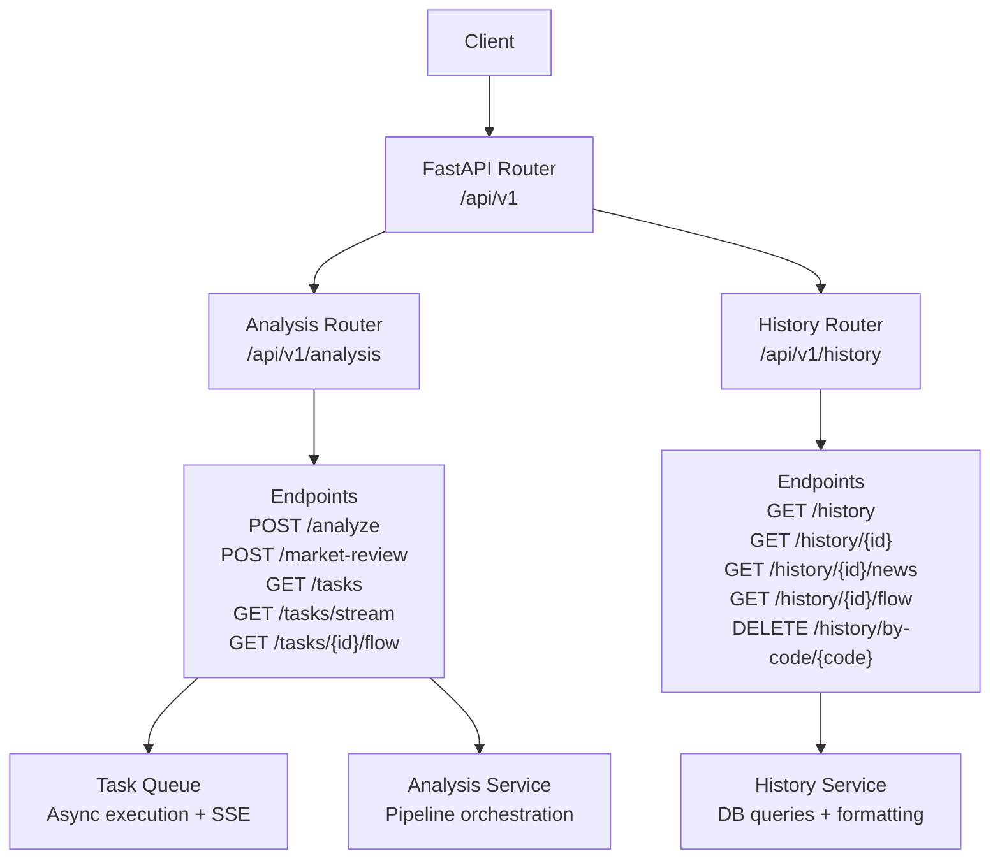
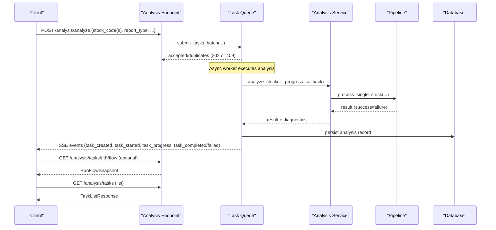
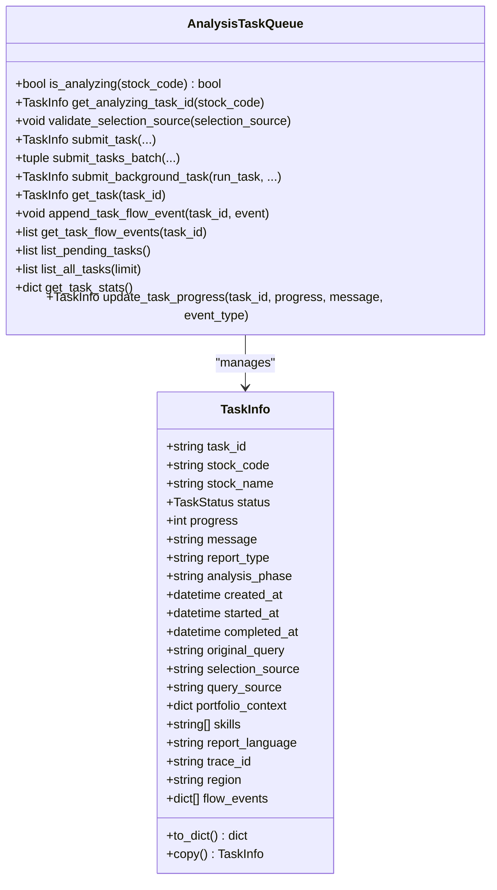
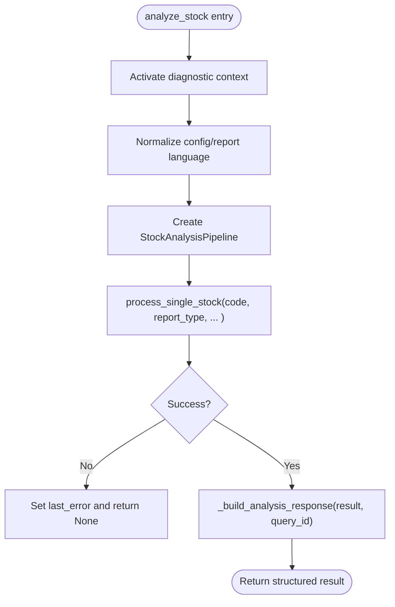
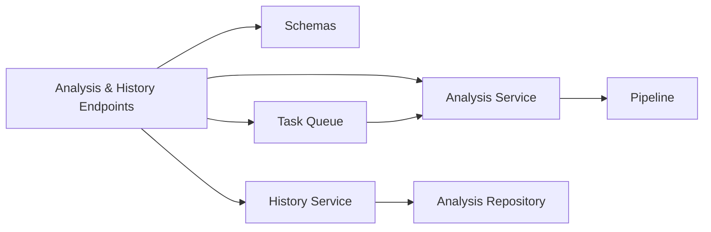

# Analysis API

<cite>
**Referenced Files in This Document**
- [analysis.py](file://api/v1/endpoints/analysis.py)
- [history.py](file://api/v1/endpoints/history.py)
- [router.py](file://api/v1/router.py)
- [analysis_schemas.py](file://api/v1/schemas/analysis.py)
- [analysis_service.py](file://src/services/analysis_service.py)
- [task_queue.py](file://src/services/task_queue.py)
- [pipeline.py](file://src/core/pipeline.py)
- [analysis_repo.py](file://src/repositories/analysis_repo.py)
- [history_service.py](file://src/services/history_service.py)
</cite>

## Table of Contents
1. [Introduction](#introduction)
2. [Project Structure](#project-structure)
3. [Core Components](#core-components)
4. [Architecture Overview](#architecture-overview)
5. [Detailed Component Analysis](#detailed-component-analysis)
6. [Dependency Analysis](#dependency-analysis)
7. [Performance Considerations](#performance-considerations)
8. [Troubleshooting Guide](#troubleshooting-guide)
9. [Conclusion](#conclusion)
10. [Appendices](#appendices)

## Introduction
This document provides detailed API documentation for DailyStockAnalysis focused on stock analysis endpoints and analysis workflow management. It covers:
- Triggering single-stock and batch analysis
- Real-time progress via Server-Sent Events (SSE)
- Retrieving analysis results from history
- Managing analysis tasks and context
- Request/response schemas, status tracking, error handling
- Rate limiting, caching strategies, and performance tips for high-volume requests

## Project Structure
The Analysis API is exposed under the /api/v1 prefix and grouped into feature routers. The analysis-related routes are mounted under /api/v1/analysis and /api/v1/history.

**Diagram sources**
- [router.py:35-57](file://api/v1/router.py#L35-L57)
- [analysis.py:263-730](file://api/v1/endpoints/analysis.py#L263-L730)
- [history.py:206-756](file://api/v1/endpoints/history.py#L206-L756)

**Section sources**
- [router.py:35-57](file://api/v1/router.py#L35-L57)

## Core Components
- Analysis endpoints: trigger analysis, manage tasks, stream progress, retrieve run flow snapshots.
- History endpoints: list, fetch details, diagnostics, news, run flow, delete by code or IDs.
- Task queue: async task lifecycle, duplicate prevention, SSE broadcasting, background tasks.
- Analysis service: orchestrates pipeline, builds reports, integrates diagnostics and localization.
- History service: query, format, and serve historical analysis records with rich metadata.

Key request parameters include stock symbols (single or batch), report type, force refresh, analysis phase, selection source, notification flag, report language, and skills. Responses include task acceptance, status updates, full analysis reports, diagnostics, and run flow snapshots.

**Section sources**
- [analysis.py:263-730](file://api/v1/endpoints/analysis.py#L263-L730)
- [history.py:206-756](file://api/v1/endpoints/history.py#L206-L756)
- [analysis_schemas.py:34-110](file://api/v1/schemas/analysis.py#L34-L110)
- [task_queue.py:156-468](file://src/services/task_queue.py#L156-L468)
- [analysis_service.py:51-151](file://src/services/analysis_service.py#L51-L151)
- [history_service.py:83-200](file://src/services/history_service.py#L83-L200)

## Architecture Overview
End-to-end flow for analysis requests:

**Diagram sources**
- [analysis.py:263-730](file://api/v1/endpoints/analysis.py#L263-L730)
- [task_queue.py:380-468](file://src/services/task_queue.py#L380-L468)
- [analysis_service.py:51-151](file://src/services/analysis_service.py#L51-L151)
- [pipeline.py:1-200](file://src/core/pipeline.py#L1-L200)

## Detailed Component Analysis

### Analysis Endpoints
- POST /analysis/analyze
  - Purpose: Trigger single-stock or batch analysis. Supports synchronous mode (single stock only) and asynchronous mode (batch).
  - Request body fields:
    - stock_code: string (single stock)
    - stock_codes: array of strings (batch)
    - report_type: simple | detailed | full | brief
    - force_refresh: boolean (ignore cache)
    - async_mode: boolean (use async queue)
    - analysis_phase: auto | premarket | intraday | postmarket
    - stock_name: optional display name
    - original_query: optional raw user input
    - selection_source: manual | autocomplete | import | image
    - notify: boolean (send notifications)
    - report_language: zh | en | ko
    - skills: array of skill IDs
  - Responses:
    - 200: AnalysisResultResponse (sync mode)
    - 202: TaskAccepted or BatchTaskAcceptedResponse (async mode)
    - 400: validation errors
    - 409: duplicate task (same stock already analyzing)
    - 500: internal error
  - Behavior:
    - Normalizes and deduplicates stock codes; rejects invalid inputs early.
    - Limits batch size to prevent abuse.
    - In async mode, submits one task per stock and returns immediately.

- POST /analysis/market-review
  - Purpose: Trigger a background market review task with region and notification options.
  - Request body fields: send_notification, report_language, region (tokens like cn, hk, us, jp, kr, both).
  - Response: MarketReviewAccepted with status, message, region, trace_id, task_id.

- GET /analysis/tasks
  - Purpose: List current tasks with optional status filter and limit.
  - Query params: status (comma-separated), limit (1–100).
  - Response: TaskListResponse with total, pending, processing counts and task items.

- GET /analysis/tasks/stream
  - Purpose: SSE endpoint streaming task lifecycle events.
  - Events: connected, task_created, task_started, task_progress, task_completed, task_failed, heartbeat.
  - Headers: Cache-Control no-cache, Connection keep-alive, X-Accel-Buffering no.

- GET /analysis/tasks/{task_id}/flow
  - Purpose: Retrieve run-flow snapshot for a task (active or completed).
  - Response: RunFlowSnapshot.

Request and response schemas are defined in the analysis schemas module.

**Section sources**
- [analysis.py:263-730](file://api/v1/endpoints/analysis.py#L263-L730)
- [analysis_schemas.py:34-110](file://api/v1/schemas/analysis.py#L34-L110)
- [analysis_schemas.py:113-169](file://api/v1/schemas/analysis.py#L113-L169)
- [analysis_schemas.py:171-444](file://api/v1/schemas/analysis.py#L171-L444)

### History Endpoints
- GET /history
  - Purpose: Paginated list of historical analysis summaries with filters.
  - Query params: stock_code, report_type, start_date, end_date, page, limit.
  - Response: HistoryListResponse with items and pagination info.

- DELETE /history/by-code/{stock_code}
  - Purpose: Delete all history records for a normalized stock code.
  - Response: DeleteHistoryResponse with deleted count.

- DELETE /history
  - Purpose: Delete history records by primary key IDs.
  - Request body: record_ids array.
  - Response: DeleteHistoryResponse.

- GET /history/stocks
  - Purpose: Distinct stocks with latest summary (excludes market review).
  - Query params: start_date, end_date, limit.
  - Response: StockBarResponse.

- GET /history/{record_id}
  - Purpose: Full analysis report detail by ID or query_id.
  - Response: AnalysisReport including meta, summary, strategy, details (news, fundamentals, boards, market structure).

- GET /history/{record_id}/diagnostics
  - Purpose: User-readable diagnostic summary and sanitized copy text.
  - Response: RunDiagnosticSummaryResponse.

- GET /history/{record_id}/flow
  - Purpose: Data/info flow snapshot for a historical record.
  - Response: RunFlowSnapshot.

- GET /history/{record_id}/news
  - Purpose: Associated news intelligence list for a record.
  - Query param: limit (1–100).
  - Response: NewsIntelResponse.

**Section sources**
- [history.py:206-756](file://api/v1/endpoints/history.py#L206-L756)

### Task Queue and Background Execution
- Duplicate prevention: Equivalent stock codes are normalized and tracked to avoid re-submission.
- Concurrency: ThreadPoolExecutor manages parallel analysis tasks; max workers configurable at runtime.
- Progress updates: update_task_progress emits SSE events with clamped progress values.
- Flow events: append_task_flow_event captures recent run-flow events per task for diagnostics.
- Background tasks: submit_background_task supports generic callable execution with lifecycle tracking.

**Diagram sources**
- [task_queue.py:62-141](file://src/services/task_queue.py#L62-L141)
- [task_queue.py:156-468](file://src/services/task_queue.py#L156-L468)

**Section sources**
- [task_queue.py:156-468](file://src/services/task_queue.py#L156-L468)
- [task_queue.py:528-664](file://src/services/task_queue.py#L528-L664)
- [task_queue.py:668-795](file://src/services/task_queue.py#L668-L795)

### Analysis Service and Pipeline
- AnalysisService.analyze_stock orchestrates:
  - Diagnostic context activation
  - Configuration normalization (report language)
  - Pipeline execution for a single stock
  - Building structured response with meta, summary, strategy, details
  - Diagnostics and market phase summary integration
- Pipeline.process_single_stock performs data fetching, analysis, decision signals, and reporting.

**Diagram sources**
- [analysis_service.py:51-151](file://src/services/analysis_service.py#L51-L151)
- [analysis_service.py:153-259](file://src/services/analysis_service.py#L153-L259)

**Section sources**
- [analysis_service.py:51-259](file://src/services/analysis_service.py#L51-L259)
- [pipeline.py:1-200](file://src/core/pipeline.py#L1-L200)

### History Service and Repository
- HistoryService handles:
  - Pagination and filtering for history lists
  - Resolving record_id to query_id or primary key
  - Formatting reports, extracting real-time fields, fundamentals, boards, market structure
  - Generating markdown reports and share images
  - Deleting records by code or IDs
- AnalysisRepository provides CRUD operations for analysis history records.

**Section sources**
- [history_service.py:83-200](file://src/services/history_service.py#L83-L200)
- [analysis_repo.py:21-131](file://src/repositories/analysis_repo.py#L21-L131)

## Dependency Analysis
- Endpoints depend on:
  - Schemas for validation and response modeling
  - Task queue for async execution and SSE
  - Analysis service for core logic
  - History service/repository for persistence and retrieval
- Internal coupling:
  - Task queue invokes AnalysisService and persists results
  - Analysis service uses pipeline and diagnostic utilities
  - History service formats persisted data and integrates market phase summaries

**Diagram sources**
- [analysis.py:263-730](file://api/v1/endpoints/analysis.py#L263-L730)
- [history.py:206-756](file://api/v1/endpoints/history.py#L206-L756)
- [task_queue.py:156-468](file://src/services/task_queue.py#L156-L468)
- [analysis_service.py:51-259](file://src/services/analysis_service.py#L51-L259)
- [history_service.py:83-200](file://src/services/history_service.py#L83-L200)
- [analysis_repo.py:21-131](file://src/repositories/analysis_repo.py#L21-L131)

**Section sources**
- [analysis.py:263-730](file://api/v1/endpoints/analysis.py#L263-L730)
- [history.py:206-756](file://api/v1/endpoints/history.py#L206-L756)
- [task_queue.py:156-468](file://src/services/task_queue.py#L156-L468)
- [analysis_service.py:51-259](file://src/services/analysis_service.py#L51-L259)
- [history_service.py:83-200](file://src/services/history_service.py#L83-L200)
- [analysis_repo.py:21-131](file://src/repositories/analysis_repo.py#L21-L131)

## Performance Considerations
- Batch limits: Single request supports up to 50 stocks to mitigate DoS risk.
- Concurrency control: Task queue uses a thread pool with configurable max workers; can be adjusted at runtime when idle.
- Duplicate prevention: Normalized stock codes prevent redundant analysis submissions.
- SSE efficiency: Heartbeat every 30 seconds; clients should handle connection drops gracefully.
- Caching: Use force_refresh=false to leverage cached data; set true to bypass cache when needed.
- Filtering: History list supports date range and stock code filters to reduce payload sizes.
- Resource cleanup: Old tasks are cleaned up after completion; flow events bounded per task.

[No sources needed since this section provides general guidance]

## Troubleshooting Guide
Common issues and resolutions:
- Validation errors (400): Ensure stock_code or stock_codes provided; check report_type, analysis_phase, and selection_source patterns.
- Duplicate task (409): Same stock already being analyzed; poll existing task or wait for completion.
- Internal errors (500): Check logs for pipeline failures; verify data sources and LLM backends.
- SSE disconnects: Reconnect on client side; use heartbeat to detect liveness.
- History not found (404): Verify record_id or query_id; ensure record exists and is not deleted.

Error responses follow standardized structures with error codes and messages.

**Section sources**
- [analysis.py:263-730](file://api/v1/endpoints/analysis.py#L263-L730)
- [history.py:206-756](file://api/v1/endpoints/history.py#L206-L756)

## Conclusion
The DailyStockAnalysis API provides robust endpoints for triggering stock analysis, managing asynchronous tasks, streaming real-time progress, and retrieving comprehensive analysis results and context. With built-in duplicate prevention, concurrency controls, and rich diagnostics, it supports high-volume analysis workflows while maintaining reliability and observability.

[No sources needed since this section summarizes without analyzing specific files]

## Appendices

### API Reference Summary

- POST /analysis/analyze
  - Request: AnalyzeRequest schema
  - Responses: AnalysisResultResponse (200), TaskAccepted/BatchTaskAcceptedResponse (202), ErrorResponse (400/500), DuplicateTaskErrorResponse (409)

- POST /analysis/market-review
  - Request: MarketReviewRequest schema
  - Response: MarketReviewAccepted (202)

- GET /analysis/tasks
  - Query: status, limit
  - Response: TaskListResponse

- GET /analysis/tasks/stream
  - SSE events: connected, task_created, task_started, task_progress, task_completed, task_failed, heartbeat

- GET /analysis/tasks/{task_id}/flow
  - Response: RunFlowSnapshot

- GET /history
  - Query: stock_code, report_type, start_date, end_date, page, limit
  - Response: HistoryListResponse

- DELETE /history/by-code/{stock_code}
  - Response: DeleteHistoryResponse

- DELETE /history
  - Request: record_ids
  - Response: DeleteHistoryResponse

- GET /history/stocks
  - Query: start_date, end_date, limit
  - Response: StockBarResponse

- GET /history/{record_id}
  - Response: AnalysisReport

- GET /history/{record_id}/diagnostics
  - Response: RunDiagnosticSummaryResponse

- GET /history/{record_id}/flow
  - Response: RunFlowSnapshot

- GET /history/{record_id}/news
  - Query: limit
  - Response: NewsIntelResponse

**Section sources**
- [analysis_schemas.py:34-444](file://api/v1/schemas/analysis.py#L34-L444)
- [analysis.py:263-730](file://api/v1/endpoints/analysis.py#L263-L730)
- [history.py:206-756](file://api/v1/endpoints/history.py#L206-L756)