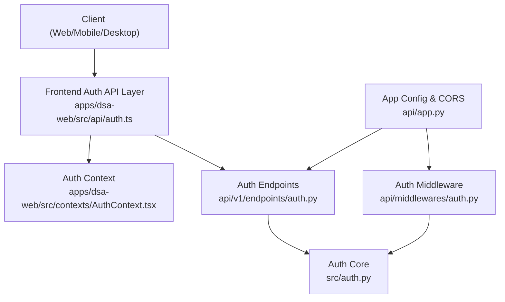
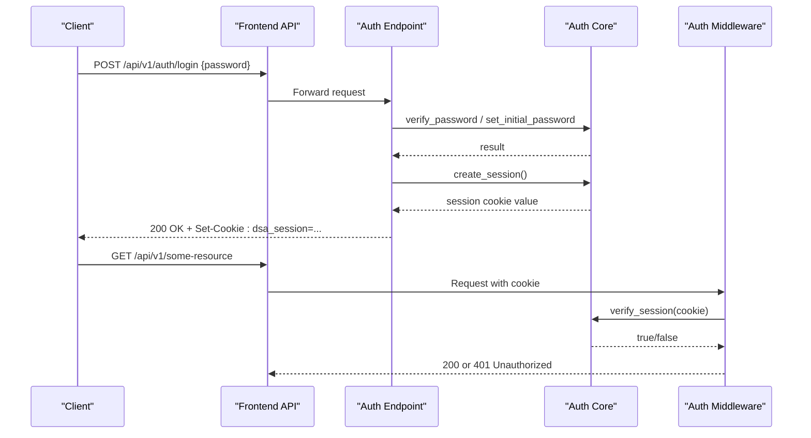
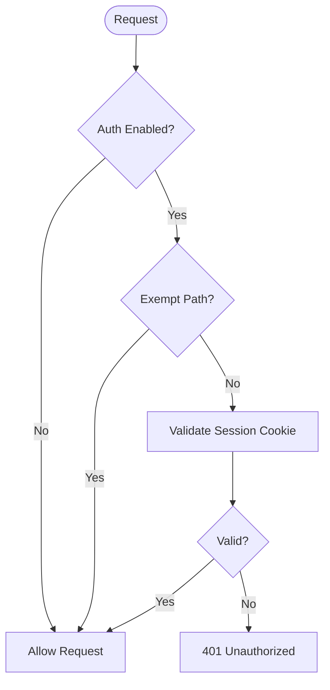
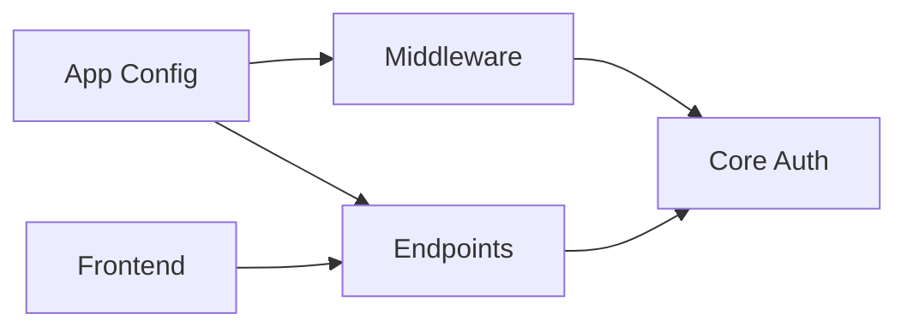

# Authentication API

<cite>
**Referenced Files in This Document**
- [auth.py](file://api/v1/endpoints/auth.py)
- [auth.py](file://src/auth.py)
- [auth.py](file://api/middlewares/auth.py)
- [app.py](file://api/app.py)
- [auth.ts](file://apps/dsa-web/src/api/auth.ts)
- [AuthContext.tsx](file://apps/dsa-web/src/contexts/AuthContext.tsx)
- [errors.py](file://api/v1/errors.py)
</cite>

## Table of Contents
1. [Introduction](#introduction)
2. [Project Structure](#project-structure)
3. [Core Components](#core-components)
4. [Architecture Overview](#architecture-overview)
5. [Detailed Component Analysis](#detailed-component-analysis)
6. [Dependency Analysis](#dependency-analysis)
7. [Performance Considerations](#performance-considerations)
8. [Troubleshooting Guide](#troubleshooting-guide)
9. [Conclusion](#conclusion)
10. [Appendices](#appendices)

## Introduction
This document describes the authentication and session management for DailyStockAnalysis. It covers all authentication endpoints, HTTP methods, URL patterns, request/response schemas, cookie-based session handling, security considerations (token/session expiration, secure storage, CORS), and client implementation guidance for web, mobile, and desktop platforms. It also includes error handling strategies and common issues.

The system uses a cookie-based session mechanism rather than JWT tokens. Sessions are signed server-side and stored in an HttpOnly cookie. Authentication is optional and controlled by an environment flag; when enabled, most API routes under /api/v1/* require a valid session cookie.

## Project Structure
Authentication spans several layers:
- Endpoints define login/logout/password change/settings/status operations.
- Middleware enforces session validation on protected routes.
- Core auth module implements password hashing, session signing, rate limiting, and secret rotation.
- App configuration sets up CORS and registers middleware.
- Frontend provides typed API calls and context to manage auth state.

**Diagram sources**
- [auth.py:1-483](file://api/v1/endpoints/auth.py#L1-L483)
- [auth.py:1-501](file://src/auth.py#L1-L501)
- [auth.py:1-76](file://api/middlewares/auth.py#L1-L76)
- [app.py:313-384](file://api/app.py#L313-L384)
- [auth.ts:1-66](file://apps/dsa-web/src/api/auth.ts#L1-L66)
- [AuthContext.tsx:1-156](file://apps/dsa-web/src/contexts/AuthContext.tsx#L1-L156)

**Section sources**
- [auth.py:1-483](file://api/v1/endpoints/auth.py#L1-L483)
- [auth.py:1-501](file://src/auth.py#L1-L501)
- [auth.py:1-76](file://api/middlewares/auth.py#L1-L76)
- [app.py:313-384](file://api/app.py#L313-L384)
- [auth.ts:1-66](file://apps/dsa-web/src/api/auth.ts#L1-L66)
- [AuthContext.tsx:1-156](file://apps/dsa-web/src/contexts/AuthContext.tsx#L1-L156)

## Core Components
- Authentication endpoints:
  - GET /api/v1/auth/status: Returns whether auth is enabled, current login state, password status, and setup state.
  - POST /api/v1/auth/login: Sets initial password or authenticates with password; returns success and sets session cookie.
  - POST /api/v1/auth/change-password: Changes password; requires valid session and password changeability.
  - POST /api/v1/auth/logout: Invalidates sessions and clears session cookie.
  - POST /api/v1/auth/settings: Enables/disables authentication and manages initial password requirements; may require re-authentication for high-risk actions.
- Session handling:
  - Cookie name: dsa_session
  - Format: nonce.timestamp.signature (HMAC-SHA256 signed)
  - Expiration: configurable via ADMIN_SESSION_MAX_AGE_HOURS (default 24 hours)
  - Secure flags: HttpOnly, SameSite=Lax, Secure based on request scheme or X-Forwarded-Proto
- Security:
  - Passwords: PBKDF2-SHA256 with 100,000 iterations and random salt
  - Rate limiting: In-process per IP with window and max failures
  - Session invalidation: rotate_session_secret() invalidates all active sessions
  - CORS: allow_credentials depends on CORS_ALLOW_ALL; explicit origins keep credentials enabled

**Section sources**
- [auth.py:42-94](file://api/v1/endpoints/auth.py#L42-L94)
- [auth.py:27-33](file://src/auth.py#L27-L33)
- [auth.py:81-134](file://src/auth.py#L81-L134)
- [auth.py:155-163](file://src/auth.py#L155-L163)
- [auth.py:332-367](file://src/auth.py#L332-L367)
- [auth.py:387-421](file://src/auth.py#L387-L421)
- [app.py:350-375](file://api/app.py#L350-L375)

## Architecture Overview
The authentication flow uses cookies and server-side session signing. When admin authentication is enabled, the middleware protects /api/v1/* except for exempt paths. Clients obtain a session via login and maintain it through subsequent requests. Logout rotates the session secret and clears the cookie.

**Diagram sources**
- [auth.py:362-428](file://api/v1/endpoints/auth.py#L362-L428)
- [auth.py:332-367](file://src/auth.py#L332-L367)
- [auth.py:37-65](file://api/middlewares/auth.py#L37-L65)
- [app.py:369-377](file://api/app.py#L369-L377)

## Detailed Component Analysis

### Authentication Endpoints
- GET /api/v1/auth/status
  - Purpose: Query auth enablement and login state without requiring authentication.
  - Response fields:
    - authEnabled: boolean
    - loggedIn: boolean
    - passwordSet: boolean (when auth enabled)
    - passwordChangeable: boolean (when auth enabled)
    - setupState: "enabled" | "password_retained" | "no_password"
  - Notes: Safe to call before login; reflects current cookie state if present.

- POST /api/v1/auth/login
  - Purpose: Authenticate with password or set initial password on first-time setup.
  - Request body:
    - password: string
    - passwordConfirm: string (required only during initial setup)
  - Behavior:
    - If auth disabled: returns 400 with error "auth_disabled".
    - If no password set: validates passwordConfirm, sets initial password, creates session.
    - If password set: verifies password, records failures for rate limiting, creates session.
  - Response:
    - 200 OK with {"ok": true} and Set-Cookie: dsa_session=...
    - 400 for validation errors
    - 401 for invalid password
    - 429 for rate-limited attempts

- POST /api/v1/auth/change-password
  - Purpose: Change password while authenticated.
  - Request body:
    - currentPassword: string
    - newPassword: string
    - newPasswordConfirm: string
  - Behavior: Requires password changeability and valid session (enforced by middleware).
  - Response:
    - 204 No Content on success
    - 400 for validation or incorrect current password

- POST /api/v1/auth/logout
  - Purpose: Invalidate sessions and clear cookie.
  - Behavior: Rotates session secret to invalidate all active sessions; deletes cookie.
  - Response:
    - 204 No Content
    - 500 if session invalidation fails

- POST /api/v1/auth/settings
  - Purpose: Enable/disable authentication and manage initial password settings.
  - Request body:
    - authEnabled: boolean
    - password: string (optional, required when enabling without existing password)
    - passwordConfirm: string (optional, must match password)
    - currentPassword: string (required for high-risk actions like disabling auth)
  - Behavior:
    - Enabling auth without stored password requires password and confirmation.
    - Re-enabling or keeping enabled may require currentPassword if not already authenticated.
    - Disabling auth requires currentPassword even if a valid session cookie exists (CSRF hardening).
  - Response:
    - 200 with updated auth status
    - 400 for validation errors
    - 401 for invalid currentPassword
    - 429 for rate-limited attempts
    - 500 for internal errors

**Section sources**
- [auth.py:185-193](file://api/v1/endpoints/auth.py#L185-L193)
- [auth.py:362-428](file://api/v1/endpoints/auth.py#L362-L428)
- [auth.py:431-465](file://api/v1/endpoints/auth.py#L431-L465)
- [auth.py:468-482](file://api/v1/endpoints/auth.py#L468-L482)
- [auth.py:195-358](file://api/v1/endpoints/auth.py#L195-L358)

### Session Management and Security
- Cookie details:
  - Name: dsa_session
  - Flags: HttpOnly, SameSite=Lax, Secure (based on HTTPS or X-Forwarded-Proto)
  - Path: /
  - Max-Age: ADMIN_SESSION_MAX_AGE_HOURS (default 24 hours)
- Session payload:
  - Format: nonce.timestamp.signature
  - Signature: HMAC-SHA256 using server-side secret
  - Expiration check: timestamp compared against configured max age
- Secret rotation:
  - rotate_session_secret() writes a new 32-byte secret atomically and reloads into memory
  - Used on logout and when toggling auth settings to invalidate all sessions
- Password storage:
  - PBKDF2-SHA256 with 100,000 iterations and random salt
  - Stored in .admin_password_hash with restrictive permissions
- Rate limiting:
  - Per-IP tracking with window and max failures
  - Prevents brute-force attacks on login and sensitive settings changes

**Diagram sources**
- [auth.py:37-65](file://api/middlewares/auth.py#L37-L65)
- [auth.py:344-367](file://src/auth.py#L344-L367)

**Section sources**
- [auth.py:72-94](file://api/v1/endpoints/auth.py#L72-L94)
- [auth.py:81-134](file://src/auth.py#L81-L134)
- [auth.py:246-280](file://src/auth.py#L246-L280)
- [auth.py:387-421](file://src/auth.py#L387-L421)

### CORS Configuration
- Default allowed origins include local development addresses.
- CORS_ALLOW_ALL=true sets allow_origins=["*"] and disables allow_credentials.
- Explicit origins list keeps allow_credentials=true for cookie-based auth.
- Warning logged when CORS_ALLOW_ALL=true and ADMIN_AUTH_ENABLED=false.

**Section sources**
- [app.py:350-375](file://api/app.py#L350-L375)

### Frontend Integration
- Typed API functions for status, login, change-password, logout, and settings updates.
- AuthContext manages UI state, handles errors, and refreshes status after mutations.
- Error mapping converts 429 rate limit into user-friendly messages.

**Section sources**
- [auth.ts:1-66](file://apps/dsa-web/src/api/auth.ts#L1-L66)
- [AuthContext.tsx:1-156](file://apps/dsa-web/src/contexts/AuthContext.tsx#L1-L156)

## Dependency Analysis
- Endpoints depend on core auth module for password verification, session creation/validation, and rate limiting.
- Middleware depends on core auth module to enforce session validation.
- App config wires CORS and registers middleware and routers.
- Frontend depends on backend endpoints and relies on cookie transport for sessions.

**Diagram sources**
- [auth.py:1-483](file://api/v1/endpoints/auth.py#L1-L483)
- [auth.py:1-501](file://src/auth.py#L1-L501)
- [auth.py:1-76](file://api/middlewares/auth.py#L1-L76)
- [app.py:313-384](file://api/app.py#L313-L384)

**Section sources**
- [auth.py:1-483](file://api/v1/endpoints/auth.py#L1-L483)
- [auth.py:1-501](file://src/auth.py#L1-L501)
- [auth.py:1-76](file://api/middlewares/auth.py#L1-L76)
- [app.py:313-384](file://api/app.py#L313-L384)

## Performance Considerations
- Password hashing uses PBKDF2 with 100,000 iterations; consider tuning for your environment.
- Rate limiting is in-memory; ensure single-process deployment or externalize if scaling horizontally.
- Session validation is lightweight HMAC check; negligible overhead.
- CORS configuration should be tuned for production to minimize unnecessary preflight requests.

[No sources needed since this section provides general guidance]

## Troubleshooting Guide
Common issues and resolutions:
- 401 Unauthorized: Missing or invalid session cookie; ensure login succeeded and cookie is sent with requests.
- 429 Too Many Requests: Rate limit exceeded; wait before retrying or adjust rate limit parameters.
- 400 Bad Request: Validation errors such as missing password, mismatched confirmations, or invalid settings.
- 500 Internal Server Error: Session rotation or configuration update failure; check logs and file permissions.
- CORS errors: Ensure CORS_ALLOW_ALL and ADMIN_AUTH_ENABLED are correctly configured; use explicit origins for credentials.

Error response format:
- Standardized structure with error code and message; detail field optional.

**Section sources**
- [errors.py:12-33](file://api/v1/errors.py#L12-L33)
- [auth.py:362-428](file://api/v1/endpoints/auth.py#L362-L428)
- [auth.py:468-482](file://api/v1/endpoints/auth.py#L468-L482)

## Conclusion
DailyStockAnalysis provides a robust, cookie-based authentication system with strong security practices including password hashing, session signing, rate limiting, and CSRF-hardened settings changes. The optional nature of authentication allows flexible deployment scenarios, while CORS configuration supports both local development and production environments. Clients should handle session cookies securely and implement proper error handling for a smooth user experience.

[No sources needed since this section summarizes without analyzing specific files]

## Appendices

### API Reference Summary
- GET /api/v1/auth/status
  - Response: { authEnabled, loggedIn, passwordSet, passwordChangeable, setupState }
- POST /api/v1/auth/login
  - Request: { password, passwordConfirm? }
  - Response: 200 OK + Set-Cookie
- POST /api/v1/auth/change-password
  - Request: { currentPassword, newPassword, newPasswordConfirm }
  - Response: 204 No Content
- POST /api/v1/auth/logout
  - Response: 204 No Content
- POST /api/v1/auth/settings
  - Request: { authEnabled, password?, passwordConfirm?, currentPassword? }
  - Response: Updated auth status

**Section sources**
- [auth.py:185-482](file://api/v1/endpoints/auth.py#L185-L482)

### Environment Variables
- ADMIN_AUTH_ENABLED: Enable/disable authentication
- ADMIN_SESSION_MAX_AGE_HOURS: Session lifetime in hours (default 24)
- CORS_ALLOW_ALL: Allow all origins (disables credentials)
- CORS_ORIGINS: Comma-separated list of allowed origins
- TRUST_X_FORWARDED_FOR: Trust proxy headers for secure cookie setting

**Section sources**
- [app.py:350-375](file://api/app.py#L350-L375)
- [auth.py:72-94](file://api/v1/endpoints/auth.py#L72-L94)

### Client Implementation Guidelines
- Web (Browser):
  - Use fetch or axios with credentials: 'include' to send cookies.
  - Handle 401 responses by redirecting to login.
  - Store session state from /api/v1/auth/status.
- Mobile (React Native/iOS/Android):
  - Configure HTTP client to accept and store cookies.
  - Implement token refresh logic using session cookie persistence.
  - Handle network errors and rate limits gracefully.
- Desktop (Electron/Tauri):
  - Use built-in networking with cookie support.
  - Persist session across app restarts if needed.
  - Implement secure storage for any additional secrets.

[No sources needed since this section provides general guidance]