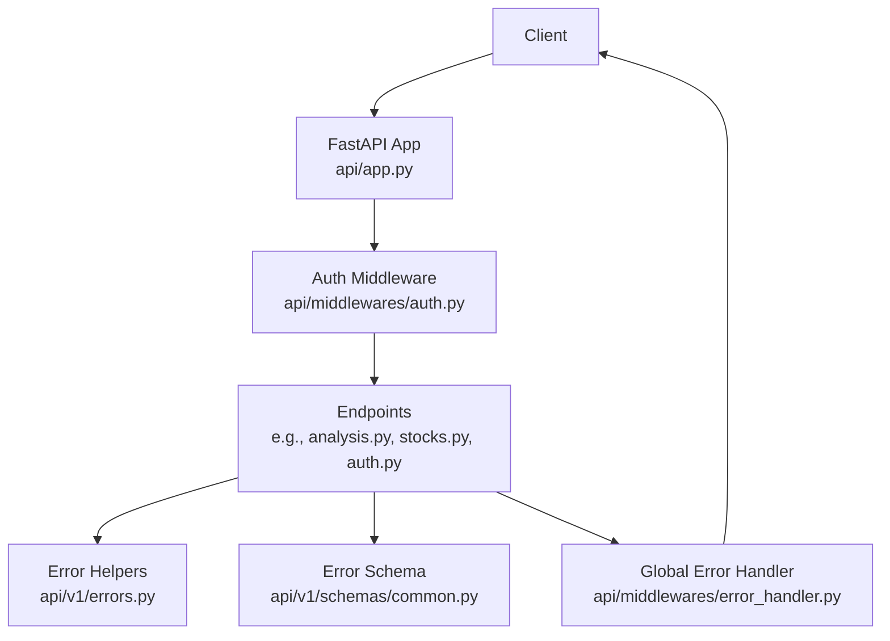
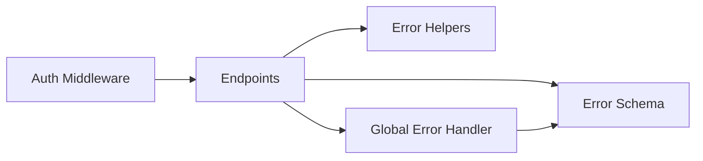

# Error Handling & Status Codes

<cite>
**Referenced Files in This Document**
- [errors.py](file://api/v1/errors.py)
- [error_handler.py](file://api/middlewares/error_handler.py)
- [auth.py](file://api/middlewares/auth.py)
- [common.py](file://api/v1/schemas/common.py)
- [analysis.py](file://api/v1/endpoints/analysis.py)
- [stocks.py](file://api/v1/endpoints/stocks.py)
- [auth_endpoint.py](file://api/v1/endpoints/auth.py)
- [app.py](file://api/app.py)
</cite>

## Table of Contents
1. Introduction
2. Project Structure
3. Core Components
4. Architecture Overview
5. Detailed Component Analysis
6. Dependency Analysis
7. Performance Considerations
8. Troubleshooting Guide
9. Conclusion

## Introduction
This document explains how the DailyStockAnalysis API handles errors and status codes. It covers:
- Standard HTTP status codes used across the API (4xx client errors, 5xx server errors)
- The unified error response schema and fields
- Common error scenarios with examples (authentication failures, validation errors, rate limiting, internal server errors)
- Debugging guidance for interpreting responses and implementing robust client-side error handling
- Resilience patterns such as retries with exponential backoff and circuit breakers

## Project Structure
Error handling is implemented through a combination of:
- A global exception handler middleware that normalizes all unhandled exceptions into a consistent JSON format
- Shared helpers to build standardized error bodies and responses
- Per-endpoint validations that raise structured HTTP exceptions
- An authentication middleware that returns explicit 401 unauthorized responses when session checks fail
- Pydantic models that define the canonical error response shape



**Diagram sources**
- [error_handler.py:24-67](file://api/middlewares/error_handler.py#L24-L67)
- [auth.py:37-65](file://api/middlewares/auth.py#L37-L65)
- [errors.py:12-33](file://api/v1/errors.py#L12-L33)
- [common.py:45-58](file://api/v1/schemas/common.py#L45-L58)

**Section sources**
- [error_handler.py:24-129](file://api/middlewares/error_handler.py#L24-L129)
- [auth.py:37-76](file://api/middlewares/auth.py#L37-L76)
- [errors.py:12-33](file://api/v1/errors.py#L12-L33)
- [common.py:45-58](file://api/v1/schemas/common.py#L45-L58)

## Core Components
- Unified error body builder and response helpers:
  - error_body(error, message, detail=None) builds the standard payload
  - api_error(status_code, error, message, detail=None) raises an HTTPException with the standard payload
  - error_json_response(status_code, error, message, detail=None) returns a JSONResponse with the standard payload
- Global exception handlers:
  - HTTPException handler preserves the standard payload or wraps it
  - RequestValidationError handler returns 422 with a structured validation error
  - General Exception handler returns 500 with a safe internal error payload
- Authentication middleware:
  - Returns 401 with a standardized unauthorized payload when session verification fails
- Error schema model:
  - ErrorResponse defines the canonical fields: error, message, detail

These components ensure every error response follows a consistent structure and uses appropriate HTTP status codes.

**Section sources**
- [errors.py:12-33](file://api/v1/errors.py#L12-L33)
- [error_handler.py:70-129](file://api/middlewares/error_handler.py#L70-L129)
- [auth.py:55-65](file://api/middlewares/auth.py#L55-L65)
- [common.py:45-58](file://api/v1/schemas/common.py#L45-L58)

## Architecture Overview
The request lifecycle includes middleware-based authentication and centralized error handling:

```mermaid
sequenceDiagram
participant C as "Client"
participant A as "FastAPI App"
participant M as "Auth Middleware"
participant E as "Endpoint"
participant H as "Global Error Handler"
C->>A : HTTP Request
A->>M : Dispatch
M->>M : Check session / exempt paths
alt Unauthorized
M-->>C : 401 {error : "unauthorized", message}
else Authorized
M->>E : Call endpoint
E->>E : Validate inputs / business logic
alt Validation error
E-->>H : Raise HTTPException(422)
H-->>C : 422 {error : "validation_error", message, detail}
alt Business error
E-->>H : Raise HTTPException(4xx)
H-->>C : 4xx {error, message, detail?}
alt Success
E-->>C : 2xx + data
end
end
Note over H,C : Unhandled exceptions become 500 {error : "internal_error", message}
```

**Diagram sources**
- [auth.py:37-65](file://api/middlewares/auth.py#L37-L65)
- [error_handler.py:82-129](file://api/middlewares/error_handler.py#L82-L129)

## Detailed Component Analysis

### Global Error Handler Middleware
- Captures all unhandled exceptions and returns a uniform 500 response with a safe message; optional detail is included only when debug logging is enabled
- Normalizes FastAPI’s HTTPException responses to the standard error payload
- Converts Pydantic validation errors into 422 responses with a structured detail array

Key behaviors:
- 422 for validation errors with detailed field-level information
- 500 for unexpected server errors with a generic message and optional detail
- Preserves original status codes for HTTPException while ensuring consistent payload shape

**Section sources**
- [error_handler.py:24-67](file://api/middlewares/error_handler.py#L24-L67)
- [error_handler.py:82-129](file://api/middlewares/error_handler.py#L82-L129)

### Authentication Middleware
- Protects /api/v1/* routes when admin authentication is enabled
- Exempts specific paths (health, docs, login/status)
- Returns 401 with a standardized unauthorized payload when no valid session cookie is present

Common scenario:
- Missing or invalid session cookie leads to 401 {error:"unauthorized", message:"Login required"}

**Section sources**
- [auth.py:19-28](file://api/middlewares/auth.py#L19-L28)
- [auth.py:55-65](file://api/middlewares/auth.py#L55-L65)

### Endpoint-Specific Errors

#### Stocks: Image Extraction
- Validates file presence, MIME type, and size limits
- Raises 400 for bad requests (missing file, unsupported type, too large)
- Raises 500 on unexpected extraction failures

Example flows:
- Missing file: 400 {error:"bad_request", message}
- Unsupported MIME: 400 {error:"unsupported_type", message}
- File too large: 400 {error:"file_too_large", message}
- Unexpected failure: 500 {error:"internal_error", message}

**Section sources**
- [stocks.py:141-195](file://api/v1/endpoints/stocks.py#L141-L195)

#### Analysis: Duplicate Task Conflict
- Prevents duplicate concurrent analysis tasks for the same stock by returning 409 Conflict

Example flow:
- Duplicate task detected: 409 {error:"conflict", message}

**Section sources**
- [analysis.py:424-424](file://api/v1/endpoints/analysis.py#L424-L424)

#### Auth: Rate Limiting and Invalid Password
- Enforces rate limiting on login attempts per IP
- Returns 429 when too many failed attempts are detected
- Returns 401 for invalid password attempts

Example flows:
- Too many failed attempts: 429 {error:"rate_limited", message}
- Wrong password: 401 {error:"invalid_password", message}

**Section sources**
- [auth_endpoint.py:299-315](file://api/v1/endpoints/auth.py#L299-L315)

### Error Response Schema
All error responses follow a consistent structure defined by the ErrorResponse model:
- error: string identifying the error category (e.g., "validation_error", "not_found", "internal_error")
- message: human-readable description of the error
- detail: optional additional context (e.g., validation details, resource identifiers)

Success responses use a separate SuccessResponse model with success, message, and data fields.

**Section sources**
- [common.py:45-58](file://api/v1/schemas/common.py#L45-L58)
- [common.py:61-74](file://api/v1/schemas/common.py#L61-L74)

## Dependency Analysis
The error handling pipeline depends on these relationships:
- Endpoints rely on shared error helpers to produce consistent payloads
- Global middleware ensures any unhandled exceptions are normalized
- Authentication middleware short-circuits unauthorized requests before reaching endpoints
- Schemas provide typed definitions for error and success responses



**Diagram sources**
- [errors.py:12-33](file://api/v1/errors.py#L12-L33)
- [error_handler.py:82-129](file://api/middlewares/error_handler.py#L82-L129)
- [auth.py:37-65](file://api/middlewares/auth.py#L37-L65)
- [common.py:45-58](file://api/v1/schemas/common.py#L45-L58)

**Section sources**
- [errors.py:12-33](file://api/v1/errors.py#L12-L33)
- [error_handler.py:82-129](file://api/middlewares/error_handler.py#L82-L129)
- [auth.py:37-65](file://api/middlewares/auth.py#L37-L65)
- [common.py:45-58](file://api/v1/schemas/common.py#L45-L58)

## Performance Considerations
- Prefer using the shared error helpers to avoid redundant payload construction
- Keep detail payloads concise; include only necessary debugging information
- Avoid excessive logging of sensitive data in error messages
- For long-running operations (e.g., background tasks), return early with accepted status and stream updates where possible

[No sources needed since this section provides general guidance]

## Troubleshooting Guide

### Interpreting Error Responses
- Always check the HTTP status code first to categorize the error:
  - 4xx indicates client-side issues (e.g., missing auth, invalid input)
  - 5xx indicates server-side issues (e.g., internal errors)
- Read the error field to identify the category:
  - "unauthorized": missing or invalid session
  - "validation_error": request body/query/path parameter issues
  - "rate_limited": too many requests or failed attempts
  - "internal_error": unexpected server failure
- Use the message field for user-facing feedback
- Inspect the detail field for developer-oriented diagnostics (e.g., validation errors, IDs)

### Common Scenarios and Fixes
- Authentication failures (401):
  - Ensure a valid session cookie is set for protected routes
  - Verify that auth is enabled and the path is not exempt
- Validation errors (422):
  - Review the detail array for field-level errors and correct the request
- Rate limiting (429):
  - Back off and retry later; reduce request frequency
- Internal server errors (500):
  - Retry with exponential backoff
  - If persistent, collect request IDs and contact support with logs

### Implementing Robust Client Error Handling
- Handle each status code explicitly:
  - 401: refresh or re-authenticate
  - 422: show validation messages from detail
  - 429: implement retry with backoff
  - 5xx: implement retry with backoff and circuit breaker
- Log contextual information (endpoint, method, payload hash) without secrets
- Provide user-friendly messages based on error categories

### Retry Strategies and Resilience Patterns
- Exponential backoff:
  - Start with a small delay and increase exponentially after each retry
  - Add jitter to avoid thundering herds
  - Cap maximum retries and total wait time
- Circuit breaker:
  - Open the circuit after consecutive failures
  - Allow periodic probe requests to test recovery
  - Close the circuit when successes resume
- Idempotency:
  - Only retry idempotent requests (GET, PUT, DELETE with stable keys)
  - Use request IDs to deduplicate retries on the server if supported

[No sources needed since this section provides general guidance]

## Conclusion
The DailyStockAnalysis API enforces a consistent error handling strategy:
- Centralized normalization via middleware ensures predictable error shapes
- Clear status codes and structured payloads simplify client-side handling
- Authentication and validation errors are explicit and actionable
- Clients should implement resilient patterns like exponential backoff and circuit breakers to handle transient failures gracefully

[No sources needed since this section summarizes without analyzing specific files]