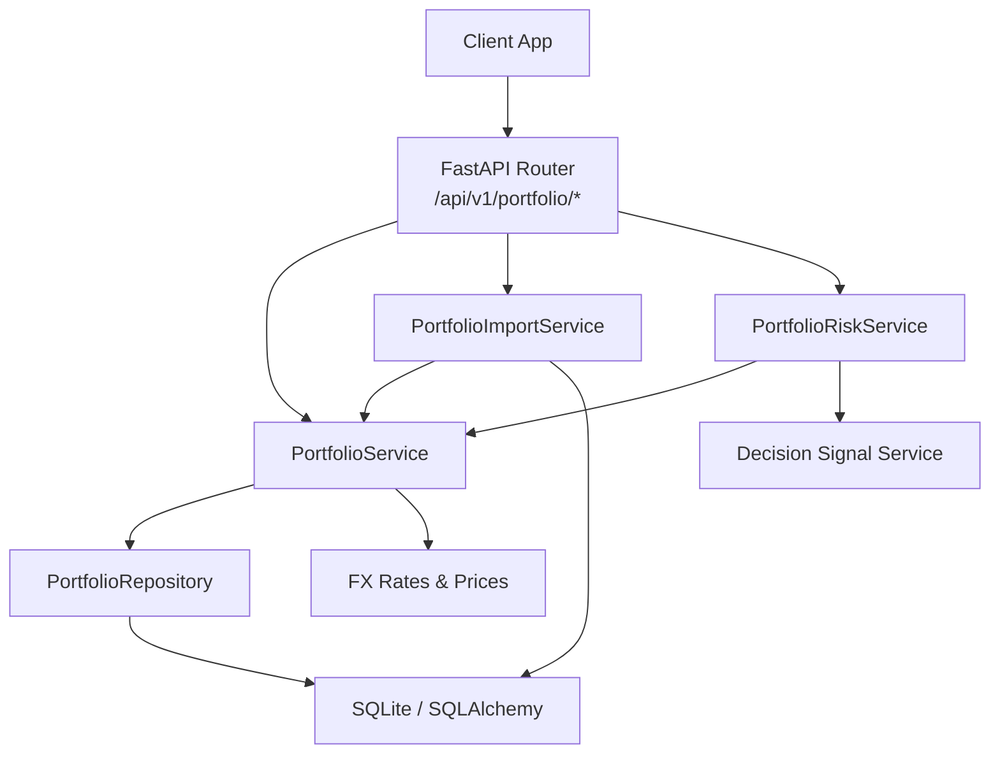
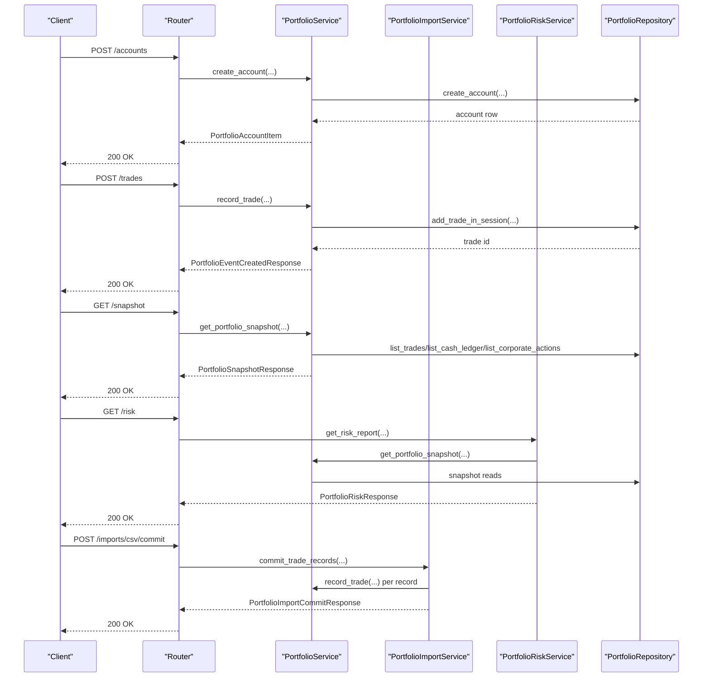
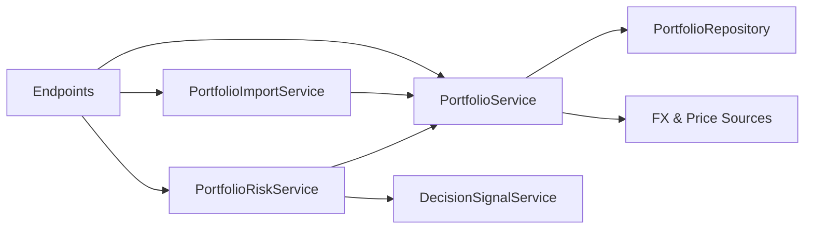

# Portfolio API

<cite>
**Referenced Files in This Document**
- [portfolio.py](file://api/v1/endpoints/portfolio.py)
- [portfolio.py](file://api/v1/schemas/portfolio.py)
- [portfolio_service.py](file://src/services/portfolio_service.py)
- [portfolio_risk_service.py](file://src/services/portfolio_risk_service.py)
- [portfolio_repo.py](file://src/repositories/portfolio_repo.py)
- [portfolio_import_service.py](file://src/services/portfolio_import_service.py)
- [futu_portfolio.py](file://src/brokers/futu/portfolio.py)
- [portfolio.ts](file://apps/dsa-web/src/api/portfolio.ts)
</cite>

## Table of Contents
1. [Introduction](#introduction)
2. [Project Structure](#project-structure)
3. [Core Components](#core-components)
4. [Architecture Overview](#architecture-overview)
5. [Detailed Component Analysis](#detailed-component-analysis)
6. [Dependency Analysis](#dependency-analysis)
7. [Performance Considerations](#performance-considerations)
8. [Troubleshooting Guide](#troubleshooting-guide)
9. [Conclusion](#conclusion)
10. [Appendices](#appendices)

## Introduction
This document describes the DailyStockAnalysis (DSA) Portfolio API focused on portfolio management and broker integration endpoints. It covers:
- Portfolio synchronization via CSV import from supported brokers
- Position tracking through trade, cash ledger, and corporate action events
- Performance analytics via portfolio snapshots with P&L calculations
- Risk assessment including concentration, drawdown, stop-loss proximity, and decision signal risk
- Real-time updates using optional realtime quotes with historical fallback
- Broker integration setup for Futu OpenD to discover live positions
- Data mapping between broker formats and DSA internal models
- Error handling for connectivity issues and data synchronization conflicts

## Project Structure
The Portfolio API is implemented as a FastAPI router under api/v1/endpoints with Pydantic schemas under api/v1/schemas. Business logic resides in src/services, persistence in src/repositories, and broker integrations in src/brokers. The frontend client lives under apps/dsa-web/src/api.

**Diagram sources**
- [portfolio.py:76-677](file://api/v1/endpoints/portfolio.py#L76-L677)
- [portfolio_service.py:109-613](file://src/services/portfolio_service.py#L109-L613)
- [portfolio_risk_service.py:21-101](file://src/services/portfolio_risk_service.py#L21-L101)
- [portfolio_import_service.py:79-270](file://src/services/portfolio_import_service.py#L79-L270)
- [portfolio_repo.py:45-159](file://src/repositories/portfolio_repo.py#L45-L159)

**Section sources**
- [portfolio.py:76-677](file://api/v1/endpoints/portfolio.py#L76-L677)
- [portfolio_service.py:109-613](file://src/services/portfolio_service.py#L109-L613)

## Core Components
- Account management: create, list, update, deactivate accounts with market and base currency metadata
- Event modeling: trades, cash ledger entries, corporate actions (cash dividends, split adjustments)
- Snapshot engine: deterministic replay of events to compute holdings, cost basis, P&L, and totals
- Risk engine: concentration, sector concentration, drawdown, stop-loss proximity, decision signal risk
- Import pipeline: parse broker CSVs into normalized records, deduplicate, and commit safely
- Broker integration: read real positions from Futu OpenD and map to analysis codes

Key responsibilities:
- Validation and normalization of symbols, markets, currencies, dates
- Idempotent writes with trade_uid and dedup_hash
- Safe concurrent writes with SQLite IMMEDIATE transactions and busy error handling
- Optional realtime quote usage with stale fallback for same-day snapshots

**Section sources**
- [portfolio_service.py:118-181](file://src/services/portfolio_service.py#L118-L181)
- [portfolio_service.py:186-339](file://src/services/portfolio_service.py#L186-L339)
- [portfolio_service.py:471-613](file://src/services/portfolio_service.py#L471-L613)
- [portfolio_risk_service.py:21-101](file://src/services/portfolio_risk_service.py#L21-L101)
- [portfolio_import_service.py:79-270](file://src/services/portfolio_import_service.py#L79-L270)
- [futu_portfolio.py:460-484](file://src/brokers/futu/portfolio.py#L460-L484)

## Architecture Overview
The API exposes REST endpoints that delegate to services which orchestrate business rules, data access, and external integrations.

**Diagram sources**
- [portfolio.py:76-677](file://api/v1/endpoints/portfolio.py#L76-L677)
- [portfolio_service.py:186-613](file://src/services/portfolio_service.py#L186-L613)
- [portfolio_risk_service.py:39-101](file://src/services/portfolio_risk_service.py#L39-L101)
- [portfolio_import_service.py:182-270](file://src/services/portfolio_import_service.py#L182-L270)
- [portfolio_repo.py:161-417](file://src/repositories/portfolio_repo.py#L161-L417)

## Detailed Component Analysis

### Accounts
- Create account: sets name, broker, market, base_currency, owner_id; validates and normalizes fields
- List accounts: supports include_inactive flag
- Update account: partial updates with validation
- Deactivate account: soft delete by setting is_active false

Request/response schemas are defined in the portfolio schemas module.

**Section sources**
- [portfolio.py:76-160](file://api/v1/endpoints/portfolio.py#L76-L160)
- [portfolio.py:12-43](file://api/v1/schemas/portfolio.py#L12-L43)
- [portfolio_service.py:118-181](file://src/services/portfolio_service.py#L118-L181)

### Trades, Cash Ledger, Corporate Actions
- Record trade: validates side, quantity, price, fee/tax; enforces sell quantity availability; supports trade_uid and dedup_hash for idempotency
- List/delete trades: paginated queries with filters (account_id, date range, symbol, side)
- Record cash ledger: direction in/out, amount > 0
- Record corporate actions: cash_dividend or split_adjustment with required parameters
- List/delete corporate actions: paginated queries with filters

Error handling:
- Validation errors return 400
- Duplicate trade_uid/dedup_hash returns 409 conflict
- Oversell attempts return 409 with oversell details
- Busy concurrency returns 409 with portfolio_busy

**Section sources**
- [portfolio.py:163-411](file://api/v1/endpoints/portfolio.py#L163-L411)
- [portfolio.py:45-149](file://api/v1/schemas/portfolio.py#L45-L149)
- [portfolio_service.py:186-339](file://src/services/portfolio_service.py#L186-L339)
- [portfolio_service.py:655-775](file://src/services/portfolio_service.py#L655-L775)
- [portfolio_repo.py:161-417](file://src/repositories/portfolio_repo.py#L161-L417)

### Portfolio Snapshot and Realtime Updates
- GET /snapshot computes holdings, cost basis, unrealized P&L, realized P&L, fees, taxes, and totals
- Supports cost_method fifo or avg
- Optional include_realtime uses best-effort realtime quotes for same-day valuation; falls back to historical close if unavailable
- Aggregates across accounts with FX conversion to a common currency (default CNY)
- Persists daily snapshots for risk analysis

Data quality flags:
- fx_stale indicates stale FX rates used
- limitations indicate partial valuation semantics for certain markets

**Section sources**
- [portfolio.py:414-441](file://api/v1/endpoints/portfolio.py#L414-L441)
- [portfolio.py:152-217](file://api/v1/schemas/portfolio.py#L152-L217)
- [portfolio_service.py:471-613](file://src/services/portfolio_service.py#L471-L613)

### Position Analysis Workflow
- POST /positions/{symbol}/analysis submits an asynchronous analysis task for a held position
- Resolves context from snapshot: account, market, currency, quantities, costs, P&L, price source/staleness
- Submits tasks to queue with portfolio context and report type
- Returns TaskAccepted or duplicate task error

**Section sources**
- [portfolio.py:444-555](file://api/v1/endpoints/portfolio.py#L444-L555)
- [portfolio.py:173-177](file://api/v1/schemas/portfolio.py#L173-L177)

### Risk Assessment
- GET /risk provides:
  - Thresholds (concentration, drawdown, stop-loss)
  - Concentration by symbol and sector
  - Drawdown series and alerts based on lookback window
  - Stop-loss proximity warnings per position
  - Decision signal risk block integrating defensive signals (sell, reduce, alert)

Risk computation depends on snapshot data and may backfill daily snapshots for the lookback window.

**Section sources**
- [portfolio.py:649-677](file://api/v1/endpoints/portfolio.py#L649-L677)
- [portfolio.py:272-297](file://api/v1/schemas/portfolio.py#L272-L297)
- [portfolio_risk_service.py:39-101](file://src/services/portfolio_risk_service.py#L39-L101)
- [portfolio_risk_service.py:282-559](file://src/services/portfolio_risk_service.py#L282-L559)

### Broker CSV Import and Synchronization
- GET /imports/csv/brokers lists supported brokers and aliases
- POST /imports/csv/parse parses uploaded CSV into normalized records with dedup hashes
- POST /imports/csv/commit commits parsed records with deduplication and dry-run support
- Supported brokers include Huatai, CITIC, CMB with column hints for flexible parsing
- Deduplication uses trade_uid and computed dedup_hash to prevent duplicates
- Errors include oversell, busy, and malformed rows

Workflow example:
1. Call brokers endpoint to select parser
2. Parse CSV to preview records and errors
3. Commit with dry_run=true to validate without writing
4. Commit again with dry_run=false to persist

**Section sources**
- [portfolio.py:558-627](file://api/v1/endpoints/portfolio.py#L558-L627)
- [portfolio.py:219-258](file://api/v1/schemas/portfolio.py#L219-L258)
- [portfolio_import_service.py:79-270](file://src/services/portfolio_import_service.py#L79-L270)

### Futu Broker Integration Setup
- Reads real positions from Futu OpenD using environment variables:
  - FUTU_OPEND_HOST, FUTU_OPEND_PORT
  - FUTU_ACC_ID (optional)
  - FUTU_SECURITY_FIRM
- Discovers active REAL NORMAL or MASTER accounts
- Loads non-zero LONG stock positions and maps to analysis codes for A/HK/US markets
- Skips unsupported markets and B-shares; logs skipped counts

Setup steps:
1. Install futu-api==10.8.6808
2. Configure OpenD host/port and security firm
3. Optionally set account ID to target one account
4. Run integration to retrieve position codes for further analysis

**Section sources**
- [futu_portfolio.py:52-162](file://src/brokers/futu/portfolio.py#L52-L162)
- [futu_portfolio.py:165-230](file://src/brokers/futu/portfolio.py#L165-L230)
- [futu_portfolio.py:233-316](file://src/brokers/futu/portfolio.py#L233-L316)
- [futu_portfolio.py:358-457](file://src/brokers/futu/portfolio.py#L358-L457)
- [futu_portfolio.py:460-484](file://src/brokers/futu/portfolio.py#L460-L484)

### Frontend Client Usage
- TypeScript client wraps all endpoints with typed requests and responses
- Builds query params for snapshots, risk, and event listings
- Handles multipart form uploads for CSV imports
- Converts snake_case server payloads to camelCase for UI consumption

**Section sources**
- [portfolio.ts:108-288](file://apps/dsa-web/src/api/portfolio.ts#L108-L288)

## Dependency Analysis
The Portfolio API has clear layering:
- Endpoints depend on services for business logic
- Services depend on repositories for persistence
- Risk service composes snapshot and decision signal services
- Import service composes portfolio service for committing normalized records
- Broker integration is isolated and can be invoked independently

**Diagram sources**
- [portfolio.py:76-677](file://api/v1/endpoints/portfolio.py#L76-L677)
- [portfolio_service.py:109-613](file://src/services/portfolio_service.py#L109-L613)
- [portfolio_risk_service.py:21-101](file://src/services/portfolio_risk_service.py#L21-L101)
- [portfolio_import_service.py:79-270](file://src/services/portfolio_import_service.py#L79-L270)
- [portfolio_repo.py:45-159](file://src/repositories/portfolio_repo.py#L45-L159)

**Section sources**
- [portfolio_service.py:109-613](file://src/services/portfolio_service.py#L109-L613)
- [portfolio_risk_service.py:21-101](file://src/services/portfolio_risk_service.py#L21-L101)
- [portfolio_import_service.py:79-270](file://src/services/portfolio_import_service.py#L79-L270)

## Performance Considerations
- Snapshot aggregation converts multi-account values to a common currency; FX staleness affects accuracy
- Realtime quotes are best-effort; historical fallback ensures consistency when realtime is unavailable
- Concurrent writes use SQLite IMMEDIATE transactions; retry on busy errors recommended
- CSV import batches records with deduplication; large files should be validated with dry_run first
- Risk drawdown computation may backfill daily snapshots for lookback windows; consider caching strategies

[No sources needed since this section provides general guidance]

## Troubleshooting Guide
Common issues and resolutions:
- Validation errors (400): Check field constraints such as side, direction, action_type, amounts, and dates
- Duplicate trade_uid or dedup_hash (409): Ensure unique identifiers or adjust CSV content
- Oversell detected (409): Verify available quantity before submitting sell orders; check corporate actions affecting splits
- Portfolio busy (409): Retry after brief delay; avoid concurrent writes to the same account
- Not found (404): Confirm account_id, trade_id, entry_id, or action_id exist and are active
- Internal errors (500): Inspect server logs for stack traces; verify database connectivity and external dependencies

Broker connectivity:
- Futu SDK not installed or version mismatch: Install specified version and configure environment variables
- Invalid OpenD address or port: Validate IPv4 host and port range; ensure OpenD is running and logged in
- No active REAL accounts: Confirm account role and status; filter by FUTU_ACC_ID if necessary

Data synchronization conflicts:
- CSV import duplicates: Use trade_uid or rely on dedup_hash; run dry_run to preview duplicates
- Stale FX rates: Refresh FX cache via /fx/refresh; monitor fx_stale flags in snapshots and risk reports

**Section sources**
- [portfolio.py:53-63](file://api/v1/endpoints/portfolio.py#L53-L63)
- [portfolio_service.py:66-90](file://src/services/portfolio_service.py#L66-L90)
- [portfolio_repo.py:136-159](file://src/repositories/portfolio_repo.py#L136-L159)
- [futu_portfolio.py:52-162](file://src/brokers/futu/portfolio.py#L52-L162)

## Conclusion
The DSA Portfolio API provides a robust foundation for portfolio management and broker integration. It supports account lifecycle, event-driven position tracking, deterministic snapshot computation, comprehensive risk analytics, and flexible CSV import workflows. Realtime quote integration enhances same-day valuations while maintaining reliability through historical fallback. The Futu broker integration enables live position discovery and mapping to analysis codes. Proper error handling and idempotent writes ensure safe synchronization even under concurrency and data conflicts.

[No sources needed since this section summarizes without analyzing specific files]

## Appendices

### API Endpoints Summary
- Accounts
  - POST /api/v1/portfolio/accounts
  - GET /api/v1/portfolio/accounts
  - PUT /api/v1/portfolio/accounts/{account_id}
  - DELETE /api/v1/portfolio/accounts/{account_id}
- Trades
  - POST /api/v1/portfolio/trades
  - GET /api/v1/portfolio/trades
  - DELETE /api/v1/portfolio/trades/{trade_id}
- Cash Ledger
  - POST /api/v1/portfolio/cash-ledger
  - GET /api/v1/portfolio/cash-ledger
  - DELETE /api/v1/portfolio/cash-ledger/{entry_id}
- Corporate Actions
  - POST /api/v1/portfolio/corporate-actions
  - GET /api/v1/portfolio/corporate-actions
  - DELETE /api/v1/portfolio/corporate-actions/{action_id}
- Snapshot
  - GET /api/v1/portfolio/snapshot
- Position Analysis
  - POST /api/v1/portfolio/positions/{symbol}/analysis
- Risk
  - GET /api/v1/portfolio/risk
- FX Refresh
  - POST /api/v1/portfolio/fx/refresh
- Import
  - GET /api/v1/portfolio/imports/csv/brokers
  - POST /api/v1/portfolio/imports/csv/parse
  - POST /api/v1/portfolio/imports/csv/commit

**Section sources**
- [portfolio.py:76-677](file://api/v1/endpoints/portfolio.py#L76-L677)

### Request/Response Schemas Overview
- Account schemas: creation, update, listing, deletion
- Trade schemas: creation, listing, deletion
- Cash ledger schemas: creation, listing, deletion
- Corporate action schemas: creation, listing, deletion
- Snapshot schema: account-level and aggregate metrics with positions
- Import schemas: parse results, commit results, supported brokers
- Risk schema: thresholds, concentration, sector concentration, drawdown, stop-loss, decision signal risk

**Section sources**
- [portfolio.py:12-297](file://api/v1/schemas/portfolio.py#L12-L297)

### Example Workflows
- Portfolio synchronization via CSV import:
  1. List supported brokers
  2. Parse CSV file to preview normalized records and errors
  3. Run dry_run commit to validate deduplication and conflicts
  4. Commit final import to persist trades
- Performance reporting:
  1. Fetch snapshot with cost method and optional realtime quotes
  2. Review total equity, realized/unrealized P&L, fees, taxes
  3. Inspect per-position metrics and price staleness
- Risk analysis:
  1. Fetch risk report with thresholds and lookback window
  2. Review concentration alerts and sector exposure
  3. Check drawdown metrics and stop-loss proximity warnings

**Section sources**
- [portfolio.py:558-677](file://api/v1/endpoints/portfolio.py#L558-L677)
- [portfolio_service.py:471-613](file://src/services/portfolio_service.py#L471-L613)
- [portfolio_risk_service.py:39-101](file://src/services/portfolio_risk_service.py#L39-L101)