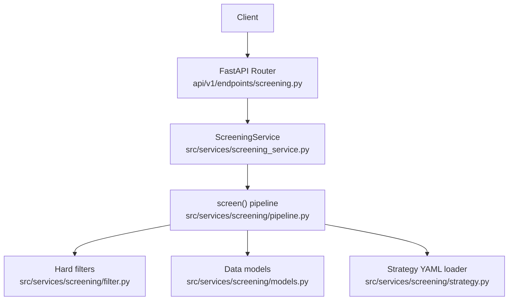
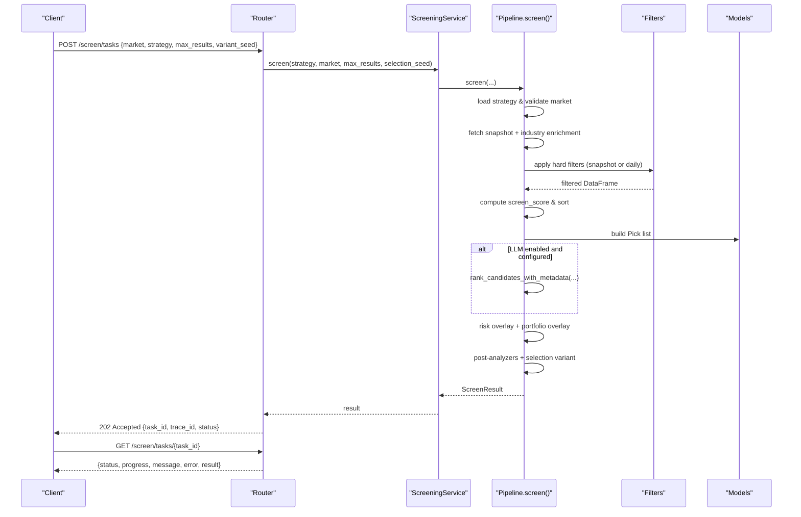
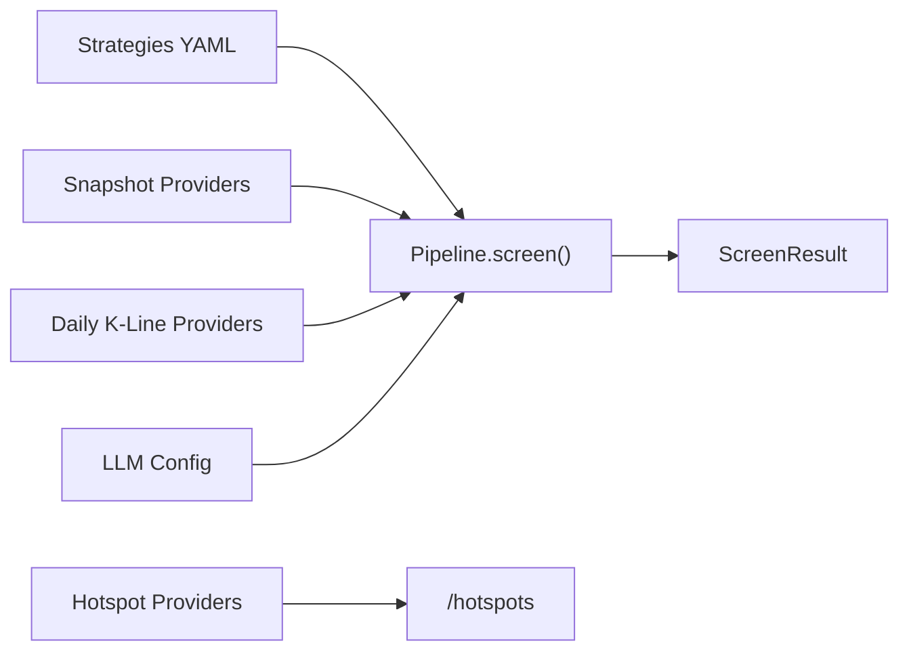

# Screening API

<cite>
**Referenced Files in This Document**
- [screening.py](file://api/v1/endpoints/screening.py)
- [screening_service.py](file://src/services/screening_service.py)
- [pipeline.py](file://src/services/screening/pipeline.py)
- [filter.py](file://src/services/screening/filter.py)
- [models.py](file://src/services/screening/models.py)
- [strategy.py](file://src/services/screening/strategy.py)
- [dual_low.yaml](file://src/services/screening/strategies/dual_low.yaml)
- [momentum_quality.yaml](file://src/services/screening/strategies/momentun_quality.yaml)
- [volume_breakout.yaml](file://src/services/screening/strategies/volume_breakout.yaml)
- [test_screening_api.py](file://tests/test_screening_api.py)
</cite>

## Table of Contents
1. Introduction
2. Project Structure
3. Core Components
4. Architecture Overview
5. Detailed Component Analysis
6. Dependency Analysis
7. Performance Considerations
8. Troubleshooting Guide
9. Conclusion

## Introduction
This document describes the DailyStockAnalysis screening API focused on stock screening and discovery. It covers how to run screeners, manage screening criteria via strategies, and retrieve filtered results. The primary endpoints include asynchronous task submission and status polling for long-running screen runs, plus synchronous execution and history retrieval.

The screening engine supports:
- Strategy-driven hard filters (technical and fundamental).
- Optional daily K-line feature enrichment.
- Factor scoring and LLM-assisted ranking when configured.
- Risk and portfolio diversity overlays.
- Hotspot discovery with caching and provider fallbacks.

## Project Structure
Screening is exposed through a FastAPI router under api/v1/endpoints/screening.py. The router delegates to src/services/screening_service.py, which orchestrates the built-in pipeline defined in src/services/screening/pipeline.py. Strategies are YAML files under src/services/screening/strategies/. Filter logic and data models live in filter.py and models.py.

**Diagram sources**
- [screening.py:133-217](file://api/v1/endpoints/screening.py#L133-L217)
- [screening_service.py:1-120](file://src/services/screening_service.py#L1-L120)
- [pipeline.py:47-144](file://src/services/screening/pipeline.py#L47-L144)
- [filter.py:46-102](file://src/services/screening/filter.py#L46-L102)
- [models.py:115-237](file://src/services/screening/models.py#L115-L237)
- [strategy.py:189-270](file://src/services/screening/strategy.py#L189-L270)

**Section sources**
- [screening.py:1-251](file://api/v1/endpoints/screening.py#L1-L251)
- [screening_service.py:1-120](file://src/services/screening_service.py#L1-L120)
- [pipeline.py:47-144](file://src/services/screening/pipeline.py#L47-L144)

## Core Components
- Endpoints: POST /api/v1/screening/screen/tasks (async), GET /api/v1/screening/screen/tasks/{task_id} (status), POST /api/v1/screening/screen (sync), GET /api/v1/screening/history, GET /api/v1/screening/history/{run_id}, GET /api/v1/screening/status, GET /api/v1/screening/strategies, GET /api/v1/screening/hotspots, GET /api/v1/screening/hotspots/{topic}.
- Request model: market, strategy, max_results, variant_seed.
- Response models: accepted task info, task status, screened picks, metadata.
- Strategy system: YAML-defined hard filters, factor weights, profiles, and ranking hints.
- Filtering: snapshot-based hard filters and optional daily K-line features.
- Ranking: factor score then optional LLM re-ranking; risk and portfolio overlays.

Key request/response contracts are enforced by Pydantic models in the endpoint file and internal dataclasses in models.py.

**Section sources**
- [screening.py:23-61](file://api/v1/endpoints/screening.py#L23-L61)
- [models.py:115-237](file://src/services/screening/models.py#L115-L237)

## Architecture Overview
The screening flow executes these stages:
1. Load strategy and validate market scope.
2. Fetch market snapshot with fallbacks and industry/concept enrichment.
3. Apply L1 hard filters (snapshot-safe first if daily features are required).
4. Optionally enrich shortlisted candidates with daily K-line features.
5. Compute screen_score and sort candidates.
6. Build Pick list and optionally collect candidate context.
7. Optional LLM ranking with context and retries.
8. Apply risk overlay and portfolio diversity overlay.
9. Run post-analyzers (e.g., scorecard, DSA).
10. Apply selection variant rotation using seed.
11. Return ScreenResult with picks and metadata.

**Diagram sources**
- [screening.py:133-202](file://api/v1/endpoints/screening.py#L133-L202)
- [pipeline.py:47-558](file://src/services/screening/pipeline.py#L47-L558)
- [filter.py:46-102](file://src/services/screening/filter.py#L46-L102)
- [models.py:115-237](file://src/services/screening/models.py#L115-L237)

## Detailed Component Analysis

### Endpoint: POST /api/v1/screening/screen/tasks
- Purpose: Submit a background screening job. Returns immediately with task_id and trace_id.
- Request body fields:
  - market: string, default "cn", length 1–16.
  - strategy: string, default "dual_low", length 1–64.
  - max_results: integer, default 20, range 1–100.
  - variant_seed: string, max length 128.
- Behavior:
  - Creates a background task via the task queue.
  - Updates progress callbacks during execution.
  - Delegates to ScreeningService.screen().
- Response schema:
  - task_id: string
  - trace_id: string
  - status: string ("pending" initially)
  - message: string
  - strategy: string
  - market: string
  - max_results: integer

**Section sources**
- [screening.py:23-61](file://api/v1/endpoints/screening.py#L23-L61)
- [screening.py:133-184](file://api/v1/endpoints/screening.py#L133-L184)

### Endpoint: GET /api/v1/screening/screen/tasks/{task_id}
- Purpose: Poll task status and retrieve final result when completed.
- Path parameter:
  - task_id: string
- Response schema:
  - task_id: string
  - trace_id: string
  - status: string
  - progress: integer
  - message: string
  - error: string
  - result: object (present when completed)

Error handling:
- Returns 404-like error if task not found or wrong report type.

**Section sources**
- [screening.py:187-202](file://api/v1/endpoints/screening.py#L187-L202)

### Endpoint: POST /api/v1/screening/screen
- Purpose: Synchronous screening execution returning results directly.
- Request body: same as async task submission.
- Response: full ScreenResult payload including picks and metadata.

Use this endpoint for quick tests or small outputs. For large datasets or production usage, prefer the async task workflow.

**Section sources**
- [screening.py:205-217](file://api/v1/endpoints/screening.py#L205-L217)
- [pipeline.py:47-144](file://src/services/screening/pipeline.py#L47-L144)

### Endpoint: GET /api/v1/screening/history
- Purpose: Retrieve recent screening runs with optional filters.
- Query parameters:
  - limit: integer, default 20, range 1–100.
  - strategy: string, optional.
  - market: string, optional.
- Response: list of run summaries.

**Section sources**
- [screening.py:220-232](file://api/v1/endpoints/screening.py#L220-L232)

### Endpoint: GET /api/v1/screening/history/{run_id}
- Purpose: Get detailed result for a specific run.
- Path parameter:
  - run_id: string
- Response: full ScreenResult for that run.

**Section sources**
- [screening.py:235-241](file://api/v1/endpoints/screening.py#L235-L241)

### Endpoint: GET /api/v1/screening/status
- Purpose: Check screening availability and engine metadata.
- Response includes:
  - available: boolean
  - engine: string ("builtin")
  - contract_version: string
  - version: string
  - strategy_count: integer
  - source_health: object (optional)

**Section sources**
- [screening.py:76-78](file://api/v1/endpoints/screening.py#L76-L78)
- [test_screening_api.py:144-186](file://tests/test_screening_api.py#L144-L186)

### Endpoint: GET /api/v1/screening/strategies
- Purpose: List available screening strategies with metadata.
- Response includes:
  - enabled: boolean
  - strategy_count: integer
  - strategies: array of strategy objects with id, name, description, category, tags, market_scope, analysis_skills, etc.

**Section sources**
- [screening.py:81-86](file://api/v1/endpoints/screening.py#L81-L86)
- [strategy.py:287-317](file://src/services/screening/strategy.py#L287-L317)

### Endpoint: GET /api/v1/screening/hotspots
- Purpose: Discover hot topics with metrics and leader stocks.
- Query parameters:
  - provider: string, optional.
  - top: integer, default 12, range 1–50.
  - refresh: boolean, default false.
  - include_details: boolean, default false.
- Response includes:
  - enabled: boolean
  - provider: string
  - provider_used: string
  - fallback_used: boolean
  - cache_used: boolean
  - cached_at: string
  - source_errors: array
  - stale: boolean
  - stale_age_hours: number
  - hotspots: array
  - hotspot_count: integer
  - details: object (when include_details is true)

Caching behavior:
- Uses local JSON cache with TTL and last-good-cache fallback.
- Provider-specific detail caches with TTL.

**Section sources**
- [screening.py:89-108](file://api/v1/endpoints/screening.py#L89-L108)
- [screening_service.py:270-336](file://src/services/screening_service.py#L270-L336)
- [screening_service.py:641-728](file://src/services/screening_service.py#L641-L728)

### Endpoint: GET /api/v1/screening/hotspots/{topic}
- Purpose: Get detailed information for a hotspot topic.
- Path parameter:
  - topic: string
- Query parameters:
  - provider: string, optional.
  - refresh: boolean, default false.
  - include_search: boolean, default false.
- Response includes:
  - enabled: boolean
  - provider: string
  - provider_used: string
  - fallback_used: boolean
  - cache_used: boolean
  - cached_at: string
  - source_errors: array
  - stocks: array
  - leader_stocks: array
  - stock_count: integer
  - route: array
  - timeline: array
  - news_search_requested: boolean
  - news_search_status: string

**Section sources**
- [screening.py:111-130](file://api/v1/endpoints/screening.py#L111-L130)
- [screening_service.py:169-238](file://src/services/screening_service.py#L169-L238)
- [screening_service.py:426-444](file://src/services/screening_service.py#L426-L444)

### Screening Criteria Syntax and Operators
Hard filters are defined per strategy in YAML under screening.hard_filters. Supported operators and fields include:
- exclude_st: boolean
- price_min, price_max: float
- amount_min: float
- market_cap_min, market_cap_max: float
- pe_ttm_min, pe_ttm_max: float
- pb_min, pb_max: float
- volume_ratio_min: float
- turnover_rate_min: float
- change_pct_min, change_pct_max: float
- change_60d_min, change_60d_max: float
- require_ma_bullish: boolean
- require_price_above_ma20: boolean
- signal_score_min: int
- macd_status_whitelist: list<string>
- rsi_status_whitelist: list<string>
- breakout_20d_pct_min, breakout_20d_pct_max: float
- range_20d_pct_max: float
- volume_ratio_20d_min, volume_ratio_20d_max: float
- body_pct_min, body_pct_max: float
- pullback_to_ma20_pct_min, pullback_to_ma20_pct_max: float
- consolidation_days_20d_min, consolidation_days_20d_max: int
- volatility_20d_pct_min, volatility_20d_pct_max: float
- max_drawdown_20d_pct_min, max_drawdown_20d_pct_max: float
- atr_20_pct_min, atr_20_pct_max: float

Filter application:
- Snapshot-safe filters applied first if daily features are required.
- Daily K-line features can be enriched for additional filters.
- Whitelist filters use exact match against configured values.

Examples:
- Value screener: dual_low.yaml uses low PE/PB, moderate price and market cap, and daily activity constraints.
- Momentum quality screener: momentum_quality.yaml emphasizes trend confirmation and quality factors.
- Breakout screener: volume_breakout.yaml targets high volume breakouts with MA20 support and consolidation patterns.

**Section sources**
- [models.py:11-67](file://src/services/screening/models.py#L11-L67)
- [filter.py:46-102](file://src/services/screening/filter.py#L46-L102)
- [filter.py:290-322](file://src/services/screening/filter.py#L290-L322)
- [dual_low.yaml:18-77](file://src/services/screening/strategies/dual_low.yaml#L18-L77)
- [momentum_quality.yaml:19-76](file://src/services/screening/strategies/momentun_quality.yaml#L19-L76)
- [volume_breakout.yaml:19-78](file://src/services/screening/strategies/volume_breakout.yaml#L19-L78)

### Parameter Validation
- market: must be one of supported markets; pipeline validates and raises an error for unsupported values.
- strategy: must exist in loaded strategies; otherwise returns an error listing available strategies.
- max_results: bounded between 1 and 100 at the API layer.
- variant_seed: opaque string used for selection variant rotation; not persisted.

Validation errors propagate through FastAPI error handling and are surfaced in response payloads or HTTP exceptions.

**Section sources**
- [pipeline.py:111-129](file://src/services/screening/pipeline.py#L111-L129)
- [screening.py:23-27](file://api/v1/endpoints/screening.py#L23-L27)

### Response Schema: Screened Stocks and Metadata
ScreenResult contains:
- strategy, market, strategy_version, strategy_category
- snapshot_count, after_filter_count
- picks: array of Pick objects
- run_id
- llm_ranked, llm_market_view, llm_selection_logic, llm_portfolio_risk
- llm_coverage, llm_parse_errors, llm_model_used, llm_attempted_models, llm_failure_reason
- ranking_mode: "factor" or "llm"
- degradation: array of diagnostic notes
- snapshot_source, source_errors
- deep_analysis_requested, post_analyzers
- daily_enriched, daily_enrich_count
- risk_enabled, portfolio_diversity_enabled
- portfolio_concentration_notes
- result_variant_applied, result_variant_pool_size, result_variant_rotated_slots
- saved_path, created_at

Pick fields include:
- rank, code, name, final_score, screen_score, ranking_reason, risk_summary
- price, change_pct, amount, total_mv, turnover_rate, volume_ratio
- pe_ratio, pb_ratio, industry, concepts
- industry_rank, industry_change_pct, industry_heat_score
- board heat scores and state
- change_60d, signal_score, ma_bullish, price_above_ma20
- MACD and RSI statuses
- 20-day technical metrics (breakout, range, volume ratio, body pct, pullback, consolidation, volatility, drawdown, ATR)
- daily quality score and flags
- factor_scores map
- LLM fields (confidence, sector, theme, tags, catalysts, risks, thesis, style fit, watch items, invalidators)
- risk_score, risk_level, risk_penalty, risk_flags, excluded_by_risk
- portfolio_penalty, portfolio_flags
- post-analysis status, summaries, score deltas, results, tags
- DSA context, news, analysis summary
- deep analysis fields

**Section sources**
- [models.py:115-237](file://src/services/screening/models.py#L115-L237)
- [pipeline.py:526-558](file://src/services/screening/pipeline.py#L526-L558)

### Examples: Technical, Fundamental, and Custom Strategies
- Fundamental value example: dual_low.yaml demonstrates low valuation thresholds and defensive style.
- Trend-quality example: momentum_quality.yaml combines momentum and quality with sector buckets.
- Technical breakout example: volume_breakout.yaml focuses on volume expansion and consolidation patterns.

These strategies define hard_filters, factor_weights, scoring/risk/portfolio profiles, and ranking_hints to guide selection and ranking.

**Section sources**
- [dual_low.yaml:1-77](file://src/services/screening/strategies/dual_low.yaml#L1-L77)
- [momentum_quality.yaml:1-76](file://src/services/screening/strategies/momentun_quality.yaml#L1-L76)
- [volume_breakout.yaml:1-78](file://src/services/screening/strategies/volume_breakout.yaml#L1-L78)

## Dependency Analysis
Screening depends on:
- Strategy YAML definitions for criteria and profiles.
- Snapshot providers with fallbacks and industry mapping.
- Daily K-line providers for advanced filters and enrichment.
- LLM configuration for optional ranking and candidate context.
- Task queue for async execution and progress reporting.
- Hotspot providers with caching and search augmentation.

**Diagram sources**
- [pipeline.py:117-179](file://src/services/screening/pipeline.py#L117-L179)
- [pipeline.py:342-450](file://src/services/screening/pipeline.py#L342-L450)
- [screening_service.py:270-336](file://src/services/screening_service.py#L270-L336)

**Section sources**
- [pipeline.py:117-179](file://src/services/screening/pipeline.py#L117-L179)
- [pipeline.py:342-450](file://src/services/screening/pipeline.py#L342-L450)
- [screening_service.py:270-336](file://src/services/screening_service.py#L270-L336)

## Performance Considerations
Optimization techniques implemented:
- Snapshot fallback chain with configurable priority and TTL.
- Industry/concept enrichment with provider caching and TTL.
- Daily K-line enrichment limited to Top-K candidates with retries and worker limits.
- LLM ranking capped by multiplier and maximum candidates; fallback to factor ranking on failure.
- Risk and portfolio overlays applied efficiently before final trimming.
- Selection variant rotation seeded per run to diversify results without persistence.
- Hotspot caching with last-good-cache fallback and detail-level TTL.

Recommendations:
- Use async task submission for large max_results to avoid blocking requests.
- Tune daily_enrich_max_candidates and lookback windows to balance freshness and cost.
- Configure LLM settings conservatively (temperature, max tokens, timeouts) to reduce latency.
- Leverage variant_seed to rotate results across repeated runs.
- Monitor source health and adjust provider priorities based on reliability.

[No sources needed since this section provides general guidance]

## Troubleshooting Guide
Common issues and diagnostics:
- Unsupported market or missing strategy: pipeline raises ValueError with available options.
- Missing snapshot columns: filter raises SnapshotFieldMissingError indicating required field.
- Daily enrichment failures: pipeline records degradation notes and may skip enrichment unless required.
- LLM ranking failures: pipeline falls back to factor ranking and logs reasons.
- Hotspot provider timeouts or disconnections: service returns friendly messages and uses cached data when available.

Operational tips:
- Inspect ScreenResult.degradation for step-by-step diagnostics.
- Use /history and /history/{run_id} to review past runs and outcomes.
- Check /status for engine availability and source health snapshots.
- For hotspot issues, try refresh=false to use cache or adjust SCREENING_SOURCE_CALL_TIMEOUT_SEC.

**Section sources**
- [pipeline.py:111-129](file://src/services/screening/pipeline.py#L111-L129)
- [filter.py:42-102](file://src/services/screening/filter.py#L42-L102)
- [pipeline.py:295-301](file://src/services/screening/pipeline.py#L295-L301)
- [pipeline.py:439-450](file://src/services/screening/pipeline.py#L439-L450)
- [screening_service.py:771-791](file://src/services/screening_service.py#L771-L791)

## Conclusion
The DailyStockAnalysis screening API provides a robust, strategy-driven framework for discovering and ranking stocks. It supports both synchronous and asynchronous workflows, comprehensive filtering, optional LLM-enhanced ranking, and resilient data sourcing with caching. By leveraging strategies, tuning enrichment and LLM settings, and monitoring diagnostics, users can build effective screening pipelines tailored to their investment styles and risk preferences.

[No sources needed since this section summarizes without analyzing specific files]