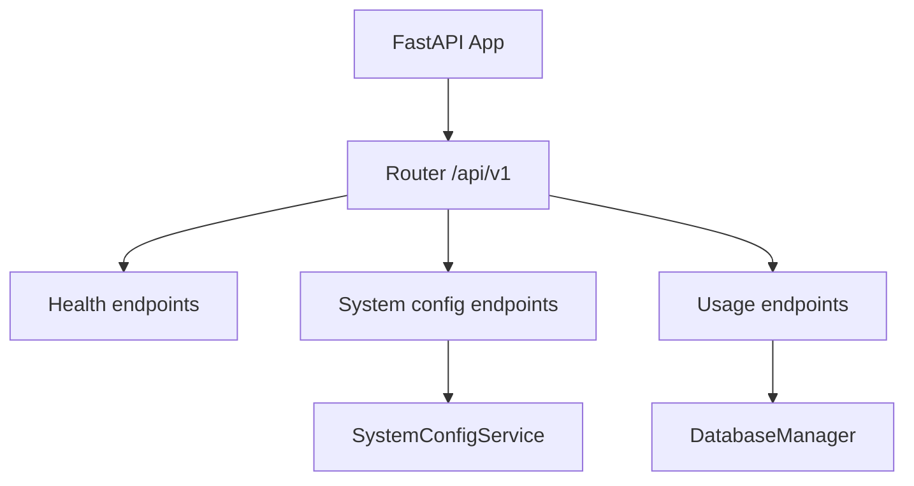
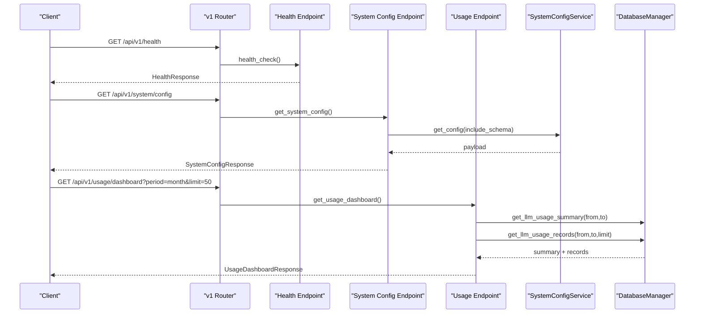
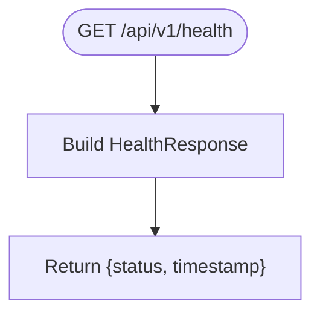
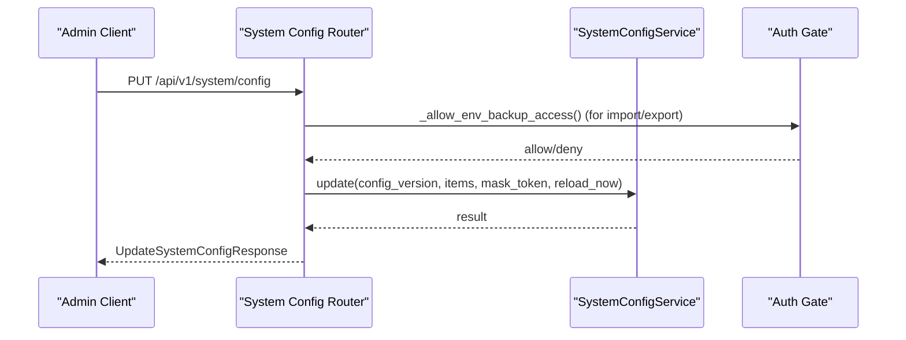
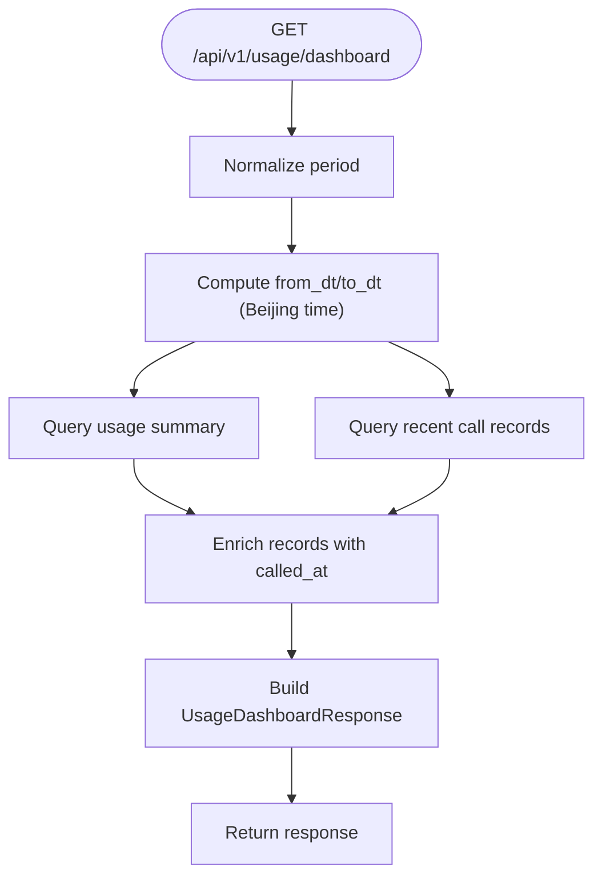
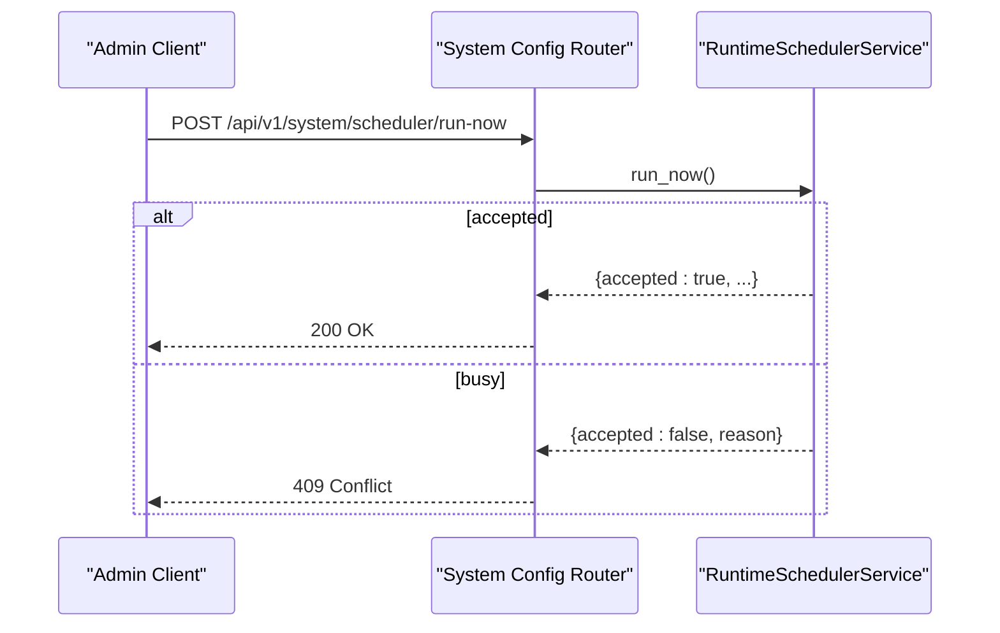
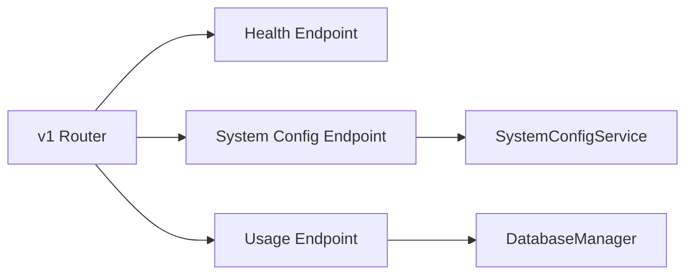

# System API

<cite>
**Referenced Files in This Document**
- [router.py](file://api/v1/router.py)
- [health.py](file://api/v1/endpoints/health.py)
- [system_config.py](file://api/v1/endpoints/system_config.py)
- [usage.py](file://api/v1/endpoints/usage.py)
- [common.py](file://api/v1/schemas/common.py)
- [system_config.py](file://api/v1/schemas/system_config.py)
- [usage.py](file://api/v1/schemas/usage.py)
- [deps.py](file://api/deps.py)
- [auth.py](file://src/auth.py)
</cite>

## Table of Contents
1. [Introduction](#introduction)
2. [Project Structure](#project-structure)
3. [Core Components](#core-components)
4. [Architecture Overview](#architecture-overview)
5. [Detailed Component Analysis](#detailed-component-analysis)
6. [Dependency Analysis](#dependency-analysis)
7. [Performance Considerations](#performance-considerations)
8. [Troubleshooting Guide](#troubleshooting-guide)
9. [Conclusion](#conclusion)
10. [Appendices](#appendices)

## Introduction
This document provides comprehensive system administration and monitoring API documentation for DailyStockAnalysis. It focuses on:
- System configuration management (read, update, validate, import/export)
- Health monitoring endpoints
- Usage tracking and metrics
- Administrative operations with security considerations

The API is versioned under /api/v1 and grouped by feature tags. Authentication is optional and controlled via environment settings; when enabled, administrative operations that touch sensitive configuration require a valid admin session.

## Project Structure
The system API is organized as FastAPI routers mounted under /api/v1:
- Health checks are exposed at the root of v1.
- System configuration endpoints are under /api/v1/system.
- Usage metrics are under /api/v1/usage.
- Schemas define request/response contracts for each domain.

**Diagram sources**
- [router.py:35-116](file://api/v1/router.py#L35-L116)
- [health.py:21-34](file://api/v1/endpoints/health.py#L21-L34)
- [system_config.py:51-729](file://api/v1/endpoints/system_config.py#L51-L729)
- [usage.py:67-100](file://api/v1/endpoints/usage.py#L67-L100)
- [deps.py:72-87](file://api/deps.py#L72-L87)

**Section sources**
- [router.py:1-117](file://api/v1/router.py#L1-L117)

## Core Components
- Health endpoint: returns service status and timestamp for load balancers and monitors.
- System configuration endpoints: read current configuration, get schema, validate updates, apply changes, export/import raw .env backups, test LLM/notification channels, preview backend statuses, and trigger scheduler runs.
- Usage endpoints: aggregate token usage summaries and dashboard data including recent calls.

Key schemas:
- Common responses: HealthResponse, ErrorResponse, SuccessResponse.
- System configuration: SystemConfigResponse, UpdateSystemConfigRequest/Response, ValidateSystemConfigRequest/Response, Import/Export payloads, channel test requests/responses, backend status models.
- Usage: UsageSummaryResponse, UsageDashboardResponse, breakdowns by call type and model.

**Section sources**
- [common.py:17-75](file://api/v1/schemas/common.py#L17-L75)
- [system_config.py:31-396](file://api/v1/schemas/system_config.py#L31-L396)
- [usage.py:11-53](file://api/v1/schemas/usage.py#L11-L53)

## Architecture Overview
The system API follows a layered design:
- Endpoints: FastAPI route handlers for HTTP requests.
- Services: Business logic encapsulated in services (e.g., SystemConfigService).
- Storage: DatabaseManager provides persistence and query capabilities.
- Security: Optional admin authentication gates sensitive operations.

**Diagram sources**
- [health.py:21-34](file://api/v1/endpoints/health.py#L21-L34)
- [system_config.py:130-161](file://api/v1/endpoints/system_config.py#L130-L161)
- [usage.py:83-100](file://api/v1/endpoints/usage.py#L83-L100)
- [deps.py:72-87](file://api/deps.py#L72-L87)

## Detailed Component Analysis

### Health Monitoring
- Endpoint: GET /api/v1/health
- Purpose: Return service status and timestamp for health probes.
- Response schema: HealthResponse with status and timestamp fields.

**Diagram sources**
- [health.py:21-34](file://api/v1/endpoints/health.py#L21-L34)
- [common.py:31-42](file://api/v1/schemas/common.py#L31-L42)

**Section sources**
- [health.py:1-35](file://api/v1/endpoints/health.py#L1-L35)
- [common.py:17-42](file://api/v1/schemas/common.py#L17-L42)

### System Configuration Management
- Read configuration: GET /api/v1/system/config
  - Returns current values with masking for secrets and optional schema metadata.
  - Response includes config_version, mask_token, items list, and provider hints.
- Get setup status: GET /api/v1/system/config/setup/status
  - Side-effect-free readiness summary for first-run setup.
- Get generation backend status: GET /api/v1/system/config/generation-backends/status
  - Cheap check without running model requests.
- Preview generation backend status: POST /api/v1/system/config/generation-backends/status/preview
  - Validates unsaved draft values against runtime expectations.
- Smoke test generation backend: POST /api/v1/system/config/generation-backends/smoke-test
  - Runs a fixed-prompt smoke test without persisting config.
- Agent backend status: GET /api/v1/system/config/agent-backends/status
  - Reads selected agent chat backend capability without model requests.
- Preview agent backend status: POST /api/v1/system/config/agent-backends/status/preview
  - Side-effect-free validation of unsaved agent settings.
- Update configuration: PUT /api/v1/system/config
  - Applies key-value updates to .env with optimistic locking via config_version.
  - Supports mask_token to preserve existing secret values and reload_now to trigger immediate reload.
- Export configuration: GET /api/v1/system/config/export
  - Exports raw .env content for backup. Requires admin session unless desktop mode.
- Import configuration: POST /api/v1/system/config/import
  - Merges raw .env into active config with conflict protection and optional reload.
- Validate configuration: POST /api/v1/system/config/validate
  - Pre-save validation without writing to .env.
- Test LLM channel: POST /api/v1/system/config/llm/test-channel
  - Minimal connectivity test for one channel definition without saving.
- Test notification channel: POST /api/v1/system/config/notification/test-channel
  - Sends a short test message using unsaved or saved notification config.
- Discover LLM models: POST /api/v1/system/config/llm/discover-models
  - Calls channel’s /models endpoint to discover available models.
- Get configuration schema: GET /api/v1/system/config/schema
  - Returns categorized field metadata for dynamic UI rendering.

**Diagram sources**
- [system_config.py:364-415](file://api/v1/endpoints/system_config.py#L364-L415)
- [system_config.py:94-127](file://api/v1/endpoints/system_config.py#L94-L127)
- [system_config.py:130-161](file://api/v1/endpoints/system_config.py#L130-L161)

**Section sources**
- [system_config.py:51-729](file://api/v1/endpoints/system_config.py#L51-L729)
- [system_config.py:31-396](file://api/v1/schemas/system_config.py#L31-L396)

### Usage Tracking and Metrics
- Summary: GET /api/v1/usage/summary?period=today|month|all
  - Aggregates token consumption by period, call type, and model.
- Dashboard: GET /api/v1/usage/dashboard?period=today|month|all&limit=1..200
  - Returns totals, breakdowns, and recent LLM call records enriched with ISO timestamps.

**Diagram sources**
- [usage.py:25-38](file://api/v1/endpoints/usage.py#L25-L38)
- [usage.py:41-64](file://api/v1/endpoints/usage.py#L41-L64)
- [usage.py:83-100](file://api/v1/endpoints/usage.py#L83-L100)

**Section sources**
- [usage.py:1-101](file://api/v1/endpoints/usage.py#L1-L101)
- [usage.py:11-53](file://api/v1/schemas/usage.py#L11-L53)

### Scheduler Operations
- Status: GET /api/v1/system/scheduler/status
  - Returns runtime scheduler status.
- Run now: POST /api/v1/system/scheduler/run-now
  - Triggers one isolated analysis run; returns conflict if already running.

**Diagram sources**
- [system_config.py:63-82](file://api/v1/endpoints/system_config.py#L63-L82)

**Section sources**
- [system_config.py:51-82](file://api/v1/endpoints/system_config.py#L51-L82)

## Dependency Analysis
- Routers mount endpoints under /api/v1 with tags for grouping.
- System configuration endpoints depend on SystemConfigService provided via dependency injection.
- Usage endpoints depend on DatabaseManager for querying usage data.
- Health endpoint is self-contained and returns a simple response.

**Diagram sources**
- [router.py:35-116](file://api/v1/router.py#L35-L116)
- [deps.py:72-87](file://api/deps.py#L72-L87)

**Section sources**
- [router.py:1-117](file://api/v1/router.py#L1-L117)
- [deps.py:1-88](file://api/deps.py#L1-L88)

## Performance Considerations
- Health checks are lightweight and suitable for frequent probing.
- Usage dashboard queries can be tuned via limit parameter; avoid excessively large limits to reduce database load.
- Configuration updates use optimistic locking (config_version) to prevent concurrent write conflicts; clients should reload configuration after conflicts.
- Backend status previews and smoke tests are side-effect-free where possible; use them to validate configurations before applying.

[No sources needed since this section provides general guidance]

## Troubleshooting Guide
Common errors and handling:
- Validation failures: 400 responses include issues array detailing keys, codes, messages, severity, expected/actual values.
- Version conflicts: 409 responses indicate configuration changed; reload and retry with updated config_version.
- Unauthorized access: 401 responses for backup/restore when admin session is missing or invalid.
- Disabled backup: 403 responses when env backup is disabled and not in desktop mode.
- Internal errors: 500 responses with generic error messages; check server logs for stack traces.

Security notes:
- Backup/restore endpoints enforce strict access control:
  - Desktop mode bypasses auth gate.
  - Non-desktop requires ADMIN_AUTH_ENABLED=true and a valid session cookie.
- Session management:
  - Sessions are signed with HMAC and have configurable max age.
  - Passwords are stored as PBKDF2 hashes with salt; rate limiting protects brute-force attempts.

**Section sources**
- [system_config.py:85-127](file://api/v1/endpoints/system_config.py#L85-L127)
- [system_config.py:364-415](file://api/v1/endpoints/system_config.py#L364-L415)
- [system_config.py:418-534](file://api/v1/endpoints/system_config.py#L418-L534)
- [auth.py:189-234](file://src/auth.py#L189-L234)
- [auth.py:332-367](file://src/auth.py#L332-L367)
- [auth.py:370-422](file://src/auth.py#L370-L422)

## Conclusion
The DailyStockAnalysis system API provides robust administrative and monitoring capabilities:
- Health checks for operational visibility.
- Comprehensive configuration management with validation, preview, and safe import/export.
- Usage metrics for cost and performance insights.
- Strong security controls for sensitive operations, including session-based access and rate limiting.

Adopt best practices:
- Always validate configuration before applying.
- Use previews and smoke tests to minimize risk.
- Monitor usage dashboards to track token consumption and identify anomalies.
- Ensure admin authentication is enabled in production environments.

[No sources needed since this section summarizes without analyzing specific files]

## Appendices

### Request/Response Schemas Overview
- HealthResponse: status, timestamp.
- SystemConfigResponse: config_version, mask_token, items, llm_model_providers, updated_at.
- UpdateSystemConfigRequest: config_version, mask_token, reload_now, items.
- UpdateSystemConfigResponse: success, config_version, applied_count, skipped_masked_count, reload_triggered, updated_keys, warnings.
- ValidateSystemConfigRequest/Response: items, valid, issues.
- ImportSystemConfigRequest: config_version, content, reload_now.
- ExportSystemConfigResponse: content, config_version, updated_at.
- TestLLMChannelRequest/Response: protocol, base_url, api_key, models, timeout_seconds, capability_checks, results.
- TestNotificationChannelRequest/Response: channel, items, title, content, timeout_seconds, attempts.
- DiscoverLLMChannelModelsRequest/Response: protocol, base_url, api_key, models, timeout_seconds, models list.
- UsageSummaryResponse: period, from_date, to_date, total_calls, token totals, by_call_type, by_model.
- UsageDashboardResponse: extends UsageSummaryResponse with recent_calls.

**Section sources**
- [common.py:17-75](file://api/v1/schemas/common.py#L17-L75)
- [system_config.py:31-396](file://api/v1/schemas/system_config.py#L31-L396)
- [usage.py:11-53](file://api/v1/schemas/usage.py#L11-L53)