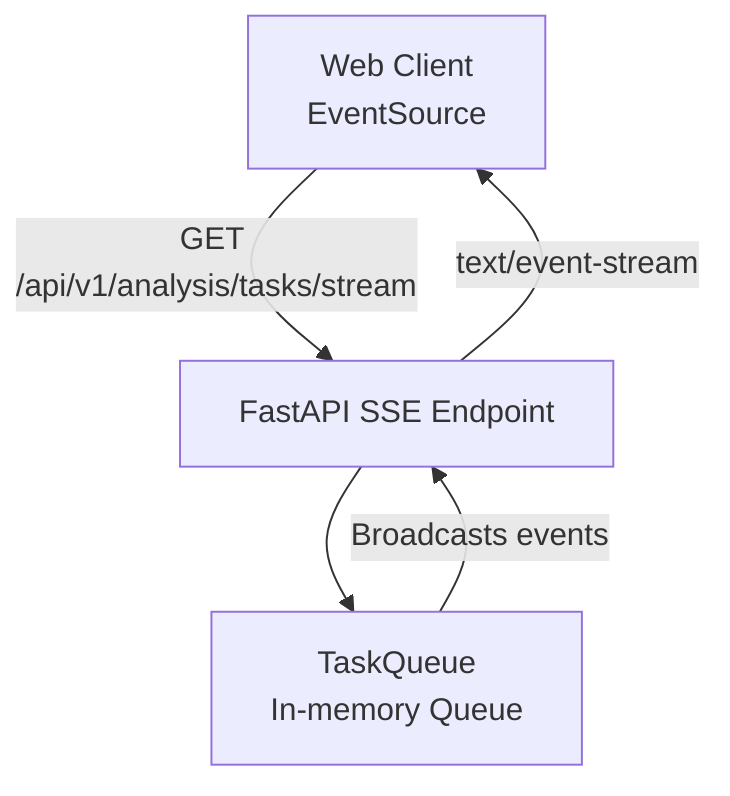
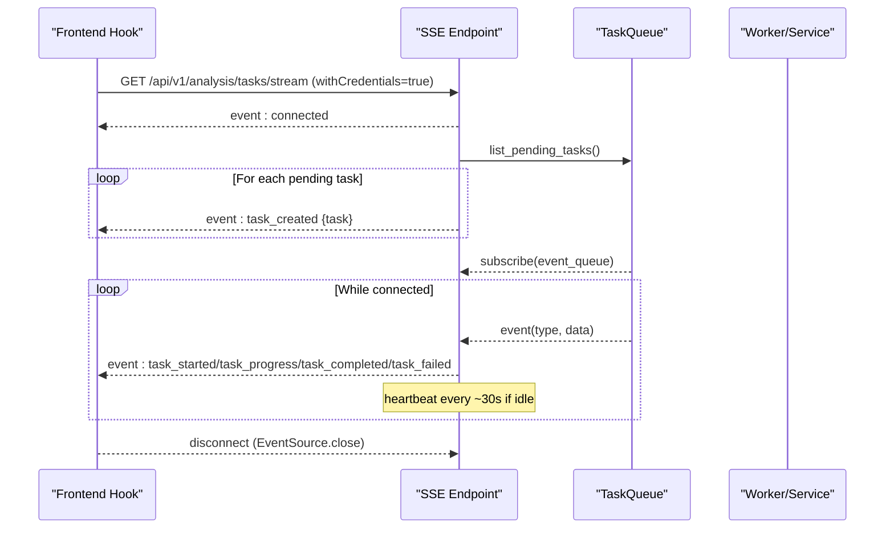
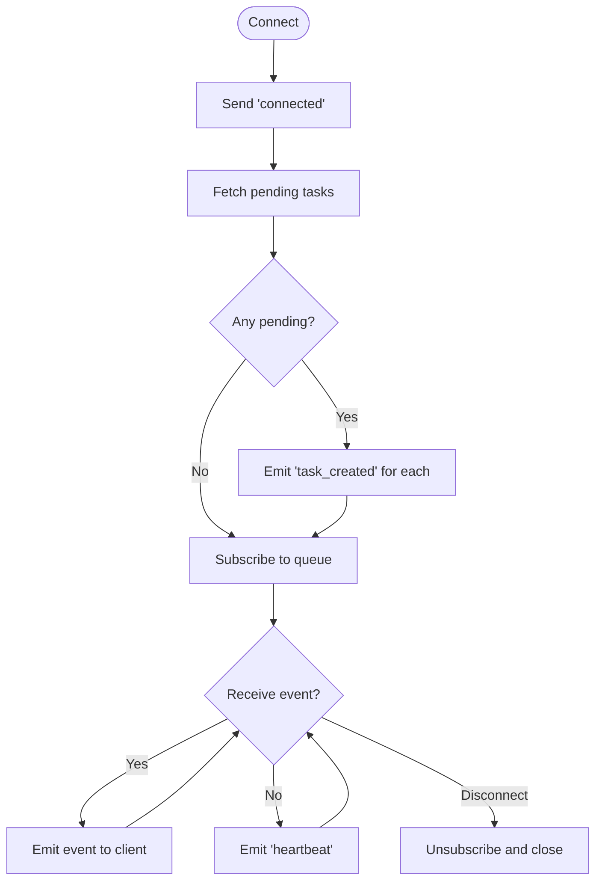
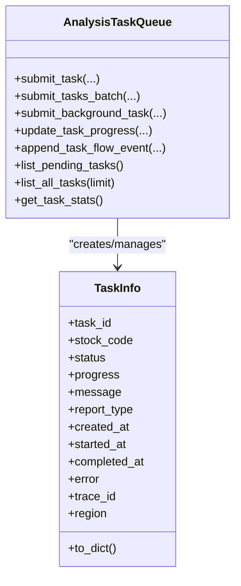
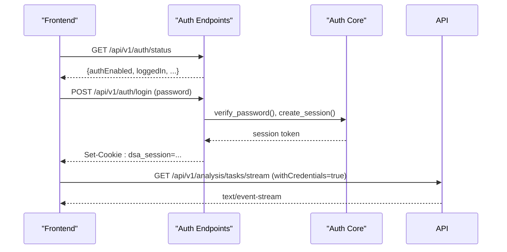
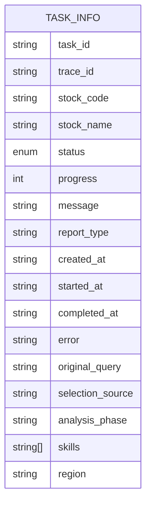
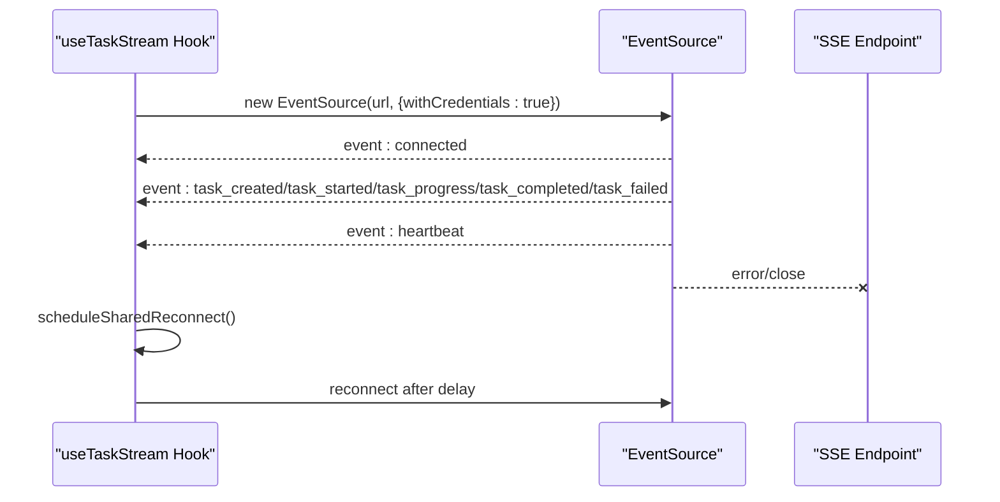
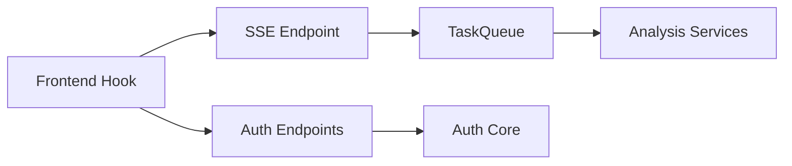

# WebSocket API

<cite>
**Referenced Files in This Document**
- [analysis.py](file://api/v1/endpoints/analysis.py)
- [task_queue.py](file://src/services/task_queue.py)
- [auth.py](file://api/v1/endpoints/auth.py)
- [auth_core.py](file://src/auth.py)
- [stream_events.py](file://src/agent/stream_events.py)
- [useTaskStream.ts](file://apps/dsa-web/src/hooks/useTaskStream.ts)
- [analysis_schemas.py](file://api/v1/schemas/analysis.py)
- [agent_stream_events_doc.md](file://docs/agent-stream-events.md)
</cite>

## Table of Contents
1. Introduction
2. Project Structure
3. Core Components
4. Architecture Overview
5. Detailed Component Analysis
6. Dependency Analysis
7. Performance Considerations
8. Troubleshooting Guide
9. Conclusion

## Introduction
This document describes the real-time communication layer for DailyStockAnalysis. The system uses Server-Sent Events (SSE) to stream analysis progress, completion, and error events to clients. It also documents authentication via HTTP cookies that are required when connecting to the SSE endpoint. While this repository implements SSE rather than raw WebSockets, the same concepts apply: connection establishment, authentication, message protocols, event types, schemas, reconnection strategies, limits, and performance guidance.

## Project Structure
Real-time streaming is implemented as an SSE endpoint under the analysis API. Clients connect using a browser EventSource with credentials enabled so the session cookie is sent automatically. The server broadcasts task lifecycle events from an in-memory task queue.

**Diagram sources**
- [analysis.py:666-730](file://api/v1/endpoints/analysis.py#L666-L730)
- [task_queue.py:156-207](file://src/services/task_queue.py#L156-L207)

**Section sources**
- [analysis.py:666-730](file://api/v1/endpoints/analysis.py#L666-L730)
- [task_queue.py:156-207](file://src/services/task_queue.py#L156-L207)

## Core Components
- SSE endpoint: Streams task events and heartbeats; sends initial pending tasks on connect.
- Task queue: Manages task lifecycle, deduplication, concurrency, and SSE broadcast.
- Authentication: Cookie-based session used by the client to authorize SSE access.
- Agent stream helpers: Build standardized progress events consumed by SSE endpoints elsewhere.
- Frontend hook: Shared EventSource with auto-reconnect and subscriber callbacks.

**Section sources**
- [analysis.py:666-730](file://api/v1/endpoints/analysis.py#L666-L730)
- [task_queue.py:156-207](file://src/services/task_queue.py#L156-L207)
- [auth.py:185-193](file://api/v1/endpoints/auth.py#L185-L193)
- [auth_core.py:332-367](file://src/auth.py#L332-L367)
- [stream_events.py:13-22](file://src/agent/stream_events.py#L13-L22)
- [useTaskStream.ts:185-257](file://apps/dsa-web/src/hooks/useTaskStream.ts#L185-L257)

## Architecture Overview
The SSE architecture centers around a single shared connection per page that fans out events to multiple React components via a hook. The server maintains an in-memory queue of tasks and broadcasts events to all subscribers.

**Diagram sources**
- [analysis.py:690-730](file://api/v1/endpoints/analysis.py#L690-L730)
- [task_queue.py:462-468](file://src/services/task_queue.py#L462-L468)
- [task_queue.py:630-664](file://src/services/task_queue.py#L630-L664)
- [useTaskStream.ts:185-257](file://apps/dsa-web/src/hooks/useTaskStream.ts#L185-L257)

## Detailed Component Analysis

### SSE Endpoint: GET /api/v1/analysis/tasks/stream
- Purpose: Stream task lifecycle events to one or more clients.
- Behavior:
  - Sends a connected event immediately.
  - Emits task_created for all currently pending tasks.
  - Subscribes to the task queue’s event channel.
  - Emits task_started, task_progress, task_completed, task_failed as they occur.
  - Emits heartbeat events approximately every 30 seconds when no events are produced.
  - Cleans up subscription on disconnect.

**Diagram sources**
- [analysis.py:690-730](file://api/v1/endpoints/analysis.py#L690-L730)

**Section sources**
- [analysis.py:666-730](file://api/v1/endpoints/analysis.py#L666-L730)

### Task Queue: In-Memory Queue and Broadcast
- Responsibilities:
  - Deduplicate tasks per stock code.
  - Execute tasks in a thread pool with configurable max workers.
  - Maintain task state and history in memory.
  - Broadcast SSE events to subscribers.
  - Append run-flow diagnostic events to active tasks and include them in progress events.

Key behaviors:
- Duplicate detection prevents concurrent analysis of the same stock.
- Progress updates clamp to 0–99 until terminal states.
- Flow events are bounded per task to avoid unbounded memory growth.
- Background tasks can be submitted for non-analysis workloads.

**Diagram sources**
- [task_queue.py:156-207](file://src/services/task_queue.py#L156-L207)
- [task_queue.py:327-468](file://src/services/task_queue.py#L327-L468)
- [task_queue.py:542-570](file://src/services/task_queue.py#L542-L570)
- [task_queue.py:630-664](file://src/services/task_queue.py#L630-L664)

**Section sources**
- [task_queue.py:156-207](file://src/services/task_queue.py#L156-L207)
- [task_queue.py:327-468](file://src/services/task_queue.py#L327-L468)
- [task_queue.py:542-570](file://src/services/task_queue.py#L542-L570)
- [task_queue.py:630-664](file://src/services/task_queue.py#L630-L664)

### Authentication and Authorization
- Session cookie: The frontend connects with withCredentials=true so the session cookie is included.
- Auth status: A dedicated endpoint returns whether auth is enabled and current login state.
- Login/logout/password change: Endpoints manage sessions and enforce rate limiting and password policies.

Security notes:
- Sessions are signed and time-limited.
- Rate limiting protects against brute-force attempts.
- High-risk settings changes require re-authentication.

**Diagram sources**
- [auth.py:185-193](file://api/v1/endpoints/auth.py#L185-L193)
- [auth.py:362-428](file://api/v1/endpoints/auth.py#L362-L428)
- [auth_core.py:332-367](file://src/auth.py#L332-L367)

**Section sources**
- [auth.py:185-193](file://api/v1/endpoints/auth.py#L185-L193)
- [auth.py:362-428](file://api/v1/endpoints/auth.py#L362-L428)
- [auth_core.py:332-367](file://src/auth.py#L332-L367)

### Message Protocols and Schemas

#### SSE Event Types
- connected: Connection established.
- task_created: New task added to the queue.
- task_started: Task execution started.
- task_progress: Progress update; may include flow_event for diagnostics.
- task_completed: Task finished successfully.
- task_failed: Task failed with error details.
- heartbeat: Keepalive when idle.

Payloads:
- All events carry a JSON object. For task-related events, the payload includes fields defined by TaskInfo.
- task_progress may include a flow_event field containing incremental run-flow diagnostics.

Agent stream events (used by other SSE endpoints):
- stage_start, stage_done, thinking, tool_start, tool_done, generating, pipeline_timeout, pipeline_budget_skipped, done, error.

**Diagram sources**
- [analysis_schemas.py:357-407](file://api/v1/schemas/analysis.py#L357-L407)

**Section sources**
- [analysis.py:690-730](file://api/v1/endpoints/analysis.py#L690-L730)
- [analysis_schemas.py:357-407](file://api/v1/schemas/analysis.py#L357-L407)
- [agent_stream_events_doc.md:41-63](file://docs/agent-stream-events.md#L41-L63)
- [stream_events.py:13-22](file://src/agent/stream_events.py#L13-L22)

### Frontend Implementation and Reconnection Strategy
- Shared EventSource: One connection per page is shared across multiple hook instances to reduce overhead.
- Auto-reconnect: On error, the hook schedules a reconnect with a delay derived from subscriber configuration.
- Callbacks: Provides typed callbacks for each event type, including optional flow events.
- Credentials: Connects with withCredentials=true to send the session cookie.

**Diagram sources**
- [useTaskStream.ts:185-257](file://apps/dsa-web/src/hooks/useTaskStream.ts#L185-L257)
- [useTaskStream.ts:267-377](file://apps/dsa-web/src/hooks/useTaskStream.ts#L267-L377)

**Section sources**
- [useTaskStream.ts:185-257](file://apps/dsa-web/src/hooks/useTaskStream.ts#L185-L257)
- [useTaskStream.ts:267-377](file://apps/dsa-web/src/hooks/useTaskStream.ts#L267-L377)

## Dependency Analysis
- The SSE endpoint depends on the task queue for event broadcasting and task state.
- The task queue depends on services that execute analysis and emit progress callbacks.
- Authentication relies on session cookies validated by the auth core module.
- The frontend hook depends on the SSE endpoint URL and handles parsing and routing of events.

**Diagram sources**
- [analysis.py:666-730](file://api/v1/endpoints/analysis.py#L666-L730)
- [task_queue.py:156-207](file://src/services/task_queue.py#L156-L207)
- [auth.py:185-193](file://api/v1/endpoints/auth.py#L185-L193)
- [auth_core.py:332-367](file://src/auth.py#L332-L367)

**Section sources**
- [analysis.py:666-730](file://api/v1/endpoints/analysis.py#L666-L730)
- [task_queue.py:156-207](file://src/services/task_queue.py#L156-L207)
- [auth.py:185-193](file://api/v1/endpoints/auth.py#L185-L193)
- [auth_core.py:332-367](file://src/auth.py#L332-L367)

## Performance Considerations
- Concurrency: The task queue uses a thread pool with a configurable maximum number of workers. Adjust based on CPU and I/O characteristics.
- Memory bounds: Flow events per task are capped to prevent unbounded memory growth.
- Heartbeats: Idle keepalives help detect dead connections early.
- Batch submissions: Submitting multiple tasks at once reduces overhead and preserves ordering guarantees for creation events.
- Frontend sharing: A single shared EventSource minimizes network and CPU usage across components.

[No sources needed since this section provides general guidance]

## Troubleshooting Guide
Common issues and resolutions:
- No events received:
  - Verify the session cookie is set and valid.
  - Ensure the SSE endpoint is reachable and not blocked by proxies.
  - Check for errors in the browser console and network tab.
- Frequent reconnects:
  - Inspect server logs for task failures or queue saturation.
  - Tune reconnect delay and ensure the backend is healthy.
- Stale tasks:
  - Confirm task lifecycle transitions are emitted correctly.
  - Validate that task_completed or task_failed is sent for long-running tasks.

Operational checks:
- Use the auth status endpoint to confirm authentication state.
- Monitor task stats and lists to validate queue health.

**Section sources**
- [auth.py:185-193](file://api/v1/endpoints/auth.py#L185-L193)
- [analysis.py:591-659](file://api/v1/endpoints/analysis.py#L591-L659)
- [task_queue.py:611-628](file://src/services/task_queue.py#L611-L628)

## Conclusion
DailyStockAnalysis provides a robust real-time streaming interface via SSE for analysis progress and notifications. The design emphasizes secure cookie-based authentication, efficient in-memory queuing with bounded memory, and resilient client-side reconnection. Consumers should implement proper error handling, respect heartbeats, and leverage batch submissions where appropriate to optimize throughput.

[No sources needed since this section summarizes without analyzing specific files]