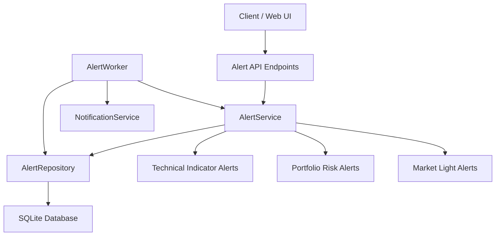
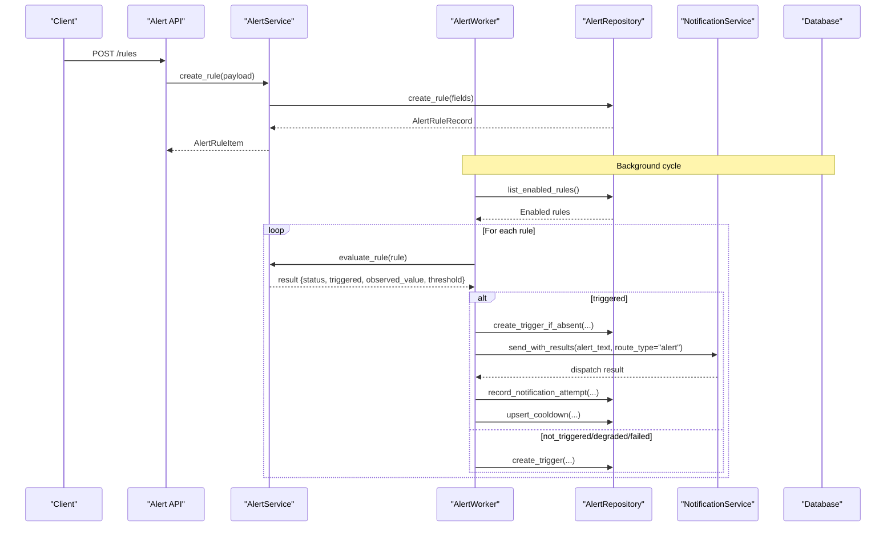
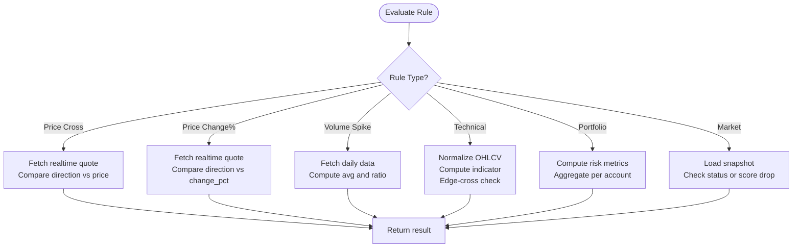
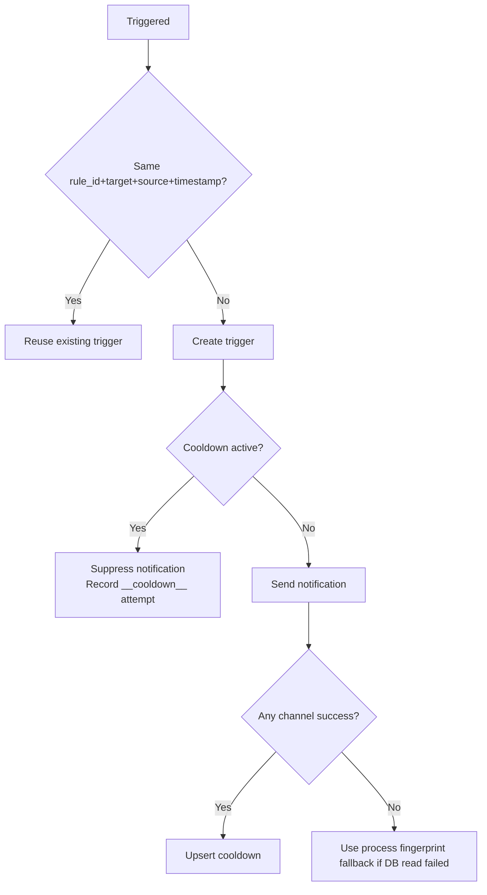
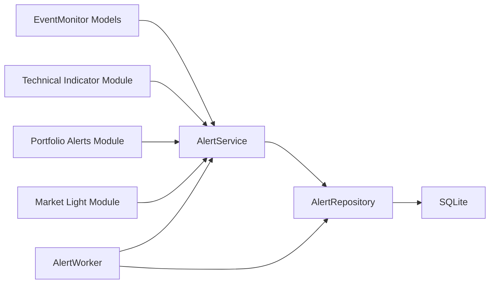

# Alert Types & Rules

<cite>
**Referenced Files in This Document**
- [alerts.py](file://api/v1/endpoints/alerts.py)
- [alerts.py](file://api/v1/schemas/alerts.py)
- [alert_service.py](file://src/services/alert_service.py)
- [alert_worker.py](file://src/services/alert_worker.py)
- [alert_indicators.py](file://src/services/alert_indicators.py)
- [events.py](file://src/agent/events.py)
- [portfolio_alerts.py](file://src/services/portfolio_alerts.py)
- [market_light_alerts.py](file://src/services/market_light_alerts.py)
- [alert_repo.py](file://src/repositories/alert_repo.py)
- [alerts.md](file://docs/alerts.md)
</cite>

## Table of Contents
1. [Introduction](#introduction)
2. [Project Structure](#project-structure)
3. [Core Components](#core-components)
4. [Architecture Overview](#architecture-overview)
5. [Detailed Component Analysis](#detailed-component-analysis)
6. [Dependency Analysis](#dependency-analysis)
7. [Performance Considerations](#performance-considerations)
8. [Troubleshooting Guide](#troubleshooting-guide)
9. [Conclusion](#conclusion)
10. [Appendices](#appendices)

## Introduction
This document explains the Alerting system’s supported alert types, rule configuration model, evaluation engine, and notification controls. It covers:
- Price alerts (threshold crossing and percentage change)
- Volume spike detection
- Technical signal alerts (RSI, MACD, moving average crossovers, KDJ, CCI)
- Portfolio risk alerts (stop-loss, concentration, drawdown, stale price)
- Market-level alerts (Market Light status and score drop)
- How to configure custom rules with conditions, thresholds, and filters
- Complex multi-condition scenarios
- Evaluation engine behavior, deduplication, cooldown, and suppression mechanisms

The goal is to help users create reliable, non-noisy alerts that integrate with the existing notification pipeline while remaining safe under data quality issues or backend failures.

## Project Structure
The Alerting system spans API endpoints, schemas, service logic, background worker, repositories, and specialized indicator/portfolio/market modules.

**Diagram sources**
- [alerts.py:56-263](file://api/v1/endpoints/alerts.py#L56-L263)
- [alert_service.py:103-227](file://src/services/alert_service.py#L103-L227)
- [alert_worker.py:78-201](file://src/services/alert_worker.py#L78-L201)
- [alert_repo.py:23-110](file://src/repositories/alert_repo.py#L23-L110)

**Section sources**
- [alerts.py:56-263](file://api/v1/endpoints/alerts.py#L56-L263)
- [alerts.md:124-153](file://docs/alerts.md#L124-L153)

## Core Components
- Alert API endpoints expose CRUD for rules, enable/disable, dry-run test, trigger history, and notification attempts.
- AlertService validates parameters, builds runtime payloads, evaluates rules, and formats results for testing and worker consumption.
- AlertWorker runs scheduled cycles, loads enabled rules from DB plus legacy JSON, evaluates them, records triggers, sends notifications, and enforces cooldown and deduplication.
- AlertRepository persists rules, triggers, notifications, and cooldowns.
- Specialized evaluators handle technical indicators, portfolio risk, and market light signals.

Supported alert types are grouped by scope:
- Single symbol: price cross, price change percent, volume spike, technical indicators
- Watchlist and portfolio holdings: same as single symbol but expanded per target scope
- Portfolio account: stop-loss, concentration, drawdown, stale price
- Market: Market Light status and score drop

**Section sources**
- [alert_service.py:75-80](file://src/services/alert_service.py#L75-L80)
- [alert_indicators.py:14-24](file://src/services/alert_indicators.py#L14-L24)
- [portfolio_alerts.py:18-31](file://src/services/portfolio_alerts.py#L18-L31)
- [market_light_alerts.py:21-31](file://src/services/market_light_alerts.py#L21-L31)
- [alerts.md:222-266](file://docs/alerts.md#L222-L266)
- [alerts.md:268-333](file://docs/alerts.md#L268-L333)
- [alerts.md:353-393](file://docs/alerts.md#L353-L393)

## Architecture Overview
The evaluation flow supports both API dry-run and background worker execution. The worker also integrates decision signal summaries and market phase context into diagnostics when available.

**Diagram sources**
- [alerts.py:56-206](file://api/v1/endpoints/alerts.py#L56-L206)
- [alert_service.py:172-227](file://src/services/alert_service.py#L172-L227)
- [alert_worker.py:107-201](file://src/services/alert_worker.py#L107-L201)
- [alert_repo.py:112-161](file://src/repositories/alert_repo.py#L112-L161)

**Section sources**
- [alert_worker.py:107-201](file://src/services/alert_worker.py#L107-L201)
- [alert_service.py:172-227](file://src/services/alert_service.py#L172-L227)

## Detailed Component Analysis

### Supported Alert Types and Configuration

#### Price Alerts
- Price threshold crossing: direction above/below against a fixed price using realtime quote.
- Percentage change: direction up/down against a percentage threshold using realtime quote.

Configuration fields:
- target_scope: single_symbol
- target: stock code
- alert_type: price_cross or price_change_percent
- parameters: direction, price or change_pct
- severity: info/warning/critical
- cooldown_policy: optional policy dict
- notification_policy: optional policy dict

Evaluation behavior:
- Realtime quote fetch; if missing or invalid, returns skipped or degraded depending on condition.
- Directional comparison determines triggered vs not_triggered.

Complex scenario example:
- Combine price_cross and price_change_percent on the same symbol to require both absolute level and intraday momentum before triggering.

**Section sources**
- [events.py:122-155](file://src/agent/events.py#L122-L155)
- [alert_service.py:311-435](file://src/services/alert_service.py#L311-L435)
- [alerts.md:14-22](file://docs/alerts.md#L14-L22)

#### Volume Spike Detection
- Detects latest daily volume exceeding N× average over recent days.

Configuration fields:
- target_scope: single_symbol
- target: stock code
- alert_type: volume_spike
- parameters: multiplier

Evaluation behavior:
- Fetches daily data; computes average and ratio; triggers if latest > multiplier × average.
- Handles malformed or missing data gracefully with degraded or skipped states.

Complex scenario example:
- Pair volume_spike with a technical indicator (e.g., RSI threshold) to confirm breakout strength.

**Section sources**
- [events.py:146-155](file://src/agent/events.py#L146-L155)
- [alert_service.py:437-522](file://src/services/alert_service.py#L437-L522)

#### Technical Signal Alerts
- Moving average crossover: close crosses MA(window) above/below.
- RSI threshold: RSI crosses threshold above/below.
- MACD cross: DIF/DEA bullish/bearish cross.
- KDJ cross: K/D bullish/bearish cross.
- CCI threshold: CCI crosses threshold above/below.

Configuration fields:
- target_scope: single_symbol
- target: stock code
- alert_type: ma_price_cross, rsi_threshold, macd_cross, kdj_cross, cci_threshold
- parameters: direction, window/period/thresholds as applicable

Evaluation behavior:
- Normalizes OHLCV data and computes indicators.
- Uses edge-cross semantics to avoid false positives on first day.
- Returns degraded when insufficient bars or data quality issues.

Complex scenario example:
- Require MACD bullish cross together with RSI crossing above a threshold to reduce whipsaw signals.

**Section sources**
- [alert_indicators.py:14-24](file://src/services/alert_indicators.py#L14-L24)
- [alert_indicators.py:44-116](file://src/services/alert_indicators.py#L44-L116)
- [alert_indicators.py:118-175](file://src/services/alert_indicators.py#L118-L175)
- [alert_indicators.py:213-355](file://src/services/alert_indicators.py#L213-L355)
- [alerts.md:222-266](file://docs/alerts.md#L222-L266)

#### Portfolio Risk Alerts
- Stop-loss: near or breach modes based on position loss percentages.
- Concentration: top weight exceeds configured threshold.
- Drawdown: aggregate drawdown alert via risk service.
- Stale price: positions with stale or missing prices.

Configuration fields:
- target_scope: portfolio_account
- target: all or active account ID
- alert_type: portfolio_stop_loss, portfolio_concentration, portfolio_drawdown, portfolio_price_stale
- parameters: mode for stop-loss; others rely on risk service defaults

Evaluation behavior:
- Uses portfolio risk services to compute metrics.
- Aggregates per-account alerts; ensures at most one trigger per account per cycle for stop-loss.

Complex scenario example:
- Combine portfolio_stop_loss with portfolio_concentration to cap exposure during drawdown events.

**Section sources**
- [portfolio_alerts.py:18-31](file://src/services/portfolio_alerts.py#L18-L31)
- [portfolio_alerts.py:80-126](file://src/services/portfolio_alerts.py#L80-L126)
- [alerts.md:309-319](file://docs/alerts.md#L309-L319)

#### Market-Level Alerts
- Market Light status: triggers when snapshot status matches configured statuses (red/yellow).
- Market Light score drop: triggers when score drops by at least min_drop compared to previous trade date.

Configuration fields:
- target_scope: market
- target: region (cn/hk/us/jp/kr)
- alert_type: market_light_status, market_light_score_drop
- parameters: statuses list or min_drop

Evaluation behavior:
- Respects trading day checks; skips if market closed.
- Validates data quality; handles unavailable/partial snapshots.
- Deduplicates by region and trade date.

Complex scenario example:
- Trigger on red status and significant score drop to emphasize severe market deterioration.

**Section sources**
- [market_light_alerts.py:21-31](file://src/services/market_light_alerts.py#L21-L31)
- [market_light_alerts.py:50-75](file://src/services/market_light_alerts.py#L50-L75)
- [market_light_alerts.py:116-173](file://src/services/market_light_alerts.py#L116-L173)
- [alerts.md:353-393](file://docs/alerts.md#L353-L393)

### Rule Creation, Filtering, and Dry-Run Testing
- Create/update/delete rules via API with validation and normalization.
- List rules with filters: enabled, alert_type, target_scope, target, source, pagination.
- Enable/disable rules without full update.
- Dry-run test evaluates rule(s) without sending notifications or writing real triggers; returns aggregated counts and target results for batch scopes.

**Section sources**
- [alerts.py:56-206](file://api/v1/endpoints/alerts.py#L56-L206)
- [alerts.py:209-263](file://api/v1/endpoints/alerts.py#L209-L263)
- [alert_service.py:110-184](file://src/services/alert_service.py#L110-L184)

### Evaluation Engine Details
- Dispatches to specific evaluators based on rule type.
- Shares daily cache across evaluations within a dry-run cycle to reduce redundant data fetches.
- Enforces timeouts per target and total for batch evaluations.
- Produces standardized results with status, triggered flag, observed value, threshold, data source, timestamp, reason, and message.

**Diagram sources**
- [alert_service.py:206-227](file://src/services/alert_service.py#L206-L227)
- [alert_service.py:311-612](file://src/services/alert_service.py#L311-L612)

**Section sources**
- [alert_service.py:206-291](file://src/services/alert_service.py#L206-L291)

### Deduplication, Cooldown, and Suppression
- Trigger deduplication: For DB rules, identical rule_id + target + data_source + data_timestamp are deduplicated; only earliest trigger is kept.
- Cooldown:
  - DB rules use persistent cooldowns keyed by rule_id, target, severity; default 24 hours unless configured otherwise.
  - If reading cooldown state fails, worker falls back to process-local fingerprint temporarily to prevent spam.
  - Legacy JSON rules continue using process-local fingerprints only.
- Notification suppression:
  - Noise suppression handled by notification infrastructure; suppressed attempts recorded synthetically.
  - No-channel or dispatch exceptions recorded with synthetic channels for observability.

**Diagram sources**
- [alert_repo.py:122-161](file://src/repositories/alert_repo.py#L122-L161)
- [alert_worker.py:762-800](file://src/services/alert_worker.py#L762-L800)
- [alerts.md:195-213](file://docs/alerts.md#L195-L213)

**Section sources**
- [alert_repo.py:122-161](file://src/repositories/alert_repo.py#L122-L161)
- [alert_worker.py:602-631](file://src/services/alert_worker.py#L602-L631)
- [alert_worker.py:762-800](file://src/services/alert_worker.py#L762-L800)
- [alerts.md:195-213](file://docs/alerts.md#L195-L213)

### Notification Integration and Diagnostics
- Notifications use NotificationService with route_type="alert".
- Each attempt is recorded with channel, attempt number, success, error_code, retryable, latency_ms, and sanitized diagnostics.
- Decision signal summaries and market phase context are attached to triggered alerts where possible, improving explainability.

**Section sources**
- [alert_worker.py:637-722](file://src/services/alert_worker.py#L637-L722)
- [alert_worker.py:375-421](file://src/services/alert_worker.py#L375-L421)
- [alert_worker.py:523-600](file://src/services/alert_worker.py#L523-L600)

## Dependency Analysis
Key dependencies and relationships:
- AlertService depends on EventMonitor models for legacy rules and specialized evaluators for technical, portfolio, and market alerts.
- AlertWorker orchestrates loading rules, evaluating them, recording triggers, sending notifications, and managing cooldowns.
- AlertRepository provides persistence for rules, triggers, notifications, and cooldowns.
- Schemas define request/response contracts for API consumers.

**Diagram sources**
- [alert_service.py:13-72](file://src/services/alert_service.py#L13-L72)
- [alert_worker.py:15-42](file://src/services/alert_worker.py#L15-L42)
- [alert_repo.py:14-20](file://src/repositories/alert_repo.py#L14-L20)

**Section sources**
- [alert_service.py:13-72](file://src/services/alert_service.py#L13-L72)
- [alert_worker.py:15-42](file://src/services/alert_worker.py#L15-L42)

## Performance Considerations
- Batch evaluation uses concurrency limits and timeouts to protect responsiveness.
- Daily data caching reduces repeated fetches within a single evaluation cycle.
- Soft caps on expanded targets (watchlist/portfolio holdings) prevent overload.
- Degraded and skipped states ensure robustness under partial data availability.

Recommendations:
- Tune cooldown periods to balance sensitivity and noise.
- Use targeted scopes (single_symbol) for high-frequency monitoring; leverage watchlist/portfolio for broader coverage with appropriate thresholds.
- Monitor trigger history and notification attempts to identify noisy rules or failing channels.

[No sources needed since this section provides general guidance]

## Troubleshooting Guide
Common issues and resolutions:
- Unsupported alert type: Ensure alert_type is allowed for the given target_scope; API returns structured unsupported errors.
- Data quality issues: Check degraded or skipped statuses; verify OHLCV columns, daily data availability, and market open status.
- Notification failures: Review notification attempts for channel-specific errors; adjust routes or credentials.
- Cooldown misbehavior: Verify cooldown policies and DB connectivity; fallback fingerprints may be active during DB outages.

**Section sources**
- [alert_service.py:85-101](file://src/services/alert_service.py#L85-L101)
- [alert_service.py:663-684](file://src/services/alert_service.py#L663-L684)
- [alert_worker.py:661-722](file://src/services/alert_worker.py#L661-L722)
- [alert_worker.py:762-800](file://src/services/alert_worker.py#L762-L800)

## Conclusion
The Alerting system provides a comprehensive, extensible framework for monitoring markets, portfolios, and individual symbols. It supports price, volume, technical, portfolio risk, and market-level alerts with robust evaluation, deduplication, cooldown, and notification controls. Users can configure precise rules tailored to their strategies and scale from single-symbol monitoring to broad portfolio and market oversight.

[No sources needed since this section summarizes without analyzing specific files]

## Appendices

### API Reference Summary
- Rule management: create, list, get, update, delete, enable, disable
- Dry-run testing: evaluate without side effects
- History: triggers and notification attempts with filtering and pagination

**Section sources**
- [alerts.py:56-263](file://api/v1/endpoints/alerts.py#L56-L263)
- [alerts.py:20-148](file://api/v1/schemas/alerts.py#L20-L148)

### Configuration Examples
- Single symbol price cross: target_scope=single_symbol, alert_type=price_cross, parameters={direction, price}
- Watchlist volume spikes: target_scope=watchlist, alert_type=volume_spike, parameters={multiplier}
- Portfolio stop-loss: target_scope=portfolio_account, alert_type=portfolio_stop_loss, parameters={mode}
- Market light status: target_scope=market, alert_type=market_light_status, parameters={statuses}

**Section sources**
- [alerts.md:14-22](file://docs/alerts.md#L14-L22)
- [alerts.md:222-266](file://docs/alerts.md#L222-L266)
- [alerts.md:268-333](file://docs/alerts.md#L268-L333)
- [alerts.md:353-393](file://docs/alerts.md#L353-L393)