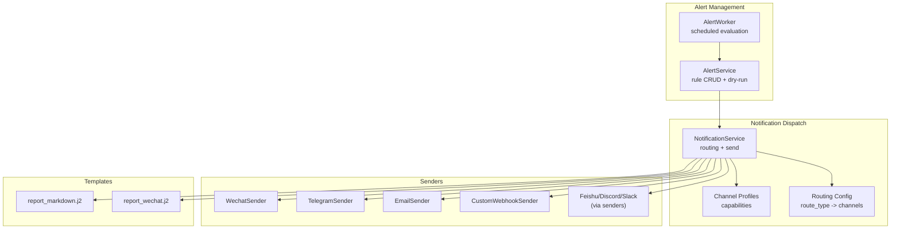
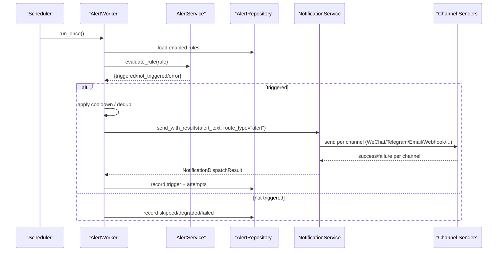
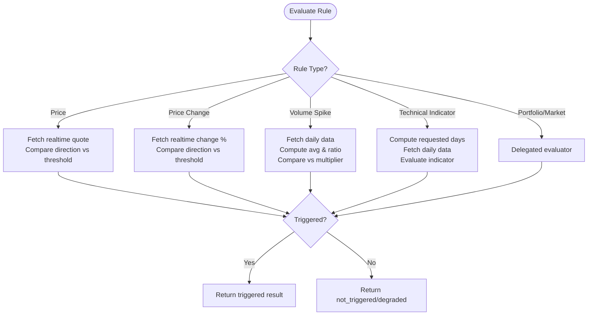
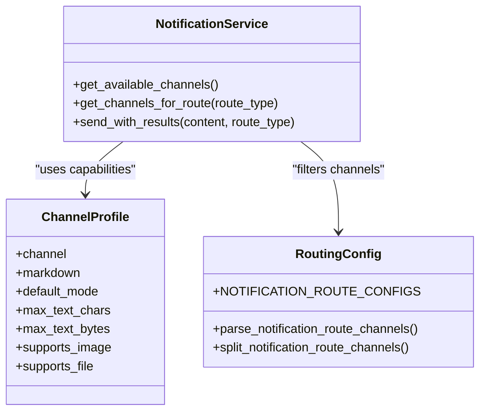
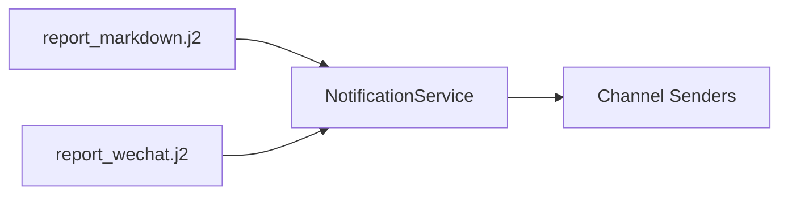
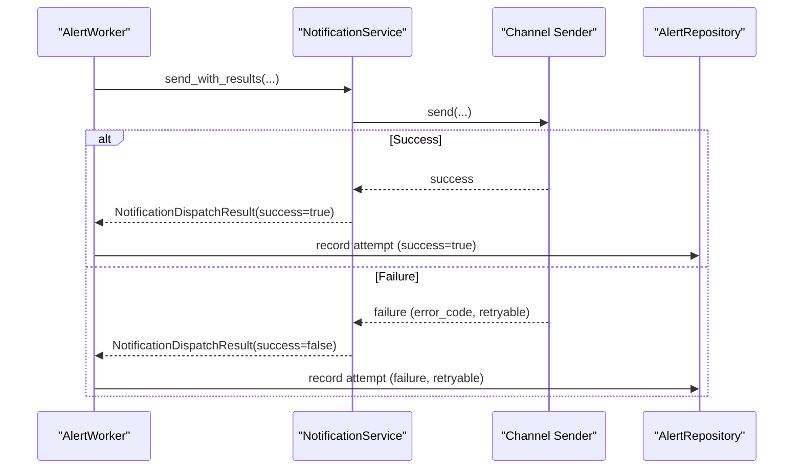
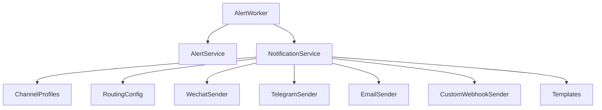

# Alerting & Notifications

<cite>
**Referenced Files in This Document**
- [alert_service.py](file://src/services/alert_service.py)
- [alert_worker.py](file://src/services/alert_worker.py)
- [alerts.py](file://api/v1/endpoints/alerts.py)
- [notification.py](file://src/notification.py)
- [notification_capabilities.py](file://src/notification_capabilities.py)
- [notification_routing.py](file://src/notification_routing.py)
- [wechat_sender.py](file://src/notification_sender/wechat_sender.py)
- [telegram_sender.py](file://src/notification_sender/telegram_sender.py)
- [email_sender.py](file://src/notification_sender/email_sender.py)
- [custom_webhook_sender.py](file://src/notification_sender/custom_webhook_sender.py)
- [report_markdown.j2](file://templates/report_markdown.j2)
- [report_wechat.j2](file://templates/report_wechat.j2)
</cite>

## Table of Contents
1. Introduction
2. Project Structure
3. Core Components
4. Architecture Overview
5. Detailed Component Analysis
6. Dependency Analysis
7. Performance Considerations
8. Troubleshooting Guide
9. Conclusion

## Introduction
This document explains the Alerting and Notifications system with a focus on multi-channel delivery, alert management, templates, scheduling, retry logic, delivery tracking, and performance for high-volume scenarios. It covers supported alert types (price alerts, volume spikes, technical signal alerts, news-based notifications), notification channels (WeChat, Feishu, Telegram, Discord, Slack, email, custom webhooks), template rendering, and operational reliability including rate limiting, batching, and error handling.

## Project Structure
The alerting and notification subsystem is organized into:
- Alert rule management and evaluation: service layer and background worker
- Notification routing and channel dispatch: unified sender interface and per-channel implementations
- Templates: Markdown and WeChat-specific report templates
- API endpoints: CRUD and dry-run testing for alert rules, trigger history, and notification attempts

**Diagram sources**
- [alert_service.py:103-226](file://src/services/alert_service.py#L103-L226)
- [alert_worker.py:78-201](file://src/services/alert_worker.py#L78-L201)
- [notification.py:257-343](file://src/notification.py#L257-L343)
- [notification_capabilities.py:75-189](file://src/notification_capabilities.py#L75-L189)
- [notification_routing.py:31-47](file://src/notification_routing.py#L31-L47)
- [wechat_sender.py:26-99](file://src/notification_sender/wechat_sender.py#L26-L99)
- [telegram_sender.py:22-119](file://src/notification_sender/telegram_sender.py#L22-L119)
- [email_sender.py:51-200](file://src/notification_sender/email_sender.py#L51-L200)
- [custom_webhook_sender.py:27-105](file://src/notification_sender/custom_webhook_sender.py#L27-L105)
- [report_markdown.j2:1-251](file://templates/report_markdown.j2#L1-L251)
- [report_wechat.j2:1-105](file://templates/report_wechat.j2#L1-L105)

**Section sources**
- [alert_service.py:103-226](file://src/services/alert_service.py#L103-L226)
- [alert_worker.py:78-201](file://src/services/alert_worker.py#L78-L201)
- [notification.py:257-343](file://src/notification.py#L257-L343)
- [notification_capabilities.py:75-189](file://src/notification_capabilities.py#L75-L189)
- [notification_routing.py:31-47](file://src/notification_routing.py#L31-L47)
- [wechat_sender.py:26-99](file://src/notification_sender/wechat_sender.py#L26-L99)
- [telegram_sender.py:22-119](file://src/notification_sender/telegram_sender.py#L22-L119)
- [email_sender.py:51-200](file://src/notification_sender/email_sender.py#L51-L200)
- [custom_webhook_sender.py:27-105](file://src/notification_sender/custom_webhook_sender.py#L27-L105)
- [report_markdown.j2:1-251](file://templates/report_markdown.j2#L1-L251)
- [report_wechat.j2:1-105](file://templates/report_wechat.j2#L1-L105)

## Core Components
- AlertService: Rule CRUD, normalization, dry-run evaluation for price, price change, volume spike, technical indicators, portfolio risk, and market light alerts.
- AlertWorker: Background scheduler that loads enabled rules, evaluates them, records triggers, applies cooldowns, and dispatches notifications.
- NotificationService: Unified dispatcher that detects configured channels, builds content via templates, routes by route_type, and sends through channel-specific senders.
- Channel Profiles and Routing: Capability profiles define per-channel limits and features; routing maps route_type to allowed channels.
- Senders: Per-channel implementations for WeChat, Telegram, Email, Custom Webhook, plus Feishu, Discord, Slack via dedicated or webhook paths.
- Templates: Markdown and WeChat templates render rich reports with charts, tables, images, and strategy synthesis.

**Section sources**
- [alert_service.py:103-226](file://src/services/alert_service.py#L103-L226)
- [alert_worker.py:78-201](file://src/services/alert_worker.py#L78-L201)
- [notification.py:257-343](file://src/notification.py#L257-L343)
- [notification_capabilities.py:75-189](file://src/notification_capabilities.py#L75-L189)
- [notification_routing.py:31-47](file://src/notification_routing.py#L31-L47)

## Architecture Overview
End-to-end flow from alert trigger to multi-channel delivery:

**Diagram sources**
- [alert_worker.py:107-201](file://src/services/alert_worker.py#L107-L201)
- [alert_service.py:206-226](file://src/services/alert_service.py#L206-L226)
- [notification.py:257-343](file://src/notification.py#L257-L343)

## Detailed Component Analysis

### Alert Types and Evaluation
- Price alerts: Evaluate realtime quote against threshold direction (above/below).
- Price change alerts: Evaluate percentage change direction (up/down) against threshold.
- Volume spike alerts: Compare latest daily volume to average over recent days using multiplier.
- Technical indicator alerts: Compute requested window, fetch daily data, evaluate indicator conditions, return observed value and threshold.
- Portfolio risk and market light alerts: Delegated to specialized evaluators with payload builders.

Evaluation outcomes include triggered, not_triggered, degraded, failed, with metadata such as observed_value, threshold, data_source, and data_timestamp.

**Diagram sources**
- [alert_service.py:311-612](file://src/services/alert_service.py#L311-L612)

**Section sources**
- [alert_service.py:311-612](file://src/services/alert_service.py#L311-L612)

### Multi-Channel Delivery Mechanism
- Channel detection: Static configuration scanning identifies available channels (WeChat, Feishu, Telegram, Email, Pushover, Ntfy, Gotify, PushPlus, ServerChan3, Custom Webhook, Discord, Slack, Astrbot).
- Route filtering: route_type selects allowed channels via configuration attributes.
- Content preparation: Templates produce Markdown or platform-specific formats; capability profiles enforce limits and features.
- Sending: Each sender handles platform specifics, chunking, retries, and fallbacks.

**Diagram sources**
- [notification.py:257-343](file://src/notification.py#L257-L343)
- [notification_capabilities.py:75-189](file://src/notification_capabilities.py#L75-L189)
- [notification_routing.py:31-92](file://src/notification_routing.py#L31-L92)

**Section sources**
- [notification.py:257-343](file://src/notification.py#L257-L343)
- [notification_capabilities.py:75-189](file://src/notification_capabilities.py#L75-L189)
- [notification_routing.py:31-92](file://src/notification_routing.py#L31-L92)

### Supported Notification Channels
- WeChat: Markdown or text payloads with chunking and image support; respects byte limits and message type.
- Feishu: Card and file support; uses lark_md/card payloads; table fallbacks handled.
- Telegram: MarkdownV2 with length limits; exponential backoff retry; fallback to plain text on parse errors; rate limit handling via Retry-After.
- Email: SMTP auto-detection, HTML/plain parts, stock-based receiver groups.
- Custom Webhook: Generic JSON POST with optional bearer token; supports DingTalk chunking and Discord file attachments.
- Discord/Slack: Via dedicated senders or custom webhook path; Slack supports sections and blocks; Discord supports markdown and files.

**Section sources**
- [wechat_sender.py:26-198](file://src/notification_sender/wechat_sender.py#L26-L198)
- [telegram_sender.py:22-200](file://src/notification_sender/telegram_sender.py#L22-L200)
- [email_sender.py:51-200](file://src/notification_sender/email_sender.py#L51-L200)
- [custom_webhook_sender.py:27-200](file://src/notification_sender/custom_webhook_sender.py#L27-L200)
- [notification_capabilities.py:75-189](file://src/notification_capabilities.py#L75-L189)

### Template System and Rich Content
- Markdown report template: Comprehensive structure with summary, intelligence, core conclusion, data perspective, phase decision, signal attribution, strategy synthesis, battle plan, and history comparison.
- WeChat template: Compact dashboard view optimized for WeChat constraints, with summary-only mode and key metrics.
- Rendering: NotificationService composes content using templates and localized labels; capability profiles guide format selection and limits.

**Diagram sources**
- [report_markdown.j2:1-251](file://templates/report_markdown.j2#L1-L251)
- [report_wechat.j2:1-105](file://templates/report_wechat.j2#L1-L105)
- [notification.py:257-343](file://src/notification.py#L257-L343)

**Section sources**
- [report_markdown.j2:1-251](file://templates/report_markdown.j2#L1-L251)
- [report_wechat.j2:1-105](file://templates/report_wechat.j2#L1-L105)
- [notification.py:257-343](file://src/notification.py#L257-L343)

### Examples: Custom Alert Rules, Templates, and Scheduling
- Custom alert rules: Use the Alert API to create/update rules for price crosses, price changes, volume spikes, and technical indicators. The test endpoint performs dry-run evaluation to validate thresholds and data availability.
- Notification templates: Customize Markdown or WeChat templates to include charts, tables, images, and strategy synthesis outputs.
- Delivery scheduling: The AlertWorker runs periodic cycles to evaluate enabled rules, apply cooldowns, and dispatch notifications based on route_type.

Operational references:
- Create/list/get/update/delete rules and triggers via API endpoints.
- Dry-run evaluation returns detailed results including observed values, thresholds, and reasons.

**Section sources**
- [alerts.py:56-206](file://api/v1/endpoints/alerts.py#L56-L206)
- [alert_service.py:110-205](file://src/services/alert_service.py#L110-L205)
- [alert_worker.py:107-201](file://src/services/alert_worker.py#L107-L201)

### Retry Logic, Delivery Status Tracking, and Error Handling
- Retry logic:
  - Telegram sender implements exponential backoff and respects Retry-After headers for rate limiting.
  - Custom Webhook sender retries on transient failures and falls back to chunked or plain text when needed.
  - WeChat sender chunks long messages and retries per chunk.
- Delivery status tracking:
  - AlertWorker records each trigger and per-channel notification attempts, including success, error_code, retryable flag, latency, and diagnostics.
  - Cooldowns prevent duplicate notifications for persisted rules; process-local fingerprints guard against DB outages.
- Error handling:
  - Evaluation errors are sanitized and recorded with diagnostic context.
  - Notification failures are captured per channel and surfaced in attempt logs.

**Diagram sources**
- [alert_worker.py:637-760](file://src/services/alert_worker.py#L637-L760)
- [telegram_sender.py:121-200](file://src/notification_sender/telegram_sender.py#L121-L200)
- [custom_webhook_sender.py:153-167](file://src/notification_sender/custom_webhook_sender.py#L153-L167)
- [wechat_sender.py:156-179](file://src/notification_sender/wechat_sender.py#L156-L179)

**Section sources**
- [alert_worker.py:637-760](file://src/services/alert_worker.py#L637-L760)
- [telegram_sender.py:121-200](file://src/notification_sender/telegram_sender.py#L121-L200)
- [custom_webhook_sender.py:153-167](file://src/notification_sender/custom_webhook_sender.py#L153-L167)
- [wechat_sender.py:156-179](file://src/notification_sender/wechat_sender.py#L156-L179)

### Rate Limiting, Batching Strategies, and Performance Optimization
- Rate limiting:
  - Telegram sender honors Retry-After and applies exponential backoff.
  - WeChat sender spaces chunked sends with delays to avoid throttling.
- Batching strategies:
  - Chunking by bytes for WeChat and DingTalk-compatible webhooks.
  - Telegram splits after Markdown conversion to respect character limits.
  - Email composites include both plain and HTML parts for compatibility.
- Performance optimization:
  - AlertWorker uses concurrency limits during dry-run evaluations and shares daily data cache across tasks.
  - Capability profiles enforce per-channel max sizes to reduce retries and failures.
  - Noise control and cooldowns reduce redundant notifications.

**Section sources**
- [telegram_sender.py:121-200](file://src/notification_sender/telegram_sender.py#L121-L200)
- [wechat_sender.py:156-179](file://src/notification_sender/wechat_sender.py#L156-L179)
- [alert_service.py:228-291](file://src/services/alert_service.py#L228-L291)
- [notification_capabilities.py:75-189](file://src/notification_capabilities.py#L75-L189)

## Dependency Analysis
Key dependencies and relationships:
- AlertWorker depends on AlertService for evaluation and on NotificationService for dispatch.
- NotificationService depends on channel profiles and routing config to select and prepare messages.
- Senders depend on configuration and formatting utilities; some integrate with external APIs (Telegram, WeChat, SMTP).
- Templates provide structured content consumed by NotificationService before sending.

**Diagram sources**
- [alert_worker.py:78-201](file://src/services/alert_worker.py#L78-L201)
- [alert_service.py:103-226](file://src/services/alert_service.py#L103-L226)
- [notification.py:257-343](file://src/notification.py#L257-L343)
- [notification_capabilities.py:75-189](file://src/notification_capabilities.py#L75-L189)
- [notification_routing.py:31-92](file://src/notification_routing.py#L31-L92)
- [wechat_sender.py:26-99](file://src/notification_sender/wechat_sender.py#L26-L99)
- [telegram_sender.py:22-119](file://src/notification_sender/telegram_sender.py#L22-L119)
- [email_sender.py:51-200](file://src/notification_sender/email_sender.py#L51-L200)
- [custom_webhook_sender.py:27-105](file://src/notification_sender/custom_webhook_sender.py#L27-L105)

**Section sources**
- [alert_worker.py:78-201](file://src/services/alert_worker.py#L78-L201)
- [alert_service.py:103-226](file://src/services/alert_service.py#L103-L226)
- [notification.py:257-343](file://src/notification.py#L257-L343)
- [notification_capabilities.py:75-189](file://src/notification_capabilities.py#L75-L189)
- [notification_routing.py:31-92](file://src/notification_routing.py#L31-L92)

## Performance Considerations
- Concurrency: Dry-run evaluations use an async semaphore to limit concurrent tasks and share daily data cache to reduce repeated fetches.
- Chunking: Long messages are split intelligently per channel limits to avoid truncation and retries.
- Cooldowns and noise control: Persisted cooldowns and process-local fingerprints suppress excessive notifications.
- Timeouts: Evaluation tasks have per-task and total timeouts to prevent hangs.
- Retry strategies: Exponential backoff and Retry-After respect for rate-limited services improve resilience.

[No sources needed since this section provides general guidance]

## Troubleshooting Guide
Common issues and resolutions:
- No channels configured: Ensure at least one static channel or context channel is set; check configuration attributes for each channel.
- Evaluation errors: Inspect sanitized reason and diagnostics in trigger records; verify data sources and thresholds.
- Rate limiting: For Telegram, honor Retry-After and adjust frequency; for WeChat, ensure chunking and delays are effective.
- Message too large: Reduce content size or rely on chunking; switch to image or file modes where supported.
- Delivery failures: Review per-channel attempt logs for error codes and retryable flags; adjust credentials or endpoints.

**Section sources**
- [alert_worker.py:637-760](file://src/services/alert_worker.py#L637-L760)
- [telegram_sender.py:121-200](file://src/notification_sender/telegram_sender.py#L121-L200)
- [wechat_sender.py:156-179](file://src/notification_sender/wechat_sender.py#L156-L179)
- [custom_webhook_sender.py:153-167](file://src/notification_sender/custom_webhook_sender.py#L153-L167)

## Conclusion
The Alerting and Notifications system provides robust, multi-channel delivery with strong evaluation, templating, and operational controls. It supports diverse alert types, flexible routing, and reliable senders with retry and rate-limit handling. Templates enable rich content presentation, while cooldowns, noise control, and performance optimizations ensure scalability and reliability under high-volume conditions.

[No sources needed since this section summarizes without analyzing specific files]