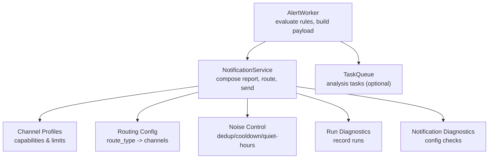
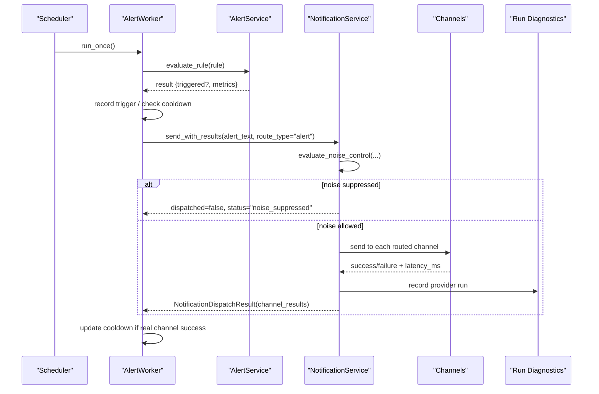
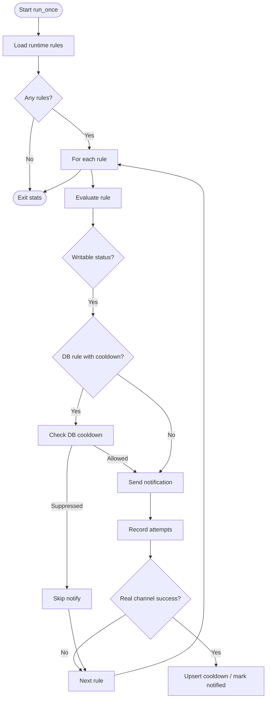
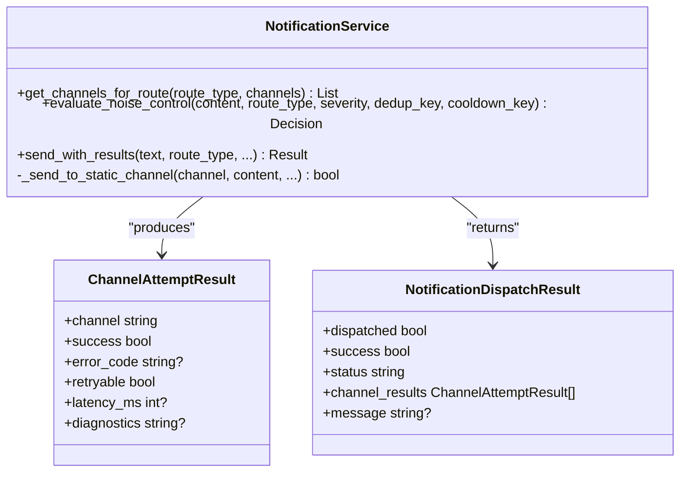
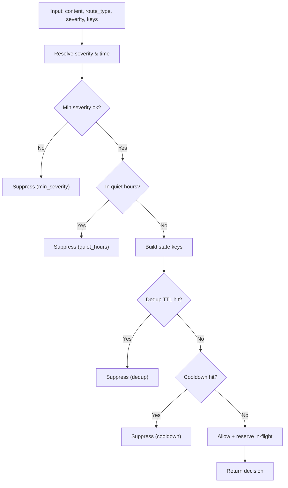
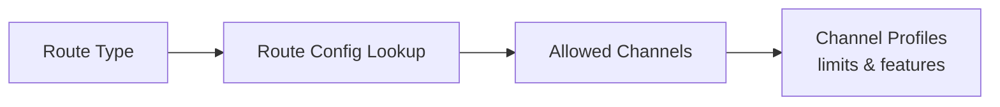
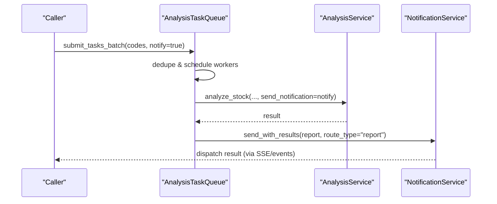
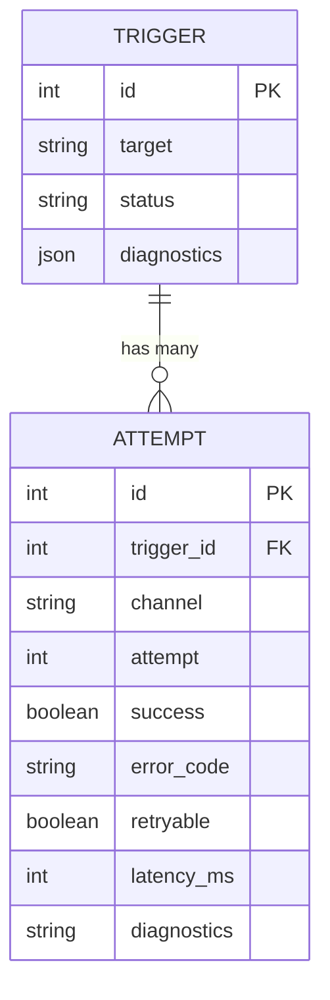
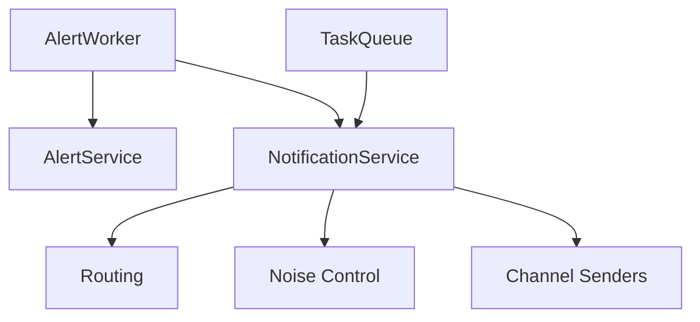
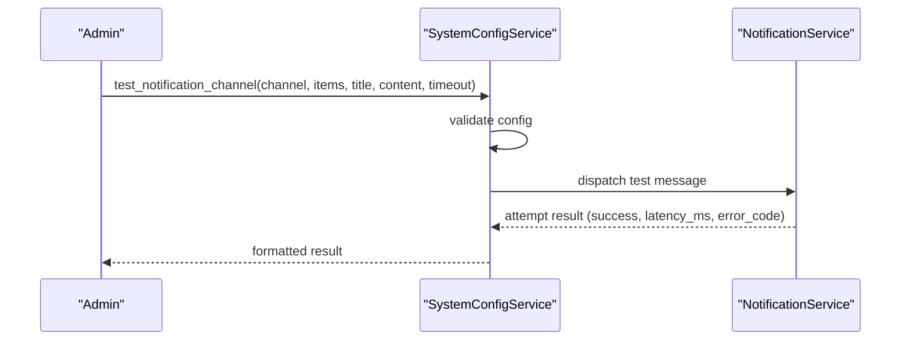

# Delivery Management

<cite>
**Referenced Files in This Document**
- [notification.py](file://src/notification.py)
- [notification_noise.py](file://src/notification_noise.py)
- [notification_routing.py](file://src/notification_routing.py)
- [notification_capabilities.py](file://src/notification_capabilities.py)
- [alert_worker.py](file://src/services/alert_worker.py)
- [task_queue.py](file://src/services/task_queue.py)
- [notification_diagnostics.py](file://src/services/notification_diagnostics.py)
- [run_diagnostics.py](file://src/services/run_diagnostics.py)
- [system_config_service.py](file://src/services/system_config_service.py)
</cite>

## Table of Contents
1. [Introduction](#introduction)
2. [Project Structure](#project-structure)
3. [Core Components](#core-components)
4. [Architecture Overview](#architecture-overview)
5. [Detailed Component Analysis](#detailed-component-analysis)
6. [Dependency Analysis](#dependency-analysis)
7. [Performance Considerations](#performance-considerations)
8. [Troubleshooting Guide](#troubleshooting-guide)
9. [Conclusion](#conclusion)
10. [Appendices](#appendices)

## Introduction
This document explains the notification delivery management system that asynchronously evaluates alerts, builds reports, and delivers them across multiple channels. It covers background processing, noise reduction (deduplication, cooldowns, quiet hours), failure handling, delivery status tracking, logging, monitoring, batching strategies, rate limiting considerations, scheduling/priority concepts, load balancing across channels, and debugging tools.

## Project Structure
The delivery system spans several modules:
- Background alert evaluation and dispatch coordination: AlertWorker
- Notification composition, routing, and channel dispatch: NotificationService
- Noise control (dedup, cooldown, quiet hours): NotificationNoiseDecision pipeline
- Channel capability profiles and renderer presets: ChannelProfile/RendererPreset
- Routing configuration per route type: Route configs and helpers
- Task queue for analysis workloads that may trigger notifications: AnalysisTaskQueue
- Diagnostics and test utilities for configuration and live testing: NotificationDiagnostics and SystemConfigService
- Run diagnostics integration to record notification runs in traces: run_diagnostics

**Diagram sources**
- [alert_worker.py:637-659](file://src/services/alert_worker.py#L637-L659)
- [notification.py:2702-2816](file://src/notification.py#L2702-L2816)
- [notification_noise.py:210-362](file://src/notification_noise.py#L210-L362)
- [notification_capabilities.py:75-234](file://src/notification_capabilities.py#L75-L234)
- [notification_routing.py:31-92](file://src/notification_routing.py#L31-L92)
- [task_queue.py:156-468](file://src/services/task_queue.py#L156-L468)
- [run_diagnostics.py:214-236](file://src/services/run_diagnostics.py#L214-L236)
- [notification_diagnostics.py:314-566](file://src/services/notification_diagnostics.py#L314-L566)

**Section sources**
- [alert_worker.py:78-201](file://src/services/alert_worker.py#L78-L201)
- [notification.py:257-343](file://src/notification.py#L257-L343)
- [notification_noise.py:1-71](file://src/notification_noise.py#L1-L71)
- [notification_capabilities.py:15-73](file://src/notification_capabilities.py#L15-L73)
- [notification_routing.py:1-92](file://src/notification_routing.py#L1-L92)
- [task_queue.py:156-468](file://src/services/task_queue.py#L156-L468)
- [notification_diagnostics.py:314-566](file://src/services/notification_diagnostics.py#L314-L566)
- [run_diagnostics.py:214-236](file://src/services/run_diagnostics.py#L214-L236)

## Core Components
- AlertWorker: Loads runtime rules, evaluates conditions, records triggers, decides whether to notify, and dispatches via NotificationService. It also handles DB-backed cooldowns and process-local fallbacks.
- NotificationService: Composes content, applies noise controls, resolves target channels by route, sends to configured channels concurrently, and returns structured results with per-channel attempt details.
- Noise Control: Process-local dedup TTL, cooldown windows, quiet hours, minimum severity filtering, and in-flight reservations to avoid duplicate sends during a single evaluation cycle.
- Routing: Route-type-based channel selection (report, alert, system_error) with validation of allowed channels.
- Capability Profiles: Per-channel text/markdown/image/file/link support and size limits used to tailor payloads.
- TaskQueue: Manages asynchronous analysis tasks; when enabled, completed analyses can trigger notifications through the same service.
- Diagnostics: Read-only config validation and live channel tests to aid troubleshooting.

**Section sources**
- [alert_worker.py:78-201](file://src/services/alert_worker.py#L78-L201)
- [notification.py:257-343](file://src/notification.py#L257-L343)
- [notification_noise.py:210-362](file://src/notification_noise.py#L210-L362)
- [notification_routing.py:31-92](file://src/notification_routing.py#L31-L92)
- [notification_capabilities.py:75-234](file://src/notification_capabilities.py#L75-L234)
- [task_queue.py:156-468](file://src/services/task_queue.py#L156-L468)
- [notification_diagnostics.py:314-566](file://src/services/notification_diagnostics.py#L314-L566)

## Architecture Overview
End-to-end flow from rule evaluation to delivery:

**Diagram sources**
- [alert_worker.py:107-201](file://src/services/alert_worker.py#L107-L201)
- [alert_worker.py:637-659](file://src/services/alert_worker.py#L637-L659)
- [notification.py:2702-2816](file://src/notification.py#L2702-L2816)
- [notification_noise.py:210-362](file://src/notification_noise.py#L210-L362)
- [run_diagnostics.py:214-236](file://src/services/run_diagnostics.py#L214-L236)

## Detailed Component Analysis

### AlertWorker: Background Evaluation and Dispatch
- Loads persisted and legacy alert rules, enforces a rule limit, and evaluates each rule using AlertService.
- Records triggers with status and diagnostics; attaches decision signal summaries where applicable.
- For DB-backed rules, checks active cooldowns before notifying; falls back to process-local fingerprinting on read failures.
- Builds alert messages, optionally enriching with market phase context and decision signal excerpts, then calls NotificationService with route_type="alert".
- Records notification attempts per channel and updates cooldown only when at least one real channel succeeds.

**Diagram sources**
- [alert_worker.py:107-201](file://src/services/alert_worker.py#L107-L201)
- [alert_worker.py:637-659](file://src/services/alert_worker.py#L637-L659)
- [alert_worker.py:762-800](file://src/services/alert_worker.py#L762-L800)

**Section sources**
- [alert_worker.py:78-201](file://src/services/alert_worker.py#L78-L201)
- [alert_worker.py:637-659](file://src/services/alert_worker.py#L637-L659)
- [alert_worker.py:762-800](file://src/services/alert_worker.py#L762-L800)

### NotificationService: Composition, Routing, and Delivery
- Detects available channels from configuration and supports context-based replies (e.g., DingTalk/Feishu sessions).
- Resolves target channels per route_type using routing configuration; unknown routes fall back to all configured channels.
- Applies noise control before sending static channels; context-channel sends are not limited by noise controls.
- Sends to each channel, captures per-attempt results including success, error_code, retryable flag, latency_ms, and diagnostics.
- Returns a structured dispatch result summarizing overall success and per-channel outcomes.

**Diagram sources**
- [notification.py:257-343](file://src/notification.py#L257-L343)
- [notification.py:2702-2816](file://src/notification.py#L2702-L2816)

**Section sources**
- [notification.py:257-343](file://src/notification.py#L257-L343)
- [notification.py:2702-2816](file://src/notification.py#L2702-L2816)

### Noise Reduction: Deduplication, Cooldowns, Quiet Hours, Severity
- Deduplication: Content-hash or explicit key within a TTL window prevents re-sending identical notifications.
- Cooldown: Time-bounded suppression keyed by a logical identifier (e.g., rule/target/scope).
- Quiet hours: Optional time window where notifications are suppressed based on configured timezone.
- Minimum severity: Notifications below configured threshold are skipped.
- In-flight reservation: Prevents duplicate evaluations from reserving the same slot during a single cycle.

**Diagram sources**
- [notification_noise.py:210-362](file://src/notification_noise.py#L210-L362)

**Section sources**
- [notification_noise.py:210-362](file://src/notification_noise.py#L210-L362)

### Routing and Channel Capabilities
- Routes: report, alert, system_error map to environment/config attributes controlling which channels receive each type.
- Validation: Invalid channel names are logged and ignored; disabled channels produce warnings.
- Capabilities: Each channel has known limits (text bytes/chars, image/file/card support) to shape payloads safely.

**Diagram sources**
- [notification_routing.py:31-92](file://src/notification_routing.py#L31-L92)
- [notification_capabilities.py:75-234](file://src/notification_capabilities.py#L75-L234)

**Section sources**
- [notification_routing.py:31-92](file://src/notification_routing.py#L31-L92)
- [notification_capabilities.py:75-234](file://src/notification_capabilities.py#L75-L234)

### Task Queue Integration and Batching
- AnalysisTaskQueue manages concurrent analysis tasks with a thread pool, preventing duplicate work per stock code and broadcasting progress events.
- When send_notification is enabled, completed analyses can trigger notifications via the same NotificationService path.
- Batch submission ensures atomicity and rollback on submission errors; duplicates are reported without blocking accepted tasks.

**Diagram sources**
- [task_queue.py:380-468](file://src/services/task_queue.py#L380-L468)
- [task_queue.py:668-766](file://src/services/task_queue.py#L668-L766)
- [notification.py:2702-2816](file://src/notification.py#L2702-L2816)

**Section sources**
- [task_queue.py:156-468](file://src/services/task_queue.py#L156-L468)
- [task_queue.py:668-766](file://src/services/task_queue.py#L668-L766)

### Delivery Status Tracking, Logging, and Monitoring
- Per-channel attempt metadata includes success, error_code, retryable, latency_ms, and diagnostics.
- AlertWorker persists notification attempts linked to triggers for later inspection.
- Run diagnostics records notification runs into trace contexts for visualization and audit.

**Diagram sources**
- [alert_worker.py:703-721](file://src/services/alert_worker.py#L703-L721)
- [run_diagnostics.py:214-236](file://src/services/run_diagnostics.py#L214-L236)

**Section sources**
- [alert_worker.py:703-721](file://src/services/alert_worker.py#L703-L721)
- [run_diagnostics.py:214-236](file://src/services/run_diagnostics.py#L214-L236)

### Retry Logic, Failure Handling, and Dead Letter Behavior
- The current design does not implement automatic exponential backoff retries. Instead:
  - Each channel send records retryable flags and error codes.
  - AlertWorker treats certain statuses (noise_suppressed, no_channel) as non-retryable.
  - On DB cooldown read failure, it uses a process-local fingerprint to avoid spamming until the next cycle.
- There is no explicit dead letter queue; failed deliveries remain visible via attempt records and diagnostics.

**Section sources**
- [alert_worker.py:724-760](file://src/services/alert_worker.py#L724-L760)
- [alert_worker.py:762-800](file://src/services/alert_worker.py#L762-L800)
- [notification.py:2783-2816](file://src/notification.py#L2783-L2816)

### Rate Limiting and Quota Respect
- Channel profiles expose platform-specific limits (e.g., Telegram UTF-16 char limits, WeChat byte caps).
- The sender layer respects these constraints when preparing payloads; there is no global rate limiter in this module.
- For high-volume scenarios, rely on noise controls (dedup/cooldown) and route scoping to reduce outbound volume.

**Section sources**
- [notification_capabilities.py:75-234](file://src/notification_capabilities.py#L75-L234)

### Delivery Scheduling, Priority Queuing, and Load Balancing
- Scheduling: AlertWorker is invoked by an external scheduler; each run processes rules sequentially with bounded rule limits.
- Priority: Not implemented explicitly; severity influences noise filtering but not ordering.
- Load balancing: Notifications are sent to all routed channels; concurrency is per-channel send, not sharded across workers.

**Section sources**
- [alert_worker.py:107-201](file://src/services/alert_worker.py#L107-L201)
- [notification.py:2702-2816](file://src/notification.py#L2702-L2816)

## Dependency Analysis
Key dependencies and coupling:
- AlertWorker depends on AlertService, DecisionSignalService, HistoryService, and NotificationService.
- NotificationService composes content and delegates to channel senders; it depends on routing and noise control modules.
- Noise control is process-local and independent of persistence.
- TaskQueue integrates with analysis services and can trigger notifications upon completion.

**Diagram sources**
- [alert_worker.py:107-201](file://src/services/alert_worker.py#L107-L201)
- [notification.py:257-343](file://src/notification.py#L257-L343)
- [notification_routing.py:31-92](file://src/notification_routing.py#L31-L92)
- [notification_noise.py:210-362](file://src/notification_noise.py#L210-L362)
- [task_queue.py:380-468](file://src/services/task_queue.py#L380-L468)

**Section sources**
- [alert_worker.py:107-201](file://src/services/alert_worker.py#L107-L201)
- [notification.py:257-343](file://src/notification.py#L257-L343)
- [notification_routing.py:31-92](file://src/notification_routing.py#L31-L92)
- [notification_noise.py:210-362](file://src/notification_noise.py#L210-L362)
- [task_queue.py:380-468](file://src/services/task_queue.py#L380-L468)

## Performance Considerations
- Use dedup and cooldown to reduce redundant sends during bursts.
- Configure route types to restrict channels per notification type.
- Keep rule sets manageable; the worker enforces a rule limit per cycle.
- Prefer context-channel replies for interactive flows to avoid extra static-channel traffic.
- Monitor latency_ms per channel to identify slow providers.

[No sources needed since this section provides general guidance]

## Troubleshooting Guide
- Configuration diagnostics: Validate channel keys, route configurations, quiet hours/timezone, and minimum severity.
- Live channel test: Build a temporary config and dispatch a test message to verify connectivity and formatting.
- Inspect attempts: Review stored notification attempts linked to triggers to diagnose failures and latencies.
- Trace runs: Use run diagnostics to view notification runs within task traces.

**Diagram sources**
- [system_config_service.py:542-577](file://src/services/system_config_service.py#L542-L577)
- [system_config_service.py:3062-3081](file://src/services/system_config_service.py#L3062-L3081)

**Section sources**
- [notification_diagnostics.py:314-566](file://src/services/notification_diagnostics.py#L314-L566)
- [system_config_service.py:542-577](file://src/services/system_config_service.py#L542-L577)
- [system_config_service.py:3062-3081](file://src/services/system_config_service.py#L3062-L3081)
- [run_diagnostics.py:214-236](file://src/services/run_diagnostics.py#L214-L236)

## Conclusion
The delivery system combines robust background evaluation, flexible multi-channel dispatch, and strong noise reduction to ensure timely and relevant notifications. While it lacks automatic retry/backoff and a dedicated dead letter queue, its detailed attempt tracking, diagnostics, and configurable routing provide strong observability and control. For high-volume environments, leverage dedup/cooldown, route scoping, and channel capabilities to maintain reliability and respect provider limits.

[No sources needed since this section summarizes without analyzing specific files]

## Appendices
- Environment variables influencing noise control: NOTIFICATION_DEDUP_TTL_SECONDS, NOTIFICATION_COOLDOWN_SECONDS, NOTIFICATION_QUIET_HOURS, NOTIFICATION_TIMEZONE, NOTIFICATION_MIN_SEVERITY, NOTIFICATION_DAILY_DIGEST_ENABLED.
- Route configuration keys: NOTIFICATION_REPORT_CHANNELS, NOTIFICATION_ALERT_CHANNELS, NOTIFICATION_SYSTEM_ERROR_CHANNELS.

**Section sources**
- [notification_noise.py:28-45](file://src/notification_noise.py#L28-L45)
- [notification_routing.py:31-47](file://src/notification_routing.py#L31-L47)