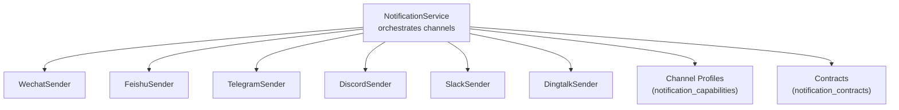
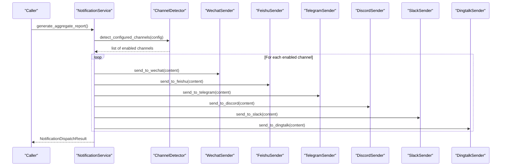
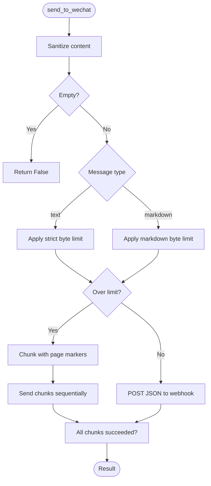
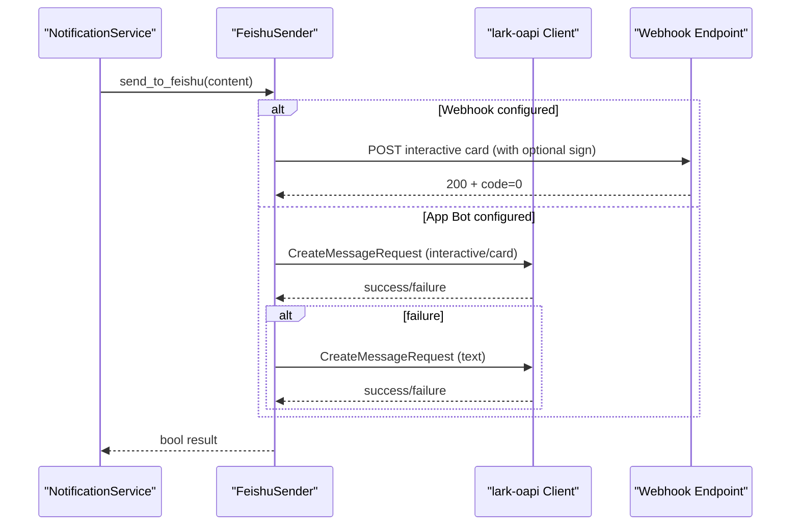
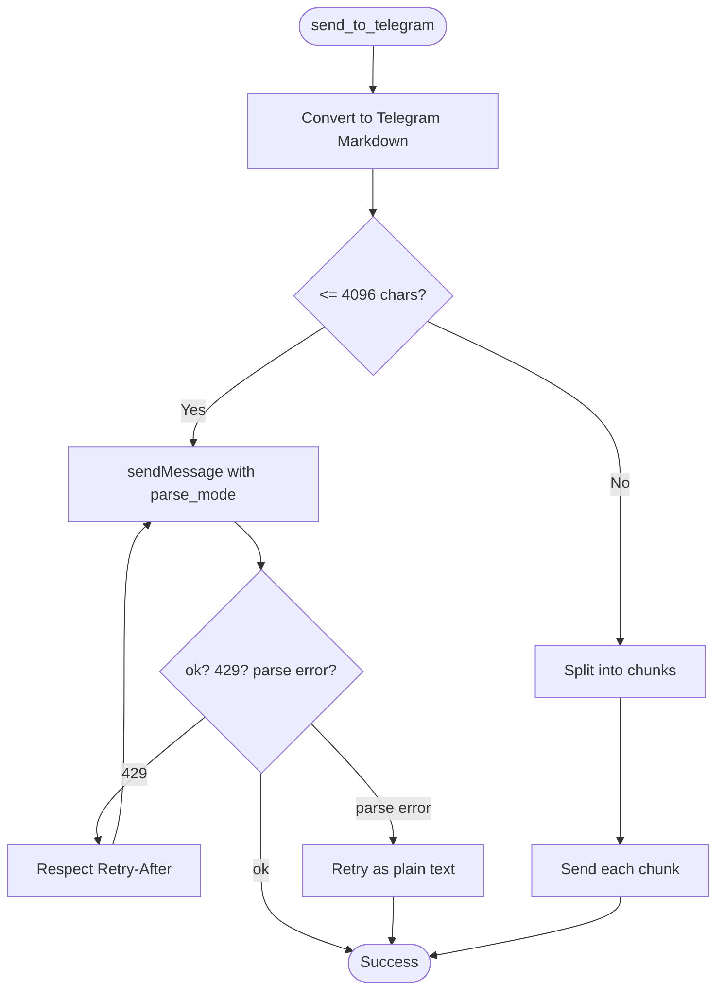
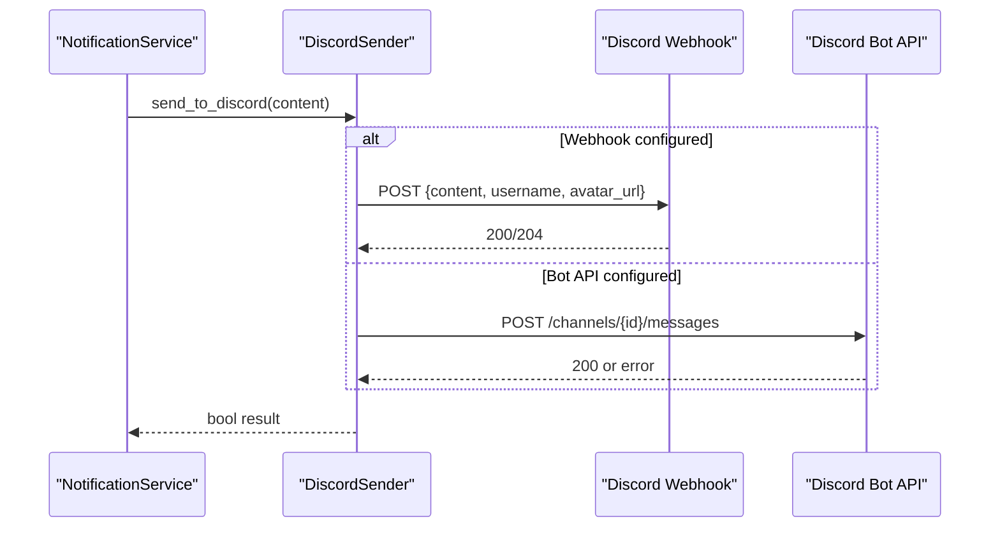
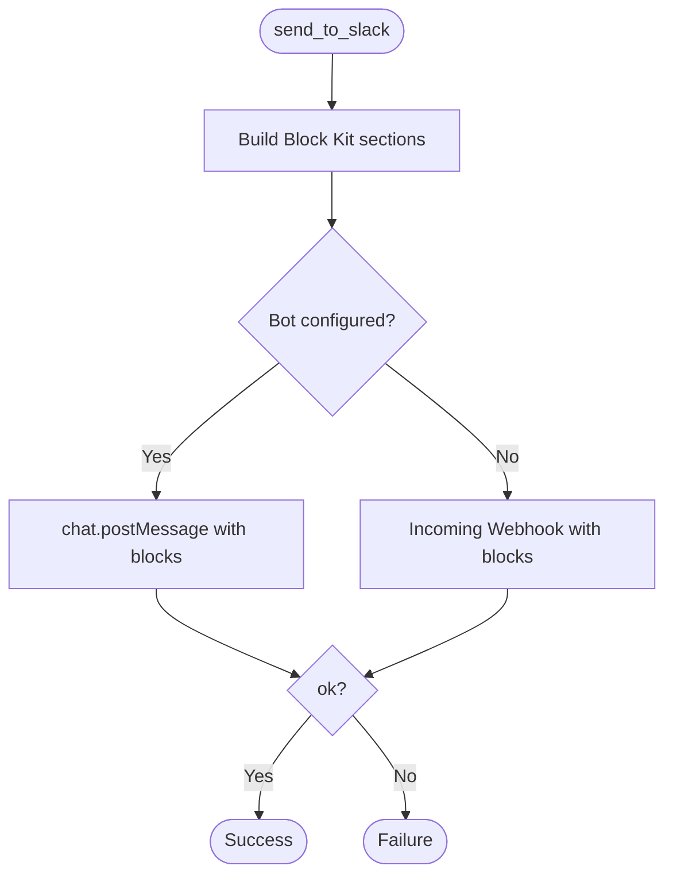
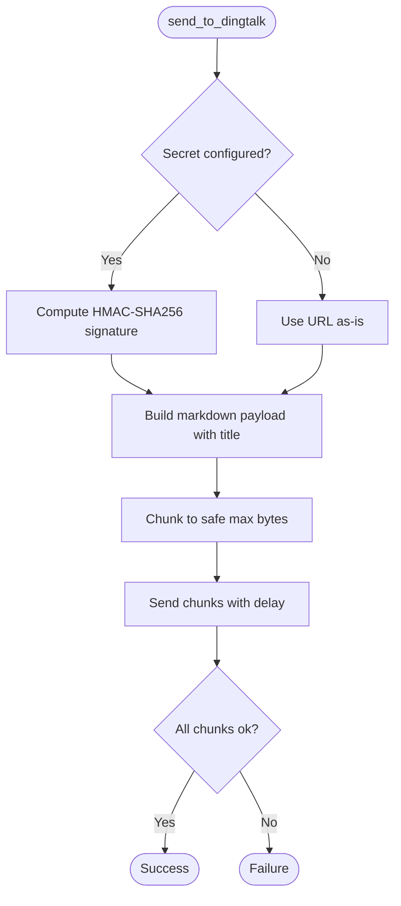
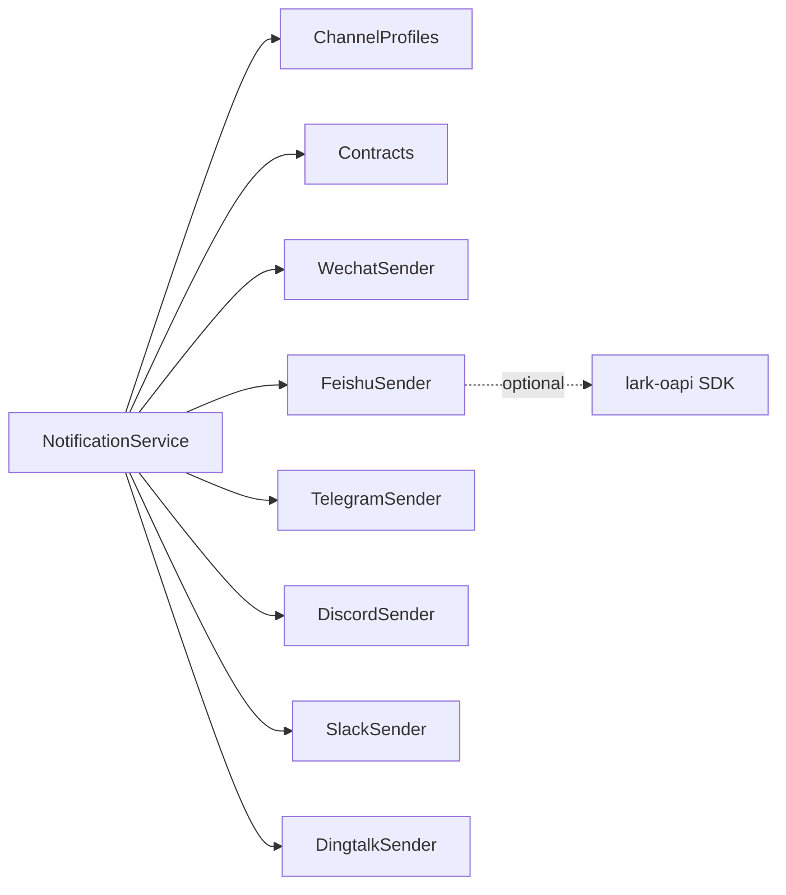

# Messaging Platforms

<cite>
**Referenced Files in This Document**
- [src/notification.py](file://src/notification.py)
- [src/notification_capabilities.py](file://src/notification_capabilities.py)
- [src/notification_contracts.py](file://src/notification_contracts.py)
- [src/notification_sender/__init__.py](file://src/notification_sender/__init__.py)
- [src/notification_sender/wechat_sender.py](file://src/notification_sender/wechat_sender.py)
- [src/notification_sender/feishu_sender.py](file://src/notification_sender/feishu_sender.py)
- [src/notification_sender/telegram_sender.py](file://src/notification_sender/telegram_sender.py)
- [src/notification_sender/discord_sender.py](file://src/notification_sender/discord_sender.py)
- [src/notification_sender/slack_sender.py](file://src/notification_sender/slack_sender.py)
- [src/notification_sender/dingtalk_sender.py](file://src/notification_sender/dingtalk_sender.py)
- [docs/bot/feishu-bot-config.md](file://docs/bot/feishu-bot-config.md)
- [docs/bot/discord-bot-config.md](file://docs/bot/discord-bot-config.md)
- [docs/bot/dingding-bot-config.md](file://docs/bot/dingding-bot-config.md)
</cite>

## Table of Contents
1. Introduction
2. Project Structure
3. Core Components
4. Architecture Overview
5. Detailed Component Analysis
6. Dependency Analysis
7. Performance Considerations
8. Troubleshooting Guide
9. Conclusion
10. Appendices

## Introduction
This document provides comprehensive, platform-focused documentation for messaging notification channels used by the system: WeChat (Enterprise WeChat), Feishu (Lark), Telegram, Discord, Slack, and DingTalk. For each platform, it covers authentication setup, API configuration, message formatting options, rate limiting policies, rich media support, environment variables, delivery guarantees, error handling patterns, webhook requirements, and testing procedures. It also explains how the central NotificationService orchestrates channel detection, routing, chunking, retries, and fallbacks.

## Project Structure
The notification subsystem is organized around a central service that composes multiple channel senders and capability profiles:
- Central orchestration and channel detection live in the notification service.
- Per-platform senders implement HTTP or SDK-based messaging with platform-specific limits and formats.
- Capability profiles define per-channel rendering defaults, size limits, and supported features.
- Contracts provide shared configuration checks (notably for Feishu).

**Diagram sources**
- [src/notification.py:257-343](file://src/notification.py#L257-L343)
- [src/notification_sender/__init__.py:10-23](file://src/notification_sender/__init__.py#L10-L23)
- [src/notification_capabilities.py:75-189](file://src/notification_capabilities.py#L75-L189)
- [src/notification_contracts.py:14-62](file://src/notification_contracts.py#L14-L62)

**Section sources**
- [src/notification.py:257-343](file://src/notification.py#L257-L343)
- [src/notification_sender/__init__.py:10-23](file://src/notification_sender/__init__.py#L10-L23)
- [src/notification_capabilities.py:75-189](file://src/notification_capabilities.py#L75-L189)
- [src/notification_contracts.py:14-62](file://src/notification_contracts.py#L14-L62)

## Core Components
- NotificationService: Composes all sender classes, detects enabled channels from configuration, builds reports, and dispatches messages to configured channels. It supports context-aware replies (e.g., replying to the originating chat for DingTalk/Feishu/Telegram when available).
- ChannelProfiles: Define per-channel capabilities such as markdown flavor, default mode, text limits, and whether images/files/cards are supported.
- Contracts: Provide lightweight helpers to check if Feishu is statically configured via environment or config attributes without importing heavy dependencies.

Key responsibilities:
- Detect configured channels based on environment/config keys.
- Normalize report language and labels.
- Split long content into chunks respecting platform limits.
- Apply retry/backoff where applicable.
- Provide structured diagnostics for dispatch results.

**Section sources**
- [src/notification.py:185-225](file://src/notification.py#L185-L225)
- [src/notification.py:480-551](file://src/notification.py#L480-L551)
- [src/notification_capabilities.py:15-73](file://src/notification_capabilities.py#L15-L73)
- [src/notification_contracts.py:37-62](file://src/notification_contracts.py#L37-L62)

## Architecture Overview
The system routes notifications through a unified interface while delegating to platform-specific senders. Each sender encapsulates its own authentication, payload construction, chunking, and retry logic. The service can also reply to the originating chat when a source message context exists.

**Diagram sources**
- [src/notification.py:257-343](file://src/notification.py#L257-L343)
- [src/notification.py:480-551](file://src/notification.py#L480-L551)
- [src/notification_sender/wechat_sender.py:26-99](file://src/notification_sender/wechat_sender.py#L26-L99)
- [src/notification_sender/feishu_sender.py:84-130](file://src/notification_sender/feishu_sender.py#L84-L130)
- [src/notification_sender/telegram_sender.py:22-119](file://src/notification_sender/telegram_sender.py#L22-L119)
- [src/notification_sender/discord_sender.py:30-101](file://src/notification_sender/discord_sender.py#L30-L101)
- [src/notification_sender/slack_sender.py:26-83](file://src/notification_sender/slack_sender.py#L26-L83)
- [src/notification_sender/dingtalk_sender.py:16-86](file://src/notification_sender/dingtalk_sender.py#L16-L86)

## Detailed Component Analysis

### WeChat (Enterprise WeChat)
- Authentication and configuration:
  - Requires a group robot Webhook URL.
  - Optional: message type selection (text vs markdown) and max bytes per message.
  - SSL verification is configurable.
- Message formatting:
  - Supports text and markdown payloads.
  - Markdown is sanitized before sending; hidden metadata is stripped.
- Size limits and chunking:
  - Default max bytes per message is configurable; text mode enforces stricter limits to stay within platform constraints.
  - Long messages are split into chunks with page markers and sent sequentially with small delays.
- Rich media:
  - Image support via msgtype image using base64-encoded content with MD5 checksum. There is an explicit byte limit for images.
- Rate limiting:
  - No built-in global rate limiter; chunking includes small sleeps between parts. Respect platform rate limits at the application level.
- Delivery guarantees:
  - Best-effort delivery with logging and per-chunk success tracking.
- Error handling:
  - Logs HTTP status codes and platform error responses; returns False on failure.
- Environment variables and config keys:
  - Webhook URL and optional max bytes, message type, SSL verification flag.
- Testing:
  - Send a short test message to verify connectivity and format rendering.
  - Test chunking by sending a longer report.
  - Test image upload path with a small PNG/JPEG under the image size limit.

**Diagram sources**
- [src/notification_sender/wechat_sender.py:40-99](file://src/notification_sender/wechat_sender.py#L40-L99)
- [src/notification_sender/wechat_sender.py:156-179](file://src/notification_sender/wechat_sender.py#L156-L179)

**Section sources**
- [src/notification_sender/wechat_sender.py:26-198](file://src/notification_sender/wechat_sender.py#L26-L198)

### Feishu (Lark)
- Authentication and configuration:
  - Two modes:
    - Webhook mode: requires a group robot Webhook URL; optional keyword and signature secret.
    - App Bot mode: requires app ID, app secret, and target chat/user ID; supports domain selection (feishu/lark).
  - Stream mode is supported for event-driven interactions; not required for simple push notifications.
- Message formatting:
  - Webhook sends interactive cards with lark_md content; falls back to plain text if card fails.
  - App Bot sends interactive cards first, then text fallback; supports file uploads via SDK when available.
- Size limits and chunking:
  - Configurable max bytes; long messages are chunked with page markers. Keyword overhead is considered when computing effective limits.
- Rich media:
  - File upload via App Bot SDK when available; Webhook mode cannot upload files and will send content as text instead.
- Rate limiting:
  - Retries with exponential backoff for App Bot sends; chunking includes small delays.
- Delivery guarantees:
  - Idempotent sends via UUID in App Bot requests; chunked sends track partial failures.
- Error handling:
  - Detailed logging of SDK errors, HTTP errors, and non-JSON responses; returns False on failure.
- Environment variables and config keys:
  - Webhook URL, optional secret and keyword; App Bot credentials, chat ID, receive ID type, domain; optional file-send mode.
- Testing:
  - Validate Webhook mode with a minimal card payload.
  - Validate App Bot mode by sending a short message to a known chat.
  - If enabling file mode, ensure required permissions and SDK version.

**Diagram sources**
- [src/notification_sender/feishu_sender.py:84-130](file://src/notification_sender/feishu_sender.py#L84-L130)
- [src/notification_sender/feishu_sender.py:225-355](file://src/notification_sender/feishu_sender.py#L225-L355)
- [src/notification_sender/feishu_sender.py:539-645](file://src/notification_sender/feishu_sender.py#L539-L645)

**Section sources**
- [src/notification_sender/feishu_sender.py:84-645](file://src/notification_sender/feishu_sender.py#L84-L645)
- [docs/bot/feishu-bot-config.md:1-297](file://docs/bot/feishu-bot-config.md#L1-L297)
- [src/notification_contracts.py:14-62](file://src/notification_contracts.py#L14-L62)

### Telegram
- Authentication and configuration:
  - Requires bot token and chat ID; optional thread ID for topic support.
- Message formatting:
  - Uses Markdown parsing mode; converts standard Markdown to Telegram-compatible syntax and escapes special characters while preserving links.
- Size limits and chunking:
  - Enforces 4096-character limit; long messages are split into chunks separated by a delimiter and sent sequentially.
- Rich media:
  - Image support via sendPhoto endpoint.
- Rate limiting:
  - Respects 429 responses and Retry-After headers; implements exponential backoff and limited retries.
- Delivery guarantees:
  - Best-effort with retries and fallback to plain text if Markdown parsing fails.
- Error handling:
  - Detects common Markdown parse errors and automatically retries as plain text; logs detailed errors and responses.
- Environment variables and config keys:
  - Bot token, chat ID, optional message thread ID.
- Testing:
  - Send a short Markdown message to verify formatting and escaping.
  - Send a long message to validate chunking behavior.
  - Test image upload with a small file.

**Diagram sources**
- [src/notification_sender/telegram_sender.py:41-119](file://src/notification_sender/telegram_sender.py#L41-L119)
- [src/notification_sender/telegram_sender.py:121-200](file://src/notification_sender/telegram_sender.py#L121-L200)
- [src/notification_sender/telegram_sender.py:256-342](file://src/notification_sender/telegram_sender.py#L256-L342)
- [src/notification_sender/telegram_sender.py:367-403](file://src/notification_sender/telegram_sender.py#L367-L403)

**Section sources**
- [src/notification_sender/telegram_sender.py:22-403](file://src/notification_sender/telegram_sender.py#L22-L403)

### Discord
- Authentication and configuration:
  - Supports two modes:
    - Webhook mode: simple, low privileges; uses channel webhook URL.
    - Bot API mode: higher privileges; requires bot token and channel ID.
- Message formatting:
  - Sends Markdown content; splits into chunks to respect Discord’s content length limit.
- Size limits and chunking:
  - Enforces a maximum content length; chunks include page markers when needed.
- Rich media:
  - Not implemented directly in this sender; rely on attachments via other flows if needed.
- Rate limiting:
  - Implements retries on 429 with Retry-After header or body; exponential backoff for server errors.
- Delivery guarantees:
  - Best-effort with retries; chunked sends log per-chunk outcomes.
- Error handling:
  - Logs HTTP errors and response bodies; returns False on failure.
- Environment variables and config keys:
  - Bot token, channel ID, optional webhook URL; optional public key for inbound interactions (for receiving commands).
- Testing:
  - Use Webhook mode for quick smoke tests; then validate Bot API mode with proper permissions.
  - Test slash commands if using Bot mode.

**Diagram sources**
- [src/notification_sender/discord_sender.py:30-101](file://src/notification_sender/discord_sender.py#L30-L101)
- [src/notification_sender/discord_sender.py:151-202](file://src/notification_sender/discord_sender.py#L151-L202)
- [src/notification_sender/discord_sender.py:204-300](file://src/notification_sender/discord_sender.py#L204-L300)

**Section sources**
- [src/notification_sender/discord_sender.py:30-300](file://src/notification_sender/discord_sender.py#L30-L300)
- [docs/bot/discord-bot-config.md:1-113](file://docs/bot/discord-bot-config.md#L1-L113)

### Slack
- Authentication and configuration:
  - Supports both Incoming Webhook and Bot API; Bot API is preferred when configured to keep text and images on the same channel.
- Message formatting:
  - Builds Block Kit sections with mrkdwn text; splits content to respect section text limits and overall text limits.
- Size limits and chunking:
  - Splits content into blocks to avoid exceeding per-section and per-message limits.
- Rich media:
  - Image support via Bot API external file upload flow; Webhook mode falls back to text if image upload fails.
- Rate limiting:
  - Best-effort retries are not explicitly implemented here; chunking reduces risk of hitting limits.
- Delivery guarantees:
  - Best-effort with logging; returns False on failure.
- Error handling:
  - Logs HTTP errors and API error messages; returns False on failure.
- Environment variables and config keys:
  - Webhook URL; optional bot token and channel ID.
- Testing:
  - Validate Webhook mode first; then enable Bot API for richer features like file uploads.

**Diagram sources**
- [src/notification_sender/slack_sender.py:26-83](file://src/notification_sender/slack_sender.py#L26-L83)
- [src/notification_sender/slack_sender.py:85-171](file://src/notification_sender/slack_sender.py#L85-L171)
- [src/notification_sender/slack_sender.py:173-245](file://src/notification_sender/slack_sender.py#L173-L245)

**Section sources**
- [src/notification_sender/slack_sender.py:26-245](file://src/notification_sender/slack_sender.py#L26-L245)

### DingTalk
- Authentication and configuration:
  - Requires a group robot Webhook URL; optional secret for HMAC-SHA256 signature.
- Message formatting:
  - Sends Markdown with a title; title is truncated to prevent excessive JSON overhead.
- Size limits and chunking:
  - Enforces a safe maximum for DingTalk’s 20,000-byte limit; chunks are sent sequentially with small delays.
- Rich media:
  - Not implemented in this sender.
- Rate limiting:
  - Small sleep between chunks; no explicit rate-limit handling beyond chunk pacing.
- Delivery guarantees:
  - Best-effort with per-chunk success tracking.
- Error handling:
  - Logs API errors and exceptions; returns False on failure.
- Environment variables and config keys:
  - Webhook URL and optional secret.
- Testing:
  - Send a short Markdown message to verify signature and chunking.
  - Validate stream mode separately if using DingTalk Stream integration.

**Diagram sources**
- [src/notification_sender/dingtalk_sender.py:16-86](file://src/notification_sender/dingtalk_sender.py#L16-L86)

**Section sources**
- [src/notification_sender/dingtalk_sender.py:16-86](file://src/notification_sender/dingtalk_sender.py#L16-L86)
- [docs/bot/dingding-bot-config.md:1-39](file://docs/bot/dingding-bot-config.md#L1-L39)

## Dependency Analysis
- NotificationService depends on all sender classes and capability/profile modules to determine which channels are enabled and how to render content.
- FeishuSender optionally depends on the lark-oapi SDK for App Bot and file upload features; gracefully degrades when unavailable.
- TelegramSender and DiscordSender implement robust retry/backoff strategies to handle transient network issues and rate limits.
- SlackSender prefers Bot API for consistent channel behavior when both Bot and Webhook are configured.

**Diagram sources**
- [src/notification.py:257-343](file://src/notification.py#L257-L343)
- [src/notification_sender/feishu_sender.py:39-70](file://src/notification_sender/feishu_sender.py#L39-L70)

**Section sources**
- [src/notification.py:257-343](file://src/notification.py#L257-L343)
- [src/notification_sender/feishu_sender.py:39-70](file://src/notification_sender/feishu_sender.py#L39-L70)

## Performance Considerations
- Chunking strategy: All senders split large messages to respect platform limits, reducing failures and improving throughput.
- Retry/backoff: Telegram and Discord implement retries with exponential backoff and respect server hints (Retry-After).
- Payload minimization: Markdown sanitization and metadata stripping reduce payload sizes across platforms.
- Prefer Bot APIs: For Slack, using Bot API ensures consistent channel behavior for text and images.
- Avoid unnecessary conversions: Where possible, use native formats (e.g., Feishu interactive cards) to minimize reformatting overhead.

[No sources needed since this section provides general guidance]

## Troubleshooting Guide
Common issues and resolutions:
- WeChat:
  - Empty content after sanitization: Ensure the report contains visible text; check message type and byte limits.
  - Image too large: Reduce image size below the enforced limit; otherwise fall back to text.
- Feishu:
  - Missing Webhook URL: Configure FEISHU_WEBHOOK_URL for group notifications; App Bot credentials alone do not enable group pushes.
  - Signature mismatch: Set FEISHU_WEBHOOK_SECRET if enabled in the group robot settings.
  - Keyword mismatch: Set FEISHU_WEBHOOK_KEYWORD exactly as configured in the robot security settings.
  - Domain mismatch: Use FEISHU_DOMAIN=lark for international Lark; default feishu for domestic Feishu.
- Telegram:
  - Markdown parse errors: The sender auto-retries as plain text; verify link syntax and avoid unsupported constructs.
  - Rate limited: Respect Retry-After; reduce frequency or batch messages.
- Discord:
  - Permissions: Ensure the bot has Send Messages, Embed Links, Attach Files, and Read Message History if using Bot mode.
  - Commands not showing: Wait for Discord to sync slash commands or re-add the bot.
- Slack:
  - Mixed channels: When both Webhook and Bot are configured, Bot API is preferred to keep text and images together.
  - File upload failures: Verify Bot permissions and use the external upload flow; fall back to text if necessary.
- DingTalk:
  - Signature errors: Ensure secret matches the one configured in the DingTalk group robot.
  - Title too long: Titles are truncated; keep titles concise.

**Section sources**
- [src/notification_sender/wechat_sender.py:73-99](file://src/notification_sender/wechat_sender.py#L73-L99)
- [src/notification_sender/feishu_sender.py:156-179](file://src/notification_sender/feishu_sender.py#L156-L179)
- [src/notification_sender/feishu_sender.py:539-645](file://src/notification_sender/feishu_sender.py#L539-L645)
- [src/notification_sender/telegram_sender.py:121-200](file://src/notification_sender/telegram_sender.py#L121-L200)
- [src/notification_sender/discord_sender.py:204-300](file://src/notification_sender/discord_sender.py#L204-L300)
- [src/notification_sender/slack_sender.py:173-245](file://src/notification_sender/slack_sender.py#L173-L245)
- [src/notification_sender/dingtalk_sender.py:21-86](file://src/notification_sender/dingtalk_sender.py#L21-L86)

## Conclusion
The notification subsystem provides a robust, multi-channel messaging layer with platform-specific optimizations. It handles authentication, formatting, chunking, retries, and rich media where supported. By configuring the appropriate environment variables and following platform-specific setup steps, users can reliably deliver analysis reports and alerts across WeChat, Feishu, Telegram, Discord, Slack, and DingTalk.

[No sources needed since this section summarizes without analyzing specific files]

## Appendices

### Environment Variables and Configuration Summary
- WeChat:
  - Webhook URL, optional message type and max bytes, SSL verification flag.
- Feishu:
  - Webhook URL, optional secret and keyword; App Bot credentials (app ID, app secret, chat ID), receive ID type, domain; optional file-send mode.
- Telegram:
  - Bot token, chat ID, optional message thread ID.
- Discord:
  - Bot token and channel ID for Bot mode; optional webhook URL; optional public key for inbound interactions.
- Slack:
  - Webhook URL; optional bot token and channel ID.
- DingTalk:
  - Webhook URL and optional secret.

**Section sources**
- [src/notification_sender/wechat_sender.py:26-39](file://src/notification_sender/wechat_sender.py#L26-L39)
- [src/notification_sender/feishu_sender.py:84-130](file://src/notification_sender/feishu_sender.py#L84-L130)
- [src/notification_sender/telegram_sender.py:22-39](file://src/notification_sender/telegram_sender.py#L22-L39)
- [src/notification_sender/discord_sender.py:30-48](file://src/notification_sender/discord_sender.py#L30-L48)
- [src/notification_sender/slack_sender.py:26-39](file://src/notification_sender/slack_sender.py#L26-L39)
- [src/notification_sender/dingtalk_sender.py:16-20](file://src/notification_sender/dingtalk_sender.py#L16-L20)
- [docs/bot/feishu-bot-config.md:1-297](file://docs/bot/feishu-bot-config.md#L1-L297)
- [docs/bot/discord-bot-config.md:1-113](file://docs/bot/discord-bot-config.md#L1-L113)
- [docs/bot/dingding-bot-config.md:1-39](file://docs/bot/dingding-bot-config.md#L1-L39)