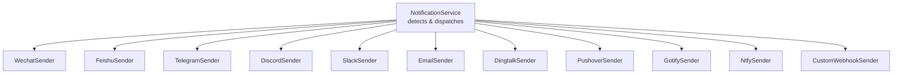
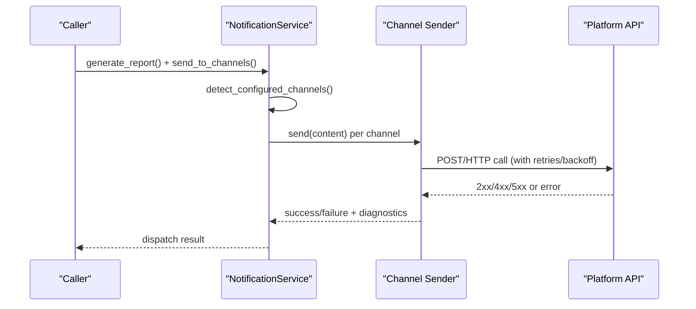
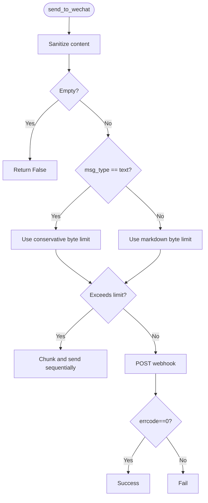
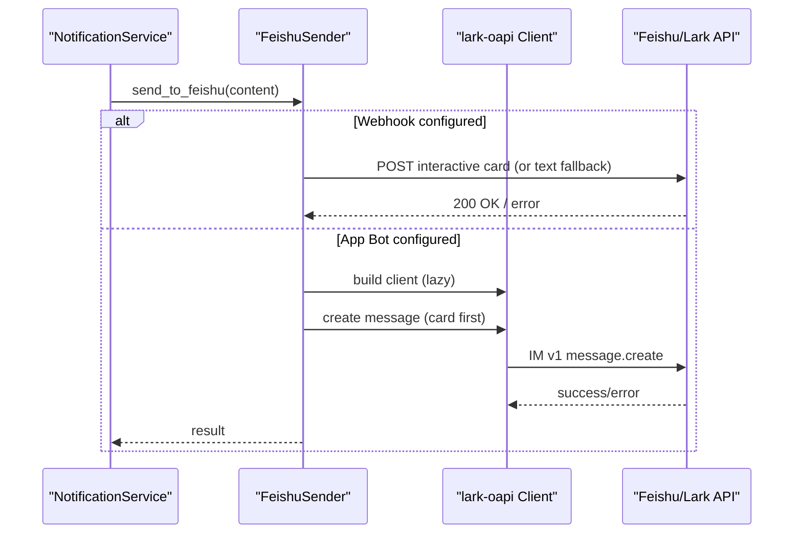
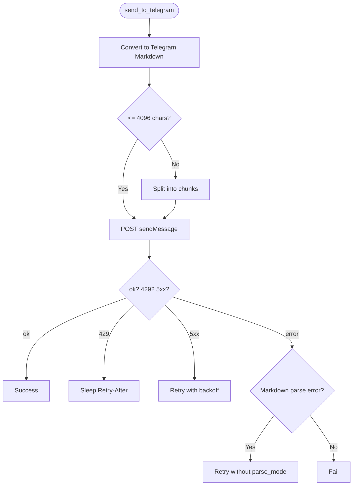
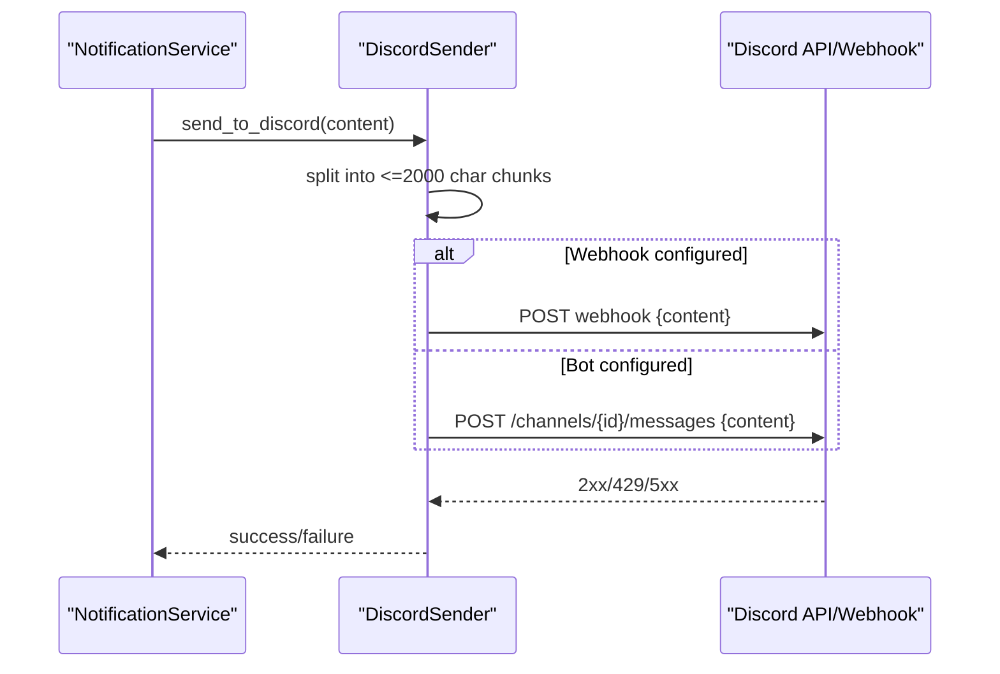
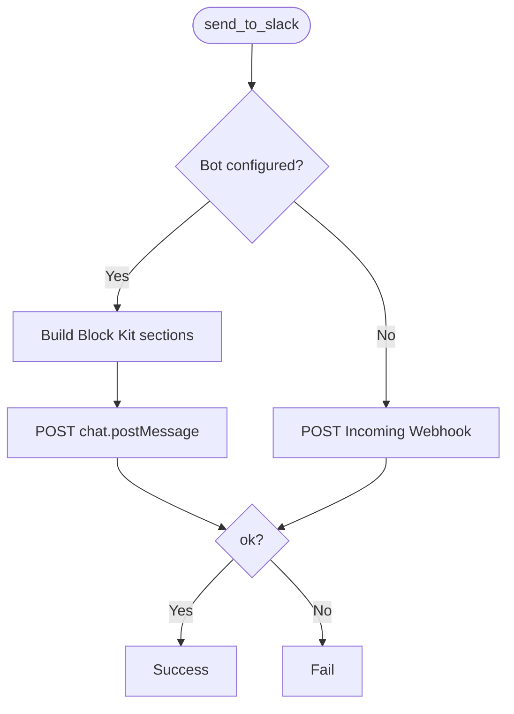
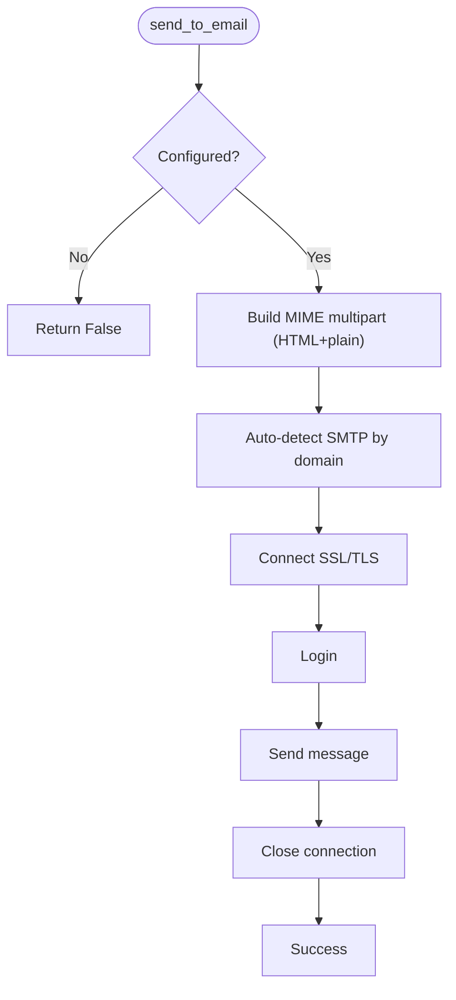
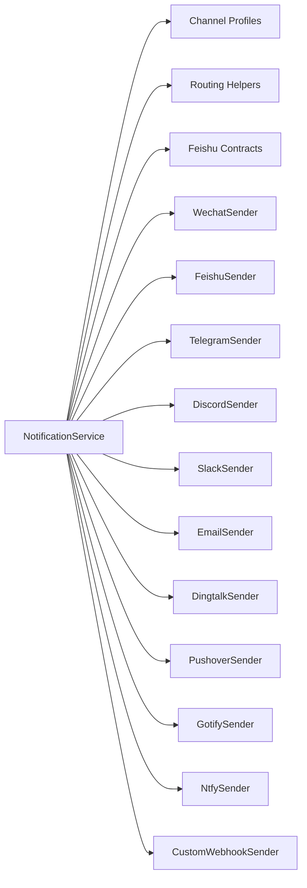

# Notification Channels

<cite>
**Referenced Files in This Document**
- [notification.py](file://src/notification.py)
- [notification_capabilities.py](file://src/notification_capabilities.py)
- [notification_contracts.py](file://src/notification_contracts.py)
- [notification_routing.py](file://src/notification_routing.py)
- [wechat_sender.py](file://src/notification_sender/wechat_sender.py)
- [feishu_sender.py](file://src/notification_sender/feishu_sender.py)
- [telegram_sender.py](file://src/notification_sender/telegram_sender.py)
- [discord_sender.py](file://src/notification_sender/discord_sender.py)
- [slack_sender.py](file://src/notification_sender/slack_sender.py)
- [email_sender.py](file://src/notification_sender/email_sender.py)
- [dingtalk_sender.py](file://src/notification_sender/dingtalk_sender.py)
- [pushover_sender.py](file://src/notification_sender/pushover_sender.py)
- [gotify_sender.py](file://src/notification_sender/gotify_sender.py)
- [ntfy_sender.py](file://src/notification_sender/ntfy_sender.py)
- [custom_webhook_sender.py](file://src/notification_sender/custom_webhook_sender.py)
</cite>

## Table of Contents
1. Introduction
2. Project Structure
3. Core Components
4. Architecture Overview
5. Detailed Component Analysis
6. Dependency Analysis
7. Performance Considerations
8. Troubleshooting Guide
9. Conclusion

## Introduction
This document explains all supported notification channels and their configuration, capabilities, and operational behavior. It covers WeChat (Enterprise WeChat), Feishu (Lark), Telegram, Discord, Slack, Email, DingTalk, Pushover, Gotify, Ntfy, and Custom Webhooks. For each channel you will find:
- Setup instructions and authentication methods
- Rate limiting considerations
- Platform-specific features and limits
- Configuration examples via environment/config keys
- Capabilities such as rich media support, formatting options, and delivery guarantees
- How to test connectivity and verify message delivery

## Project Structure
The notification system is composed of:
- A central service that detects configured channels and dispatches messages
- Per-channel senders implementing platform APIs
- Capability profiles describing per-channel rendering and limits
- Routing helpers for selecting which channels receive which notifications
- Contracts for shared configuration checks

**Diagram sources**
- [notification.py:257-332](file://src/notification.py#L257-L332)
- [notification_sender/__init__.py](file://src/notification_sender/__init__.py)

**Section sources**
- [notification.py:257-332](file://src/notification.py#L257-L332)
- [notification_routing.py:13-28](file://src/notification_routing.py#L13-L28)

## Core Components
- NotificationService aggregates all sender classes and detects enabled channels from configuration. It also supports context-based replies (e.g., replying to a chat where the trigger came from).
- Channel capability profiles define default modes, text limits, and whether images/files/cards are supported.
- Routing helpers define which channels can be used for report/alert/system-error routes.
- Contracts provide safe checks for Feishu configuration without importing heavy SDKs.

Key responsibilities:
- Detect configured channels from config attributes
- Prepare content per channel profile (markdown conversion, chunking)
- Dispatch to one or more channels with retries and rate-limit handling
- Provide diagnostics and noise control hooks

**Section sources**
- [notification.py:480-560](file://src/notification.py#L480-L560)
- [notification_capabilities.py:75-189](file://src/notification_capabilities.py#L75-L189)
- [notification_routing.py:31-92](file://src/notification_routing.py#L31-L92)
- [notification_contracts.py:14-63](file://src/notification_contracts.py#L14-L63)

## Architecture Overview
The runtime flow:
1. Build NotificationService with current Config
2. Detect available channels by inspecting config attributes
3. Generate report content once; prepare per-channel payloads using capability profiles
4. Send to each enabled channel with retries and backoff where applicable
5. Record success/failure and optional diagnostics

**Diagram sources**
- [notification.py:257-332](file://src/notification.py#L257-L332)
- [notification.py:480-560](file://src/notification.py#L480-L560)

## Detailed Component Analysis

### WeChat (Enterprise WeChat)
- Authentication: Webhook URL only
- Formatting: Markdown or Text mode; markdown is default
- Limits: Default max bytes configurable; text mode capped conservatively; image payload limited to ~2 MB base64
- Rich media: Image upload supported via msgtype=image
- Delivery: Chunked sending for long messages; page markers added automatically
- Rate limiting: No built-in throttling; add delays if needed at caller level
- Configuration keys:
  - wechat_webhook_url
  - wechat_msg_type (text/markdown)
  - wechat_max_bytes
  - webhook_verify_ssl
- Example setup:
  - Set WECHAT_WEBHOOK_URL to your Enterprise WeChat robot webhook
  - Optionally set WECHAT_MSG_TYPE=text if you prefer plain text
  - Adjust WECHAT_MAX_BYTES if needed
- Testing:
  - Use the provided send method to post a short message; check logs for success or error codes
  - For images, ensure size under the limit and use the image send path

**Diagram sources**
- [wechat_sender.py:40-179](file://src/notification_sender/wechat_sender.py#L40-L179)

**Section sources**
- [wechat_sender.py:26-198](file://src/notification_sender/wechat_sender.py#L26-L198)
- [notification_capabilities.py:75-84](file://src/notification_capabilities.py#L75-L84)

### Feishu (Lark)
- Authentication:
  - Webhook mode: feishu_webhook_url (+ optional secret/signature)
  - App Bot mode: feishu_app_id + feishu_app_secret + feishu_chat_id (+ receive id type and domain)
- Formatting: Lark Markdown via interactive card; fallback to text
- Limits: Max bytes configurable; chunked sending for long messages
- Rich media: File upload via App Bot SDK; webhook mode sends file content as text/card
- Delivery: Card-first with retry and idempotency UUID; chunked with page markers
- Rate limiting: Retries with exponential backoff on transient errors
- Configuration keys:
  - feishu_webhook_url, feishu_webhook_secret, feishu_webhook_keyword
  - feishu_app_id, feishu_app_secret, feishu_chat_id, feishu_receive_id_type, feishu_domain
  - feishu_max_bytes, feishu_send_as_file
  - webhook_verify_ssl
- Example setup:
  - Webhook: configure feishu_webhook_url; optionally enable signature verification
  - App Bot: configure app credentials and target chat; choose receive_id_type
- Testing:
  - Try a short message; verify card renders correctly
  - For files, ensure SDK version supports file upload when using App Bot

**Diagram sources**
- [feishu_sender.py:84-130](file://src/notification_sender/feishu_sender.py#L84-L130)
- [feishu_sender.py:225-355](file://src/notification_sender/feishu_sender.py#L225-L355)
- [feishu_sender.py:361-379](file://src/notification_sender/feishu_sender.py#L361-L379)

**Section sources**
- [feishu_sender.py:84-645](file://src/notification_sender/feishu_sender.py#L84-L645)
- [notification_capabilities.py:85-94](file://src/notification_capabilities.py#L85-L94)
- [notification_contracts.py:14-63](file://src/notification_contracts.py#L14-L63)

### Telegram
- Authentication: bot_token + chat_id (+ optional message_thread_id)
- Formatting: MarkdownV2 with automatic conversion; falls back to plain text on parse errors
- Limits: 4096 characters (UTF-16 code units); chunked by sections
- Rich media: Photo upload supported
- Delivery: Retry with backoff; respects Retry-After on 429
- Rate limiting: Respects server rate limits; backs off on 429
- Configuration keys:
  - telegram_bot_token, telegram_chat_id, telegram_message_thread_id
- Example setup:
  - Create a bot via BotFather, get token
  - Get chat_id from a conversation or getUpdates
  - Optional: set thread id for topics
- Testing:
  - Send a short message; if markdown fails, it will auto-fallback to plain text
  - Verify photo upload works if needed

**Diagram sources**
- [telegram_sender.py:41-119](file://src/notification_sender/telegram_sender.py#L41-L119)
- [telegram_sender.py:121-200](file://src/notification_sender/telegram_sender.py#L121-L200)
- [telegram_sender.py:256-342](file://src/notification_sender/telegram_sender.py#L256-L342)

**Section sources**
- [telegram_sender.py:22-403](file://src/notification_sender/telegram_sender.py#L22-L403)
- [notification_capabilities.py:104-112](file://src/notification_capabilities.py#L104-L112)

### Discord
- Authentication:
  - Webhook URL preferred (simple, low privileges)
  - Or Bot token + channel_id for Bot API
- Formatting: Discord Markdown; content split to respect 2000-char limit
- Limits: 2000 characters per message; configurable max words
- Rich media: Images via custom webhook file attachment; Bot API supports attachments too
- Delivery: Retry with backoff; respects retry_after on 429
- Rate limiting: Handles 429 with retry_after; sleeps between chunks
- Configuration keys:
  - discord_webhook_url OR discord_bot_token + discord_main_channel_id
  - discord_max_words
  - webhook_verify_ssl
- Example setup:
  - Webhook: create a channel webhook in Discord settings
  - Bot: invite bot to server, grant permissions, set channel id
- Testing:
  - Send a short message; verify both text and image paths work

**Diagram sources**
- [discord_sender.py:64-148](file://src/notification_sender/discord_sender.py#L64-L148)
- [discord_sender.py:151-202](file://src/notification_sender/discord_sender.py#L151-L202)
- [discord_sender.py:204-300](file://src/notification_sender/discord_sender.py#L204-L300)

**Section sources**
- [discord_sender.py:30-300](file://src/notification_sender/discord_sender.py#L30-L300)
- [notification_capabilities.py:161-167](file://src/notification_capabilities.py#L161-L167)

### Slack
- Authentication:
  - Incoming Webhook URL
  - Or Bot token + channel_id (preferred to keep text and images consistent)
- Formatting: mrkdwn; Block Kit sections split to respect per-block limits
- Limits: ~39000 characters per message; section text limited to ~3000
- Rich media: Image upload via Bot API (files.getUploadURLExternal flow); webhook mode falls back to text
- Delivery: Sends blocks; no explicit retry loop but robust error logging
- Rate limiting: None built-in; rely on Slack’s rate limits and handle errors
- Configuration keys:
  - slack_webhook_url OR slack_bot_token + slack_channel_id
  - webhook_verify_ssl
- Example setup:
  - Webhook: create an incoming webhook for a channel
  - Bot: install app, authorize scopes, set channel id
- Testing:
  - Send a short message; verify block rendering
  - For images, prefer Bot mode

**Diagram sources**
- [slack_sender.py:49-83](file://src/notification_sender/slack_sender.py#L49-L83)
- [slack_sender.py:85-104](file://src/notification_sender/slack_sender.py#L85-L104)
- [slack_sender.py:106-171](file://src/notification_sender/slack_sender.py#L106-L171)

**Section sources**
- [slack_sender.py:26-245](file://src/notification_sender/slack_sender.py#L26-L245)
- [notification_capabilities.py:168-177](file://src/notification_capabilities.py#L168-L177)

### Email
- Authentication: SMTP with sender email and password/app key
- Formatting: HTML and plain text; Markdown converted to simple HTML
- Limits: Depends on provider; no hard limit enforced here
- Rich media: Inline image attachment supported
- Delivery: Uses provider-specific SMTP settings (auto-detected by domain)
- Rate limiting: None built-in; depends on provider
- Configuration keys:
  - email_sender, email_password, email_receivers
  - email_sender_name (optional)
  - stock_email_groups (optional routing by stocks)
- Example setup:
  - Configure sender and password/app key
  - Receivers default to sender if not set
  - Optional groups to route specific stocks to different emails
- Testing:
  - Send a short report; verify HTML rendering and inline image

**Diagram sources**
- [email_sender.py:134-226](file://src/notification_sender/email_sender.py#L134-L226)

**Section sources**
- [email_sender.py:51-283](file://src/notification_sender/email_sender.py#L51-L283)
- [notification_capabilities.py:113-121](file://src/notification_capabilities.py#L113-L121)

### DingTalk
- Authentication: Webhook URL (via custom webhook sender) or dedicated sender
- Formatting: Markdown with title
- Limits: ~20000 bytes per message; chunked sending supported
- Rich media: Not directly supported in this sender; text/markdown only
- Delivery: Chunked with page markers; template-aware for DingTalk format
- Rate limiting: None built-in; add delays if needed
- Configuration keys:
  - dingtalk_webhook_url (used by custom webhook sender)
  - webhook_verify_ssl
- Example setup:
  - Create a custom robot in DingTalk and copy the webhook URL
- Testing:
  - Send a short message; verify markdown rendering

**Section sources**
- [custom_webhook_sender.py:273-329](file://src/notification_sender/custom_webhook_sender.py#L273-L329)
- [custom_webhook_sender.py:361-398](file://src/notification_sender/custom_webhook_sender.py#L361-L398)
- [notification_capabilities.py:95-103](file://src/notification_capabilities.py#L95-L103)

### Pushover
- Authentication: user_key + api_token
- Formatting: Plain text (Markdown converted)
- Limits: 1024 characters per message; chunked by paragraphs
- Rich media: Not supported here
- Delivery: Chunked with titles indicating part numbers
- Rate limiting: None built-in; relies on Pushover limits
- Configuration keys:
  - pushover_user_key, pushover_api_token
- Example setup:
  - Create an application in Pushover and note user key and token
- Testing:
  - Send a short message; verify mobile/desktop delivery

**Section sources**
- [pushover_sender.py:20-237](file://src/notification_sender/pushover_sender.py#L20-L237)
- [notification_capabilities.py:122-128](file://src/notification_capabilities.py#L122-L128)

### Gotify
- Authentication: Server base URL + token header (X-Gotify-Key)
- Formatting: Markdown via extras contentType
- Limits: Depends on server; no hard limit enforced here
- Rich media: Not supported here
- Delivery: Single JSON publish; timeout and request exceptions handled
- Rate limiting: None built-in
- Configuration keys:
  - gotify_url (base URL, not ending with /message)
  - gotify_token
  - webhook_verify_ssl
- Example setup:
  - Deploy Gotify server, create application token
- Testing:
  - Send a short message; verify server logs

**Section sources**
- [gotify_sender.py:47-124](file://src/notification_sender/gotify_sender.py#L47-L124)
- [notification_capabilities.py:135-140](file://src/notification_capabilities.py#L135-L140)

### Ntfy
- Authentication: Optional Bearer token; topic derived from URL path
- Formatting: Markdown enabled via flag
- Limits: Depends on server; no hard limit enforced here
- Rich media: Not supported here
- Delivery: JSON publish to server root with topic; timeouts handled
- Rate limiting: None built-in
- Configuration keys:
  - ntfy_url (must include topic path)
  - ntfy_token (optional)
  - webhook_verify_ssl
- Example setup:
  - Use public ntfy.sh or self-hosted instance; set URL like https://ntfy.sh/my-topic
- Testing:
  - Subscribe to topic and send a test message

**Section sources**
- [ntfy_sender.py:51-128](file://src/notification_sender/ntfy_sender.py#L51-L128)
- [notification_capabilities.py:129-134](file://src/notification_capabilities.py#L129-L134)

### Custom Webhooks
- Authentication: Optional Bearer token; supports multiple URLs
- Formatting: Auto-detects common services (DingTalk, Discord, Slack, Bark); otherwise generic JSON
- Limits: Varies per service; chunking implemented for DingTalk
- Rich media: Supports Discord file attachments; others fall back to text
- Delivery: Iterates over configured URLs; returns success if any succeeds
- Rate limiting: None built-in; add delays if needed
- Configuration keys:
  - custom_webhook_urls (list)
  - custom_webhook_bearer_token (optional)
  - custom_webhook_body_template (optional JSON template)
  - webhook_verify_ssl
- Example setup:
  - Add one or more webhook URLs; optionally set a body template
- Testing:
  - Use the test method to send a sample message and inspect per-URL results

**Section sources**
- [custom_webhook_sender.py:27-413](file://src/notification_sender/custom_webhook_sender.py#L27-L413)
- [notification_capabilities.py:153-160](file://src/notification_capabilities.py#L153-L160)

## Dependency Analysis
- NotificationService composes all senders and uses capability profiles to decide how to render content
- Routing module defines allowed channels for different notification types
- Contracts provide lightweight checks for Feishu configuration without circular imports

**Diagram sources**
- [notification.py:257-332](file://src/notification.py#L257-L332)
- [notification_capabilities.py:75-189](file://src/notification_capabilities.py#L75-L189)
- [notification_routing.py:13-92](file://src/notification_routing.py#L13-L92)
- [notification_contracts.py:14-63](file://src/notification_contracts.py#L14-L63)

**Section sources**
- [notification.py:257-332](file://src/notification.py#L257-L332)
- [notification_routing.py:13-92](file://src/notification_routing.py#L13-L92)
- [notification_capabilities.py:75-189](file://src/notification_capabilities.py#L75-L189)
- [notification_contracts.py:14-63](file://src/notification_contracts.py#L14-L63)

## Performance Considerations
- Chunking: Most senders split long messages to respect platform limits (bytes or characters)
- Retries and backoff: Telegram and Discord implement retries with exponential backoff; Feishu App Bot retries with idempotency
- Rate limiting: Respect 429 responses and Retry-After headers where available
- Network: All HTTP calls honor timeout_seconds and optional SSL verification flags
- Concurrency: The service dispatches to multiple channels; callers should consider overall throughput and platform quotas

[No sources needed since this section provides general guidance]

## Troubleshooting Guide
Common issues and resolutions:
- WeChat
  - Empty content or exceeding text limit: Ensure content is non-empty and within limits; chunking handles overflow
  - Image too large: Keep under ~2 MB base64; otherwise fallback to text
- Feishu
  - Missing App Bot credentials: Ensure app_id, app_secret, and chat_id are set; verify domain and receive_id_type
  - Webhook signature mismatch: Provide correct secret and timestamp/sign fields
- Telegram
  - Markdown parse errors: Automatically falls back to plain text; avoid unsupported entities
  - Rate limited: Sleep according to Retry-After; reduce frequency
- Discord
  - Content exceeds 2000 chars: Automatically chunked; verify chunk boundaries
  - 429: Backoff based on retry_after; reduce burst rate
- Slack
  - Block text too long: Automatically split into sections; prefer Bot mode for images
- Email
  - Authentication failed: Verify sender and password/app key; confirm SMTP settings auto-detected correctly
  - Connection errors: Check network and firewall; adjust timeout
- Pushover/Gotify/Ntfy
  - Invalid URL/token: Validate endpoint and token; ensure URL formats match expectations
- Custom Webhooks
  - Template not valid JSON: Revert to default payload; fix template syntax
  - Service-specific limits: Truncate or chunk as needed

Testing connectivity:
- Use each sender’s send method with a short message and inspect logs for success or detailed error messages
- For custom webhooks, use the test method to get per-URL attempt details including latency and HTTP status

**Section sources**
- [wechat_sender.py:40-179](file://src/notification_sender/wechat_sender.py#L40-L179)
- [feishu_sender.py:84-130](file://src/notification_sender/feishu_sender.py#L84-L130)
- [telegram_sender.py:121-200](file://src/notification_sender/telegram_sender.py#L121-L200)
- [discord_sender.py:204-300](file://src/notification_sender/discord_sender.py#L204-L300)
- [slack_sender.py:106-171](file://src/notification_sender/slack_sender.py#L106-L171)
- [email_sender.py:134-226](file://src/notification_sender/email_sender.py#L134-L226)
- [custom_webhook_sender.py:169-261](file://src/notification_sender/custom_webhook_sender.py#L169-L261)

## Conclusion
This system provides a unified notification layer with robust per-channel implementations. Each channel includes appropriate formatting, limits, and delivery strategies. Use the capability profiles and routing helpers to tailor behavior, and rely on built-in retries and chunking to improve reliability. For troubleshooting, consult the per-channel sections and leverage the diagnostic outputs and logs.

[No sources needed since this section summarizes without analyzing specific files]