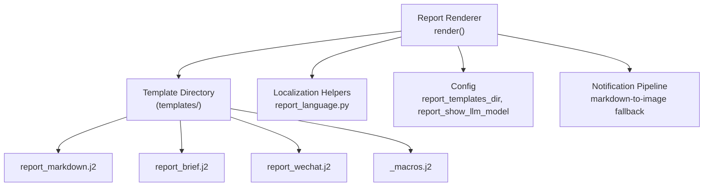
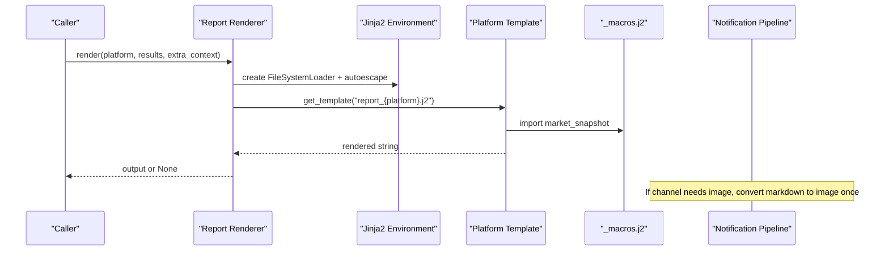
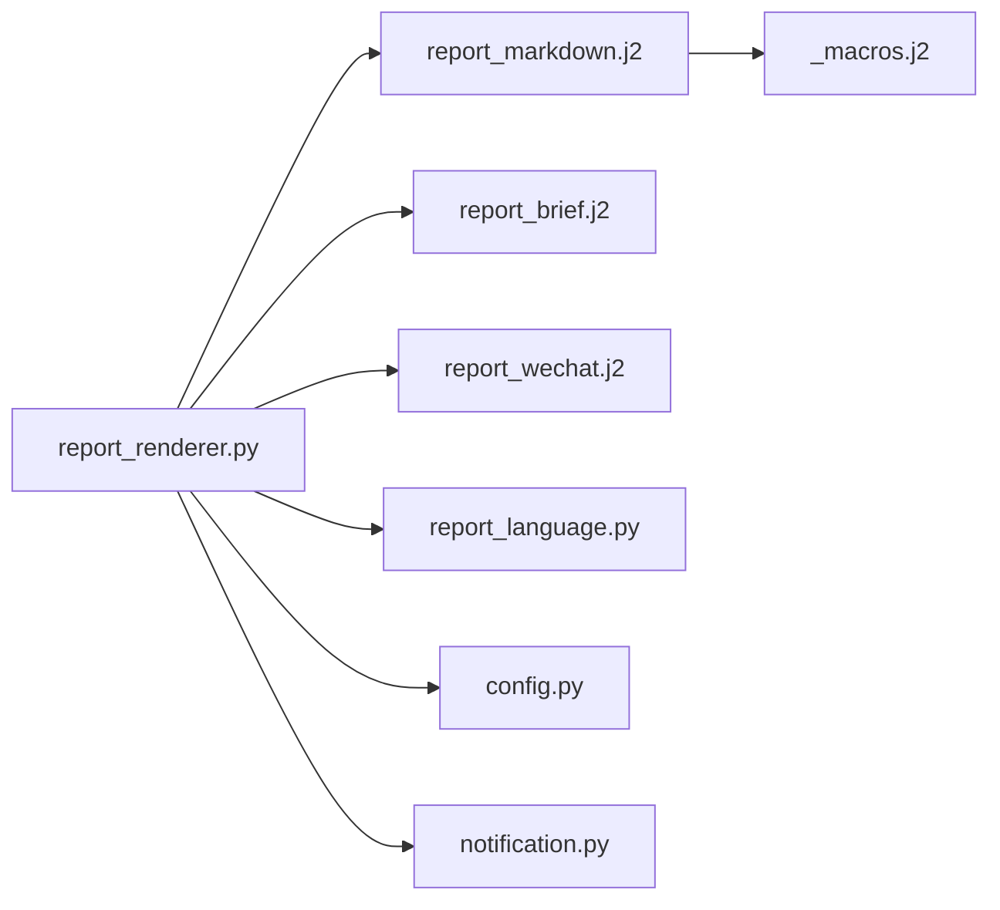

# Template System

<cite>
**Referenced Files in This Document**
- [report_renderer.py](file://src/services/report_renderer.py)
- [report_markdown.j2](file://templates/report_markdown.j2)
- [report_brief.j2](file://templates/report_brief.j2)
- [report_wechat.j2](file://templates/report_wechat.j2)
- [_macros.j2](file://templates/_macros.j2)
- [notification.py](file://src/notification.py)
- [config.py](file://src/config.py)
- [report_language.py](file://src/report_language.py)
- [test_report_renderer.py](file://tests/test_report_renderer.py)
- [test_md2img_template.py](file://tests/test_md2img_template.py)
</cite>

## Table of Contents
1. [Introduction](#introduction)
2. [Project Structure](#project-structure)
3. [Core Components](#core-components)
4. [Architecture Overview](#architecture-overview)
5. [Detailed Component Analysis](#detailed-component-analysis)
6. [Dependency Analysis](#dependency-analysis)
7. [Performance Considerations](#performance-considerations)
8. [Troubleshooting Guide](#troubleshooting-guide)
9. [Conclusion](#conclusion)
10. [Appendices](#appendices)

## Introduction
This document explains the Jinja2-based template system used to format notification content for multiple channels. It covers how templates are rendered, what variables and helpers are available, how to customize layouts, include charts or images, and adapt content per channel constraints. It also documents built-in templates for markdown reports, brief summaries, and WeChat-formatted messages, plus testing, debugging, and version management practices.

## Project Structure
The template system is centered around a renderer that loads Jinja2 templates from a configurable directory and renders them with localized labels and enriched analysis results. Built-in templates exist for three platforms: markdown, brief, and wechat. A shared macro file provides reusable components such as market snapshot tables.

**Diagram sources**
- [report_renderer.py:80-129](file://src/services/report_renderer.py#L80-L129)
- [config.py:1132-1137](file://src/config.py#L1132-L1137)
- [notification.py:2740-2759](file://src/notification.py#L2740-L2759)

**Section sources**
- [report_renderer.py:80-129](file://src/services/report_renderer.py#L80-L129)
- [config.py:1132-1137](file://src/config.py#L1132-L1137)

## Core Components
- Report renderer: Loads Jinja2 environment, resolves template path, builds context (labels, enriched results, counts), and renders the selected platform template.
- Built-in templates:
  - Markdown report: Full dashboard with sections like summary, core conclusion, data perspective, phase decision, signal attribution, strategy synthesis, battle plan, and history comparison.
  - Brief summary: Compact one-line-per-stock summary with score and short insight.
  - WeChat message: Channel-friendly layout with truncated text and key highlights.
- Shared macros: Reusable blocks such as market snapshot table rendering.
- Localization: Labels, signals, trends, and strategy synthesis are localized via helper functions injected into the template context.

Key responsibilities:
- Context preparation: Sorting results by sentiment score, computing buy/hold/sell counts, preparing localized stock names, trend predictions, and empty-news disclosures.
- Safe rendering: Autoescape disabled for markdown; errors return None so callers can fallback.
- Channel integration: The notification pipeline may convert markdown to image for channels that do not support rich text.

**Section sources**
- [report_renderer.py:93-267](file://src/services/report_renderer.py#L93-L267)
- [report_markdown.j2:1-251](file://templates/report_markdown.j2#L1-L251)
- [report_brief.j2:1-22](file://templates/report_brief.j2#L1-L22)
- [report_wechat.j2:1-105](file://templates/report_wechat.j2#L1-L105)
- [_macros.j2:1-19](file://templates/_macros.j2#L1-L19)
- [report_language.py:1-200](file://src/report_language.py#L1-L200)

## Architecture Overview
The renderer composes a context and renders a platform-specific template. The notification layer decides whether to send text or an image based on channel capabilities and configuration.

**Diagram sources**
- [report_renderer.py:115-129](file://src/services/report_renderer.py#L115-L129)
- [report_renderer.py:257-266](file://src/services/report_renderer.py#L257-L266)
- [notification.py:2740-2759](file://src/notification.py#L2740-L2759)

## Detailed Component Analysis

### Report Renderer
- Template resolution: Uses a configurable directory relative to project root; falls back if missing.
- Context building:
  - Enriched list includes localized stock name, signal emoji/text, trend prediction, and empty-news disclosure.
  - Counts for buy/hold/sell derived from display decision types.
  - Localized labels and helpers injected for consistent wording across languages.
- Rendering:
  - Jinja2 Environment with FileSystemLoader and autoescape disabled for markdown safety.
  - Returns None on error to allow caller fallback.

Practical implications:
- Extra context can be passed but cannot override labels or report_language to avoid breaking localization contracts.
- History comparison and phase pack excerpts are prepared via helper functions.

**Section sources**
- [report_renderer.py:80-129](file://src/services/report_renderer.py#L80-L129)
- [report_renderer.py:131-256](file://src/services/report_renderer.py#L131-L256)
- [report_renderer.py:257-267](file://src/services/report_renderer.py#L257-L267)

### Markdown Template
Highlights:
- Summary section lists each stock with signal, score, and trend prediction.
- Optional full detail mode shows intelligence insights, core conclusion, data perspective (trend, price metrics, volume, chip structure), phase decision, signal attribution weights, strategy synthesis, battle plan (sniper points, position strategy, checklist), and history comparison.
- Market snapshot macro renders a compact table of key metrics.
- Footer includes generation time and optional model usage line controlled by config.

Variables and helpers commonly used:
- report_date, report_timestamp, results, enriched, summary_only
- buy_count, hold_count, sell_count
- labels (localized strings)
- report_language
- models_used, show_llm_model
- market_status_line
- escape_md, clean_sniper, failed_checks
- localize_* helpers for trends, actions, chips, strategy synthesis

**Section sources**
- [report_markdown.j2:1-251](file://templates/report_markdown.j2#L1-L251)
- [_macros.j2:1-19](file://templates/_macros.j2#L1-L19)
- [report_renderer.py:215-250](file://src/services/report_renderer.py#L215-L250)

### Brief Template
Highlights:
- Compact header with date and counts.
- One-line entries per stock with signal emoji, code, score, and a short one-sentence insight.
- Footer with timestamp and optional model usage line.

Use cases:
- Quick daily digest for chat or email where brevity matters.

**Section sources**
- [report_brief.j2:1-22](file://templates/report_brief.j2#L1-L22)
- [report_renderer.py:215-250](file://src/services/report_renderer.py#L215-L250)

### WeChat Template
Highlights:
- Channel-friendly formatting with concise lines and truncation for long texts.
- Shows headline, summary, and per-stock highlights including earnings outlook, sentiment summary, risk alerts, positive catalysts, sniper points, position advice, and strategy synthesis summary.
- Includes failed checks when present.

Channel constraints:
- Text length limits are enforced upstream; the notification pipeline may convert markdown to image for channels that do not support rich text.

**Section sources**
- [report_wechat.j2:1-105](file://templates/report_wechat.j2#L1-L105)
- [notification.py:2740-2759](file://src/notification.py#L2740-L2759)

### Shared Macros
- market_snapshot(result): Renders a table of close/open/high/low/change/volume/amount and optional current price, volume ratio, turnover rate, and source.

Usage:
- Included by markdown template to provide a consistent market snapshot block.

**Section sources**
- [_macros.j2:1-19](file://templates/_macros.j2#L1-L19)

### Localization and Labels
- All visible headings and labels are provided through a labels map resolved by language.
- Helpers localize trend predictions, operation advice, chip health, strategy signals, consensus levels, conflict severity, and strategy synthesis summaries.
- Report language is normalized and propagated into the template context.

**Section sources**
- [report_language.py:1-200](file://src/report_language.py#L1-L200)
- [report_renderer.py:131-139](file://src/services/report_renderer.py#L131-L139)
- [report_renderer.py:215-250](file://src/services/report_renderer.py#L215-L250)

### Channel Integration and Image Conversion
- For channels that do not support markdown, the notification pipeline converts the rendered markdown to an image once and sends it to all affected channels.
- Configuration controls which channels use image conversion and maximum character thresholds to avoid oversized images.

**Section sources**
- [notification.py:2740-2759](file://src/notification.py#L2740-L2759)
- [config.py:1159-1162](file://src/config.py#L1159-L1162)

## Dependency Analysis

**Diagram sources**
- [report_renderer.py:80-129](file://src/services/report_renderer.py#L80-L129)
- [report_renderer.py:257-266](file://src/services/report_renderer.py#L257-L266)
- [notification.py:2740-2759](file://src/notification.py#L2740-L2759)

**Section sources**
- [report_renderer.py:80-129](file://src/services/report_renderer.py#L80-L129)
- [report_renderer.py:257-266](file://src/services/report_renderer.py#L257-L266)
- [notification.py:2740-2759](file://src/notification.py#L2740-L2759)

## Performance Considerations
- Template rendering is lightweight; heavy work should remain in Python context preparation.
- Avoid excessive loops or expensive computations inside templates; prefer precomputed values in context.
- Markdown-to-image conversion is performed once per dispatch when needed; ensure max_chars threshold prevents huge images.
- Use summary_only mode for quick digests to reduce rendering scope.

[No sources needed since this section provides general guidance]

## Troubleshooting Guide
Common issues and resolutions:
- Template not found: Ensure report_templates_dir points to the correct path and files exist.
- Render errors: Renderer returns None; check logs and validate input data shapes.
- Missing localization: Verify report_language normalization and that labels are loaded.
- Image conversion failures: Check md2img engine installation and configuration; review max_chars limit.
- Unexpected content: Inspect enriched payload and dashboard fields; confirm strategy synthesis shape is valid.

Testing references:
- Renderer behavior, localization, and fallbacks are covered by unit tests.
- Markdown-to-image behavior and branding are validated by dedicated tests.

**Section sources**
- [report_renderer.py:115-129](file://src/services/report_renderer.py#L115-L129)
- [report_renderer.py:257-267](file://src/services/report_renderer.py#L257-L267)
- [test_report_renderer.py:75-478](file://tests/test_report_renderer.py#L75-L478)
- [test_md2img_template.py:31-181](file://tests/test_md2img_template.py#L31-L181)

## Conclusion
The template system provides a flexible, localized, and channel-aware way to generate rich notifications. By leveraging Jinja2 templates, shared macros, and robust context preparation, you can produce consistent outputs across markdown, brief, and WeChat formats. Channel-specific constraints are handled by the notification pipeline, including automatic markdown-to-image conversion when necessary.

[No sources needed since this section summarizes without analyzing specific files]

## Appendices

### Template Variables Reference
- Global:
  - report_date, report_timestamp
  - results, enriched
  - summary_only
  - buy_count, hold_count, sell_count
  - labels, report_language
  - models_used, show_llm_model
  - market_status_line
- Per result:
  - result.code, result.name, result.sentiment_score
  - result.analysis_summary, result.trend_prediction
  - result.dashboard (core_conclusion, intelligence, battle_plan, data_perspective, phase_decision, signal_attribution, strategy_synthesis)
  - empty_news_disclosure
- Helpers:
  - escape_md, clean_sniper, failed_checks
  - localize_trend_prediction, localize_operation_advice, localize_action_label
  - localize_chip_health, localize_strategy_signal, localize_consensus_level, localize_conflict_severity
  - normalize_strategy_synthesis_payload, strategy_invalid_opinion_count
  - signal_attribution_has_content, signal_attribution_weight_items

**Section sources**
- [report_renderer.py:215-250](file://src/services/report_renderer.py#L215-L250)
- [report_markdown.j2:1-251](file://templates/report_markdown.j2#L1-L251)
- [report_wechat.j2:1-105](file://templates/report_wechat.j2#L1-L105)
- [report_brief.j2:1-22](file://templates/report_brief.j2#L1-L22)

### Creating Custom Templates
Steps:
1. Add a new template file under the configured templates directory.
2. Implement a platform identifier mapping in the renderer or caller to select your template.
3. Use existing variables and helpers to maintain consistency with localization and formatting.
4. Test with both summary_only and full modes.
5. Validate against channel constraints; consider markdown-to-image fallback.

Best practices:
- Keep templates focused on presentation; move logic to Python context.
- Use macros for repeated structures.
- Respect label maps for all user-facing text.
- Handle missing or malformed dashboard fields gracefully.

**Section sources**
- [report_renderer.py:80-129](file://src/services/report_renderer.py#L80-L129)
- [report_renderer.py:215-250](file://src/services/report_renderer.py#L215-L250)

### Including Charts and Images
- For channels supporting markdown, embed links to hosted images or use markdown image syntax.
- For channels without markdown support, rely on the notification pipeline’s markdown-to-image conversion.
- Configure markdown_to_image_channels and md2img_engine appropriately.
- Use structured payloads to inject branding and metadata when converting to images.

**Section sources**
- [notification.py:2740-2759](file://src/notification.py#L2740-L2759)
- [config.py:1159-1162](file://src/config.py#L1159-L1162)
- [test_md2img_template.py:115-181](file://tests/test_md2img_template.py#L115-L181)

### Adapting Content for Channel Constraints
- Use summary_only for short channels.
- Truncate long strings in templates where appropriate.
- Prefer bullet points and concise phrasing for mobile-first channels.
- Leverage WeChat template patterns for compact messaging.

**Section sources**
- [report_wechat.j2:1-105](file://templates/report_wechat.j2#L1-L105)
- [report_brief.j2:1-22](file://templates/report_brief.j2#L1-L22)

### Testing and Debugging
- Unit tests cover rendering paths, localization, and fallbacks.
- Use summary_only mode to isolate template logic.
- Validate markdown-to-image pipelines with test fixtures.
- Log warnings when render fails; inspect context and template path.

**Section sources**
- [test_report_renderer.py:75-478](file://tests/test_report_renderer.py#L75-L478)
- [test_md2img_template.py:31-181](file://tests/test_md2img_template.py#L31-L181)

### Version Management Practices
- Store templates in version control alongside code.
- Pin template directory via configuration to avoid drift.
- When changing templates, add or update tests to assert expected output segments.
- Coordinate changes with channel-specific constraints and image conversion settings.

**Section sources**
- [config.py:1132-1137](file://src/config.py#L1132-L1137)
- [test_report_renderer.py:75-478](file://tests/test_report_renderer.py#L75-L478)