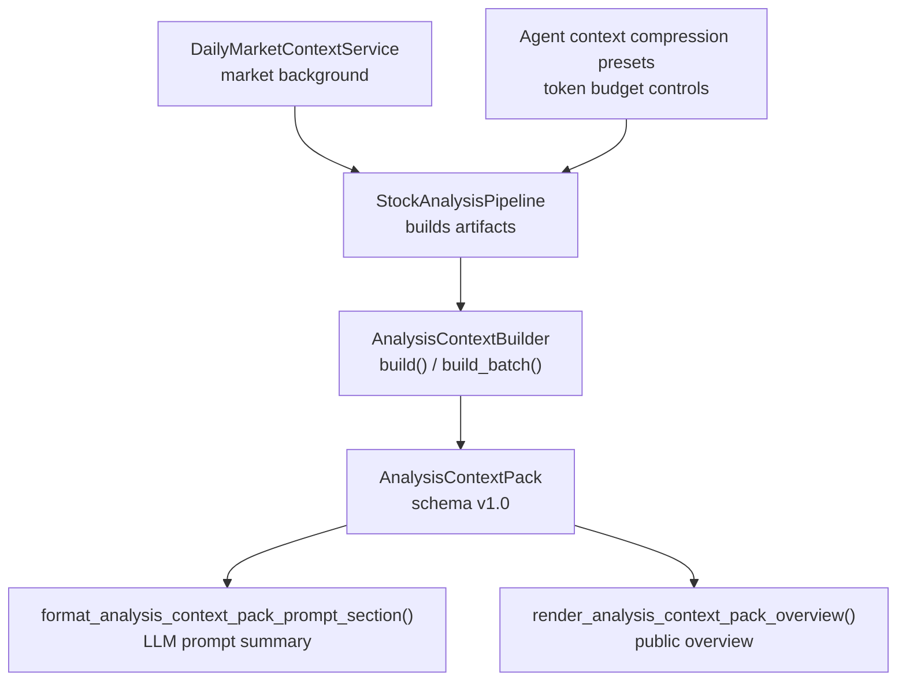
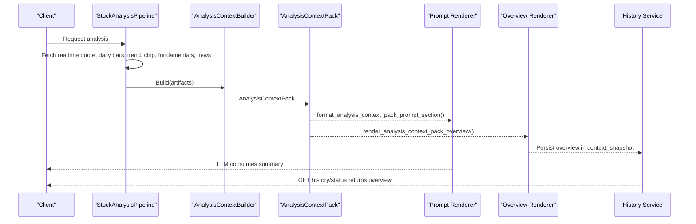
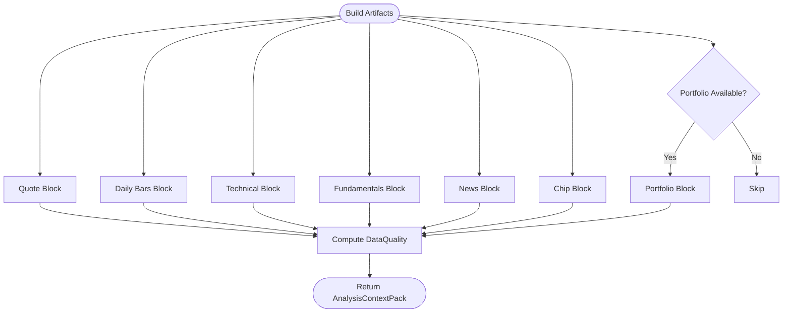
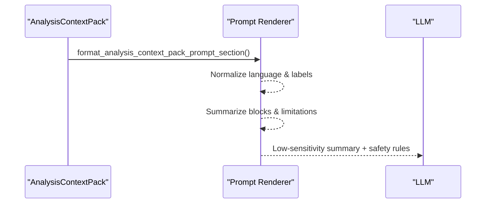
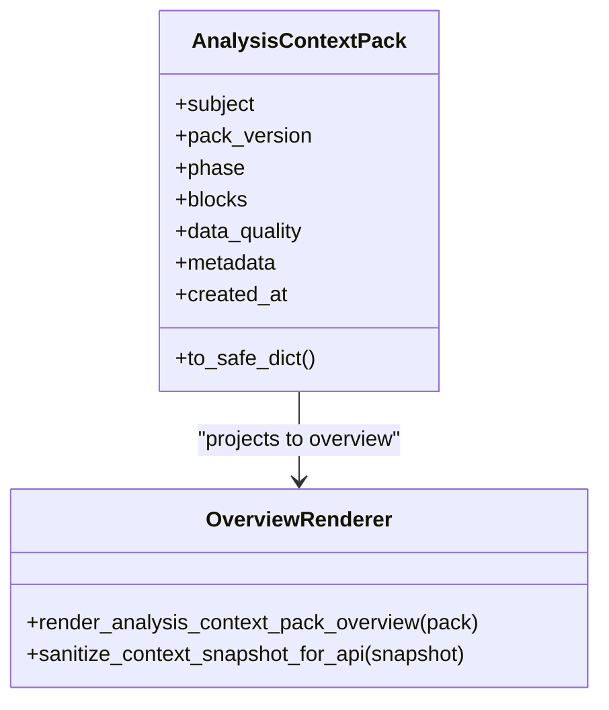
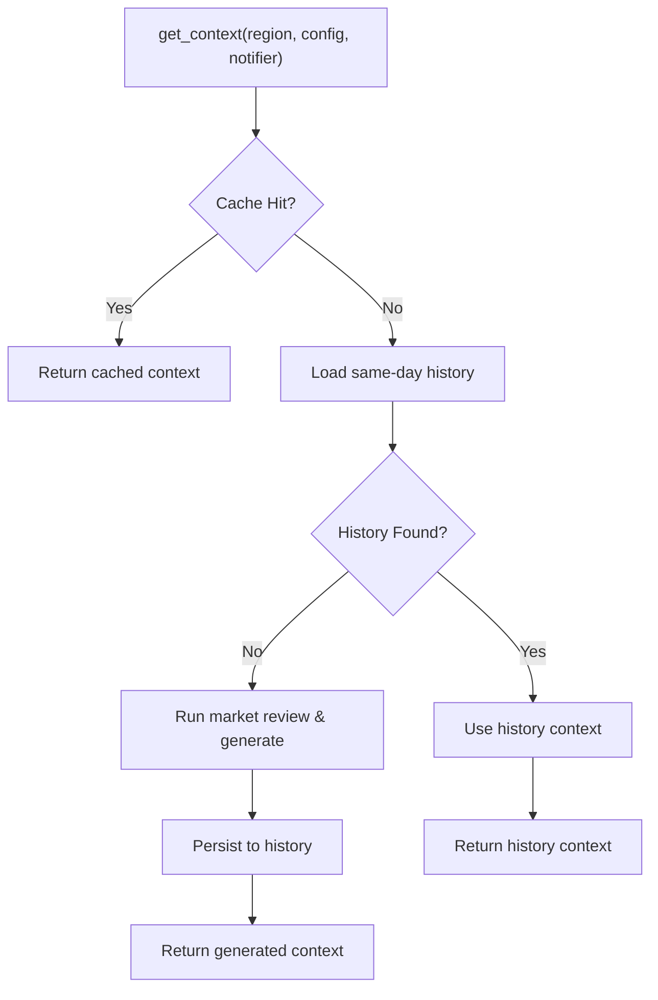
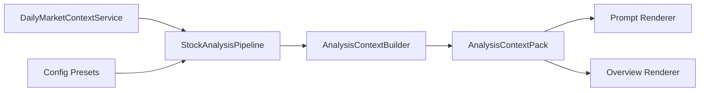

# Analysis Context Building

<cite>
**Referenced Files in This Document**
- [analysis_context_builder.py](file://src/services/analysis_context_builder.py)
- [analysis_context_pack.py](file://src/schemas/analysis_context_pack.py)
- [analysis_context_pack_overview.py](file://src/analysis_context_pack_overview.py)
- [analysis_context_pack_prompt.py](file://src/analysis_context_pack_prompt.py)
- [pipeline.py](file://src/core/pipeline.py)
- [daily_market_context.py](file://src/services/daily_market_context.py)
- [analysis-context-pack.md](file://docs/analysis-context-pack.md)
- [test_analysis_api_contract.py](file://tests/test_analysis_api_contract.py)
- [config.py](file://src/config.py)
</cite>

## Table of Contents
1. [Introduction](#introduction)
2. [Project Structure](#project-structure)
3. [Core Components](#core-components)
4. [Architecture Overview](#architecture-overview)
5. [Detailed Component Analysis](#detailed-component-analysis)
6. [Dependency Analysis](#dependency-analysis)
7. [Performance Considerations](#performance-considerations)
8. [Troubleshooting Guide](#troubleshooting-guide)
9. [Conclusion](#conclusion)
10. [Appendices](#appendices)

## Introduction
This document explains how the system builds a unified analysis context for stock analysis and how that context is packaged, summarized, and consumed by downstream AI components. It focuses on:
- How disparate data sources (technical indicators, fundamentals, news sentiment, market context, portfolio state) are integrated into a single internal contract.
- The structure of the context pack used by LLMs and downstream consumers.
- Prompt engineering techniques that optimize token usage and prioritize information.
- Customization points, enrichment strategies, and performance considerations.
- How context quality influences final recommendation confidence and accuracy.
- Versioning and compatibility across analysis modes.

## Project Structure
The analysis context pipeline centers around a builder that assembles artifacts produced by the stock analysis pipeline into a versioned internal envelope. A prompt renderer converts this envelope into a low-sensitivity summary for LLM consumption, while an overview renderer exposes a safe public view to APIs and UI.

**Diagram sources**
- [pipeline.py:1377-1403](file://src/core/pipeline.py#L1377-L1403)
- [analysis_context_builder.py:77-116](file://src/services/analysis_context_builder.py#L77-L116)
- [analysis_context_pack.py:104-129](file://src/schemas/analysis_context_pack.py#L104-L129)
- [analysis_context_pack_prompt.py:123-144](file://src/analysis_context_pack_prompt.py#L123-L144)
- [analysis_context_pack_overview.py:27-90](file://src/analysis_context_pack_overview.py#L27-L90)
- [daily_market_context.py:89-237](file://src/services/daily_market_context.py#L89-L237)
- [config.py:191-223](file://src/config.py#L191-L223)

**Section sources**
- [analysis_context_builder.py:77-116](file://src/services/analysis_context_builder.py#L77-L116)
- [analysis_context_pack.py:15-49](file://src/schemas/analysis_context_pack.py#L15-L49)
- [analysis_context_pack_prompt.py:103-144](file://src/analysis_context_pack_prompt.py#L103-L144)
- [analysis_context_pack_overview.py:27-90](file://src/analysis_context_pack_overview.py#L27-L90)
- [pipeline.py:1377-1403](file://src/core/pipeline.py#L1377-L1403)
- [daily_market_context.py:89-237](file://src/services/daily_market_context.py#L89-L237)
- [config.py:191-223](file://src/config.py#L191-L223)

## Core Components
- AnalysisContextBuilder: Assembles a versioned internal `AnalysisContextPack` from pipeline artifacts without fetching new data. It maps existing inputs into blocks such as quote, daily bars, technical, fundamentals, news, chip, and optional portfolio.
- AnalysisContextPack schema: Defines the internal contract with subject identity, block catalog, field statuses, timestamps, and data quality metadata.
- Prompt renderer: Produces a low-sensitivity summary string for LLM prompts, including status, source, warnings, missing reasons, and data limitations.
- Public overview renderer: Projects the pack into a safe, low-sensitivity object exposed via history, task status, and Web report surfaces.
- Daily market context service: Provides region-scoped daily market background summaries that are injected into the analysis flow and can influence guardrails.
- Configuration presets: Define agent context compression profiles that control token budgets and summarization behavior.

**Section sources**
- [analysis_context_builder.py:57-116](file://src/services/analysis_context_builder.py#L57-L116)
- [analysis_context_pack.py:51-129](file://src/schemas/analysis_context_pack.py#L51-L129)
- [analysis_context_pack_prompt.py:123-198](file://src/analysis_context_pack_prompt.py#L123-L198)
- [analysis_context_pack_overview.py:27-120](file://src/analysis_context_pack_overview.py#L27-L120)
- [daily_market_context.py:61-237](file://src/services/daily_market_context.py#L61-L237)
- [config.py:191-223](file://src/config.py#L191-L223)

## Architecture Overview
The end-to-end flow integrates multiple data sources into a unified context pack and then produces two outputs:
- A low-sensitivity prompt summary for LLM consumption.
- A low-sensitivity public overview for API/UI consumption.

**Diagram sources**
- [pipeline.py:2933-2969](file://src/core/pipeline.py#L2933-L2969)
- [analysis_context_builder.py:77-116](file://src/services/analysis_context_builder.py#L77-L116)
- [analysis_context_pack_prompt.py:123-198](file://src/analysis_context_pack_prompt.py#L123-L198)
- [analysis_context_pack_overview.py:27-90](file://src/analysis_context_pack_overview.py#L27-L90)
- [test_analysis_api_contract.py:2089-2127](file://tests/test_analysis_api_contract.py#L2089-L2127)

## Detailed Component Analysis

### AnalysisContextBuilder and Block Assembly
The builder constructs a versioned pack from pipeline artifacts. It creates blocks for:
- Quote: Realtime or fallback quote with staleness and source metadata.
- Daily Bars: Today/yesterday bars and date metadata; marks partial availability when only one day exists.
- Technical: Trend result and intraday overlay signals; marks estimated or partial when intraday overlays are present.
- Fundamentals: Status mapping (ok/available, not_supported, partial, fetch_failed), coverage, and source chain.
- News: Content presence and result count metadata.
- Chip: Distribution availability and source.
- Portfolio: Optional auxiliary block exposing limited fields when available.

Data quality is computed using fixed weights and status scores to produce an overall score, level, block scores, and limitations list.

**Diagram sources**
- [analysis_context_builder.py:80-116](file://src/services/analysis_context_builder.py#L80-L116)
- [analysis_context_builder.py:119-524](file://src/services/analysis_context_builder.py#L119-L524)

**Section sources**
- [analysis_context_builder.py:57-116](file://src/services/analysis_context_builder.py#L57-L116)
- [analysis_context_builder.py:119-524](file://src/services/analysis_context_builder.py#L119-L524)

### Prompt Engineering for LLM Consumption
The prompt renderer generates a compact, low-sensitivity summary tailored for LLM consumption. It includes:
- Subject identity and pack version.
- Block statuses, sources, warnings, and missing reasons.
- News result count and data quality warnings.
- Data limitations section with phase-aware constraints when core blocks are degraded.
- Safety rules preventing raw payload reproduction and enforcing conservative confidence levels under degraded conditions.

Language normalization ensures consistent structural labels across English and Korean contexts while allowing output language directives to constrain model responses.

**Diagram sources**
- [analysis_context_pack_prompt.py:103-198](file://src/analysis_context_pack_prompt.py#L103-L198)
- [analysis_context_pack_prompt.py:288-350](file://src/analysis_context_pack_prompt.py#L288-L350)

**Section sources**
- [analysis_context_pack_prompt.py:103-198](file://src/analysis_context_pack_prompt.py#L103-L198)
- [analysis_context_pack_prompt.py:288-350](file://src/analysis_context_pack_prompt.py#L288-L350)

### Public Overview and API Exposure
The overview renderer projects the pack into a safe, low-sensitivity object suitable for APIs and UI. It exposes:
- Pack version and creation time.
- Subject code, name, and market.
- Block keys, labels, statuses, sources, warnings, and missing reasons.
- Counts per status and data quality summary.
- Metadata such as trigger source and news result count.

Sensitive values are redacted, and the raw snapshot is sanitized before exposure.

**Diagram sources**
- [analysis_context_pack.py:104-129](file://src/schemas/analysis_context_pack.py#L104-L129)
- [analysis_context_pack_overview.py:27-120](file://src/analysis_context_pack_overview.py#L27-L120)

**Section sources**
- [analysis_context_pack_overview.py:27-120](file://src/analysis_context_pack_overview.py#L27-L120)
- [test_analysis_api_contract.py:2089-2127](file://tests/test_analysis_api_contract.py#L2089-L2127)

### Daily Market Context Integration
Daily market context provides region-scoped background summaries that are injected into the analysis flow. It caches results by date and region, loads from history when available, and generates fresh context if needed. It also formats a low-sensitivity prompt section with guardrails for conservative environments.

**Diagram sources**
- [daily_market_context.py:103-237](file://src/services/daily_market_context.py#L103-L237)
- [daily_market_context.py:239-332](file://src/services/daily_market_context.py#L239-L332)
- [daily_market_context.py:385-496](file://src/services/daily_market_context.py#L385-L496)

**Section sources**
- [daily_market_context.py:89-237](file://src/services/daily_market_context.py#L89-L237)
- [daily_market_context.py:635-701](file://src/services/daily_market_context.py#L635-L701)

### Relationship to Final Recommendation Generation
The context pack’s data quality directly influences downstream confidence and safety rules:
- If core blocks (quote, daily bars, technical) are degraded, the prompt enforces lower confidence levels and conservative conclusions.
- Phase-aware constraints adjust guidance based on market phase (premarket, intraday, postmarket, non-trading).
- The public overview’s data quality score and limitations inform UI diagnostics and alerting logic.

**Section sources**
- [analysis_context_pack_prompt.py:288-350](file://src/analysis_context_pack_prompt.py#L288-L350)
- [analysis_context_pack_overview.py:193-231](file://src/analysis_context_pack_overview.py#L193-L231)
- [analysis-context-pack.md:139-160](file://docs/analysis-context-pack.md#L139-L160)

## Dependency Analysis
The builder depends on pipeline artifacts and does not perform additional fetches. The prompt and overview renderers depend on the schema and utilities for sanitization and labeling. The daily market context service depends on history and market review execution paths.

**Diagram sources**
- [pipeline.py:1377-1403](file://src/core/pipeline.py#L1377-L1403)
- [analysis_context_builder.py:77-116](file://src/services/analysis_context_builder.py#L77-L116)
- [analysis_context_pack_prompt.py:123-198](file://src/analysis_context_pack_prompt.py#L123-L198)
- [analysis_context_pack_overview.py:27-90](file://src/analysis_context_pack_overview.py#L27-L90)
- [daily_market_context.py:89-237](file://src/services/daily_market_context.py#L89-L237)
- [config.py:191-223](file://src/config.py#L191-L223)

**Section sources**
- [analysis_context_builder.py:77-116](file://src/services/analysis_context_builder.py#L77-L116)
- [analysis_context_pack.py:15-49](file://src/schemas/analysis_context_pack.py#L15-L49)
- [analysis_context_pack_prompt.py:103-144](file://src/analysis_context_pack_prompt.py#L103-L144)
- [analysis_context_pack_overview.py:27-90](file://src/analysis_context_pack_overview.py#L27-L90)
- [daily_market_context.py:89-237](file://src/services/daily_market_context.py#L89-L237)
- [config.py:191-223](file://src/config.py#L191-L223)

## Performance Considerations
- Token optimization: Agent context compression presets define trigger tokens, protected turns, summary target tokens, and history budget tokens to balance cost and fidelity.
- Caching: Daily market context uses in-memory cache keyed by date, region, language, and optionally query ID to avoid redundant generation.
- Minimal overhead: The builder is zero-fetch and only assembles existing artifacts, reducing latency and external calls.
- Summary-only prompt: The LLM receives a low-sensitivity summary rather than full payloads, reducing token usage and risk of sensitive leakage.

**Section sources**
- [config.py:191-223](file://src/config.py#L191-L223)
- [daily_market_context.py:103-237](file://src/services/daily_market_context.py#L103-L237)
- [analysis_context_pack_prompt.py:123-198](file://src/analysis_context_pack_prompt.py#L123-L198)

## Troubleshooting Guide
Common issues and diagnostics:
- Missing quote or daily bars: Check artifact availability and stale markers; block status will reflect missing or partial conditions.
- Fallback quote: Inspect source and fallback_from metadata; warnings include provider fallback codes.
- Intraday overlay: Technical block may be marked partial or estimated when intraday overlays are present; check enhanced_context today metadata.
- Fundamentals failure: Status maps to fetch_failed when fundamental pipeline fails; missing_reason indicates pipeline failure.
- News missing: News block missing implies no content; metadata.news_result_count helps diagnose search outcomes.
- Data quality score: Review block_scores and limitations to identify weak areas impacting overall quality.

**Section sources**
- [analysis_context_builder.py:119-524](file://src/services/analysis_context_builder.py#L119-L524)
- [analysis_context_pack_prompt.py:288-350](file://src/analysis_context_pack_prompt.py#L288-L350)
- [analysis_context_pack_overview.py:193-231](file://src/analysis_context_pack_overview.py#L193-L231)

## Conclusion
The analysis context building system integrates diverse data sources into a unified, versioned internal contract that supports both LLM prompt consumption and public API exposure. By enforcing low-sensitivity summaries, structured block statuses, and data quality scoring, it improves transparency and reliability. Prompt engineering ensures token efficiency and prioritizes critical information, while daily market context adds macro-level background. Versioning and compatibility boundaries protect existing runtime behavior and enable safe evolution across analysis modes.

## Appendices

### Custom Context Builders and Enrichment Strategies
- Custom builders: Extend or wrap `AnalysisContextBuilder.build()` to inject domain-specific metadata or additional blocks while preserving the schema contract.
- Enrichment strategies: Augment artifacts before building the pack, such as merging social sentiment into news_context or attaching portfolio context for manual holdings analysis.
- Performance techniques: Use caching (e.g., daily market context), compress prompts via agent context compression presets, and avoid redundant fetches by relying on pipeline artifacts.

**Section sources**
- [analysis_context_builder.py:77-116](file://src/services/analysis_context_builder.py#L77-L116)
- [daily_market_context.py:103-237](file://src/services/daily_market_context.py#L103-L237)
- [config.py:191-223](file://src/config.py#L191-L223)

### Versioning and Compatibility Across Modes
- Pack version: Fixed at “1.0” with strict validation to prevent accidental upgrades.
- Mode compatibility: Same builder and schema support ordinary analysis, Agent single/multi paths, and historical consumption; differences lie in artifact availability and injection points.
- Backward compatibility: Old records lacking overview or data_quality return safe defaults; context snapshots are sanitized for API exposure.

**Section sources**
- [analysis_context_pack.py:15-49](file://src/schemas/analysis_context_pack.py#L15-L49)
- [analysis_context_pack_overview.py:135-190](file://src/analysis_context_pack_overview.py#L135-L190)
- [analysis-context-pack.md:121-137](file://docs/analysis-context-pack.md#L121-L137)