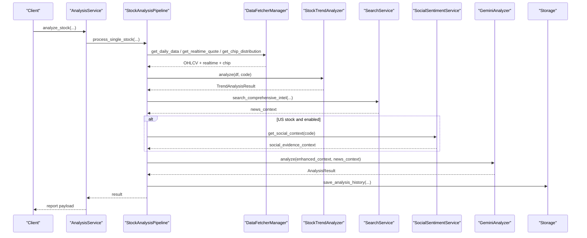
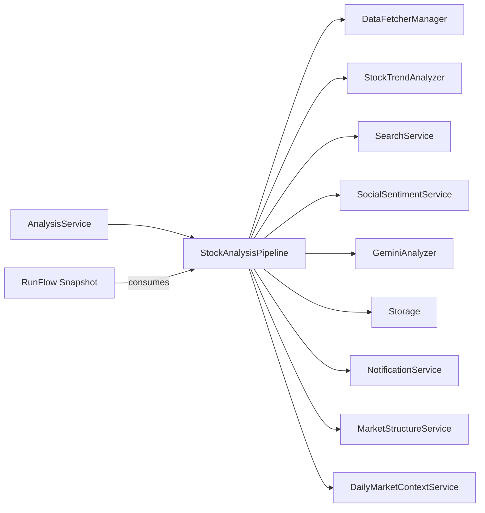
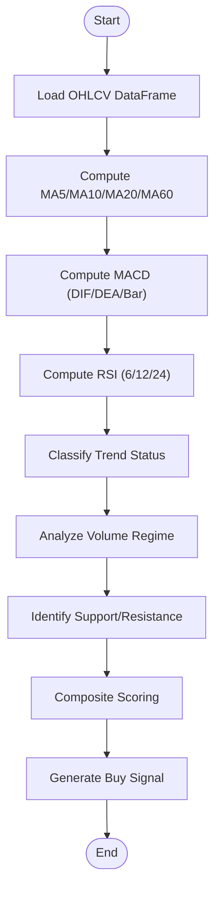
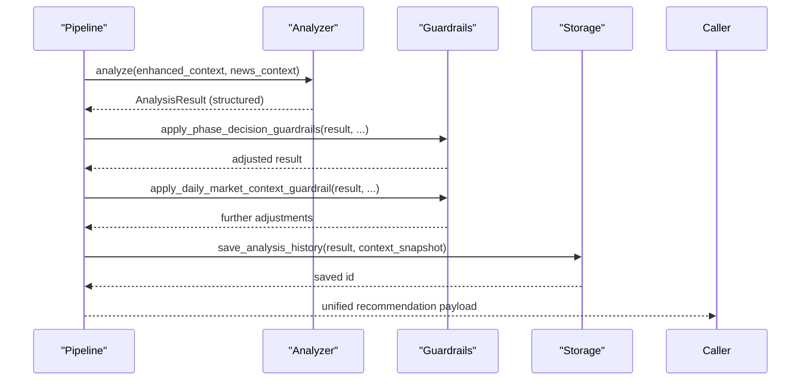

# Analysis Pipeline

<cite>
**Referenced Files in This Document**
- [pipeline.py](file://src/core/pipeline.py)
- [analyzer.py](file://src/analyzer.py)
- [stock_analyzer.py](file://src/stock_analyzer.py)
- [market_analyzer.py](file://src/market_analyzer.py)
- [analysis_service.py](file://src/services/analysis_service.py)
- [run_flow.py](file://src/services/run_flow.py)
- [social_sentiment_service.py](file://src/services/social_sentiment_service.py)
- [config.py](file://src/config.py)
</cite>

## Table of Contents
1. Introduction
2. Project Structure
3. Core Components
4. Architecture Overview
5. Detailed Component Analysis
6. Dependency Analysis
7. Performance Considerations
8. Troubleshooting Guide
9. Conclusion
10. Appendices

## Introduction
This document explains the multi-stage Analysis Pipeline that transforms raw market data into actionable investment insights. It covers sequential stages from data collection through technical analysis, fundamental aggregation, sentiment enrichment, and risk assessment. It also documents configuration options, stage dependencies, error handling, indicator calculations, result aggregation, parallel processing, resource management, and monitoring.

## Project Structure
The pipeline is orchestrated by a central pipeline class that coordinates data fetching, trend analysis, news and social sentiment retrieval, LLM-based synthesis, and result persistence. Supporting services provide market review capabilities, run-flow diagnostics, and optional social sentiment for US equities.

```mermaid
graph TB
A["API / Scheduler"] --> B["AnalysisService"]
B --> C["StockAnalysisPipeline"]
C --> D["DataFetcherManager"]
C --> E["StockTrendAnalyzer"]
C --> F["SearchService"]
C --> G["SocialSentimentService (US only)"]
C --> H["GeminiAnalyzer (LLM)"]
C --> I["Storage (DB)"]
C --> J["NotificationService"]
C --> K["MarketStructureService"]
C --> L["DailyMarketContextService"]
M["RunFlow Snapshot"] < --> N["Diagnostics & Events"]
```

**Diagram sources**
- [analysis_service.py:51-149](file://src/services/analysis_service.py#L51-L149)
- [pipeline.py:209-319](file://src/core/pipeline.py#L209-L319)
- [run_flow.py:77-180](file://src/services/run_flow.py#L77-L180)

**Section sources**
- [analysis_service.py:51-149](file://src/services/analysis_service.py#L51-L149)
- [pipeline.py:209-319](file://src/core/pipeline.py#L209-L319)
- [run_flow.py:77-180](file://src/services/run_flow.py#L77-L180)

## Core Components
- StockAnalysisPipeline: Orchestrates end-to-end analysis, including data acquisition, trend analysis, context assembly, LLM invocation, guardrails, and persistence.
- StockTrendAnalyzer: Computes technical indicators (MA, MACD, RSI), evaluates trend status, volume behavior, support/resistance, and generates a composite buy signal score.
- GeminiAnalyzer: Wraps LLM calls via LiteLLM, validates structured outputs, applies placeholders for missing fields, and records usage telemetry.
- MarketAnalyzer: Builds market overview and daily recap reports across regions using indices, breadth, sector/concept rankings, and news.
- SocialSentimentService: Optional social sentiment enrichment for US stocks with retry and caching.
- AnalysisService: Entry point used by API/scheduler to execute pipeline runs and build standardized responses.
- RunFlow snapshotting: Captures provider runs, LLM runs, history saves, and notifications into a unified execution graph.

**Section sources**
- [pipeline.py:209-319](file://src/core/pipeline.py#L209-L319)
- [stock_analyzer.py:172-263](file://src/stock_analyzer.py#L172-L263)
- [analyzer.py:304-499](file://src/analyzer.py#L304-L499)
- [market_analyzer.py:122-157](file://src/market_analyzer.py#L122-L157)
- [social_sentiment_service.py:55-86](file://src/services/social_sentiment_service.py#L55-L86)
- [analysis_service.py:51-149](file://src/services/analysis_service.py#L51-L149)
- [run_flow.py:77-180](file://src/services/run_flow.py#L77-L180)

## Architecture Overview
The pipeline follows a staged workflow:

1. Data Collection
   - Daily bars and realtime quotes via DataFetcherManager with automatic fallbacks.
   - Chip distribution and board membership when available.
2. Technical Analysis
   - Trend analysis computes MA alignment, bias, volume regime, MACD/RSI signals, and a composite score.
3. Fundamental Aggregation
   - Unified fundamental context with coverage metadata; fail-open if unavailable.
4. News and Sentiment
   - Multi-source news search; optional social sentiment for US equities appended to news context.
5. Context Assembly and LLM Synthesis
   - Enhanced context includes quote, chip, trend, fundamentals, market phase, and daily market context.
   - LLM produces structured analysis with decision actions and dashboard fields.
6. Guardrails and Risk Assessment
   - Phase-aware guardrails and daily market context adjustments refine decisions.
7. Persistence and Notifications
   - Save analysis history, extract decision signals, and optionally notify.



**Diagram sources**
- [analysis_service.py:51-149](file://src/services/analysis_service.py#L51-L149)
- [pipeline.py:414-918](file://src/core/pipeline.py#L414-L918)
- [stock_analyzer.py:206-263](file://src/stock_analyzer.py#L206-L263)
- [social_sentiment_service.py:191-200](file://src/services/social_sentiment_service.py#L191-L200)

## Detailed Component Analysis

### Data Collection Stage
- Daily data fetch with resume target date logic to avoid redundant network calls.
- Realtime quote retrieval with source priority and graceful degradation to historical close when unavailable.
- Chip distribution fetched with circuit-breaker style logging and failure tolerance.
- Board membership attached to fundamental context for A-shares.

Key behaviors:
- Resume checkpointing prevents re-fetching when today’s data already exists.
- Realtime overlay augments intraday bars and moving averages when available.
- Fail-open design ensures downstream stages continue even if optional sources fail.

**Section sources**
- [pipeline.py:358-413](file://src/core/pipeline.py#L358-L413)
- [pipeline.py:470-511](file://src/core/pipeline.py#L470-L511)
- [pipeline.py:1140-1197](file://src/core/pipeline.py#L1140-L1197)

### Technical Analysis Stage
The StockTrendAnalyzer computes:
- Moving averages (MA5, MA10, MA20, MA60) and alignment classification.
- Bias relative to MAs to avoid chasing high prices.
- Volume regime (shrinking vs expanding) and price-volume correlation.
- Support/resistance levels near MAs and recent highs.
- MACD (DIF/DEA/bar) with golden/death cross and zero-axis crossings.
- RSI (short/mid/long) with overbought/oversold zones.
- Composite scoring and final buy signal mapped to canonical decision scale.

Complexity:
- Indicator computations are linear in number of bars O(n).
- Signal generation aggregates constant-time checks per component.

Optimization opportunities:
- Cache intermediate series where appropriate.
- Early exit on insufficient data to reduce overhead.

Error handling:
- Returns partial results with risk factors when data is insufficient.

**Section sources**
- [stock_analyzer.py:172-263](file://src/stock_analyzer.py#L172-L263)
- [stock_analyzer.py:265-339](file://src/stock_analyzer.py#L265-L339)
- [stock_analyzer.py:341-481](file://src/stock_analyzer.py#L341-L481)
- [stock_analyzer.py:482-583](file://src/stock_analyzer.py#L482-L583)
- [stock_analyzer.py:585-755](file://src/stock_analyzer.py#L585-L755)

### Fundamental Aggregation Stage
- Unified fundamental context retrieved with timeout budget and coverage metadata.
- If unavailable or failed, a minimal not-supported structure is injected so downstream stages remain robust.
- For A-shares, board membership is appended to provide sector/theme context.

Configuration:
- Timeout controlled by configuration to bound latency.

**Section sources**
- [pipeline.py:531-559](file://src/core/pipeline.py#L531-L559)
- [pipeline.py:1140-1197](file://src/core/pipeline.py#L1140-L1197)

### News and Sentiment Stage
- Multi-dimensional news search with up to five queries; results persisted for auditability.
- Optional social sentiment service for US stocks enriches the news context with Reddit/X/Polymarket signals.
- Persisted intelligence can be merged into the final news context.

Resilience:
- Search service initialization failures do not block analysis; it proceeds without news.
- Social sentiment fetch errors are logged and ignored gracefully.

**Section sources**
- [pipeline.py:612-684](file://src/core/pipeline.py#L612-L684)
- [social_sentiment_service.py:55-86](file://src/services/social_sentiment_service.py#L55-L86)
- [social_sentiment_service.py:191-200](file://src/services/social_sentiment_service.py#L191-L200)

### LLM Synthesis and Result Validation
- The analyzer wraps LiteLLM calls with model routing, fallbacks, and parameter recovery.
- Structured output validation ensures required fields exist; missing fields are filled with localized placeholders.
- Usage telemetry recorded per call with duration and provider identity.

Validation and fallback:
- Content integrity checks enforce mandatory fields.
- Placeholder filling guarantees consistent report structure even under partial model outputs.

**Section sources**
- [analyzer.py:304-499](file://src/analyzer.py#L304-L499)
- [analyzer.py:1-108](file://src/analyzer.py#L1-L108)

### Guardrails and Risk Assessment
- Phase-aware guardrails adjust decisions based on market phase summary and context pack overview.
- Daily market context guardrail further refines recommendations using macro environment summaries.
- Decision action fields are refreshed to align with final result semantics.

**Section sources**
- [pipeline.py:817-865](file://src/core/pipeline.py#L817-L865)

### Persistence and Notifications
- Analysis history saved with context snapshots; decision signals extracted post-save.
- Notification service invoked conditionally; progress callbacks emit SSE-friendly updates.

**Section sources**
- [pipeline.py:867-918](file://src/core/pipeline.py#L867-L918)
- [analysis_service.py:153-259](file://src/services/analysis_service.py#L153-L259)

## Dependency Analysis
- StockAnalysisPipeline depends on:
  - DataFetcherManager for market data and chip distribution.
  - StockTrendAnalyzer for technical indicators and signals.
  - SearchService for news intelligence.
  - SocialSentimentService (optional) for US equity social signals.
  - GeminiAnalyzer for LLM synthesis.
  - Storage for persistence.
  - NotificationService for alerts.
  - MarketStructureService and DailyMarketContextService for contextual inputs.
- AnalysisService composes the pipeline and builds API responses.
- RunFlow snapshotting consumes diagnostics emitted during provider runs, LLM runs, history saves, and notifications.



**Diagram sources**
- [analysis_service.py:51-149](file://src/services/analysis_service.py#L51-L149)
- [pipeline.py:209-319](file://src/core/pipeline.py#L209-L319)
- [run_flow.py:77-180](file://src/services/run_flow.py#L77-L180)

**Section sources**
- [analysis_service.py:51-149](file://src/services/analysis_service.py#L51-L149)
- [pipeline.py:209-319](file://src/core/pipeline.py#L209-L319)
- [run_flow.py:77-180](file://src/services/run_flow.py#L77-L180)

## Performance Considerations
- Parallelism:
  - ThreadPoolExecutor is available for concurrent tasks within the pipeline and related services.
  - Provider retries and fallbacks minimize total latency by leveraging multiple sources.
- Resource Management:
  - Timeouts bound fundamental aggregation and LLM calls.
  - In-memory caches in social sentiment reduce repeated network calls.
- Monitoring:
  - Progress callbacks emit incremental updates for long-running LLM streams.
  - Diagnostics capture provider runs, LLM runs, and notification outcomes for observability.

[No sources needed since this section provides general guidance]

## Troubleshooting Guide
Common issues and mitigations:
- Missing or stale realtime quotes:
  - Pipeline falls back to historical closes; logs indicate source and staleness.
- Fundamental data unavailable:
  - Not-supported context injected; downstream analysis continues.
- Search service disabled or failed:
  - Analysis proceeds without news; diagnostic snapshot marks skipped blocks.
- Social sentiment unavailable:
  - Ignored for non-US tickers or when API key missing; no impact on core flow.
- LLM output incomplete:
  - Content integrity checks add placeholders; usage telemetry records provider/model/duration.

Operational tips:
- Enable progress callbacks to track LLM streaming progress.
- Inspect run-flow snapshots to identify failing providers or LLM routes.
- Use diagnostics to trace model selection and fallback chains.

**Section sources**
- [pipeline.py:470-511](file://src/core/pipeline.py#L470-L511)
- [pipeline.py:612-684](file://src/core/pipeline.py#L612-L684)
- [analyzer.py:304-499](file://src/analyzer.py#L304-L499)
- [run_flow.py:77-180](file://src/services/run_flow.py#L77-L180)

## Conclusion
The Analysis Pipeline integrates data collection, technical analysis, fundamental aggregation, news and sentiment enrichment, and LLM-driven synthesis into a resilient, configurable workflow. It emphasizes fail-open design, robust validation, and comprehensive diagnostics to deliver reliable investment insights while supporting customization and performance tuning.

[No sources needed since this section summarizes without analyzing specific files]

## Appendices

### Configuration Options Relevant to the Pipeline
- max_workers: Controls concurrency for background tasks.
- agent_mode and agent_skills: Auto-enable agent mode when skills are configured.
- report_language: Normalized language for outputs and placeholders.
- enable_realtime_quote and realtime_source_priority: Control realtime quote usage and source preference.
- enable_chip_distribution: Toggle chip analysis inclusion.
- fundamental_stage_timeout_seconds: Budget for fundamental aggregation.
- news_max_age_days and news_strategy_profile: Influence news window and strategy.
- social_sentiment_api_key and social_sentiment_api_url: Enable social sentiment for US stocks.
- litellm_model and llm_model_list: Model routing and fallbacks for LLM calls.

**Section sources**
- [pipeline.py:219-319](file://src/core/pipeline.py#L219-L319)
- [config.py:181-188](file://src/config.py#L181-L188)

### Custom Analysis Stages and Pipeline Customization
- Add custom notifier overrides by ensuring signature compatibility for optional kwargs.
- Extend context enhancement by injecting additional fields into enhanced_context before LLM call.
- Introduce new provider integrations via DataFetcherManager to supply domain-specific metrics.
- Customize guardrails by implementing additional adjustments to decision actions based on new contexts.

**Section sources**
- [pipeline.py:129-136](file://src/core/pipeline.py#L129-L136)
- [pipeline.py:925-1138](file://src/core/pipeline.py#L925-L1138)

### Example Workflows

#### Technical Indicators Calculation Flow


**Diagram sources**
- [stock_analyzer.py:265-339](file://src/stock_analyzer.py#L265-L339)
- [stock_analyzer.py:341-481](file://src/stock_analyzer.py#L341-L481)
- [stock_analyzer.py:482-583](file://src/stock_analyzer.py#L482-L583)
- [stock_analyzer.py:585-755](file://src/stock_analyzer.py#L585-L755)

#### Result Aggregation and Recommendation Formation


**Diagram sources**
- [pipeline.py:727-865](file://src/core/pipeline.py#L727-L865)
- [pipeline.py:867-918](file://src/core/pipeline.py#L867-L918)