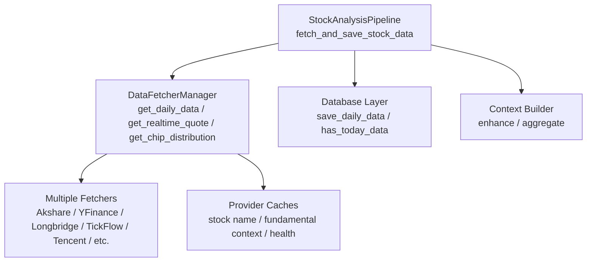
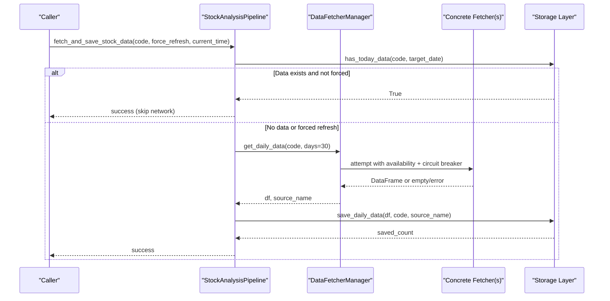
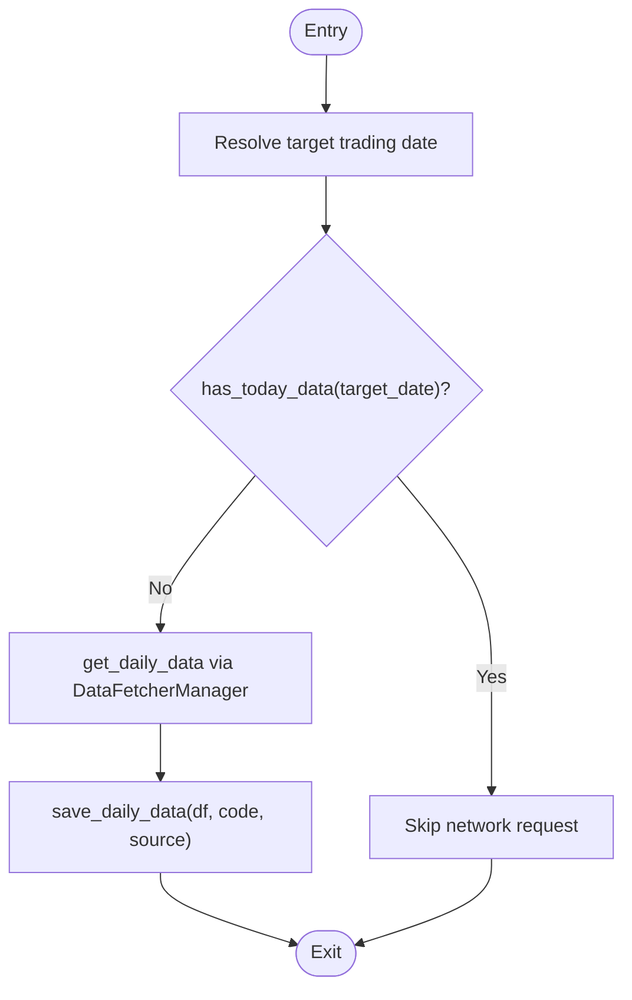
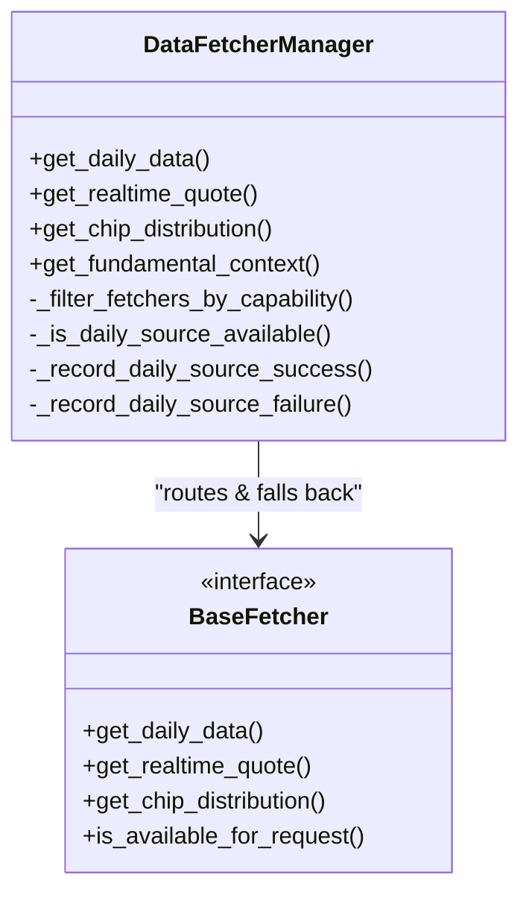
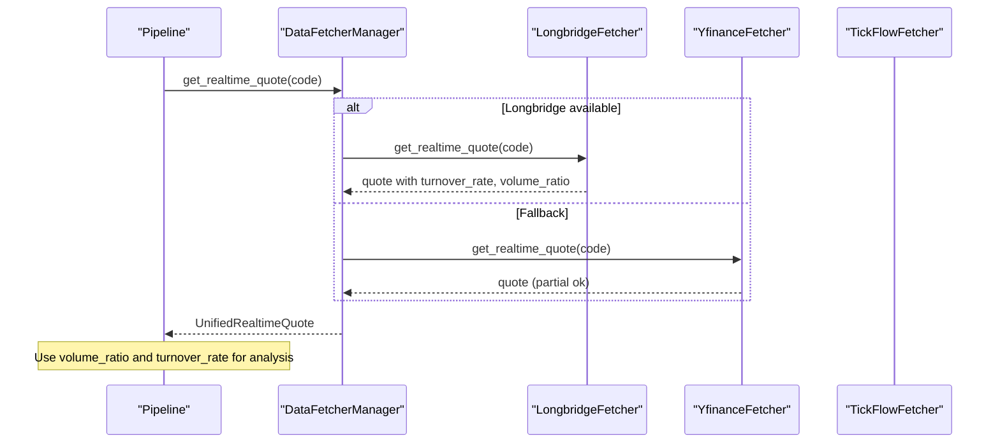
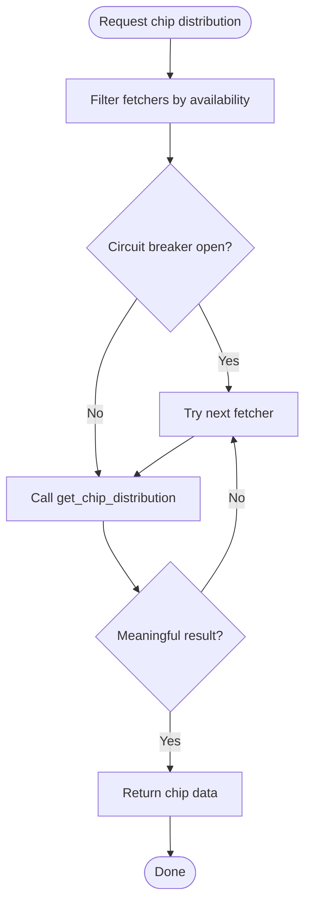
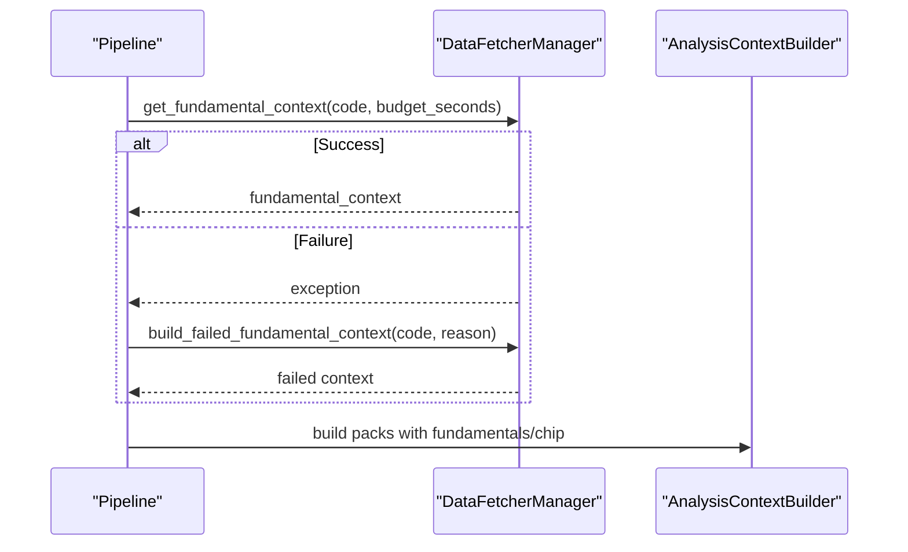
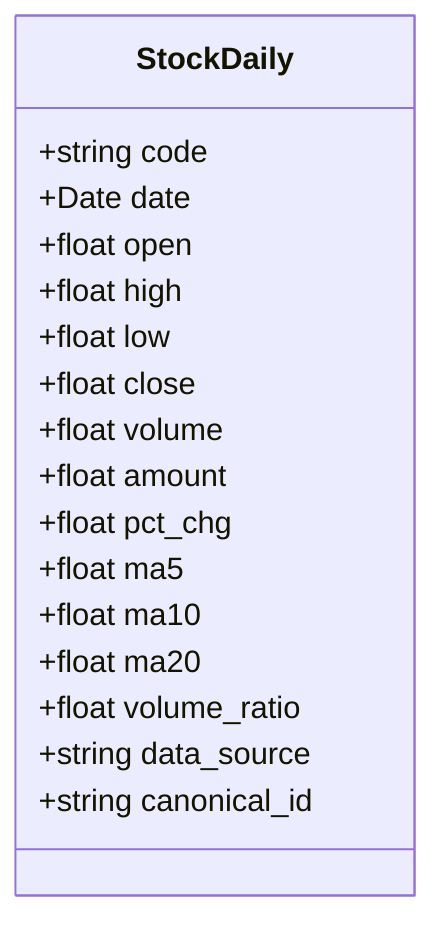
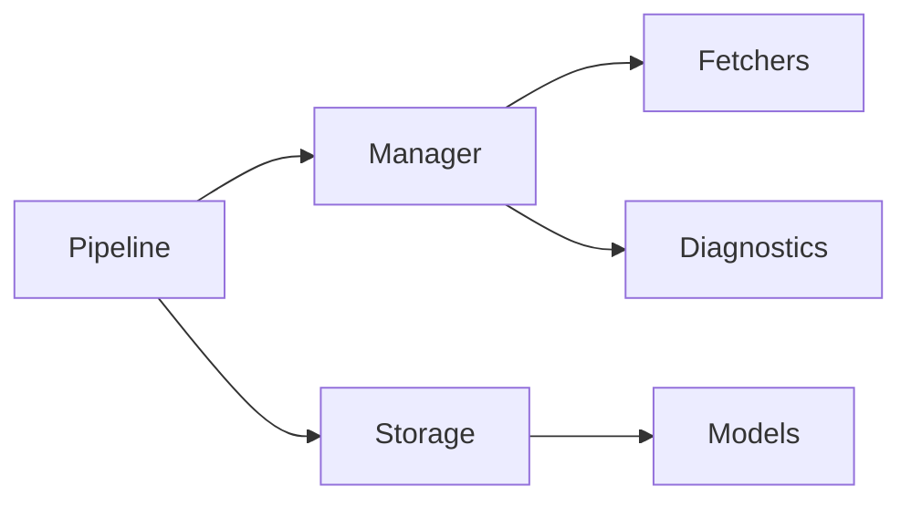

# Data Collection Stage

<cite>
**Referenced Files in This Document**
- [pipeline.py](file://src/core/pipeline.py)
- [base.py](file://data_provider/base.py)
- [storage.py](file://src/storage.py)
- [longbridge_fetcher.py](file://data_provider/longbridge_fetcher.py)
- [yfinance_fetcher.py](file://data_provider/yfinance_fetcher.py)
- [tickflow_fetcher.py](file://data_provider/tickflow_fetcher.py)
- [history_service.py](file://src/services/history_service.py)
- [analysis_context_builder.py](file://src/services/analysis_context_builder.py)
- [test_chip_distribution_manager.py](file://tests/test_chip_distribution_manager.py)
</cite>

## Table of Contents
1. [Introduction](#introduction)
2. [Project Structure](#project-structure)
3. [Core Components](#core-components)
4. [Architecture Overview](#architecture-overview)
5. [Detailed Component Analysis](#detailed-component-analysis)
6. [Dependency Analysis](#dependency-analysis)
7. [Performance Considerations](#performance-considerations)
8. [Troubleshooting Guide](#troubleshooting-guide)
9. [Conclusion](#conclusion)

## Introduction
This document explains the Data Collection Stage with a focus on:
- The breakpoint resume logic that avoids redundant network requests when trading day data already exists.
- The unified DataFetcherManager integration for fetching daily history, real-time quotes, chip distribution, and fundamental context with automatic fallbacks.
- Real-time quote collection including volume ratio and turnover rate computation across providers.
- Chip distribution collection with circuit breaker protection.
- Fundamental context aggregation and storage.
- Data validation, normalization, and database persistence.

## Project Structure
The Data Collection Stage spans three layers:
- Pipeline orchestration: coordinates fetch-and-save, analysis, and context enrichment.
- Data provider abstraction: manages multiple fetchers with routing, availability checks, caching, and fallbacks.
- Storage layer: persists normalized daily bars, snapshots, and metadata.

**Diagram sources**
- [pipeline.py:358-412](file://src/core/pipeline.py#L358-L412)
- [base.py:700-813](file://data_provider/base.py#L700-L813)
- [storage.py:100-177](file://src/storage.py#L100-L177)

**Section sources**
- [pipeline.py:358-412](file://src/core/pipeline.py#L358-L412)
- [base.py:700-813](file://data_provider/base.py#L700-L813)
- [storage.py:100-177](file://src/storage.py#L100-L177)

## Core Components
- StockAnalysisPipeline.fetch_and_save_stock_data: orchestrates breakpoint resume, daily data retrieval via DataFetcherManager, and persistence to the database.
- DataFetcherManager: centralizes data source access, availability probing, per-fetcher locks, market-aware routing, short-term circuit breakers, and fallback logging.
- Storage layer: provides has_today_data for resume checks and save_daily_data for persistence; models include stock_daily with canonical_id indexing.

Key responsibilities:
- Avoid unnecessary network calls by checking existing trading day data.
- Normalize stock codes and resolve target dates consistently.
- Persist only new rows and record source names for traceability.

**Section sources**
- [pipeline.py:358-412](file://src/core/pipeline.py#L358-L412)
- [base.py:700-813](file://data_provider/base.py#L700-L813)
- [storage.py:100-177](file://src/storage.py#L100-L177)

## Architecture Overview
The data collection pipeline integrates multiple data sources through a single manager interface. It supports:
- Daily history with market-aware routing and short-term circuit breakers.
- Real-time quotes with provider-specific computations (volume ratio, turnover rate).
- Chip distribution with circuit breaker protection and meaningful result validation.
- Fundamental context aggregation with timeout budgeting and failure payloads.

**Diagram sources**
- [pipeline.py:358-412](file://src/core/pipeline.py#L358-L412)
- [base.py:942-1140](file://data_provider/base.py#L942-L1140)
- [storage.py:100-177](file://src/storage.py#L100-L177)

## Detailed Component Analysis

### Breakpoint Resume Logic in fetch_and_save_stock_data
- Resolves the target trading date using a frozen reference time to ensure consistent resume behavior across runs.
- Checks if the target trading day’s data already exists; if so, skips network calls entirely.
- On missing data or forced refresh, retrieves daily history via DataFetcherManager and persists it.

**Diagram sources**
- [pipeline.py:358-412](file://src/core/pipeline.py#L358-L412)

**Section sources**
- [pipeline.py:358-412](file://src/core/pipeline.py#L358-L412)

### DataFetcherManager Integration and Automatic Fallback
- Maintains a list of configured fetchers and filters them by capability and market support.
- Probes availability via is_available_for_request/is_available/_is_available before attempting requests.
- Serializes shared state access per fetcher instance to avoid race conditions.
- Applies short-term circuit breakers for daily data sources to reduce load during failures.
- Logs each attempt, failure reason, and final successful source; records provider run metrics.

**Diagram sources**
- [base.py:700-813](file://data_provider/base.py#L700-L813)
- [base.py:942-1140](file://data_provider/base.py#L942-L1140)

**Section sources**
- [base.py:700-813](file://data_provider/base.py#L700-L813)
- [base.py:942-1140](file://data_provider/base.py#L942-L1140)

### Real-Time Quote Collection: Volume Ratio and Turnover Rate
- Pipeline retrieves real-time quotes via DataFetcherManager when enabled; otherwise degrades gracefully to historical close prices.
- Providers compute derived fields:
  - Longbridge: turnover_rate from volume and circulating shares (fallback to total_shares), volume_ratio from recent average volume, pe_ratio and pb_ratio from static info.
  - YFinance index fallback: may return partial data with missing fields marked.
  - TickFlow: returns turnover_rate directly from provider payload.
- History service normalizes field names across sources (e.g., volume_ratio/volumeRatio, turnover_rate/turnoverRate/turnover).

**Diagram sources**
- [pipeline.py:474-494](file://src/core/pipeline.py#L474-L494)
- [longbridge_fetcher.py:807-841](file://data_provider/longbridge_fetcher.py#L807-L841)
- [yfinance_fetcher.py:750-783](file://data_provider/yfinance_fetcher.py#L750-L783)
- [tickflow_fetcher.py:832-864](file://data_provider/tickflow_fetcher.py#L832-L864)
- [history_service.py:313-337](file://src/services/history_service.py#L313-L337)

**Section sources**
- [pipeline.py:474-494](file://src/core/pipeline.py#L474-L494)
- [longbridge_fetcher.py:807-841](file://data_provider/longbridge_fetcher.py#L807-L841)
- [yfinance_fetcher.py:750-783](file://data_provider/yfinance_fetcher.py#L750-L783)
- [tickflow_fetcher.py:832-864](file://data_provider/tickflow_fetcher.py#L832-L864)
- [history_service.py:313-337](file://src/services/history_service.py#L313-L337)

### Chip Distribution Collection with Circuit Breaker Protection
- Pipeline requests chip distribution via DataFetcherManager; results are optional and fail-open.
- Manager validates “meaningful” chip distributions and applies a circuit breaker per source key to avoid repeated failures.
- Tests verify fallback behavior when a provider returns placeholder or raises errors, and diagnostics capture provider runs.

**Diagram sources**
- [base.py:2637-2668](file://data_provider/base.py#L2637-L2668)
- [test_chip_distribution_manager.py:58-81](file://tests/test_chip_distribution_manager.py#L58-L81)

**Section sources**
- [base.py:2637-2668](file://data_provider/base.py#L2637-L2668)
- [test_chip_distribution_manager.py:58-81](file://tests/test_chip_distribution_manager.py#L58-L81)

### Fundamental Context Aggregation
- Pipeline aggregates fundamental context via DataFetcherManager.get_fundamental_context with a configurable timeout budget.
- If aggregation fails, build_failed_fundamental_context produces a structured failed payload with coverage and error details.
- Context builder constructs blocks for fundamentals and chip distribution, marking status and sources appropriately.

**Diagram sources**
- [pipeline.py:531-547](file://src/core/pipeline.py#L531-L547)
- [base.py:3869-3904](file://data_provider/base.py#L3869-L3904)
- [analysis_context_builder.py:327-364](file://src/services/analysis_context_builder.py#L327-L364)

**Section sources**
- [pipeline.py:531-547](file://src/core/pipeline.py#L531-L547)
- [base.py:3869-3904](file://data_provider/base.py#L3869-L3904)
- [analysis_context_builder.py:327-364](file://src/services/analysis_context_builder.py#L327-L364)

### Data Validation, Normalization, and Storage Procedures
- Stock code normalization ensures consistent identifiers across markets and formats.
- Daily bar model includes OHLCV, percentage change, moving averages, volume ratio, and canonical_id for stable identity.
- Persistence uses unique constraints on code+date to prevent duplicates; save_daily_data records the source name for provenance.

**Diagram sources**
- [storage.py:100-177](file://src/storage.py#L100-L177)

**Section sources**
- [storage.py:100-177](file://src/storage.py#L100-L177)

## Dependency Analysis
- Pipeline depends on DataFetcherManager for all data acquisition paths and on Storage for persistence and resume checks.
- DataFetcherManager depends on concrete fetchers implementing standardized interfaces and on diagnostic recording utilities.
- Storage depends on SQLAlchemy ORM and enforces schema-level uniqueness and indexes for efficient queries.

**Diagram sources**
- [pipeline.py:358-412](file://src/core/pipeline.py#L358-L412)
- [base.py:700-813](file://data_provider/base.py#L700-L813)
- [storage.py:100-177](file://src/storage.py#L100-L177)

**Section sources**
- [pipeline.py:358-412](file://src/core/pipeline.py#L358-L412)
- [base.py:700-813](file://data_provider/base.py#L700-L813)
- [storage.py:100-177](file://src/storage.py#L100-L177)

## Performance Considerations
- Breakpoint resume eliminates redundant network calls when trading day data exists, reducing latency and external API usage.
- DataFetcherManager’s short-term circuit breakers protect against cascading failures and excessive retries.
- Per-fetcher call serialization prevents concurrent state corruption while allowing parallelism across different fetchers.
- Real-time quote fallbacks minimize impact when primary providers are unavailable.

[No sources needed since this section provides general guidance]

## Troubleshooting Guide
Common issues and resolutions:
- Missing daily data: Ensure has_today_data resolves correctly and target trading date calculation aligns with market calendars.
- All providers unavailable: Verify fetcher availability probes and configuration; check logs for “unavailable” or “CircuitOpen” reasons.
- Partial real-time quotes: Inspect missing_fields and data_quality; some providers may not supply turnover_rate or volume_ratio.
- Chip distribution failures: Confirm circuit breaker state and meaningful result checks; fall back to alternative providers.
- Fundamental context timeouts: Adjust budget_seconds and review source_chain for failed segments.

**Section sources**
- [base.py:942-1140](file://data_provider/base.py#L942-L1140)
- [pipeline.py:474-494](file://src/core/pipeline.py#L474-L494)
- [base.py:2637-2668](file://data_provider/base.py#L2637-L2668)
- [base.py:3869-3904](file://data_provider/base.py#L3869-L3904)

## Conclusion
The Data Collection Stage implements a robust, resilient pipeline for acquiring stock data from multiple sources. It leverages:
- Breakpoint resume to avoid unnecessary network requests.
- A unified DataFetcherManager for consistent access patterns and automatic fallbacks.
- Provider-specific computations for real-time indicators like volume ratio and turnover rate.
- Circuit breaker protection for chip distribution to maintain stability under failures.
- Structured fundamental context aggregation with clear failure signaling.
- Strong data validation, normalization, and persistence practices in the storage layer.

[No sources needed since this section summarizes without analyzing specific files]