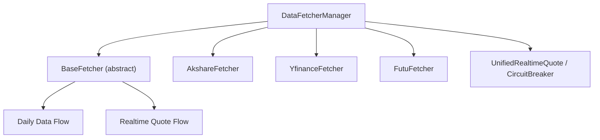
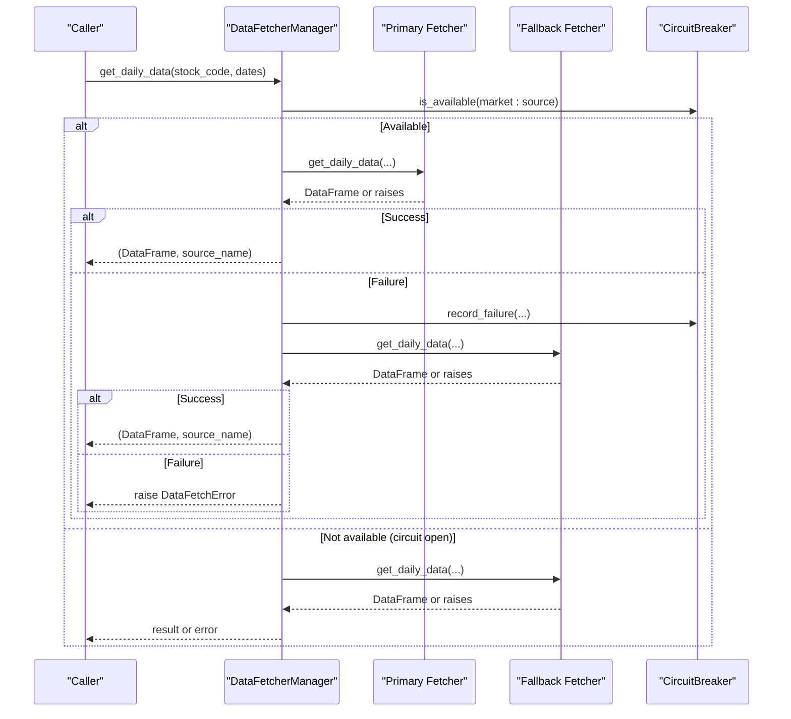
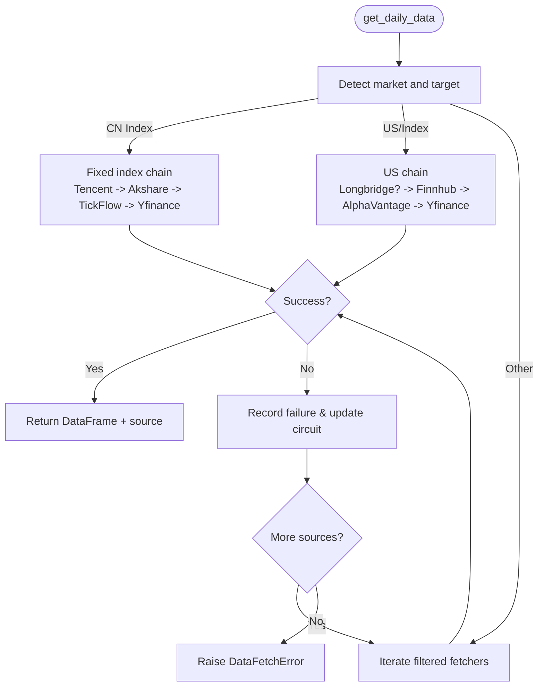
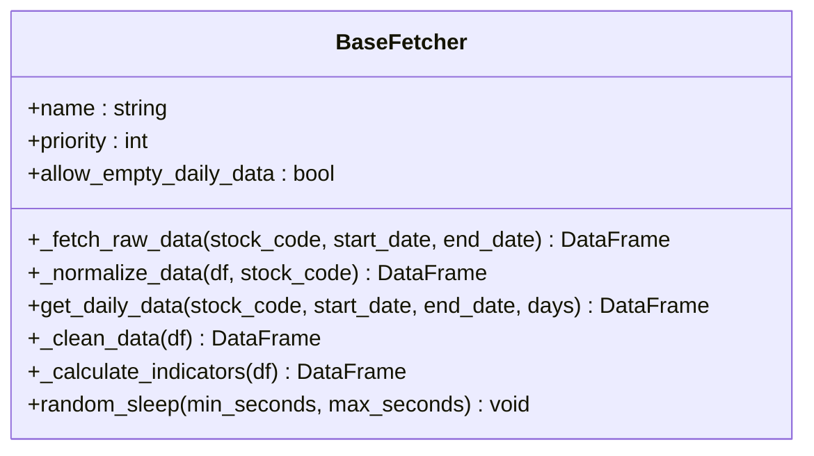
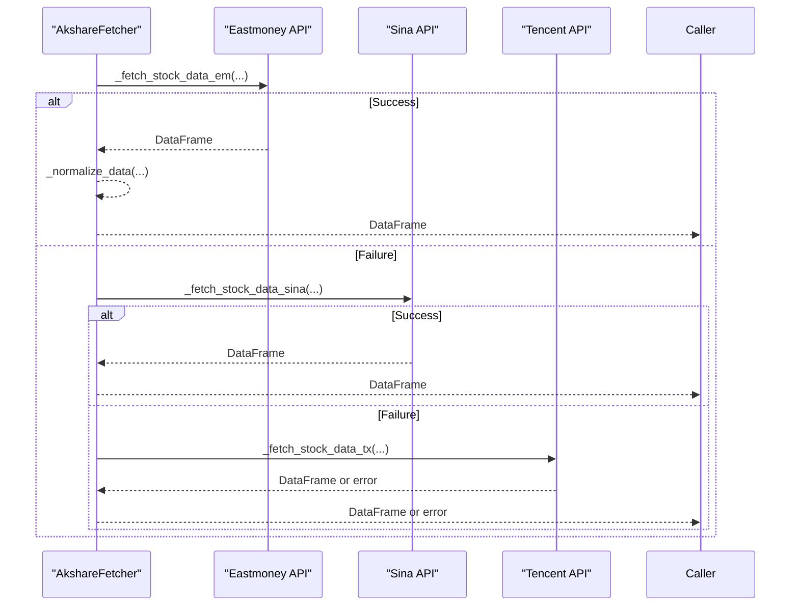
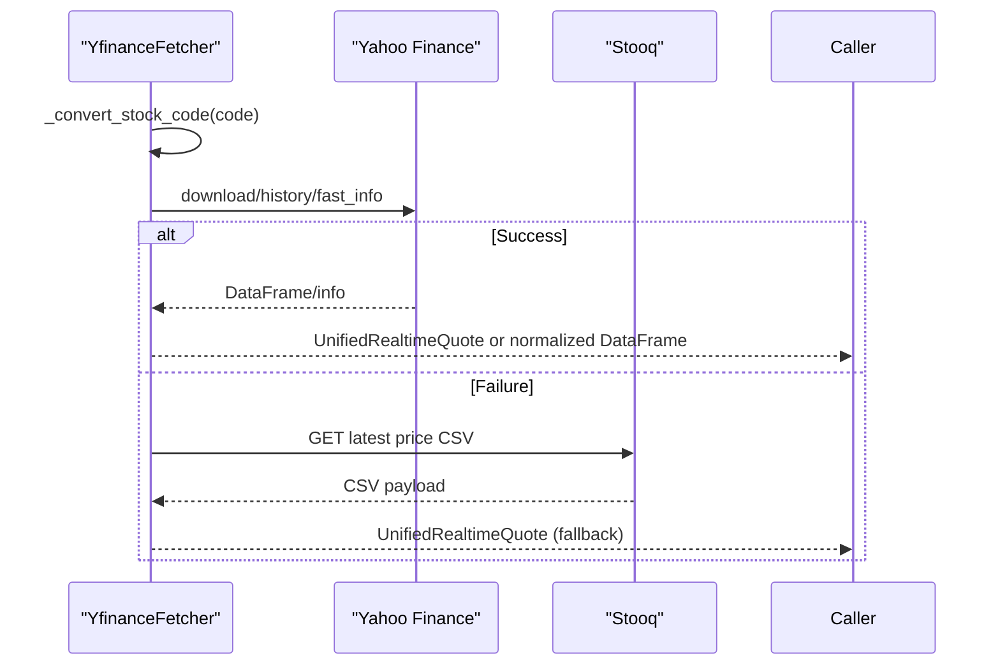
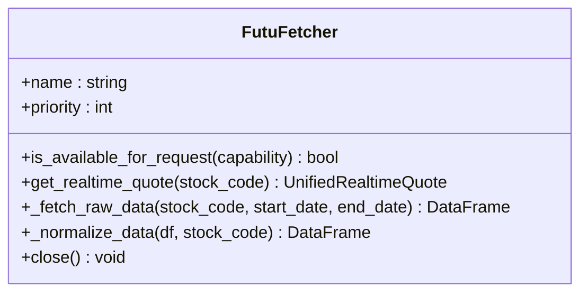
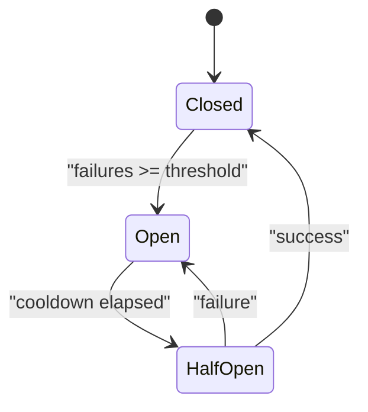
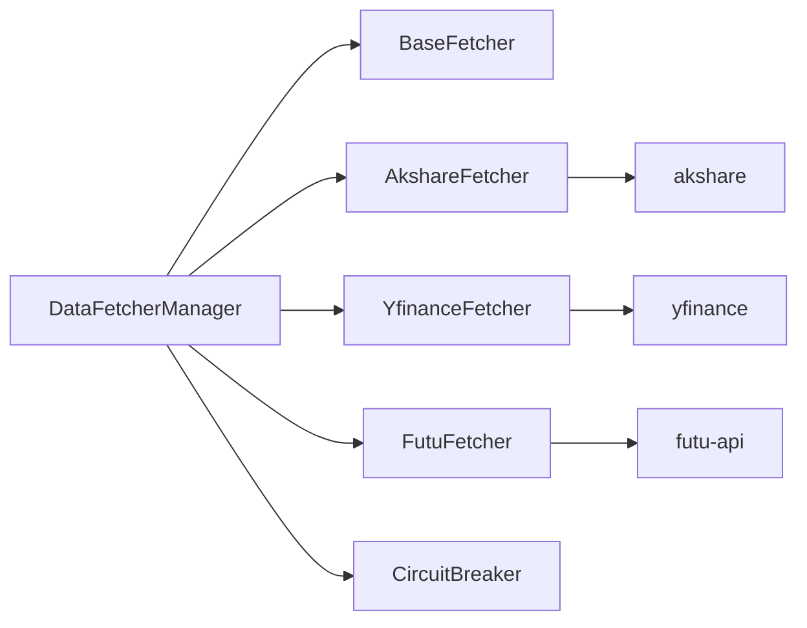

# Market Data Fetching

<cite>
**Referenced Files in This Document**
- [base.py](file://data_provider/base.py)
- [akshare_fetcher.py](file://data_provider/akshare_fetcher.py)
- [yfinance_fetcher.py](file://data_provider/yfinance_fetcher.py)
- [futu_fetcher.py](file://data_provider/futu_fetcher.py)
- [realtime_types.py](file://data_provider/realtime_types.py)
</cite>

## Table of Contents
1. Introduction
2. Project Structure
3. Core Components
4. Architecture Overview
5. Detailed Component Analysis
6. Dependency Analysis
7. Performance Considerations
8. Troubleshooting Guide
9. Conclusion

## Introduction
This document explains the market data fetching capabilities centered on the DataFetcherManager and its fetcher implementations. It covers:
- The unified interface for accessing multiple market data sources (AkShare, YFinance, Futu, and others).
- Automatic fallback and priority-based switching when primary sources fail.
- Real-time quote collection with volume ratio and turnover rate extraction.
- Configuration examples, connection failure handling, and performance optimization strategies.
- Data normalization that standardizes heterogeneous provider responses into consistent formats.

## Project Structure
The market data layer is organized around a strategy pattern:
- Base abstractions define a uniform contract for daily and real-time data retrieval.
- Concrete fetchers implement provider-specific logic for AkShare, YFinance, Futu, etc.
- A manager orchestrates routing, prioritization, fallback, caching, and health monitoring.

**Diagram sources**
- [base.py:331-589](file://data_provider/base.py#L331-L589)
- [base.py:604-1633](file://data_provider/base.py#L604-L1633)
- [akshare_fetcher.py:391-800](file://data_provider/akshare_fetcher.py#L391-L800)
- [yfinance_fetcher.py:58-306](file://data_provider/yfinance_fetcher.py#L58-L306)
- [futu_fetcher.py:59-349](file://data_provider/futu_fetcher.py#L59-L349)
- [realtime_types.py:110-194](file://data_provider/realtime_types.py#L110-L194)

**Section sources**
- [base.py:331-589](file://data_provider/base.py#L331-L589)
- [base.py:604-1633](file://data_provider/base.py#L604-L1633)

## Core Components
- BaseFetcher: Abstract base defining the unified interface for daily history and optional real-time quotes, plus common data cleaning and indicator computation.
- DataFetcherManager: Orchestrates fetcher selection by market and capability, implements priority-based routing, automatic fallback, circuit breaking, and enrichment of results.
- Provider Fetchers:
  - AkshareFetcher: Primary source for A-shares and HK; includes internal fallbacks across Eastmoney/Sina/Tencent endpoints and robust rate limiting.
  - YfinanceFetcher: International coverage (US/HK/JP/KR/TW), code conversion to Yahoo symbols, index support, and Stooq fallback for US quotes.
  - FutuFetcher: Read-only HK quote and daily K-line via OpenD, with strong availability checks and context lifecycle management.
- Unified types: UnifiedRealtimeQuote standardizes real-time fields; CircuitBreaker manages per-source health states.

Key responsibilities:
- Normalization: Standard columns for daily data and unified fields for real-time quotes.
- Fallback: Priority chains per market with circuit breaker protection.
- Enrichment: Supplement missing fields from secondary providers.
- Observability: Provider run recording and detailed logging.

**Section sources**
- [base.py:331-589](file://data_provider/base.py#L331-L589)
- [base.py:604-1633](file://data_provider/base.py#L604-L1633)
- [akshare_fetcher.py:391-800](file://data_provider/akshare_fetcher.py#L391-L800)
- [yfinance_fetcher.py:58-306](file://data_provider/yfinance_fetcher.py#L58-L306)
- [futu_fetcher.py:59-349](file://data_provider/futu_fetcher.py#L59-L349)
- [realtime_types.py:110-194](file://data_provider/realtime_types.py#L110-L194)

## Architecture Overview
The system uses a layered architecture:
- Entry points: DataFetcherManager.get_daily_data and get_realtime_quote route requests based on market and configuration.
- Routing: Market detection (CN/HK/US/JP/KR/TW) selects appropriate fetcher sets and ordered chains.
- Execution: Each fetcher implements _fetch_raw_data and _normalize_data to conform to the base contract.
- Resilience: CircuitBreaker gates access to failing sources; retry/backoff at fetcher level; manager-level fallback.
- Output: Daily data standardized to STANDARD_COLUMNS; real-time data wrapped as UnifiedRealtimeQuote with metadata.

**Diagram sources**
- [base.py:1643-1905](file://data_provider/base.py#L1643-L1905)
- [base.py:815-845](file://data_provider/base.py#L815-L845)
- [realtime_types.py:285-465](file://data_provider/realtime_types.py#L285-L465)

## Detailed Component Analysis

### DataFetcherManager: Routing, Fallback, and Health
- Default initialization builds an ordered list of fetchers, including optional ones only when configured (Tushare, TickFlow, Longbridge, Finnhub, AlphaVantage, Futu).
- Market-aware filtering skips unsupported fetchers for non-CN markets.
- Daily data flow:
  - CN indices use a fixed chain: Tencent -> Akshare -> TickFlow -> Yfinance.
  - US stocks/indexes use a dedicated chain with optional Longbridge preference.
  - Other markets iterate through filtered fetchers with per-attempt logging and circuit breaker checks.
- Real-time quote flow:
  - JP/KR/TW: YFinance first.
  - US/HK: Configurable priorities; supports supplementing missing fields from later sources.
  - CN: Iterates configured realtime_source_priority (efinance, akshare_em/sina/tencent, tushare, tickflow).
- Enrichment: Adds fetched_at, provider_timestamp staleness, fallback_from, and optional market/currency/data_quality metadata.

**Diagram sources**
- [base.py:942-1140](file://data_provider/base.py#L942-L1140)
- [base.py:1643-1905](file://data_provider/base.py#L1643-L1905)

**Section sources**
- [base.py:1533-1633](file://data_provider/base.py#L1533-L1633)
- [base.py:1643-1905](file://data_provider/base.py#L1643-L1905)
- [base.py:2137-2400](file://data_provider/base.py#L2137-L2400)

### BaseFetcher: Unified Interface and Normalization
- Daily data pipeline:
  - _fetch_raw_data: Provider-specific retrieval.
  - _normalize_data: Map provider columns to STANDARD_COLUMNS.
  - _clean_data: Type coercion, null handling, sorting.
  - _calculate_indicators: MA5/MA10/MA20 and volume_ratio (daily volume vs 5-day average).
- Error handling: Wraps exceptions into DataFetchError with summarized messages.
- Rate limiting helpers: random_sleep and per-fetcher jitter strategies.

**Diagram sources**
- [base.py:331-589](file://data_provider/base.py#L331-L589)

**Section sources**
- [base.py:331-589](file://data_provider/base.py#L331-L589)

### AkshareFetcher: Primary CN/HK Source with Internal Fallbacks
- Prioritizes Eastmoney via akshare, with fallbacks to Sina and Tencent endpoints within the same fetcher.
- Uses timeouts for long-running calls and exponential backoff retries for transient errors.
- Handles ETFs, A-shares, and HK codes with dedicated methods and symbol conversions.
- Realtime quote support with cache and classification of HTTP errors for better diagnostics.

**Diagram sources**
- [akshare_fetcher.py:581-750](file://data_provider/akshare_fetcher.py#L581-L750)
- [akshare_fetcher.py:460-500](file://data_provider/akshare_fetcher.py#L460-L500)

**Section sources**
- [akshare_fetcher.py:391-800](file://data_provider/akshare_fetcher.py#L391-L800)

### YfinanceFetcher: International Coverage and Stooq Fallback
- Converts stock codes to Yahoo Finance format, supporting US, HK, JP, KR, TW, and CN suffix forms.
- Provides main indices retrieval across regions and a Stooq-based fallback for US quotes when needed.
- Normalizes yfinance MultiIndex outputs to standard columns and computes pct_chg and amount where missing.

**Diagram sources**
- [yfinance_fetcher.py:97-183](file://data_provider/yfinance_fetcher.py#L97-L183)
- [yfinance_fetcher.py:184-234](file://data_provider/yfinance_fetcher.py#L184-L234)
- [yfinance_fetcher.py:537-686](file://data_provider/yfinance_fetcher.py#L537-L686)

**Section sources**
- [yfinance_fetcher.py:58-306](file://data_provider/yfinance_fetcher.py#L58-L306)
- [yfinance_fetcher.py:537-686](file://data_provider/yfinance_fetcher.py#L537-L686)

### FutuFetcher: HK OpenD Adapter
- Connects to Futu OpenD for HK quotes and daily K-lines with explicit availability checks and context lifecycle management.
- Returns UnifiedRealtimeQuote with rich fields (volume_ratio, turnover_rate, valuation metrics) when available.
- Normalizes daily data to STANDARD_COLUMNS and handles time zone offsets for accurate timestamps.

**Diagram sources**
- [futu_fetcher.py:59-349](file://data_provider/futu_fetcher.py#L59-L349)

**Section sources**
- [futu_fetcher.py:59-349](file://data_provider/futu_fetcher.py#L59-L349)

### Realtime Types and Circuit Breaker
- UnifiedRealtimeQuote: Standardized structure for real-time quotes with optional fields and helper methods for basic/volume presence checks.
- CircuitBreaker: Per-source state machine (closed/open/half-open) with configurable thresholds and cooldowns; used for both daily and realtime paths.

**Diagram sources**
- [realtime_types.py:110-194](file://data_provider/realtime_types.py#L110-L194)
- [realtime_types.py:285-465](file://data_provider/realtime_types.py#L285-L465)

**Section sources**
- [realtime_types.py:110-194](file://data_provider/realtime_types.py#L110-L194)
- [realtime_types.py:285-465](file://data_provider/realtime_types.py#L285-L465)

## Dependency Analysis
- DataFetcherManager depends on:
  - BaseFetcher for the unified contract.
  - Individual fetchers for market-specific retrieval.
  - CircuitBreaker for resilience.
  - Utilities for market detection and symbol mapping.
- Fetchers depend on external libraries (akshare, yfinance, futu-api) and may include local patches/configs.

**Diagram sources**
- [base.py:604-1633](file://data_provider/base.py#L604-L1633)
- [akshare_fetcher.py:391-800](file://data_provider/akshare_fetcher.py#L391-L800)
- [yfinance_fetcher.py:58-306](file://data_provider/yfinance_fetcher.py#L58-L306)
- [futu_fetcher.py:59-349](file://data_provider/futu_fetcher.py#L59-L349)
- [realtime_types.py:285-465](file://data_provider/realtime_types.py#L285-L465)

**Section sources**
- [base.py:604-1633](file://data_provider/base.py#L604-L1633)

## Performance Considerations
- Prefetching:
  - prefetch_realtime_quotes triggers bulk caches for efinance/akshare_em/tushare/tickflow when enabled and beneficial.
  - prefetch_daily_klines preloads TickFlow daily K-lines for batches.
- Timeouts and retries:
  - AkShare calls are bounded by process-level timeouts; exponential backoff retries for transient errors.
- Caching:
  - Realtime caches with TTL reduce repeated network calls.
  - Fundamental and concept rankings caches minimize redundant work.
- Filtering:
  - Market-aware fetcher filtering avoids unnecessary attempts on unsupported sources.
- Indicator computation:
  - Rolling windows for moving averages and volume_ratio are computed efficiently in pandas.

[No sources needed since this section provides general guidance]

## Troubleshooting Guide
Common issues and resolutions:
- All sources unavailable:
  - Check configuration for required tokens/endpoints (e.g., TUSHARE_TOKEN, FUTU_OPEND_HOST, LONGBRIDGE credentials).
  - Inspect logs for “no available data source” messages and verify market routing.
- Rate limiting or anti-bot blocks:
  - AkShare may raise RateLimitError; rely on built-in jitter and retries; consider reducing request frequency or enabling patches if applicable.
- Circuit breaker open:
  - Sources enter OPEN after consecutive failures; wait for cooldown or reset health state for diagnostics.
- Empty results:
  - Some providers return empty DataFrames for certain codes/dates; ensure date ranges are valid and consider alternative sources.
- Realtime quote missing fields:
  - Use _supplement_quote behavior to fill volume_ratio/turnover_rate/valuation from secondary sources; check fallback_from metadata.

**Section sources**
- [base.py:1643-1905](file://data_provider/base.py#L1643-L1905)
- [base.py:2137-2400](file://data_provider/base.py#L2137-L2400)
- [realtime_types.py:285-465](file://data_provider/realtime_types.py#L285-L465)

## Conclusion
The market data fetching subsystem provides a resilient, extensible framework for retrieving daily and real-time market data across multiple providers. Through a unified interface, priority-based routing, automatic fallback, and circuit breaking, it ensures high availability and consistent output formats. AkShare serves as the primary CN/HK source with internal fallbacks, YFinance offers broad international coverage with Stooq fallback, and Futu delivers precise HK data via OpenD. Operators can optimize performance using prefetching, configure priorities, and diagnose issues via detailed logging and metadata.

[No sources needed since this section summarizes without analyzing specific files]