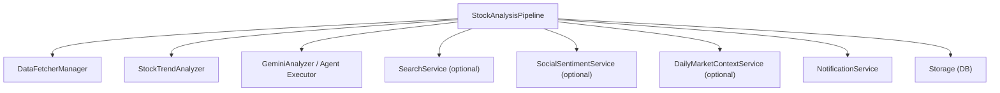
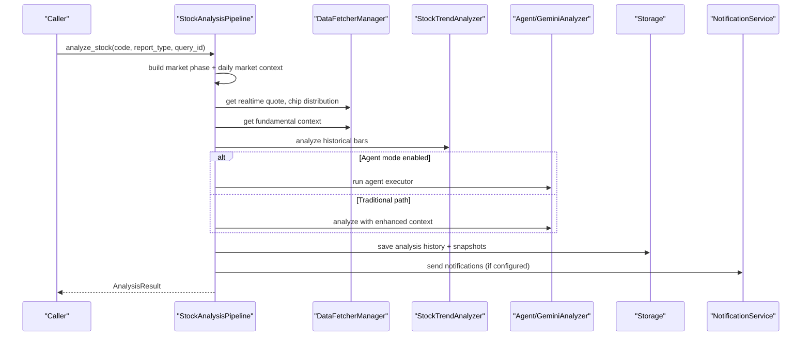
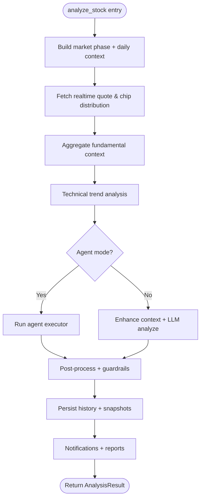
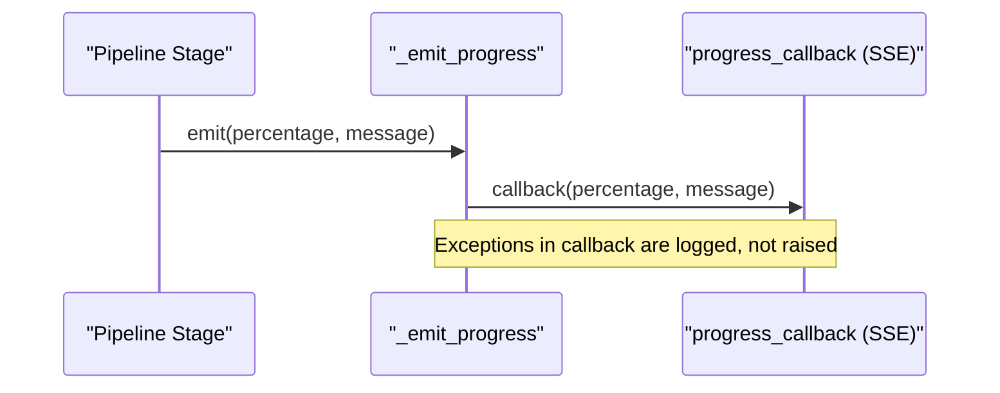
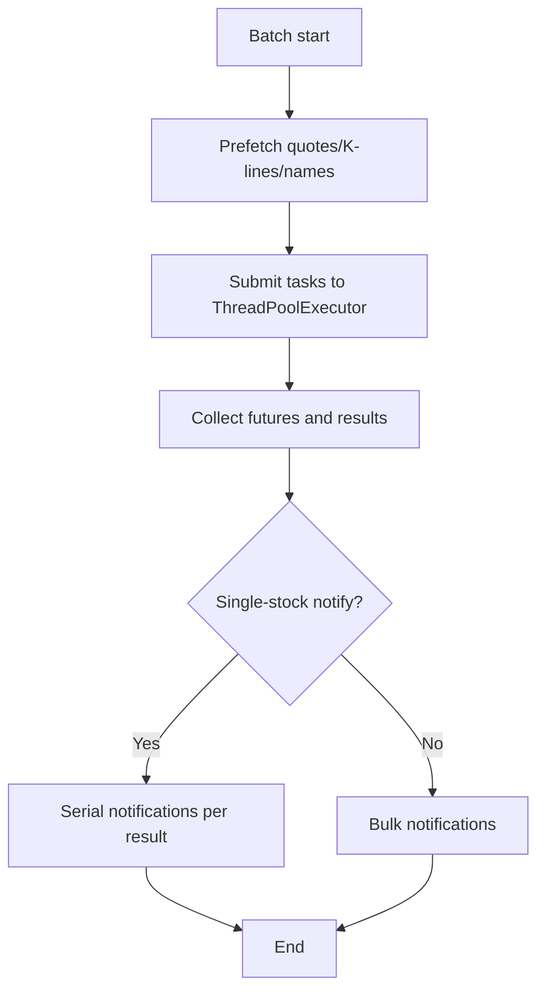
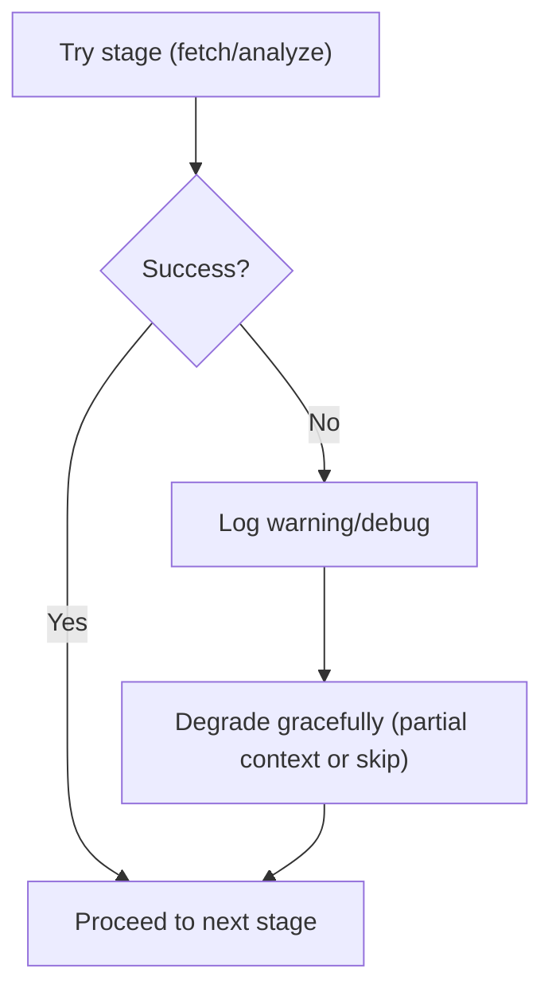
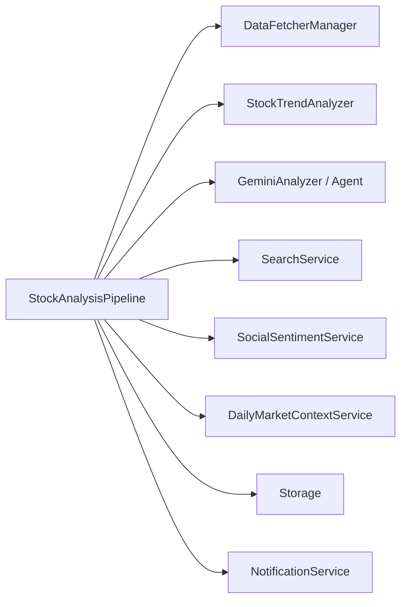

# Pipeline Orchestration

<cite>
**Referenced Files in This Document**
- [pipeline.py](file://src/core/pipeline.py)
- [main.py](file://main.py)
- [task_queue.py](file://src/services/task_queue.py)
- [base.py](file://data_provider/base.py)
</cite>

## Table of Contents
1. [Introduction](#introduction)
2. [Project Structure](#project-structure)
3. [Core Components](#core-components)
4. [Architecture Overview](#architecture-overview)
5. [Detailed Component Analysis](#detailed-component-analysis)
6. [Dependency Analysis](#dependency-analysis)
7. [Performance Considerations](#performance-considerations)
8. [Troubleshooting Guide](#troubleshooting-guide)
9. [Conclusion](#conclusion)

## Introduction
This document explains the Pipeline Orchestration system centered on the StockAnalysisPipeline class. It covers initialization, stage coordination, execution flow, configuration options (max_workers, analysis_skills, daily_market_context), progress tracking via SSE streaming, error handling and retry strategies, concurrent processing, thread safety, and resource management during parallel stock analysis.

## Project Structure
The pipeline orchestrates multiple subsystems:
- Data fetching and caching via DataFetcherManager
- Technical trend analysis via StockTrendAnalyzer
- AI-driven analysis via GeminiAnalyzer or Agent executor
- Optional search and social sentiment services
- Daily market context service for macro environment
- Notification and reporting services
- Persistence via storage layer

**Diagram sources**
- [pipeline.py:219-334](file://src/core/pipeline.py#L219-L334)

**Section sources**
- [pipeline.py:219-334](file://src/core/pipeline.py#L219-L334)

## Core Components
- StockAnalysisPipeline: Central orchestrator that coordinates data acquisition, context building, analysis (traditional or agent-based), result post-processing, persistence, and notifications.
- Configuration integration: Reads global config; supports per-run overrides for max_workers, analysis_skills, daily_market_context_enabled, and more.
- Progress bridge: _emit_progress forwards percentage and messages to an external callback for SSE streaming.
- Concurrency: Batch processing uses ThreadPoolExecutor with configurable max_workers.
- Resilience: Fail-open optional services, timeouts, retries for fundamentals, guardrails for decisions, and graceful degradation when components fail.

**Section sources**
- [pipeline.py:219-334](file://src/core/pipeline.py#L219-L334)
- [pipeline.py:336-356](file://src/core/pipeline.py#L336-L356)
- [pipeline.py:3200-3350](file://src/core/pipeline.py#L3200-L3350)

## Architecture Overview
The pipeline executes a multi-stage workflow per stock:
1. Resolve market phase and daily market context
2. Fetch realtime quotes and chip distribution
3. Aggregate fundamental context and build market structure context
4. Perform technical trend analysis
5. Optionally run Agent mode or traditional LLM path
6. Enhance context with realtime/chip/trend/fundamentals/market context
7. Persist results and extract decision signals
8. Send notifications and save reports

**Diagram sources**
- [pipeline.py:414-918](file://src/core/pipeline.py#L414-L918)
- [pipeline.py:1339-1787](file://src/core/pipeline.py#L1339-L1787)

## Detailed Component Analysis

### Initialization and Configuration
- Constructor accepts:
  - config: Global configuration object
  - max_workers: Override concurrency limit
  - source_message, query_id, trace_id, query_source: Request metadata
  - save_context_snapshot: Whether to persist full context snapshot
  - progress_callback: Callable(int percent, str message) for SSE streaming
  - analysis_skills: List[str] to auto-enable agent mode when specific skills are requested
  - analysis_phase: "auto", "intraday", etc.
  - portfolio_context: Optional dict for portfolio-aware analysis
  - daily_market_context_enabled: Toggle daily market context inclusion
  - daily_market_context_allow_generate: Allow generating daily market context if missing
- Initializes core services:
  - DataFetcherManager, StockTrendAnalyzer, GeminiAnalyzer, NotificationService
  - MarketStructureService (fail-open)
  - SearchService (fail-open)
  - SocialSentimentService (US stocks only, fail-open)
- Thread-safe locks:
  - Single-stock notification lock
  - Daily market context service lazy init lock
  - Concept rankings cache lock

**Section sources**
- [pipeline.py:219-334](file://src/core/pipeline.py#L219-L334)

### Stage Coordination and Execution Flow
- analyze_stock performs:
  - Market phase context and summary
  - Realtime quote and chip distribution fetches with fallback logging
  - Fundamental context aggregation with timeout and retry budget
  - Trend analysis over recent bars (with optional realtime augmentation)
  - Branch to Agent mode if enabled by config or analysis_skills
  - Traditional path: comprehensive news/social intelligence, context enhancement, LLM call
  - Post-processing: guardrails, price position normalization, decision stabilization
  - Persistence: save analysis history, snapshots, decision signal extraction
  - Reporting: local report saving and notifications

**Diagram sources**
- [pipeline.py:414-918](file://src/core/pipeline.py#L414-L918)
- [pipeline.py:1339-1787](file://src/core/pipeline.py#L1339-L1787)

**Section sources**
- [pipeline.py:414-918](file://src/core/pipeline.py#L414-L918)
- [pipeline.py:1339-1787](file://src/core/pipeline.py#L1339-L1787)

### Progress Tracking and SSE Integration
- _emit_progress(progress, message):
  - Safely invokes progress_callback if present
  - Logs failures without breaking pipeline flow
  - Used at key stages (e.g., fetching data, searching news, LLM streaming)
- LLM streaming progress:
  - stream_progress_callback updates dynamic progress based on characters received
  - Ensures monotonic progress updates to avoid UI flicker

**Diagram sources**
- [pipeline.py:336-356](file://src/core/pipeline.py#L336-L356)
- [pipeline.py:753-761](file://src/core/pipeline.py#L753-L761)

**Section sources**
- [pipeline.py:336-356](file://src/core/pipeline.py#L336-L356)
- [pipeline.py:753-761](file://src/core/pipeline.py#L753-L761)

### Concurrent Processing and Resource Management
- Batch processing:
  - Uses ThreadPoolExecutor(max_workers=self.max_workers)
  - Prefetches daily K-lines and realtime quotes for efficiency
  - Prefetches stock names to avoid placeholder names during concurrency
  - Supports single-stock notify mode (serial notifications after batch)
- Task queue concurrency:
  - sync_max_workers adjusts worker pool safely when idle
  - Defers adjustment if tasks are inflight

**Diagram sources**
- [pipeline.py:3200-3350](file://src/core/pipeline.py#L3200-L3350)
- [task_queue.py:215-279](file://src/services/task_queue.py#L215-L279)

**Section sources**
- [pipeline.py:3200-3350](file://src/core/pipeline.py#L3200-L3350)
- [task_queue.py:215-279](file://src/services/task_queue.py#L215-L279)

### Error Handling, Retries, and Graceful Degradation
- Optional services fail-open:
  - SearchService, MarketHotspotService, SocialSentimentService initialized with try/except; pipeline continues without them
- Fundamentals stage:
  - Bounded timeout and best-effort retries with remaining budget
  - Returns partial/failed context without blocking main flow
- Trend analysis and other steps wrapped in try/except with warnings
- Decision guardrails:
  - Phase decision guardrails and daily market context guardrails adjust actions where appropriate
- LLM runs:
  - Record metrics and errors; exceptions re-raised after recording
- History persistence:
  - Non-fatal on failure; records diagnostics

**Diagram sources**
- [pipeline.py:269-334](file://src/core/pipeline.py#L269-L334)
- [base.py:3110-3139](file://data_provider/base.py#L3110-L3139)
- [pipeline.py:806-815](file://src/core/pipeline.py#L806-L815)
- [pipeline.py:867-916](file://src/core/pipeline.py#L867-L916)

**Section sources**
- [pipeline.py:269-334](file://src/core/pipeline.py#L269-L334)
- [base.py:3110-3139](file://data_provider/base.py#L3110-L3139)
- [pipeline.py:806-815](file://src/core/pipeline.py#L806-L815)
- [pipeline.py:867-916](file://src/core/pipeline.py#L867-L916)

### Thread Safety Considerations
- Locks:
  - _single_stock_notify_lock ensures serial notifications in single-stock mode
  - _daily_market_context_service_lock protects lazy initialization of DailyMarketContextService
  - _concept_rankings_cache_lock guards concept rankings cache
- Safe attribute access:
  - Many attributes accessed with getattr and defaults to support test mocks and partial initialization
- Best-effort callbacks:
  - _emit_progress catches exceptions to prevent cascade failures

**Section sources**
- [pipeline.py:277-280](file://src/core/pipeline.py#L277-L280)
- [pipeline.py:1935-1944](file://src/core/pipeline.py#L1935-L1944)
- [pipeline.py:336-356](file://src/core/pipeline.py#L336-L356)

### Examples of Instantiation, Custom Configuration, and Monitoring
- Basic instantiation:
  - Create StockAnalysisPipeline with default config; optionally pass max_workers, analysis_skills, daily_market_context_enabled
- Custom configuration:
  - Pass analysis_skills to enable agent mode selectively
  - Set daily_market_context_enabled to include/exclude daily market context
  - Provide progress_callback to receive SSE progress events
- Monitoring:
  - Use progress_callback to render real-time progress in UI
  - Inspect logs for stage transitions and degradation notices
  - Check saved analysis history and diagnostic snapshots for post-run review

Note: Refer to constructor parameters and usage patterns in the codebase for exact signatures and behavior.

**Section sources**
- [pipeline.py:219-334](file://src/core/pipeline.py#L219-L334)
- [pipeline.py:336-356](file://src/core/pipeline.py#L336-L356)

## Dependency Analysis
Key dependencies and relationships:
- DataFetcherManager: Provides realtime quotes, chip distribution, fundamental context, daily K-lines, and name resolution
- StockTrendAnalyzer: Technical indicators and trend signals
- GeminiAnalyzer/Agent Executor: LLM-based analysis with streaming progress
- SearchService: Multi-dimensional news and intelligence retrieval (optional)
- SocialSentimentService: US-only social sentiment (optional)
- DailyMarketContextService: Macro environment summaries (optional)
- Storage: Persists daily data, analysis history, snapshots, and news intel
- NotificationService: Generates and sends reports

**Diagram sources**
- [pipeline.py:219-334](file://src/core/pipeline.py#L219-L334)

**Section sources**
- [pipeline.py:219-334](file://src/core/pipeline.py#L219-L334)

## Performance Considerations
- Concurrency:
  - Tune max_workers to balance throughput and API rate limits
  - Batch prefetch reduces redundant network calls
- Timeouts and retries:
  - Fundamentals stage uses bounded retries within a time budget
- Streaming progress:
  - LLM streaming updates progress incrementally to keep UI responsive
- Guardrails:
  - Phase and daily market context guardrails stabilize decisions without extra LLM calls
- Resource cleanup:
  - ThreadPoolExecutor is used with context managers to ensure proper shutdown

[No sources needed since this section provides general guidance]

## Troubleshooting Guide
Common issues and resolutions:
- Search service unavailable:
  - Pipeline continues without news intelligence; check logs for initialization warnings
- Realtime quote failures:
  - Falls back to historical close prices; verify provider configuration and connectivity
- Chip distribution unavailable:
  - Continues analysis without chip data; confirm availability for the target market
- LLM errors:
  - Errors recorded with model and duration; inspect diagnostics and consider adjusting model or parameters
- History save failures:
  - Non-fatal; check storage permissions and disk space
- Notifications not sent:
  - Verify notifier configuration; single-stock notify mode may suppress bulk notifications

**Section sources**
- [pipeline.py:269-334](file://src/core/pipeline.py#L269-L334)
- [pipeline.py:806-815](file://src/core/pipeline.py#L806-L815)
- [pipeline.py:867-916](file://src/core/pipeline.py#L867-L916)

## Conclusion
StockAnalysisPipeline provides a robust, configurable, and resilient orchestration layer for stock analysis workflows. It integrates data fetching, technical analysis, optional agent-driven reasoning, and daily market context while maintaining thread safety, progress streaming, and graceful degradation across component failures. Proper tuning of max_workers, analysis_skills, and daily_market_context settings enables efficient and reliable operation across diverse environments.

[No sources needed since this section summarizes without analyzing specific files]