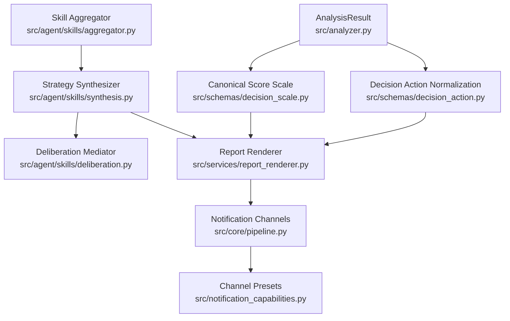
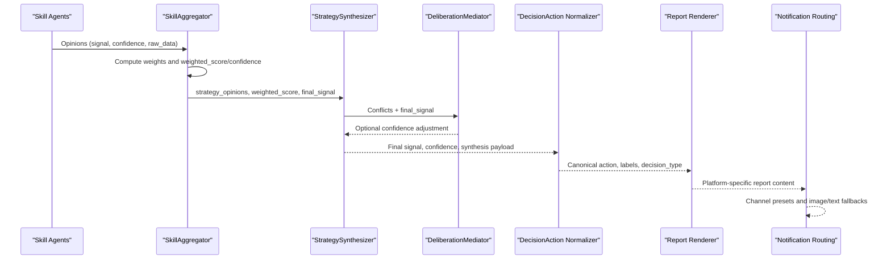
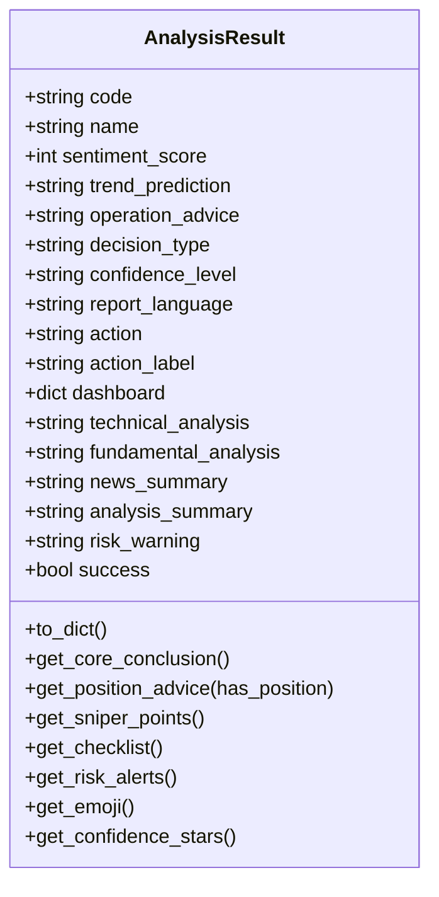
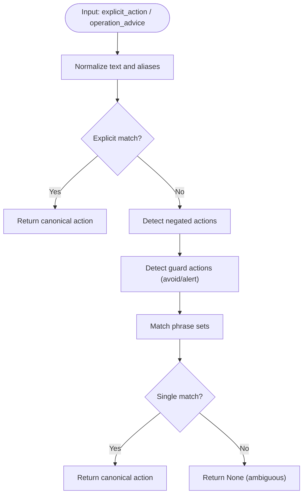
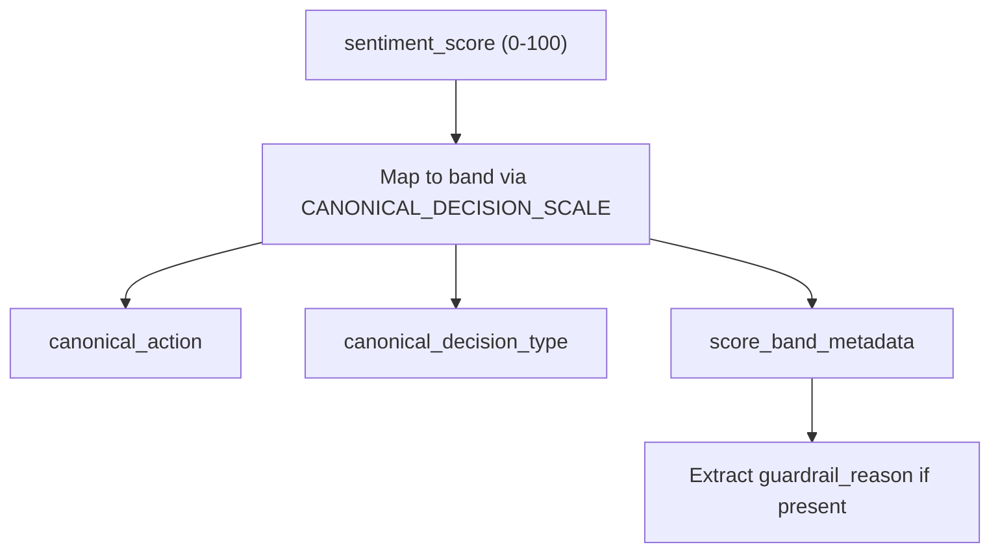
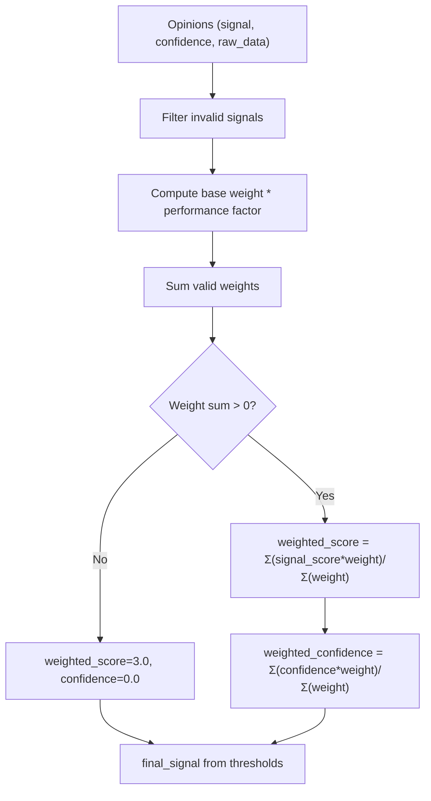
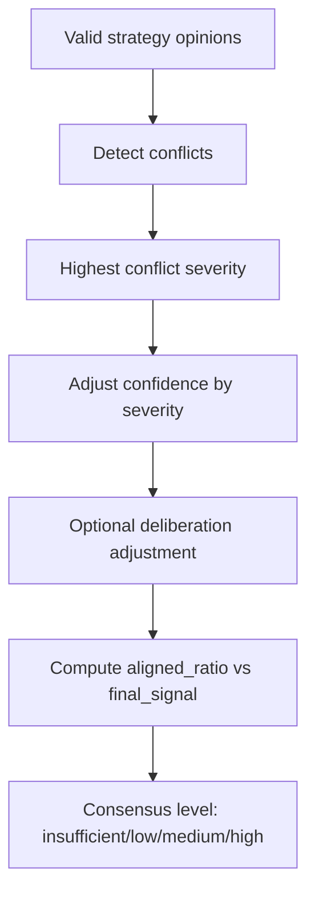
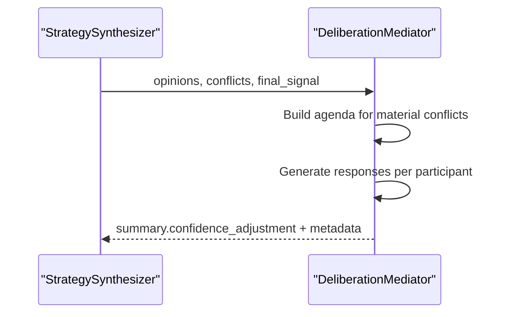
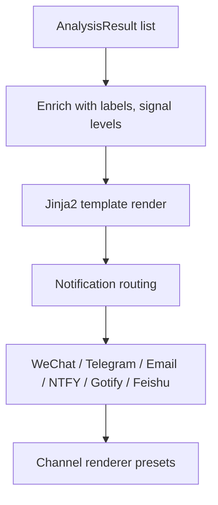
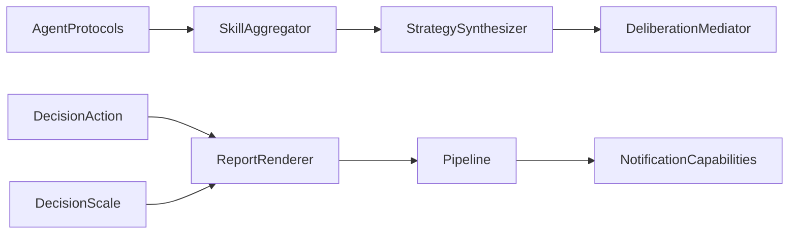

# Result Aggregation

<cite>
**Referenced Files in This Document**
- [analyzer.py](file://src/analyzer.py)
- [decision_action.py](file://src/schemas/decision_action.py)
- [decision_scale.py](file://src/schemas/decision_scale.py)
- [aggregator.py](file://src/agent/skills/aggregator.py)
- [synthesis.py](file://src/agent/skills/synthesis.py)
- [deliberation.py](file://src/agent/skills/deliberation.py)
- [report_renderer.py](file://src/services/report_renderer.py)
- [pipeline.py](file://src/core/pipeline.py)
- [notification_capabilities.py](file://src/notification_capabilities.py)
- [history_service.py](file://src/services/history_service.py)
- [analysis_endpoint.py](file://api/v1/endpoints/analysis.py)
- [analysis_api_contract_test.py](file://tests/test_analysis_api_contract.py)
</cite>

## Table of Contents
1. Introduction
2. Project Structure
3. Core Components
4. Architecture Overview
5. Detailed Component Analysis
6. Dependency Analysis
7. Performance Considerations
8. Troubleshooting Guide
9. Conclusion

## Introduction
This document explains how the system aggregates insights from multiple analysis stages into unified investment recommendations. It focuses on:
- The AnalysisResult structure and how technical signals, fundamental metrics, sentiment analysis, and risk assessments are combined.
- Decision action normalization that standardizes recommendations across different analysis modes.
- Confidence scoring based on data quality, consensus, and conflict severity.
- Weighting schemes for different analysis types and handling conflicting signals.
- Integration with report rendering systems and formatting for web dashboards, notifications, and PDF-like outputs.
- Troubleshooting aggregation issues and performance optimization for large-scale workflows.

## Project Structure
The result aggregation pipeline spans several modules:
- Data model and display normalization live in schema helpers.
- Multi-skill aggregation and synthesis live in agent skills.
- Report rendering and notification routing connect aggregated results to output channels.
- History reconstruction ensures consistent behavior when reading persisted results.

**Diagram sources**
- [analyzer.py:1674-1854](file://src/analyzer.py#L1674-L1854)
- [decision_action.py:306-401](file://src/schemas/decision_action.py#L306-L401)
- [decision_scale.py:25-82](file://src/schemas/decision_scale.py#L25-L82)
- [aggregator.py:65-171](file://src/agent/skills/aggregator.py#L65-L171)
- [synthesis.py:212-276](file://src/agent/skills/synthesis.py#L212-L276)
- [deliberation.py:89-146](file://src/agent/skills/deliberation.py#L89-L146)
- [report_renderer.py:93-267](file://src/services/report_renderer.py#L93-L267)
- [pipeline.py:3705-3771](file://src/core/pipeline.py#L3705-L3771)
- [notification_capabilities.py:201-239](file://src/notification_capabilities.py#L201-L239)

**Section sources**
- [analyzer.py:1674-1854](file://src/analyzer.py#L1674-L1854)
- [aggregator.py:65-171](file://src/agent/skills/aggregator.py#L65-L171)
- [synthesis.py:212-276](file://src/agent/skills/synthesis.py#L212-L276)
- [report_renderer.py:93-267](file://src/services/report_renderer.py#L93-L267)
- [pipeline.py:3705-3771](file://src/core/pipeline.py#L3705-L3771)
- [notification_capabilities.py:201-239](file://src/notification_capabilities.py#L201-L239)

## Core Components
- AnalysisResult is the central container for all analysis outputs, including scores, advice, dashboard sections, and metadata used by downstream components.
- DecisionAction normalization maps diverse textual or explicit actions into a canonical eight-state taxonomy and aligns it with the canonical score-to-action scale.
- SkillAggregator computes weighted scores and confidence from multiple skill-agent opinions, then delegates to StrategySynthesizer for consensus and conflict handling.
- StrategySynthesizer detects conflicts, adjusts confidence, and produces a synthesis payload with consensus level, supporting/opposing skills, and optional deliberation outcomes.
- DeliberationMediator provides deterministic mediation for material conflicts, optionally enhanced by LLM-based mediators with strict schema guards.
- ReportRenderer prepares enriched context for templates and renders platform-specific reports; Notification routing selects channel-specific renderers.

**Section sources**
- [analyzer.py:1674-1854](file://src/analyzer.py#L1674-L1854)
- [decision_action.py:306-401](file://src/schemas/decision_action.py#L306-L401)
- [decision_scale.py:25-82](file://src/schemas/decision_scale.py#L25-L82)
- [aggregator.py:65-171](file://src/agent/skills/aggregator.py#L65-L171)
- [synthesis.py:212-276](file://src/agent/skills/synthesis.py#L212-L276)
- [deliberation.py:89-146](file://src/agent/skills/deliberation.py#L89-L146)
- [report_renderer.py:93-267](file://src/services/report_renderer.py#L93-L267)

## Architecture Overview
The aggregation architecture combines multi-source signals into a single recommendation through weighted synthesis and conflict-aware confidence adjustment, then normalizes the final action for consistent display and reporting.

**Diagram sources**
- [aggregator.py:65-171](file://src/agent/skills/aggregator.py#L65-L171)
- [synthesis.py:212-276](file://src/agent/skills/synthesis.py#L212-L276)
- [deliberation.py:89-146](file://src/agent/skills/deliberation.py#L89-L146)
- [decision_action.py:306-401](file://src/schemas/decision_action.py#L306-L401)
- [report_renderer.py:93-267](file://src/services/report_renderer.py#L93-L267)
- [pipeline.py:3705-3771](file://src/core/pipeline.py#L3705-L3771)

## Detailed Component Analysis

### AnalysisResult and Dashboard Integration
- AnalysisResult holds core fields such as sentiment_score, operation_advice, decision_type, confidence_level, and a dashboard dict containing structured sections like core_conclusion, intelligence.risk_alerts, battle_plan.sniper_points, and phase_decision.
- Methods provide convenient accessors for core conclusion, position advice, sniper points, checklist, risk alerts, emoji, and confidence stars.
- History reconstruction rebuilds AnalysisResult from persisted payloads, preserving dashboard and news evidence flags.

**Diagram sources**
- [analyzer.py:1674-1854](file://src/analyzer.py#L1674-L1854)

**Section sources**
- [analyzer.py:1674-1854](file://src/analyzer.py#L1674-L1854)
- [history_service.py:948-1023](file://src/services/history_service.py#L948-L1023)

### Decision Action Normalization
- normalize_decision_action maps explicit values and natural-language phrases into a canonical eight-state taxonomy: buy, add, hold, reduce, sell, watch, avoid, alert.
- build_action_fields and display_action_fields_for_result combine explicit_action, operation_advice, sentiment_score, guardrail_reason, and report_type to produce a stable action and localized label.
- Alignment with the canonical score-to-action scale ensures consistency between numeric scores and displayed actions, with guardrails explaining downgrades.

**Diagram sources**
- [decision_action.py:306-401](file://src/schemas/decision_action.py#L306-L401)

**Section sources**
- [decision_action.py:306-401](file://src/schemas/decision_action.py#L306-L401)
- [decision_scale.py:25-82](file://src/schemas/decision_scale.py#L25-L82)

### Canonical Score Scale and Guardrails
- CANONICAL_DECISION_SCALE defines bands mapping 0–100 scores to signal_key, action, and decision_type, ensuring uniform interpretation across modules.
- Functions normalize_score, action_for_score, decision_type_for_score, and score_band_metadata support consistent conversions and diagnostics.
- Guardrail reason extraction consolidates reasons from multiple locations for transparency and debugging.

**Diagram sources**
- [decision_scale.py:25-82](file://src/schemas/decision_scale.py#L25-L82)
- [decision_scale.py:102-161](file://src/schemas/decision_scale.py#L102-L161)

**Section sources**
- [decision_scale.py:25-82](file://src/schemas/decision_scale.py#L25-L82)
- [decision_scale.py:102-161](file://src/schemas/decision_scale.py#L102-L161)

### Skill Aggregation and Weighting
- SkillAggregator collects skill-agent opinions, computes per-skill weights using confidence and optional outcome-based autoweights, and calculates weighted_score and weighted_confidence over valid strategies.
- Weights are bounded and filtered; insufficient evidence triggers neutral defaults.
- Individual signals and total adjustments are recorded for traceability.

**Diagram sources**
- [aggregator.py:65-171](file://src/agent/skills/aggregator.py#L65-L171)

**Section sources**
- [aggregator.py:65-171](file://src/agent/skills/aggregator.py#L65-L171)

### Conflict Detection and Consensus
- ConflictDetector identifies directional opposition, wide score dispersion, high-confidence dissent, and adjustment contradictions among strategy opinions.
- StrategySynthesizer adjusts confidence based on conflict severity and optionally integrates deliberation outcomes to refine confidence while preserving final_signal.
- Consensus level is determined by evidence sufficiency, opinion alignment ratio, and conflict severity.

**Diagram sources**
- [synthesis.py:81-196](file://src/agent/skills/synthesis.py#L81-L196)
- [synthesis.py:212-276](file://src/agent/skills/synthesis.py#L212-L276)
- [synthesis.py:324-377](file://src/agent/skills/synthesis.py#L324-L377)

**Section sources**
- [synthesis.py:81-196](file://src/agent/skills/synthesis.py#L81-L196)
- [synthesis.py:212-276](file://src/agent/skills/synthesis.py#L212-L276)
- [synthesis.py:324-377](file://src/agent/skills/synthesis.py#L324-L377)

### Deliberation Mediation
- DeliberationMediator builds an agenda for material conflicts and generates responses per participant, softening signals/confidences under specific conditions.
- Summary captures resolution status, minority view preservation, and confidence adjustment with reason keys.
- LLM-based mediators wrap deterministic baselines with schema-guarded refinements and robust fallbacks.

**Diagram sources**
- [deliberation.py:89-146](file://src/agent/skills/deliberation.py#L89-L146)
- [deliberation.py:228-281](file://src/agent/skills/deliberation.py#L228-L281)

**Section sources**
- [deliberation.py:89-146](file://src/agent/skills/deliberation.py#L89-L146)
- [deliberation.py:228-281](file://src/agent/skills/deliberation.py#L228-L281)

### Report Rendering and Output Channels
- ReportRenderer enriches results with localized labels, signal levels, and market status excerpts, then renders Jinja2 templates for platforms like markdown, wechat, brief.
- Notification routing selects channel-specific renderers and applies image/text fallbacks; channel presets define renderer mappings for feishu, telegram, dingtalk, slack.
- Pipeline orchestrates sending reports to channels, including special handling for enterprise WeChat and file-based delivery for Feishu.

**Diagram sources**
- [report_renderer.py:93-267](file://src/services/report_renderer.py#L93-L267)
- [pipeline.py:3705-3771](file://src/core/pipeline.py#L3705-L3771)
- [notification_capabilities.py:201-239](file://src/notification_capabilities.py#L201-L239)

**Section sources**
- [report_renderer.py:93-267](file://src/services/report_renderer.py#L93-L267)
- [pipeline.py:3705-3771](file://src/core/pipeline.py#L3705-L3771)
- [notification_capabilities.py:201-239](file://src/notification_capabilities.py#L201-L239)

### API Contract and Display Priority
- The API endpoint normalizes task results and ensures the public response includes enriched report data, preferring raw_result action over summary action when available.
- Tests validate that action priority rules and market phase summaries are correctly propagated to clients.

**Section sources**
- [analysis_endpoint.py:933-1019](file://api/v1/endpoints/analysis.py#L933-L1019)
- [analysis_api_contract_test.py:833-884](file://tests/test_analysis_api_contract.py#L833-L884)
- [analysis_api_contract_test.py:1969-2001](file://tests/test_analysis_api_contract.py#L1969-L2001)
- [analysis_api_contract_test.py:1774-1803](file://tests/test_analysis_api_contract.py#L1774-L1803)

## Dependency Analysis
- Aggregator depends on protocols and synthesis utilities to convert agent opinions into strategy opinions and compute consensus.
- Synthesizer depends on conflict detection and deliberation mediators to adjust confidence and determine consensus level.
- DecisionAction and DecisionScale are consumed by ReportRenderer to ensure consistent display across channels.
- Pipeline and NotificationCapabilities coordinate channel selection and renderer presets for output formatting.

**Diagram sources**
- [aggregator.py:65-171](file://src/agent/skills/aggregator.py#L65-L171)
- [synthesis.py:212-276](file://src/agent/skills/synthesis.py#L212-L276)
- [deliberation.py:89-146](file://src/agent/skills/deliberation.py#L89-L146)
- [decision_action.py:306-401](file://src/schemas/decision_action.py#L306-L401)
- [decision_scale.py:25-82](file://src/schemas/decision_scale.py#L25-L82)
- [report_renderer.py:93-267](file://src/services/report_renderer.py#L93-L267)
- [pipeline.py:3705-3771](file://src/core/pipeline.py#L3705-L3771)
- [notification_capabilities.py:201-239](file://src/notification_capabilities.py#L201-L239)

**Section sources**
- [aggregator.py:65-171](file://src/agent/skills/aggregator.py#L65-L171)
- [synthesis.py:212-276](file://src/agent/skills/synthesis.py#L212-L276)
- [deliberation.py:89-146](file://src/agent/skills/deliberation.py#L89-L146)
- [decision_action.py:306-401](file://src/schemas/decision_action.py#L306-L401)
- [decision_scale.py:25-82](file://src/schemas/decision_scale.py#L25-L82)
- [report_renderer.py:93-267](file://src/services/report_renderer.py#L93-L267)
- [pipeline.py:3705-3771](file://src/core/pipeline.py#L3705-L3771)
- [notification_capabilities.py:201-239](file://src/notification_capabilities.py#L201-L239)

## Performance Considerations
- Limit deliberation rounds and cap participants to reduce LLM calls during conflict mediation.
- Use outcome-based autoweighting judiciously; cache computed weights and skip recomputation when inputs are unchanged.
- Prefer lightweight deterministic mediation as baseline; invoke LLM mediators only when material conflicts exist.
- Batch report rendering and reuse template contexts where possible; avoid redundant localization computations.
- For large-scale runs, filter invalid signals early and short-circuit when evidence is insufficient to avoid unnecessary computation.

[No sources needed since this section provides general guidance]

## Troubleshooting Guide
Common aggregation issues and resolutions:
- Ambiguous action mapping: If normalize_decision_action returns None, check for conflicting negations or overlapping phrase matches; ensure explicit_action is set when possible.
- Low consensus despite high scores: Inspect conflict severity and aligned_ratio; high-severity conflicts will downgrade consensus and confidence.
- Missing dashboard fields: Validate required fields like dashboard.intelligence.risk_alerts and dashboard.core_conclusion.one_sentence; use integrity checks to identify missing parts.
- Inconsistent display action vs score: Ensure guardrail reasons are captured; alignment logic may override neutral actions when score indicates direction.
- Notification failures: Verify channel presets and renderer availability; fall back to text when image rendering fails; confirm route filtering selects intended channels.

**Section sources**
- [decision_action.py:306-401](file://src/schemas/decision_action.py#L306-L401)
- [synthesis.py:324-377](file://src/agent/skills/synthesis.py#L324-L377)
- [analyzer.py:321-354](file://src/analyzer.py#L321-L354)
- [pipeline.py:3705-3771](file://src/core/pipeline.py#L3705-L3771)

## Conclusion
The result aggregation system combines multiple analysis stages into a unified recommendation through robust weighting, conflict detection, and deliberation-aware confidence adjustment. Decision action normalization ensures consistent display across channels, while report rendering and notification routing deliver tailored outputs for dashboards, notifications, and PDF-like formats. By following the documented patterns and troubleshooting steps, teams can maintain reliable, transparent, and scalable aggregation workflows.