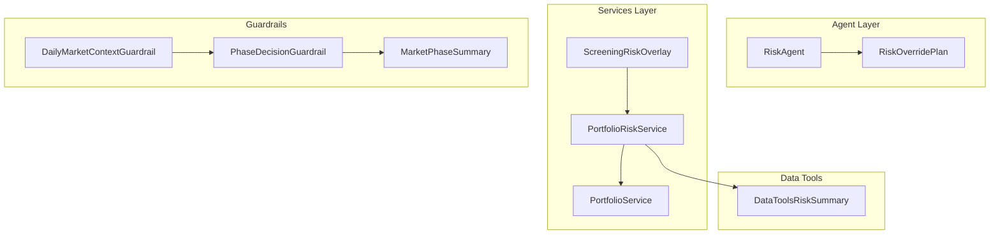
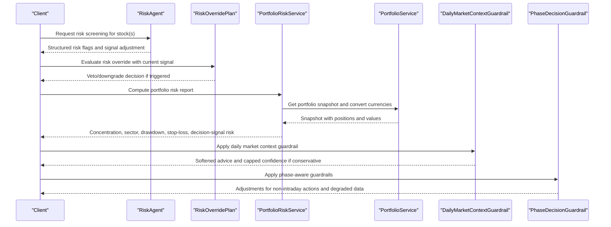
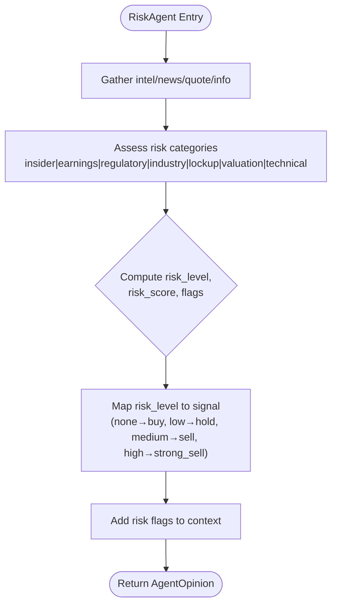
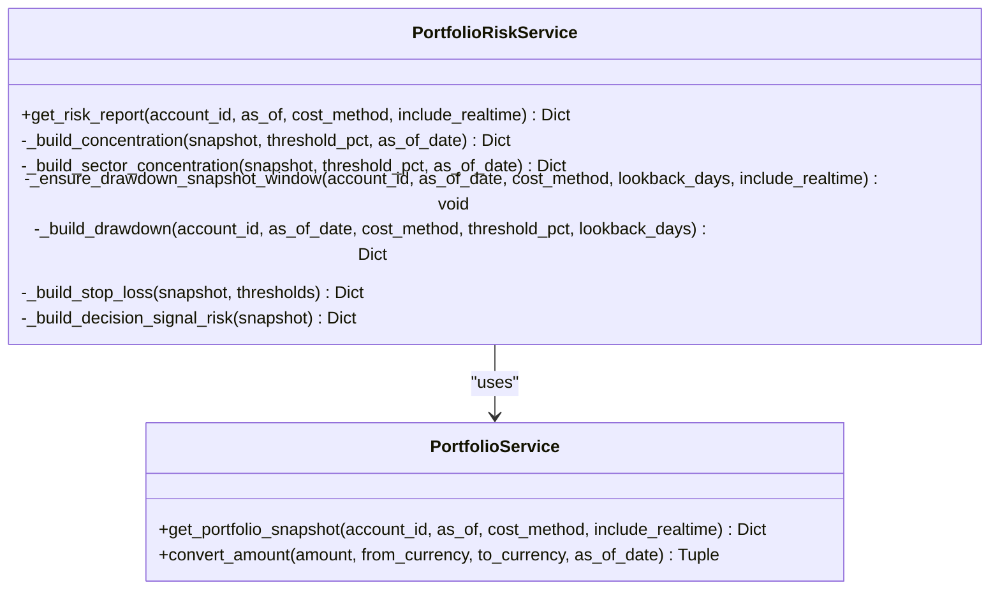
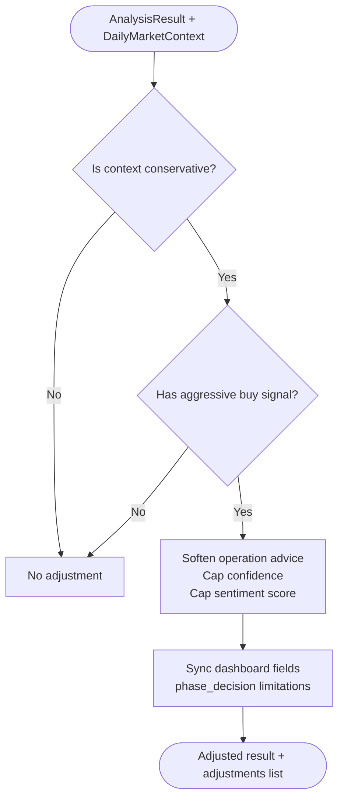
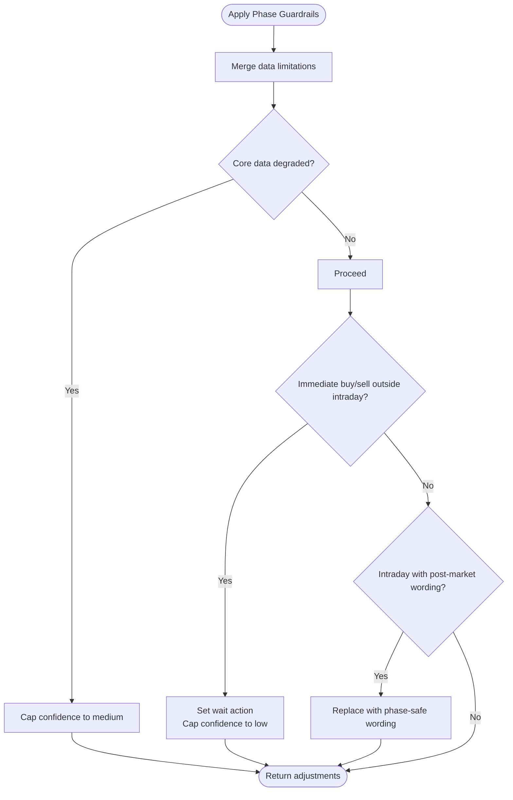
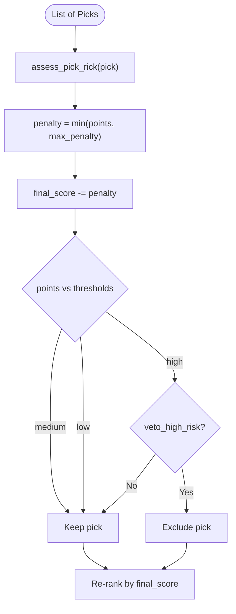
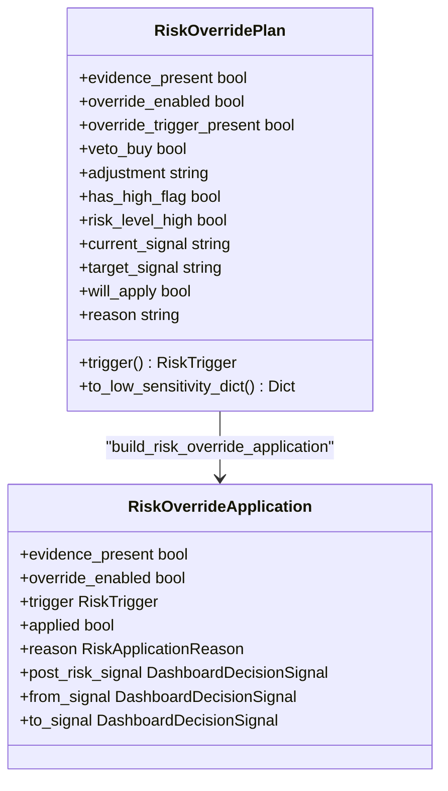
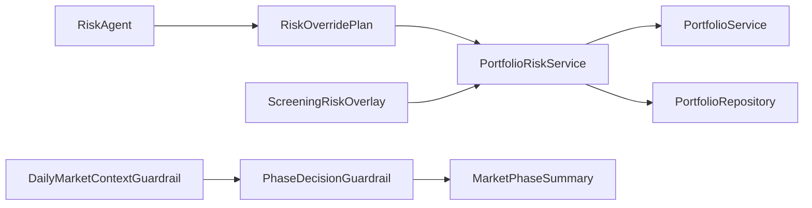

# Risk Assessment Stage

<cite>
**Referenced Files in This Document**
- [risk_agent.py](file://src/agent/agents/risk_agent.py)
- [portfolio_risk_service.py](file://src/services/portfolio_risk_service.py)
- [daily_market_context_guardrail.py](file://src/daily_market_context_guardrail.py)
- [phase_decision_guardrail.py](file://src/phase_decision_guardrail.py)
- [market_phase_summary.py](file://src/market_phase_summary.py)
- [risk_override.py](file://src/agent/risk_override.py)
- [screening_risk.py](file://src/services/screening/risk.py)
- [portfolio_service.py](file://src/services/portfolio_service.py)
- [data_tools.py](file://src/agent/tools/data_tools.py)
</cite>

## Table of Contents
1. Introduction
2. Project Structure
3. Core Components
4. Architecture Overview
5. Detailed Component Analysis
6. Dependency Analysis
7. Performance Considerations
8. Troubleshooting Guide
9. Conclusion

## Introduction
This document explains the Risk Assessment Stage that evaluates portfolio risk and market risk across individual stocks and portfolios. It covers:
- The risk agent’s role in identifying potential risks such as volatility, correlation, and exposure.
- Portfolio-level risk measurement including concentration risk, sector exposure, and drawdown potential.
- Daily market context guardrails that adjust recommendations based on current market conditions and phases.
- Risk scoring methodologies, risk tolerance configuration, and mitigation strategies.
- Integration with position sizing and how risk assessment influences investment recommendations.
- The relationship between individual stock risk and broader market risk factors in portfolio construction.

## Project Structure
The Risk Assessment Stage spans several modules:
- Agent layer: a dedicated risk agent scans for event-driven and technical risks per stock.
- Services layer: a portfolio risk service computes portfolio-level metrics (concentration, sector, drawdown, stop-loss proximity).
- Guardrails: daily market context and phase-aware guardrails soften or constrain aggressive actions under conservative market regimes.
- Screening overlay: an independent risk overlay penalizes risky picks before ranking.
- Data tools: expose curated risk summaries to agents and dashboards.

**Diagram sources**
- [risk_agent.py:29-129](file://src/agent/agents/risk_agent.py#L29-L129)
- [risk_override.py:121-305](file://src/agent/risk_override.py#L121-L305)
- [portfolio_risk_service.py:21-101](file://src/services/portfolio_risk_service.py#L21-L101)
- [portfolio_service.py:109-114](file://src/services/portfolio_service.py#L109-L114)
- [screening_risk.py:50-138](file://src/services/screening/risk.py#L50-L138)
- [daily_market_context_guardrail.py:62-112](file://src/daily_market_context_guardrail.py#L62-L112)
- [phase_decision_guardrail.py:116-205](file://src/phase_decision_guardrail.py#L116-L205)
- [market_phase_summary.py:87-105](file://src/market_phase_summary.py#L87-L105)
- [data_tools.py:215-249](file://src/agent/tools/data_tools.py#L215-L249)

**Section sources**
- [risk_agent.py:29-129](file://src/agent/agents/risk_agent.py#L29-L129)
- [portfolio_risk_service.py:21-101](file://src/services/portfolio_risk_service.py#L21-L101)
- [daily_market_context_guardrail.py:62-112](file://src/daily_market_context_guardrail.py#L62-L112)
- [phase_decision_guardrail.py:116-205](file://src/phase_decision_guardrail.py#L116-L205)
- [market_phase_summary.py:87-105](file://src/market_phase_summary.py#L87-L105)
- [risk_override.py:121-305](file://src/agent/risk_override.py#L121-L305)
- [screening_risk.py:50-138](file://src/services/screening/risk.py#L50-L138)
- [portfolio_service.py:109-114](file://src/services/portfolio_service.py#L109-L114)
- [data_tools.py:215-249](file://src/agent/tools/data_tools.py#L215-L249)

## Core Components
- RiskAgent: identifies event-driven and technical risks per stock and produces structured flags and signal adjustments.
- PortfolioRiskService: measures portfolio-level risks including concentration, sector exposure, drawdown, stop-loss proximity, and decision-signal-based risk.
- DailyMarketContextGuardrail: softens aggressive buy signals when daily market context is conservative.
- PhaseDecisionGuardrail: enforces phase-aware constraints (e.g., no immediate action outside intraday) and caps confidence when data quality degrades.
- ScreeningRiskOverlay: applies a configurable risk penalty to candidate picks, including sector concentration penalties.
- RiskOverridePlan: centralizes risk override logic to veto or downgrade signals based on risk evidence and policy.

**Section sources**
- [risk_agent.py:29-129](file://src/agent/agents/risk_agent.py#L29-L129)
- [portfolio_risk_service.py:21-101](file://src/services/portfolio_risk_service.py#L21-L101)
- [daily_market_context_guardrail.py:62-112](file://src/daily_market_context_guardrail.py#L62-L112)
- [phase_decision_guardrail.py:116-205](file://src/phase_decision_guardrail.py#L116-L205)
- [screening_risk.py:50-138](file://src/services/screening/risk.py#L50-L138)
- [risk_override.py:121-305](file://src/agent/risk_override.py#L121-L305)

## Architecture Overview
The Risk Assessment Stage integrates multiple layers to produce robust, market-aware recommendations:

**Diagram sources**
- [risk_agent.py:38-116](file://src/agent/agents/risk_agent.py#L38-L116)
- [risk_override.py:241-305](file://src/agent/risk_override.py#L241-L305)
- [portfolio_risk_service.py:39-101](file://src/services/portfolio_risk_service.py#L39-L101)
- [portfolio_service.py:109-114](file://src/services/portfolio_service.py#L109-L114)
- [daily_market_context_guardrail.py:62-112](file://src/daily_market_context_guardrail.py#L62-L112)
- [phase_decision_guardrail.py:116-205](file://src/phase_decision_guardrail.py#L116-L205)

## Detailed Component Analysis

### RiskAgent: Individual Stock Risk Identification
- Responsibilities:
  - Scans for insider activity, earnings warnings, regulatory issues, industry headwinds, lock-up expirations, valuation extremes, and technical warning signs.
  - Produces structured JSON with risk level, score, flags, veto flag, reasoning, and signal adjustment.
  - Converts risk level into an inverted trading signal and propagates flags into the agent context.
- Output integration:
  - Flags are added to the agent context for downstream risk override evaluation.
  - Signal mapping converts risk levels into actionable decisions.

**Diagram sources**
- [risk_agent.py:38-116](file://src/agent/agents/risk_agent.py#L38-L116)

**Section sources**
- [risk_agent.py:29-129](file://src/agent/agents/risk_agent.py#L29-L129)

### PortfolioRiskService: Portfolio-Level Risk Measurement
- Capabilities:
  - Concentration risk: top position weights and alerts against configured thresholds.
  - Sector concentration: maps holdings to sectors (with coverage stats), warns on overexposure.
  - Drawdown analysis: builds equity series from daily snapshots, computes max/current drawdown and alerts.
  - Stop-loss proximity: identifies positions near or triggered by stop-loss thresholds.
  - Decision-signal risk: aggregates defensive actions (sell/reduce/alert) for held positions.
- Configuration:
  - Thresholds include concentration alert percentage, drawdown alert percentage, stop-loss alert percentage, near-ratio multiplier, and lookback window.
- Data flow:
  - Uses PortfolioService to fetch snapshots and perform currency conversions; ensures historical snapshot backfill for drawdown computation.

**Diagram sources**
- [portfolio_risk_service.py:21-101](file://src/services/portfolio_risk_service.py#L21-L101)
- [portfolio_service.py:109-114](file://src/services/portfolio_service.py#L109-L114)

**Section sources**
- [portfolio_risk_service.py:21-101](file://src/services/portfolio_risk_service.py#L21-L101)
- [portfolio_service.py:109-114](file://src/services/portfolio_service.py#L109-L114)

### Daily Market Context Guardrail: Conservative Market Adjustments
- Behavior:
  - Detects conservative/high-risk market tags or textual markers.
  - If aggressive buy signals exist, softens operation advice, downgrades confidence, and caps sentiment score.
  - Updates dashboard fields to reflect softened strategy and limitations.
- Inputs:
  - Daily market context object containing risk tags, summary text, and position caps.
- Outputs:
  - List of adjustments applied (e.g., buy softened, confidence capped).

**Diagram sources**
- [daily_market_context_guardrail.py:62-112](file://src/daily_market_context_guardrail.py#L62-L112)
- [daily_market_context_guardrail.py:201-215](file://src/daily_market_context_guardrail.py#L201-L215)

**Section sources**
- [daily_market_context_guardrail.py:62-112](file://src/daily_market_context_guardrail.py#L62-L112)
- [daily_market_context_guardrail.py:201-215](file://src/daily_market_context_guardrail.py#L201-L215)

### Phase Decision Guardrail: Phase-Aware Constraints
- Behavior:
  - Merges data limitations from phase summary and analysis context pack overview.
  - Caps confidence when core quote/daily/technical data is degraded.
  - Prevents immediate buy/sell actions outside intraday phases and replaces post-market recap wording during intraday.
  - Appends reasons and limitations to phase_decision for transparency.
- Inputs:
  - AnalysisResult, market phase summary, analysis context pack overview, report language.
- Outputs:
  - Adjusted result and list of applied adjustments.

**Diagram sources**
- [phase_decision_guardrail.py:116-205](file://src/phase_decision_guardrail.py#L116-L205)
- [phase_decision_guardrail.py:229-242](file://src/phase_decision_guardrail.py#L229-L242)
- [phase_decision_guardrail.py:283-300](file://src/phase_decision_guardrail.py#L283-L300)
- [phase_decision_guardrail.py:326-371](file://src/phase_decision_guardrail.py#L326-L371)

**Section sources**
- [phase_decision_guardrail.py:116-205](file://src/phase_decision_guardrail.py#L116-L205)
- [phase_decision_guardrail.py:229-242](file://src/phase_decision_guardrail.py#L229-L242)
- [phase_decision_guardrail.py:283-300](file://src/phase_decision_guardrail.py#L283-L300)
- [phase_decision_guardrail.py:326-371](file://src/phase_decision_guardrail.py#L326-L371)

### Screening Risk Overlay: Candidate Pick Risk Penalties
- Behavior:
  - Computes risk points per pick using price moves, volume anomalies, valuation extremes, technical indicators, LLM confidence, and daily data quality.
  - Applies bounded penalty to final score and assigns risk level (low/medium/high).
  - Optionally vetoes high-risk picks.
  - Penalizes repeated sectors via portfolio buckets to avoid crowded trades.
- Configuration:
  - Risk profile parameters control thresholds and point deductions.
  - Portfolio bucket map defines sector groupings and concentration penalties.

**Diagram sources**
- [screening_risk.py:50-83](file://src/services/screening/risk.py#L50-L83)
- [screening_risk.py:141-199](file://src/services/screening/risk.py#L141-L199)
- [screening_risk.py:240-247](file://src/services/screening/risk.py#L240-L247)
- [screening_risk.py:86-138](file://src/services/screening/risk.py#L86-L138)

**Section sources**
- [screening_risk.py:50-138](file://src/services/screening/risk.py#L50-L138)
- [screening_risk.py:141-199](file://src/services/screening/risk.py#L141-L199)
- [screening_risk.py:240-247](file://src/services/screening/risk.py#L240-L247)

### Risk Override Plan: Centralized Risk Controls
- Behavior:
  - Builds a unified plan from risk agent evidence and dashboard signal.
  - Determines whether to veto buy signals or downgrade them based on severity and adjustment instructions.
  - Validates transitions to ensure consistent application and records reasons.
- Integration:
  - Consumes risk flags and raw risk data from the risk agent context.
  - Produces low-sensitivity outputs suitable for prompts and dashboards.

**Diagram sources**
- [risk_override.py:121-157](file://src/agent/risk_override.py#L121-L157)
- [risk_override.py:160-204](file://src/agent/risk_override.py#L160-L204)
- [risk_override.py:207-238](file://src/agent/risk_override.py#L207-L238)
- [risk_override.py:241-305](file://src/agent/risk_override.py#L241-L305)

**Section sources**
- [risk_override.py:121-305](file://src/agent/risk_override.py#L121-L305)

### Data Tools: Curated Risk Summaries
- Behavior:
  - Extracts key risk metrics from portfolio risk reports for consumption by agents and dashboards.
  - Limits top items to reduce noise and focuses on concentration, drawdown, and stop-loss alerts.
- Usage:
  - Provides standardized views of thresholds, currency, cost method, and risk components.

**Section sources**
- [data_tools.py:215-249](file://src/agent/tools/data_tools.py#L215-L249)

## Dependency Analysis
- Coupling:
  - RiskAgent depends on agent protocols and tool names to gather information and produce structured outputs.
  - PortfolioRiskService depends on PortfolioService for snapshots and currency conversion, and on repositories for historical snapshots.
  - Guardrails depend on market phase summaries and report language utilities to adapt outputs safely.
  - ScreeningRiskOverlay depends on pick models and configurable profiles to apply penalties.
  - RiskOverridePlan bridges agent outputs with dashboard signals to enforce risk policies.
- External integrations:
  - DataFetcherManager is used optionally for board/sector classification within PortfolioRiskService.
  - Config provides thresholds and behavior toggles for risk services.

**Diagram sources**
- [risk_agent.py:29-129](file://src/agent/agents/risk_agent.py#L29-L129)
- [risk_override.py:241-305](file://src/agent/risk_override.py#L241-L305)
- [portfolio_risk_service.py:21-101](file://src/services/portfolio_risk_service.py#L21-L101)
- [portfolio_service.py:109-114](file://src/services/portfolio_service.py#L109-L114)
- [daily_market_context_guardrail.py:62-112](file://src/daily_market_context_guardrail.py#L62-L112)
- [phase_decision_guardrail.py:116-205](file://src/phase_decision_guardrail.py#L116-L205)
- [market_phase_summary.py:87-105](file://src/market_phase_summary.py#L87-L105)
- [screening_risk.py:50-138](file://src/services/screening/risk.py#L50-L138)

**Section sources**
- [risk_agent.py:29-129](file://src/agent/agents/risk_agent.py#L29-L129)
- [risk_override.py:241-305](file://src/agent/risk_override.py#L241-L305)
- [portfolio_risk_service.py:21-101](file://src/services/portfolio_risk_service.py#L21-L101)
- [portfolio_service.py:109-114](file://src/services/portfolio_service.py#L109-L114)
- [daily_market_context_guardrail.py:62-112](file://src/daily_market_context_guardrail.py#L62-L112)
- [phase_decision_guardrail.py:116-205](file://src/phase_decision_guardrail.py#L116-L205)
- [market_phase_summary.py:87-105](file://src/market_phase_summary.py#L87-L105)
- [screening_risk.py:50-138](file://src/services/screening/risk.py#L50-L138)

## Performance Considerations
- Snapshot backfill:
  - PortfolioRiskService ensures historical snapshots exist for drawdown calculation within the configured lookback window, avoiding stale metrics.
- Currency conversion:
  - All portfolio metrics are normalized to a common currency using PortfolioService conversion to ensure accurate aggregation.
- Sector classification:
  - Board lookup is cached per symbol/market to minimize repeated calls; failures are recorded without blocking processing.
- Guardrail efficiency:
  - Daily and phase guardrails operate on lightweight checks (tags, markers, phase labels) to minimize overhead while ensuring safe outputs.

[No sources needed since this section provides general guidance]

## Troubleshooting Guide
- Risk agent parsing failures:
  - If risk JSON cannot be parsed, the agent logs a warning and returns None; verify the agent’s output format and inputs.
- Portfolio risk unavailability:
  - Decision-signal risk may be unavailable due to exceptions; the service returns an empty structure with availability flag set accordingly.
- Sector classification errors:
  - Non-CN markets or failed board lookups result in “UNCLASSIFIED” entries; check market codes and data provider availability.
- Guardrail adjustments:
  - If aggressive buy signals persist despite conservative context, verify language normalization and marker detection; confirm report_language settings.
- Phase-related wording:
  - Intraday outputs should not contain post-market recap phrasing; guardrails replace such wording automatically.

**Section sources**
- [risk_agent.py:95-116](file://src/agent/agents/risk_agent.py#L95-L116)
- [portfolio_risk_service.py:103-173](file://src/services/portfolio_risk_service.py#L103-L173)
- [portfolio_risk_service.py:389-420](file://src/services/portfolio_risk_service.py#L389-L420)
- [daily_market_context_guardrail.py:62-112](file://src/daily_market_context_guardrail.py#L62-L112)
- [phase_decision_guardrail.py:326-371](file://src/phase_decision_guardrail.py#L326-L371)

## Conclusion
The Risk Assessment Stage combines agent-driven risk identification, portfolio-level risk measurement, and market-aware guardrails to produce safe, actionable recommendations:
- RiskAgent surfaces granular stock risks and adjusts signals conservatively when warranted.
- PortfolioRiskService quantifies concentration, sector exposure, drawdown, and stop-loss proximity, enabling portfolio-level risk controls.
- Daily and phase guardrails ensure recommendations align with current market conditions and data quality, preventing overly aggressive actions in conservative environments.
- Screening overlays and risk overrides integrate risk into selection and execution, influencing position sizing and investment decisions.
Together, these components balance individual stock risk with broader market factors to construct resilient portfolios.

[No sources needed since this section summarizes without analyzing specific files]