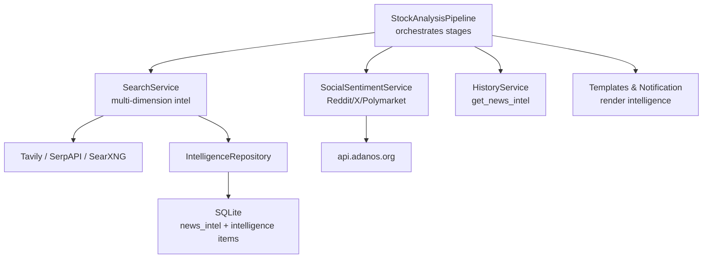
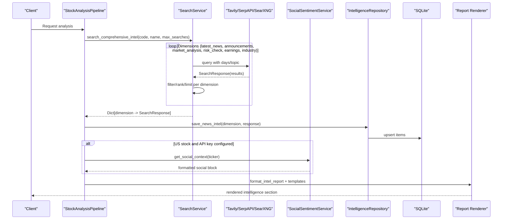
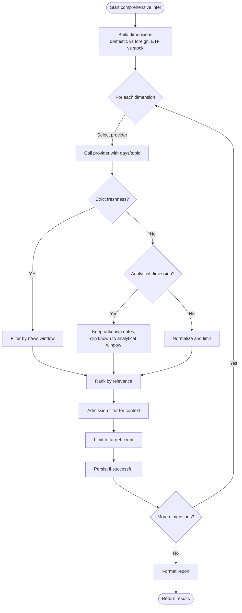
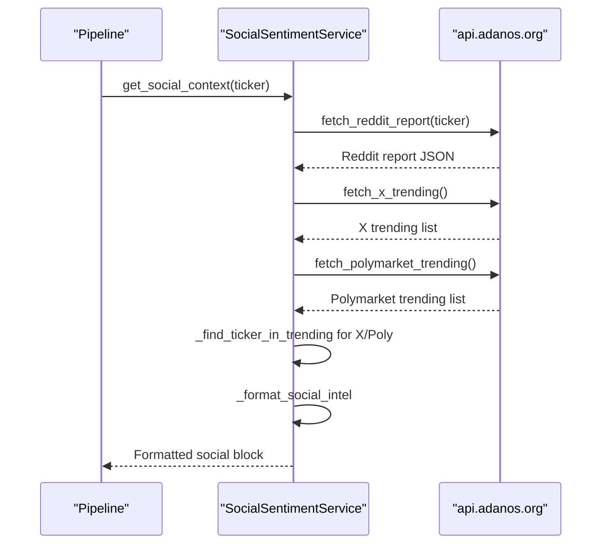
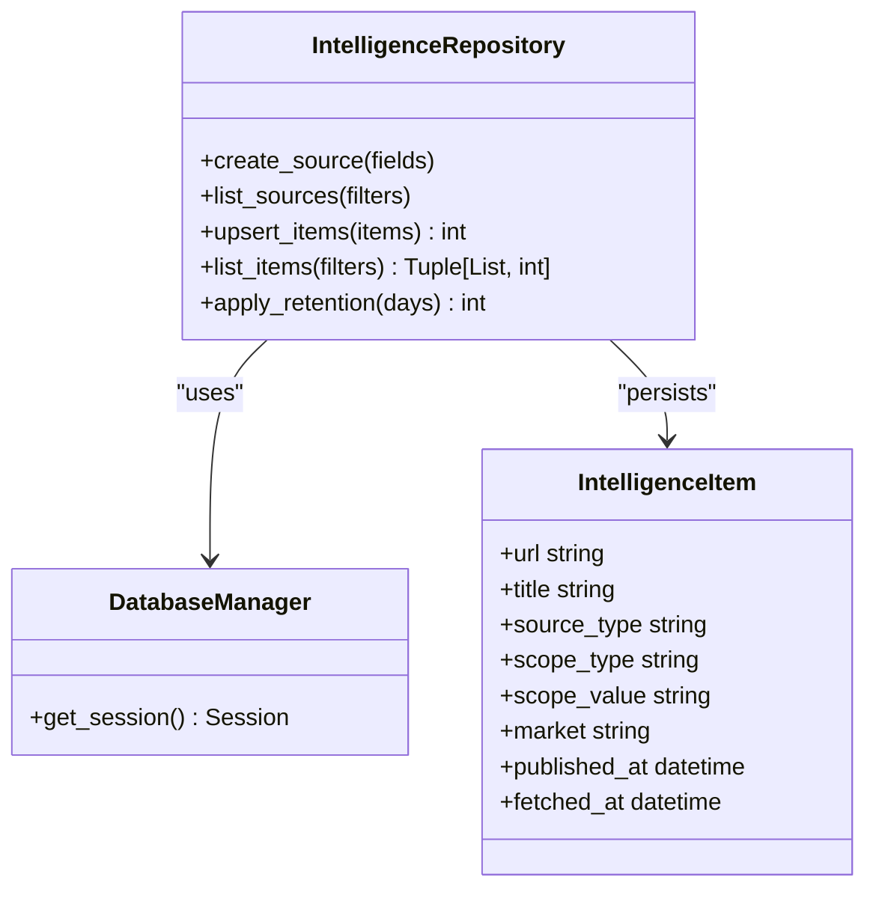
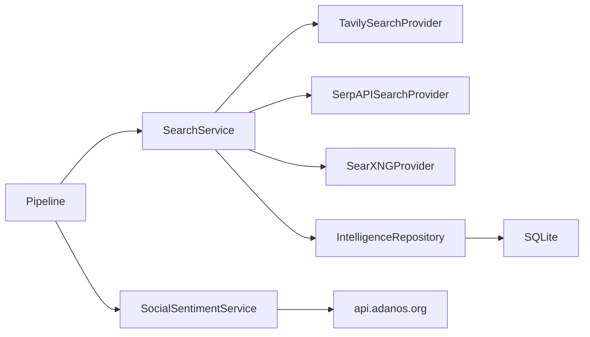

# Sentiment Analysis Stage

<cite>
**Referenced Files in This Document**
- [search_service.py](file://src/search_service.py)
- [social_sentiment_service.py](file://src/services/social_sentiment_service.py)
- [intelligence_service.py](file://src/services/intelligence_service.py)
- [pipeline.py](file://src/core/pipeline.py)
- [intelligence_repo.py](file://src/repositories/intelligence_repo.py)
- [storage.py](file://src/storage.py)
- [search_tools.py](file://src/agent/tools/search_tools.py)
- [report_markdown.j2](file://templates/report_markdown.j2)
- [notification.py](file://src/notification.py)
- [history_service.py](file://src/services/history_service.py)
- [config.py](file://src/config.py)
</cite>

## Table of Contents
1. [Introduction](#introduction)
2. [Project Structure](#project-structure)
3. [Core Components](#core-components)
4. [Architecture Overview](#architecture-overview)
5. [Detailed Component Analysis](#detailed-component-analysis)
6. [Dependency Analysis](#dependency-analysis)
7. [Performance Considerations](#performance-considerations)
8. [Troubleshooting Guide](#troubleshooting-guide)
9. [Conclusion](#conclusion)
10. [Appendices](#appendices)

## Introduction
This document explains the Sentiment Analysis Stage that powers news gathering, social sentiment analysis, and intelligence aggregation for investment decisions. It focuses on:
- The multi-dimensional search orchestration via `SearchService.search_comprehensive_intel` across news sources, financial databases, and market intelligence feeds.
- Social sentiment integration for US stocks from Reddit, X (Twitter), and Polymarket through a dedicated service.
- Intelligence report formatting and synthesis into coherent context for downstream technical/fundamental analysis and decision-making.
- Query construction, result filtering, ranking, and scoring strategies.
- Fallback mechanisms when search services are unavailable or return insufficient data.
- Persistence of intelligence context for long-term sentiment tracking and historical review.
- How sentiment integrates with technical and fundamental analysis to form actionable investment recommendations.

## Project Structure
The Sentiment Analysis Stage spans several modules:
- Search orchestration and provider routing live in the search service layer.
- Social sentiment collection is isolated in a dedicated service for US tickers.
- Configurable intelligence sources (RSS/Atom/NewsNow) are managed by an intelligence service and persisted via repositories and storage models.
- The pipeline wires search results and social sentiment into the agent’s initial context and persists evidence for later retrieval.
- Reports render intelligence sections consistently across notifications and templates.

**Diagram sources**
- [pipeline.py:621-668](file://src/core/pipeline.py#L621-L668)
- [search_service.py:4350-4602](file://src/search_service.py#L4350-L4602)
- [social_sentiment_service.py:191-221](file://src/services/social_sentiment_service.py#L191-L221)
- [intelligence_repo.py:108-150](file://src/repositories/intelligence_repo.py#L108-L150)
- [storage.py:180-200](file://src/storage.py#L180-L200)

**Section sources**
- [pipeline.py:621-668](file://src/core/pipeline.py#L621-L668)
- [search_service.py:4350-4602](file://src/search_service.py#L4350-L4602)
- [social_sentiment_service.py:191-221](file://src/services/social_sentiment_service.py#L191-L221)
- [intelligence_repo.py:108-150](file://src/repositories/intelligence_repo.py#L108-L150)
- [storage.py:180-200](file://src/storage.py#L180-L200)

## Core Components
- SearchService: Multi-dimensional search orchestrator with provider rotation, freshness filters, relevance ranking, and reporting.
- SocialSentimentService: Aggregates Reddit, X, and Polymarket signals for US tickers and formats them as prompt-ready text.
- IntelligenceService: Fetches, validates, and persists RSS/Atom/NewsNow intelligence sources; supports auto-fetch and retention.
- Repository and Storage: Persist news intelligence and configurable intelligence items; enable querying by scope, market, and time windows.
- Pipeline Integration: Injects search and social sentiment into the agent’s context, persists evidence, and exposes it via history APIs and reports.

**Section sources**
- [search_service.py:4350-4659](file://src/search_service.py#L4350-L4659)
- [social_sentiment_service.py:55-221](file://src/services/social_sentiment_service.py#L55-L221)
- [intelligence_service.py:122-359](file://src/services/intelligence_service.py#L122-L359)
- [intelligence_repo.py:108-193](file://src/repositories/intelligence_repo.py#L108-L193)
- [storage.py:180-200](file://src/storage.py#L180-L200)

## Architecture Overview
The Sentiment Analysis Stage composes multiple data streams into a unified intelligence context:

**Diagram sources**
- [pipeline.py:621-668](file://src/core/pipeline.py#L621-L668)
- [search_service.py:4350-4602](file://src/search_service.py#L4350-L4602)
- [social_sentiment_service.py:191-221](file://src/services/social_sentiment_service.py#L191-L221)
- [intelligence_repo.py:108-150](file://src/repositories/intelligence_repo.py#L108-L150)
- [storage.py:180-200](file://src/storage.py#L180-L200)

## Detailed Component Analysis

### SearchService.search_comprehensive_intel
Purpose:
- Executes multi-dimensional searches tailored to domestic vs foreign tickers and ETFs vs single stocks.
- Rotates providers to balance load and resilience.
- Applies dimension-specific lookback windows and freshness policies.
- Ranks and filters results to produce concise, high-signal context.

Key behaviors:
- Dimension set: latest_news, announcements, market_analysis, risk_check, earnings, industry.
- For foreign tickers, English aliases are used to improve coverage in English-language providers.
- Analytical dimensions (market_analysis, earnings) use a wider lookback window to capture longer-horizon insights.
- Strict freshness applies to latest_news and announcements; risk_check strictness depends on ETF vs non-ETF.
- Each dimension goes through normalization, filtering, ranking, admission filtering, and limiting to target counts.

Query construction examples:
- Domestic stock: “{name} {code} 最新 新闻 重大 事件”
- Foreign stock: “{EnglishAlias} {code} latest news events”
- Risk check: varies by ETF vs non-ETF to avoid overly strict filtering for index/ETF contexts.

Result filtering and ranking:
- Freshness filters enforce recent dates for strict dimensions.
- Analytical dimensions keep unknown-date results while clipping known dates to the analytical window.
- Ranking considers relevance category, score, and reasons; Chinese preference may be applied based on ticker/market.

Provider selection and fallback:
- Available providers are rotated per dimension.
- If no providers are available, the loop exits early and returns partial or empty results.

Persistence:
- Successful dimensions are persisted via repository calls in the pipeline and tools layer.

Report formatting:
- `format_intel_report` renders a structured summary per dimension with titles, snippets, dates, and relevance metadata.

**Diagram sources**
- [search_service.py:4350-4602](file://src/search_service.py#L4350-L4602)
- [search_service.py:4604-4659](file://src/search_service.py#L4604-L4659)

**Section sources**
- [search_service.py:4350-4602](file://src/search_service.py#L4350-L4602)
- [search_service.py:4604-4659](file://src/search_service.py#L4604-L4659)

### Social Sentiment Service Integration (US Stocks)
Purpose:
- Collects Reddit, X (Twitter), and Polymarket trending and per-ticker data for US stocks.
- Formats aggregated signals into a readable block suitable for LLM prompts.

Capabilities:
- Per-ticker Reddit report fetch with buzz/sentiment scores, mentions, top mentions, and daily stats.
- Trending lists for X and Polymarket filtered to the target ticker.
- In-memory TTL cache for trending endpoints to reduce redundant requests.
- Graceful handling of transient network errors with retries.

Integration flow:
- Only active for US stock codes when an API key is configured.
- Results are appended to the existing news context or stand alone if no prior news context exists.

**Diagram sources**
- [social_sentiment_service.py:152-221](file://src/services/social_sentiment_service.py#L152-L221)
- [social_sentiment_service.py:226-344](file://src/services/social_sentiment_service.py#L226-L344)

**Section sources**
- [social_sentiment_service.py:55-221](file://src/services/social_sentiment_service.py#L55-L221)
- [social_sentiment_service.py:226-344](file://src/services/social_sentiment_service.py#L226-L344)

### Intelligence Report Formatting and Synthesis
Formatting:
- `format_intel_report` organizes results by dimension with consistent labels and limited snippet previews.
- Includes relevance metadata such as category, score, and reasons when present.

Synthesis:
- The pipeline merges search results and social sentiment into a unified news context.
- Templates and notification rendering include intelligence sections like sentiment summary, earnings outlook, risk alerts, positive catalysts, and latest news.

Example rendering paths:
- Markdown template includes intelligence fields and conditional sections.
- Notification service builds human-readable summaries with emphasis on risks and catalysts.

**Section sources**
- [search_service.py:4604-4659](file://src/search_service.py#L4604-L4659)
- [report_markdown.j2:31-61](file://templates/report_markdown.j2#L31-L61)
- [notification.py:1346-1370](file://src/notification.py#L1346-L1370)
- [history_service.py:1090-1118](file://src/services/history_service.py#L1090-L1118)

### Search Query Construction, Filtering, and Scoring
Query construction:
- Domestic vs foreign queries adjust language and keywords.
- ETF vs single-stock adjustments ensure appropriate risk and performance terms.

Filtering:
- Strict freshness for latest_news and announcements.
- Analytical dimensions allow unknown dates but clip known dates to a longer window.
- Admission filters remove low-value results before final limiting.

Scoring and ranking:
- Relevance category and score guide ranking.
- Chinese preference can be applied based on market/ticker characteristics.

Evidence persistence:
- Tools layer persists successful dimensions with query context for auditability and follow-up.

**Section sources**
- [search_service.py:4350-4602](file://src/search_service.py#L4350-L4602)
- [search_tools.py:158-211](file://src/agent/tools/search_tools.py#L158-L211)

### Fallback Mechanisms When Search Services Are Unavailable
- Provider rotation ensures alternative engines are tried per dimension.
- If all providers are unavailable, the loop exits early; results may be partial or empty.
- Enhanced fallback search (`search_stock_price_fallback`) aggregates price and trend information using multiple keyword templates when primary data sources fail.
- Social sentiment service gracefully handles network errors and missing data without breaking the pipeline.
- Intelligence auto-fetch is fail-open; failures are logged and do not halt analysis.

**Section sources**
- [search_service.py:4350-4602](file://src/search_service.py#L4350-L4602)
- [search_service.py:4692-4796](file://src/search_service.py#L4692-L4796)
- [social_sentiment_service.py:92-103](file://src/services/social_sentiment_service.py#L92-L103)
- [intelligence_service.py:307-359](file://src/services/intelligence_service.py#L307-L359)

### Integration with Persisted Intelligence Context for Long-Term Tracking
- News intelligence is saved per dimension with query context for traceability.
- IntelligenceRepository supports upserts, deduplication by URL/source/scope/market, and retention policies.
- HistoryService retrieves news intelligence by query_id, falling back to context-based retrieval when needed.
- Configuration controls retention days, fetch timeouts, and maximum items per source.

**Diagram sources**
- [intelligence_repo.py:108-193](file://src/repositories/intelligence_repo.py#L108-L193)
- [storage.py:180-200](file://src/storage.py#L180-L200)

**Section sources**
- [intelligence_repo.py:108-193](file://src/repositories/intelligence_repo.py#L108-L193)
- [history_service.py:747-776](file://src/services/history_service.py#L747-L776)
- [config.py:1883-1911](file://src/config.py#L1883-L1911)

### Relationship Between Sentiment Analysis and Technical/Fundamental Analysis
- Decision synthesis weights inputs: technical opinion ~40%, intelligence/sentiment ~30%, risk flags ~30%.
- High-severity risk can cap the overall signal at “hold,” ensuring downside protection.
- Intelligence sections feed sentiment summary, earnings outlook, risk alerts, and catalysts into the final recommendation.
- Historical tests demonstrate how trend analysis and news context combine to refine prompts and conclusions.

**Section sources**
- [decision_agent.py:38-96](file://src/agent/agents/decision_agent.py#L38-L96)
- [report_markdown.j2:31-61](file://templates/report_markdown.j2#L31-L61)
- [analyzer.py:2027-2072](file://src/analyzer.py#L2027-L2072)

## Dependency Analysis
- SearchService depends on provider implementations (Tavily, SerpAPI, SearXNG) and configuration for windows and profiles.
- SocialSentimentService depends on an external API and optional caching.
- IntelligenceService depends on HTTP clients, XML/JSON parsers, and DNS validation to prevent unsafe requests.
- Pipeline coordinates both search and social sentiment, persisting results and injecting context.
- Repository and Storage provide durable persistence and querying capabilities.

**Diagram sources**
- [search_service.py:4350-4602](file://src/search_service.py#L4350-L4602)
- [social_sentiment_service.py:191-221](file://src/services/social_sentiment_service.py#L191-L221)
- [intelligence_repo.py:108-193](file://src/repositories/intelligence_repo.py#L108-L193)

**Section sources**
- [search_service.py:4350-4602](file://src/search_service.py#L4350-L4602)
- [social_sentiment_service.py:191-221](file://src/services/social_sentiment_service.py#L191-L221)
- [intelligence_repo.py:108-193](file://src/repositories/intelligence_repo.py#L108-L193)

## Performance Considerations
- Concurrency limits: topic-news subprocess worker slots prevent overload during intensive searches.
- Retries with exponential backoff mitigate transient network errors for both search and social sentiment calls.
- Caching for trending endpoints reduces repeated API calls within short intervals.
- Overfetching strategy: request more results than target per dimension to allow robust filtering and ranking.
- Timeouts and process-level deadlines protect against hung providers.

[No sources needed since this section provides general guidance]

## Troubleshooting Guide
Common issues and resolutions:
- No search engine available: Ensure API keys are configured; otherwise, enhanced fallback search may still provide supplemental data.
- Empty results after comprehensive intel: Check dimension-specific filters and lookback windows; verify provider availability and quotas.
- Social sentiment unavailable: Confirm SOCIAL_SENTIMENT_API_KEY and network connectivity; service returns None gracefully when unavailable.
- Intelligence fetch failures: Validate URLs, DNS resolution, and allowed hostnames; auto-fetch logs errors without halting analysis.
- Persistence failures: Repository upserts handle integrity errors; check database constraints and retention settings.

**Section sources**
- [search_service.py:4350-4602](file://src/search_service.py#L4350-L4602)
- [social_sentiment_service.py:92-103](file://src/services/social_sentiment_service.py#L92-L103)
- [intelligence_service.py:307-359](file://src/services/intelligence_service.py#L307-L359)
- [intelligence_repo.py:108-150](file://src/repositories/intelligence_repo.py#L108-L150)

## Conclusion
The Sentiment Analysis Stage integrates multi-dimensional news search, social sentiment signals, and configurable intelligence sources into a cohesive context that informs technical and fundamental analysis. Robust filtering, ranking, and persistence ensure reliable, auditable insights. Fallback mechanisms maintain continuity even when external services are degraded. The resulting intelligence contributes directly to decision synthesis, balancing sentiment with technical structure and risk considerations to produce actionable investment recommendations.

[No sources needed since this section summarizes without analyzing specific files]

## Appendices

### Example: Comprehensive Intel Flow for a Domestic Stock
- Dimensions: latest_news, announcements, market_analysis, risk_check, earnings, industry.
- Queries constructed with Chinese keywords and stock identifiers.
- Strict freshness applied to latest_news and announcements; analytical dimensions use extended lookback.
- Results ranked and limited; successful dimensions persisted.

**Section sources**
- [search_service.py:4434-4489](file://src/search_service.py#L4434-L4489)
- [search_service.py:4550-4586](file://src/search_service.py#L4550-L4586)

### Example: Social Sentiment Block for a US Ticker
- Aggregates Reddit report, X trending entry, and Polymarket trending entry.
- Formats buzz scores, sentiment scores, mentions, and trade counts into a prompt-ready block.
- Appended to news context if available.

**Section sources**
- [social_sentiment_service.py:191-221](file://src/services/social_sentiment_service.py#L191-L221)
- [social_sentiment_service.py:244-344](file://src/services/social_sentiment_service.py#L244-L344)

### Example: Rendering Intelligence in Reports
- Markdown template includes sentiment summary, earnings outlook, risk alerts, positive catalysts, and latest news.
- Notification service constructs similar sections with emphasis on risks and catalysts.

**Section sources**
- [report_markdown.j2:31-61](file://templates/report_markdown.j2#L31-L61)
- [notification.py:1346-1370](file://src/notification.py#L1346-L1370)