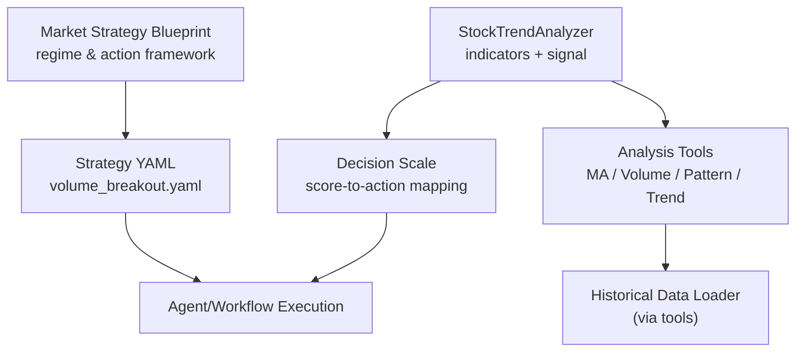
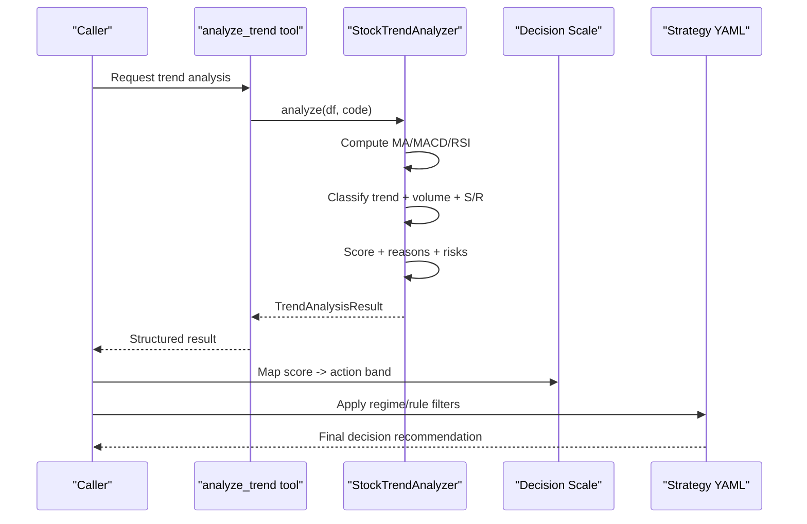
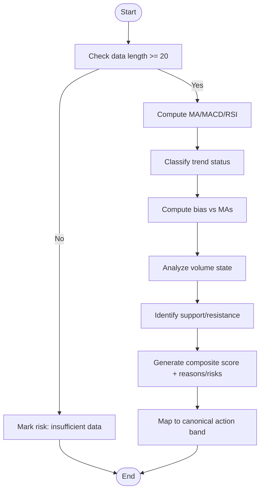
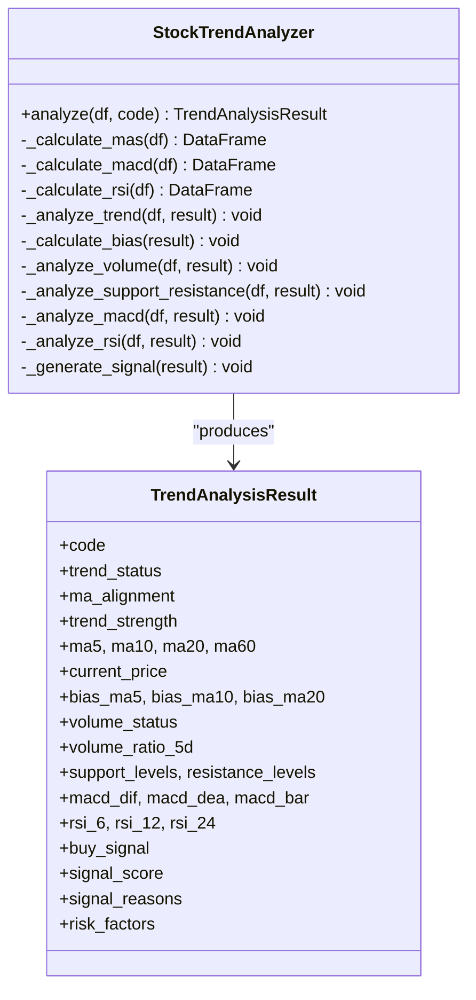
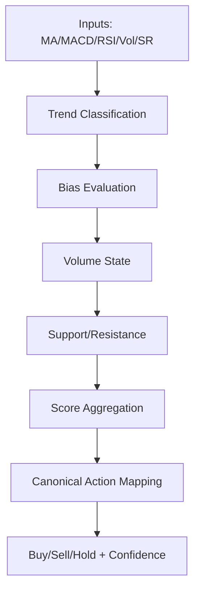
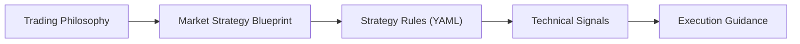
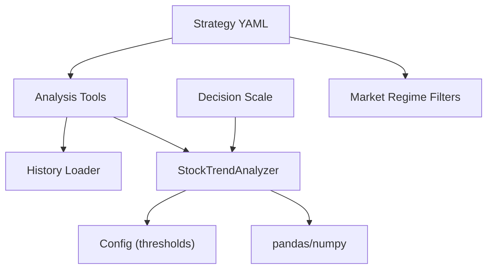
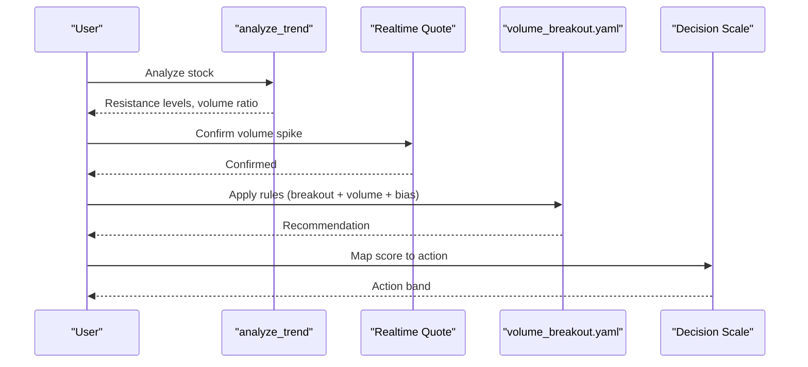

# Technical Analysis Stage

<cite>
**Referenced Files in This Document**
- [src/stock_analyzer.py](file://src/stock_analyzer.py)
- [src/agent/tools/analysis_tools.py](file://src/agent/tools/analysis_tools.py)
- [src/schemas/decision_scale.py](file://src/schemas/decision_scale.py)
- [strategies/volume_breakout.yaml](file://strategies/volume_breakout.yaml)
- [src/core/market_strategy.py](file://src/core/market_strategy.py)
- [tests/test_stock_analyzer_bias.py](file://tests/test_stock_analyzer_bias.py)
</cite>

## Table of Contents
1. Introduction
2. Project Structure
3. Core Components
4. Architecture Overview
5. Detailed Component Analysis
6. Dependency Analysis
7. Performance Considerations
8. Troubleshooting Guide
9. Conclusion
10. Appendices

## Introduction
This document explains the Technical Analysis Stage centered on StockTrendAnalyzer and its trend analysis processes. It covers multi-indicator analysis (moving averages, momentum indicators, volume analysis, pattern recognition), trend status determination (bullish, bearish, sideways), buy/sell signal generation with confidence scoring, integration with market strategy concepts and trading philosophy, configuration and threshold tuning, historical data requirements, handling insufficient data, and how technical signals relate to broader market context in decision-making.

## Project Structure
The Technical Analysis Stage is implemented primarily in:
- A core analyzer that computes indicators, determines trend status, and generates signals
- Tooling that exposes analysis capabilities via tools for agents and APIs
- Strategy definitions that tie technical signals to actionable rules
- A canonical decision scale that maps scores to actions consistently across the system

**Diagram sources**
- [src/stock_analyzer.py:172-263](file://src/stock_analyzer.py#L172-L263)
- [src/agent/tools/analysis_tools.py:42-87](file://src/agent/tools/analysis_tools.py#L42-L87)
- [src/schemas/decision_scale.py:25-31](file://src/schemas/decision_scale.py#L25-L31)
- [strategies/volume_breakout.yaml:1-48](file://strategies/volume_breakout.yaml#L1-L48)
- [src/core/market_strategy.py:68-98](file://src/core/market_strategy.py#L68-L98)

**Section sources**
- [src/stock_analyzer.py:172-263](file://src/stock_analyzer.py#L172-L263)
- [src/agent/tools/analysis_tools.py:42-87](file://src/agent/tools/analysis_tools.py#L42-L87)
- [src/schemas/decision_scale.py:25-31](file://src/schemas/decision_scale.py#L25-L31)
- [strategies/volume_breakout.yaml:1-48](file://strategies/volume_breakout.yaml#L1-L48)
- [src/core/market_strategy.py:68-98](file://src/core/market_strategy.py#L68-L98)

## Core Components
- StockTrendAnalyzer: Computes moving averages, MACD, RSI; classifies trend status; analyzes volume and support/resistance; generates a composite score and buy/sell signal.
- Analysis Tools: Expose MA calculation, volume analysis, pattern recognition, and full trend analysis as callable tools.
- Decision Scale: Canonical mapping from 0–100 score to action bands (strong buy, buy, watch, reduce, sell).
- Strategy Definitions: YAML-based strategies (e.g., volume breakout) that combine technical signals with explicit rules and market regime filters.
- Market Strategy Blueprint: High-level market regime and action framework used to contextualize decisions.

Key responsibilities:
- Indicator computation and validation
- Multi-factor scoring and signal generation
- Consistent action mapping via canonical scale
- Integration points for strategies and market context

**Section sources**
- [src/stock_analyzer.py:172-263](file://src/stock_analyzer.py#L172-L263)
- [src/agent/tools/analysis_tools.py:42-87](file://src/agent/tools/analysis_tools.py#L42-L87)
- [src/schemas/decision_scale.py:25-31](file://src/schemas/decision_scale.py#L25-L31)
- [strategies/volume_breakout.yaml:1-48](file://strategies/volume_breakout.yaml#L1-L48)
- [src/core/market_strategy.py:68-98](file://src/core/market_strategy.py#L68-L98)

## Architecture Overview
The technical analysis pipeline ingests OHLCV data, computes indicators, evaluates trend and volume conditions, and produces a scored signal aligned with the canonical decision scale. Strategies can wrap these signals into rule-based entries conditioned on market regimes.

**Diagram sources**
- [src/agent/tools/analysis_tools.py:42-87](file://src/agent/tools/analysis_tools.py#L42-L87)
- [src/stock_analyzer.py:206-263](file://src/stock_analyzer.py#L206-L263)
- [src/schemas/decision_scale.py:25-31](file://src/schemas/decision_scale.py#L25-L31)
- [strategies/volume_breakout.yaml:1-48](file://strategies/volume_breakout.yaml#L1-L48)

## Detailed Component Analysis

### StockTrendAnalyzer: Indicators, Trend Status, and Signal Generation
- Moving Averages: MA5/MA10/MA20/MA60 computed via rolling means; MA60 falls back to MA20 when insufficient data.
- MACD: Standard parameters (12/26/9); detects golden/death crosses and zero-axis crossings.
- RSI: Wilder’s EMA-style implementation for short/mid/long periods; neutral default when insufficient data.
- Trend Status: Based on MA alignment and spread dynamics; categories include strong bull, bull, weak bull, consolidation, weak bear, bear, strong bear.
- Volume Analysis: Compares latest volume to 5-day average; categorizes heavy/shrink/normal with directional price context.
- Support/Resistance: Identifies MA-based supports and recent highs as resistance.
- Scoring: Weighted composite across trend, bias, volume, support, MACD, RSI; mapped to canonical action bands.

**Diagram sources**
- [src/stock_analyzer.py:206-263](file://src/stock_analyzer.py#L206-L263)
- [src/stock_analyzer.py:265-339](file://src/stock_analyzer.py#L265-L339)
- [src/stock_analyzer.py:341-447](file://src/stock_analyzer.py#L341-L447)
- [src/stock_analyzer.py:449-583](file://src/stock_analyzer.py#L449-L583)
- [src/stock_analyzer.py:585-754](file://src/stock_analyzer.py#L585-L754)

**Section sources**
- [src/stock_analyzer.py:206-263](file://src/stock_analyzer.py#L206-L263)
- [src/stock_analyzer.py:265-339](file://src/stock_analyzer.py#L265-L339)
- [src/stock_analyzer.py:341-447](file://src/stock_analyzer.py#L341-L447)
- [src/stock_analyzer.py:449-583](file://src/stock_analyzer.py#L449-L583)
- [src/stock_analyzer.py:585-754](file://src/stock_analyzer.py#L585-L754)

### Multi-Indicator Analysis Details
- Moving Averages: Rolling windows produce MA5/MA10/MA20/MA60; MA60 uses MA20 fallback if <60 days available.
- Momentum Indicators:
  - MACD: DIF/DEA/bar computed; cross and zero-axis crossing logic yields status and textual signal.
  - RSI: Short/mid/long RSI values; mid-period drives status classification with thresholds.
- Volume Analysis: Ratio of latest volume to 5-day average; combined with daily price change to classify volume-price behavior.
- Pattern Recognition: Candlestick and chart patterns detected over a configurable window (e.g., Doji, Hammer, Engulfing, Morning/Evening Star, Double Bottom, breakout, box oscillation).

**Diagram sources**
- [src/stock_analyzer.py:172-263](file://src/stock_analyzer.py#L172-L263)
- [src/stock_analyzer.py:265-339](file://src/stock_analyzer.py#L265-L339)
- [src/stock_analyzer.py:341-583](file://src/stock_analyzer.py#L341-L583)
- [src/stock_analyzer.py:585-754](file://src/stock_analyzer.py#L585-L754)

**Section sources**
- [src/stock_analyzer.py:265-339](file://src/stock_analyzer.py#L265-L339)
- [src/agent/tools/analysis_tools.py:323-497](file://src/agent/tools/analysis_tools.py#L323-L497)

### Trend Status Determination and Buy/Sell Signals
- Trend Status: Derived from MA ordering and spread expansion/compression; includes strong bull/bear and consolidation states.
- Signal Generation: Composite scoring across trend, bias, volume, support, MACD, RSI; final mapping to canonical action bands ensures consistent interpretation.
- Confidence Scoring: The score (0–100) reflects confluence of factors; reasons and risks are recorded for transparency.

**Diagram sources**
- [src/stock_analyzer.py:341-447](file://src/stock_analyzer.py#L341-L447)
- [src/stock_analyzer.py:585-754](file://src/stock_analyzer.py#L585-L754)
- [src/schemas/decision_scale.py:25-31](file://src/schemas/decision_scale.py#L25-L31)

**Section sources**
- [src/stock_analyzer.py:341-447](file://src/stock_analyzer.py#L341-L447)
- [src/stock_analyzer.py:585-754](file://src/stock_analyzer.py#L585-L754)
- [src/schemas/decision_scale.py:25-31](file://src/schemas/decision_scale.py#L25-L31)
- [tests/test_stock_analyzer_bias.py:186-316](file://tests/test_stock_analyzer_bias.py#L186-L316)

### Integration with Market Strategy Concepts and Trading Philosophy
- Trading Philosophy: Emphasizes strict entry discipline, trend-following, efficiency, pullback entries, and risk checks.
- Market Strategy Blueprint: Defines dimensions (e.g., capital sentiment, leading themes) and an action framework (offense, balanced, defense) to set risk posture.
- Strategy YAML: Encodes concrete rules combining technical signals (e.g., breakout above resistance with volume confirmation) and post-trade validations.

**Diagram sources**
- [src/core/market_strategy.py:68-98](file://src/core/market_strategy.py#L68-L98)
- [strategies/volume_breakout.yaml:1-48](file://strategies/volume_breakout.yaml#L1-L48)

**Section sources**
- [src/core/market_strategy.py:68-98](file://src/core/market_strategy.py#L68-L98)
- [strategies/volume_breakout.yaml:1-48](file://strategies/volume_breakout.yaml#L1-L48)

### Historical Data Requirements and Handling Insufficient Data
- Minimum Data:
  - Trend analysis requires at least 20 days; otherwise returns insufficient data risk factor.
  - MACD and RSI require sufficient history relative to their periods; otherwise return “insufficient data” signals.
  - Pattern detection requires a minimum window (e.g., ≥10 days) to identify candlestick/chart patterns reliably.
- Fallbacks:
  - MA60 falls back to MA20 when <60 days are available.
  - RSI defaults to neutral when insufficient data.
- Tool-Level Guards:
  - Tools explicitly check data availability and return errors or warnings when thresholds are not met.

**Section sources**
- [src/stock_analyzer.py:206-222](file://src/stock_analyzer.py#L206-L222)
- [src/stock_analyzer.py:265-275](file://src/stock_analyzer.py#L265-L275)
- [src/stock_analyzer.py:491-493](file://src/stock_analyzer.py#L491-L493)
- [src/stock_analyzer.py:554-556](file://src/stock_analyzer.py#L554-L556)
- [src/agent/tools/analysis_tools.py:42-44](file://src/agent/tools/analysis_tools.py#L42-L44)
- [src/agent/tools/analysis_tools.py:323-334](file://src/agent/tools/analysis_tools.py#L323-L334)

### Custom Indicator Configuration, Threshold Tuning, and Signal Interpretation
- Configurable Parameters:
  - Bias threshold influences whether price deviations from MA5 trigger caution or acceptance; strong trends may relax thresholds conditionally.
  - Volume thresholds define heavy/shrink classifications.
  - MACD and RSI periods are fixed but can be conceptually tuned by adjusting underlying logic if needed.
- Tuning Examples:
  - Adjust bias_threshold to tighten/loosen entry discipline against chasing.
  - Modify volume ratios to adapt to different liquidity environments.
  - Use pattern detection windows to balance sensitivity vs. reliability.
- Signal Interpretation:
  - Reasons and risk factors explain drivers behind scores.
  - Canonical action mapping standardizes interpretation across systems.

**Section sources**
- [src/stock_analyzer.py:585-665](file://src/stock_analyzer.py#L585-L665)
- [src/stock_analyzer.py:667-727](file://src/stock_analyzer.py#L667-L727)
- [tests/test_stock_analyzer_bias.py:183-189](file://tests/test_stock_analyzer_bias.py#L183-L189)

### Relationship Between Technical Signals and Broader Market Context
- Market Regime: The blueprint defines regime-aware action frameworks (offense/balanced/defense) to calibrate aggressiveness.
- Daily Market Context: Low-sensitivity summaries and risk tags inform conservative guardrails in decision-making.
- Strategy Alignment: Strategies specify required market regimes (e.g., trending_up) to ensure technical signals are traded in favorable contexts.

**Section sources**
- [src/core/market_strategy.py:68-98](file://src/core/market_strategy.py#L68-L98)
- [strategies/volume_breakout.yaml:1-15](file://strategies/volume_breakout.yaml#L1-L15)

## Dependency Analysis
- StockTrendAnalyzer depends on pandas/numpy for indicator calculations and reads configuration for thresholds.
- Analysis tools depend on history loaders to fetch OHLCV data and expose functions for MA, volume, pattern, and trend analysis.
- Decision scale provides a stable mapping layer ensuring consistency between scores and actions.
- Strategy YAML files declare required tools and market regimes, linking technical outputs to execution rules.

**Diagram sources**
- [src/stock_analyzer.py:172-263](file://src/stock_analyzer.py#L172-L263)
- [src/agent/tools/analysis_tools.py:42-87](file://src/agent/tools/analysis_tools.py#L42-L87)
- [src/schemas/decision_scale.py:25-31](file://src/schemas/decision_scale.py#L25-L31)
- [strategies/volume_breakout.yaml:1-48](file://strategies/volume_breakout.yaml#L1-L48)

**Section sources**
- [src/stock_analyzer.py:172-263](file://src/stock_analyzer.py#L172-L263)
- [src/agent/tools/analysis_tools.py:42-87](file://src/agent/tools/analysis_tools.py#L42-L87)
- [src/schemas/decision_scale.py:25-31](file://src/schemas/decision_scale.py#L25-L31)
- [strategies/volume_breakout.yaml:1-48](file://strategies/volume_breakout.yaml#L1-L48)

## Performance Considerations
- Indicator Computation: Rolling and exponential operations are vectorized; ensure data frames are sorted by date before processing.
- Window Sizes: Larger windows increase accuracy but also memory and compute; choose minimal sufficient windows for your use case.
- Fallbacks: MA60 fallback avoids failures on shorter histories; consider caching results if re-analyzing frequently.
- Tool Calls: Batch requests where possible to minimize repeated data fetching.

[No sources needed since this section provides general guidance]

## Troubleshooting Guide
- Insufficient Data:
  - Trend analysis requires ≥20 days; pattern detection requires ≥10 days; MACD/RSI need enough history for their periods.
  - When insufficient, expect risk factors or explicit error messages indicating data limitations.
- Unexpected Signals:
  - Review reasons and risk factors attached to the score.
  - Validate thresholds (e.g., bias_threshold) and volume ratios against current market conditions.
- Strategy Misfires:
  - Ensure market regime filters match current environment.
  - Confirm required tools are available and returning expected fields.

**Section sources**
- [src/stock_analyzer.py:206-222](file://src/stock_analyzer.py#L206-L222)
- [src/stock_analyzer.py:491-493](file://src/stock_analyzer.py#L491-L493)
- [src/stock_analyzer.py:554-556](file://src/stock_analyzer.py#L554-L556)
- [src/agent/tools/analysis_tools.py:42-44](file://src/agent/tools/analysis_tools.py#L42-L44)
- [src/agent/tools/analysis_tools.py:323-334](file://src/agent/tools/analysis_tools.py#L323-L334)

## Conclusion
The Technical Analysis Stage provides a robust, multi-indicator framework anchored by clear trend classification, volume analysis, momentum indicators, and pattern recognition. Signals are scored and mapped to a canonical decision scale, ensuring consistent interpretation. Strategies and market strategy blueprints connect technical signals to actionable regimes and philosophies, while safeguards handle insufficient data and align decisions with broader market context.

[No sources needed since this section summarizes without analyzing specific files]

## Appendices

### Example: Volume Breakout Strategy Workflow

**Diagram sources**
- [src/agent/tools/analysis_tools.py:42-87](file://src/agent/tools/analysis_tools.py#L42-L87)
- [strategies/volume_breakout.yaml:17-48](file://strategies/volume_breakout.yaml#L17-L48)
- [src/schemas/decision_scale.py:25-31](file://src/schemas/decision_scale.py#L25-L31)