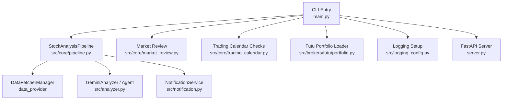
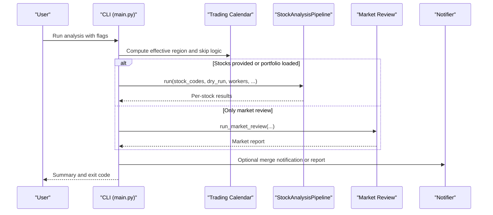
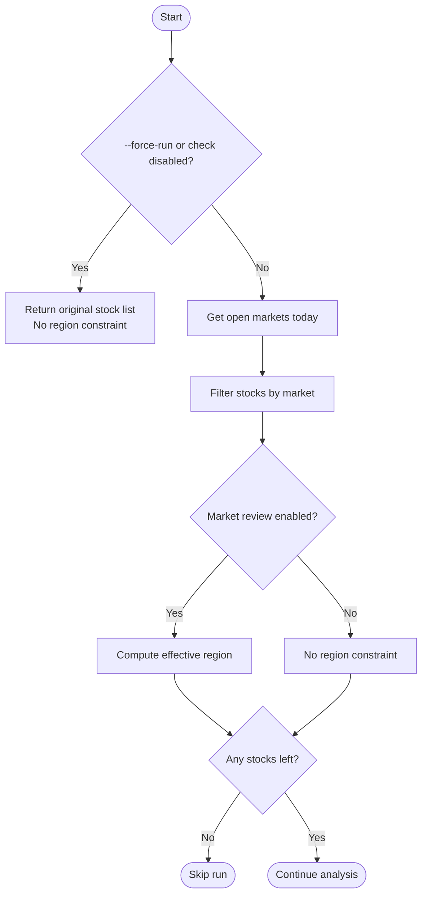
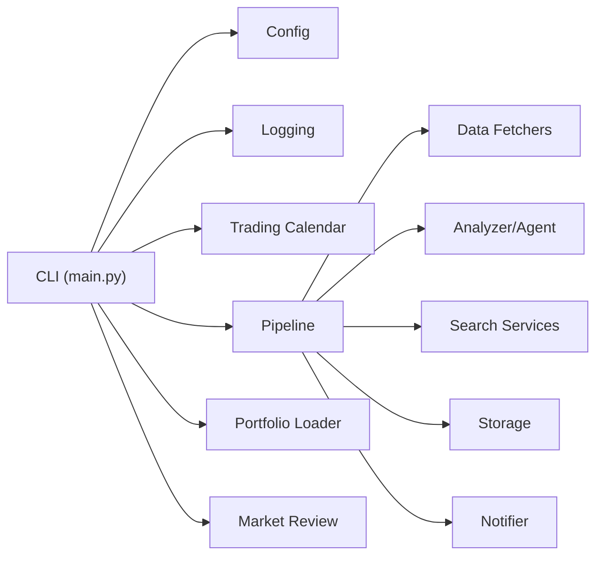

# Analysis Commands

<cite>
**Referenced Files in This Document**
- [main.py](file://main.py)
- [server.py](file://server.py)
- [src/core/pipeline.py](file://src/core/pipeline.py)
- [src/services/analysis_service.py](file://src/services/analysis_service.py)
- [src/core/trading_calendar.py](file://src/core/trading_calendar.py)
- [src/brokers/futu/portfolio.py](file://src/brokers/futu/portfolio.py)
- [src/logging_config.py](file://src/logging_config.py)
</cite>

## Table of Contents
1. [Introduction](#introduction)
2. [Project Structure](#project-structure)
3. [Core Components](#core-components)
4. [Architecture Overview](#architecture-overview)
5. [Detailed Component Analysis](#detailed-component-analysis)
6. [Dependency Analysis](#dependency-analysis)
7. [Performance Considerations](#performance-considerations)
8. [Troubleshooting Guide](#troubleshooting-guide)
9. [Conclusion](#conclusion)

## Introduction
This document explains the stock analysis commands and execution flow for individual and batch analysis. It covers how to target specific stocks, run market-wide analysis, integrate with broker holdings, control concurrency, optimize performance, and handle errors and logging. It also documents how the system integrates with daily market review functionality and how to use dry-run mode for safe testing.

## Project Structure
The command-line entry point is implemented in the main module, which parses arguments, resolves configuration, applies trading-day filters, and orchestrates the analysis pipeline. The core pipeline coordinates data fetching, context building, AI analysis, notifications, and reporting. A FastAPI server can be started alongside or independently to expose analysis via API.

**Diagram sources**
- [main.py:272-443](file://main.py#L272-L443)
- [src/core/pipeline.py:209-319](file://src/core/pipeline.py#L209-L319)
- [src/core/trading_calendar.py:154-175](file://src/core/trading_calendar.py#L154-L175)
- [src/brokers/futu/portfolio.py:20-49](file://src/brokers/futu/portfolio.py#L20-L49)
- [server.py:1-55](file://server.py#L1-L55)

**Section sources**
- [main.py:272-443](file://main.py#L272-L443)
- [server.py:1-55](file://server.py#L1-L55)

## Core Components
- Command-line argument parsing and modes:
  - Individual and batch stock analysis via --stocks.
  - Broker portfolio-driven analysis via --portfolio futu.
  - Dry-run mode via --dry-run to fetch data without AI analysis.
  - Force-run bypass for trading day checks via --force-run.
  - Concurrency control via --workers.
  - Context snapshot toggle via --no-context-snapshot.
  - Market review integration via --market-review and --no-market-review.
  - Notification controls via --no-notify, --check-notify, --single-notify.
  - Scheduling and service modes via --schedule, --webui/--serve options.

- Analysis pipeline:
  - StockAnalysisPipeline manages data fetching, trend analysis, news/intelligence search, market phase context, LLM-based analysis, decision extraction, and notifications.

- Trading calendar and market review:
  - Trading-day filtering per stock and region-aware market review scheduling.
  - Reuse of daily market context to avoid redundant work.

- Portfolio integration:
  - Futu portfolio loader reads real holdings and converts codes for analysis.

**Section sources**
- [main.py:272-443](file://main.py#L272-L443)
- [src/core/pipeline.py:209-319](file://src/core/pipeline.py#L209-L319)
- [src/core/trading_calendar.py:154-175](file://src/core/trading_calendar.py#L154-L175)
- [src/brokers/futu/portfolio.py:20-49](file://src/brokers/futu/portfolio.py#L20-L49)

## Architecture Overview
The analysis workflow starts from the CLI, resolves stock scope (explicit list or broker portfolio), applies trading-day filters, optionally runs market review, then executes per-stock analysis through the pipeline. Results are saved, reported, and optionally merged into a single notification or document.

**Diagram sources**
- [main.py:719-1131](file://main.py#L719-L1131)
- [src/core/pipeline.py:209-319](file://src/core/pipeline.py#L209-L319)
- [src/core/trading_calendar.py:154-175](file://src/core/trading_calendar.py#L154-L175)

## Detailed Component Analysis

### Main CLI and Argument Handling
Key parameters and behaviors:
- --stocks: Comma-separated stock codes; overrides config watchlist when provided.
- --portfolio: Currently supports futu; replaces stock list with real holdings.
- --dry-run: Fetches data only; skips AI analysis.
- --force-run: Skips trading day checks to force full analysis.
- --workers: Overrides max_workers for concurrency.
- --no-context-snapshot: Disables saving analysis context snapshots for performance.
- --market-review / --no-market-review: Control market review execution.
- --no-notify / --check-notify / --single-notify: Control notifications.
- --schedule / --webui / --serve: Service and scheduling modes.

Execution highlights:
- Portfolio resolution happens early; if empty and no market review requested, the run may skip analysis.
- Trading-day filter computes effective region and per-stock availability; can skip entire run if all markets closed unless forced.
- Pipeline is constructed with query_id, source, worker count, and context snapshot settings.
- Market review can reuse daily context to avoid duplicate work.
- Results are summarized and optional merged reports are sent.

Practical examples:
- Analyze specific stocks: python main.py --stocks 600519,000001
- Use Futu portfolio: python main.py --portfolio futu
- Dry-run test: python main.py --dry-run
- Force non-trading day run: python main.py --force-run
- Limit concurrency: python main.py --workers 4
- Disable context snapshots: python main.py --no-context-snapshot
- Only market review: python main.py --market-review

**Section sources**
- [main.py:272-443](file://main.py#L272-L443)
- [main.py:719-1131](file://main.py#L719-L1131)

### Analysis Pipeline
Responsibilities:
- Initialize services (fetcher manager, analyzer, notifier, market structure/hotspot services).
- For each stock:
  - Fetch and save daily data with resume support.
  - Gather realtime quotes and chip distribution where enabled.
  - Build fundamental and market structure context.
  - Perform trend analysis using historical bars and optional realtime augmentation.
  - Search intelligence (news, social sentiment for US stocks).
  - Load daily market context when enabled.
  - Enhance context with realtime, chip, trend, portfolio, and market phase info.
  - Invoke LLM/Agent analysis and record diagnostics.
  - Persist decisions and signals, generate reports, and send notifications.

Concurrency and progress:
- Uses ThreadPoolExecutor internally for parallel tasks.
- Emits progress callbacks for streaming UIs and task tracking.

**Section sources**
- [src/core/pipeline.py:209-319](file://src/core/pipeline.py#L209-L319)
- [src/core/pipeline.py:358-800](file://src/core/pipeline.py#L358-L800)

### Trading Day Filtering and Market Review Integration
- _compute_trading_day_filter:
  - If --force-run or trading day check disabled, returns original stock list and no region constraint.
  - Otherwise, uses open markets today to filter stocks by their market and compute effective region for market review.
  - Returns should_skip_all when no stocks remain and no relevant markets are open.

- Market review reuse:
  - Daily market context is primed before stock analysis when enabled.
  - If stock analysis produces a reusable context, market review can be skipped and reused content saved/sent.

**Diagram sources**
- [main.py:446-485](file://main.py#L446-L485)
- [src/core/trading_calendar.py:154-175](file://src/core/trading_calendar.py#L154-L175)

**Section sources**
- [main.py:446-485](file://main.py#L446-L485)
- [main.py:822-998](file://main.py#L822-L998)

### Portfolio Integration (Futu)
- --portfolio futu loads real holdings from Futu OpenD.
- Filters to LONG positions, excludes shorts and non-stocks, deduplicates codes, and normalizes them for analysis.
- Errors during portfolio loading propagate to the caller to ensure clear failure semantics.

Usage example:
- python main.py --portfolio futu

**Section sources**
- [main.py:538-554](file://main.py#L538-L554)
- [src/brokers/futu/portfolio.py:20-49](file://src/brokers/futu/portfolio.py#L20-L49)
- [src/brokers/futu/portfolio.py:287-316](file://src/brokers/futu/portfolio.py#L287-L316)

### API and Service Modes
- server.py initializes logging and exposes the FastAPI app for REST endpoints.
- main.py can start the API server in-process and optionally schedule analyses or run immediately based on flags and environment.

Use cases:
- Start API only: python main.py --serve-only
- Start API and run scheduled jobs: python main.py --serve --schedule

**Section sources**
- [server.py:1-55](file://server.py#L1-L55)
- [main.py:1403-1558](file://main.py#L1403-L1558)

## Dependency Analysis
- CLI depends on:
  - Configuration and logging setup.
  - Trading calendar utilities for day checks.
  - Pipeline for analysis orchestration.
  - Portfolio loader for broker holdings.
  - Market review for macro context.
  - Notifier for outputs and reports.

- Pipeline depends on:
  - Data fetchers for history, realtime, fundamentals, chips.
  - Analyzer/Agent for LLM-based insights.
  - Search services for news and social sentiment.
  - Storage for persistence and snapshots.
  - Decision signal extractors and summarizers.

**Diagram sources**
- [main.py:272-443](file://main.py#L272-L443)
- [src/core/pipeline.py:209-319](file://src/core/pipeline.py#L209-L319)

**Section sources**
- [main.py:272-443](file://main.py#L272-L443)
- [src/core/pipeline.py:209-319](file://src/core/pipeline.py#L209-L319)

## Performance Considerations
- Concurrency:
  - Adjust --workers to match system resources and external API limits.
  - Pipeline uses thread pools; excessive workers may cause rate limiting or resource contention.

- Context snapshots:
  - Use --no-context-snapshot to disable saving full analysis context snapshots when storage or I/O is constrained.

- Market review reuse:
  - When enabled, daily market context is primed and reused to avoid redundant generation.

- Data freshness:
  - Resume support avoids re-fetching existing daily data; force refresh can be used when needed.

[No sources needed since this section provides general guidance]

## Troubleshooting Guide
Common issues and resolutions:
- Empty stock list:
  - Ensure STOCK_LIST is configured or provide --stocks; otherwise, analysis may skip unless market review is enabled.

- No report generated:
  - Check expected outputs: stock reports and/or market review. If neither produced, logs indicate failure reasons such as empty_stock_list, report_save_failed, or no_report.

- Trading day skip:
  - On non-trading days, analysis may be skipped per market; use --force-run to override.

- Portfolio load failures:
  - Futu portfolio errors propagate clearly; verify OpenD connectivity and account configuration.

- Notifications not sent:
  - Use --check-notify to validate configuration; ensure channels are available and properly configured.

- Logging:
  - Enable debug mode with --debug for detailed logs.
  - Logs are written to configured log_dir; fallback to console if file I/O fails.

Error handling patterns:
- Pipeline stages fail-open where appropriate (e.g., search service initialization, market hotspot service).
- Final result aggregation ensures partial failures do not block entire runs unless critical.

**Section sources**
- [main.py:719-1131](file://main.py#L719-L1131)
- [src/core/pipeline.py:209-319](file://src/core/pipeline.py#L209-L319)
- [src/logging_config.py:1-200](file://src/logging_config.py#L1-L200)

## Conclusion
The analysis commands provide flexible control over stock analysis scope, concurrency, and output behavior. You can analyze specific stocks, process broker portfolios, run market-wide reviews, and safely test configurations with dry-run. Integrating with market review enhances contextual insights while optimizing performance through context reuse and configurable concurrency. Robust error handling and logging help diagnose issues quickly and maintain reliable operations.

[No sources needed since this section summarizes without analyzing specific files]