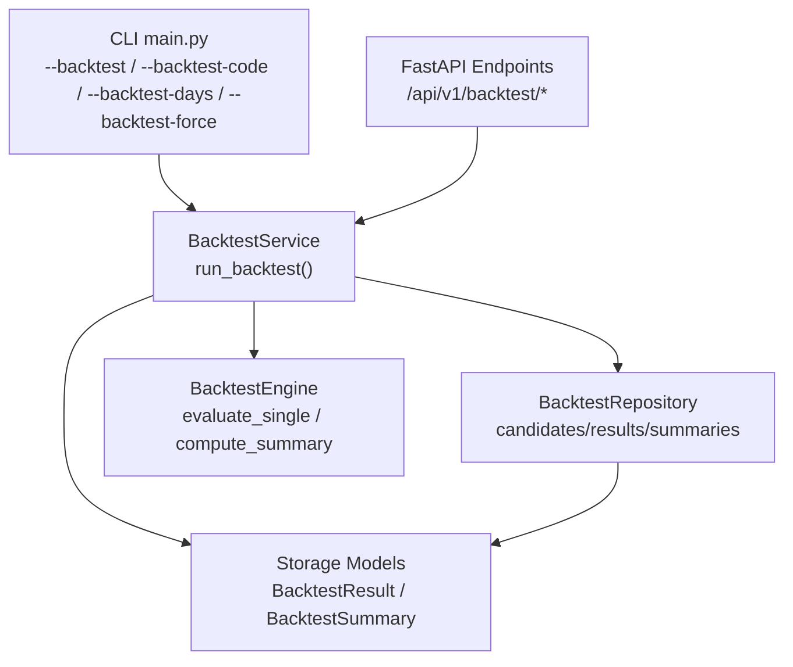
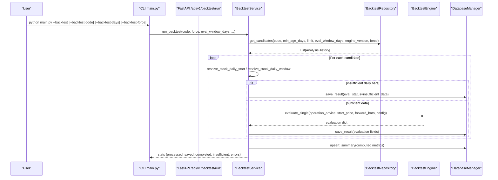
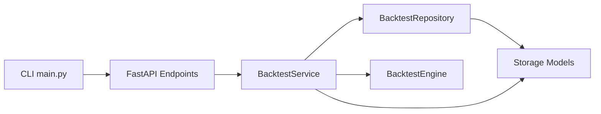

# Backtesting Commands

<cite>
**Referenced Files in This Document**
- [main.py](file://main.py)
- [src/services/backtest_service.py](file://src/services/backtest_service.py)
- [src/core/backtest_engine.py](file://src/core/backtest_engine.py)
- [api/v1/endpoints/backtest.py](file://api/v1/endpoints/backtest.py)
- [api/v1/schemas/backtest.py](file://api/v1/schemas/backtest.py)
- [src/repositories/backtest_repo.py](file://src/repositories/backtest_repo.py)
- [src/storage.py](file://src/storage.py)
- [src/config.py](file://src/config.py)
</cite>

## Table of Contents
1. [Introduction](#introduction)
2. [Project Structure](#project-structure)
3. [Core Components](#core-components)
4. [Architecture Overview](#architecture-overview)
5. [Detailed Component Analysis](#detailed-component-analysis)
6. [Dependency Analysis](#dependency-analysis)
7. [Performance Considerations](#performance-considerations)
8. [Troubleshooting Guide](#troubleshooting-guide)
9. [Conclusion](#conclusion)
10. [Appendices](#appendices)

## Introduction
This document explains the backtesting commands and workflows that evaluate historical analysis performance and validate strategy effectiveness. It covers:
- Command-line flags for running backtests, targeting specific stocks, configuring evaluation windows, and forcing re-execution.
- How backtesting uses historical analysis results and forward daily price data to compute outcomes and metrics.
- Practical usage examples for time-bounded runs, multi-stock evaluations, and result interpretation.
- Configuration options, storage schema, and integration points with strategy development.
- Performance considerations, memory management tips, and troubleshooting guidance.

## Project Structure
Backtesting spans CLI entry points, API endpoints, service orchestration, a pure logic engine, repository queries, and persistent storage models. The flow is:
- CLI parses flags and triggers backtest execution (or auto-backtest).
- API endpoints expose run/results/performance operations.
- Service coordinates candidate selection, daily window resolution, engine evaluation, persistence, and summary recomputation.
- Engine computes outcomes, direction correctness, simulated returns, and target hit statistics.
- Repository handles filtering, pagination, and summary upserts.
- Storage defines tables for individual results and aggregated summaries.

**Diagram sources**
- [main.py:416-441](file://main.py#L416-L441)
- [api/v1/endpoints/backtest.py:45-85](file://api/v1/endpoints/backtest.py#L45-L85)
- [src/services/backtest_service.py:45-309](file://src/services/backtest_service.py#L45-L309)
- [src/core/backtest_engine.py:158-273](file://src/core/backtest_engine.py#L158-L273)
- [src/repositories/backtest_repo.py:42-80](file://src/repositories/backtest_repo.py#L42-L80)
- [src/storage.py:402-522](file://src/storage.py#L402-L522)

**Section sources**
- [main.py:416-441](file://main.py#L416-L441)
- [api/v1/endpoints/backtest.py:45-85](file://api/v1/endpoints/backtest.py#L45-L85)
- [src/services/backtest_service.py:45-309](file://src/services/backtest_service.py#L45-L309)
- [src/core/backtest_engine.py:158-273](file://src/core/backtest_engine.py#L158-L273)
- [src/repositories/backtest_repo.py:42-80](file://src/repositories/backtest_repo.py#L42-L80)
- [src/storage.py:402-522](file://src/storage.py#L402-L522)

## Core Components
- CLI arguments:
  - --backtest: triggers backtest evaluation on historical analysis records.
  - --backtest-code: restricts backtest to a specific stock code.
  - --backtest-days: sets the evaluation window in trading days.
  - --backtest-force: forces re-execution even if results already exist.
- Service layer:
  - Validates parameters, resolves candidates, fetches daily windows, runs engine evaluation, persists results, and recomputes summaries.
- Engine:
  - Pure logic for outcome classification, direction correctness, simulated entry/exit, stop-loss/take-profit hits, and aggregate metrics.
- Repository:
  - Queries eligible analysis history, paginates results, filters by date/code/window/version, and upserts summaries.
- Storage:
  - Defines backtest_results and backtest_summaries tables with unique constraints and indexes.

**Section sources**
- [main.py:416-441](file://main.py#L416-L441)
- [src/services/backtest_service.py:45-309](file://src/services/backtest_service.py#L45-L309)
- [src/core/backtest_engine.py:158-273](file://src/core/backtest_engine.py#L158-L273)
- [src/repositories/backtest_repo.py:42-80](file://src/repositories/backtest_repo.py#L42-L80)
- [src/storage.py:402-522](file://src/storage.py#L402-L522)

## Architecture Overview
The backtesting system integrates CLI, API, service, engine, repository, and storage into a cohesive pipeline.

**Diagram sources**
- [main.py:416-441](file://main.py#L416-L441)
- [api/v1/endpoints/backtest.py:45-85](file://api/v1/endpoints/backtest.py#L45-L85)
- [src/services/backtest_service.py:45-309](file://src/services/backtest_service.py#L45-L309)
- [src/repositories/backtest_repo.py:42-80](file://src/repositories/backtest_repo.py#L42-L80)
- [src/core/backtest_engine.py:158-273](file://src/core/backtest_engine.py#L158-L273)
- [src/storage.py:402-522](file://src/storage.py#L402-L522)

## Detailed Component Analysis

### CLI Backtest Flags
- --backtest: Enables backtest mode; when combined with other flags, it runs evaluation against historical analysis records.
- --backtest-code: Filters candidates to a single stock code.
- --backtest-days: Overrides the evaluation window (trading days). If omitted, configuration default is used.
- --backtest-force: Forces re-computation even if existing results match the same window and engine version.

These flags are parsed and passed through to the service or used by auto-backtest routines.

**Section sources**
- [main.py:416-441](file://main.py#L416-L441)

### API Backtest Endpoints
- POST /api/v1/backtest/run: Triggers backtest evaluation with request body parameters including code, force, eval_window_days, min_age_days, analysis_date_from/to, limit.
- GET /api/v1/backtest/results: Paginated list of backtest results with optional filters (code, eval_window_days, analysis dates, phase).
- GET /api/v1/backtest/performance: Overall performance metrics summary.
- GET /api/v1/backtest/performance/{code}: Per-stock performance metrics summary.

Request/response schemas define validation ranges and field semantics for robust client interactions.

**Section sources**
- [api/v1/endpoints/backtest.py:45-242](file://api/v1/endpoints/backtest.py#L45-L242)
- [api/v1/schemas/backtest.py:15-114](file://api/v1/schemas/backtest.py#L15-L114)

### BacktestService Orchestration
Key responsibilities:
- Parameter validation and defaults from configuration.
- Candidate selection via repository with filters (code, age, window, version, force).
- Daily window resolution using stock identity and forward bar availability.
- Engine evaluation per candidate, persisting results, and recomputing summaries.
- Diagnostics and messages indicating why no work was done or why results are empty.

Important behaviors:
- Idempotent non-force runs avoid duplicate writes.
- Date-filtered runs align legacy result dates to snapshot dates for visibility.
- Large query sets trigger dynamic summary computation with row limits to protect performance.

**Section sources**
- [src/services/backtest_service.py:45-309](file://src/services/backtest_service.py#L45-L309)
- [src/services/backtest_service.py:311-497](file://src/services/backtest_service.py#L311-L497)
- [src/services/backtest_service.py:499-661](file://src/services/backtest_service.py#L499-L661)

### BacktestEngine Logic
Core logic includes:
- Direction inference from operation advice text (bullish/bearish/hold/wait), with negation handling.
- Position recommendation inference (long/cash) based on advice intent.
- Outcome classification using neutral band thresholds and expected direction.
- Simulated long-only execution with stop-loss and take-profit checks over forward bars.
- Summary aggregation across multiple results, computing win/loss/neutral rates, direction accuracy, average returns, target hit rates, and advice breakdown.

Complexity notes:
- Evaluation per candidate is O(W) where W is the evaluation window length.
- Summary computation is O(N) over N results.

**Section sources**
- [src/core/backtest_engine.py:112-155](file://src/core/backtest_engine.py#L112-L155)
- [src/core/backtest_engine.py:158-273](file://src/core/backtest_engine.py#L158-L273)
- [src/core/backtest_engine.py:367-479](file://src/core/backtest_engine.py#L367-L479)
- [src/core/backtest_engine.py:603-675](file://src/core/backtest_engine.py#L603-L675)
- [src/core/backtest_engine.py:688-778](file://src/core/backtest_engine.py#L688-L778)

### Repository and Storage
Repository provides:
- Candidate queries filtered by age, code, window, version, and force.
- Pagination and context-aware queries for results and summaries.
- Upsert of summaries keyed by scope, code, window, and version.

Storage models:
- backtest_results: one row per analysis evaluated, with unique constraint per analysis_history_id + eval_window_days + engine_version.
- backtest_summaries: aggregated metrics keyed by scope + code + eval_window_days + engine_version.

Indexes support efficient filtering by code, analysis_date, and evaluated_at.

**Section sources**
- [src/repositories/backtest_repo.py:42-80](file://src/repositories/backtest_repo.py#L42-L80)
- [src/repositories/backtest_repo.py:145-173](file://src/repositories/backtest_repo.py#L145-L173)
- [src/repositories/backtest_repo.py:175-354](file://src/repositories/backtest_repo.py#L175-L354)
- [src/repositories/backtest_repo.py:356-426](file://src/repositories/backtest_repo.py#L356-L426)
- [src/storage.py:402-522](file://src/storage.py#L402-L522)

### Configuration Options
Backtest-related settings are loaded from environment/configuration:
- backtest_enabled: toggles automatic backtest runs.
- backtest_eval_window_days: default evaluation window in trading days.
- backtest_min_age_days: minimum age of analysis records before eligibility.
- backtest_engine_version: version tag for result compatibility.
- backtest_neutral_band_pct: threshold for neutral band in outcome classification.

These values influence candidate selection, evaluation behavior, and summary computation.

**Section sources**
- [src/config.py:1182-1186](file://src/config.py#L1182-L1186)
- [src/config.py:2152-2156](file://src/config.py#L2152-L2156)

## Dependency Analysis
Backtesting depends on:
- CLI argument parsing and optional auto-backtest invocation.
- FastAPI endpoints for programmatic access.
- Service orchestrating repository queries, daily window resolution, engine evaluation, and persistence.
- Engine providing deterministic outcome and metric calculations.
- Repository abstracting database access and filtering.
- Storage defining schema and constraints.

**Diagram sources**
- [main.py:416-441](file://main.py#L416-L441)
- [api/v1/endpoints/backtest.py:45-242](file://api/v1/endpoints/backtest.py#L45-L242)
- [src/services/backtest_service.py:45-309](file://src/services/backtest_service.py#L45-L309)
- [src/repositories/backtest_repo.py:42-80](file://src/repositories/backtest_repo.py#L42-L80)
- [src/core/backtest_engine.py:158-273](file://src/core/backtest_engine.py#L158-L273)
- [src/storage.py:402-522](file://src/storage.py#L402-L522)

**Section sources**
- [main.py:416-441](file://main.py#L416-L441)
- [api/v1/endpoints/backtest.py:45-242](file://api/v1/endpoints/backtest.py#L45-L242)
- [src/services/backtest_service.py:45-309](file://src/services/backtest_service.py#L45-L309)
- [src/repositories/backtest_repo.py:42-80](file://src/repositories/backtest_repo.py#L42-L80)
- [src/core/backtest_engine.py:158-273](file://src/core/backtest_engine.py#L158-L273)
- [src/storage.py:402-522](file://src/storage.py#L402-L522)

## Performance Considerations
- Evaluation window size: Larger eval_window_days increases per-candidate cost linearly. Choose windows appropriate to strategy horizon.
- Candidate limits: Use limit to cap processed records; batch processing avoids excessive memory use.
- Force flag: Re-running with force deletes prior results for matching keys before inserting new ones; ensure this is intentional.
- Date filters: Narrow analysis_date_from/to reduces candidate set and speeds up runs.
- Dynamic summaries: When querying large result sets, the service enforces row limits to prevent heavy computations.
- Database indexes: Results and summaries leverage indexes on code, analysis_date, evaluated_at, and composite keys for efficient filtering.
- Memory management: Avoid overly large limits; prefer pagination for result retrieval and targeted code/date filters for runs.

[No sources needed since this section provides general guidance]

## Troubleshooting Guide
Common issues and resolutions:
- No matching analysis records:
  - Ensure analysis records exist and meet min_age_days and report_type filters.
  - Check code normalization and market mapping.
- Insufficient daily data:
  - Verify forward bars exist for the evaluation window; the service may attempt refill but can still fail if data is missing.
- Empty results after run:
  - Non-force runs skip existing results; use --backtest-force to recompute.
  - Review diagnostics message for reasons like no_new_results or insufficient_daily_data.
- Errors during evaluation:
  - Inspect backend logs for exceptions; invalid anchor prices or missing end close lead to unable/error statuses.
- Query too many rows:
  - Narrow filters (code, dates, phase) or reduce eval_window_days to stay within dynamic summary limits.

Operational tips:
- Use GET /api/v1/backtest/results with small page sizes to inspect recent outputs.
- Use GET /api/v1/backtest/performance and /api/v1/backtest/performance/{code} to quickly assess overall and per-stock metrics.
- Validate configuration values for backtest_eval_window_days and backtest_min_age_days.

**Section sources**
- [src/services/backtest_service.py:450-497](file://src/services/backtest_service.py#L450-L497)
- [api/v1/endpoints/backtest.py:45-242](file://api/v1/endpoints/backtest.py#L45-L242)
- [src/core/backtest_engine.py:158-273](file://src/core/backtest_engine.py#L158-L273)

## Conclusion
The backtesting subsystem provides a robust, configurable workflow to evaluate historical analysis performance and validate strategies. By combining CLI flags, API endpoints, service orchestration, deterministic engine logic, and persistent storage, users can:
- Run targeted backtests on specific stocks and time periods.
- Configure evaluation windows and force re-runs for iterative strategy refinement.
- Interpret detailed metrics including direction accuracy, win/loss rates, simulated returns, and target hit statistics.
- Integrate backtesting into automated pipelines and strategy development cycles while managing performance and reliability.

[No sources needed since this section summarizes without analyzing specific files]

## Appendices

### Practical Examples
- Run a backtest for a specific stock over a custom window:
  - CLI: python main.py --backtest --backtest-code 600519 --backtest-days 10
  - API: POST /api/v1/backtest/run with code="600519", eval_window_days=10
- Restrict by analysis date range:
  - API: POST /api/v1/backtest/run with analysis_date_from and analysis_date_to
- Force re-execution:
  - CLI: python main.py --backtest --backtest-force
  - API: POST /api/v1/backtest/run with force=true
- Retrieve results and performance:
  - GET /api/v1/backtest/results with code and date filters
  - GET /api/v1/backtest/performance and /api/v1/backtest/performance/{code}

[No sources needed since this section provides practical guidance]