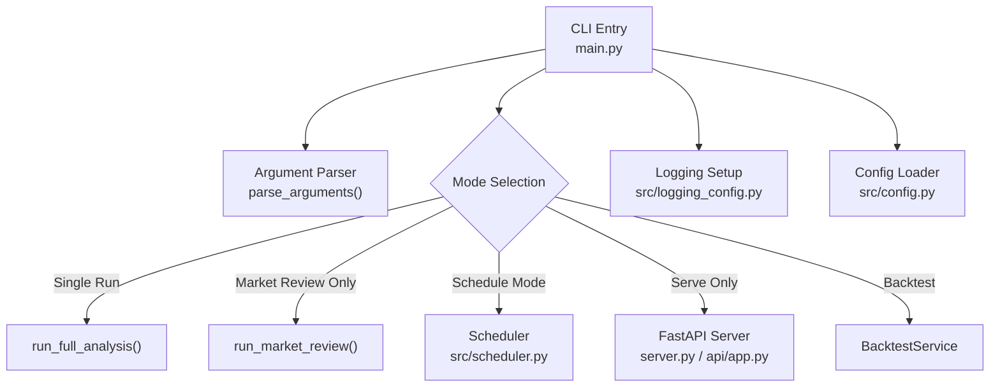
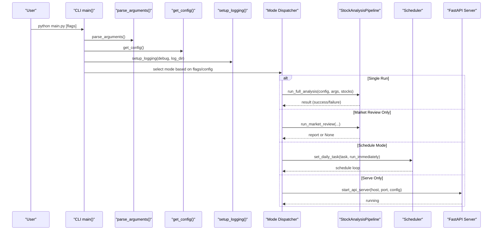
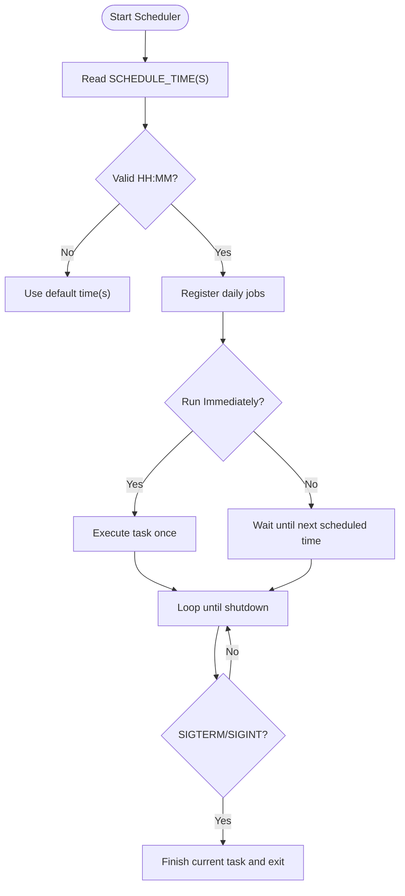
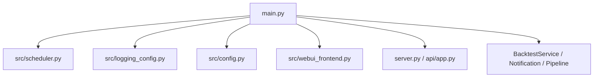

# CLI Commands

<cite>
**Referenced Files in This Document**
- [main.py](file://main.py)
- [server.py](file://server.py)
- [src/scheduler.py](file://src/scheduler.py)
- [src/logging_config.py](file://src/logging_config.py)
- [src/config.py](file://src/config.py)
- [src/webui_frontend.py](file://src/webui_frontend.py)
- [api/app.py](file://api/app.py)
- [docs/full-guide.md](file://docs/full-guide.md)
</cite>

## Table of Contents
1. [Introduction](#introduction)
2. [Project Structure](#project-structure)
3. [Core Components](#core-components)
4. [Architecture Overview](#architecture-overview)
5. [Detailed Component Analysis](#detailed-component-analysis)
6. [Dependency Analysis](#dependency-analysis)
7. [Performance Considerations](#performance-considerations)
8. [Troubleshooting Guide](#troubleshooting-guide)
9. [Conclusion](#conclusion)
10. [Appendices](#appendices)

## Introduction
This document provides comprehensive CLI documentation for automated analysis and batch processing. It covers all available commands, parameters, configuration flags, output formats, scripting workflows, scheduling, logging, error handling, debugging techniques, CI/CD integration, and cron job setup examples. The CLI is centered around a single entry point that supports daily stock analysis, market review generation, scheduled task management, service control (Web/API), and backtesting.

## Project Structure
The CLI is implemented as a Python application with:
- A primary CLI entry point that parses arguments and dispatches modes (single run, market review only, schedule mode, serve-only, backtest).
- A scheduler module for recurring tasks and graceful shutdown.
- Logging configuration supporting console and rotating file outputs.
- Configuration loading from environment variables and .env files.
- Optional Web/API server mode to expose REST endpoints and manage schedules at runtime.

**Diagram sources**
- [main.py:272-443](file://main.py#L272-L443)
- [main.py:1403-1736](file://main.py#L1403-L1736)
- [src/scheduler.py:82-200](file://src/scheduler.py#L82-L200)
- [server.py:1-55](file://server.py#L1-L55)
- [src/logging_config.py:89-157](file://src/logging_config.py#L89-L157)
- [src/config.py:1-200](file://src/config.py#L1-L200)

**Section sources**
- [main.py:272-443](file://main.py#L272-L443)
- [main.py:1403-1736](file://main.py#L1403-L1736)
- [server.py:1-55](file://server.py#L1-L55)
- [src/scheduler.py:82-200](file://src/scheduler.py#L82-L200)
- [src/logging_config.py:89-157](file://src/logging_config.py#L89-L157)
- [src/config.py:1-200](file://src/config.py#L1-L200)

## Core Components
- CLI argument parser defines all commands and flags for daily analysis, market review, scheduling, service control, and backtesting.
- Main dispatcher selects the execution mode based on flags and configuration.
- Scheduler manages recurring tasks with configurable times and graceful shutdown.
- Logging system writes to console and rotating log files with debug and info levels.
- Configuration loader reads environment variables and .env files, validates settings, and exposes typed accessors.
- Web/UI frontend preparation ensures static assets are present when serving the Web UI.

Key responsibilities:
- Daily analysis execution: parse stocks, filter by trading day, run pipeline, optional notifications.
- Market review generation: run market-wide review with region selection and lock protection.
- Scheduled task management: configure daily runs, immediate execution behavior, background tasks.
- Service control: start FastAPI server, optionally keep process alive, bind host/port resolution.
- Backtesting: run backtests over historical analysis results with filters and force options.

**Section sources**
- [main.py:272-443](file://main.py#L272-L443)
- [main.py:1403-1736](file://main.py#L1403-L1736)
- [src/scheduler.py:82-200](file://src/scheduler.py#L82-L200)
- [src/logging_config.py:89-157](file://src/logging_config.py#L89-L157)
- [src/config.py:1-200](file://src/config.py#L1-L200)
- [src/webui_frontend.py:236-322](file://src/webui_frontend.py#L236-L322)

## Architecture Overview
The CLI orchestrates multiple subsystems depending on the selected mode. It loads configuration, sets up logging, resolves stock lists or portfolio-based lists, applies trading-day filtering, and then executes either a single analysis run, a market review, a scheduled loop, or starts the API server.

**Diagram sources**
- [main.py:272-443](file://main.py#L272-L443)
- [main.py:1403-1736](file://main.py#L1403-L1736)
- [src/scheduler.py:82-200](file://src/scheduler.py#L82-L200)
- [server.py:1-55](file://server.py#L1-L55)

## Detailed Component Analysis

### CLI Arguments and Modes
The CLI supports the following commands and flags:
- --debug: Enable debug-level console logging during bootstrap and runtime.
- --dry-run: Fetch data without performing AI analysis.
- --stocks: Comma-separated list of stock codes to analyze; overrides configuration.
- --portfolio: Use broker portfolio (currently supported: futu); overrides --stocks and STOCK_LIST.
- --no-notify: Disable sending push notifications after analysis.
- --check-notify: Check notification channel configuration without sending messages.
- --single-notify: Push per-stock immediately instead of aggregated notifications.
- --workers: Override concurrency threads (default uses configuration).
- --schedule: Enable scheduled task mode; can be combined with serve to delegate scheduling to runtime scheduler.
- --no-run-immediately: When schedule mode is enabled, do not execute once at startup.
- --market-review: Run market review only.
- --no-market-review: Skip market review even if enabled in configuration.
- --force-run: Skip trading day checks and force full analysis execution.
- --webui / --webui-only: Start Web UI; mapped internally to serve/serve-only.
- --serve / --serve-only: Start FastAPI backend; optionally also execute analysis tasks.
- --port / --host: Bind address and port for FastAPI/Web service.
- --no-context-snapshot: Do not save analysis context snapshots.
- --backtest: Run backtests over historical analysis results.
- --backtest-code: Limit backtest to a specific stock code.
- --backtest-days: Set evaluation window days for backtest.
- --backtest-force: Force re-running backtests even if results exist.

Execution modes:
- Single run: Executes analysis for specified stocks or configured list, with optional market review and notifications.
- Market review only: Runs market-wide review with region filtering and lock protection.
- Schedule mode: Registers daily jobs and optionally runs immediately; can integrate background tasks like alert monitoring.
- Serve only: Starts FastAPI server without automatic analysis; use API endpoints to trigger tasks.
- Backtest: Runs backtest service with filters and force options.

Output and exit codes:
- Successful runs return exit code 0.
- Failures due to empty stock list, report save failures, or no report generate non-zero exit codes.
- Logs include structured information about triggers, regions, and outcomes.

Practical examples:
- Analyze specific stocks: python main.py --stocks 600519,000001
- Run market-wide review: python main.py --market-review
- Enable scheduled mode: python main.py --schedule
- Start API server only: python main.py --serve-only
- Dry-run data fetch: python main.py --dry-run
- Debug mode: python main.py --debug

**Section sources**
- [main.py:272-443](file://main.py#L272-L443)
- [main.py:1403-1736](file://main.py#L1403-L1736)

### Scheduling and Task Management
The scheduler supports:
- Daily execution at configured time(s).
- Immediate execution at startup unless overridden.
- Graceful shutdown via signal handlers.
- Background tasks such as agent event monitoring.
- Dynamic schedule updates from runtime configuration.

Configuration inputs:
- SCHEDULE_TIME or SCHEDULE_TIMES for one or more HH:MM times.
- schedule_run_immediately to control immediate execution behavior.
- Background tasks intervals and names.

Behavior:
- Validates schedule times and falls back to defaults if invalid.
- Cancels and re-registers daily jobs when times change.
- Integrates with CLI flags to suppress immediate runs or force schedule mode.

**Diagram sources**
- [src/scheduler.py:27-48](file://src/scheduler.py#L27-L48)
- [src/scheduler.py:51-80](file://src/scheduler.py#L51-L80)
- [src/scheduler.py:82-200](file://src/scheduler.py#L82-L200)
- [src/scheduler.py:198-248](file://src/scheduler.py#L198-L248)

**Section sources**
- [src/scheduler.py:27-48](file://src/scheduler.py#L27-L48)
- [src/scheduler.py:51-80](file://src/scheduler.py#L51-L80)
- [src/scheduler.py:82-200](file://src/scheduler.py#L82-L200)
- [src/scheduler.py:198-248](file://src/scheduler.py#L198-L248)

### Logging, Error Handling, and Debugging
Logging:
- Bootstrap logging writes to stderr before configuration is loaded.
- Runtime logging switches to configured directory with rotating files for info and debug levels.
- Console level can be controlled via debug flag or explicit console_level.

Error handling:
- Early failures fall back to stderr logging to ensure visibility.
- File I/O errors for logs degrade gracefully to console output.
- Specific failure reasons are tracked (e.g., empty_stock_list, no_report, report_save_failed) and influence exit codes.

Debugging techniques:
- Use --debug to enable detailed logs.
- Inspect rotating log files under the configured log directory.
- Use --check-notify to validate notification channels without sending messages.
- Use --force-run to bypass trading day checks for testing.

**Section sources**
- [main.py:173-208](file://main.py#L173-L208)
- [src/logging_config.py:89-157](file://src/logging_config.py#L89-L157)
- [main.py:1403-1736](file://main.py#L1403-L1736)

### Service Control (Web/API)
Modes:
- --serve: Start FastAPI backend and optionally execute analysis tasks.
- --serve-only: Start FastAPI backend without automatic analysis.
- --webui / --webui-only: Convenience aliases mapping to serve/serve-only.

Binding:
- Host and port resolved from CLI first, then configuration.
- Public bind warnings issued if authentication is disabled.

Frontend assets:
- Automatic preparation of WebUI static assets; warns if missing or outdated.

API endpoints:
- Analysis endpoints for triggering runs, querying tasks, streaming progress, and retrieving history.
- Health check and Swagger docs available.

**Section sources**
- [main.py:1470-1558](file://main.py#L1470-L1558)
- [server.py:1-55](file://server.py#L1-L55)
- [src/webui_frontend.py:236-322](file://src/webui_frontend.py#L236-L322)
- [docs/full-guide.md:1601-1638](file://docs/full-guide.md#L1601-L1638)

### Backtesting
Commands:
- --backtest: Run backtests over historical analysis results.
- --backtest-code: Limit backtest to a specific stock code.
- --backtest-days: Set evaluation window days.
- --backtest-force: Force re-running backtests even if results exist.

Behavior:
- Uses BacktestService to compute stats including processed, saved, completed, insufficient, and errors.
- Integrated into CLI flow with clear logging of outcomes.

**Section sources**
- [main.py:416-443](file://main.py#L416-L443)
- [main.py:1560-1576](file://main.py#L1560-L1576)

## Dependency Analysis
The CLI depends on several modules:
- Argument parsing and mode dispatch in main.py.
- Scheduler for recurring tasks and graceful shutdown.
- Logging configuration for console and file outputs.
- Configuration loader for environment and .env values.
- WebUI frontend preparation for asset readiness.
- FastAPI server for API endpoints and runtime scheduler integration.

**Diagram sources**
- [main.py:272-443](file://main.py#L272-L443)
- [main.py:1403-1736](file://main.py#L1403-L1736)
- [src/scheduler.py:82-200](file://src/scheduler.py#L82-L200)
- [src/logging_config.py:89-157](file://src/logging_config.py#L89-L157)
- [src/config.py:1-200](file://src/config.py#L1-L200)
- [src/webui_frontend.py:236-322](file://src/webui_frontend.py#L236-L322)
- [server.py:1-55](file://server.py#L1-L55)

**Section sources**
- [main.py:272-443](file://main.py#L272-L443)
- [main.py:1403-1736](file://main.py#L1403-L1736)
- [src/scheduler.py:82-200](file://src/scheduler.py#L82-L200)
- [src/logging_config.py:89-157](file://src/logging_config.py#L89-L157)
- [src/config.py:1-200](file://src/config.py#L1-L200)
- [src/webui_frontend.py:236-322](file://src/webui_frontend.py#L236-L322)
- [server.py:1-55](file://server.py#L1-L55)

## Performance Considerations
- Concurrency: Use --workers to adjust thread count for parallel analysis; defaults come from configuration.
- Trading day filtering: Reduces unnecessary work on non-trading days; can be forced with --force-run for testing.
- Notification batching: --single-notify changes notification behavior; consider trade-offs between immediacy and volume.
- Log rotation: Rotating file handlers prevent unbounded disk usage; monitor log directories for space.
- Frontend assets: Ensure WebUI assets are built to avoid performance issues in Web mode.

[No sources needed since this section provides general guidance]

## Troubleshooting Guide
Common issues and resolutions:
- Empty stock list: Ensure STOCK_LIST is configured or pass --stocks; CLI will log failure reason and may return non-zero exit code.
- Notification failures: Use --check-notify to validate channels; inspect logs for retryable vs non-retryable errors.
- Scheduling not executing: Verify SCHEDULE_TIME(S) format and schedule_run_immediately setting; check scheduler logs for validation and registration.
- WebUI not rendering correctly: Ensure static assets are present; CLI warns if assets are missing or outdated.
- API server binding: Confirm host/port resolution; public bind without auth triggers warnings.

Debugging steps:
- Enable --debug for verbose logs.
- Inspect rotating log files under configured log directory.
- Use --force-run to bypass trading day checks for testing.
- Use --dry-run to test data fetching without AI analysis.

**Section sources**
- [main.py:1403-1736](file://main.py#L1403-L1736)
- [src/logging_config.py:89-157](file://src/logging_config.py#L89-L157)
- [src/webui_frontend.py:236-322](file://src/webui_frontend.py#L236-L322)

## Conclusion
The CLI provides a robust interface for automated stock analysis, market review generation, scheduling, service control, and backtesting. It supports flexible configuration via environment variables and flags, integrates with logging and notification systems, and offers both interactive and headless operation modes. For production use, leverage scheduling, proper logging, and CI/CD integration to automate workflows reliably.

[No sources needed since this section summarizes without analyzing specific files]

## Appendices

### Command Reference Summary
- Daily analysis: python main.py [--stocks ...] [--portfolio futu] [--no-notify] [--single-notify] [--workers N] [--dry-run] [--debug]
- Market review: python main.py --market-review [--no-notify] [--force-run]
- Schedule mode: python main.py --schedule [--no-run-immediately] [--no-notify] [--no-market-review]
- Service control: python main.py --serve-only [--host ...] [--port ...]
- Backtesting: python main.py --backtest [--backtest-code ...] [--backtest-days N] [--backtest-force]

**Section sources**
- [main.py:272-443](file://main.py#L272-L443)
- [main.py:1403-1736](file://main.py#L1403-L1736)

### Practical Workflows
- Analyze specific stocks: python main.py --stocks 600519,000001
- Run market-wide review: python main.py --market-review
- Set up automated schedule: Configure SCHEDULE_TIME or SCHEDULE_TIMES and run python main.py --schedule
- Integrate with CI/CD: Use GitHub Actions workflow to invoke CLI with appropriate flags and secrets for notifications and data sources
- Process results programmatically: Use API endpoints to query tasks, stream progress, and retrieve reports

**Section sources**
- [docs/full-guide.md:1601-1638](file://docs/full-guide.md#L1601-L1638)
- [README.md:168-177](file://README.md#L168-L177)

### Cron Job Setup Examples
- Linux cron: Schedule daily execution at a fixed time using the CLI with desired flags.
- Windows Task Scheduler: Create a task to run python main.py with flags at specified times.
- Docker: Run containerized CLI with environment variables and flags for automation.

[No sources needed since this section provides general guidance]