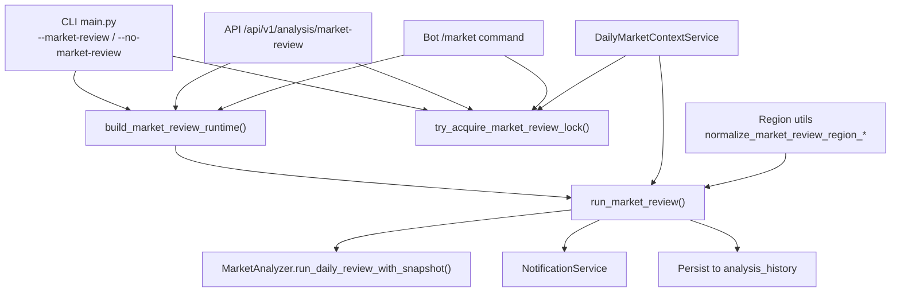
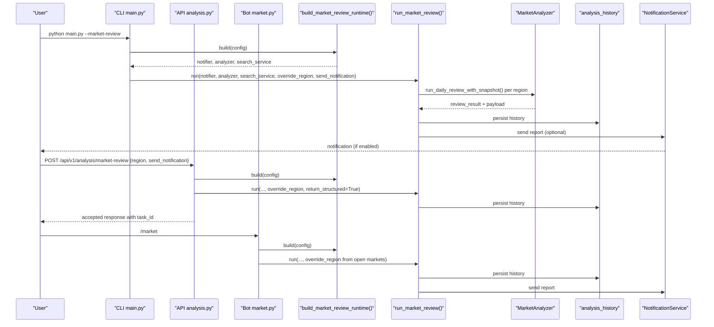
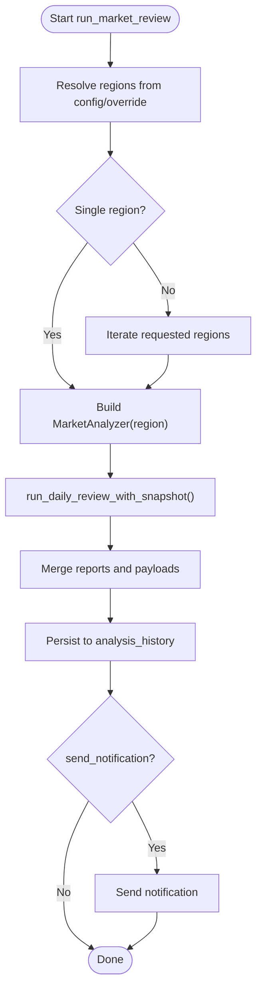
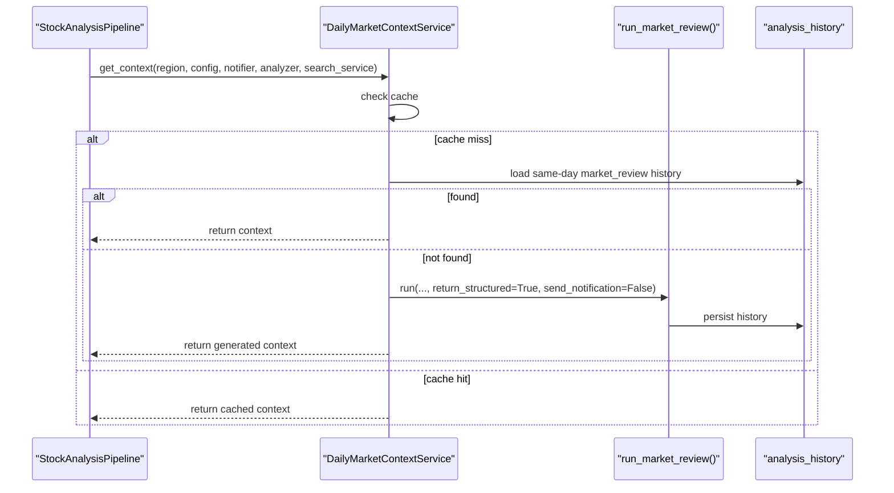
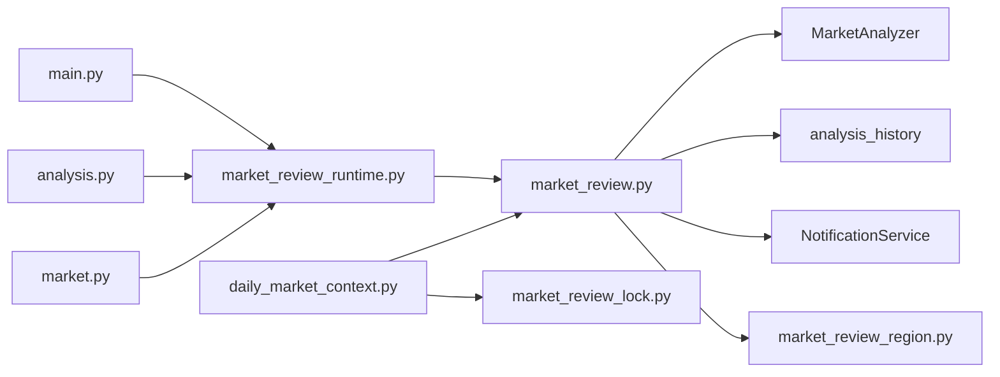

# Market Review Commands

<cite>
**Referenced Files in This Document**
- [main.py](file://main.py)
- [market_review.py](file://src/core/market_review.py)
- [market_review_runtime.py](file://src/core/market_review_runtime.py)
- [market_review_lock.py](file://src/core/market_review_lock.py)
- [market_review_region.py](file://src/utils/market_review_region.py)
- [daily_market_context.py](file://src/services/daily_market_context.py)
- [market.py](file://bot/commands/market.py)
- [analysis.py](file://api/v1/endpoints/analysis.py)
- [marketReviewRegion.ts](file://apps\dsa-web\src\utils\marketReviewRegion.ts)
- [settingsHelp.ts](file://apps\dsa-web\src\locales\settingsHelp.ts)
- [test_bot_market_command.py](file://tests/test_bot_market_command.py)
- [test_main_schedule_mode.py](file://tests/test_main_schedule_mode.py)
- [analysis.test.ts](file://apps\dsa-web\src\api\__tests__\analysis.test.ts)
</cite>

## Table of Contents
1. Introduction
2. Project Structure
3. Core Components
4. Architecture Overview
5. Detailed Component Analysis
6. Dependency Analysis
7. Performance Considerations
8. Troubleshooting Guide
9. Conclusion
10. Appendices

## Introduction
This document explains the market review commands and workflows that generate comprehensive market analysis reports across multiple regions (CN, HK, US, JP, KR). It covers:
- The standalone market review mode via the --market-review flag
- Skipping market context generation with --no-market-review during daily stock analysis
- Region-specific analysis using configuration and runtime overrides
- How market review integrates with daily analysis to provide macroeconomic context for individual stocks
- Examples for running reviews per region, configuring multi-market analysis, and customizing report output
- Caching mechanisms for reusing market context
- Performance considerations and troubleshooting strategies

## Project Structure
Market review spans CLI entry points, API endpoints, bot commands, core execution logic, region normalization utilities, locking, and daily context integration.

**Diagram sources**
- [main.py:272-364](file://main.py#L272-L364)
- [market_review_runtime.py:79-129](file://src/core/market_review_runtime.py#L79-L129)
- [market_review.py:174-461](file://src/core/market_review.py#L174-L461)
- [market_review_lock.py:144-228](file://src/core/market_review_lock.py#L144-L228)
- [daily_market_context.py:103-237](file://src/services/daily_market_context.py#L103-L237)
- [market_review_region.py:13-71](file://src/utils/market_review_region.py#L13-L71)

**Section sources**
- [main.py:272-364](file://main.py#L272-L364)
- [market_review_runtime.py:79-129](file://src/core/market_review_runtime.py#L79-L129)
- [market_review.py:174-461](file://src/core/market_review.py#L174-L461)
- [market_review_lock.py:144-228](file://src/core/market_review_lock.py#L144-L228)
- [daily_market_context.py:103-237](file://src/services/daily_market_context.py#L103-L237)
- [market_review_region.py:13-71](file://src/utils/market_review_region.py#L13-L71)

## Core Components
- CLI flags:
  - --market-review: run only market review
  - --no-market-review: skip market review during daily analysis
- Region selection:
  - Configurable via MARKET_REVIEW_REGION (supports cn, hk, us, jp, kr, both, or comma-separated subsets)
  - Runtime override supported by API/bot/scheduler based on open markets
- Execution runtime:
  - build_market_review_runtime constructs notifier, analyzer, search service
  - run_market_review orchestrates single or multi-region reviews, persists history, and sends notifications
- Concurrency control:
  - try_acquire_market_review_lock prevents overlapping runs within a process and same host
- Daily context integration:
  - DailyMarketContextService loads or generates low-sensitivity market context for stock analysis prompts
  - Reuses existing market_review history when available; otherwise triggers a background generation under lock

**Section sources**
- [main.py:354-364](file://main.py#L354-L364)
- [market_review_region.py:13-71](file://src/utils/market_review_region.py#L13-L71)
- [market_review_runtime.py:79-129](file://src/core/market_review_runtime.py#L79-L129)
- [market_review.py:174-461](file://src/core/market_review.py#L174-L461)
- [market_review_lock.py:144-228](file://src/core/market_review_lock.py#L144-L228)
- [daily_market_context.py:103-237](file://src/services/daily_market_context.py#L103-L237)

## Architecture Overview
The system supports three primary entry points into market review:
- CLI: --market-review executes standalone market review; --no-market-review disables it in daily flows
- API: POST /api/v1/analysis/market-review accepts region and notification preferences
- Bot: /market command triggers review asynchronously with trading-day filtering

All paths converge on run_market_review, which:
- Resolves effective regions from config and optional overrides
- Executes per-region analysis via MarketAnalyzer
- Merges reports and structured payloads
- Persists results to analysis_history
- Sends notifications unless merged or disabled

**Diagram sources**
- [main.py:354-364](file://main.py#L354-L364)
- [analysis.py:135-177](file://api/v1/endpoints/analysis.py#L135-L177)
- [market.py:115-160](file://bot/commands/market.py#L115-L160)
- [market_review_runtime.py:79-129](file://src/core/market_review_runtime.py#L79-L129)
- [market_review.py:174-461](file://src/core/market_review.py#L174-L461)

## Detailed Component Analysis

### CLI Entry Points and Flags
- --market-review: triggers standalone market review execution path
- --no-market-review: skips market review during daily analysis pipeline
- These flags are parsed early and influence scheduling and execution branches

Examples:
- Run only market review: python main.py --market-review
- Skip market review in daily flow: python main.py --no-market-review

**Section sources**
- [main.py:354-364](file://main.py#L354-L364)
- [test_main_schedule_mode.py:2073-2150](file://tests/test_main_schedule_mode.py#L2073-L2150)

### Region Selection and Multi-Market Analysis
- Supported regions: cn, hk, us, jp, kr
- Configuration:
  - MARKET_REVIEW_REGION accepts a subset like cn,us,jp or both to include all
  - Invalid or empty values fall back to cn
- Runtime override:
  - Bot and scheduler compute effective region based on open markets today
  - API allows request-scoped region override

Examples:
- Single region: set MARKET_REVIEW_REGION=cn
- Multi-region: set MARKET_REVIEW_REGION=cn,us
- All supported: set MARKET_REVIEW_REGION=both

Frontend serialization ensures ordered region lists and defaults to both when all are selected.

**Section sources**
- [market_review_region.py:13-71](file://src/utils/market_review_region.py#L13-L71)
- [marketReviewRegion.ts:5-10](file://apps\dsa-web\src\utils\marketReviewRegion.ts#L5-L10)
- [settingsHelp.ts:2473-2484](file://apps\dsa-web\src\locales\settingsHelp.ts#L2473-L2484)
- [test_bot_market_command.py:108-171](file://tests/test_bot_market_command.py#L108-L171)
- [analysis.test.ts:28-57](file://apps\dsa-web\src\api\__tests__\analysis.test.ts#L28-L57)

### Standalone Market Review Execution
- build_market_review_runtime constructs:
  - NotificationService
  - GeminiAnalyzer (if LLM configured)
  - SearchService (if enabled)
- run_market_review:
  - Resolves regions from config or override
  - Executes per-region analysis via MarketAnalyzer
  - Merges reports and payloads
  - Persists to analysis_history
  - Sends notifications unless merge mode or disabled

**Diagram sources**
- [market_review_runtime.py:79-129](file://src/core/market_review_runtime.py#L79-L129)
- [market_review.py:174-461](file://src/core/market_review.py#L174-L461)

**Section sources**
- [market_review_runtime.py:79-129](file://src/core/market_review_runtime.py#L79-L129)
- [market_review.py:174-461](file://src/core/market_review.py#L174-L461)

### API Endpoint for Market Review
- POST /api/v1/analysis/market-review accepts:
  - region (comma-separated or both)
  - send_notification
  - report_language (request-scoped)
- Returns accepted status with task_id
- Background execution uses build_market_review_runtime and run_market_review with override_region

Example request body:
{
  "send_notification": true,
  "region": "cn,us",
  "report_language": "en"
}

**Section sources**
- [analysis.py:135-177](file://api/v1/endpoints/analysis.py#L135-L177)
- [analysis.test.ts:28-57](file://apps\dsa-web\src\api\__tests__\analysis.test.ts#L28-L57)

### Bot Command Integration
- /market command:
  - Acquires market review lock
  - Computes effective region based on open markets
  - Builds runtime and runs market review asynchronously
  - Skips if no relevant markets are open and notifies user

**Section sources**
- [market.py:50-160](file://bot/commands/market.py#L50-L160)
- [test_bot_market_command.py:108-171](file://tests/test_bot_market_command.py#L108-L171)

### Daily Analysis Integration and Macro Context
- DailyMarketContextService provides low-sensitivity market context for stock analysis prompts
- Behavior:
  - Prefers cached context for date/region
  - Falls back to same-day history records of type market_review
  - If none available and allowed, triggers run_market_review with return_structured=True and send_notification=False
  - Uses market review lock to serialize concurrent generations
- DAILY_MARKET_CONTEXT_ENABLED controls whether this context is injected into stock analysis prompts and guardrails; setting it false does not disable standalone market review

**Diagram sources**
- [daily_market_context.py:103-237](file://src/services/daily_market_context.py#L103-L237)
- [daily_market_context.py:385-495](file://src/services/daily_market_context.py#L385-L495)
- [market_review.py:174-461](file://src/core/market_review.py#L174-L461)

**Section sources**
- [daily_market_context.py:103-237](file://src/services/daily_market_context.py#L103-L237)
- [daily_market_context.py:385-495](file://src/services/daily_market_context.py#L385-L495)
- [market_review.py:174-461](file://src/core/market_review.py#L174-L461)

### Report Output Customization
- Language:
  - report_language can be set globally or per request (API)
  - Titles and separators adapt to language (en, ko, zh default)
- Color scheme:
  - market_review_color_scheme controls index change colors (green_up, red_up)
- Sections:
  - Structured payloads include sections and sectors; missing sector blocks are appended automatically
- File persistence:
  - Markdown files saved with date-based filenames unless disabled

**Section sources**
- [market_review.py:115-148](file://src/core/market_review.py#L115-L148)
- [market_review.py:483-511](file://src/core/market_review.py#L483-L511)
- [market_review.py:514-668](file://src/core/market_review.py#L514-L668)
- [settingsHelp.ts:2473-2484](file://apps\dsa-web\src\locales\settingsHelp.ts#L2473-L2484)

## Dependency Analysis
Key dependencies and relationships:
- CLI/API/Bot depend on build_market_review_runtime to assemble services
- run_market_review depends on MarketAnalyzer per region
- DailyMarketContextService depends on run_market_review and analysis_history
- Region normalization utilities ensure consistent inputs
- Locking prevents overlapping executions

**Diagram sources**
- [main.py:354-364](file://main.py#L354-L364)
- [analysis.py:135-177](file://api/v1/endpoints/analysis.py#L135-L177)
- [market.py:115-160](file://bot/commands/market.py#L115-L160)
- [market_review_runtime.py:79-129](file://src/core/market_review_runtime.py#L79-L129)
- [market_review.py:174-461](file://src/core/market_review.py#L174-L461)
- [daily_market_context.py:103-237](file://src/services/daily_market_context.py#L103-L237)
- [market_review_lock.py:144-228](file://src/core/market_review_lock.py#L144-L228)
- [market_review_region.py:13-71](file://src/utils/market_review_region.py#L13-L71)

**Section sources**
- [main.py:354-364](file://main.py#L354-L364)
- [analysis.py:135-177](file://api/v1/endpoints/analysis.py#L135-L177)
- [market.py:115-160](file://bot/commands/market.py#L115-L160)
- [market_review_runtime.py:79-129](file://src/core/market_review_runtime.py#L79-L129)
- [market_review.py:174-461](file://src/core/market_review.py#L174-L461)
- [daily_market_context.py:103-237](file://src/services/daily_market_context.py#L103-L237)
- [market_review_lock.py:144-228](file://src/core/market_review_lock.py#L144-L228)
- [market_review_region.py:13-71](file://src/utils/market_review_region.py#L13-L71)

## Performance Considerations
- Concurrency control:
  - try_acquire_market_review_lock serializes market review runs within a process and same host
  - Prevents duplicate work and resource contention
- Caching:
  - DailyMarketContextService caches contexts per date/region and query scope
  - Reuses same-day history to avoid regeneration
- Multi-region efficiency:
  - Sequential per-region execution reduces memory pressure while merging outputs
- LLM availability:
  - build_market_review_runtime detects configured LLM backends; falls back gracefully if unavailable
- Notification overhead:
  - send_notification can be disabled for internal context generation to reduce I/O

[No sources needed since this section provides general guidance]

## Troubleshooting Guide
Common issues and resolutions:
- No relevant markets open:
  - Bot skips review and sends notification; verify trading_day_check_enabled and open markets
- LLM configuration errors:
  - build_market_review_runtime logs backend config errors; ensure model keys are set
- Generation failures:
  - run_market_review catches GenerationError and logs details; check backend connectivity and quotas
- Lock contention:
  - Stale lock detection cleans up expired locks; ensure data directory is writable
- History persistence failures:
  - Diagnostics are recorded; check database permissions and storage path

**Section sources**
- [market.py:115-160](file://bot/commands/market.py#L115-L160)
- [market_review_runtime.py:24-76](file://src/core/market_review_runtime.py#L24-L76)
- [market_review.py:443-461](file://src/core/market_review.py#L443-L461)
- [market_review_lock.py:116-141](file://src/core/market_review_lock.py#L116-L141)
- [daily_market_context.py:484-495](file://src/services/daily_market_context.py#L484-L495)

## Conclusion
Market review provides robust, configurable macroeconomic context across multiple regions and integrates seamlessly with daily stock analysis. Use --market-review for standalone reports, --no-market-review to skip context injection, and configure MARKET_REVIEW_REGION for targeted or multi-market coverage. Leverage caching and locking for performance and reliability, and consult the troubleshooting guide for common issues.

[No sources needed since this section summarizes without analyzing specific files]

## Appendices

### Example Workflows
- Run CN-only review:
  - Set MARKET_REVIEW_REGION=cn
  - Execute: python main.py --market-review
- Run US+JP+KR review:
  - Set MARKET_REVIEW_REGION=us,jp,kr
  - Execute: python main.py --market-review
- API trigger with English report:
  - POST /api/v1/analysis/market-review with region="cn,us" and report_language="en"
- Bot trigger:
  - Send /market; effective region computed from open markets

**Section sources**
- [market_review_region.py:13-71](file://src/utils/market_review_region.py#L13-L71)
- [analysis.test.ts:28-57](file://apps\dsa-web\src\api\__tests__\analysis.test.ts#L28-L57)
- [market.py:115-160](file://bot/commands/market.py#L115-L160)