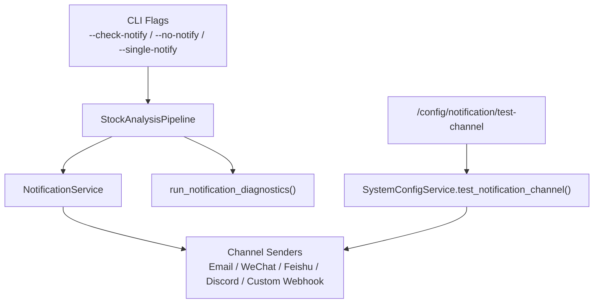
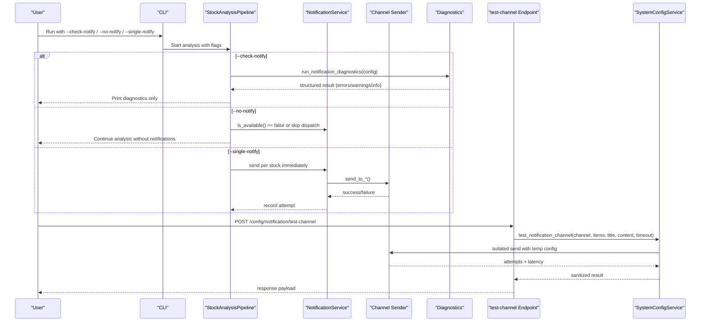
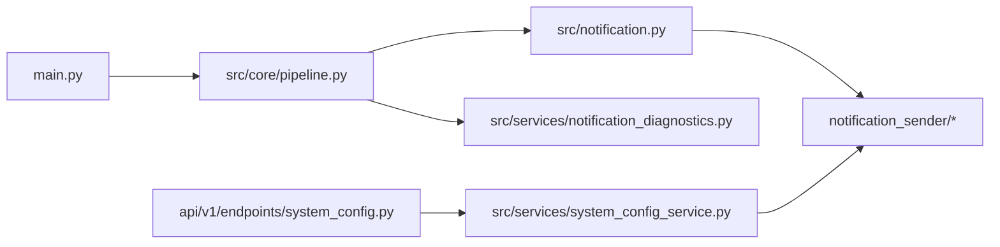

# Notification Testing

<cite>
**Referenced Files in This Document**
- [main.py](file://main.py)
- [src/notification.py](file://src/notification.py)
- [src/notification_capabilities.py](file://src/notification_capabilities.py)
- [src/notification_contracts.py](file://src/notification_contracts.py)
- [src/services/system_config_service.py](file://src/services/system_config_service.py)
- [api/v1/endpoints/system_config.py](file://api/v1/endpoints/system_config.py)
- [src/core/pipeline.py](file://src/core/pipeline.py)
- [src/services/notification_diagnostics.py](file://src/services/notification_diagnostics.py)
- [src/notification_sender/email_sender.py](file://src/notification_sender/email_sender.py)
- [src/notification_sender/wechat_sender.py](file://src/notification_sender/wechat_sender.py)
- [src/notification_sender/feishu_sender.py](file://src/notification_sender/feishu_sender.py)
- [src/notification_sender/discord_sender.py](file://src/notification_sender/discord_sender.py)
- [tests/test_notification_diagnostics.py](file://tests/test_notification_diagnostics.py)
- [tests/test_system_config_service.py](file://tests/test_system_config_service.py)
- [tests/test_system_config_api.py](file://tests/test_system_config_api.py)
</cite>

## Table of Contents
1. [Introduction](#introduction)
2. [Project Structure](#project-structure)
3. [Core Components](#core-components)
4. [Architecture Overview](#architecture-overview)
5. [Detailed Component Analysis](#detailed-component-analysis)
6. [Dependency Analysis](#dependency-analysis)
7. [Performance Considerations](#performance-considerations)
8. [Troubleshooting Guide](#troubleshooting-guide)
9. [Conclusion](#conclusion)
10. [Appendices](#appendices)

## Introduction
This document explains how to test notification channels and validate delivery capabilities without sending real messages during normal analysis runs. It covers:
- The --check-notify flag for read-only configuration validation
- The --no-notify flag to disable notifications during analysis
- The --single-notify flag for per-stock notification testing
- How to test email, WeChat (Enterprise WeChat), Feishu, Discord, and custom webhooks
- Configuration verification, message formatting checks, and debugging delivery issues
- Security considerations, rate limiting guidance, and best practices for reliable notifications

## Project Structure
Notification testing spans CLI flags, the core pipeline, a dedicated diagnostics module, an API endpoint for ad-hoc channel tests, and per-channel senders.

**Diagram sources**
- [main.py:272-333](file://main.py#L272-L333)
- [src/core/pipeline.py:1-110](file://src/core/pipeline.py#L1-L110)
- [src/notification.py:257-344](file://src/notification.py#L257-L344)
- [src/services/notification_diagnostics.py:314-566](file://src/services/notification_diagnostics.py#L314-L566)
- [api/v1/endpoints/system_config.py:614-655](file://api/v1/endpoints/system_config.py#L614-L655)
- [src/services/system_config_service.py:3012-3062](file://src/services/system_config_service.py#L3012-L3062)

**Section sources**
- [main.py:272-333](file://main.py#L272-L333)
- [src/core/pipeline.py:1-110](file://src/core/pipeline.py#L1-L110)
- [src/notification.py:257-344](file://src/notification.py#L257-L344)
- [src/services/notification_diagnostics.py:314-566](file://src/services/notification_diagnostics.py#L314-L566)
- [api/v1/endpoints/system_config.py:614-655](file://api/v1/endpoints/system_config.py#L614-L655)
- [src/services/system_config_service.py:3012-3062](file://src/services/system_config_service.py#L3012-L3062)

## Core Components
- CLI flags
  - --check-notify: perform read-only notification configuration diagnostics without sending any messages
  - --no-notify: skip all notification dispatches during analysis
  - --single-notify: enable per-stock notification mode so each stock triggers a notification immediately after analysis
- NotificationService: aggregates configured channels, formats reports, and dispatches messages
- Channel senders: EmailSender, WechatSender, FeishuSender, DiscordSender, CustomWebhookSender, etc.
- Diagnostics: run_notification_diagnostics() validates environment/config keys and routes without sending
- SystemConfigService: provides a safe, isolated test-notification flow via API that does not persist secrets

Key responsibilities:
- Detect configured channels from Config
- Validate minimal and advanced keys per channel
- Build and format messages tailored to channel capabilities
- Dispatch with retries, chunking, and timeouts where applicable

**Section sources**
- [main.py:272-333](file://main.py#L272-L333)
- [src/notification.py:257-344](file://src/notification.py#L257-L344)
- [src/services/notification_diagnostics.py:314-566](file://src/services/notification_diagnostics.py#L314-L566)
- [src/services/system_config_service.py:3012-3062](file://src/services/system_config_service.py#L3012-L3062)

## Architecture Overview
The notification testing workflow has two main paths:
1. CLI-driven analysis with flags controlling notification behavior
2. API-driven one-off channel test using temporary configuration items

**Diagram sources**
- [main.py:272-333](file://main.py#L272-L333)
- [src/core/pipeline.py:1-110](file://src/core/pipeline.py#L1-L110)
- [src/services/notification_diagnostics.py:314-566](file://src/services/notification_diagnostics.py#L314-L566)
- [api/v1/endpoints/system_config.py:614-655](file://api/v1/endpoints/system_config.py#L614-L655)
- [src/services/system_config_service.py:3012-3062](file://src/services/system_config_service.py#L3012-L3062)

## Detailed Component Analysis

### CLI Flags and Behavior
- --check-notify
  - Purpose: Read-only check of notification configuration; no messages are sent
  - Behavior: Invokes diagnostics to validate minimal/advanced keys, route configs, and channel-specific URL rules
  - Output: Structured errors, warnings, and info about configured channels
- --no-notify
  - Purpose: Disable all notifications during analysis
  - Behavior: Skips dispatch even if channels are configured
- --single-notify
  - Purpose: Enable per-stock notification mode
  - Behavior: After analyzing each stock, immediately dispatch a notification instead of waiting for aggregate report

Examples:
- Validate configuration without sending: python main.py --check-notify
- Run analysis without notifications: python main.py --no-notify
- Test per-stock notifications: python main.py --single-notify

**Section sources**
- [main.py:272-333](file://main.py#L272-L333)

### Notification Diagnostics
- Validates presence and correctness of minimal and advanced keys per channel
- Checks route configurations and noise-control settings
- Reports invalid URLs for ntfy and gotify
- Produces a structured result with errors, warnings, and info

Common validations:
- ntfy URL must include topic path
- gotify URL must be base server URL (not ending with /message)
- Paired keys required (e.g., Telegram token + chat ID, email sender + password)
- Route channels must be valid and enabled

**Section sources**
- [src/services/notification_diagnostics.py:314-566](file://src/services/notification_diagnostics.py#L314-L566)
- [tests/test_notification_diagnostics.py:93-123](file://tests/test_notification_diagnostics.py#L93-L123)

### API-Based One-Off Channel Test
- Endpoint: POST /config/notification/test-channel
- Request fields: channel, items (key/value pairs), title, content, timeout_seconds, optional mask_token
- Behavior: Builds an isolated Config from provided items, validates, then sends a short test message through the selected channel
- Response: success, message, error_code, stage, retryable, latency_ms, attempts (sanitized)

Supported channels include:
- wechat, dingtalk, feishu, telegram, email, pushover, ntfy, gotify, pushplus, serverchan3, custom, discord, slack, astrbot

Example usage pattern:
- Provide channel and required keys in items
- Set a short title and content to verify formatting
- Use timeout_seconds appropriate for your network

Security:
- Secrets are not persisted by this endpoint
- Targets and tokens are masked in responses

**Section sources**
- [api/v1/endpoints/system_config.py:614-655](file://api/v1/endpoints/system_config.py#L614-L655)
- [src/services/system_config_service.py:3012-3062](file://src/services/system_config_service.py#L3012-L3062)
- [tests/test_system_config_service.py:2976-3008](file://tests/test_system_config_service.py#L2976-L3008)
- [tests/test_system_config_api.py:916-950](file://tests/test_system_config_api.py#L916-L950)

### Channel-Specific Testing Notes

#### Email
- Minimal keys: EMAIL_SENDER, EMAIL_PASSWORD
- Advanced keys: EMAIL_RECEIVERS, EMAIL_SENDER_NAME
- Formatting: Markdown is converted to HTML and plain text parts
- Testing: Use the API endpoint with channel=email and subject=title

**Section sources**
- [src/notification_sender/email_sender.py:51-200](file://src/notification_sender/email_sender.py#L51-L200)
- [src/services/notification_diagnostics.py:110-116](file://src/services/notification_diagnostics.py#L110-L116)

#### WeChat (Enterprise WeChat)
- Minimal key: WECHAT_WEBHOOK_URL
- Advanced key: WECHAT_MSG_TYPE (text/markdown)
- Limits: Text type ~2048 bytes; markdown default ~4000 bytes; chunked sending supported
- Testing: Use channel=wechat; ensure webhook URL is correct and accessible

**Section sources**
- [src/notification_sender/wechat_sender.py:26-198](file://src/notification_sender/wechat_sender.py#L26-L198)
- [src/services/notification_diagnostics.py:80-86](file://src/services/notification_diagnostics.py#L80-L86)

#### Feishu
- Two modes:
  - Webhook: FEISHU_WEBHOOK_URL (+ optional secret/keyword)
  - App Bot: FEISHU_APP_ID, FEISHU_APP_SECRET, FEISHU_CHAT_ID
- Supports cards and file uploads when SDK available
- Testing: Use channel=feishu; choose mode based on your setup

**Section sources**
- [src/notification_sender/feishu_sender.py:84-200](file://src/notification_sender/feishu_sender.py#L84-L200)
- [src/notification_contracts.py:14-34](file://src/notification_contracts.py#L14-L34)
- [src/services/notification_diagnostics.py:87-94](file://src/services/notification_diagnostics.py#L87-L94)

#### Discord
- Modes:
  - Webhook: DISCORD_WEBHOOK_URL
  - Bot: DISCORD_BOT_TOKEN + DISCORD_MAIN_CHANNEL_ID
- Content length limit enforced; chunked sending supported
- Testing: Use channel=discord; prefer webhook for quick tests

**Section sources**
- [src/notification_sender/discord_sender.py:30-200](file://src/notification_sender/discord_sender.py#L30-L200)
- [src/services/notification_diagnostics.py:159-167](file://src/services/notification_diagnostics.py#L159-L167)

#### Custom Webhook
- Minimal key: CUSTOM_WEBHOOK_URLS
- Advanced keys: CUSTOM_WEBHOOK_BEARER_TOKEN, CUSTOM_WEBHOOK_BODY_TEMPLATE, WEBHOOK_VERIFY_SSL
- Testing: Use channel=custom; configure template and headers as needed

**Section sources**
- [src/services/system_config_service.py:3031-3054](file://src/services/system_config_service.py#L3031-L3054)
- [src/services/notification_diagnostics.py:152-158](file://src/services/notification_diagnostics.py#L152-L158)

### Message Formatting and Capabilities
- Channel profiles define preferred rendering modes and limits
- Some channels support images, files, or rich cards; others fall back to plain text
- For long messages, senders implement chunking and page markers

Profiles overview:
- Email: full HTML with image/file support
- WeChat: markdown/text with byte limits and chunking
- Feishu: lark_md/card/file
- Discord: markdown with word-based chunking
- Others: plain_text or markdown depending on platform

**Section sources**
- [src/notification_capabilities.py:75-189](file://src/notification_capabilities.py#L75-L189)

### Per-Stock Notification Mode (--single-notify)
- When enabled, the pipeline dispatches a notification immediately after analyzing each stock
- Useful for validating per-stock formatting and delivery before running full batch jobs
- Integrates with noise control and routing to avoid excessive alerts

**Section sources**
- [main.py:329-333](file://main.py#L329-L333)
- [src/core/pipeline.py:1-110](file://src/core/pipeline.py#L1-L110)

## Dependency Analysis
- CLI flags influence pipeline behavior and notifier activation
- NotificationService composes multiple senders and detects configured channels
- Diagnostics depend on contracts for Feishu groups and routing metadata
- API test endpoint builds isolated Config and invokes senders directly

**Diagram sources**
- [main.py:272-333](file://main.py#L272-L333)
- [src/core/pipeline.py:1-110](file://src/core/pipeline.py#L1-L110)
- [src/notification.py:257-344](file://src/notification.py#L257-L344)
- [src/services/notification_diagnostics.py:314-566](file://src/services/notification_diagnostics.py#L314-L566)
- [api/v1/endpoints/system_config.py:614-655](file://api/v1/endpoints/system_config.py#L614-L655)
- [src/services/system_config_service.py:3012-3062](file://src/services/system_config_service.py#L3012-L3062)

**Section sources**
- [src/notification.py:257-344](file://src/notification.py#L257-L344)
- [src/services/notification_diagnostics.py:314-566](file://src/services/notification_diagnostics.py#L314-L566)
- [src/services/system_config_service.py:3012-3062](file://src/services/system_config_service.py#L3012-L3062)

## Performance Considerations
- Chunking: WeChat and Discord automatically split long messages to respect platform limits
- Timeouts: All senders accept timeout_seconds to prevent hangs during tests
- Retries: Discord implements limited retries with sleep between chunks
- Network: Ensure webhook endpoints are reachable and SSL verification is configured appropriately

Recommendations:
- Use reasonable timeout_seconds for tests (e.g., 5–10 seconds)
- Prefer webhooks for fast local tests
- Avoid sending large attachments frequently; use text fallbacks when possible

[No sources needed since this section provides general guidance]

## Troubleshooting Guide
Common issues and resolutions:
- Missing minimal keys: Diagnostics will list missing keys; add them before testing
- Invalid URLs:
  - ntfy: Must include topic path
  - gotify: Must be base URL without /message
- Partial configurations: Paired keys must both be present (e.g., Telegram token + chat ID)
- Rate limits: Respect provider limits; add delays between test attempts
- SSL verification: If behind proxies or self-signed certs, adjust WEBHOOK_VERIFY_SSL carefully

Debugging steps:
1. Run diagnostics to identify configuration errors
2. Use the API test endpoint with minimal items to isolate issues
3. Check logs for channel-specific errors and chunking behavior
4. Validate formatting by inspecting attempts and sanitized targets in responses

**Section sources**
- [src/services/notification_diagnostics.py:314-566](file://src/services/notification_diagnostics.py#L314-L566)
- [tests/test_notification_diagnostics.py:93-123](file://tests/test_notification_diagnostics.py#L93-L123)
- [src/notification_sender/wechat_sender.py:26-198](file://src/notification_sender/wechat_sender.py#L26-L198)
- [src/notification_sender/discord_sender.py:30-200](file://src/notification_sender/discord_sender.py#L30-L200)

## Conclusion
Use --check-notify for safe configuration audits, --no-notify to suppress notifications during analysis, and --single-notify to validate per-stock delivery. For targeted testing, the API endpoint allows isolated channel tests without persisting secrets. Combine diagnostics, channel-specific notes, and formatting profiles to ensure reliable notifications across email, WeChat, Feishu, Discord, and custom webhooks.

[No sources needed since this section summarizes without analyzing specific files]

## Appendices

### Quick Reference: Flags and Endpoints
- CLI
  - --check-notify: read-only diagnostics
  - --no-notify: disable notifications
  - --single-notify: per-stock notifications
- API
  - POST /config/notification/test-channel: test one channel with temporary items

**Section sources**
- [main.py:272-333](file://main.py#L272-L333)
- [api/v1/endpoints/system_config.py:614-655](file://api/v1/endpoints/system_config.py#L614-L655)

### Security Best Practices
- Never commit secrets; use environment variables or secure secret stores
- Mask sensitive values in logs and responses (handled by sanitization)
- Restrict webhook access via IP allowlists or authentication at the receiver
- Use HTTPS and verify SSL unless explicitly disabled for controlled environments

[No sources needed since this section provides general guidance]

### Rate Limiting Guidance
- Add delays between repeated tests to avoid provider throttling
- Prefer small payloads for frequent tests
- Monitor provider dashboards for quota usage

[No sources needed since this section provides general guidance]