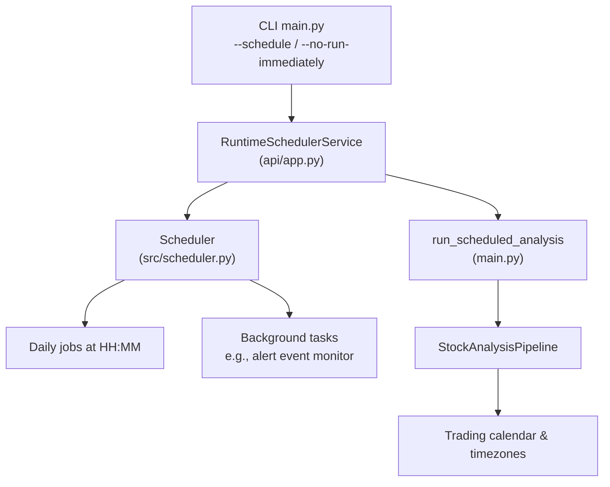
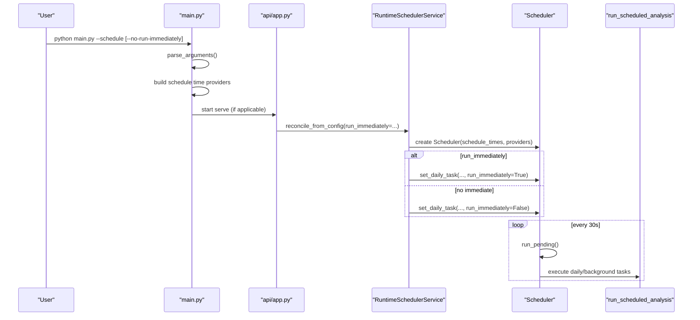
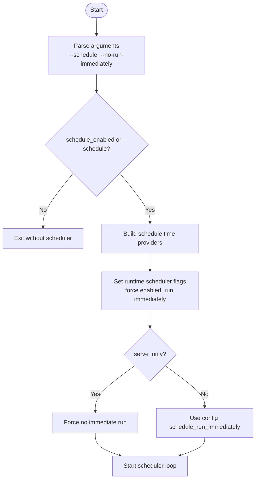
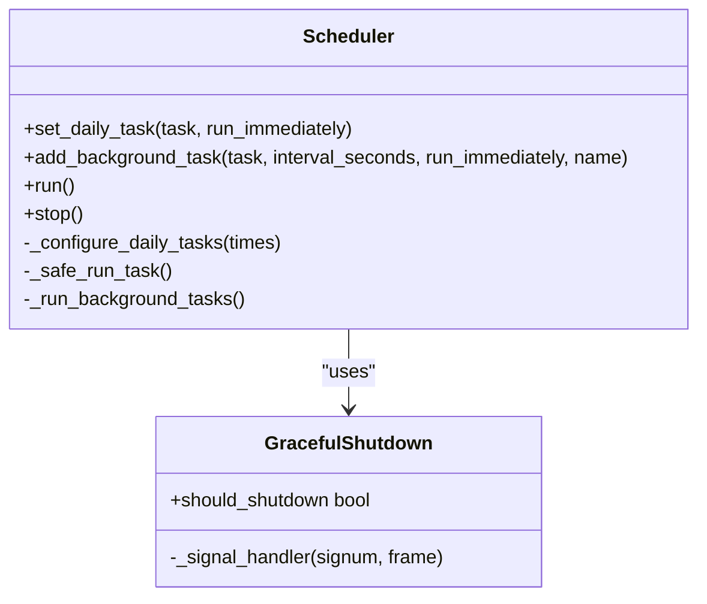
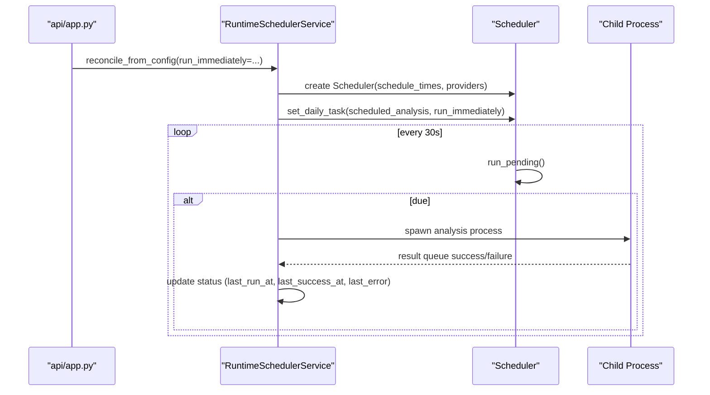
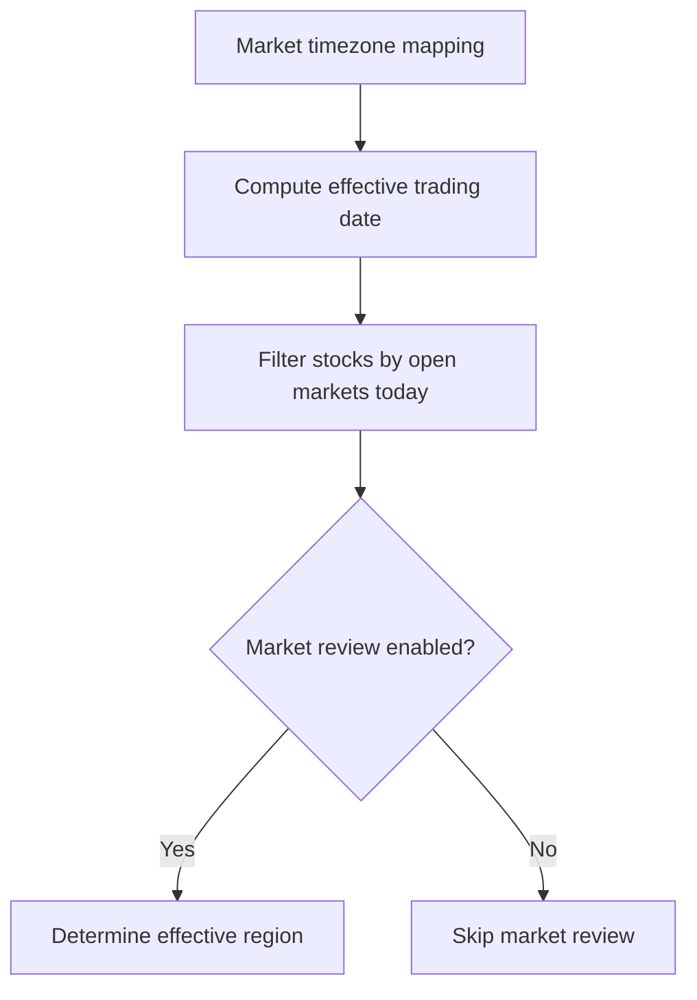
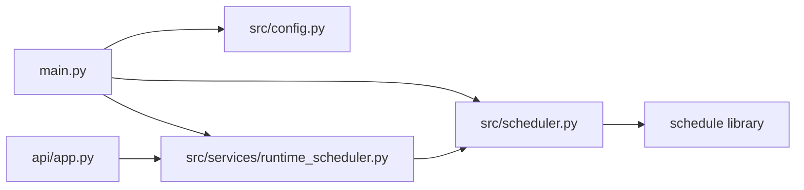

# Scheduling & Automation

<cite>
**Referenced Files in This Document**
- [main.py](file://main.py)
- [src/scheduler.py](file://src/scheduler.py)
- [src/services/runtime_scheduler.py](file://src/services/runtime_scheduler.py)
- [api/app.py](file://api/app.py)
- [src/config.py](file://src/config.py)
- [src/core/trading_calendar.py](file://src/core/trading_calendar.py)
- [docs/full-guide_EN.md](file://docs/full-guide_EN.md)
- [tests/test_main_schedule_mode.py](file://tests/test_main_schedule_mode.py)
- [tests/test_runtime_scheduler_service.py](file://tests/test_runtime_scheduler_service.py)
</cite>

## Table of Contents
1. [Introduction](#introduction)
2. [Project Structure](#project-structure)
3. [Core Components](#core-components)
4. [Architecture Overview](#architecture-overview)
5. [Detailed Component Analysis](#detailed-component-analysis)
6. [Dependency Analysis](#dependency-analysis)
7. [Performance Considerations](#performance-considerations)
8. [Troubleshooting Guide](#troubleshooting-guide)
9. [Conclusion](#conclusion)
10. [Appendices](#appendices)

## Introduction
This document explains how to schedule and automate analysis workflows using the application’s built-in scheduler and runtime scheduler service. It covers:
- The --schedule flag for enabling scheduled task mode
- The --no-run-immediately flag to prevent immediate execution on startup
- Integration with system schedulers (cron, GitHub Actions, Windows Task Scheduler)
- How to set recurring analysis tasks, configure intervals, and manage job lifecycles
- Environment variables for scheduling, monitoring, and timezone considerations
- Practical examples for daily market analysis, weekly portfolio reviews, and custom schedules
- Job failure handling, recovery strategies, and production best practices

## Project Structure
Scheduling spans three layers:
- CLI entrypoint and argument parsing: main.py
- In-process scheduler loop and background tasks: src/scheduler.py
- Long-lived process scheduler service (API/Web/Desktop): src/services/runtime_scheduler.py
- API startup wiring and runtime flags: api/app.py
- Configuration model and environment keys: src/config.py
- Market timezones and trading calendar: src/core/trading_calendar.py
- Deployment and cron examples: docs/full-guide_EN.md

**Diagram sources**
- [main.py:272-443](file://main.py#L272-L443)
- [src/services/runtime_scheduler.py:238-672](file://src/services/runtime_scheduler.py#L238-L672)
- [src/scheduler.py:82-473](file://src/scheduler.py#L82-L473)
- [api/app.py:253-285](file://api/app.py#L253-L285)
- [src/core/trading_calendar.py:40-51](file://src/core/trading_calendar.py#L40-L51)

**Section sources**
- [main.py:272-443](file://main.py#L272-L443)
- [src/services/runtime_scheduler.py:238-672](file://src/services/runtime_scheduler.py#L238-L672)
- [src/scheduler.py:82-473](file://src/scheduler.py#L82-L473)
- [api/app.py:253-285](file://api/app.py#L253-L285)
- [src/config.py:1198-1203](file://src/config.py#L1198-L1203)
- [src/core/trading_calendar.py:40-51](file://src/core/trading_calendar.py#L40-L51)

## Core Components
- CLI flags:
  - --schedule: enables scheduled task mode; when present or config.schedule_enabled is true, the runtime scheduler is started.
  - --no-run-immediately: prevents an immediate run on startup when scheduling is enabled.
- Scheduler:
  - Registers one or more daily jobs at configured times (HH:MM).
  - Supports a provider-based refresh so schedule times can change at runtime without restarts.
  - Runs background tasks on a polling loop (minimum 30-second interval).
- RuntimeSchedulerService:
  - Manages long-lived scheduling inside API/Web/Desktop processes.
  - Enforces a global lock to avoid overlapping analysis runs.
  - Spawns analysis in a child process with watchdog timeout and graceful termination.
  - Exposes status and run-now capabilities via app state.

Key configuration fields:
- schedule_enabled: enable/disable scheduling
- schedule_time / schedule_times: single or multiple daily times
- schedule_run_immediately: whether to run immediately on startup (overridable by CLI)

Environment variables:
- SCHEDULE_TIME, SCHEDULE_TIMES: override schedule times
- DSA_RUNTIME_SCHEDULER_FORCE_ENABLED, DSA_RUNTIME_SCHEDULER_RUN_IMMEDIATELY, DSA_RUNTIME_SCHEDULER_SUPPRESS_START, DSA_RUNTIME_SCHEDULER_ARGS, DSA_RUNTIME_SCHEDULER_TIMEOUT_SECONDS: control runtime scheduler behavior

**Section sources**
- [main.py:272-443](file://main.py#L272-L443)
- [main.py:1353-1389](file://main.py#L1353-L1389)
- [main.py:1493-1520](file://main.py#L1493-L1520)
- [src/scheduler.py:27-48](file://src/scheduler.py#L27-L48)
- [src/scheduler.py:82-473](file://src/scheduler.py#L82-L473)
- [src/services/runtime_scheduler.py:24-41](file://src/services/runtime_scheduler.py#L24-L41)
- [src/services/runtime_scheduler.py:238-672](file://src/services/runtime_scheduler.py#L238-L672)
- [src/config.py:1198-1203](file://src/config.py#L1198-L1203)

## Architecture Overview
The scheduling architecture supports two modes:
- CLI-driven scheduling: main.py builds providers for schedule times, sets runtime flags, and calls into the scheduler.
- Runtime scheduler service: api/app.py initializes a service that owns scheduling within a long-lived process, reconciling from config and exposing run-now/status.

**Diagram sources**
- [main.py:272-443](file://main.py#L272-L443)
- [main.py:1353-1389](file://main.py#L1353-L1389)
- [main.py:1493-1520](file://main.py#L1493-L1520)
- [api/app.py:253-285](file://api/app.py#L253-L285)
- [src/services/runtime_scheduler.py:554-605](file://src/services/runtime_scheduler.py#L554-L605)
- [src/scheduler.py:391-424](file://src/scheduler.py#L391-L424)

## Detailed Component Analysis

### CLI Scheduling Entry Point
- Parses --schedule and --no-run-immediately.
- Determines if scheduling should be enabled based on CLI flags and config.
- Builds schedule time providers that read from environment and config, with fallback defaults.
- Sets runtime flags controlling immediate execution and scheduler ownership.

**Diagram sources**
- [main.py:272-443](file://main.py#L272-L443)
- [main.py:1353-1389](file://main.py#L1353-L1389)
- [main.py:1493-1520](file://main.py#L1493-L1520)

**Section sources**
- [main.py:272-443](file://main.py#L272-L443)
- [main.py:1353-1389](file://main.py#L1353-L1389)
- [main.py:1493-1520](file://main.py#L1493-L1520)

### Scheduler Loop and Background Tasks
- Validates and normalizes schedule times (supports single or comma-separated list).
- Registers daily jobs at specified times.
- Polls every 30 seconds, running pending jobs and background tasks.
- Graceful shutdown handles SIGINT/SIGTERM.

**Diagram sources**
- [src/scheduler.py:51-128](file://src/scheduler.py#L51-L128)
- [src/scheduler.py:130-250](file://src/scheduler.py#L130-L250)
- [src/scheduler.py:283-424](file://src/scheduler.py#L283-L424)

**Section sources**
- [src/scheduler.py:27-48](file://src/scheduler.py#L27-L48)
- [src/scheduler.py:82-473](file://src/scheduler.py#L82-L473)

### Runtime Scheduler Service
- Owns scheduling in long-lived processes (API/Web/Desktop).
- Reconciles from config, starts/stops scheduler thread, manages background tasks.
- Executes analysis in a child process with watchdog timeout and process tree cleanup.
- Tracks last run/success/error timestamps and next run time.

**Diagram sources**
- [api/app.py:253-285](file://api/app.py#L253-L285)
- [src/services/runtime_scheduler.py:238-672](file://src/services/runtime_scheduler.py#L238-L672)
- [src/services/runtime_scheduler.py:317-460](file://src/services/runtime_scheduler.py#L317-L460)

**Section sources**
- [api/app.py:253-285](file://api/app.py#L253-L285)
- [src/services/runtime_scheduler.py:238-672](file://src/services/runtime_scheduler.py#L238-L672)

### Timezone and Trading Day Considerations
- Market timezones are mapped per region (cn, hk, us, jp, kr, tw).
- Effective trading date and phase logic ensure analyses align with market sessions.
- Quiet hours and notification timezone settings apply to notifications but not directly to schedule times unless explicitly configured.

**Diagram sources**
- [src/core/trading_calendar.py:40-51](file://src/core/trading_calendar.py#L40-L51)
- [main.py:446-485](file://main.py#L446-L485)

**Section sources**
- [src/core/trading_calendar.py:40-51](file://src/core/trading_calendar.py#L40-L51)
- [main.py:446-485](file://main.py#L446-L485)

## Dependency Analysis
- main.py depends on:
  - Config for schedule_enabled, schedule_time(s), schedule_run_immediately
  - Scheduler for daily jobs and background tasks
  - Runtime scheduler flags for immediate execution control
- api/app.py depends on:
  - RuntimeSchedulerService to own scheduling in long-lived processes
  - Config to determine run_immediately behavior
- src/services/runtime_scheduler.py depends on:
  - Scheduler for loop and job management
  - Child process orchestration for analysis isolation and timeouts
- src/scheduler.py depends on:
  - schedule library for cron-like daily jobs
  - signal handling for graceful shutdown

**Diagram sources**
- [main.py:272-443](file://main.py#L272-L443)
- [src/config.py:1198-1203](file://src/config.py#L1198-L1203)
- [src/scheduler.py:82-473](file://src/scheduler.py#L82-L473)
- [src/services/runtime_scheduler.py:238-672](file://src/services/runtime_scheduler.py#L238-L672)
- [api/app.py:253-285](file://api/app.py#L253-L285)

**Section sources**
- [main.py:272-443](file://main.py#L272-L443)
- [src/config.py:1198-1203](file://src/config.py#L1198-L1203)
- [src/scheduler.py:82-473](file://src/scheduler.py#L82-L473)
- [src/services/runtime_scheduler.py:238-672](file://src/services/runtime_scheduler.py#L238-L672)
- [api/app.py:253-285](file://api/app.py#L253-L285)

## Performance Considerations
- Scheduler loop polls every 30 seconds; background task intervals below 30 seconds are clamped to 30.
- Analysis runs are isolated in child processes with configurable timeout to prevent hangs.
- Global lock prevents overlapping analysis runs; subsequent triggers are skipped with reason recorded.
- Stock index cache refresh is best-effort and non-blocking before analysis.

[No sources needed since this section provides general guidance]

## Troubleshooting Guide
Common issues and resolutions:
- Schedule not starting:
  - Ensure schedule_enabled is true or pass --schedule.
  - Check DSA_RUNTIME_SCHEDULER_FORCE_ENABLED if forcing enablement.
  - Verify schedule_time(s) format HH:MM and normalization.
- Immediate run not happening:
  - If --no-run-immediately is passed, immediate run is disabled.
  - For serve-only mode, immediate run is suppressed by design.
- Overlapping runs:
  - A global lock ensures only one analysis runs at a time; check status for "analysis_already_running".
- Job failures:
  - Last error timestamp and message are tracked; inspect logs and status.
  - Watchdog terminates hung analysis processes after timeout.
- Timezone mismatches:
  - Confirm TZ and NOTIFICATION_TIMEZONE for notifications; schedule times are local to process timezone.
  - Use market-specific effective dates via trading calendar.

Monitoring and diagnostics:
- Use RuntimeSchedulerService.status() to inspect enabled, running, next_run_at, last_run_at, last_success_at, last_error, last_skipped_at, last_skip_reason.
- Logs include scheduler lifecycle events, job executions, and background task activity.

**Section sources**
- [src/services/runtime_scheduler.py:317-460](file://src/services/runtime_scheduler.py#L317-L460)
- [src/services/runtime_scheduler.py:647-672](file://src/services/runtime_scheduler.py#L647-L672)
- [src/scheduler.py:283-424](file://src/scheduler.py#L283-L424)
- [tests/test_runtime_scheduler_service.py:401-429](file://tests/test_runtime_scheduler_service.py#L401-L429)

## Conclusion
The application provides robust scheduling and automation for analysis workflows through both CLI and runtime services. Use --schedule to enable scheduled mode and --no-run-immediately to defer immediate execution. Configure schedule times via environment variables or config, integrate with system schedulers like cron or GitHub Actions, and leverage the runtime scheduler service for long-running deployments. Monitor job health via status and logs, handle failures with watchdog timeouts and graceful shutdown, and align schedules with market timezones and trading days for reliable automated analysis.

[No sources needed since this section summarizes without analyzing specific files]

## Appendices

### Environment Variables for Scheduling
- SCHEDULE_TIME: Single daily time (HH:MM)
- SCHEDULE_TIMES: Comma-separated list of daily times (HH:MM)
- DSA_RUNTIME_SCHEDULER_FORCE_ENABLED: Force-enable runtime scheduler
- DSA_RUNTIME_SCHEDULER_RUN_IMMEDIATELY: Control immediate run in runtime scheduler
- DSA_RUNTIME_SCHEDULER_SUPPRESS_START: Suppress automatic start in runtime scheduler
- DSA_RUNTIME_SCHEDULER_ARGS: Pass additional args to scheduled runs
- DSA_RUNTIME_SCHEDULER_TIMEOUT_SECONDS: Timeout for analysis worker process

**Section sources**
- [src/services/runtime_scheduler.py:24-41](file://src/services/runtime_scheduler.py#L24-L41)
- [main.py:1353-1389](file://main.py#L1353-L1389)
- [api/app.py:253-285](file://api/app.py#L253-L285)

### Practical Examples

- Daily market analysis at 18:00 local time:
  - Set SCHEDULE_TIME=18:00 or schedule_time="18:00"
  - Enable scheduling via --schedule or schedule_enabled=true
  - Optionally disable immediate run with --no-run-immediately

- Weekly portfolio review:
  - Use SCHEDULE_TIMES="09:00,18:00" for multiple daily runs
  - Combine with market_review_region to target specific markets
  - Schedule via cron to run once per week at desired time

- Custom analysis schedule:
  - Define SCHEDULE_TIMES with multiple times
  - Use background tasks for periodic checks (e.g., alert event monitor)
  - Adjust agent_event_monitor_interval_minutes for frequency

- Cron integration:
  - Example: '0 10 * * 1-5' for weekdays at UTC 10:00 (convert to local timezone as needed)
  - Reference deployment guides for cron expressions and timezone notes

**Section sources**
- [docs/full-guide_EN.md:690-710](file://docs/full-guide_EN.md#L690-L710)
- [src/scheduler.py:27-48](file://src/scheduler.py#L27-L48)
- [src/services/runtime_scheduler.py:206-235](file://src/services/runtime_scheduler.py#L206-L235)

### Best Practices for Production
- Use runtime scheduler service for long-lived processes (API/Web/Desktop) to centralize scheduling.
- Enforce timeouts and process isolation to prevent hanging analyses.
- Monitor status endpoints/logs for next_run_at, last_error, and skip reasons.
- Align schedule times with market timezones and trading calendars.
- Avoid overlapping runs by relying on the global lock; handle skips gracefully.
- Keep schedule configurations version-controlled and auditable.

[No sources needed since this section provides general guidance]