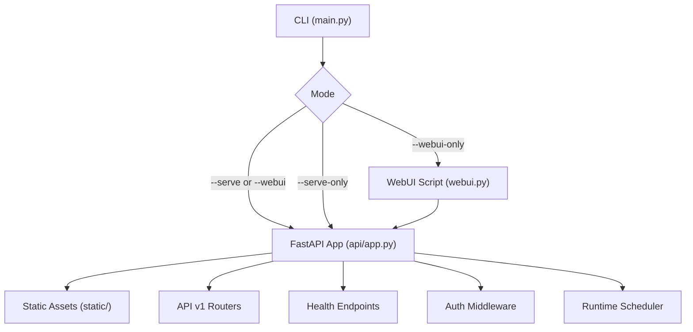
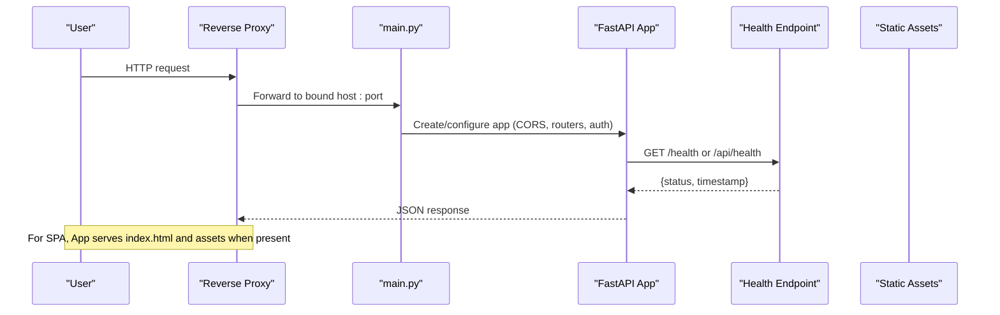
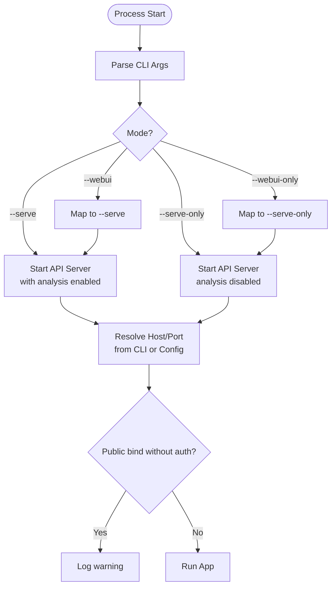
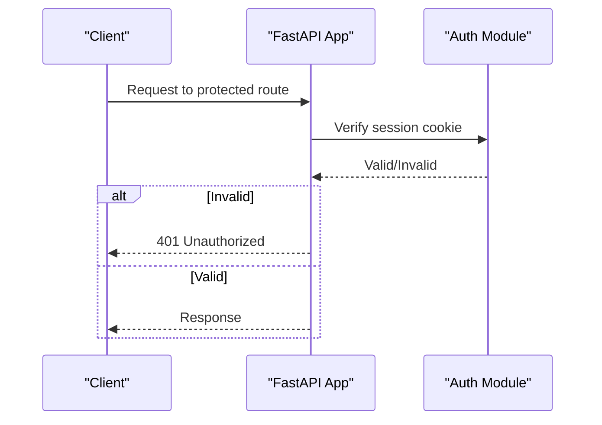
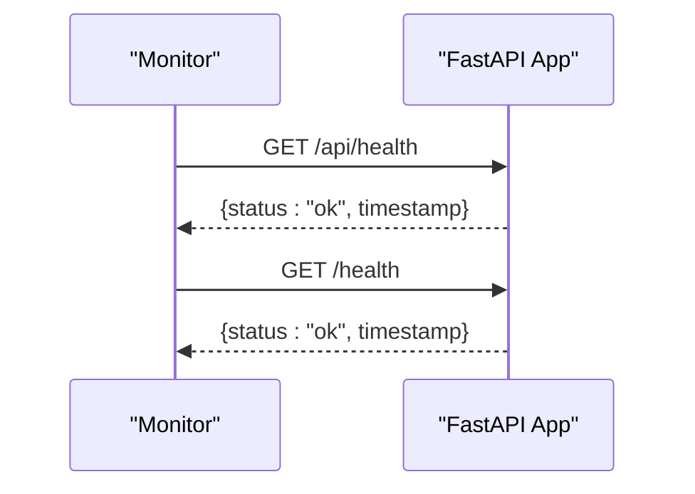
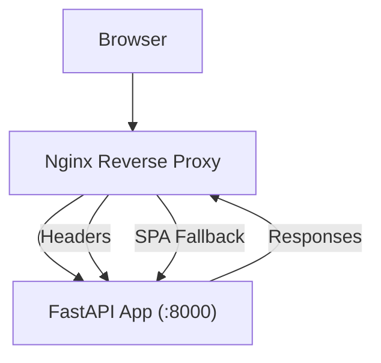
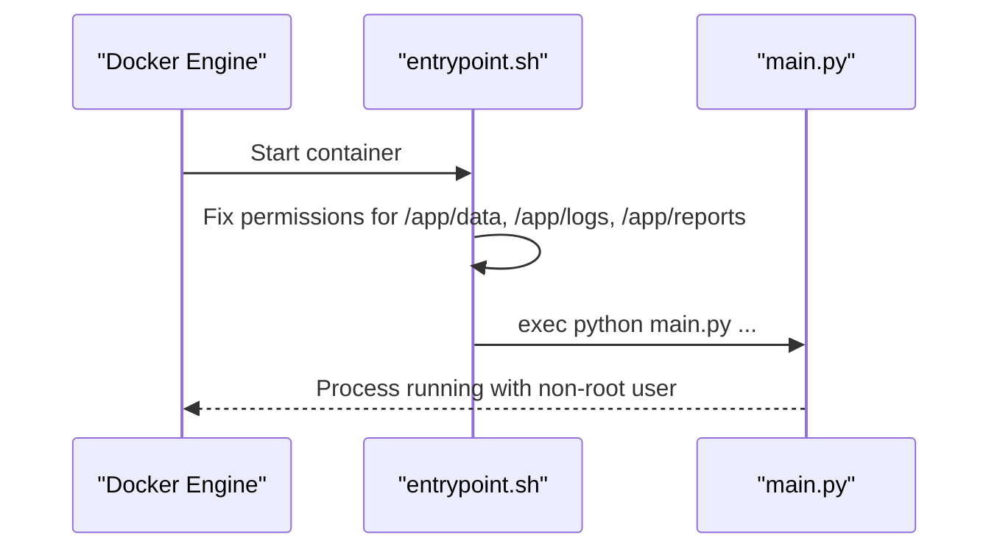
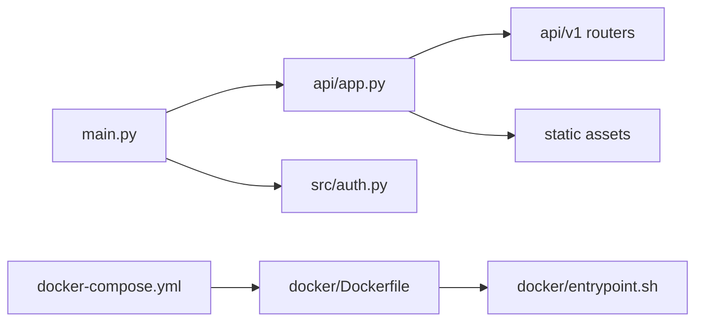

# Service Management

<cite>
**Referenced Files in This Document**
- [main.py](file://main.py)
- [server.py](file://server.py)
- [webui.py](file://webui.py)
- [api/app.py](file://api/app.py)
- [src/config.py](file://src/config.py)
- [src/auth.py](file://src/auth.py)
- [api/v1/endpoints/health.py](file://api/v1/endpoints/health.py)
- [api/v1/schemas/common.py](file://api/v1/schemas/common.py)
- [docker/Dockerfile](file://docker/Dockerfile)
- [docker/docker-compose.yml](file://docker/docker-compose.yml)
- [docker/entrypoint.sh](file://docker/entrypoint.sh)
- [docs/deploy-webui-cloud.md](file://docs/deploy-webui-cloud.md)
</cite>

## Table of Contents
1. Introduction
2. Project Structure
3. Core Components
4. Architecture Overview
5. Detailed Component Analysis
6. Dependency Analysis
7. Performance Considerations
8. Troubleshooting Guide
9. Conclusion
10. Appendices

## Introduction
This document explains how to start and manage the application server and web interface using service management commands, configuration options, and production deployment practices. It covers:
- Starting modes: --serve, --webui, --serve-only, --webui-only
- Network binding with --host and --port
- Authentication and security considerations for production
- Reverse proxy integration and container orchestration
- Health checks, monitoring, and lifecycle management
- Common startup issues, performance tuning, and scaling guidance

## Project Structure
The service layer is built around a FastAPI backend that can serve both API endpoints and the web UI static assets. The main entry point provides CLI flags to control which components run. A lightweight server wrapper exposes the app for direct uvicorn usage, while a dedicated webui script offers a simple way to launch the web interface. Docker artifacts provide a production-ready image, compose services, and an entrypoint that ensures writable directories and drops privileges.



**Diagram sources**
- [main.py:372-408](file://main.py#L372-L408)
- [api/app.py:313-384](file://api/app.py#L313-L384)
- [webui.py:26-55](file://webui.py#L26-L55)

**Section sources**
- [main.py:372-408](file://main.py#L372-L408)
- [server.py:1-55](file://server.py#L1-L55)
- [webui.py:1-60](file://webui.py#L1-L60)
- [api/app.py:313-384](file://api/app.py#L313-L384)

## Core Components
- CLI mode selection and argument parsing define whether the process runs as an API server, a web UI server, or both.
- The FastAPI application configures CORS, mounts routers, serves static assets when available, and registers health endpoints.
- Authentication middleware protects routes based on environment toggles and session handling.
- Docker Compose defines two services: analyzer (scheduled tasks) and server (API-only), with environment variables controlling bind address and port.

Key capabilities:
- Start API + analysis: --serve
- Start API only: --serve-only
- Start Web UI only: --webui-only
- Start Web UI (alias to serve): --webui
- Bind host/port via --host and --port or environment variables
- Health check at /health and /api/health
- Optional background scheduler and stock index refresh

**Section sources**
- [main.py:372-408](file://main.py#L372-L408)
- [api/app.py:313-384](file://api/app.py#L313-L384)
- [api/app.py:435-454](file://api/app.py#L435-L454)
- [docker/docker-compose.yml:59-73](file://docker/docker-compose.yml#L59-L73)

## Architecture Overview
The runtime architecture supports multiple deployment patterns:
- Direct CLI invocation through main.py with flags
- Uvicorn directly via server.py or webui.py
- Containerized deployment with Docker Compose
- Reverse proxy in front of the API/web UI



**Diagram sources**
- [api/app.py:313-384](file://api/app.py#L313-L384)
- [api/app.py:398-454](file://api/app.py#L398-L454)
- [api/app.py:498-560](file://api/app.py#L498-L560)

**Section sources**
- [api/app.py:313-384](file://api/app.py#L313-L384)
- [api/app.py:398-454](file://api/app.py#L398-L454)
- [api/app.py:498-560](file://api/app.py#L498-L560)

## Detailed Component Analysis

### CLI Service Modes and Binding
- Flags:
  - --serve: Start FastAPI backend service and execute analysis tasks
  - --serve-only: Start FastAPI backend service without automatic analysis
  - --webui: Alias to enable serving the web UI (maps to --serve)
  - --webui-only: Start web service without automatic analysis (maps to --serve-only)
- Binding:
  - --host and --port override defaults; otherwise use WEBUI_HOST and WEBUI_PORT from configuration
  - Public bind hosts (e.g., 0.0.0.0) trigger a warning if authentication is disabled



**Diagram sources**
- [main.py:372-408](file://main.py#L372-L408)
- [main.py:114-118](file://main.py#L114-L118)
- [main.py:98-111](file://main.py#L98-L111)

**Section sources**
- [main.py:372-408](file://main.py#L372-L408)
- [main.py:114-118](file://main.py#L114-L118)
- [main.py:98-111](file://main.py#L98-L111)

### FastAPI Application Lifecycle and Features
- Creates the FastAPI app with lifespan hooks for scheduler initialization and cleanup
- Registers CORS middleware with configurable origins and credentials behavior
- Mounts API v1 routers and error handlers
- Serves root path and SPA fallback when static assets are present
- Exposes health endpoints at /health and /api/health
- Background tasks include stock index refresh and name resolver cache warmup

```mermaid
classDiagram
class FastAPI_App {
+lifespan()
+add_middleware(CORS)
+include_router(api_v1_router)
+get("/health")
+get("/", SPA fallback)
+get("/assets/{path}")
}
class RuntimeSchedulerService {
+reconcile_from_config()
+stop()
}
class SystemConfigService {
}
FastAPI_App --> RuntimeSchedulerService : "initializes"
FastAPI_App --> SystemConfigService : "initializes"
```

**Diagram sources**
- [api/app.py:237-310](file://api/app.py#L237-L310)
- [api/app.py:313-384](file://api/app.py#L313-L384)
- [api/app.py:398-454](file://api/app.py#L398-L454)

**Section sources**
- [api/app.py:237-310](file://api/app.py#L237-L310)
- [api/app.py:313-384](file://api/app.py#L313-L384)
- [api/app.py:398-454](file://api/app.py#L398-L454)

### Authentication and Security
- Toggle: ADMIN_AUTH_ENABLED enables admin authentication for protected routes
- Session secret rotation and storage under data directory
- Password hashing and verification with PBKDF2
- Rate limiting for login attempts per IP
- Trust X-Forwarded-For for reverse proxy scenarios
- Warnings when CORS allows all origins without authentication



**Diagram sources**
- [src/auth.py:69-79](file://src/auth.py#L69-L79)
- [src/auth.py:197-203](file://src/auth.py#L197-L203)
- [src/auth.py:332-367](file://src/auth.py#L332-L367)
- [src/auth.py:370-384](file://src/auth.py#L370-L384)
- [api/app.py:157-164](file://api/app.py#L157-L164)

**Section sources**
- [src/auth.py:69-79](file://src/auth.py#L69-L79)
- [src/auth.py:197-203](file://src/auth.py#L197-L203)
- [src/auth.py:332-367](file://src/auth.py#L332-L367)
- [src/auth.py:370-384](file://src/auth.py#L370-L384)
- [api/app.py:157-164](file://api/app.py#L157-L164)

### Health Checks and Monitoring
- Health endpoints return status and timestamp for load balancers and monitors
- Docker HEALTHCHECK probes /api/health or /health
- Logs and metrics can be collected via standard logging configuration



**Diagram sources**
- [api/app.py:435-454](file://api/app.py#L435-L454)
- [api/v1/endpoints/health.py:21-34](file://api/v1/endpoints/health.py#L21-L34)
- [api/v1/schemas/common.py:31-42](file://api/v1/schemas/common.py#L31-L42)
- [docker/Dockerfile:95-98](file://docker/Dockerfile#L95-L98)

**Section sources**
- [api/app.py:435-454](file://api/app.py#L435-L454)
- [api/v1/endpoints/health.py:21-34](file://api/v1/endpoints/health.py#L21-L34)
- [api/v1/schemas/common.py:31-42](file://api/v1/schemas/common.py#L31-L42)
- [docker/Dockerfile:95-98](file://docker/Dockerfile#L95-L98)

### Reverse Proxy Integration
- Nginx example forwards traffic to localhost:8000 with proper headers
- WebSocket support included for real-time features
- TRUST_X_FORWARDED_FOR recommended when behind a single trusted proxy



**Diagram sources**
- [docs/deploy-webui-cloud.md:277-327](file://docs/deploy-webui-cloud.md#L277-L327)
- [src/auth.py:370-384](file://src/auth.py#L370-L384)

**Section sources**
- [docs/deploy-webui-cloud.md:277-327](file://docs/deploy-webui-cloud.md#L277-L327)
- [src/auth.py:370-384](file://src/auth.py#L370-L384)

### Container Orchestration and Lifecycle
- Docker image builds frontend assets and installs Python dependencies
- Entrypoint repairs directory ownership and permissions, then drops privileges
- Compose defines analyzer and server services with resource limits and volumes
- Default command for server service uses --serve-only with explicit host/port



**Diagram sources**
- [docker/Dockerfile:20-106](file://docker/Dockerfile#L20-L106)
- [docker/entrypoint.sh:63-90](file://docker/entrypoint.sh#L63-L90)
- [docker/docker-compose.yml:59-73](file://docker/docker-compose.yml#L59-L73)

**Section sources**
- [docker/Dockerfile:20-106](file://docker/Dockerfile#L20-L106)
- [docker/entrypoint.sh:63-90](file://docker/entrypoint.sh#L63-L90)
- [docker/docker-compose.yml:59-73](file://docker/docker-compose.yml#L59-L73)

## Dependency Analysis
- main.py parses CLI arguments and maps --webui/--webui-only to serve modes
- api/app.py creates the FastAPI app, adds CORS, mounts routers, and serves static assets
- src/auth.py provides authentication toggles, session handling, and rate limiting
- docker files define build steps, environment variables, and service commands



**Diagram sources**
- [main.py:372-408](file://main.py#L372-L408)
- [api/app.py:313-384](file://api/app.py#L313-L384)
- [src/auth.py:69-79](file://src/auth.py#L69-L79)
- [docker/docker-compose.yml:59-73](file://docker/docker-compose.yml#L59-L73)
- [docker/Dockerfile:20-106](file://docker/Dockerfile#L20-L106)
- [docker/entrypoint.sh:63-90](file://docker/entrypoint.sh#L63-L90)

**Section sources**
- [main.py:372-408](file://main.py#L372-L408)
- [api/app.py:313-384](file://api/app.py#L313-L384)
- [src/auth.py:69-79](file://src/auth.py#L69-L79)
- [docker/docker-compose.yml:59-73](file://docker/docker-compose.yml#L59-L73)
- [docker/Dockerfile:20-106](file://docker/Dockerfile#L20-L106)
- [docker/entrypoint.sh:63-90](file://docker/entrypoint.sh#L63-L90)

## Performance Considerations
- Resource limits: Compose sets memory reservations and limits; adjust for workload size
- Concurrency: Reduce MAX_WORKERS for constrained environments
- Background tasks: Stock index refresh and name resolver warmup occur at startup to reduce first-request latency
- Logging: Configure log levels and file rotation to avoid disk pressure
- Static assets: Ensure frontend build is present to avoid SPA fallback overhead

[No sources needed since this section provides general guidance]

## Troubleshooting Guide
Common issues and resolutions:
- Blank page in Web UI: Frontend not built; build assets or use --serve-only which includes guidance
- Permission errors in containers: Entrypoint fixes ownership; ensure host mounts allow writes
- Authentication warnings: Enable ADMIN_AUTH_ENABLED when exposing to public networks
- CORS misconfiguration: Avoid CORS_ALLOW_ALL=true unless on trusted networks and consider enabling auth
- Health checks failing: Verify /api/health or /health responds; check network bindings and ports

**Section sources**
- [api/app.py:398-433](file://api/app.py#L398-L433)
- [docker/entrypoint.sh:63-90](file://docker/entrypoint.sh#L63-L90)
- [src/auth.py:69-79](file://src/auth.py#L69-L79)
- [api/app.py:157-164](file://api/app.py#L157-L164)
- [docker/Dockerfile:95-98](file://docker/Dockerfile#L95-L98)

## Conclusion
The service management layer provides flexible modes to run the API and web interface independently or together, with robust configuration for network binding, authentication, and production deployments. Health endpoints and Docker tooling simplify monitoring and lifecycle management. Follow the security recommendations and performance guidelines to ensure reliable operation in high-availability environments.

[No sources needed since this section summarizes without analyzing specific files]

## Appendices

### Command Reference
- Start API with analysis: python main.py --serve
- Start API only: python main.py --serve-only
- Start Web UI only: python main.py --webui-only
- Start Web UI (alias): python main.py --webui
- Bind host/port: --host <ip>, --port <number>
- Environment overrides: WEBUI_HOST, WEBUI_PORT

**Section sources**
- [main.py:372-408](file://main.py#L372-L408)
- [webui.py:26-55](file://webui.py#L26-L55)
- [docker/docker-compose.yml:35-41](file://docker/docker-compose.yml#L35-L41)

### Production Deployment Examples
- Docker Compose server service command: --serve-only with host and port
- Nginx reverse proxy configuration with WebSocket support
- Health check via curl to /api/health or /health

**Section sources**
- [docker/docker-compose.yml:65-73](file://docker/docker-compose.yml#L65-L73)
- [docs/deploy-webui-cloud.md:277-327](file://docs/deploy-webui-cloud.md#L277-L327)
- [docker/Dockerfile:95-98](file://docker/Dockerfile#L95-L98)