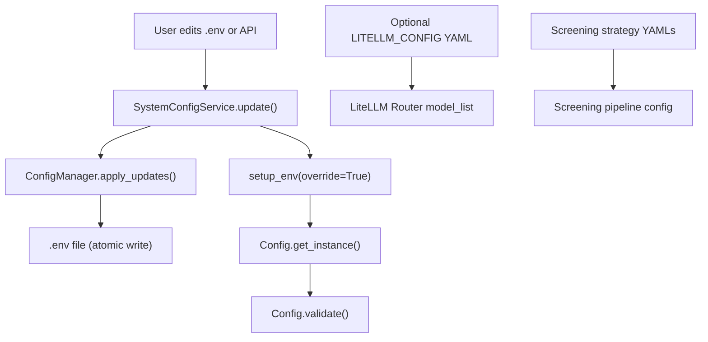
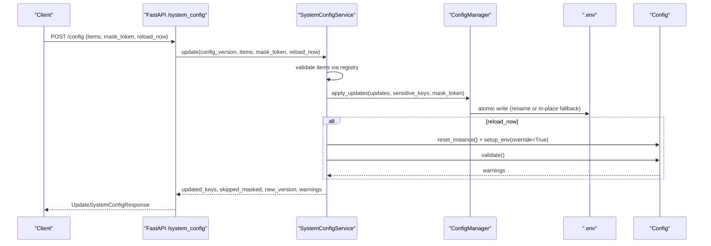
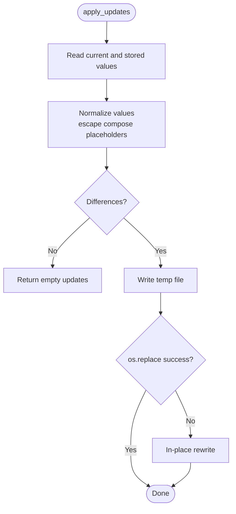
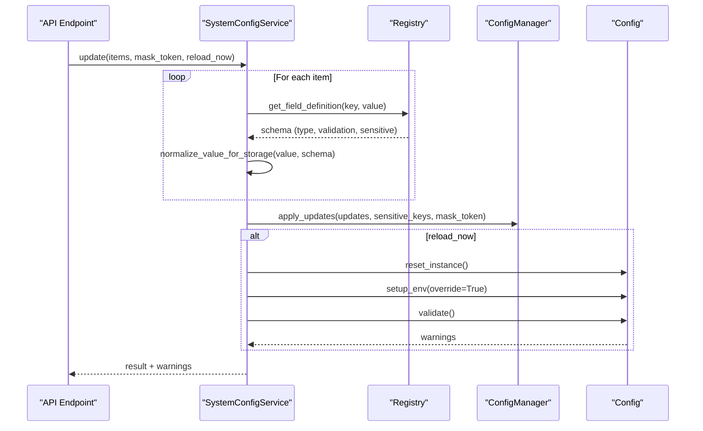
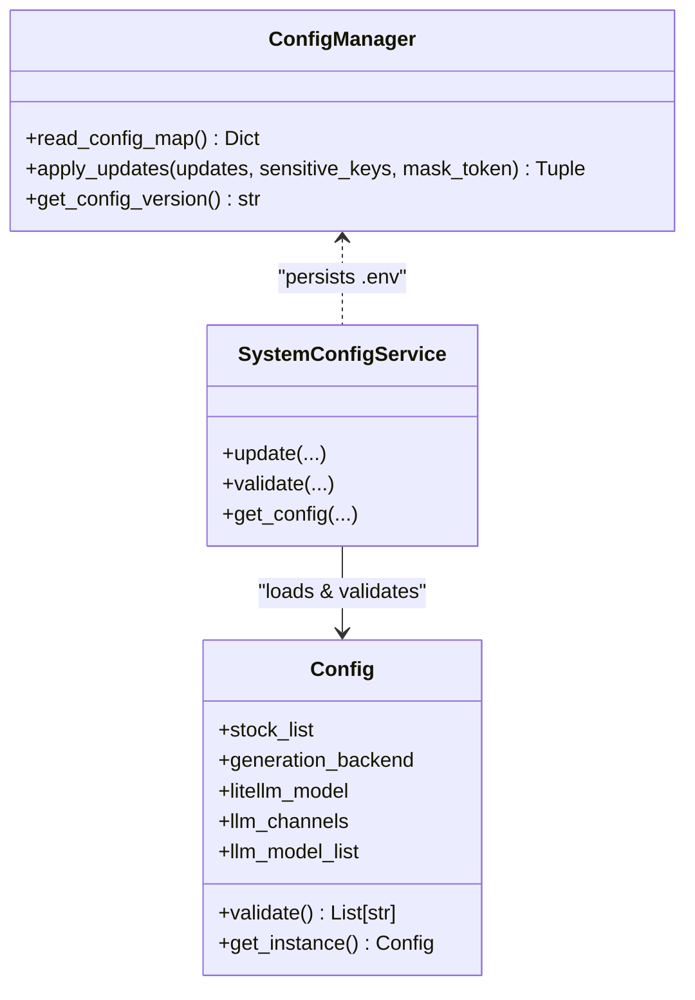
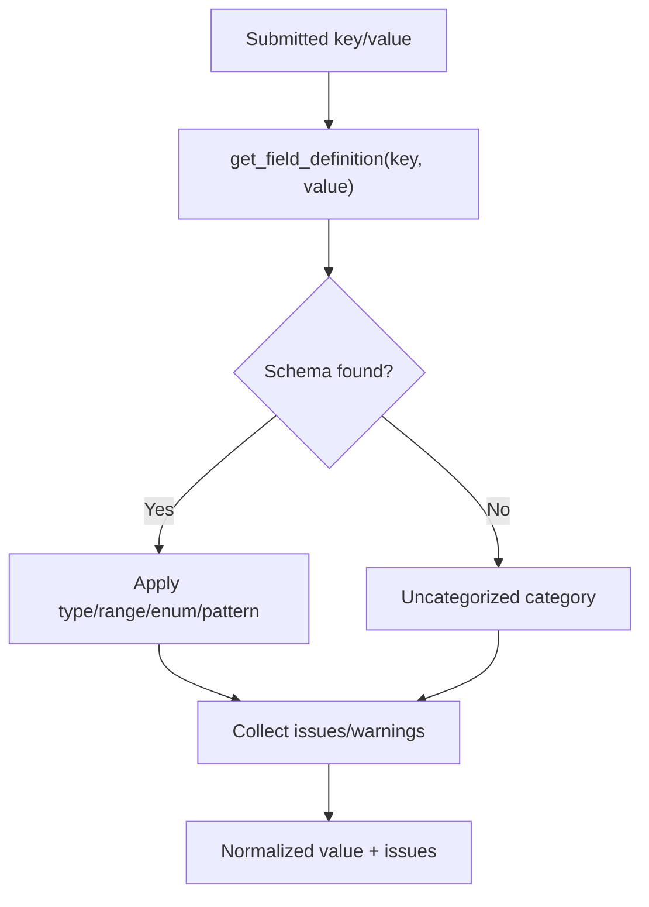
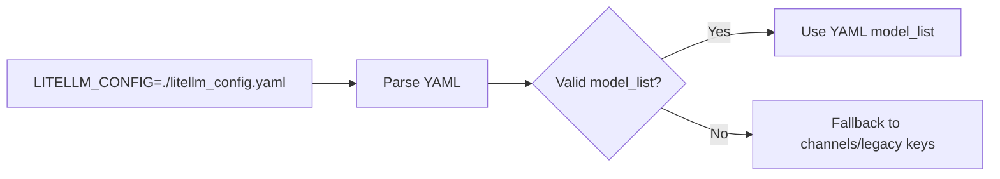
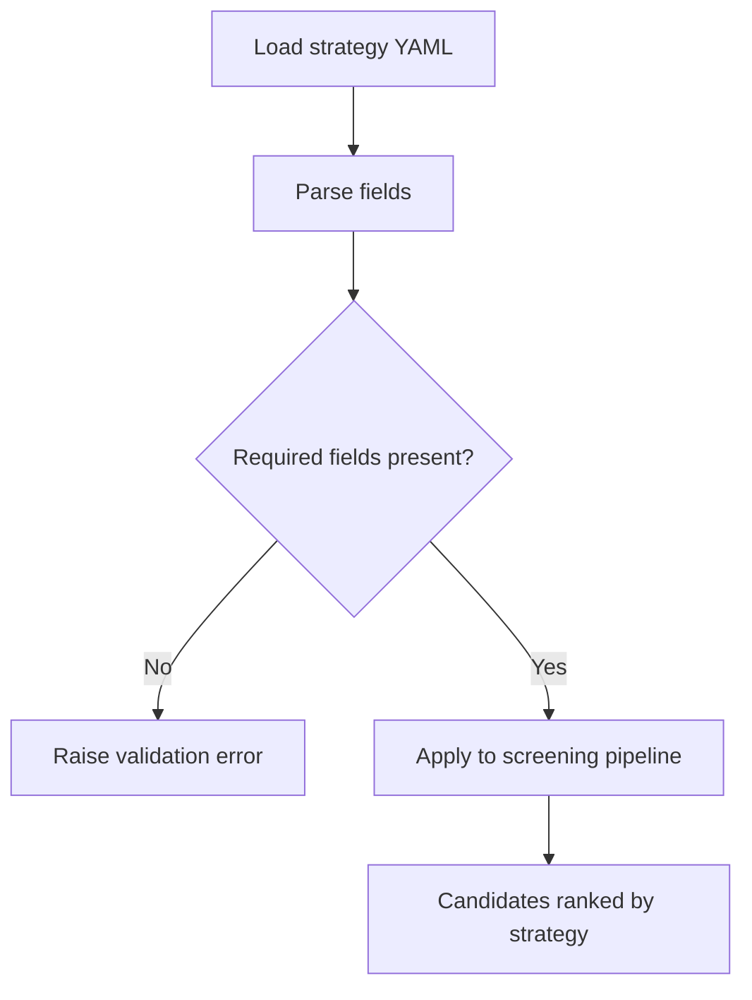
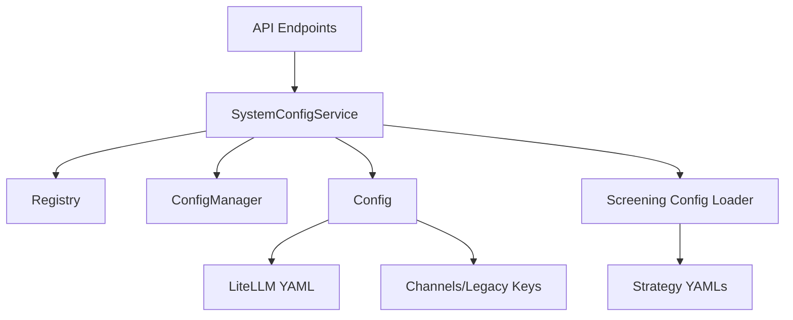

# Configuration Files

<cite>
**Referenced Files in This Document**
- [config.py](file://src/config.py)
- [config_manager.py](file://src/core/config_manager.py)
- [config_registry.py](file://src/core/config_registry.py)
- [system_config_service.py](file://src/services/system_config_service.py)
- [system_config.py](file://api/v1/endpoints/system_config.py)
- [litellm_config.example.yaml](file://docs/examples/litellm_config.example.yaml)
- [balanced_alpha.yaml](file://src/services/screening/strategies/balanced_alpha.yaml)
- [volume_breakout.yaml](file://strategies/volume_breakout.yaml)
- [screening_config.py](file://src/services/screening/config.py)
</cite>

## Table of Contents
1. [Introduction](#introduction)
2. [Project Structure](#project-structure)
3. [Core Components](#core-components)
4. [Architecture Overview](#architecture-overview)
5. [Detailed Component Analysis](#detailed-component-analysis)
6. [Dependency Analysis](#dependency-analysis)
7. [Performance Considerations](#performance-considerations)
8. [Troubleshooting Guide](#troubleshooting-guide)
9. [Conclusion](#conclusion)
10. [Appendices](#appendices)

## Introduction
This document explains how configuration files are managed across the system, focusing on:
- YAML configuration files for advanced model routing and screening strategies
- JSON schema metadata that drives validation and UI behavior
- File-based settings stored in a .env file with atomic read/write semantics
- The configuration manager’s role in loading, validating, merging, and reloading configuration sources
- The precedence between environment variables, .env values, and runtime overrides
- Examples for single-stock analysis, portfolio monitoring, and batch processing
- Validation rules, error handling, and migration considerations when updating configurations

## Project Structure
Configuration is organized into several layers:
- Default and user-provided environment variables via .env
- Advanced LiteLLM routing via an optional YAML file
- Screening strategy definitions as YAML files
- A registry of field metadata that defines types, validation, categories, and UI hints
- A service layer that validates, persists, and reloads configuration at runtime

**Diagram sources**
- [system_config_service.py:2059-2091](file://src/services/system_config_service.py#L2059-L2091)
- [config_manager.py:177-256](file://src/core/config_manager.py#L177-L256)
- [config.py:822-858](file://src/config.py#L822-L858)
- [litellm_config.example.yaml:18-101](file://docs/examples/litellm_config.example.yaml#L18-L101)
- [balanced_alpha.yaml:1-75](file://src/services/screening/strategies/balanced_alpha.yaml#L1-L75)

**Section sources**
- [config_manager.py:112-290](file://src/core/config_manager.py#L112-L290)
- [config_registry.py:20-71](file://src/core/config_registry.py#L20-L71)
- [system_config_service.py:130-200](file://src/services/system_config_service.py#L130-L200)
- [litellm_config.example.yaml:1-101](file://docs/examples/litellm_config.example.yaml#L1-L101)
- [balanced_alpha.yaml:1-75](file://src/services/screening/strategies/balanced_alpha.yaml#L1-L75)

## Core Components
- ConfigManager: Atomic read/write for .env, version tracking, and safe updates with fallback rewrite paths.
- SystemConfigService: Validates submitted fields using the registry, normalizes values, persists to .env, optionally reloads runtime, and returns warnings.
- Config: Loads environment variables, builds LLM routing (channels, YAML, legacy keys), exposes typed accessors, and runs comprehensive validation.
- Registry: Defines field metadata (types, ranges, enums, sensitivity, examples, docs) used by both validation and UI.
- Screening config loader: Reads additional .env files for screening tasks and applies them to process environment safely.

Key responsibilities:
- Loading: setup_env loads .env; Config parses channels/YAML/legacy keys into a unified model list.
- Validation: Field-level and cross-field checks via registry and Config.validate().
- Merging: Channels/YAML take priority over legacy keys; process environment can override mutable keys when explicitly set.
- Persistence: ConfigManager writes .env atomically and tracks version for conflict detection.
- Runtime reload: Optional immediate reload after update to apply changes without restart.

**Section sources**
- [config_manager.py:112-290](file://src/core/config_manager.py#L112-L290)
- [system_config_service.py:95-200](file://src/services/system_config_service.py#L95-L200)
- [config.py:822-1019](file://src/config.py#L822-L1019)
- [config_registry.py:20-71](file://src/core/config_registry.py#L20-L71)
- [screening_config.py:35-110](file://src/services/screening/config.py#L35-L110)

## Architecture Overview
The configuration flow spans API endpoints, service logic, file persistence, and runtime reload.

**Diagram sources**
- [system_config.py:379-416](file://api/v1/endpoints/system_config.py#L379-L416)
- [system_config_service.py:2059-2091](file://src/services/system_config_service.py#L2059-L2091)
- [config_manager.py:177-256](file://src/core/config_manager.py#L177-L256)
- [config.py:822-858](file://src/config.py#L822-L858)

## Detailed Component Analysis

### Configuration Manager (.env persistence)
- Reads key-value pairs from .env with optional interpolation control and special handling for compose-sensitive keys.
- Writes updates atomically using rename; falls back to in-place rewrite if rename fails due to mount constraints.
- Tracks file version based on content hash and modification time for optimistic concurrency.
- Preserves comments and blank lines while updating only changed assignments.

**Diagram sources**
- [config_manager.py:177-256](file://src/core/config_manager.py#L177-L256)

**Section sources**
- [config_manager.py:112-290](file://src/core/config_manager.py#L112-L290)

### System Config Service (validation, normalization, reload)
- Normalizes submitted values according to registry data types and validation rules.
- Persists updates through ConfigManager with sensitive-key masking support.
- Optionally reloads runtime by resetting Config, reapplying environment, and running validation to collect warnings.
- Exposes import/export and validation-only endpoints via API.

**Diagram sources**
- [system_config_service.py:2059-2091](file://src/services/system_config_service.py#L2059-L2091)
- [config_registry.py:84-800](file://src/core/config_registry.py#L84-L800)
- [config_manager.py:177-256](file://src/core/config_manager.py#L177-L256)
- [config.py:822-858](file://src/config.py#L822-L858)

**Section sources**
- [system_config_service.py:95-200](file://src/services/system_config_service.py#L95-L200)
- [system_config_service.py:2059-2091](file://src/services/system_config_service.py#L2059-L2091)

### Config (loading, merging, validation)
- Loads .env via setup_env with optional override behavior to preserve process environment precedence during initial load.
- Builds LLM routing from multiple sources:
  - LITELLM_CONFIG YAML path (highest priority when valid)
  - LLM_CHANNELS (channel editor)
  - Legacy keys (e.g., per-provider keys and models)
- Normalizes provider prefixes, API surfaces, and temperature settings.
- Validates configuration and returns structured issues and backward-compatible messages.

**Diagram sources**
- [config.py:822-1019](file://src/config.py#L822-L1019)
- [config_manager.py:112-290](file://src/core/config_manager.py#L112-L290)
- [system_config_service.py:130-200](file://src/services/system_config_service.py#L130-L200)

**Section sources**
- [config.py:822-1019](file://src/config.py#L822-L1019)
- [config.py:3700-3752](file://src/config.py#L3700-L3752)

### Registry (JSON schema-like metadata)
- Defines categories, display order, and grouping for UI.
- Provides per-field metadata: type, validation rules, options, defaults, sensitivity, examples, help links, and warning codes.
- Used by SystemConfigService to normalize and validate inputs before persisting.

**Diagram sources**
- [config_registry.py:20-71](file://src/core/config_registry.py#L20-L71)
- [config_registry.py:84-800](file://src/core/config_registry.py#L84-L800)
- [system_config_service.py:2373-2611](file://src/services/system_config_service.py#L2373-L2611)

**Section sources**
- [config_registry.py:20-71](file://src/core/config_registry.py#L20-L71)
- [config_registry.py:84-800](file://src/core/config_registry.py#L84-L800)

### YAML Configuration Files

#### Advanced Model Routing (LiteLLM YAML)
- Path specified via LITELLM_CONFIG takes priority when parseable and yields a model_list.
- Supports multiple providers, multi-key load balancing, and router settings.
- Keys can reference environment variables securely.

**Diagram sources**
- [litellm_config.example.yaml:18-101](file://docs/examples/litellm_config.example.yaml#L18-L101)
- [config_registry.py:412-440](file://src/core/config_registry.py#L412-L440)

**Section sources**
- [litellm_config.example.yaml:1-101](file://docs/examples/litellm_config.example.yaml#L1-L101)
- [config_registry.py:412-440](file://src/core/config_registry.py#L412-L440)

#### Screening Strategy YAMLs
- Define strategy name, display name, description, category, tags, skills, style, screening filters, factor weights, scoring profiles, risk profile, portfolio buckets, ranking hints, and output limits.
- Example: balanced_alpha.yaml demonstrates a multi-factor balanced strategy with market scope, hard filters, and sector buckets.

**Diagram sources**
- [balanced_alpha.yaml:1-75](file://src/services/screening/strategies/balanced_alpha.yaml#L1-L75)
- [strategy.py:977-1031](file://src/services/screening/strategy.py#L977-L1031)

**Section sources**
- [balanced_alpha.yaml:1-75](file://src/services/screening/strategies/balanced_alpha.yaml#L1-L75)
- [volume_breakout.yaml:1-48](file://strategies/volume_breakout.yaml#L1-L48)
- [strategy.py:977-1031](file://src/services/screening/strategy.py#L977-L1031)

### Environment Variables and Precedence
- setup_env loads .env; when override=False (initial load), existing process environment variables take precedence.
- When reload_now=True, setup_env is called with override=True to refresh runtime state from .env.
- Process environment can intentionally override mutable keys if set differently than .env at bootstrap.
- Screening subsystem supports additional .env files via SCREENING_ENV_FILE and SCREENING_ENV_FILES, applied safely to process environment.

Precedence summary:
- Highest: Process environment (especially when explicitly set at bootstrap)
- Next: .env file (persisted via ConfigManager)
- Lowest: Defaults and inferred values within Config

**Section sources**
- [config.py:822-858](file://src/config.py#L822-L858)
- [config.py:726-759](file://tests/test_config_env_compat.py#L726-L759)
- [screening_config.py:35-110](file://src/services/screening/config.py#L35-L110)

## Dependency Analysis
Components interact as follows:
- API endpoints delegate to SystemConfigService for all configuration operations.
- SystemConfigService depends on ConfigManager for .env persistence and on Config for runtime loading/validation.
- Registry provides schema metadata consumed by SystemConfigService for validation and UI generation.
- YAML configs influence LLM routing built by Config; screening YAMLs influence screening pipeline behavior.

**Diagram sources**
- [system_config.py:379-416](file://api/v1/endpoints/system_config.py#L379-L416)
- [system_config_service.py:130-200](file://src/services/system_config_service.py#L130-L200)
- [config_registry.py:20-71](file://src/core/config_registry.py#L20-L71)
- [config.py:822-1019](file://src/config.py#L822-L1019)
- [screening_config.py:35-110](file://src/services/screening/config.py#L35-L110)

**Section sources**
- [system_config.py:379-416](file://api/v1/endpoints/system_config.py#L379-L416)
- [system_config_service.py:130-200](file://src/services/system_config_service.py#L130-L200)
- [config_registry.py:20-71](file://src/core/config_registry.py#L20-L71)
- [config.py:822-1019](file://src/config.py#L822-L1019)
- [screening_config.py:35-110](file://src/services/screening/config.py#L35-L110)

## Performance Considerations
- Atomic writes minimize corruption risk and reduce downtime during updates.
- Versioning enables optimistic concurrency to avoid lost updates.
- Caching of .env reads in screening loader reduces repeated disk I/O.
- LLM routing prioritization avoids unnecessary parsing when YAML is invalid, falling back efficiently.

[No sources needed since this section provides general guidance]

## Troubleshooting Guide
Common issues and resolutions:
- Validation failures: Check field types, ranges, enums, and patterns defined in the registry; use the validate endpoint to preview issues before saving.
- Version conflicts: If concurrent edits occur, the server returns a conflict; reload the latest config version and retry.
- Import errors: Ensure imported .env payload contains recognized keys; otherwise, no updates are applied.
- Reload failures: Even if .env is updated, runtime reload may fail; check logs and re-run validation to identify misconfiguration.

Error types surfaced:
- ConfigValidationError: Contains a list of issues with severity, message, and field context.
- ConfigConflictError: Indicates stale config_version; includes current version.
- ConfigImportError: Raised when imported payload has no recognized configuration.

**Section sources**
- [system_config_service.py:95-117](file://src/services/system_config_service.py#L95-L117)
- [system_config_service.py:2373-2611](file://src/services/system_config_service.py#L2373-L2611)
- [system_config.py:379-416](file://api/v1/endpoints/system_config.py#L379-L416)

## Conclusion
The configuration system combines robust file-based persistence, rich schema-driven validation, and flexible runtime reloading. It supports advanced model routing via YAML, screening strategies via YAML, and seamless integration with environment variables. Users can manage configuration through the API with clear validation feedback, conflict resolution, and safe persistence.

[No sources needed since this section summarizes without analyzing specific files]

## Appendices

### Example Configuration Scenarios

- Single-stock analysis
  - Set primary model and optional fallback models
  - Configure stock list for one ticker
  - Use default screening disabled unless needed

- Portfolio monitoring
  - Add multiple stocks to STOCK_LIST
  - Enable screening to discover candidates across sectors
  - Adjust news window and bias thresholds for portfolio-wide signals

- Batch processing
  - Increase generation backend concurrency and timeouts
  - Use LITELLM_CONFIG YAML to route different models per task
  - Leverage screening strategies for large-scale candidate discovery

[No sources needed since this section provides conceptual examples]