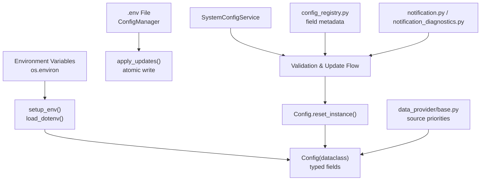
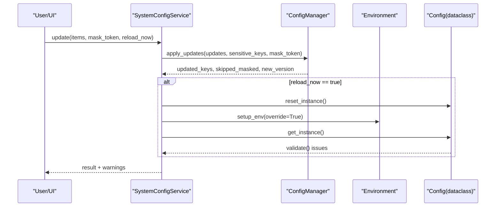
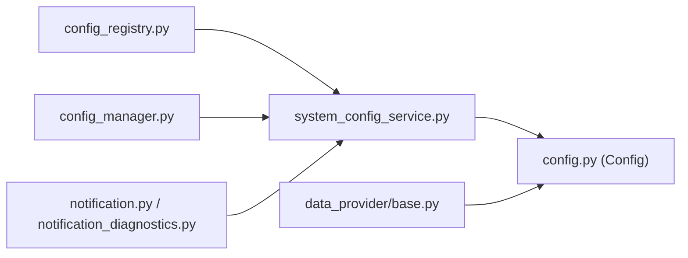

# Configuration Management

<cite>
**Referenced Files in This Document**
- [config.py](file://src/config.py)
- [config_manager.py](file://src/core/config_manager.py)
- [config_registry.py](file://src/core/config_registry.py)
- [system_config_service.py](file://src/services/system_config_service.py)
- [notification.py](file://src/notification.py)
- [notification_diagnostics.py](file://src/services/notification_diagnostics.py)
- [base.py](file://data_provider/base.py)
- [local_cli_backend.py](file://src/llm/local_cli_backend.py)
</cite>

## Table of Contents
1. [Introduction](#introduction)
2. [Project Structure](#project-structure)
3. [Core Components](#core-components)
4. [Architecture Overview](#architecture-overview)
5. [Detailed Component Analysis](#detailed-component-analysis)
6. [Dependency Analysis](#dependency-analysis)
7. [Performance Considerations](#performance-considerations)
8. [Troubleshooting Guide](#troubleshooting-guide)
9. [Conclusion](#conclusion)
10. [Appendices](#appendices)

## Introduction
This document explains the Configuration Management system for environment variables, configuration files, and runtime overrides. It covers:
- Where configuration is defined and loaded
- The hierarchy from environment variables to configuration files to runtime overrides
- Available configuration options for AI model providers, market data sources, notification channels, and system settings
- Validation mechanisms and error messaging
- Common configuration scenarios
- Security considerations, versioning, and migration strategies

## Project Structure
The configuration system is implemented across a few core modules:
- Environment loading and typed configuration object: src/config.py
- Atomic .env file read/write with versioning: src/core/config_manager.py
- Field metadata, categories, validation hints, and UI schema: src/core/config_registry.py
- Service layer that validates, updates, imports, and reloads configuration: src/services/system_config_service.py
- Notification channel detection and diagnostics: src/notification.py, src/services/notification_diagnostics.py
- Market data source priority and fallback behavior: data_provider/base.py
- Sensitive value masking in diagnostics: src/llm/local_cli_backend.py

**Diagram sources**
- [config.py:822-859](file://src/config.py#L822-L859)
- [config_manager.py:112-215](file://src/core/config_manager.py#L112-L215)
- [config_registry.py:20-71](file://src/core/config_registry.py#L20-L71)
- [system_config_service.py:2059-2091](file://src/services/system_config_service.py#L2059-L2091)

**Section sources**
- [config.py:822-859](file://src/config.py#L822-L859)
- [config_manager.py:112-215](file://src/core/config_manager.py#L112-L215)
- [config_registry.py:20-71](file://src/core/config_registry.py#L20-L71)
- [system_config_service.py:2059-2091](file://src/services/system_config_service.py#L2059-L2091)

## Core Components
- Config (dataclass): Centralized typed configuration with defaults and parsing helpers for booleans, integers, floats, enums, and lists. It also loads sensitive values and normalizes provider/model strings.
- ConfigManager: Reads/writes .env with atomic replace or in-place rewrite fallback, tracks config version, and escapes Docker Compose template placeholders where needed.
- SystemConfigService: Validates submitted configuration against field schemas, applies updates, optionally reloads runtime, and exposes import/export capabilities.
- Config Registry: Single source of truth for field metadata, categories, validation rules, examples, help keys, and documentation links used by the UI and validation pipeline.
- Notification Diagnostics: Detects configured notification channels based on environment keys and provides guidance for minimal vs advanced configuration.
- Data Provider Priorities: Controls market data source order and fallback chains via configuration keys.

Key responsibilities:
- Load environment variables from .env and process environment
- Provide typed accessors and normalization
- Persist changes safely to .env
- Validate new values before applying
- Reload runtime configuration when requested

**Section sources**
- [config.py:861-1200](file://src/config.py#L861-L1200)
- [config_manager.py:112-215](file://src/core/config_manager.py#L112-L215)
- [config_registry.py:20-71](file://src/core/config_registry.py#L20-L71)
- [system_config_service.py:95-117](file://src/services/system_config_service.py#L95-L117)
- [notification_diagnostics.py:83-198](file://src/services/notification_diagnostics.py#L83-L198)

## Architecture Overview
Configuration flows through three layers:
1. Environment variables: Process-level environment variables take precedence at bootstrap; some keys are explicitly preserved as runtime overrides.
2. Configuration file (.env): Loaded via dotenv; supports interpolation and special escaping for compose-sensitive keys.
3. Runtime overrides: After saving via SystemConfigService, the application can reload to apply changes without restart.

**Diagram sources**
- [system_config_service.py:2059-2091](file://src/services/system_config_service.py#L2059-L2091)
- [config_manager.py:177-215](file://src/core/config_manager.py#L177-L215)
- [config.py:822-859](file://src/config.py#L822-L859)

## Detailed Component Analysis

### Environment Loading and Typed Configuration
- setup_env(): Loads .env using dotenv, handles compose-sensitive placeholder unescaping, and respects an optional override flag to refresh environment after updates.
- Config(dataclass): Defines all configuration fields with defaults and parsing utilities for booleans, integers, floats, enums, and lists. Includes LLM routing helpers, temperature resolution, and agent context compression presets.
- Bootstrap runtime overrides: Captures process-provided environment values before dotenv mutates os.environ so that explicit runtime overrides win when they differ from persisted values.

Practical implications:
- Use environment variables for secrets and deployment-time overrides
- Use .env for persistent defaults and team-shared settings
- Use runtime reload to apply non-secret changes immediately

**Section sources**
- [config.py:822-859](file://src/config.py#L822-L859)
- [config.py:226-323](file://src/config.py#L226-L323)
- [config.py:2781-2813](file://src/config.py#L2781-L2813)

### Configuration File Persistence and Versioning
- ConfigManager.read_config_map(): Parses .env into key-value pairs with optional interpolation and compose-sensitive unescaping.
- ConfigManager.apply_updates(): Merges updates, skips masked sensitive values, escapes compose-sensitive templates, writes atomically with rename, and falls back to in-place rewrite if rename fails.
- ConfigManager.get_config_version(): Returns a deterministic version string based on file modification time and content hash for conflict detection.

Security and reliability:
- Sensitive keys can be masked during updates to avoid overwriting existing secrets unintentionally
- Atomic writes reduce risk of partial writes in concurrent environments

**Section sources**
- [config_manager.py:124-156](file://src/core/config_manager.py#L124-L156)
- [config_manager.py:177-215](file://src/core/config_manager.py#L177-L215)
- [config_manager.py:217-263](file://src/core/config_manager.py#L217-L263)
- [config_manager.py:158-175](file://src/core/config_manager.py#L158-L175)

### Field Metadata, Categories, and Validation Schema
- config_registry.py defines categories (Base Settings, AI Model, Data Source, Notification, System, Agent, Backtest), display order, and per-field metadata including types, UI controls, validation constraints, examples, and help keys.
- Used by SystemConfigService to validate submitted values and build schema responses for the UI.

Benefits:
- Centralized documentation and validation rules
- Consistent UI rendering and help text
- Clear examples and docs links for each setting

**Section sources**
- [config_registry.py:20-71](file://src/core/config_registry.py#L20-L71)
- [config_registry.py:84-800](file://src/core/config_registry.py#L84-L800)

### Validation and Error Handling
- SystemConfigService._collect_issues(): Collects field-level and cross-field validation issues using registry metadata and effective maps of saved/runtime/display values.
- Numeric range validation, enum checks, and custom validators produce structured issues with codes, messages, severity, expected, and actual values.
- Exceptions:
  - ConfigValidationError: Raised when submitted fields fail validation
  - ConfigConflictError: Raised when configuration version conflicts occur
  - ConfigImportError: Raised when imported .env payload is invalid

Error handling flow:
- Normalize values
- Validate against schema
- Merge with runtime and saved values for cross-field checks
- Return structured issues to client for correction

**Section sources**
- [system_config_service.py:95-117](file://src/services/system_config_service.py#L95-L117)
- [system_config_service.py:2373-2397](file://src/services/system_config_service.py#L2373-L2397)
- [system_config_service.py:2795-2817](file://src/services/system_config_service.py#L2795-L2817)

### Configuration Hierarchy and Override Rules
- Priority order:
  1. Process environment variables captured at bootstrap (runtime overrides)
  2. .env file values
  3. Defaults in Config(dataclass)
- Some keys are treated as “web UI mutable” and may prefer persisted .env values unless a process-level override differs.
- setup_env(override=True) refreshes environment after updates to ensure runtime reflects persisted changes.

Operational guidance:
- For secrets, prefer process environment variables
- For non-secrets, use .env and reload runtime to apply changes
- Avoid committing secrets to version control

**Section sources**
- [config.py:2781-2813](file://src/config.py#L2781-L2813)
- [config.py:822-859](file://src/config.py#L822-L859)
- [system_config_service.py:2059-2091](file://src/services/system_config_service.py#L2059-L2091)

### AI Model Providers Configuration
Available options include:
- Primary model and fallback models
- Multi-channel LLM configuration via channels or YAML
- Temperature and prompt cache telemetry/hints/diagnostics
- Provider-specific keys and base URLs
- Agent-only model overrides

Common scenarios:
- Set a primary provider/model and one or more fallbacks for redundancy
- Configure multiple channels with different protocols and models
- Enable prompt cache telemetry and diagnostics for cost/performance insights
- Use local CLI backends with concurrency and timeout limits

Notes:
- Protocol inference and model normalization ensure correct routing through LiteLLM
- Responses API surface requires OpenAI provider route

**Section sources**
- [config_registry.py:118-704](file://src/core/config_registry.py#L118-L704)
- [config.py:393-575](file://src/config.py#L393-L575)
- [config.py:706-749](file://src/config.py#L706-L749)
- [config.py:768-819](file://src/config.py#L768-L819)

### Market Data Sources Configuration
Market data source priorities and fallbacks are controlled via configuration keys such as:
- Realtime source priority list
- Per-provider priorities (e.g., TickFlow priority)
- Index-specific fixed chains (Tencent → AkShare → TickFlow → YFinance)

Behavior:
- Fail-open: missing or unavailable sources degrade gracefully
- Index routes use fixed chains independent of generic priorities
- Optional features like TickFlow enhance daily K-lines and market review

**Section sources**
- [base.py:1713-1735](file://data_provider/base.py#L1713-L1735)
- [base.py:2291-2322](file://data_provider/base.py#L2291-L2322)

### Notification Channels Configuration
Supported channels include WeCom, Feishu, DingTalk, Telegram, Email, Pushover, ntfy, Gotify, PushPlus, Server酱3, Custom Webhook, Discord, Slack, and AstrBot.

Detection logic:
- Minimal keys enable basic functionality
- Advanced keys unlock additional features
- Channel specs define minimal vs alternative key sets and notes

Examples:
- Email requires sender and password
- ntfy requires a full topic endpoint URL
- Gotify requires server base URL plus token

**Section sources**
- [notification.py:491-523](file://src/notification.py#L491-L523)
- [notification_diagnostics.py:83-198](file://src/services/notification_diagnostics.py#L83-L198)

### System Settings and Performance Tuning
Relevant settings include:
- Logging directory and level
- Database path and SQLite tuning
- Max workers and debug mode
- Schedule enabled/time
- Report type, language, and renderer options
- Markdown-to-image conversion settings
- Prefetch realtime quotes toggle

Performance tips:
- Adjust max_workers to balance throughput and rate limits
- Tune SQLite busy timeout and retry parameters for high concurrency
- Disable prefetch if not needed to reduce network load
- Use report renderer selectively to avoid overhead

**Section sources**
- [config.py:1171-1200](file://src/config.py#L1171-L1200)

## Dependency Analysis
Configuration components interact as follows:
- SystemConfigService depends on ConfigManager for persistence and on config_registry for validation metadata
- Config(dataclass) depends on helper functions for parsing and normalization
- Notification detection depends on environment keys and diagnostic specs
- Data provider prioritization depends on configuration keys and runtime state

**Diagram sources**
- [config_registry.py:20-71](file://src/core/config_registry.py#L20-L71)
- [system_config_service.py:2059-2091](file://src/services/system_config_service.py#L2059-L2091)
- [config_manager.py:112-215](file://src/core/config_manager.py#L112-L215)
- [config.py:822-859](file://src/config.py#L822-L859)
- [notification_diagnostics.py:83-198](file://src/services/notification_diagnostics.py#L83-L198)
- [base.py:1713-1735](file://data_provider/base.py#L1713-L1735)

**Section sources**
- [config_registry.py:20-71](file://src/core/config_registry.py#L20-L71)
- [system_config_service.py:2059-2091](file://src/services/system_config_service.py#L2059-L2091)
- [config_manager.py:112-215](file://src/core/config_manager.py#L112-L215)
- [config.py:822-859](file://src/config.py#L822-L859)
- [notification_diagnostics.py:83-198](file://src/services/notification_diagnostics.py#L83-L198)
- [base.py:1713-1735](file://data_provider/base.py#L1713-L1735)

## Performance Considerations
- Concurrency: Limit generation backend concurrency and local CLI concurrency to avoid resource exhaustion
- Timeouts: Set appropriate timeouts for generation backends and agent tool calls
- Prompt cache: Enable telemetry and hints judiciously to reduce costs while maintaining performance
- Data fetching: Adjust realtime quote prefetch and source priorities to minimize unnecessary network calls
- Database: Tune SQLite WAL and busy timeout for write-heavy workloads

[No sources needed since this section provides general guidance]

## Troubleshooting Guide
Common issues and resolutions:
- Validation errors: Review structured issues returned by SystemConfigService, focusing on code, message, expected, and actual values
- Version conflicts: Ensure you submit the current config_version when updating to avoid stale writes
- Import failures: Validate .env payload format and ensure recognized keys are present
- Notification channel not working: Check minimal vs advanced keys per channel spec; verify endpoints and tokens
- AI model routing problems: Confirm protocol and model normalization; ensure Responses API surface uses OpenAI provider route

Diagnostics:
- Use notification diagnostics to identify configured channels and required keys
- Inspect effective maps combining saved, runtime, and display values for cross-field validation

**Section sources**
- [system_config_service.py:95-117](file://src/services/system_config_service.py#L95-L117)
- [system_config_service.py:2373-2397](file://src/services/system_config_service.py#L2373-L2397)
- [notification_diagnostics.py:83-198](file://src/services/notification_diagnostics.py#L83-L198)

## Conclusion
The Configuration Management system provides a robust, validated, and user-friendly way to manage environment variables, configuration files, and runtime overrides. It supports complex AI model routing, flexible market data source prioritization, and diverse notification channels. With strong validation, secure handling of sensitive values, and clear error messages, it enables reliable operation across development, testing, and production environments.

[No sources needed since this section summarizes without analyzing specific files]

## Appendices

### Configuration Scenarios

- Multiple AI providers:
  - Define a primary model and one or more fallback models
  - Optionally configure multi-channel LLM settings or a YAML model list
  - Enable prompt cache telemetry and diagnostics for insight

- Different notification channels:
  - Configure minimal keys for each channel (e.g., email sender/password, ntfy topic URL)
  - Add advanced keys for enhanced features (e.g., threads, topics, verification)
  - Use diagnostics to confirm channel status and required keys

- Optimizing performance:
  - Adjust generation backend concurrency and timeouts
  - Tune database parameters for write-heavy workloads
  - Control realtime quote prefetch and source priorities

[No sources needed since this section provides general guidance]

### Security Considerations
- Keep secrets in process environment variables rather than .env
- Mask sensitive values during updates to prevent accidental overwrites
- Avoid committing secrets to version control
- Use high-entropy secrets for HMAC and authentication keys
- Validate SSL for webhooks when possible

**Section sources**
- [config_manager.py:177-215](file://src/core/config_manager.py#L177-L215)
- [local_cli_backend.py:217-277](file://src/llm/local_cli_backend.py#L217-L277)

### Configuration Versioning and Migration
- Versioning: ConfigManager returns a deterministic version string based on file state; use this to detect conflicts during updates
- Migration strategies:
  - Prefer additive changes to .env to maintain compatibility
  - Use registry metadata to guide users through deprecated or changed keys
  - Validate new values before applying to prevent runtime issues
  - Reload runtime configuration to apply changes without restart

**Section sources**
- [config_manager.py:158-175](file://src/core/config_manager.py#L158-L175)
- [system_config_service.py:2059-2091](file://src/services/system_config_service.py#L2059-L2091)