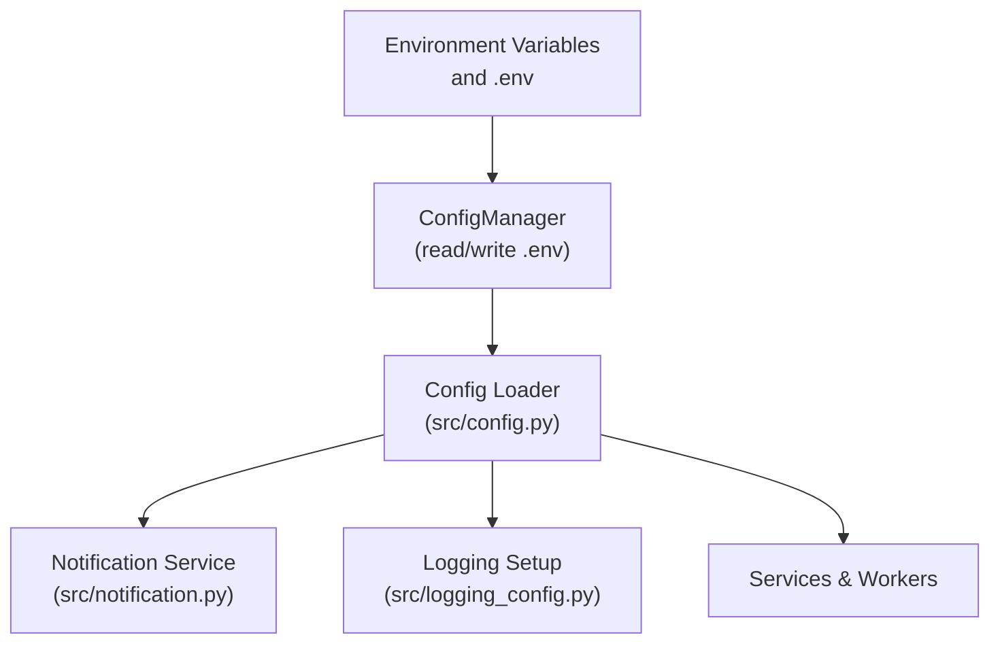
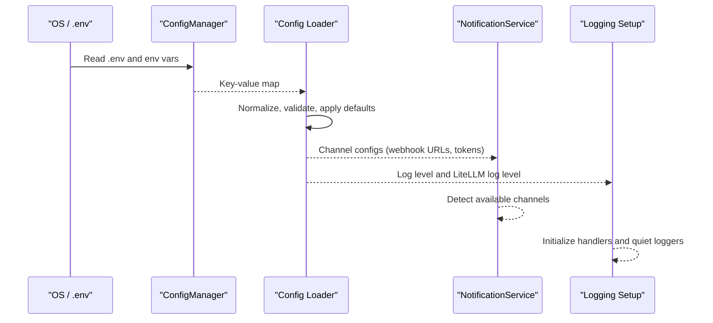
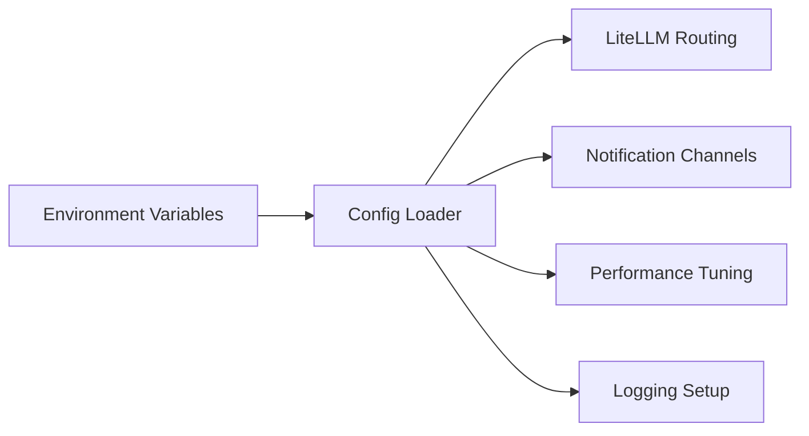

# Environment Variables

<cite>
**Referenced Files in This Document**
- [src/config.py](file://src/config.py)
- [src/core/config_manager.py](file://src/core/config_manager.py)
- [src/notification.py](file://src/notification.py)
- [src/logging_config.py](file://src/logging_config.py)
- [scripts/check_env.py](file://scripts/check_env.py)
- [docs/LLM_CONFIG_GUIDE_EN.md](file://docs/LLM_CONFIG_GUIDE_EN.md)
- [docs/full-guide_EN.md](file://docs/full-guide_EN.md)
- [.github/workflows/00-daily-analysis.yml](file://.github/workflows/00-daily-analysis.yml)
</cite>

## Table of Contents
1. Introduction
2. Project Structure
3. Core Components
4. Architecture Overview
5. Detailed Component Analysis
6. Dependency Analysis
7. Performance Considerations
8. Troubleshooting Guide
9. Conclusion
10. Appendices

## Introduction
This document provides a comprehensive guide to environment variables for the project, focusing on:
- AI model provider settings (LiteLLM routing and provider-specific keys)
- Market data source configurations
- Broker integration settings
- Notification channel configurations (WeChat, Feishu, Telegram, Discord, Slack, email, and others)
- System performance and runtime tuning
- Logging levels
- Common deployment scenarios (development, staging, production)
- Security best practices and precedence rules

The configuration is loaded from environment variables and an optional .env file managed by a dedicated config manager. The central configuration loader reads these values into a typed Config object used across services.

## Project Structure
Environment variable handling spans several modules:
- Configuration loading and parsing: src/config.py
- .env read/write and compose-safe escaping: src/core/config_manager.py
- Notification channels detection and dispatch: src/notification.py
- Logging initialization and LiteLLM log level control: src/logging_config.py
- Example CI usage for secrets and variables: .github/workflows/00-daily-analysis.yml
- LLM configuration guidance and examples: docs/LLM_CONFIG_GUIDE_EN.md, docs/full-guide_EN.md
- Environment validation helper: scripts/check_env.py

**Diagram sources**
- [src/core/config_manager.py:112-156](file://src/core/config_manager.py#L112-L156)
- [src/config.py:1787-2290](file://src/config.py#L1787-L2290)
- [src/notification.py:257-343](file://src/notification.py#L257-L343)
- [src/logging_config.py:83-198](file://src/logging_config.py#L83-L198)

**Section sources**
- [src/config.py:1787-2290](file://src/config.py#L1787-L2290)
- [src/core/config_manager.py:112-156](file://src/core/config_manager.py#L112-L156)
- [src/notification.py:257-343](file://src/notification.py#L257-L343)
- [src/logging_config.py:83-198](file://src/logging_config.py#L83-L198)

## Core Components
- Configuration loader: Reads all environment variables into a strongly typed Config instance with defaults, ranges, and normalization helpers.
- .env manager: Provides atomic read/write, versioning, and Docker Compose placeholder escaping for sensitive fields.
- Notification service: Detects enabled channels based on configured credentials and routes messages accordingly.
- Logging setup: Initializes console and file handlers and controls LiteLLM logger verbosity via an environment variable.

Key responsibilities:
- Parse booleans, integers, floats with bounds and warnings
- Normalize provider names and model strings
- Resolve fallback models and channels
- Validate and sanitize sensitive values

**Section sources**
- [src/config.py:226-324](file://src/config.py#L226-L324)
- [src/config.py:393-575](file://src/config.py#L393-L575)
- [src/config.py:1787-2290](file://src/config.py#L1787-L2290)
- [src/core/config_manager.py:37-64](file://src/core/config_manager.py#L37-L64)
- [src/core/config_manager.py:112-156](file://src/core/config_manager.py#L112-L156)

## Architecture Overview
Environment variables flow through a clear pipeline:
1. .env or process environment is read by ConfigManager.
2. Config loader normalizes and validates values.
3. Services consume Config to enable features (e.g., notifications, logging).
4. Runtime behavior adapts to environment (e.g., LiteLLM routing, concurrency, timeouts).

**Diagram sources**
- [src/core/config_manager.py:124-156](file://src/core/config_manager.py#L124-L156)
- [src/config.py:1787-2290](file://src/config.py#L1787-L2290)
- [src/notification.py:480-551](file://src/notification.py#L480-L551)
- [src/logging_config.py:83-198](file://src/logging_config.py#L83-L198)

## Detailed Component Analysis

### AI Model Provider Settings (LiteLLM and Providers)
- Primary model routing:
  - LITELLM_MODEL: Unified model route alias; supports provider/model format.
  - LITELLM_FALLBACK_MODELS: Ordered list of fallback providers/models when primary fails.
- Provider-specific keys and models:
  - GEMINI_API_KEY, GEMINI_MODEL, GEMINI_MODEL_FALLBACK, GEMINI_TEMPERATURE, GEMINI_MAX_RETRIES, GEMINI_RETRY_DELAY, GEMINI_REQUEST_DELAY
  - ANTHROPIC_API_KEY, ANTHROPIC_MODEL, ANTHROPIC_TEMPERATURE, ANTHROPIC_MAX_TOKENS
  - OPENAI_API_KEY, OPENAI_BASE_URL, OPENAI_MODEL, OPENAI_VISION_MODEL, OPENAI_TEMPERATURE
  - VISION_MODEL: Vision model selection alias
  - DEEPSEEK_* keys are supported via OpenAI-compatible or direct provider resolution
- Advanced multi-channel configuration:
  - LLM_CHANNELS: Comma-separated channel names
  - Per-channel: LLM_{CHANNEL}_PROTOCOL, LLM_{CHANNEL}_API_SURFACE, LLM_{CHANNEL}_BASE_URL, LLM_{CHANNEL}_MODELS, LLM_{CHANNEL}_API_KEY(S), LLM_{CHANNEL}_ENABLED
  - Responses API surface requires openai protocol and compatible models
- Local CLI backends:
  - GENERATION_BACKEND, GENERATION_FALLBACK_BACKEND, GENERATION_BACKEND_TIMEOUT_SECONDS, GENERATION_BACKEND_MAX_OUTPUT_BYTES, GENERATION_BACKEND_MAX_CONCURRENCY, LOCAL_CLI_BACKEND_MAX_CONCURRENCY, OPENCODE_CLI_MODEL
- Agent-related model settings:
  - AGENT_BACKEND, AGENT_GENERATION_BACKEND, AGENT_LITELLM_MODEL, AGENT_MODE, AGENT_MAX_STEPS, AGENT_SKILLS, AGENT_ARCH, AGENT_ORCHESTRATOR_MODE, AGENT_ORCHESTRATOR_TIMEOUT_S
- Search and intelligence keys:
  - TAVILY_API_KEYS, BRAVE_API_KEYS, SERPAPI_KEYS, SEARXNG_BASE_URLS, SOCIAL_SENTIMENT_API_KEY, SOCIAL_SENTIMENT_API_URL

Notes:
- Temperature resolution prefers per-provider variables, then falls back to a unified LLM_TEMPERATURE.
- Provider key lists support multiple keys for rotation (e.g., GEMINI_API_KEYS, ANTHROPIC_API_KEYS, OPENAI_API_KEYS).
- Anspire Open can be used as an OpenAI-compatible provider with its own base URL and model.

Common examples:
- Simple provider setup using Gemini or OpenAI-compatible endpoints
- Multi-key rotation and cross-model fallback
- Ollama local models via OLLAMA_API_BASE and LITELLM_MODEL

**Section sources**
- [src/config.py:706-749](file://src/config.py#L706-L749)
- [src/config.py:1842-1883](file://src/config.py#L1842-L1883)
- [src/config.py:1916-1997](file://src/config.py#L1916-L1997)
- [src/config.py:2338-2500](file://src/config.py#L2338-L2500)
- [docs/LLM_CONFIG_GUIDE_EN.md:21-53](file://docs/LLM_CONFIG_GUIDE_EN.md#L21-L53)
- [docs/LLM_CONFIG_GUIDE_EN.md:95-155](file://docs/LLM_CONFIG_GUIDE_EN.md#L95-L155)
- [docs/LLM_CONFIG_GUIDE_EN.md:159-200](file://docs/LLM_CONFIG_GUIDE_EN.md#L159-L200)
- [docs/full-guide_EN.md:1197-1231](file://docs/full-guide_EN.md#L1197-L1231)

### Market Data Source Configurations
- Tushare:
  - TUSHARE_TOKEN: Authentication token for Tushare Pro
- TickFlow:
  - TICKFLOW_API_KEY, TICKFLOW_KLINE_ADJUST, TICKFLOW_PRIORITY, TICKFLOW_BATCH_DAILY_ENABLED, TICKFLOW_BATCH_SIZE
- Futu:
  - FUTU_OPEND_HOST, FUTU_OPEND_PORT, FUTU_HK_REALTIME_SOURCE_PRIORITY
- Other market data providers:
  - FINNHUB_API_KEY, ALPHAVANTAGE_API_KEY
  - LONGBRIDGE_APP_KEY, LONGBRIDGE_APP_SECRET, LONGBRIDGE_ACCESS_TOKEN, LONGBRIDGE_OAUTH_CLIENT_ID
- Stock index remote update:
  - STOCK_INDEX_REMOTE_UPDATE_ENABLED

Realtime quote and cache:
- ENABLE_REALTIME_QUOTE, ENABLE_REALTIME_TECHNICAL_INDICATORS, ENABLE_CHIP_DISTRIBUTION
- REALTIME_CACHE_TTL, CIRCUIT_BREAKER_COOLDOWN
- realtime_source_priority resolved internally

**Section sources**
- [src/config.py:881-905](file://src/config.py#L881-L905)
- [src/config.py:1791-1812](file://src/config.py#L1791-L1812)
- [src/config.py:2217-2231](file://src/config.py#L2217-L2231)

### Broker Integration Settings
- Futu broker integration uses opend host/port and HK realtime priority. These are primarily for data access and portfolio operations where applicable.
- Longbridge integration includes app key/secret, access token, and OAuth client ID for authentication flows.

**Section sources**
- [src/config.py:1800-1812](file://src/config.py#L1800-L1812)

### Notification Channel Configurations
Supported channels include WeChat (Enterprise WeChat), Feishu, DingTalk, Telegram, Email, Pushover, ntfy, Gotify, PushPlus, ServerChan3, Custom Webhook, Discord, Slack, and ASTRBOT.

Channel-specific environment variables:
- WeChat:
  - WECHAT_WEBHOOK_URL, WECHAT_MSG_TYPE, WECOM_CORPID, WECOM_TOKEN, WECOM_ENCODING_AES_KEY, WECOM_AGENT_ID
- Feishu:
  - FEISHU_WEBHOOK_URL, FEISHU_WEBHOOK_SECRET, FEISHU_WEBHOOK_KEYWORD, FEISHU_APP_ID, FEISHU_APP_SECRET, FEISHU_CHAT_ID, FEISHU_RECEIVE_ID_TYPE, FEISHU_DOMAIN, FEISHU_FOLDER_TOKEN, FEISHU_VERIFICATION_TOKEN, FEISHU_ENCRYPT_KEY, FEISHU_STREAM_ENABLED, FEISHU_MAX_BYTES, FEISHU_SEND_AS_FILE
- DingTalk:
  - DINGTALK_WEBHOOK_URL, DINGTALK_SECRET, DINGTALK_APP_KEY, DINGTALK_APP_SECRET, DINGTALK_STREAM_ENABLED
- Telegram:
  - TELEGRAM_BOT_TOKEN, TELEGRAM_CHAT_ID, TELEGRAM_MESSAGE_THREAD_ID, TELEGRAM_WEBHOOK_SECRET
- Email:
  - EMAIL_SENDER, EMAIL_SENDER_NAME, EMAIL_PASSWORD, EMAIL_RECEIVERS
- Pushover:
  - PUSHOVER_USER_KEY, PUSHOVER_API_TOKEN
- ntfy:
  - NTFY_URL, NTFY_TOKEN
- Gotify:
  - GOTIFY_URL, GOTIFY_TOKEN
- PushPlus:
  - PUSHPLUS_TOKEN, PUSHPLUS_TOPIC
- ServerChan3:
  - SERVERCHAN3_SENDKEY
- Custom Webhook:
  - CUSTOM_WEBHOOK_URLS, CUSTOM_WEBHOOK_BEARER_TOKEN, CUSTOM_WEBHOOK_BODY_TEMPLATE, WEBHOOK_VERIFY_SSL
- Discord:
  - DISCORD_BOT_TOKEN, DISCORD_MAIN_CHANNEL_ID (alias DISCORD_CHANNEL_ID), DISCORD_WEBHOOK_URL, DISCORD_INTERACTIONS_PUBLIC_KEY, DISCORD_MAX_WORDS
- Slack:
  - SLACK_WEBHOOK_URL, SLACK_BOT_TOKEN, SLACK_CHANNEL_ID
- ASTRBOT:
  - ASTRBOT_URL, ASTRBOT_TOKEN

Routing and noise control:
- NOTIFICATION_REPORT_CHANNELS, NOTIFICATION_ALERT_CHANNELS, NOTIFICATION_SYSTEM_ERROR_CHANNELS
- NOTIFICATION_DEDUP_TTL_SECONDS, NOTIFICATION_COOLDOWN_SECONDS, NOTIFICATION_QUIET_HOURS, NOTIFICATION_TIMEZONE, NOTIFICATION_MIN_SEVERITY, NOTIFICATION_DAILY_DIGEST_ENABLED
- Report formatting: REPORT_TYPE, REPORT_LANGUAGE, REPORT_SUMMARY_ONLY, REPORT_SHOW_LLM_MODEL, REPORT_TEMPLATES_DIR, REPORT_RENDERER_ENABLED, REPORT_INTEGRITY_ENABLED, REPORT_INTEGRITY_RETRY, REPORT_HISTORY_COMPARE_N

Markdown-to-image conversion:
- MARKDOWN_TO_IMAGE_CHANNELS, MARKDOWN_TO_IMAGE_MAX_CHARS, MD2IMG_ENGINE

**Section sources**
- [src/config.py:2022-2130](file://src/config.py#L2022-L2130)
- [src/notification.py:185-201](file://src/notification.py#L185-L201)
- [src/notification.py:480-551](file://src/notification.py#L480-L551)
- [.github/workflows/00-daily-analysis.yml:312-336](file://.github/workflows/00-daily-analysis.yml#L312-L336)

### System Performance and Runtime Settings
Concurrency and workers:
- MAX_WORKERS: Global worker pool size
- GENERATION_BACKEND_MAX_CONCURRENCY: Max concurrent generation requests
- LOCAL_CLI_BACKEND_MAX_CONCURRENCY: Max concurrent local CLI backend tasks

Timeouts:
- GENERATION_BACKEND_TIMEOUT_SECONDS: Timeout for generation backend calls
- FUNDAMENTAL_STAGE_TIMEOUT_SECONDS, FUNDAMENTAL_FETCH_TIMEOUT_SECONDS
- AGENT_ORCHESTRATOR_TIMEOUT_S and per-agent tool timeouts
- NEWS_INTEL_FETCH_TIMEOUT_SEC

Cache and storage:
- REALTIME_CACHE_TTL: Cache TTL for realtime quotes
- FUNDAMENTAL_CACHE_TTL_SECONDS, FUNDAMENTAL_CACHE_MAX_ENTRIES
- DATABASE_PATH, SQLITE_WAL_ENABLED, SQLITE_BUSY_TIMEOUT_MS, SQLITE_WRITE_RETRY_MAX, SQLITE_WRITE_RETRY_BASE_DELAY
- SAVE_CONTEXT_SNAPSHOT

Scheduler and execution:
- SCHEDULE_ENABLED, SCHEDULE_TIME, SCHEDULE_TIMES, SCHEDULE_RUN_IMMEDIATELY, RUN_IMMEDIATELY
- BACKTEST_ENABLED, BACKTEST_EVAL_WINDOW_DAYS, BACKTEST_MIN_AGE_DAYS, BACKTEST_ENGINE_VERSION, BACKTEST_NEUTRAL_BAND_PCT

Web UI:
- WEBUI_ENABLED, WEBUI_HOST, WEBUI_PORT

Proxy and network:
- HTTP_PROXY, HTTPS_PROXY

Market review and context:
- MARKET_REVIEW_ENABLED, DAILY_MARKET_CONTEXT_ENABLED, MARKET_REVIEW_REGION, MARKET_REVIEW_COLOR_SCHEME
- TRADING_DAY_CHECK_ENABLED

Bot and rate limiting:
- BOT_ENABLED, BOT_COMMAND_PREFIX, BOT_RATE_LIMIT_REQUESTS, BOT_RATE_LIMIT_WINDOW, BOT_ADMIN_USERS

**Section sources**
- [src/config.py:2131-2290](file://src/config.py#L2131-L2290)
- [docs/full-guide_EN.md:405-422](file://docs/full-guide_EN.md#L405-L422)

### Logging Levels
- LOG_LEVEL: Console and file handler level
- LOG_DIR: Directory for log files
- LITELLM_LOG_LEVEL: Controls LiteLLM logger verbosity; invalid values fall back to default

Logging initialization sets up console output, rotating file logs, and debug logs, while reducing noisy third-party library logs.

**Section sources**
- [src/logging_config.py:22-31](file://src/logging_config.py#L22-L31)
- [src/logging_config.py:68-80](file://src/logging_config.py#L68-L80)
- [src/logging_config.py:83-198](file://src/logging_config.py#L83-L198)

## Dependency Analysis
Environment variables influence multiple subsystems:
- AI model routing depends on LiteLLM provider registry and channel configuration
- Notifications depend on channel credentials and routing policies
- Performance tuning affects concurrency, timeouts, and caching layers
- Logging configuration controls verbosity and file outputs

**Diagram sources**
- [src/config.py:1787-2290](file://src/config.py#L1787-L2290)
- [src/notification.py:480-551](file://src/notification.py#L480-L551)
- [src/logging_config.py:83-198](file://src/logging_config.py#L83-L198)

**Section sources**
- [src/config.py:1787-2290](file://src/config.py#L1787-L2290)
- [src/notification.py:480-551](file://src/notification.py#L480-L551)
- [src/logging_config.py:83-198](file://src/logging_config.py#L83-L198)

## Performance Considerations
- Set MAX_WORKERS appropriately for your workload and hardware constraints.
- Tune GENERATION_BACKEND_MAX_CONCURRENCY and LOCAL_CLI_BACKEND_MAX_CONCURRENCY to balance throughput and resource usage.
- Use realistic timeouts to avoid long-running tasks blocking resources.
- Enable SQLite WAL and tune busy timeout for better concurrency under load.
- Adjust REALTIME_CACHE_TTL and fundamental cache settings to reduce external API calls.
- Use notification deduplication and cooldowns to prevent alert storms.

[No sources needed since this section provides general guidance]

## Troubleshooting Guide
- Verify environment variables using the provided script:
  - Run scripts/check_env.py to test configuration loading, database connectivity, LLM calls, and notifications.
- Check notification availability:
  - NotificationService detects configured channels and logs available channels; ensure required credentials are set.
- Logging diagnostics:
  - Inspect regular and debug log files in LOG_DIR; adjust LOG_LEVEL and LITELLM_LOG_LEVEL for more detail.
- Common issues:
  - Invalid integer/float values trigger warnings and fall back to defaults.
  - Unsupported LLM API surfaces or protocols cause channel skipping; verify LLM_{CHANNEL}_API_SURFACE and protocol.
  - Missing provider keys result in unavailable channels; confirm API keys and base URLs.

**Section sources**
- [scripts/check_env.py:88-122](file://scripts/check_env.py#L88-L122)
- [scripts/check_env.py:241-341](file://scripts/check_env.py#L241-L341)
- [scripts/check_env.py:344-388](file://scripts/check_env.py#L344-L388)
- [src/notification.py:480-551](file://src/notification.py#L480-L551)
- [src/logging_config.py:168-198](file://src/logging_config.py#L168-L198)

## Conclusion
Environment variables provide a flexible and powerful way to configure AI model providers, market data sources, broker integrations, notifications, performance tuning, and logging. By understanding the precedence rules, security best practices, and the impact of each variable, you can reliably deploy the system across development, staging, and production environments.

[No sources needed since this section summarizes without analyzing specific files]

## Appendices

### Common Deployment Scenarios

- Development:
  - Use local or free providers (e.g., Gemini free tier, Ollama local models)
  - Enable detailed logging (LOG_LEVEL=DEBUG)
  - Keep concurrency low (MAX_WORKERS small, limited generation concurrency)
  - Use simple notification channels (e.g., Telegram or custom webhook)

- Staging:
  - Use paid providers with fallbacks (e.g., Gemini primary, Anthropic/OpenAI fallback)
  - Moderate concurrency and timeouts
  - Enable multiple notification channels (email, Feishu, DingTalk)
  - Use SQLite WAL and tuned cache TTLs

- Production:
  - Robust provider redundancy (multi-key rotation, cross-model fallback)
  - Strict timeouts and concurrency limits
  - Comprehensive notifications with deduplication and cooldowns
  - Secure secret management (use CI secrets, .env isolation, masked values)

Example combinations:
- Gemini primary with OpenAI-compatible fallback:
  - GEMINI_API_KEY, GEMINI_MODEL, OPENAI_API_KEY, OPENAI_BASE_URL, LITELLM_MODEL, LITELLM_FALLBACK_MODELS
- Anspire Open as OpenAI-compatible:
  - ANSPIRE_API_KEYS, ANSPIRE_LLM_BASE_URL, ANSPIRE_LLM_MODEL, LITELLM_MODEL=openai/<model>
- Local Ollama:
  - OLLAMA_API_BASE, LITELLM_MODEL=ollama/<model>

**Section sources**
- [docs/LLM_CONFIG_GUIDE_EN.md:95-155](file://docs/LLM_CONFIG_GUIDE_EN.md#L95-L155)
- [docs/full-guide_EN.md:1197-1231](file://docs/full-guide_EN.md#L1197-L1231)
- [.github/workflows/00-daily-analysis.yml:312-336](file://.github/workflows/00-daily-analysis.yml#L312-L336)

### Security Best Practices
- Store sensitive credentials in CI secrets or isolated .env files; never commit secrets.
- Use masked values for sensitive fields when updating .env via the config manager.
- Prefer per-channel API keys and rotate keys regularly.
- Restrict LOG_LEVEL in production to avoid leaking sensitive information.
- Validate and sanitize inputs; rely on built-in parsers that warn and clamp out-of-range values.

**Section sources**
- [src/core/config_manager.py:177-215](file://src/core/config_manager.py#L177-L215)
- [src/logging_config.py:168-198](file://src/logging_config.py#L168-L198)

### Precedence Rules
- Process environment variables take precedence over .env values when both exist.
- The config loader applies defaults when variables are missing or invalid.
- Some variables have explicit precedence (e.g., VISION_MODEL > OPENAI_VISION_MODEL).
- Channel configuration allows enabling/disabling channels independently via LLM_{CHANNEL}_ENABLED.

**Section sources**
- [src/config.py:1869-1874](file://src/config.py#L1869-L1874)
- [src/config.py:2338-2500](file://src/config.py#L2338-L2500)