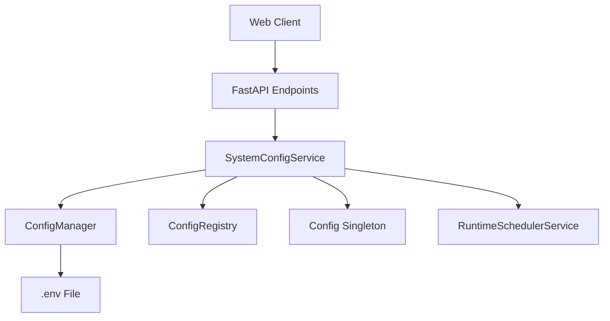
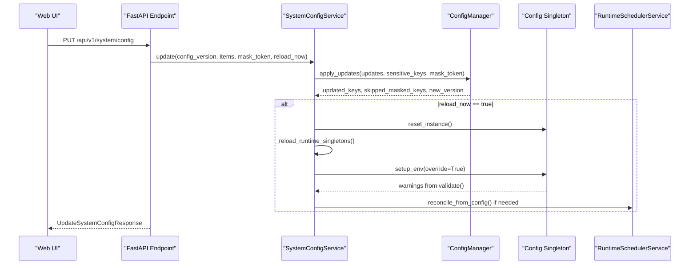
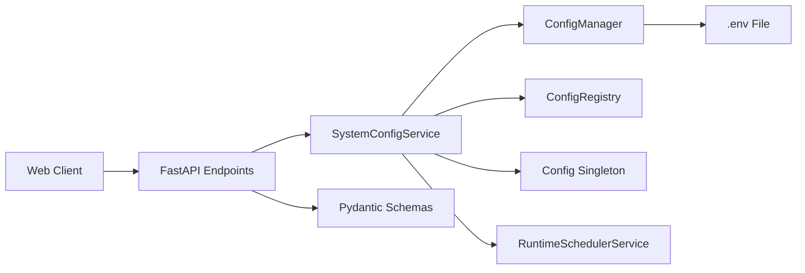

# Runtime Configuration

<cite>
**Referenced Files in This Document**
- [system_config.py](file://api/v1/endpoints/system_config.py)
- [system_config_service.py](file://src/services/system_config_service.py)
- [config_manager.py](file://src/core/config_manager.py)
- [config_registry.py](file://src/core/config_registry.py)
- [system_config.py](file://api/v1/schemas/system_config.py)
- [systemConfig.ts](file://apps/dsa-web/src/api/systemConfig.ts)
- [systemConfig.ts](file://apps/dsa-web/src/types/systemConfig.ts)
- [runtime_scheduler.py](file://src/services/runtime_scheduler.py)
- [config.py](file://src/config.py)
</cite>

## Table of Contents
1. [Introduction](#introduction)
2. [Project Structure](#project-structure)
3. [Core Components](#core-components)
4. [Architecture Overview](#architecture-overview)
5. [Detailed Component Analysis](#detailed-component-analysis)
6. [Dependency Analysis](#dependency-analysis)
7. [Performance Considerations](#performance-considerations)
8. [Troubleshooting Guide](#troubleshooting-guide)
9. [Conclusion](#conclusion)
10. [Appendices](#appendices)

## Introduction
This document explains the runtime configuration system that allows dynamic updates to agent parameters, notification channels, and performance tuning options without restarting services. It covers the API surface for updating settings at runtime, hot-reload behavior, versioning and conflict handling, validation, atomic persistence, monitoring hooks, and consistency with persistent storage.

## Project Structure
The runtime configuration feature is implemented across API endpoints, a service layer, a file-based configuration manager, a schema registry, and a Web client integration:

- API endpoints expose read, validate, update, import/export, and test operations for system configuration.
- The service layer orchestrates validation, persistence, and optional runtime reloads.
- The configuration manager provides atomic `.env` read/write and deterministic versioning.
- The schema registry defines field metadata used by the UI and validation.
- The Web client calls the API and handles errors such as validation failures and version conflicts.
- A runtime scheduler service integrates with configuration changes when scheduling-related settings change.

**Diagram sources**
- [system_config.py:130-416](file://api/v1/endpoints/system_config.py#L130-L416)
- [system_config_service.py:305-327](file://src/services/system_config_service.py#L305-L327)
- [config_manager.py:112-215](file://src/core/config_manager.py#L112-L215)
- [config_registry.py:22-71](file://src/core/config_registry.py#L22-L71)
- [runtime_scheduler.py:1-41](file://src/services/runtime_scheduler.py#L1-L41)

**Section sources**
- [system_config.py:130-416](file://api/v1/endpoints/system_config.py#L130-L416)
- [system_config_service.py:305-327](file://src/services/system_config_service.py#L305-L327)
- [config_manager.py:112-215](file://src/core/config_manager.py#L112-L215)
- [config_registry.py:22-71](file://src/core/config_registry.py#L22-L71)
- [runtime_scheduler.py:1-41](file://src/services/runtime_scheduler.py#L1-L41)

## Core Components
- SystemConfigService: Central logic for reading, validating, updating, importing/exporting configuration, testing LLM and notification channels, and triggering runtime reloads.
- ConfigManager: Atomic `.env` persistence, optimistic versioning, and safe value escaping for Docker Compose templates.
- ConfigRegistry: Field metadata, categories, validation hints, and display ordering for UI rendering.
- FastAPI Endpoints: REST endpoints for configuration CRUD, validation, import/export, status checks, and channel tests.
- Web Client: TypeScript API client that serializes requests, normalizes responses, and surfaces user-friendly errors.

Key responsibilities:
- Read current configuration with masked sensitive values and schema metadata.
- Validate submitted items before persisting.
- Persist updates atomically to `.env`.
- Optionally reload runtime configuration and reset singletons so running processes pick up new settings immediately.
- Provide preview and smoke-test endpoints for generation backends and notification channels.
- Protect against concurrent edits using config versioning.

**Section sources**
- [system_config_service.py:95-117](file://src/services/system_config_service.py#L95-L117)
- [system_config_service.py:305-327](file://src/services/system_config_service.py#L305-L327)
- [config_manager.py:158-215](file://src/core/config_manager.py#L158-L215)
- [config_registry.py:22-71](file://src/core/config_registry.py#L22-L71)
- [system_config.py:130-416](file://api/v1/endpoints/system_config.py#L130-L416)
- [systemConfig.ts:180-339](file://apps/dsa-web/src/api/systemConfig.ts#L180-L339)

## Architecture Overview
The runtime configuration flow combines API routing, service orchestration, atomic file persistence, and optional runtime reloads.

**Diagram sources**
- [system_config.py:364-416](file://api/v1/endpoints/system_config.py#L364-L416)
- [system_config_service.py:2059-2091](file://src/services/system_config_service.py#L2059-L2091)
- [config_manager.py:177-215](file://src/core/config_manager.py#L177-L215)
- [runtime_scheduler.py:192-200](file://src/services/runtime_scheduler.py#L192-L200)

## Detailed Component Analysis

### System Configuration API
Endpoints provide:
- GET `/api/v1/system/config`: Load current configuration with schema metadata and masked secrets.
- POST `/api/v1/system/config/validate`: Validate submitted items without writing.
- PUT `/api/v1/system/config`: Update key-value pairs with optimistic locking via `config_version`.
- POST `/api/v1/system/config/import`: Import raw `.env` content with conflict protection.
- GET `/api/v1/system/config/export`: Export active `.env` content (requires admin session or desktop mode).
- Status and test endpoints for generation backends, agent backends, LLM channels, and notification channels.
- GET `/api/v1/system/config/schema`: Return categorized field metadata for dynamic UI rendering.

Error handling includes:
- Validation failures return structured issues.
- Version conflicts return current config version to prompt reload.
- Unauthorized access for export/import unless allowed by environment or authenticated session.

**Section sources**
- [system_config.py:130-416](file://api/v1/endpoints/system_config.py#L130-L416)
- [system_config.py:418-534](file://api/v1/endpoints/system_config.py#L418-L534)
- [system_config.py:537-729](file://api/v1/endpoints/system_config.py#L537-L729)

### SystemConfigService
Responsibilities:
- Build display configuration map merging saved and runtime environment values.
- Normalize values according to schema and handle sensitive fields.
- Validate submitted items and produce detailed issues.
- Apply updates atomically through ConfigManager.
- Trigger runtime reloads by resetting Config singleton and reloading singletons.
- Test LLM and notification channels without persisting changes.
- Manage import/export with security gating and version conflict checks.

Hot-reload behavior:
- When `reload_now` is true, the service resets the global Config instance, reloads runtime singletons (tool registry, fetcher manager, search service), and re-applies environment overrides.
- Warnings are collected from post-reload validation and returned in the update response.

Conflict resolution:
- Uses optimistic locking based on `.env` file state hash and modification time.
- If the provided `config_version` does not match the current version, a conflict error is raised with the current version.

Validation:
- Validates types, formats, enums, ranges, and channel-specific requirements.
- Returns structured issues with severity levels for UI feedback.

**Section sources**
- [system_config_service.py:305-327](file://src/services/system_config_service.py#L305-L327)
- [system_config_service.py:454-511](file://src/services/system_config_service.py#L454-L511)
- [system_config_service.py:513-520](file://src/services/system_config_service.py#L513-L520)
- [system_config_service.py:729-747](file://src/services/system_config_service.py#L729-L747)
- [system_config_service.py:2059-2091](file://src/services/system_config_service.py#L2059-L2091)

### ConfigManager
Atomic persistence:
- Reads `.env` into a normalized mapping while preserving compose-sensitive placeholders.
- Applies updates by building an in-memory list of entries, replacing existing assignments or appending new ones.
- Writes to a temporary file and atomically renames it to the target path; falls back to in-place rewrite when rename is unsupported.
- Escapes application template placeholders for Docker Compose compatibility.

Versioning:
- Computes a deterministic version string combining file modification timestamp and SHA-256 content hash.
- Provides last updated timestamp in ISO format.

Concurrency safety:
- Uses a reentrant lock around write operations to prevent race conditions.

**Section sources**
- [config_manager.py:67-110](file://src/core/config_manager.py#L67-L110)
- [config_manager.py:124-175](file://src/core/config_manager.py#L124-L175)
- [config_manager.py:177-215](file://src/core/config_manager.py#L177-L215)
- [config_manager.py:217-263](file://src/core/config_manager.py#L217-L263)

### ConfigRegistry
Schema and metadata:
- Defines categories like base, AI model, data source, notification, system, agent, backtest, and uncategorized.
- Provides field definitions including titles, descriptions, data types, UI controls, validation rules, examples, and documentation links.
- Exposes functions to build schema responses and retrieve field definitions for runtime use.

Impact on runtime:
- Guides UI rendering and validation during configuration updates.
- Supports dynamic forms and help panels with localized keys and examples.

**Section sources**
- [config_registry.py:22-71](file://src/core/config_registry.py#L22-L71)
- [config_registry.py:84-800](file://src/core/config_registry.py#L84-L800)

### Web Client Integration
The Web client:
- Serializes request payloads to snake_case for backend consumption.
- Normalizes backend responses to camelCase for frontend usage.
- Handles validation errors and version conflicts with typed exceptions and user-facing messages.
- Exposes methods for getting configuration, schema, status, validation, import/export, and channel tests.

Example flows:
- Update configuration: send `UpdateSystemConfigRequest` with `configVersion`, `items`, optional `maskToken`, and `reloadNow`.
- Validate configuration: send `ValidateSystemConfigRequest` with `items`.
- Import configuration: send `ImportSystemConfigRequest` with `configVersion`, `content`, and optional `reloadNow`.

**Section sources**
- [systemConfig.ts:68-178](file://apps/dsa-web/src/api/systemConfig.ts#L68-L178)
- [systemConfig.ts:180-339](file://apps/dsa-web/src/api/systemConfig.ts#L180-L339)
- [systemConfig.ts:259-339](file://apps/dsa-web/src/api/systemConfig.ts#L259-L339)
- [systemConfig.ts:351-362](file://apps/dsa-web/src/types/systemConfig.ts#L351-L362)

### Runtime Scheduler Integration
Configuration changes can affect scheduled tasks:
- The runtime scheduler service reads configuration to determine schedule times, timeouts, and flags.
- After configuration reload, reconciliation may be triggered to adjust running schedules based on updated settings.
- Environment variables control scheduler behavior, including force enablement, immediate runs, and argument overrides.

**Section sources**
- [runtime_scheduler.py:24-41](file://src/services/runtime_scheduler.py#L24-L41)
- [runtime_scheduler.py:192-200](file://src/services/runtime_scheduler.py#L192-L200)

## Dependency Analysis
The runtime configuration system has clear boundaries and dependencies:

Coupling and cohesion:
- Endpoints depend only on the service layer, keeping HTTP concerns separate from business logic.
- Service encapsulates validation, persistence, and reload coordination.
- Manager isolates file I/O and versioning.
- Registry centralizes schema metadata, improving maintainability.

External integrations:
- Pydantic schemas enforce request/response contracts.
- Web client adapts between frontend conventions and backend expectations.

Potential circular dependencies:
- None observed; dependencies are layered and unidirectional.

**Diagram sources**
- [system_config.py:130-416](file://api/v1/endpoints/system_config.py#L130-L416)
- [system_config_service.py:305-327](file://src/services/system_config_service.py#L305-L327)
- [config_manager.py:112-215](file://src/core/config_manager.py#L112-L215)
- [config_registry.py:22-71](file://src/core/config_registry.py#L22-L71)
- [system_config.py:1-36](file://api/v1/schemas/system_config.py#L1-L36)

**Section sources**
- [system_config.py:130-416](file://api/v1/endpoints/system_config.py#L130-L416)
- [system_config_service.py:305-327](file://src/services/system_config_service.py#L305-L327)
- [config_manager.py:112-215](file://src/core/config_manager.py#L112-L215)
- [config_registry.py:22-71](file://src/core/config_registry.py#L22-L71)
- [system_config.py:1-36](file://api/v1/schemas/system_config.py#L1-L36)

## Performance Considerations
- Atomic writes minimize downtime and corruption risk during configuration updates.
- Optimistic versioning prevents lost updates and reduces contention.
- Hot reload avoids full process restarts but should be used judiciously for expensive singletons.
- Preview and smoke-test endpoints allow validation without side effects, reducing unnecessary reloads.
- Schema-driven validation catches errors early, preventing costly downstream failures.

[No sources needed since this section provides general guidance]

## Troubleshooting Guide
Common issues and resolutions:
- Validation failures: Review structured issues returned by the validate endpoint and fix field values accordingly.
- Version conflicts: Reload configuration to obtain the latest `configVersion` before retrying updates.
- Unauthorized export/import: Ensure admin authentication is enabled and a valid session exists, or run in desktop mode.
- Hot reload warnings: Inspect warnings returned after reload to identify configuration inconsistencies.
- Channel test failures: Use dedicated test endpoints to diagnose connectivity and capability issues for LLM and notification channels.

**Section sources**
- [system_config.py:389-416](file://api/v1/endpoints/system_config.py#L389-L416)
- [system_config.py:418-534](file://api/v1/endpoints/system_config.py#L418-L534)
- [system_config_service.py:2059-2091](file://src/services/system_config_service.py#L2059-L2091)

## Conclusion
The runtime configuration system enables safe, validated, and atomic updates to agent parameters, notification channels, and performance tuning options without service restarts. It uses optimistic versioning to prevent conflicts, provides comprehensive validation and testing capabilities, and supports hot reloads to apply changes immediately. The API surface is well-defined with clear error responses, and the Web client integrates seamlessly to present a user-friendly experience. While audit trails and detailed change logs are not explicitly implemented in the analyzed files, the system provides strong foundations for tracking changes through versioning, timestamps, and structured validation results.

[No sources needed since this section summarizes without analyzing specific files]

## Appendices

### API Examples
- Get configuration:
  - Method: GET
  - Path: `/api/v1/system/config`
  - Query: `include_schema=true`
  - Response: Current configuration with schema metadata and masked secrets.

- Validate configuration:
  - Method: POST
  - Path: `/api/v1/system/config/validate`
  - Body: `{ "items": [{ "key": "STOCK_LIST", "value": "600519,300750" }] }`
  - Response: Validation result with issues.

- Update configuration:
  - Method: PUT
  - Path: `/api/v1/system/config`
  - Body: `{ "configVersion": "...", "items": [...], "reloadNow": true }`
  - Response: Update result with applied keys and warnings.

- Import configuration:
  - Method: POST
  - Path: `/api/v1/system/config/import`
  - Body: `{ "configVersion": "...", "content": "KEY=VALUE\n...", "reloadNow": true }`
  - Response: Update result with applied keys and warnings.

- Export configuration:
  - Method: GET
  - Path: `/api/v1/system/config/export`
  - Response: Raw `.env` content and metadata.

- Test notification channel:
  - Method: POST
  - Path: `/api/v1/system/config/notification/test-channel`
  - Body: `{ "channel": "email", "items": [...], "title": "...", "content": "..." }`
  - Response: Test result with attempts and diagnostics.

**Section sources**
- [system_config.py:130-416](file://api/v1/endpoints/system_config.py#L130-L416)
- [system_config.py:418-534](file://api/v1/endpoints/system_config.py#L418-L534)
- [system_config.py:537-729](file://api/v1/endpoints/system_config.py#L537-L729)
- [systemConfig.ts:180-339](file://apps/dsa-web/src/api/systemConfig.ts#L180-L339)

### Configuration Versioning and Rollback
- Versioning: Each `.env` file state produces a deterministic version string based on modification time and content hash. Updates require matching `configVersion` to prevent concurrent edits.
- Rollback: To rollback, import a previous `.env` backup using the import endpoint with the correct `configVersion`. The system will merge the imported content and optionally trigger a reload.

**Section sources**
- [config_manager.py:158-175](file://src/core/config_manager.py#L158-L175)
- [system_config_service.py:729-747](file://src/services/system_config_service.py#L729-L747)
- [system_config.py:455-534](file://api/v1/endpoints/system_config.py#L455-L534)

### Monitoring and Audit Trails
- Timestamps: The configuration response includes `updated_at` indicating the last modification time.
- Validation issues: Structured issues provide detailed feedback for each field, aiding in auditing configuration changes.
- Logging: Endpoints log errors and warnings during configuration operations, supporting operational monitoring.

Note: Explicit audit trails recording who made changes and when are not implemented in the analyzed files. Future enhancements could add user context and change history logging.

**Section sources**
- [system_config_service.py:454-511](file://src/services/system_config_service.py#L454-L511)
- [system_config.py:130-416](file://api/v1/endpoints/system_config.py#L130-L416)

### Relationship Between Runtime Configuration and Persistent Storage
- Persistence: All configuration changes are written to `.env` using atomic operations to ensure consistency.
- Runtime: On reload, the system resets the global Config singleton and applies environment overrides, ensuring running processes use the latest configuration.
- Consistency: The combination of atomic writes, versioning, and hot reload maintains consistency across service restarts and concurrent updates.

**Section sources**
- [config_manager.py:177-263](file://src/core/config_manager.py#L177-L263)
- [system_config_service.py:2059-2091](file://src/services/system_config_service.py#L2059-L2091)
- [config.py:1-200](file://src/config.py#L1-L200)