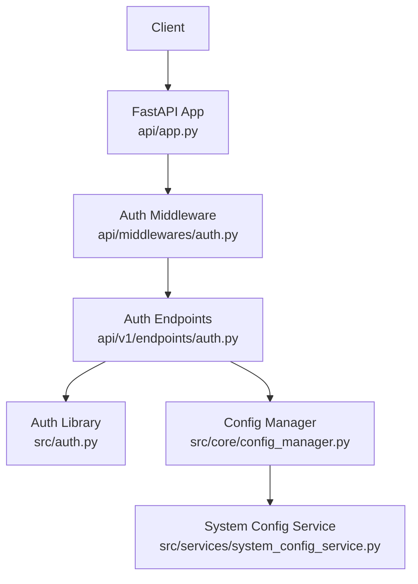
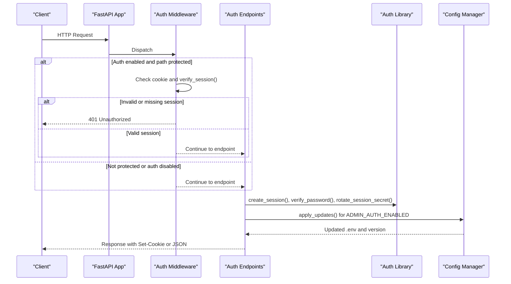
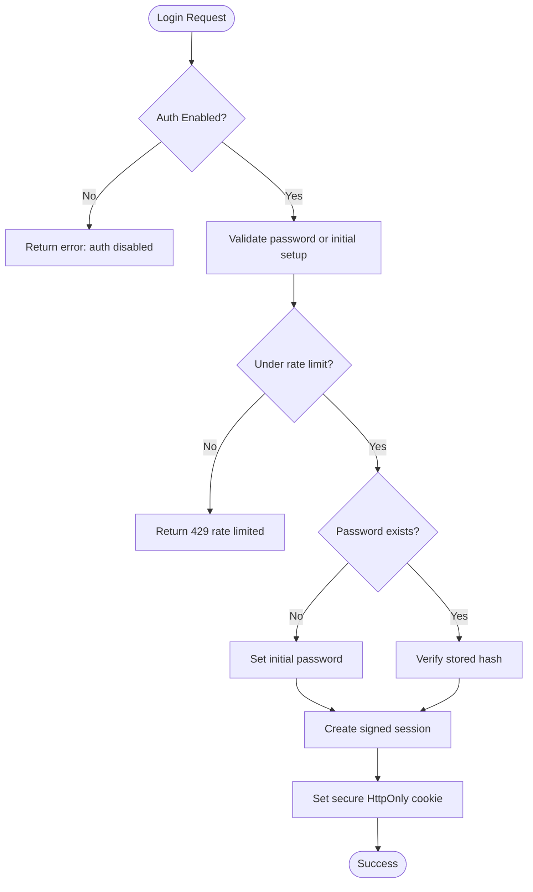
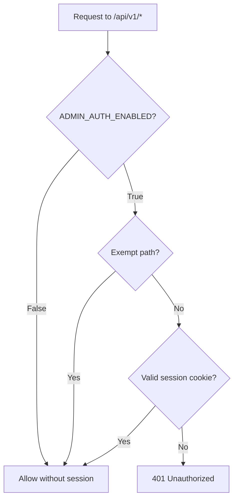
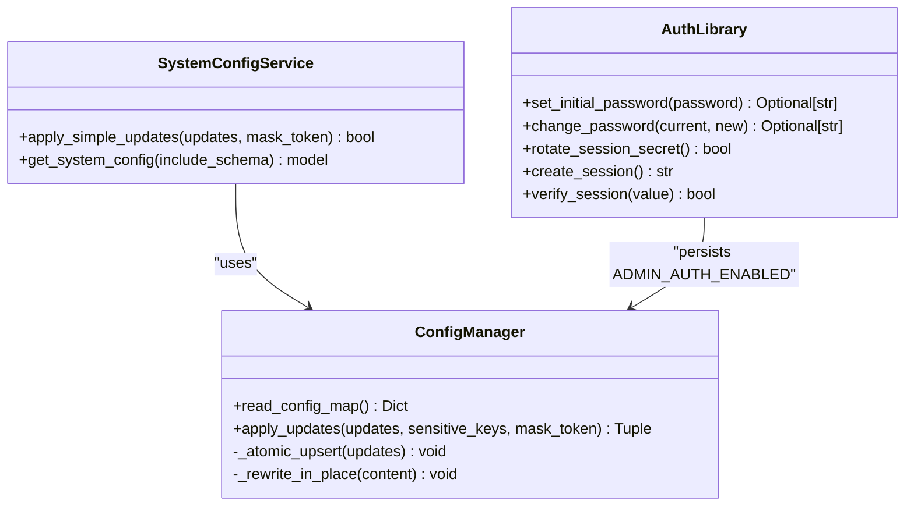
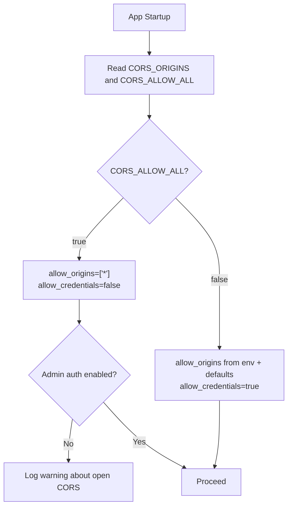
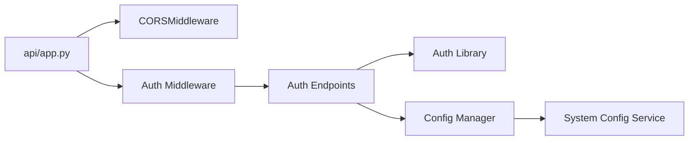

# Security Configuration

<cite>
**Referenced Files in This Document**
- [src/auth.py](file://src/auth.py)
- [api/middlewares/auth.py](file://api/middlewares/auth.py)
- [api/v1/endpoints/auth.py](file://api/v1/endpoints/auth.py)
- [api/app.py](file://api/app.py)
- [src/core/config_manager.py](file://src/core/config_manager.py)
- [src/services/system_config_service.py](file://src/services/system_config_service.py)
- [tests/test_api_app_cors.py](file://tests/test_api_app_cors.py)
- [tests/test_auth.py](file://tests/test_auth.py)
- [tests/test_auth_api.py](file://tests/test_auth_api.py)
</cite>

## Table of Contents
1. Introduction
2. Project Structure
3. Core Components
4. Architecture Overview
5. Detailed Component Analysis
6. Dependency Analysis
7. Performance Considerations
8. Troubleshooting Guide
9. Conclusion
10. Appendices

## Introduction
This document explains the security configuration for authentication, authorization, session management, and credential handling in the application. It focuses on how admin authentication is enabled, how sessions are created and validated, how secrets and API keys are managed through configuration, and how CORS and request protections are configured. It also provides guidance for production hardening, including secret rotation, audit logging considerations, and compliance-aware practices.

## Project Structure
Security-related functionality is implemented across a small set of focused modules:
- Authentication logic and session management live in src/auth.py.
- Request-level enforcement via middleware lives in api/middlewares/auth.py.
- Authentication endpoints (login, logout, status, change password, settings) live in api/v1/endpoints/auth.py.
- Application startup and CORS configuration live in api/app.py.
- Configuration persistence and atomic updates live in src/core/config_manager.py and src/services/system_config_service.py.

**Diagram sources**
- [api/app.py:313-384](file://api/app.py#L313-L384)
- [api/middlewares/auth.py:37-76](file://api/middlewares/auth.py#L37-L76)
- [api/v1/endpoints/auth.py:185-483](file://api/v1/endpoints/auth.py#L185-L483)
- [src/auth.py:197-422](file://src/auth.py#L197-L422)
- [src/core/config_manager.py:177-256](file://src/core/config_manager.py#L177-L256)
- [src/services/system_config_service.py:130-200](file://src/services/system_config_service.py#L130-L200)

**Section sources**
- [api/app.py:313-384](file://api/app.py#L313-L384)
- [api/middlewares/auth.py:37-76](file://api/middlewares/auth.py#L37-L76)
- [api/v1/endpoints/auth.py:185-483](file://api/v1/endpoints/auth.py#L185-L483)
- [src/auth.py:197-422](file://src/auth.py#L197-L422)
- [src/core/config_manager.py:177-256](file://src/core/config_manager.py#L177-L256)
- [src/services/system_config_service.py:130-200](file://src/services/system_config_service.py#L130-L200)

## Core Components
- Admin authentication toggle and session management:
  - Enabled by environment variable ADMIN_AUTH_ENABLED.
  - Passwords are stored as PBKDF2 hashes with salt in a file under the data directory.
  - Sessions are signed cookies containing nonce, timestamp, and HMAC signature; expiry is enforced.
  - Session signing secret is stored securely and can be rotated to invalidate all sessions.
- Request protection:
  - A middleware enforces authenticated sessions for /api/v1/* when auth is enabled.
  - Exempt paths include login, status, health checks, and OpenAPI docs.
- Configuration management:
  - .env values are read and updated atomically.
  - Sensitive fields can be masked during updates and reads.
  - System config service coordinates runtime reloads after changes.

**Section sources**
- [src/auth.py:27-422](file://src/auth.py#L27-L422)
- [api/middlewares/auth.py:19-76](file://api/middlewares/auth.py#L19-L76)
- [api/v1/endpoints/auth.py:72-183](file://api/v1/endpoints/auth.py#L72-L183)
- [src/core/config_manager.py:177-256](file://src/core/config_manager.py#L177-L256)
- [src/services/system_config_service.py:130-200](file://src/services/system_config_service.py#L130-L200)

## Architecture Overview
The security architecture combines environment-driven toggles, file-backed credentials, signed session cookies, and middleware-based enforcement.

**Diagram sources**
- [api/middlewares/auth.py:37-76](file://api/middlewares/auth.py#L37-L76)
- [api/v1/endpoints/auth.py:185-483](file://api/v1/endpoints/auth.py#L185-L483)
- [src/auth.py:332-422](file://src/auth.py#L332-L422)
- [src/core/config_manager.py:177-256](file://src/core/config_manager.py#L177-L256)

## Detailed Component Analysis

### Authentication and Session Management
- Admin authentication is controlled by ADMIN_AUTH_ENABLED. When enabled, requests to /api/v1/* require a valid session cookie unless explicitly exempted.
- Password storage:
  - Passwords are hashed using PBKDF2 with a random salt and stored in a file with restrictive permissions.
  - Initial password setup and change flows validate strength and enforce confirmation where applicable.
- Session lifecycle:
  - Sessions are signed cookies with format nonce.timestamp.signature.
  - Expiry is enforced based on configurable max age hours.
  - Rotation invalidates all active sessions by changing the signing secret.
- Rate limiting:
  - In-memory per-IP rate limiting protects login and high-risk settings changes.
  - IP extraction respects TRUST_X_FORWARDED_FOR to handle reverse proxies safely.

**Diagram sources**
- [api/v1/endpoints/auth.py:362-428](file://api/v1/endpoints/auth.py#L362-L428)
- [src/auth.py:246-367](file://src/auth.py#L246-L367)
- [src/auth.py:387-422](file://src/auth.py#L387-L422)

**Section sources**
- [src/auth.py:27-422](file://src/auth.py#L27-L422)
- [api/v1/endpoints/auth.py:362-483](file://api/v1/endpoints/auth.py#L362-L483)

### Authorization Controls
- The middleware enforces authentication for /api/v1/* when ADMIN_AUTH_ENABLED is true.
- Exempt paths include:
  - /api/v1/auth/login
  - /api/v1/auth/status
  - /api/health and /health
  - /docs, /redoc, /openapi.json
- If no valid session cookie is present, responses return 401 with an unauthorized message.

**Diagram sources**
- [api/middlewares/auth.py:19-76](file://api/middlewares/auth.py#L19-L76)

**Section sources**
- [api/middlewares/auth.py:19-76](file://api/middlewares/auth.py#L19-L76)

### Credential Management and Secrets Handling
- Passwords:
  - Stored as PBKDF2 hashes with salts in a file under the data directory.
  - File permissions are set to restrict access.
  - CLI reset and web change-password flows ensure validation and safe writes.
- Session secret:
  - Stored in a file with restrictive permissions.
  - Rotation replaces the secret and invalidates existing sessions.
- Configuration persistence:
  - .env updates are applied atomically with fallback behavior for mounted filesystems.
  - Sensitive keys can be masked during updates to prevent accidental exposure.
  - System config service coordinates reloading configuration at runtime.

**Diagram sources**
- [src/core/config_manager.py:177-256](file://src/core/config_manager.py#L177-L256)
- [src/services/system_config_service.py:130-200](file://src/services/system_config_service.py#L130-L200)
- [src/auth.py:246-367](file://src/auth.py#L246-L367)

**Section sources**
- [src/auth.py:246-367](file://src/auth.py#L246-L367)
- [src/core/config_manager.py:177-256](file://src/core/config_manager.py#L177-L256)
- [src/services/system_config_service.py:130-200](file://src/services/system_config_service.py#L130-L200)

### CORS Policies and Secure Transmission
- CORS configuration:
  - Default allowed origins include local development addresses.
  - Additional origins can be provided via CORS_ORIGINS.
  - Setting CORS_ALLOW_ALL=true sets allow_origins to ["*"] and disables allow_credentials to remain browser-compatible.
  - A warning is logged if open CORS is used while admin authentication is disabled.
- Secure cookies:
  - Session cookies are set with httponly and samesite=lax.
  - secure flag is set based on X-Forwarded-Proto when behind a trusted proxy or URL scheme otherwise.
  - Max age is configurable via ADMIN_SESSION_MAX_AGE_HOURS.

**Diagram sources**
- [api/app.py:349-375](file://api/app.py#L349-L375)
- [tests/test_api_app_cors.py:23-55](file://tests/test_api_app_cors.py#L23-L55)

**Section sources**
- [api/app.py:349-375](file://api/app.py#L349-L375)
- [tests/test_api_app_cors.py:23-55](file://tests/test_api_app_cors.py#L23-L55)

### API Key Management for External Services
- API keys and secrets are managed through environment variables and persisted in .env via ConfigManager.
- Sensitive keys can be masked during updates and reads to avoid accidental exposure.
- SystemConfigService exposes schema and masking behavior for sensitive fields.
- While JWT tokens and OAuth flows are not implemented in this codebase, external service integrations should follow these patterns:
  - Store secrets in .env or a secrets manager.
  - Use HTTPS for all transmissions.
  - Rotate keys regularly and log rotations.
  - Avoid logging raw secrets; use redaction utilities where available.

**Section sources**
- [src/core/config_manager.py:177-256](file://src/core/config_manager.py#L177-L256)
- [src/services/system_config_service.py:130-200](file://src/services/system_config_service.py#L130-L200)

### Request Validation and Protection
- Login and settings endpoints implement rate limiting to mitigate brute-force attacks.
- Client IP extraction supports trusted reverse proxies via TRUST_X_FORWARDED_FOR.
- High-risk actions (e.g., disabling auth) require current password re-authentication even if a valid session cookie is present.

**Section sources**
- [src/auth.py:370-422](file://src/auth.py#L370-L422)
- [api/v1/endpoints/auth.py:208-358](file://api/v1/endpoints/auth.py#L208-L358)

## Dependency Analysis
- FastAPI app wires middleware and routers:
  - CORSMiddleware is added with dynamic origin configuration.
  - Auth middleware is registered to protect API routes conditionally.
- Auth endpoints depend on:
  - Auth library for session creation, verification, and password hashing.
  - ConfigManager/SystemConfigService for persisting and reloading ADMIN_AUTH_ENABLED.
- Tests validate CORS behavior and session lifecycle.

**Diagram sources**
- [api/app.py:313-384](file://api/app.py#L313-L384)
- [api/middlewares/auth.py:37-76](file://api/middlewares/auth.py#L37-L76)
- [api/v1/endpoints/auth.py:185-483](file://api/v1/endpoints/auth.py#L185-L483)
- [src/auth.py:197-422](file://src/auth.py#L197-L422)
- [src/core/config_manager.py:177-256](file://src/core/config_manager.py#L177-L256)
- [src/services/system_config_service.py:130-200](file://src/services/system_config_service.py#L130-L200)

**Section sources**
- [api/app.py:313-384](file://api/app.py#L313-L384)
- [api/middlewares/auth.py:37-76](file://api/middlewares/auth.py#L37-L76)
- [api/v1/endpoints/auth.py:185-483](file://api/v1/endpoints/auth.py#L185-L483)
- [src/auth.py:197-422](file://src/auth.py#L197-L422)
- [src/core/config_manager.py:177-256](file://src/core/config_manager.py#L177-L256)
- [src/services/system_config_service.py:130-200](file://src/services/system_config_service.py#L130-L200)

## Performance Considerations
- Rate limiting uses in-memory structures; consider scaling to distributed stores if running multiple instances.
- Session verification involves HMAC computation; keep session payloads minimal and enforce reasonable max ages.
- Atomic .env updates may incur disk I/O; batch updates where possible and monitor performance in high-throughput environments.

[No sources needed since this section provides general guidance]

## Troubleshooting Guide
- Authentication not working:
  - Ensure ADMIN_AUTH_ENABLED is set appropriately.
  - Verify that the session cookie is present and valid; check expiry and signing secret rotation.
  - Confirm that exempt paths are not mistakenly included in protected routes.
- CORS issues:
  - If CORS_ALLOW_ALL=true, credentials will be disabled; adjust origins explicitly if credentials are required.
  - Watch for warnings when open CORS is used without admin authentication enabled.
- Rate limiting errors:
  - Check TRUST_X_FORWARDED_FOR configuration if behind a reverse proxy.
  - Review login failure logs and adjust rate limit windows if necessary.
- Secret rotation failures:
  - Ensure write permissions to the data directory for session secret and password files.
  - On failure, the system may roll back configuration changes; inspect logs for details.

**Section sources**
- [api/middlewares/auth.py:37-76](file://api/middlewares/auth.py#L37-L76)
- [api/app.py:349-375](file://api/app.py#L349-L375)
- [src/auth.py:370-422](file://src/auth.py#L370-L422)
- [tests/test_auth.py:92-167](file://tests/test_auth.py#L92-L167)
- [tests/test_auth_api.py:141-167](file://tests/test_auth_api.py#L141-L167)

## Conclusion
The application implements a robust, environment-driven admin authentication system with secure session management, rate limiting, and careful CORS configuration. Credentials and secrets are handled with strong hashing, restricted file permissions, and atomic configuration updates. For production deployments, enable admin authentication, configure explicit CORS origins, rotate session secrets periodically, and monitor logs for security-relevant events. While JWT and OAuth are not part of this codebase, the same principles—secure secret storage, HTTPS-only transmission, and strict access controls—should guide external integrations.

[No sources needed since this section summarizes without analyzing specific files]

## Appendices

### Security Best Practices Checklist
- Enable ADMIN_AUTH_ENABLED in production.
- Configure explicit CORS_ORIGINS; avoid CORS_ALLOW_ALL in production.
- Set ADMIN_SESSION_MAX_AGE_HOURS to a reasonable value.
- Use TRUST_X_FORWARDED_FOR only with trusted reverse proxies.
- Rotate session secrets regularly and after any security incident.
- Mask sensitive keys during configuration updates and avoid logging secrets.
- Monitor rate limiting and adjust thresholds based on traffic patterns.
- Audit configuration changes and maintain version control for .env files.

[No sources needed since this section provides general guidance]