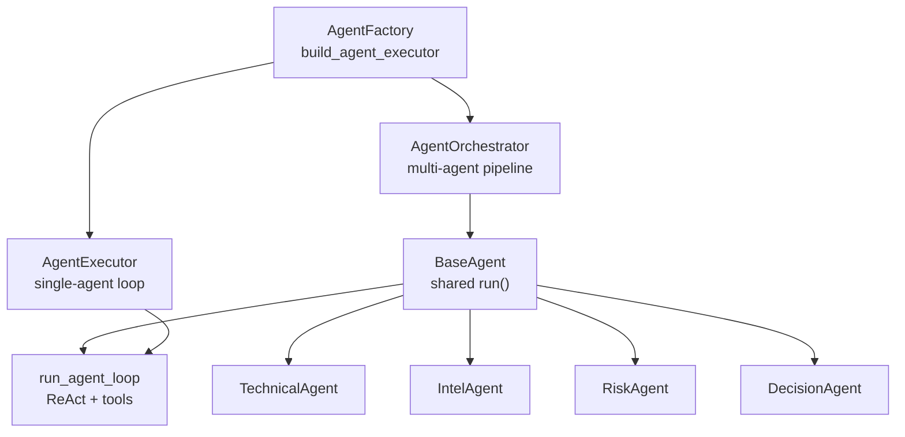
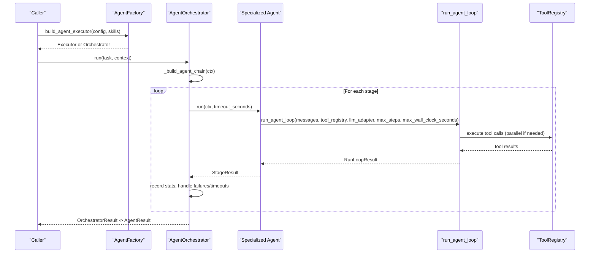
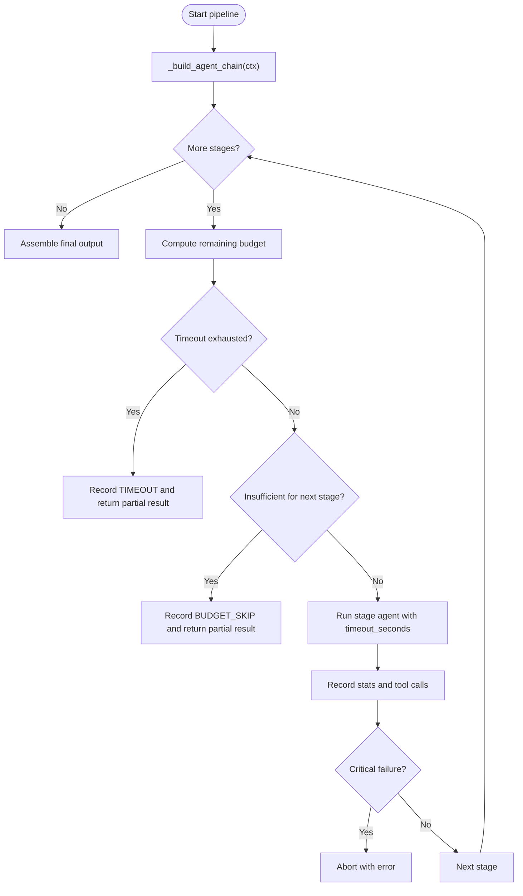
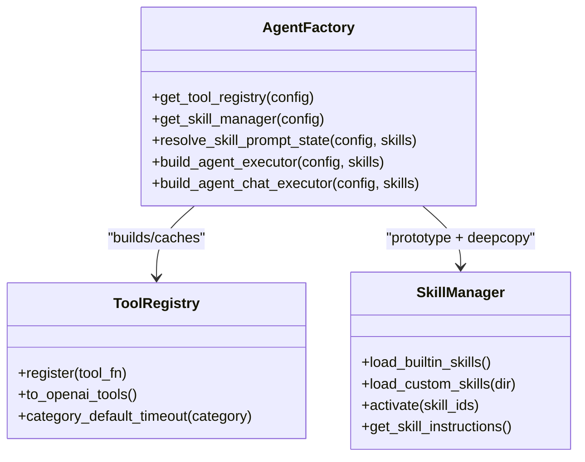
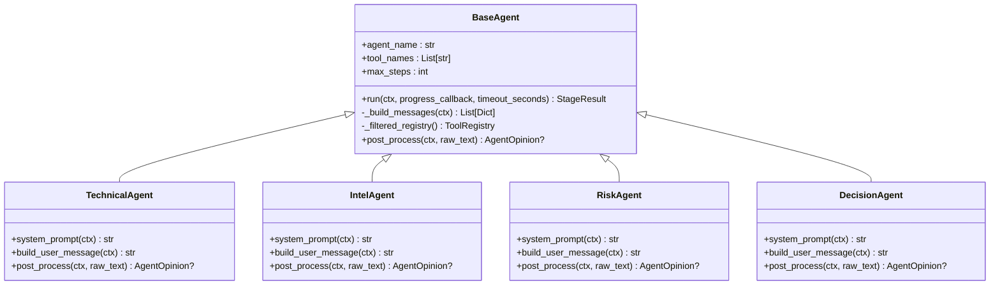
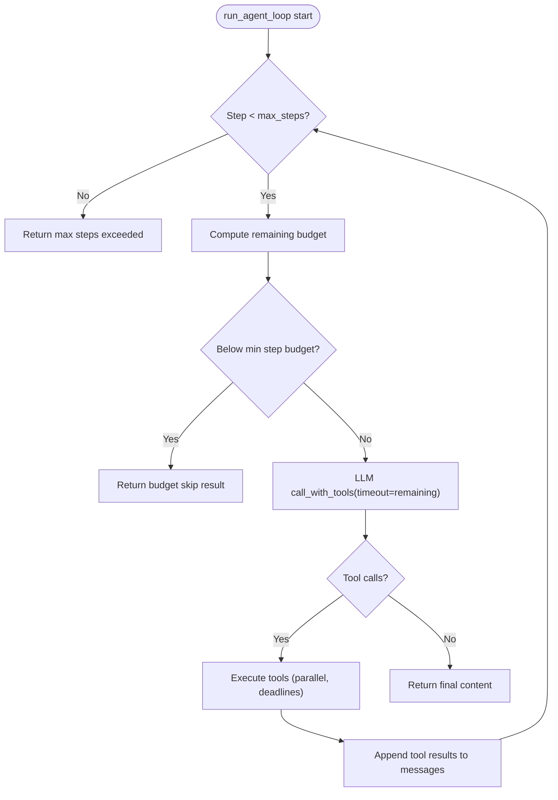
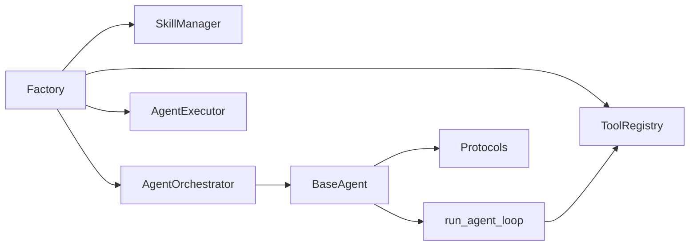

# Agent Lifecycle Management

<cite>
**Referenced Files in This Document**
- [orchestrator.py](file://src/agent/orchestrator.py)
- [factory.py](file://src/agent/factory.py)
- [executor.py](file://src/agent/executor.py)
- [runner.py](file://src/agent/runner.py)
- [base_agent.py](file://src/agent/agents/base_agent.py)
- [technical_agent.py](file://src/agent/agents/technical_agent.py)
- [intel_agent.py](file://src/agent/agents/intel_agent.py)
- [risk_agent.py](file://src/agent/agents/risk_agent.py)
- [decision_agent.py](file://src/agent/agents/decision_agent.py)
- [protocols.py](file://src/agent/protocols.py)
- [config.py](file://src/config.py)
</cite>

## Table of Contents
1. Introduction
2. Project Structure
3. Core Components
4. Architecture Overview
5. Detailed Component Analysis
6. Dependency Analysis
7. Performance Considerations
8. Troubleshooting Guide
9. Conclusion

## Introduction
This document explains the agent lifecycle management system that handles specialized agents from creation to destruction across a multi-agent pipeline. It covers:
- Agent registration and instantiation patterns
- Configuration inheritance from the orchestrator (timeouts, step limits, tool access)
- Agent initialization, parameter validation, and dependency injection
- Creating custom agents and configuring agent-specific settings
- Resource management and cleanup during lifecycle transitions
- Error handling and graceful degradation when budgets or timeouts are exceeded

The system supports multiple execution modes and provides robust safeguards against overruns while preserving partial results for downstream consumption.

## Project Structure
At a high level, the lifecycle is orchestrated by a central coordinator that composes specialized agents, enforces shared configuration, and manages execution budgets. The executor and runner provide reusable ReAct loops and tool execution semantics. Agents implement role-specific prompts and post-processing to produce structured opinions consumed by later stages.

**Diagram sources**
- [factory.py:551-711](file://src/agent/factory.py#L551-L711)
- [orchestrator.py:107-136](file://src/agent/orchestrator.py#L107-L136)
- [executor.py:641-667](file://src/agent/executor.py#L641-L667)
- [runner.py:326-365](file://src/agent/runner.py#L326-L365)
- [base_agent.py:38-69](file://src/agent/agents/base_agent.py#L38-L69)
- [technical_agent.py:23-35](file://src/agent/agents/technical_agent.py#L23-L35)
- [intel_agent.py:24-32](file://src/agent/agents/intel_agent.py#L24-L32)
- [risk_agent.py:29-36](file://src/agent/agents/risk_agent.py#L29-L36)
- [decision_agent.py:24-29](file://src/agent/agents/decision_agent.py#L24-L29)

**Section sources**
- [factory.py:551-711](file://src/agent/factory.py#L551-L711)
- [orchestrator.py:107-136](file://src/agent/orchestrator.py#L107-L136)
- [executor.py:641-667](file://src/agent/executor.py#L641-L667)
- [runner.py:326-365](file://src/agent/runner.py#L326-L365)
- [base_agent.py:38-69](file://src/agent/agents/base_agent.py#L38-L69)

## Core Components
- AgentFactory: Builds and caches ToolRegistry and SkillManager; constructs either a single-agent executor or an orchestrator based on configuration.
- AgentOrchestrator: Composes a stage chain (technical → intel → risk → decision, with optional specialist skills), applies per-stage timeouts and step limits, and aggregates results.
- AgentExecutor: Single-agent ReAct loop with tool calling, prompt assembly, and dashboard parsing.
- Runner: Shared ReAct loop implementation with tool execution, timeout resolution, and progress events.
- BaseAgent and Specialized Agents: Provide common execution, message building, tool scoping, and opinion post-processing.
- Protocols: Shared data structures for context, opinions, stage results, and failure reasons.
- Config: Provides defaults and runtime values for steps, timeouts, and mode selection.

Key responsibilities:
- Registration and instantiation: ToolRegistry and SkillManager are built once and reused; agents are instantiated per run via the factory/orchestrator.
- Configuration inheritance: Global max_steps, orchestrator timeout, and per-agent timeouts are propagated to child agents.
- Tool access control: Agents can restrict their tool surface; category-level timeouts apply uniformly.
- Lifecycle transitions: Stages report status and failure reasons; orchestrator degrades gracefully on non-critical failures and aborts on critical ones.

**Section sources**
- [factory.py:377-449](file://src/agent/factory.py#L377-L449)
- [factory.py:452-491](file://src/agent/factory.py#L452-L491)
- [factory.py:551-711](file://src/agent/factory.py#L551-L711)
- [orchestrator.py:115-136](file://src/agent/orchestrator.py#L115-L136)
- [orchestrator.py:137-174](file://src/agent/orchestrator.py#L137-L174)
- [executor.py:641-667](file://src/agent/executor.py#L641-L667)
- [runner.py:326-365](file://src/agent/runner.py#L326-L365)
- [base_agent.py:38-69](file://src/agent/agents/base_agent.py#L38-L69)
- [protocols.py:149-209](file://src/agent/protocols.py#L149-L209)
- [config.py:181-188](file://src/config.py#L181-L188)

## Architecture Overview
The lifecycle flows through three layers:
- Entry and composition: Factory resolves architecture and builds either a single-agent executor or an orchestrator.
- Orchestration: Orchestrator builds an ordered agent chain, injects shared dependencies (tool registry, LLM adapter), and runs stages with budget controls.
- Execution: Each agent uses BaseAgent.run to invoke the shared runner, which coordinates LLM calls and tool execution with timeouts and progress events.

**Diagram sources**
- [factory.py:551-711](file://src/agent/factory.py#L551-L711)
- [orchestrator.py:352-374](file://src/agent/orchestrator.py#L352-L374)
- [orchestrator.py:479-766](file://src/agent/orchestrator.py#L479-L766)
- [base_agent.py:99-171](file://src/agent/agents/base_agent.py#L99-L171)
- [runner.py:326-601](file://src/agent/runner.py#L326-L601)

## Detailed Component Analysis

### AgentOrchestrator: Pipeline Coordination and Budgeting
Responsibilities:
- Build agent chains based on mode (quick, standard, full, specialist).
- Apply global and per-agent timeouts and step limits.
- Execute stages sequentially with progress callbacks and streaming events.
- Handle critical vs non-critical failures and degrade gracefully.
- Assemble final output (dashboard or chat response) and runtime facts.

Key behaviors:
- Timeout computation: Reads orchestrator-level timeout and per-agent clamps from config.
- Step limit propagation: Adjusts child agent max_steps respecting per-agent defaults unless user explicitly raises the global limit.
- Specialist insertion: In specialist mode, skill agents are inserted before decision and executed in batches with concurrency and per-skill timeouts.
- Failure policy: Critical stage failures abort; non-critical (intel, risk, skills) degrade and continue.

**Diagram sources**
- [orchestrator.py:479-766](file://src/agent/orchestrator.py#L479-L766)
- [orchestrator.py:265-287](file://src/agent/orchestrator.py#L265-L287)
- [orchestrator.py:318-346](file://src/agent/orchestrator.py#L318-L346)

**Section sources**
- [orchestrator.py:115-136](file://src/agent/orchestrator.py#L115-L136)
- [orchestrator.py:137-174](file://src/agent/orchestrator.py#L137-L174)
- [orchestrator.py:265-287](file://src/agent/orchestrator.py#L265-L287)
- [orchestrator.py:318-346](file://src/agent/orchestrator.py#L318-L346)
- [orchestrator.py:479-766](file://src/agent/orchestrator.py#L479-L766)

### AgentFactory: Registration, Caching, and Instantiation
Responsibilities:
- Build and cache ToolRegistry with category-level timeouts.
- Build and cache SkillManager prototype; return deep copies per request.
- Resolve active skills and policies from configuration and requests.
- Construct either AgentExecutor or AgentOrchestrator based on agent_arch.

Key behaviors:
- Thread-safe registry caching keyed by effective category timeout map.
- Safe coercion of numeric config values to prevent invalid timeouts.
- Reset capability to rebuild registry after runtime config reload.

**Diagram sources**
- [factory.py:377-449](file://src/agent/factory.py#L377-L449)
- [factory.py:452-491](file://src/agent/factory.py#L452-L491)
- [factory.py:551-711](file://src/agent/factory.py#L551-L711)

**Section sources**
- [factory.py:377-449](file://src/agent/factory.py#L377-L449)
- [factory.py:452-491](file://src/agent/factory.py#L452-L491)
- [factory.py:551-711](file://src/agent/factory.py#L551-L711)

### BaseAgent and Specialized Agents: Initialization, Tool Access, and Post-Processing
Responsibilities:
- BaseAgent: Common execution flow, message building, tool filtering, memory injection, and opinion post-processing hook.
- TechnicalAgent: Fetches quotes/history, computes indicators, outputs technical opinion JSON.
- IntelAgent: Gathers news and sentiment, detects risks, caches intel for downstream reuse.
- RiskAgent: Scans for red flags, propagates risk flags into context.
- DecisionAgent: Synthesizes opinions into final dashboard or natural-language answer.

Key behaviors:
- Tool subset restriction via tool_names; filtered registry preserves category-timeout behavior.
- Pre-fetched data injection avoids redundant tool calls.
- Post-process transforms raw LLM text into structured AgentOpinion; DecisionAgent parses dashboard JSON.

**Diagram sources**
- [base_agent.py:38-69](file://src/agent/agents/base_agent.py#L38-L69)
- [base_agent.py:99-171](file://src/agent/agents/base_agent.py#L99-L171)
- [base_agent.py:177-269](file://src/agent/agents/base_agent.py#L177-L269)
- [technical_agent.py:23-104](file://src/agent/agents/technical_agent.py#L23-L104)
- [intel_agent.py:24-119](file://src/agent/agents/intel_agent.py#L24-L119)
- [risk_agent.py:29-129](file://src/agent/agents/risk_agent.py#L29-L129)
- [decision_agent.py:24-290](file://src/agent/agents/decision_agent.py#L24-L290)

**Section sources**
- [base_agent.py:99-171](file://src/agent/agents/base_agent.py#L99-L171)
- [base_agent.py:177-269](file://src/agent/agents/base_agent.py#L177-L269)
- [technical_agent.py:23-104](file://src/agent/agents/technical_agent.py#L23-L104)
- [intel_agent.py:24-119](file://src/agent/agents/intel_agent.py#L24-L119)
- [risk_agent.py:29-129](file://src/agent/agents/risk_agent.py#L29-L129)
- [decision_agent.py:24-290](file://src/agent/agents/decision_agent.py#L24-L290)

### Runner: ReAct Loop, Tool Execution, and Timeouts
Responsibilities:
- Execute LLM ↔ tool loop with configurable max steps and wall-clock budget.
- Resolve per-tool timeouts using first-wins precedence (explicit > per-tool declaration > category default).
- Enforce minimum step budget to avoid wasteful short-lived calls.
- Emit progress events and persist usage telemetry when enabled.

Key behaviors:
- Parallel tool execution with capped thread pool and deadline-driven waits.
- Non-retriable timeout caching prevents duplicate side effects on retries.
- Graceful fallback when remaining budget falls below minimum threshold.

**Diagram sources**
- [runner.py:326-601](file://src/agent/runner.py#L326-L601)
- [runner.py:656-706](file://src/agent/runner.py#L656-L706)
- [runner.py:709-800](file://src/agent/runner.py#L709-L800)

**Section sources**
- [runner.py:326-601](file://src/agent/runner.py#L326-L601)
- [runner.py:656-706](file://src/agent/runner.py#L656-L706)
- [runner.py:709-800](file://src/agent/runner.py#L709-L800)

### Protocols: Context, Opinions, and Stage Results
Responsibilities:
- Define shared data structures for cross-agent communication and orchestration.
- Provide helpers for adding opinions and risk flags, and normalizing signals and failure reasons.

Key behaviors:
- AgentContext carries query identity, collected data, opinions, risk flags, and metadata.
- StageResult captures stage lifecycle status, errors, and failure reasons.
- Signal normalization ensures consistent decision labels across pipeline stages.

**Section sources**
- [protocols.py:149-209](file://src/agent/protocols.py#L149-L209)
- [protocols.py:215-257](file://src/agent/protocols.py#L215-L257)
- [protocols.py:296-372](file://src/agent/protocols.py#L296-L372)

## Dependency Analysis
The system exhibits clear separation of concerns:
- Factory depends on ToolRegistry and SkillManager to assemble executors/orchestrators.
- Orchestrator depends on BaseAgent subclasses and the runner for execution.
- BaseAgent depends on runner for ReAct loop and protocols for shared types.
- Runner depends on ToolRegistry for tool execution and LLMToolAdapter for model calls.

**Diagram sources**
- [factory.py:551-711](file://src/agent/factory.py#L551-L711)
- [orchestrator.py:107-136](file://src/agent/orchestrator.py#L107-L136)
- [base_agent.py:38-69](file://src/agent/agents/base_agent.py#L38-L69)
- [runner.py:326-365](file://src/agent/runner.py#L326-L365)
- [protocols.py:149-209](file://src/agent/protocols.py#L149-L209)

**Section sources**
- [factory.py:551-711](file://src/agent/factory.py#L551-L711)
- [orchestrator.py:107-136](file://src/agent/orchestrator.py#L107-L136)
- [base_agent.py:38-69](file://src/agent/agents/base_agent.py#L38-L69)
- [runner.py:326-365](file://src/agent/runner.py#L326-L365)
- [protocols.py:149-209](file://src/agent/protocols.py#L149-L209)

## Performance Considerations
- ToolRegistry and SkillManager are cached at module level to avoid repeated disk I/O and registration overhead.
- Category-level tool timeouts prevent runaway network-bound operations; explicit per-run overrides can relax stricter defaults but never exceed the outer wall-clock budget.
- Minimum step budget guards reduce wasted LLM billing cycles when remaining time is too small for meaningful work.
- Parallel tool execution is capped to a small thread pool to balance throughput and resource contention.
- Memory calibration and pre-fetched data injection reduce redundant computations and keep prompts within context windows.

[No sources needed since this section provides general guidance]

## Troubleshooting Guide
Common issues and resolutions:
- Pipeline timeout: Occurs when total elapsed time exceeds configured orchestrator timeout. Partial results may still be returned with a timeout note.
- Budget skip: When remaining budget is below the minimum required for a stage, the stage is skipped to avoid futile calls.
- Critical stage failure: If a critical stage fails, the pipeline aborts with an error; non-critical stages (intel, risk, skills) degrade gracefully.
- Tool timeout: Per-tool timeouts enforced via first-wins precedence; non-retriable timeouts are cached to prevent duplicate side effects.
- Dashboard parse failure: DecisionAgent or orchestrator may fail to parse JSON; raw text is stored for diagnostics.

Operational tips:
- Increase AGENT_MAX_STEPS or adjust agent_orchestrator_timeout_s for complex tasks.
- Use per-agent timeout overrides to tailor budgets for slow tools.
- Inspect tool_calls_log and models_used to diagnose provider fallbacks and tool performance.
- Validate skill selections and ensure requested skills exist in the catalog.

**Section sources**
- [orchestrator.py:176-262](file://src/agent/orchestrator.py#L176-L262)
- [orchestrator.py:479-766](file://src/agent/orchestrator.py#L479-L766)
- [runner.py:266-319](file://src/agent/runner.py#L266-L319)
- [runner.py:656-706](file://src/agent/runner.py#L656-L706)
- [decision_agent.py:248-290](file://src/agent/agents/decision_agent.py#L248-L290)

## Conclusion
The agent lifecycle management system provides a robust, configurable pipeline for specialized agents. Through centralized factory construction, orchestrator-driven composition, and a shared ReAct runner, it enforces consistent timeouts, step limits, and tool access while supporting graceful degradation and detailed diagnostics. Custom agents can extend the system by implementing BaseAgent hooks, defining tool subsets, and producing structured opinions consumed by downstream stages. Proper configuration and monitoring enable reliable operation across diverse analysis scenarios.

[No sources needed since this section summarizes without analyzing specific files]