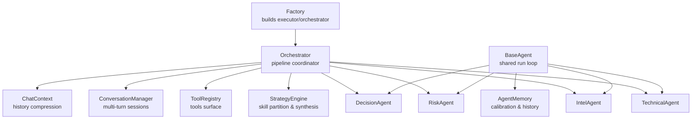
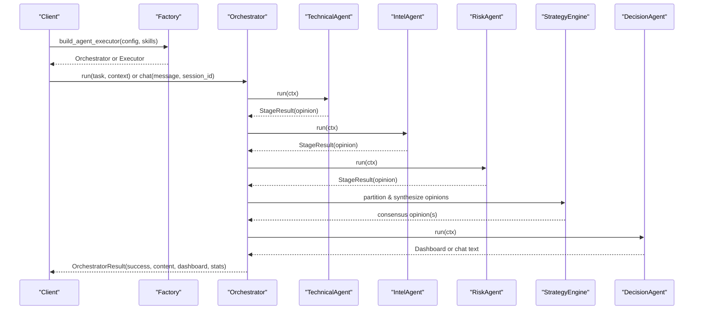
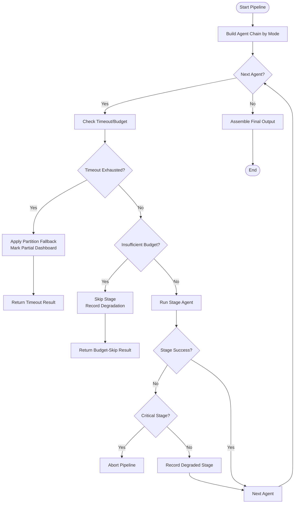
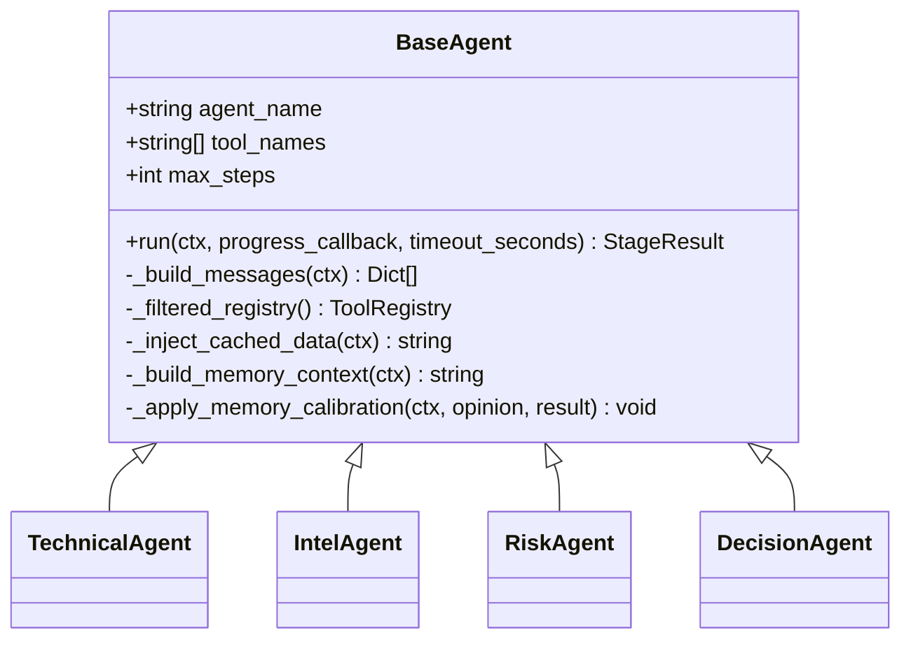
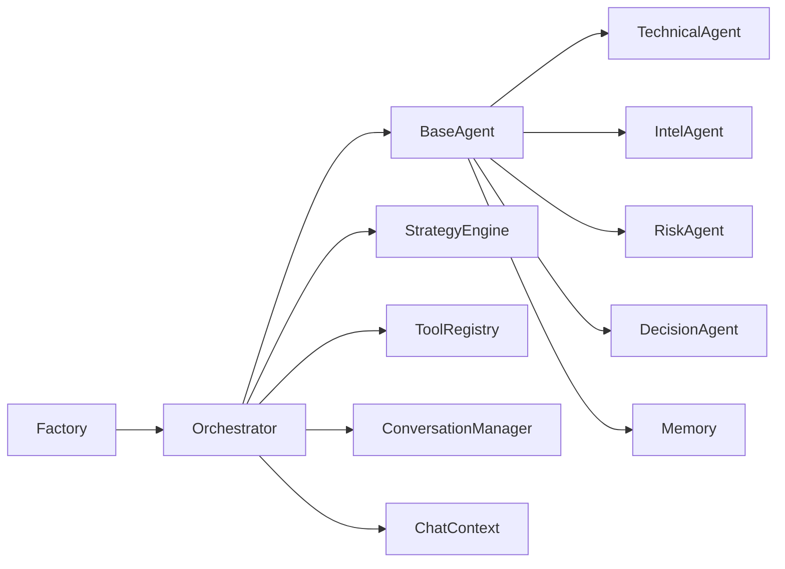

# Agent Orchestration System

<cite>
**Referenced Files in This Document**
- [orchestrator.py](file://src/agent/orchestrator.py)
- [factory.py](file://src/agent/factory.py)
- [conversation.py](file://src/agent/conversation.py)
- [chat_context.py](file://src/agent/chat_context.py)
- [memory.py](file://src/agent/memory.py)
- [base_agent.py](file://src/agent/agents/base_agent.py)
- [technical_agent.py](file://src/agent/agents/technical_agent.py)
- [intel_agent.py](file://src/agent/agents/intel_agent.py)
- [risk_agent.py](file://src/agent/agents/risk_agent.py)
- [decision_agent.py](file://src/agent/agents/decision_agent.py)
- [protocols.py](file://src/agent/protocols.py)
- [engine.py](file://src/agent/skills/engine.py)
- [registry.py](file://src/agent/tools/registry.py)
</cite>

## Table of Contents
1. Introduction
2. Project Structure
3. Core Components
4. Architecture Overview
5. Detailed Component Analysis
6. Dependency Analysis
7. Performance Considerations
8. Troubleshooting Guide
9. Conclusion
10. Appendices

## Introduction
This document explains the multi-agent orchestration system that coordinates specialized agents for stock analysis tasks. It covers agent lifecycle management, conversation state handling, inter-agent communication patterns, and how the orchestrator manages agent selection, task distribution, and result aggregation across technical analysis, intelligence gathering, risk assessment, and decision-making stages. It also documents agent registration via tools, skill-based routing, fallback strategies when agents fail or return incomplete results, examples for creating custom agents and defining skills, and how conversation context is shared, persisted, and compressed across interactions.

## Project Structure
The orchestration system lives under src/agent with clear separation:
- Orchestrator and factory manage pipeline execution and configuration
- Agents implement specialized analysis roles
- Protocols define shared data structures for context, opinions, and stage results
- Skills engine partitions and synthesizes strategy/skill opinions
- Tools registry provides callable capabilities to agents
- Conversation manager and chat context handle multi-turn history and compression
- Memory module enables learning from past analyses and confidence calibration

**Diagram sources**
- [factory.py:551-711](file://src/agent/factory.py#L551-L711)
- [orchestrator.py:107-136](file://src/agent/orchestrator.py#L107-L136)
- [base_agent.py:38-69](file://src/agent/agents/base_agent.py#L38-L69)
- [engine.py:54-59](file://src/agent/skills/engine.py#L54-L59)
- [registry.py:169-182](file://src/agent/tools/registry.py#L169-L182)
- [conversation.py:56-121](file://src/agent/conversation.py#L56-L121)
- [chat_context.py:120-135](file://src/agent/chat_context.py#L120-L135)

**Section sources**
- [factory.py:551-711](file://src/agent/factory.py#L551-L711)
- [orchestrator.py:107-136](file://src/agent/orchestrator.py#L107-L136)

## Core Components
- Orchestrator: Builds an ordered agent chain based on mode (quick, standard, full, specialist), executes stages with timeouts and budget guards, aggregates results, and produces final dashboard or chat response.
- Agents: Specialized implementations (technical, intel, risk, decision) inheriting from a common base that handles message building, tool access scoping, LLM invocation, opinion parsing, and memory calibration.
- Protocols: Shared dataclasses for AgentContext, AgentOpinion, StageResult, and enums for signals and stage status/reasons.
- Skills Engine: Partitions opinions into valid skill vs non-skill, normalizes signals, and synthesizes consensus outputs used by decision-making.
- Tools Registry: Central catalog of callable tools with categories, schemas, and per-category timeout ceilings; agents can restrict their tool subset.
- Conversation Manager: Manages multi-turn sessions with TTL, persists user turns and assistant messages, and supports session cleanup.
- Chat Context Builder: Builds visible chat history with optional LLM-based summarization and trace injection while respecting token budgets.
- Memory: Provides historical analysis retrieval and confidence calibration to adjust agent confidence based on track record.

**Section sources**
- [orchestrator.py:77-96](file://src/agent/orchestrator.py#L77-L96)
- [base_agent.py:38-69](file://src/agent/agents/base_agent.py#L38-L69)
- [protocols.py:149-232](file://src/agent/protocols.py#L149-L232)
- [engine.py:54-59](file://src/agent/skills/engine.py#L54-L59)
- [registry.py:169-182](file://src/agent/tools/registry.py#L169-L182)
- [conversation.py:56-121](file://src/agent/conversation.py#L56-L121)
- [chat_context.py:120-135](file://src/agent/chat_context.py#L120-L135)
- [memory.py:62-88](file://src/agent/memory.py#L62-L88)

## Architecture Overview
The orchestrator constructs a pipeline of agents depending on the configured mode:
- Quick: Technical → Decision
- Standard: Technical → Intel → Decision
- Full: Technical → Intel → Risk → Decision
- Specialist: Technical → Intel → Risk → Skill/Specialist batch → Decision

Each stage runs with optional per-agent timeouts and a global pipeline timeout/budget guard. Non-critical stages (intel, risk, skill) degrade gracefully; critical failures abort early. The decision agent synthesizes all prior opinions and risk flags into a final dashboard or natural-language answer.

**Diagram sources**
- [orchestrator.py:772-800](file://src/agent/orchestrator.py#L772-L800)
- [orchestrator.py:479-766](file://src/agent/orchestrator.py#L479-L766)
- [engine.py:134-200](file://src/agent/skills/engine.py#L134-L200)
- [decision_agent.py:24-34](file://src/agent/agents/decision_agent.py#L24-L34)

**Section sources**
- [orchestrator.py:772-800](file://src/agent/orchestrator.py#L772-L800)
- [orchestrator.py:479-766](file://src/agent/orchestrator.py#L479-L766)

## Detailed Component Analysis

### Orchestrator: Pipeline Coordination and Fallbacks
- Mode-driven chain construction selects which agents to include.
- Budget and timeout enforcement:
  - Global pipeline timeout computed from config.
  - Per-agent timeout clamps applied when configured.
  - Minimum stage budget prevents starting low-value stages near deadline.
- Failure handling:
  - Critical stage failure aborts pipeline.
  - Non-critical stages (intel, risk, skill) degrade with recorded reasons.
  - Partition fallback marks partial dashboards when timeouts occur.
- Specialist mode inserts skill agents before decision and aggregates their opinions, invalid records, and scheduler metadata.

**Diagram sources**
- [orchestrator.py:479-766](file://src/agent/orchestrator.py#L479-L766)
- [orchestrator.py:772-800](file://src/agent/orchestrator.py#L772-L800)

**Section sources**
- [orchestrator.py:479-766](file://src/agent/orchestrator.py#L479-L766)
- [orchestrator.py:772-800](file://src/agent/orchestrator.py#L772-L800)

### Base Agent: Lifecycle, Tools, and Memory Calibration
- Message assembly includes system prompt, conversation history, market phase/structure/daily context, pre-fetched data, and user message.
- Tool subset restriction ensures agents only call relevant tools while preserving category-timeout policies.
- Execution uses a shared run loop with step limits and wall-clock timeouts.
- Post-processing converts raw LLM output into structured AgentOpinion and injects into context.
- Memory integration:
  - Retrieves recent analysis history for the stock.
  - Applies confidence calibration based on historical accuracy when enabled.

**Diagram sources**
- [base_agent.py:38-69](file://src/agent/agents/base_agent.py#L38-L69)
- [base_agent.py:99-171](file://src/agent/agents/base_agent.py#L99-L171)
- [base_agent.py:177-270](file://src/agent/agents/base_agent.py#L177-L270)
- [base_agent.py:271-321](file://src/agent/agents/base_agent.py#L271-L321)

**Section sources**
- [base_agent.py:99-171](file://src/agent/agents/base_agent.py#L99-L171)
- [base_agent.py:177-270](file://src/agent/agents/base_agent.py#L177-L270)
- [base_agent.py:271-321](file://src/agent/agents/base_agent.py#L271-L321)

### Technical Agent: Data Fetching and Structured Opinion
- Uses tools for realtime quotes, daily history, trend analysis, moving averages, volume analysis, pattern detection, chip distribution, and analysis context.
- Produces JSON opinion with signal, confidence, reasoning, key levels, trend score, MA alignment, volume status, and detected pattern.
- Post-processing parses JSON into AgentOpinion for downstream consumption.

**Section sources**
- [technical_agent.py:23-35](file://src/agent/agents/technical_agent.py#L23-L35)
- [technical_agent.py:37-83](file://src/agent/agents/technical_agent.py#L37-L83)
- [technical_agent.py:85-103](file://src/agent/agents/technical_agent.py#L85-L103)

### Intel Agent: News, Sentiment, and Capital Flow
- Searches news, announcements, risk events, and capital flow (A-shares).
- Classifies positive catalysts and risk alerts; assesses sentiment.
- Caches parsed intel in context for reuse by downstream agents (e.g., RiskAgent).
- Propagates risk alerts to context as risk flags.

**Section sources**
- [intel_agent.py:24-32](file://src/agent/agents/intel_agent.py#L24-L32)
- [intel_agent.py:34-93](file://src/agent/agents/intel_agent.py#L34-L93)
- [intel_agent.py:95-116](file://src/agent/agents/intel_agent.py#L95-L116)

### Risk Agent: Screening and Severity-Based Flags
- Scans insider activity, earnings warnings, regulatory actions, industry policy, lock-up expirations, valuation extremes, and technical warning signs.
- Outputs structured risk assessment including severity and veto guidance.
- Converts risk level to inverted trading signal and propagates flags to context.

**Section sources**
- [risk_agent.py:29-36](file://src/agent/agents/risk_agent.py#L29-L36)
- [risk_agent.py:38-93](file://src/agent/agents/risk_agent.py#L38-L93)
- [risk_agent.py:95-129](file://src/agent/agents/risk_agent.py#L95-L129)

### Decision Agent: Synthesis and Final Output
- In chat mode, synthesizes prior opinions into a natural-language answer tailored to language preferences.
- In dashboard mode, synthesizes evidence into a structured Decision Dashboard with decision_type, confidence_level, analysis_summary, and nested phase_decision fields.
- Normalizes decision signals to stable enum values and stores parsed dashboard in context.

**Section sources**
- [decision_agent.py:24-34](file://src/agent/agents/decision_agent.py#L24-L34)
- [decision_agent.py:35-157](file://src/agent/agents/decision_agent.py#L35-L157)
- [decision_agent.py:159-246](file://src/agent/agents/decision_agent.py#L159-L246)
- [decision_agent.py:248-290](file://src/agent/agents/decision_agent.py#L248-L290)

### Skills Engine: Partitioning and Synthesis
- Partitions opinions into valid skill opinions, invalid records, and non-skill opinions.
- Normalizes signals using canonical mapping and tracks invalid reasons.
- Aggregates and synthesizes consensus outcomes, producing structured synthesis used by decision-making.

**Section sources**
- [engine.py:54-59](file://src/agent/skills/engine.py#L54-L59)
- [engine.py:60-132](file://src/agent/skills/engine.py#L60-L132)
- [engine.py:134-200](file://src/agent/skills/engine.py#L134-L200)

### Tools Registry: Registration and Category Timeouts
- Central catalog of tools with parameters, categories, and policies.
- Supports multiple provider schema formats and public descriptors.
- Enforces per-category timeout ceilings derived from configuration.

**Section sources**
- [registry.py:26-94](file://src/agent/tools/registry.py#L26-L94)
- [registry.py:169-200](file://src/agent/tools/registry.py#L169-L200)

### Conversation Manager: Multi-Turn Sessions
- Manages sessions with TTL, persists user turns and assistant messages, and cleans up expired sessions.
- Stores selected skill IDs with user turns for context-aware behavior.

**Section sources**
- [conversation.py:18-55](file://src/agent/conversation.py#L18-L55)
- [conversation.py:56-121](file://src/agent/conversation.py#L56-L121)

### Chat Context Builder: History Compression and Trace Injection
- Builds visible chat history with optional LLM-based summarization respecting trigger tokens and protected turns.
- Injects provider traces where budget allows and preserves model/provider metadata.

**Section sources**
- [chat_context.py:120-135](file://src/agent/chat_context.py#L120-L135)
- [chat_context.py:228-364](file://src/agent/chat_context.py#L228-L364)
- [chat_context.py:406-429](file://src/agent/chat_context.py#L406-L429)

### Memory: Learning and Confidence Calibration
- Retrieves recent analysis history for a stock and builds memory context for prompts.
- Computes calibration factors based on historical accuracy and average confidence when sufficient samples exist.
- Adjusts agent confidence within safe bounds after calibration.

**Section sources**
- [memory.py:62-88](file://src/agent/memory.py#L62-L88)
- [memory.py:93-139](file://src/agent/memory.py#L93-L139)
- [memory.py:145-200](file://src/agent/memory.py#L145-L200)
- [memory.py:206-279](file://src/agent/memory.py#L206-L279)

## Dependency Analysis
- Orchestrator depends on:
  - Agents (technical, intel, risk, decision)
  - StrategyEngine for skill partitioning and synthesis
  - ToolRegistry for tool execution and category timeouts
  - ConversationManager and ChatContext for multi-turn history
  - Protocols for shared data structures
- Agents depend on:
  - BaseAgent for common execution and message building
  - Memory for calibration and context injection
  - ToolRegistry filtered subsets
- Factory centralizes configuration and returns either single-agent executor or orchestrator based on architecture setting.

**Diagram sources**
- [factory.py:551-711](file://src/agent/factory.py#L551-L711)
- [orchestrator.py:772-800](file://src/agent/orchestrator.py#L772-L800)
- [base_agent.py:38-69](file://src/agent/agents/base_agent.py#L38-L69)
- [engine.py:54-59](file://src/agent/skills/engine.py#L54-L59)
- [registry.py:169-182](file://src/agent/tools/registry.py#L169-L182)
- [conversation.py:56-121](file://src/agent/conversation.py#L56-L121)
- [chat_context.py:120-135](file://src/agent/chat_context.py#L120-L135)
- [memory.py:62-88](file://src/agent/memory.py#L62-L88)

**Section sources**
- [factory.py:551-711](file://src/agent/factory.py#L551-L711)
- [orchestrator.py:772-800](file://src/agent/orchestrator.py#L772-L800)

## Performance Considerations
- Pipeline timeouts and budget guards prevent wasted LLM calls near deadlines.
- Per-agent timeouts enforce reasonable ceilings per stage.
- Tool category timeouts cap expensive operations (data, search, analysis, action, market).
- Conversation history compression reduces token usage while preserving protected recent turns.
- Memory calibration avoids overconfident decisions when historical accuracy suggests otherwise.
- Specialist mode batches skill evaluations with concurrency controls and per-skill timeouts.

[No sources needed since this section provides general guidance]

## Troubleshooting Guide
Common issues and resolutions:
- Pipeline timeout:
  - Check global orchestrator timeout and per-agent timeouts.
  - Review budget skip logs indicating insufficient remaining time.
  - Inspect runtime facts and degraded events for last completed stage.
- Stage failure:
  - Critical stages abort immediately; review error messages and failure reasons.
  - Non-critical stages degrade gracefully; check recorded degradation reasons.
- Invalid skill opinions:
  - Missing or unrecognized signals are moved to diagnostics; ensure skill outputs conform to expected schema.
- Conversation history overflow:
  - Enable compression and tune trigger tokens and protected turns.
  - Verify summary generation succeeded; fallback to recent messages if failed.
- Tool execution errors:
  - Validate tool category timeouts and ensure handlers accept required parameters.
  - Use filtered registries to limit scope and reduce noise.

**Section sources**
- [orchestrator.py:479-766](file://src/agent/orchestrator.py#L479-L766)
- [engine.py:60-132](file://src/agent/skills/engine.py#L60-L132)
- [chat_context.py:228-364](file://src/agent/chat_context.py#L228-L364)
- [registry.py:169-200](file://src/agent/tools/registry.py#L169-L200)

## Conclusion
The multi-agent orchestration system provides a robust, configurable pipeline for stock analysis. It coordinates specialized agents with clear lifecycle management, resilient fallbacks, and comprehensive context sharing. The factory abstracts configuration, the orchestrator enforces budgets and modes, agents encapsulate domain expertise, and the skills engine ensures consistent synthesis. Conversation history compression and memory calibration enhance performance and decision quality. Extensibility is supported through tool registration, skill definitions, and custom agents adhering to the base interface.

[No sources needed since this section summarizes without analyzing specific files]

## Appendices

### Creating Custom Agents
- Inherit from BaseAgent and implement:
  - agent_name: unique identifier
  - system_prompt(ctx): system instructions
  - build_user_message(ctx): user prompt
  - post_process(ctx, raw_text): parse into AgentOpinion
- Optionally set tool_names to restrict tool access.
- Use max_steps to control LLM interaction depth.

**Section sources**
- [base_agent.py:38-69](file://src/agent/agents/base_agent.py#L38-L69)
- [base_agent.py:74-93](file://src/agent/agents/base_agent.py#L74-L93)
- [base_agent.py:99-171](file://src/agent/agents/base_agent.py#L99-L171)

### Defining Agent Skills
- Activate skills via factory configuration or API request.
- Skills are loaded from built-in and custom directories.
- Skill instructions and policies are injected into agent prompts.
- StrategyEngine partitions and synthesizes skill opinions consistently.

**Section sources**
- [factory.py:452-548](file://src/agent/factory.py#L452-L548)
- [engine.py:60-132](file://src/agent/skills/engine.py#L60-L132)

### Configuring Collaboration Patterns
- Choose orchestrator mode: quick, standard, full, specialist.
- Set global timeout and per-agent timeouts.
- Configure skill concurrency and per-skill timeouts in specialist mode.
- Enable conversation compression and tune thresholds.

**Section sources**
- [orchestrator.py:77-136](file://src/agent/orchestrator.py#L77-L136)
- [orchestrator.py:137-175](file://src/agent/orchestrator.py#L137-L175)
- [chat_context.py:228-364](file://src/agent/chat_context.py#L228-L364)