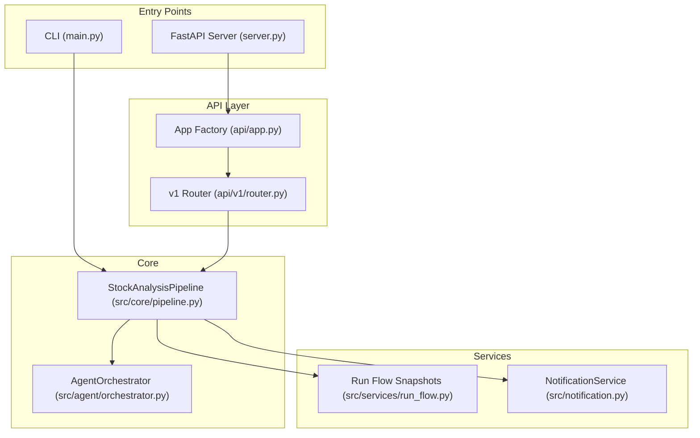
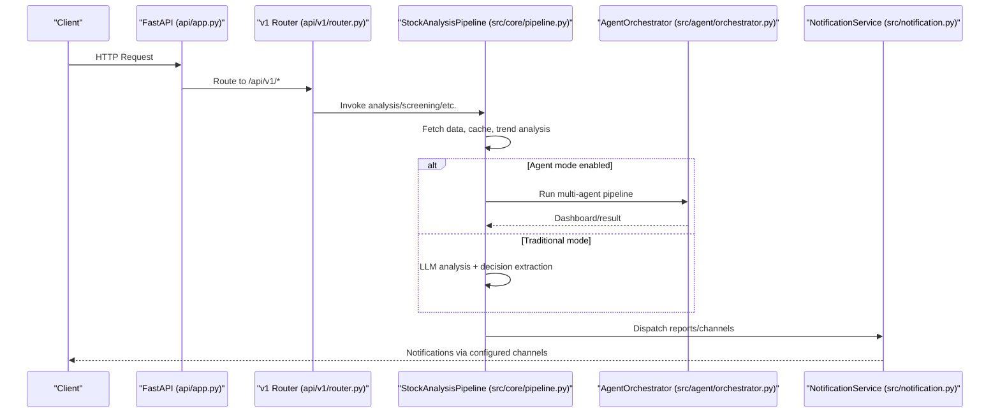
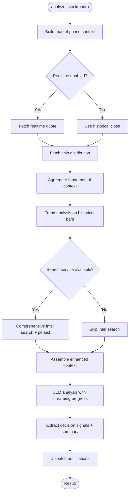
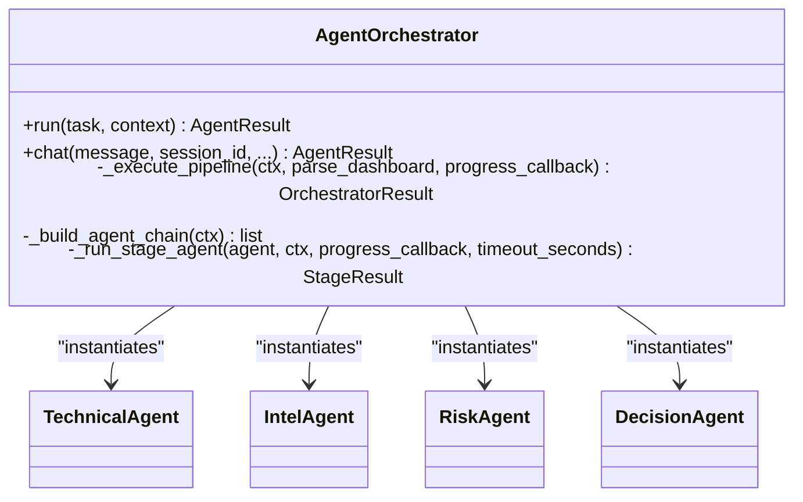
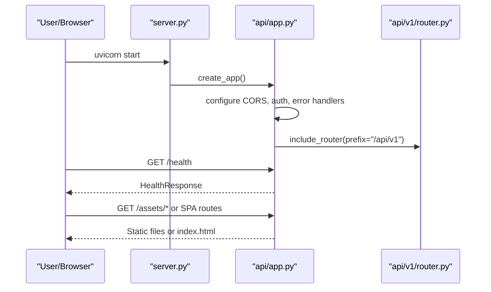
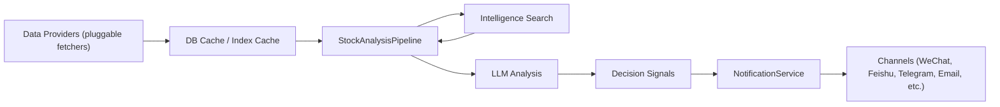
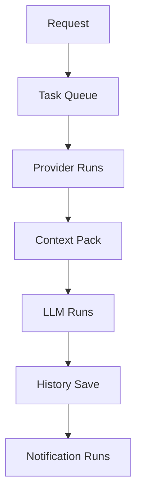
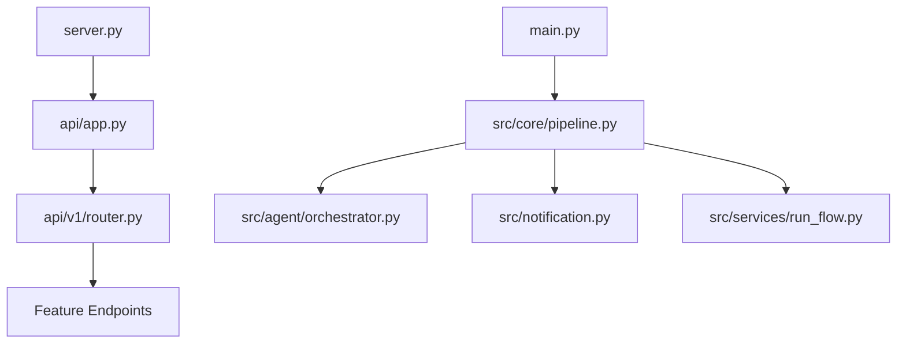

# Core Architecture

<cite>
**Referenced Files in This Document**
- [main.py](file://main.py)
- [server.py](file://server.py)
- [api/app.py](file://api/app.py)
- [api/v1/router.py](file://api/v1/router.py)
- [src/core/pipeline.py](file://src/core/pipeline.py)
- [src/agent/orchestrator.py](file://src/agent/orchestrator.py)
- [src/services/run_flow.py](file://src/services/run_flow.py)
- [src/notification.py](file://src/notification.py)
</cite>

## Table of Contents
1. Introduction
2. Project Structure
3. Core Components
4. Architecture Overview
5. Detailed Component Analysis
6. Dependency Analysis
7. Performance Considerations
8. Troubleshooting Guide
9. Conclusion

## Introduction
This document describes the high-level architecture of the DailyStockAnalysis core system. It focuses on:
- Pipeline architecture that processes market data through multiple analysis stages
- Multi-agent orchestration coordinating specialized agents for technical analysis, intelligence gathering, risk assessment, and decision making
- Service layer with REST API endpoints and background task processing
- Data flow from external market data sources through caching layers to analysis engines and notification delivery systems
- System boundaries, third-party integrations, and scalability considerations
- Cross-cutting concerns including authentication, error handling, logging, and monitoring
- Plugin architecture enabling extensible data providers, notification channels, and analysis strategies

## Project Structure
The system is organized into clear layers:
- Entry points: CLI orchestrator and FastAPI server
- API layer: versioned routers for features like analysis, history, stocks, alerts, screening, intelligence, portfolio, backtest, system config, usage, and health
- Core pipeline: end-to-end stock analysis workflow with data fetching, trend analysis, search/intelligence, LLM-based analysis, and notifications
- Agent orchestration: multi-agent pipeline (technical, intel, risk, specialist, decision) with modes and budgets
- Services: run-flow snapshots, scheduling, diagnostics, and domain services
- Notification layer: multi-channel dispatch and reporting
- Data providers: pluggable fetchers and adapters for market data and fundamentals

**Diagram sources**
- [main.py:272-443](file://main.py#L272-L443)
- [server.py:21-55](file://server.py#L21-L55)
- [api/app.py:313-384](file://api/app.py#L313-L384)
- [api/v1/router.py:31-117](file://api/v1/router.py#L31-L117)
- [src/core/pipeline.py:209-319](file://src/core/pipeline.py#L209-L319)
- [src/agent/orchestrator.py:107-136](file://src/agent/orchestrator.py#L107-L136)
- [src/services/run_flow.py:77-180](file://src/services/run_flow.py#L77-L180)
- [src/notification.py:257-343](file://src/notification.py#L257-L343)

**Section sources**
- [main.py:272-443](file://main.py#L272-L443)
- [server.py:21-55](file://server.py#L21-L55)
- [api/app.py:313-384](file://api/app.py#L313-L384)
- [api/v1/router.py:31-117](file://api/v1/router.py#L31-L117)

## Core Components
- StockAnalysisPipeline: central coordinator for data acquisition, trend analysis, intelligence search, context assembly, LLM analysis, decision extraction, and notifications. Supports agent mode and traditional analysis paths.
- AgentOrchestrator: multi-agent pipeline with modes (quick, standard, full, specialist), budget/timeouts, stage failures, and strategy engine integration.
- NotificationService: multi-channel dispatcher with routing, noise control, report generation, and context-aware delivery (e.g., stream replies).
- Run Flow Snapshots: structured visualization of request, queue, data sources, analysis, artifacts, and notifications for live and historical runs.

**Section sources**
- [src/core/pipeline.py:209-319](file://src/core/pipeline.py#L209-L319)
- [src/agent/orchestrator.py:107-136](file://src/agent/orchestrator.py#L107-L136)
- [src/notification.py:257-343](file://src/notification.py#L257-L343)
- [src/services/run_flow.py:77-180](file://src/services/run_flow.py#L77-L180)

## Architecture Overview
The system exposes a REST API and CLI entry points. The CLI coordinates scheduled or ad-hoc analysis runs; the API serves requests, manages CORS/auth, mounts v1 routers, and hosts the frontend when available. The core pipeline orchestrates data fetching, caching, analysis, and notifications. The agent orchestrator can be engaged for advanced multi-agent analysis.

**Diagram sources**
- [api/app.py:313-384](file://api/app.py#L313-L384)
- [api/v1/router.py:31-117](file://api/v1/router.py#L31-L117)
- [src/core/pipeline.py:414-750](file://src/core/pipeline.py#L414-L750)
- [src/agent/orchestrator.py:352-374](file://src/agent/orchestrator.py#L352-L374)
- [src/notification.py:257-343](file://src/notification.py#L257-L343)

## Detailed Component Analysis

### Pipeline Architecture (StockAnalysisPipeline)
Responsibilities:
- Data acquisition via DataFetcherManager with fallbacks and caching
- Realtime quote and chip distribution retrieval with resilience
- Trend analysis using historical bars and optional realtime augmentation
- Intelligence search across multiple providers with persistence
- Context assembly combining market phase, daily market context, fundamentals, and news
- LLM analysis with streaming progress and diagnostics
- Decision signal extraction and summary
- Notification dispatch with channel routing and noise control

Key flows:
- fetch_and_save_stock_data: checks DB for reusable data, fetches from provider, saves to DB
- analyze_stock: orchestrates realtime quote, chip, fundamentals, trend, search, context, LLM, and notifications
- Agent mode switch: auto-enables based on configuration/skills; delegates to orchestrator

**Diagram sources**
- [src/core/pipeline.py:414-750](file://src/core/pipeline.py#L414-L750)

**Section sources**
- [src/core/pipeline.py:358-413](file://src/core/pipeline.py#L358-L413)
- [src/core/pipeline.py:414-750](file://src/core/pipeline.py#L414-L750)

### Multi-Agent Orchestration (AgentOrchestrator)
Modes:
- quick: Technical → Decision
- standard: Technical → Intel → Decision
- full: Technical → Intel → Risk → Decision
- specialist: inserts specialist skill agents before Decision

Controls:
- Global timeout and per-stage minimum budget
- Per-agent timeouts via configuration map
- Non-critical stage degradation (intel/risk) vs critical failure
- Strategy engine integration at Decision stage

**Diagram sources**
- [src/agent/orchestrator.py:107-136](file://src/agent/orchestrator.py#L107-L136)
- [src/agent/orchestrator.py:772-800](file://src/agent/orchestrator.py#L772-L800)

**Section sources**
- [src/agent/orchestrator.py:107-136](file://src/agent/orchestrator.py#L107-L136)
- [src/agent/orchestrator.py:352-374](file://src/agent/orchestrator.py#L352-L374)
- [src/agent/orchestrator.py:479-766](file://src/agent/orchestrator.py#L479-L766)
- [src/agent/orchestrator.py:772-800](file://src/agent/orchestrator.py#L772-L800)

### Service Layer (REST API, Background Tasks, Frontend Hosting)
- FastAPI app factory configures CORS, auth middleware, error handlers, and includes v1 router under /api/v1
- Health endpoint for load balancers/monitoring
- Static SPA hosting with asset consistency checks and safe path resolution
- Background tasks: stock index refresh, runtime scheduler reconciliation, AkShare name resolver warmup

**Diagram sources**
- [server.py:21-55](file://server.py#L21-L55)
- [api/app.py:313-384](file://api/app.py#L313-L384)
- [api/v1/router.py:31-117](file://api/v1/router.py#L31-L117)

**Section sources**
- [api/app.py:313-384](file://api/app.py#L313-L384)
- [api/app.py:386-497](file://api/app.py#L386-L497)
- [api/app.py:498-560](file://api/app.py#L498-L560)
- [server.py:21-55](file://server.py#L21-L55)

### Data Flow and Caching
- Data providers: pluggable fetchers managed by DataFetcherManager with fallbacks and circuit breakers
- Caching: DB-backed daily data storage with resume targets; remote/local stock index cache served by API
- Intelligence search: multi-provider search with persistence and zero-hit disclosure
- Social sentiment: US-only optional enrichment
- Notifications: multi-channel dispatch with routing and noise control

**Diagram sources**
- [src/core/pipeline.py:358-413](file://src/core/pipeline.py#L358-L413)
- [src/core/pipeline.py:612-688](file://src/core/pipeline.py#L612-L688)
- [api/app.py:456-497](file://api/app.py#L456-L497)
- [src/notification.py:257-343](file://src/notification.py#L257-L343)

**Section sources**
- [src/core/pipeline.py:358-413](file://src/core/pipeline.py#L358-L413)
- [src/core/pipeline.py:612-688](file://src/core/pipeline.py#L612-L688)
- [api/app.py:456-497](file://api/app.py#L456-L497)
- [src/notification.py:257-343](file://src/notification.py#L257-L343)

### Run Flow Visualization
Run flow snapshots provide a structured view of:
- Entry/request and task queue status
- Data source provider runs with retries/fallbacks
- Context pack blocks and statuses
- LLM runs with model/provider and fallbacks
- History save and notification runs

**Diagram sources**
- [src/services/run_flow.py:77-180](file://src/services/run_flow.py#L77-L180)
- [src/services/run_flow.py:258-368](file://src/services/run_flow.py#L258-L368)
- [src/services/run_flow.py:371-725](file://src/services/run_flow.py#L371-L725)

**Section sources**
- [src/services/run_flow.py:77-180](file://src/services/run_flow.py#L77-L180)
- [src/services/run_flow.py:258-368](file://src/services/run_flow.py#L258-L368)
- [src/services/run_flow.py:371-725](file://src/services/run_flow.py#L371-L725)

### Plugin Architecture
- Data providers: modular fetchers and adapters registered via manager; supports multiple markets and fallbacks
- Notification channels: pluggable senders aggregated in NotificationService; detection and routing based on configuration
- Analysis strategies: skills and strategies integrated via orchestrator and strategy engine; configurable concurrency and timeouts

Extensibility points:
- Add new fetcher implementations and register with DataFetcherManager
- Implement new sender classes and integrate with NotificationService
- Define new skills/strategies and configure via orchestrator settings

**Section sources**
- [src/core/pipeline.py:262-319](file://src/core/pipeline.py#L262-L319)
- [src/notification.py:257-343](file://src/notification.py#L257-L343)
- [src/agent/orchestrator.py:107-136](file://src/agent/orchestrator.py#L107-L136)

## Dependency Analysis
High-level dependencies:
- CLI depends on pipeline and services for scheduling and execution
- API depends on app factory and v1 routers; routers depend on feature endpoints
- Pipeline depends on data providers, analyzer, notification, search, and services
- Orchestrator depends on tool registry, LLM adapter, and agent implementations
- Run flow depends on diagnostics and schemas for visualization

**Diagram sources**
- [main.py:272-443](file://main.py#L272-L443)
- [server.py:21-55](file://server.py#L21-L55)
- [api/app.py:313-384](file://api/app.py#L313-L384)
- [api/v1/router.py:31-117](file://api/v1/router.py#L31-L117)
- [src/core/pipeline.py:209-319](file://src/core/pipeline.py#L209-L319)
- [src/agent/orchestrator.py:107-136](file://src/agent/orchestrator.py#L107-L136)
- [src/notification.py:257-343](file://src/notification.py#L257-L343)
- [src/services/run_flow.py:77-180](file://src/services/run_flow.py#L77-L180)

**Section sources**
- [main.py:272-443](file://main.py#L272-L443)
- [server.py:21-55](file://server.py#L21-L55)
- [api/app.py:313-384](file://api/app.py#L313-L384)
- [api/v1/router.py:31-117](file://api/v1/router.py#L31-L117)

## Performance Considerations
- Concurrency: pipeline uses thread pools for concurrent work; orchestrator supports skill concurrency and per-agent timeouts
- Fallbacks and resilience: data providers and search services degrade gracefully; non-critical stages (intel/risk) do not abort pipelines
- Caching: DB-backed daily data and remote/local stock index caches reduce network calls and startup latency
- Streaming: LLM streaming progress improves perceived performance and enables partial results
- Background tasks: stock index refresh and scheduler reconciliation run asynchronously to avoid blocking requests

[No sources needed since this section provides general guidance]

## Troubleshooting Guide
Common issues and mitigations:
- Missing frontend assets: API logs inconsistencies and returns plain-text 404s for missing assets; rebuild frontend bundle
- Empty stock list: CLI logs and skips run if no stocks and market review disabled; ensure STOCK_LIST or portfolio is configured
- No notification channels: warning logged; configure at least one channel or use context channels from bot messages
- Provider failures: fallback chains and retry logic; check provider_runs in run flow snapshots for details
- Timeout/budget: orchestrator emits pipeline_timeout or budget_skipped events; adjust global/per-agent timeouts

**Section sources**
- [api/app.py:76-113](file://api/app.py#L76-L113)
- [api/app.py:498-560](file://api/app.py#L498-L560)
- [main.py:719-800](file://main.py#L719-L800)
- [src/notification.py:331-343](file://src/notification.py#L331-L343)
- [src/agent/orchestrator.py:479-766](file://src/agent/orchestrator.py#L479-L766)

## Conclusion
DailyStockAnalysis implements a robust, extensible architecture centered around a resilient analysis pipeline and a flexible multi-agent orchestration system. The service layer provides a clean REST API with background tasks and frontend hosting. Data flows from pluggable providers through caching and analysis engines to multi-channel notifications. Scalability is supported via concurrency controls, fallbacks, and asynchronous tasks. Cross-cutting concerns such as authentication, error handling, logging, and monitoring are integrated throughout the system.

[No sources needed since this section summarizes without analyzing specific files]