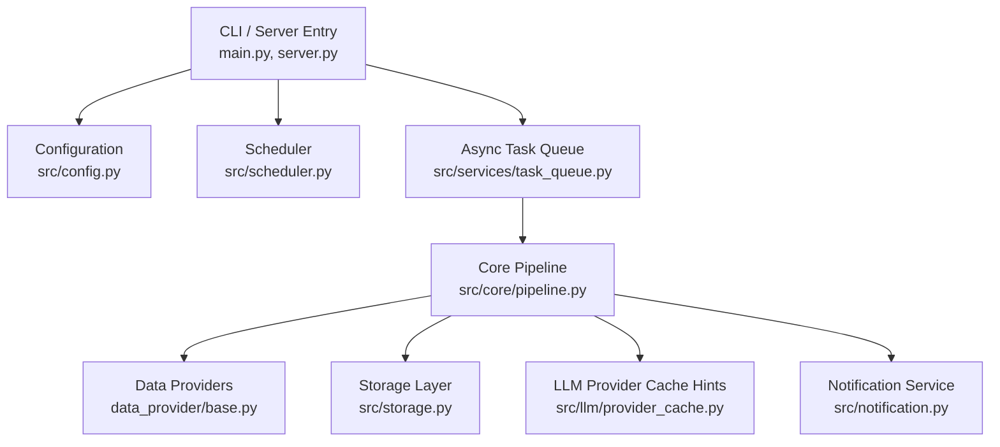
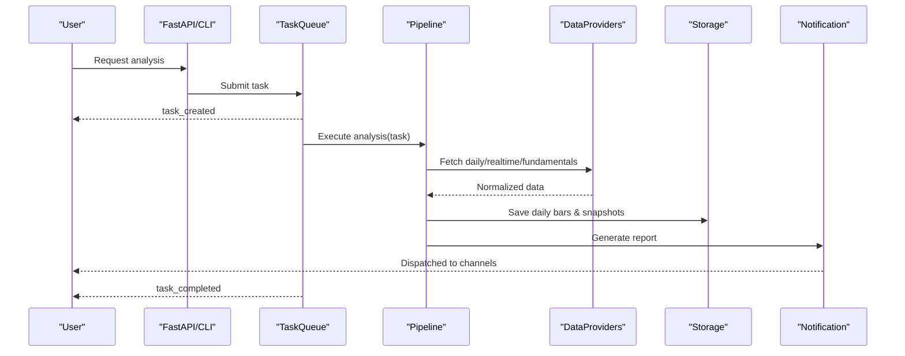
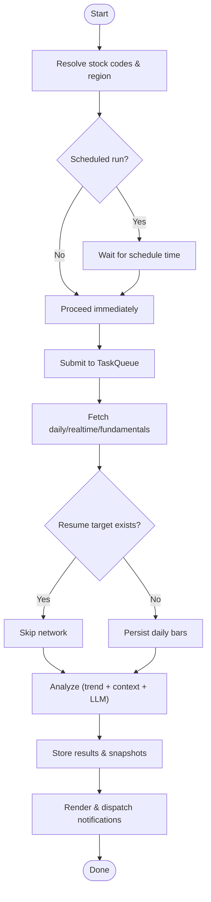
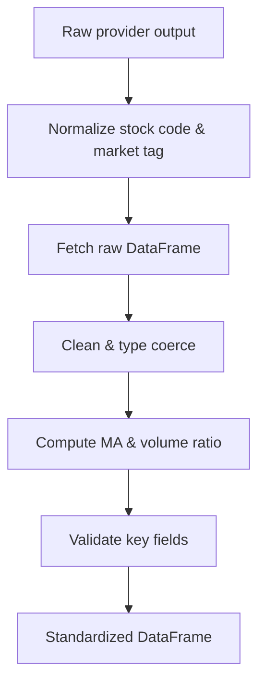
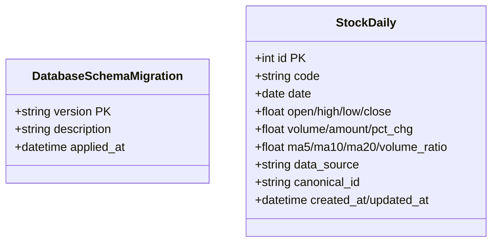
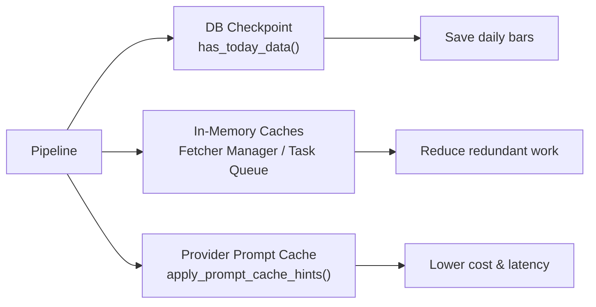
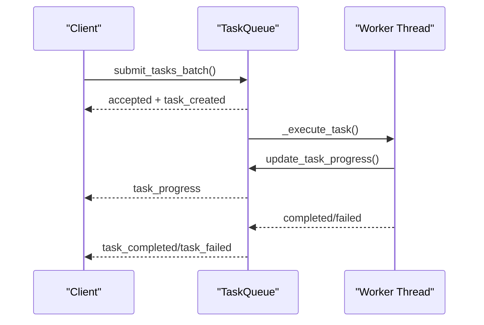
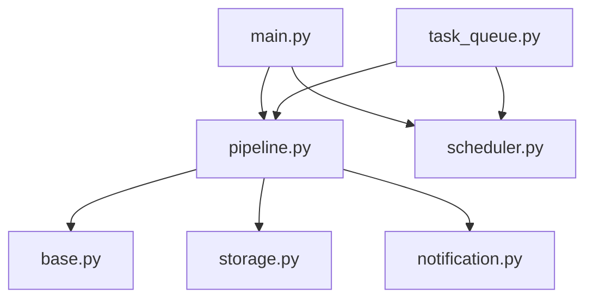

# Data Flow Patterns

<cite>
**Referenced Files in This Document**
- [main.py](file://main.py)
- [server.py](file://server.py)
- [src/config.py](file://src/config.py)
- [src/storage.py](file://src/storage.py)
- [src/scheduler.py](file://src/scheduler.py)
- [src/core/pipeline.py](file://src/core/pipeline.py)
- [data_provider/base.py](file://data_provider/base.py)
- [src/services/task_queue.py](file://src/services/task_queue.py)
- [src/notification.py](file://src/notification.py)
- [src/llm/provider_cache.py](file://src/llm/provider_cache.py)
</cite>

## Table of Contents
1. Introduction
2. Project Structure
3. Core Components
4. Architecture Overview
5. Detailed Component Analysis
6. Dependency Analysis
7. Performance Considerations
8. Troubleshooting Guide
9. Conclusion

## Introduction
This document explains the end-to-end data flow patterns in the DailyStockAnalysis system. It traces how external market data enters the system, passes through caching and analysis layers, persists into storage, and is delivered via notifications. It also covers schema evolution, validation, caching strategies (in-memory, database, provider prompt cache), event-driven propagation, async processing, consistency guarantees, extensibility points, performance tuning, and security/compliance considerations.

## Project Structure
The system is organized around a CLI/server entry point, a core analysis pipeline, a pluggable data provider layer, an in-process task queue for async execution, a SQLite-backed storage layer, and a multi-channel notification service. A scheduler drives periodic runs, while configuration centralizes environment-driven behavior.

**Diagram sources**
- [main.py:211-247](file://main.py#L211-L247)
- [server.py:21-55](file://server.py#L21-L55)
- [src/config.py:1-100](file://src/config.py#L1-L100)
- [src/scheduler.py:82-128](file://src/scheduler.py#L82-L128)
- [src/services/task_queue.py:156-217](file://src/services/task_queue.py#L156-L217)
- [src/core/pipeline.py:209-319](file://src/core/pipeline.py#L209-L319)
- [data_provider/base.py:604-683](file://data_provider/base.py#L604-L683)
- [src/storage.py:90-177](file://src/storage.py#L90-L177)
- [src/notification.py:257-344](file://src/notification.py#L257-L344)
- [src/llm/provider_cache.py:509-583](file://src/llm/provider_cache.py#L509-L583)

**Section sources**
- [main.py:211-247](file://main.py#L211-L247)
- [server.py:21-55](file://server.py#L21-L55)
- [src/config.py:1-100](file://src/config.py#L1-L100)
- [src/scheduler.py:82-128](file://src/scheduler.py#L82-L128)
- [src/services/task_queue.py:156-217](file://src/services/task_queue.py#L156-L217)
- [src/core/pipeline.py:209-319](file://src/core/pipeline.py#L209-L319)
- [data_provider/base.py:604-683](file://data_provider/base.py#L604-L683)
- [src/storage.py:90-177](file://src/storage.py#L90-L177)
- [src/notification.py:257-344](file://src/notification.py#L257-L344)
- [src/llm/provider_cache.py:509-583](file://src/llm/provider_cache.py#L509-L583)

## Core Components
- Configuration: Centralized environment and runtime configuration with validation and normalization.
- Scheduler: In-process scheduling with graceful shutdown and background tasks.
- Task Queue: Thread-pooled async execution with deduplication, progress tracking, and SSE broadcasting.
- Data Providers: Strategy-managed fetchers with failover, rate limiting, and standardization.
- Storage: SQLAlchemy ORM models, migrations, indexes, and upserts for daily bars, news, intelligence, portfolio, and more.
- Notification: Multi-channel dispatch with routing, noise control, and context-aware replies.
- LLM Prompt Cache: Capability registry and hint injection to reduce cost and latency.

**Section sources**
- [src/config.py:1-100](file://src/config.py#L1-L100)
- [src/scheduler.py:82-128](file://src/scheduler.py#L82-L128)
- [src/services/task_queue.py:156-217](file://src/services/task_queue.py#L156-L217)
- [data_provider/base.py:331-529](file://data_provider/base.py#L331-L529)
- [src/storage.py:90-177](file://src/storage.py#L90-L177)
- [src/notification.py:257-344](file://src/notification.py#L257-L344)
- [src/llm/provider_cache.py:217-364](file://src/llm/provider_cache.py#L217-L364)

## Architecture Overview
End-to-end data journey:
- Entry: CLI or FastAPI server triggers analysis.
- Scheduling: Optional scheduled runs execute at configured times.
- Async Execution: Tasks are queued, deduplicated, and executed in a thread pool.
- Data Acquisition: Pluggable providers fetch daily history, real-time quotes, chip distribution, fundamentals, and indices with automatic fallback.
- Caching: Database checkpointing (resume from last trading day), in-memory caches (fetcher manager, concept rankings), and provider prompt cache hints.
- Analysis: Technical trend analysis, market phase/context, optional agent mode, search/intelligence aggregation, and LLM generation.
- Persistence: Results, snapshots, decisions, and usage logs stored in SQLite with versioned schema.
- Delivery: Reports rendered and dispatched to configured channels; context-aware replies supported.

**Diagram sources**
- [server.py:21-55](file://server.py#L21-L55)
- [src/services/task_queue.py:327-468](file://src/services/task_queue.py#L327-L468)
- [src/core/pipeline.py:358-413](file://src/core/pipeline.py#L358-L413)
- [data_provider/base.py:452-529](file://data_provider/base.py#L452-L529)
- [src/storage.py:100-177](file://src/storage.py#L100-L177)
- [src/notification.py:257-344](file://src/notification.py#L257-L344)

## Detailed Component Analysis

### End-to-End Data Flow
- Trigger and orchestration: main.py exposes StockAnalysisPipeline lazily and coordinates full runs, market review, and backtests. server.py boots logging and FastAPI app.
- Scheduling: src/scheduler.py provides daily jobs and background tasks with graceful shutdown.
- Async execution: src/services/task_queue.py enqueues tasks, prevents duplicates by normalized code, executes via ThreadPoolExecutor, broadcasts SSE events, and updates status.
- Pipeline: src/core/pipeline.py orchestrates fetching, caching, analysis, persistence, and notification. It integrates market phase/context, trend analysis, search/intelligence, and optional agent mode.
- Data providers: data_provider/base.py implements BaseFetcher and DataFetcherManager with strategy pattern, failover, rate limiting, and standardization.
- Storage: src/storage.py defines ORM models, indexes, constraints, and migration markers.
- Notifications: src/notification.py composes reports and dispatches across multiple channels with routing and noise control.

**Diagram sources**
- [main.py:719-800](file://main.py#L719-L800)
- [src/scheduler.py:130-196](file://src/scheduler.py#L130-L196)
- [src/services/task_queue.py:327-468](file://src/services/task_queue.py#L327-L468)
- [src/core/pipeline.py:358-413](file://src/core/pipeline.py#L358-L413)
- [src/storage.py:100-177](file://src/storage.py#L100-L177)
- [src/notification.py:257-344](file://src/notification.py#L257-L344)

**Section sources**
- [main.py:719-800](file://main.py#L719-L800)
- [server.py:21-55](file://server.py#L21-L55)
- [src/scheduler.py:130-196](file://src/scheduler.py#L130-L196)
- [src/services/task_queue.py:327-468](file://src/services/task_queue.py#L327-L468)
- [src/core/pipeline.py:358-413](file://src/core/pipeline.py#L358-L413)
- [data_provider/base.py:452-529](file://data_provider/base.py#L452-L529)
- [src/storage.py:100-177](file://src/storage.py#L100-L177)
- [src/notification.py:257-344](file://src/notification.py#L257-L344)

### Data Transformation Pipelines and Validation
- Normalization: Stock codes are normalized across markets (A-shares, HK, US, JP, KR, TW). Market tags and ETF detection guide routing.
- Standardization: Each provider returns standardized OHLCV columns plus computed indicators (MA5/10/20, volume_ratio).
- Cleaning: Type coercion, null handling, sorting by date.
- Validation: Fundamental and chip metrics validated before use; empty or invalid inputs trigger safe fallbacks.

**Diagram sources**
- [data_provider/base.py:71-150](file://data_provider/base.py#L71-L150)
- [data_provider/base.py:452-529](file://data_provider/base.py#L452-L529)
- [data_provider/base.py:531-589](file://data_provider/base.py#L531-L589)

**Section sources**
- [data_provider/base.py:71-150](file://data_provider/base.py#L71-L150)
- [data_provider/base.py:452-529](file://data_provider/base.py#L452-L529)
- [data_provider/base.py:531-589](file://data_provider/base.py#L531-L589)

### Schema Evolution Strategies
- Version marker: CURRENT_SCHEMA_VERSION tracks baseline.
- Migration table: schema_migrations records applied versions and timestamps.
- Safe additions: New columns added nullable with defaults; read paths remain backward compatible during transition phases.
- Indexes and constraints: Unique and composite indexes ensure integrity and query performance.

**Diagram sources**
- [src/storage.py:90-177](file://src/storage.py#L90-L177)

**Section sources**
- [src/storage.py:90-177](file://src/storage.py#L90-L177)

### Caching Strategies
- Database caching (checkpoint resume): Pipeline checks if target trading day data exists before fetching; saves only new rows.
- In-memory caches:
  - Fetcher manager maintains per-fetcher locks and short-lived caches (e.g., concept rankings TTL).
  - Task queue keeps recent flow events and task state in memory.
- Provider prompt cache:
  - Capability registry maps providers to cache activation modes and directive support.
  - Hint injection adds provider-specific cache keys or session isolation when enabled.

**Diagram sources**
- [src/core/pipeline.py:358-413](file://src/core/pipeline.py#L358-L413)
- [data_provider/base.py:604-683](file://data_provider/base.py#L604-L683)
- [src/services/task_queue.py:542-578](file://src/services/task_queue.py#L542-L578)
- [src/llm/provider_cache.py:509-583](file://src/llm/provider_cache.py#L509-L583)

**Section sources**
- [src/core/pipeline.py:358-413](file://src/core/pipeline.py#L358-L413)
- [data_provider/base.py:604-683](file://data_provider/base.py#L604-L683)
- [src/services/task_queue.py:542-578](file://src/services/task_queue.py#L542-L578)
- [src/llm/provider_cache.py:509-583](file://src/llm/provider_cache.py#L509-L583)

### Event-Driven Propagation and Message Queuing
- Task lifecycle events: task_created, task_started, task_progress, task_completed, task_failed are broadcast to subscribers (SSE).
- Flow events: Per-task recent events are appended and bounded, enabling UI streaming and diagnostics.
- Background tasks: Scheduler supports periodic background tasks with daemon threads.

**Diagram sources**
- [src/services/task_queue.py:380-468](file://src/services/task_queue.py#L380-L468)
- [src/services/task_queue.py:630-664](file://src/services/task_queue.py#L630-L664)
- [src/services/task_queue.py:668-795](file://src/services/task_queue.py#L668-L795)
- [src/scheduler.py:300-389](file://src/scheduler.py#L300-L389)

**Section sources**
- [src/services/task_queue.py:380-468](file://src/services/task_queue.py#L380-L468)
- [src/services/task_queue.py:630-664](file://src/services/task_queue.py#L630-L664)
- [src/services/task_queue.py:668-795](file://src/services/task_queue.py#L668-L795)
- [src/scheduler.py:300-389](file://src/scheduler.py#L300-L389)

### Data Consistency Guarantees
- Idempotent writes: Unique constraints on daily bars (code+date), news URLs, and other entities prevent duplicates.
- Transactional safety: SQLAlchemy sessions manage commits; failures roll back partial changes within a transaction boundary.
- Deduplication: Task queue normalizes codes and blocks duplicate concurrent analysis for the same stock.
- Resume capability: Pipeline uses target trading date to avoid re-fetching already persisted data.

**Section sources**
- [src/storage.py:100-177](file://src/storage.py#L100-L177)
- [src/services/task_queue.py:42-49](file://src/services/task_queue.py#L42-L49)
- [src/core/pipeline.py:358-413](file://src/core/pipeline.py#L358-L413)

### Extensibility Points
- Custom data processors: Implement BaseFetcher methods (_fetch_raw_data, _normalize_data) and register via DataFetcherManager to add new sources with automatic failover.
- Extending data sources: Add a new fetcher class with priority and capability flags; manager filters by market/capability automatically.
- Custom notifiers: Mix-in additional sender classes into NotificationService to support new channels.
- Agent skills and strategies: Configure via pipeline parameters and config to alter analysis behavior without changing core flows.

**Section sources**
- [data_provider/base.py:331-529](file://data_provider/base.py#L331-L529)
- [data_provider/base.py:604-683](file://data_provider/base.py#L604-L683)
- [src/notification.py:257-344](file://src/notification.py#L257-L344)
- [src/core/pipeline.py:209-319](file://src/core/pipeline.py#L209-L319)

### Security, Privacy, and Compliance
- Secrets management: Configuration loads sensitive values from environment files; proxy settings applied safely.
- Public binding warning: Web UI bind address checked against public interfaces; warns if auth disabled.
- Noise and routing: Notification routing and noise controls limit exposure and frequency.
- Telemetry filtering: Provider prompt cache telemetry can be filtered to minimize sensitive metadata leakage.

**Section sources**
- [src/config.py:1-100](file://src/config.py#L1-L100)
- [main.py:94-118](file://main.py#L94-L118)
- [src/notification.py:613-640](file://src/notification.py#L613-L640)
- [src/llm/provider_cache.py:586-614](file://src/llm/provider_cache.py#L586-L614)

## Dependency Analysis
Key dependencies and coupling:
- main.py depends on pipeline, scheduler, and services for orchestration.
- Pipeline depends on DataFetcherManager, Analyzer, NotificationService, SearchService, and Storage.
- DataFetcherManager encapsulates multiple fetchers and manages availability and failover.
- TaskQueue depends on AnalysisService (via lazy import) and emits events to clients.
- NotificationService composes multiple senders and applies routing/noise policies.

**Diagram sources**
- [main.py:211-247](file://main.py#L211-L247)
- [src/core/pipeline.py:209-319](file://src/core/pipeline.py#L209-L319)
- [data_provider/base.py:604-683](file://data_provider/base.py#L604-L683)
- [src/services/task_queue.py:156-217](file://src/services/task_queue.py#L156-L217)
- [src/notification.py:257-344](file://src/notification.py#L257-L344)

**Section sources**
- [main.py:211-247](file://main.py#L211-L247)
- [src/core/pipeline.py:209-319](file://src/core/pipeline.py#L209-L319)
- [data_provider/base.py:604-683](file://data_provider/base.py#L604-L683)
- [src/services/task_queue.py:156-217](file://src/services/task_queue.py#L156-L217)
- [src/notification.py:257-344](file://src/notification.py#L257-L344)

## Performance Considerations
- Concurrency:
  - TaskQueue uses a configurable ThreadPoolExecutor; max workers can be adjusted dynamically when idle.
  - DataFetcherManager serializes per-fetcher calls to avoid shared-state races.
- Caching:
  - Database checkpointing avoids redundant network I/O.
  - In-memory caches reduce repeated lookups (concept rankings, flow events).
  - Provider prompt cache hints lower LLM costs and latency where supported.
- Filtering:
  - Market and capability filters skip unsupported fetchers early.
- Logging:
  - Structured logging and diagnostic contexts help identify bottlenecks.

[No sources needed since this section provides general guidance]

## Troubleshooting Guide
Common issues and remedies:
- Empty stock list: Pipeline aborts with clear error when no stocks and market review disabled.
- Data source failures: FetcherManager auto-fails over; check logs for provider errors and circuit breaker cooldowns.
- Notification misconfiguration: Channel detection validates required fields; warnings logged when no channels available.
- Scheduler drift: Graceful shutdown ensures current tasks complete; next run time displayed for verification.
- LLM prompt cache not applied: Verify hints enabled and capability verified; diagnostics indicate reason.

**Section sources**
- [main.py:767-800](file://main.py#L767-L800)
- [data_provider/base.py:604-683](file://data_provider/base.py#L604-L683)
- [src/notification.py:480-564](file://src/notification.py#L480-L564)
- [src/scheduler.py:391-424](file://src/scheduler.py#L391-L424)
- [src/llm/provider_cache.py:509-583](file://src/llm/provider_cache.py#L509-L583)

## Conclusion
DailyStockAnalysis implements a robust, extensible data flow that ingests market data through resilient providers, persists and validates it in a versioned schema, analyzes with technical and AI components, and delivers insights via multi-channel notifications. Caching at multiple layers and event-driven async execution ensure efficiency and responsiveness. The design emphasizes fault tolerance, observability, and configurability, with clear extension points for custom processors and sources. Security and privacy are addressed via environment-based secrets, routing controls, and telemetry filtering.