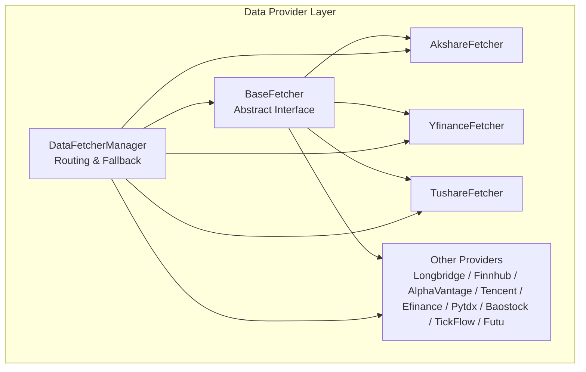
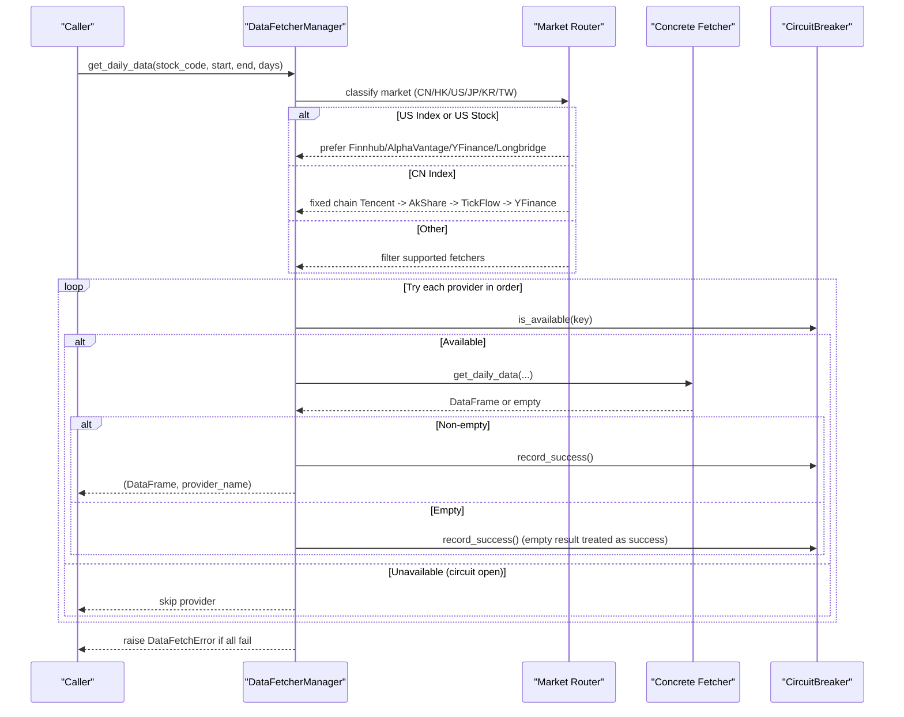
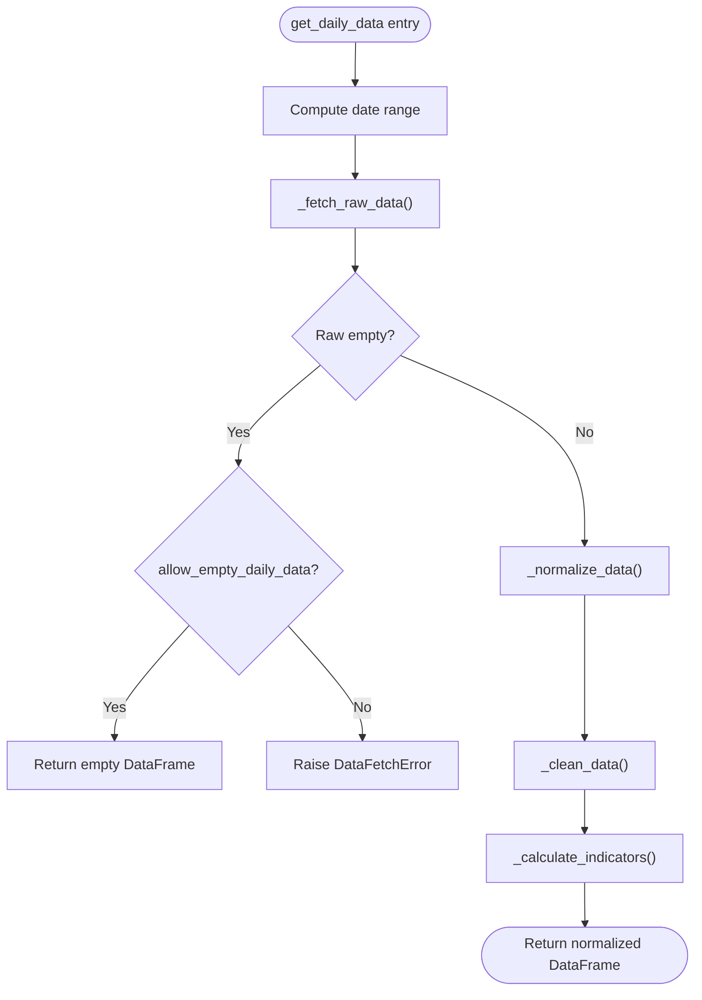
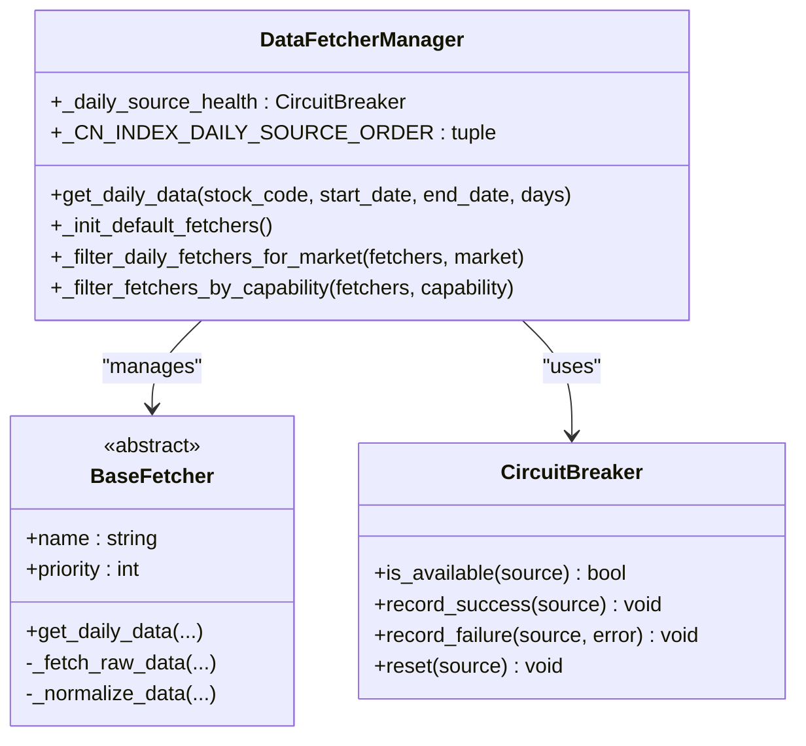
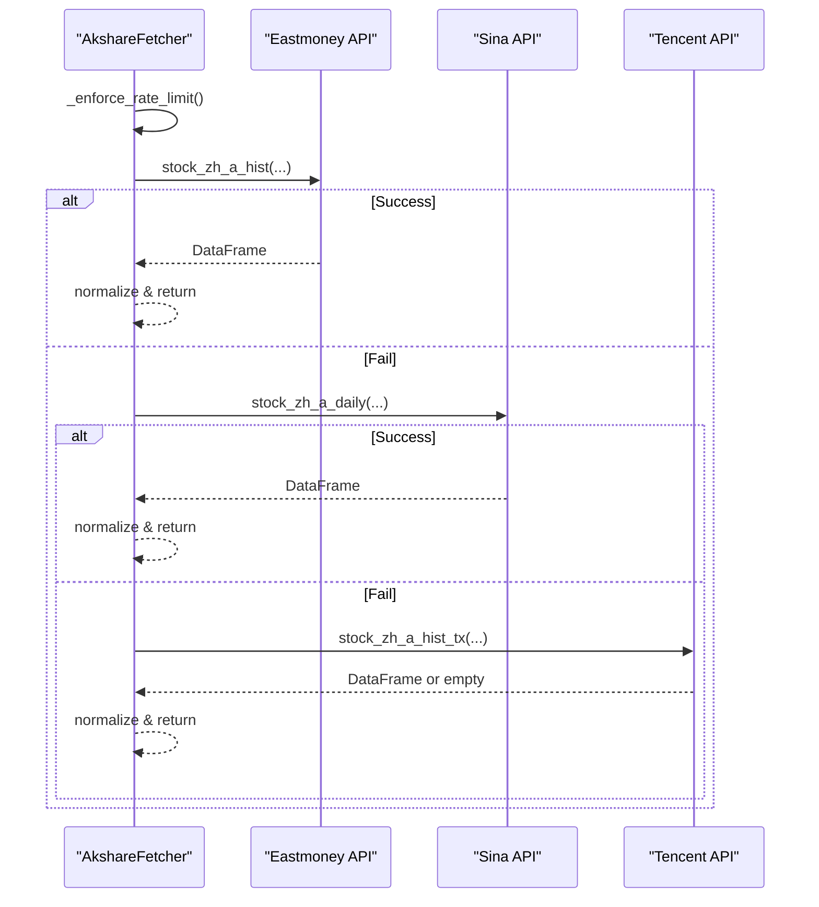
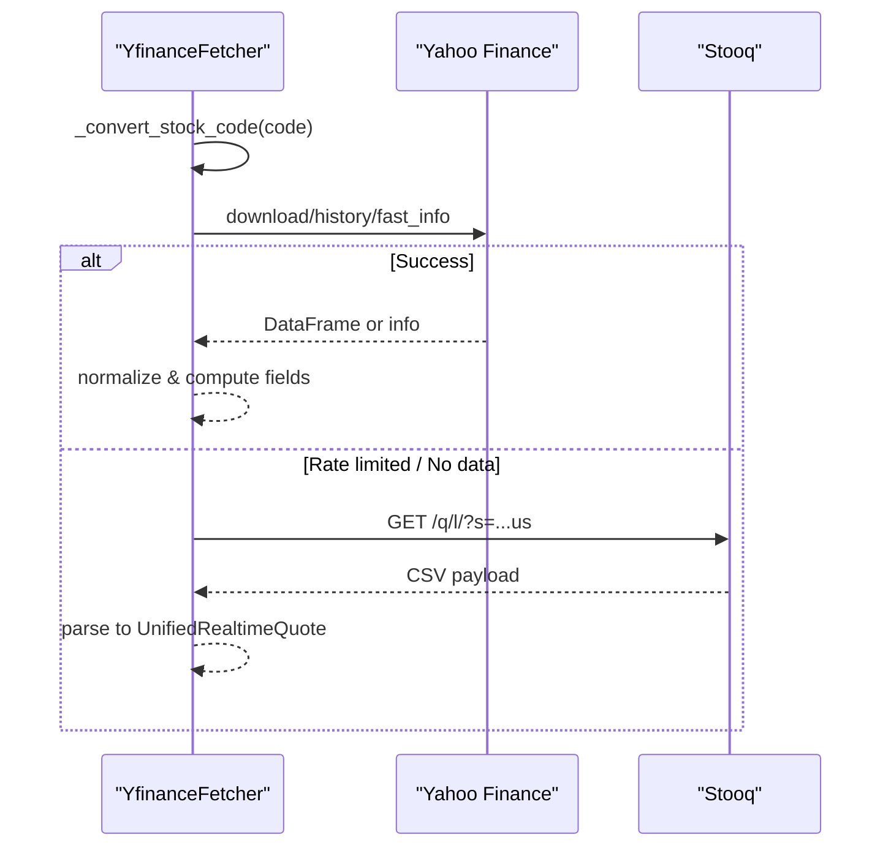
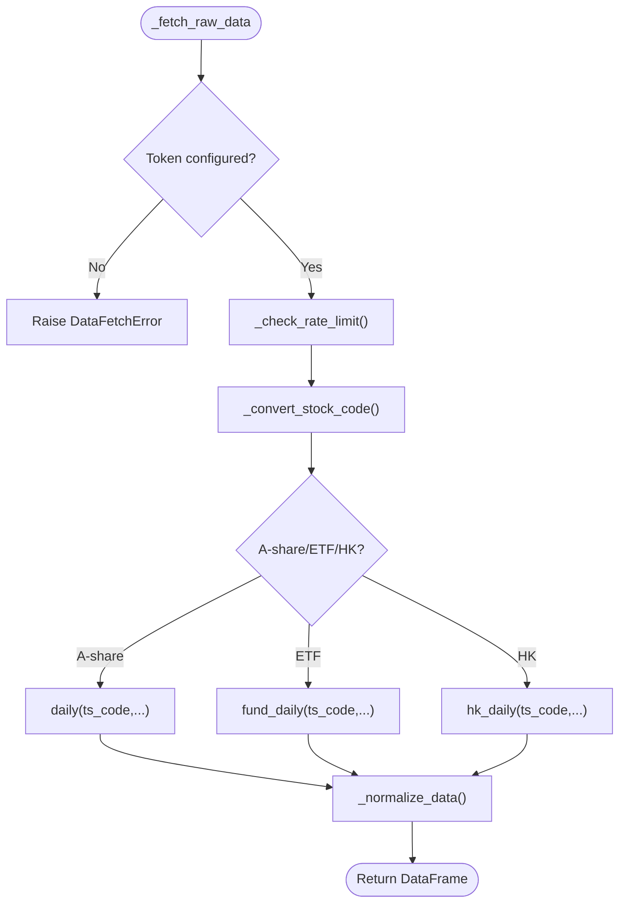
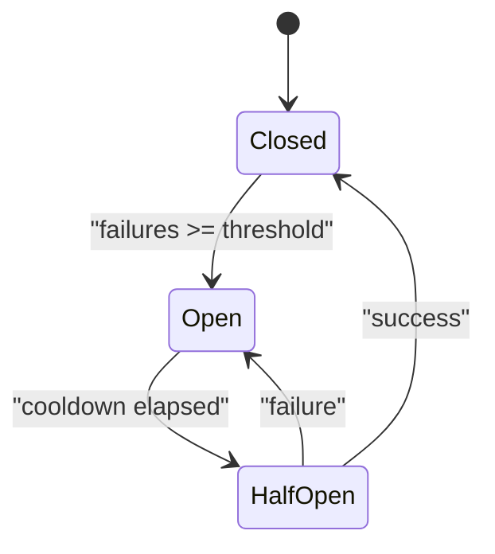
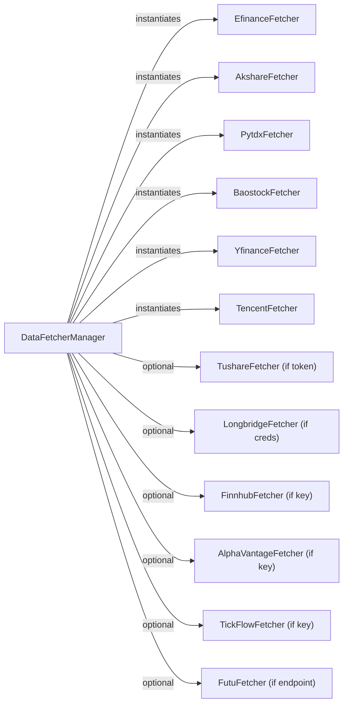

# Data Sources Integration

<cite>
**Referenced Files in This Document**
- [base.py](file://data_provider/base.py)
- [__init__.py](file://data_provider/__init__.py)
- [akshare_fetcher.py](file://data_provider/akshare_fetcher.py)
- [yfinance_fetcher.py](file://data_provider/yfinance_fetcher.py)
- [tushare_fetcher.py](file://data_provider/tushare_fetcher.py)
- [realtime_types.py](file://data_provider/realtime_types.py)
</cite>

## Table of Contents
1. [Introduction](#introduction)
2. [Project Structure](#project-structure)
3. [Core Components](#core-components)
4. [Architecture Overview](#architecture-overview)
5. [Detailed Component Analysis](#detailed-component-analysis)
6. [Dependency Analysis](#dependency-analysis)
7. [Performance Considerations](#performance-considerations)
8. [Troubleshooting Guide](#troubleshooting-guide)
9. [Conclusion](#conclusion)
10. [Appendices](#appendices)

## Introduction
This document explains the pluggable data provider architecture used by DailyStockAnalysis to acquire market data from multiple sources (AkShare, YFinance, Tushare, Futu, Longbridge, Finnhub, Alpha Vantage, Tencent, Efinance, Pytdx, Baostock, TickFlow). It covers:
- The base fetcher interface and normalization pipeline
- Provider registration and priority-based routing
- Automatic fallback strategies and circuit breakers
- Real-time quote fetching, historical daily data retrieval, and fundamental aggregation patterns
- Rate limiting, authentication, error handling, and retry mechanisms
- Guidance for implementing custom providers and configuring priorities

## Project Structure
The data provider layer is organized around a common abstraction and a manager that orchestrates multiple concrete providers. Key modules:
- Base abstractions and manager: base.py
- Package exports and default priorities: __init__.py
- Concrete providers: akshare_fetcher.py, yfinance_fetcher.py, tushare_fetcher.py, plus others imported via __init__.py
- Unified real-time types and circuit breaker: realtime_types.py

**Diagram sources**
- [base.py:331-529](file://data_provider/base.py#L331-L529)
- [base.py:604-1633](file://data_provider/base.py#L604-L1633)
- [__init__.py:35-66](file://data_provider/__init__.py#L35-L66)

**Section sources**
- [base.py:331-529](file://data_provider/base.py#L331-L529)
- [base.py:604-1633](file://data_provider/base.py#L604-L1633)
- [__init__.py:35-66](file://data_provider/__init__.py#L35-L66)

## Core Components
- BaseFetcher: Defines the unified interface for fetching raw data and normalizing it into a standard schema with computed indicators.
- DataFetcherManager: Registers providers, orders them by priority, routes requests by market/asset type, applies fallbacks, and tracks health via circuit breakers.
- Realtime types: Unified structures for quotes and chip distribution, plus a CircuitBreaker for resilience.

Key responsibilities:
- Standardized daily columns: date, open, high, low, close, volume, amount, pct_chg
- Indicator computation: MA5/MA10/MA20, volume_ratio
- Market-aware routing: CN/HK/US/JP/KR/TW
- Health-aware selection: per-market source health tracking and short-circuiting on failures

**Section sources**
- [base.py:40-42](file://data_provider/base.py#L40-L42)
- [base.py:331-589](file://data_provider/base.py#L331-L589)
- [base.py:604-848](file://data_provider/base.py#L604-L848)
- [realtime_types.py:94-194](file://data_provider/realtime_types.py#L94-L194)
- [realtime_types.py:285-465](file://data_provider/realtime_types.py#L285-L465)

## Architecture Overview
The system uses a strategy pattern with a central manager to route requests to the best available provider. For daily data:
- US stocks/indexes are routed through a dedicated chain (Finnhub/Alpha Vantage/YFinance/Longbridge depending on configuration).
- CN indices use a fixed ordered chain (Tencent/AkShare/TickFlow/YFinance) with symbol mapping per provider.
- Other markets follow filtered provider lists based on capability and support matrix.

For real-time quotes:
- Each provider returns a UnifiedRealtimeQuote.
- Circuit breakers protect against repeated failures and enable graceful degradation.

**Diagram sources**
- [base.py:1643-1905](file://data_provider/base.py#L1643-L1905)
- [base.py:942-1140](file://data_provider/base.py#L942-L1140)
- [base.py:815-848](file://data_provider/base.py#L815-L848)
- [realtime_types.py:285-465](file://data_provider/realtime_types.py#L285-L465)

## Detailed Component Analysis

### BaseFetcher and Normalization Pipeline
- _fetch_raw_data: Implemented by each provider to call external APIs.
- _normalize_data: Maps provider-specific columns to STANDARD_COLUMNS.
- _clean_data: Ensures datetime types, numeric coercion, drops invalid rows, sorts by date.
- _calculate_indicators: Adds MA5/MA10/MA20 and volume_ratio.

**Diagram sources**
- [base.py:452-529](file://data_provider/base.py#L452-L529)
- [base.py:531-589](file://data_provider/base.py#L531-L589)

**Section sources**
- [base.py:331-589](file://data_provider/base.py#L331-L589)

### DataFetcherManager: Routing, Fallback, and Health
- Default initialization: Creates core fetchers and optional ones when configured (Tushare, TickFlow, Longbridge, Finnhub, Alpha Vantage, Futu).
- Priority sorting: Lower number = higher priority; dynamic adjustments (e.g., Tushare promoted when token configured).
- Market filtering: Skips providers that do not support the target market.
- Capability probing: Calls is_available_for_request/is_available/_is_available to skip unavailable providers at runtime.
- Daily source health: Per-market circuit breaker keyed by provider name; records successes/failures and enforces cooldown.
- CN index routing: Fixed ordered chain with provider-specific symbol mapping; logs and records provider runs with fallback targets.

**Diagram sources**
- [base.py:604-848](file://data_provider/base.py#L604-L848)
- [base.py:1533-1633](file://data_provider/base.py#L1533-L1633)
- [realtime_types.py:285-465](file://data_provider/realtime_types.py#L285-L465)

**Section sources**
- [base.py:604-848](file://data_provider/base.py#L604-L848)
- [base.py:1533-1633](file://data_provider/base.py#L1533-L1633)

### AkshareFetcher: A-Share, ETF, HK, and Index History
- Multi-channel history: Tries Eastmoney, Sina, Tencent endpoints with rate limiting and jitter.
- Timeouts: Uses a subprocess wrapper to enforce timeouts on long-running calls.
- Market detection: Routes A-shares, ETFs, HK stocks, and indices appropriately.
- Error classification: Categorizes HTTP errors for better diagnostics and fallback decisions.

**Diagram sources**
- [akshare_fetcher.py:460-613](file://data_provider/akshare_fetcher.py#L460-L613)
- [akshare_fetcher.py:615-750](file://data_provider/akshare_fetcher.py#L615-L750)

**Section sources**
- [akshare_fetcher.py:391-800](file://data_provider/akshare_fetcher.py#L391-L800)

### YfinanceFetcher: Global Coverage and Index Quotes
- Code conversion: Maps A-share, HK, JP/KR/TW suffix codes, US tickers, and US indices to Yahoo Finance symbols.
- History: Downloads adjusted OHLCV and computes pct_chg and estimated amount.
- Indices: Provides main indices across regions using ticker fast_info or history fallback.
- Stooq fallback: For US stocks when primary sources are rate-limited, fetches latest price via Stooq CSV.

**Diagram sources**
- [yfinance_fetcher.py:97-183](file://data_provider/yfinance_fetcher.py#L97-L183)
- [yfinance_fetcher.py:184-234](file://data_provider/yfinance_fetcher.py#L184-L234)
- [yfinance_fetcher.py:351-527](file://data_provider/yfinance_fetcher.py#L351-L527)
- [yfinance_fetcher.py:537-686](file://data_provider/yfinance_fetcher.py#L537-L686)

**Section sources**
- [yfinance_fetcher.py:58-306](file://data_provider/yfinance_fetcher.py#L58-L306)
- [yfinance_fetcher.py:351-527](file://data_provider/yfinance_fetcher.py#L351-L527)
- [yfinance_fetcher.py:537-686](file://data_provider/yfinance_fetcher.py#L537-L686)

### TushareFetcher: Token-Gated High-Quality Data
- Authentication: Requires TUSHARE_TOKEN; supports custom HTTP endpoint via environment variable.
- Rate limiting: Enforces per-minute quota; sleeps until next minute when exceeded.
- Markets: Supports A-shares, ETFs, and HK stocks; explicitly rejects US stocks.
- Realtime: Attempts Pro realtime; falls back to legacy realtime if needed.

**Diagram sources**
- [tushare_fetcher.py:175-235](file://data_provider/tushare_fetcher.py#L175-L235)
- [tushare_fetcher.py:246-295](file://data_provider/tushare_fetcher.py#L246-L295)
- [tushare_fetcher.py:464-546](file://data_provider/tushare_fetcher.py#L464-L546)
- [tushare_fetcher.py:548-595](file://data_provider/tushare_fetcher.py#L548-L595)

**Section sources**
- [tushare_fetcher.py:135-235](file://data_provider/tushare_fetcher.py#L135-L235)
- [tushare_fetcher.py:246-295](file://data_provider/tushare_fetcher.py#L246-L295)
- [tushare_fetcher.py:464-595](file://data_provider/tushare_fetcher.py#L464-L595)

### Real-Time Quote Abstraction and Circuit Breakers
- UnifiedRealtimeQuote: Standardizes fields like price, change_pct, volume, amplitude, and metadata such as source, market, currency, and data_quality.
- CircuitBreaker: Tracks per-source state (closed/open/half-open), enforces failure thresholds and cooldowns, and supports reset.

**Diagram sources**
- [realtime_types.py:94-194](file://data_provider/realtime_types.py#L94-L194)
- [realtime_types.py:285-465](file://data_provider/realtime_types.py#L285-L465)

**Section sources**
- [realtime_types.py:94-194](file://data_provider/realtime_types.py#L94-L194)
- [realtime_types.py:285-465](file://data_provider/realtime_types.py#L285-L465)

## Dependency Analysis
- Provider capabilities and market support are declared centrally and used to filter candidates at runtime.
- Optional providers are only instantiated when credentials/config are present, reducing overhead and avoiding unnecessary probes.
- Manager maintains per-fetcher locks to serialize shared state access and ensure thread safety during concurrent calls.

**Diagram sources**
- [base.py:1533-1633](file://data_provider/base.py#L1533-L1633)
- [__init__.py:35-66](file://data_provider/__init__.py#L35-L66)

**Section sources**
- [base.py:1533-1633](file://data_provider/base.py#L1533-L1633)
- [__init__.py:35-66](file://data_provider/__init__.py#L35-L66)

## Performance Considerations
- Rate limiting and jitter: Built-in random sleep and per-provider throttling reduce risk of bans and smooth load.
- Timeouts: AkShare calls are wrapped with process-level timeouts to avoid hanging requests.
- Prefetching: Batch prefetch of real-time quotes can be enabled for large watchlists to amortize costs.
- Caching: Short-lived caches for real-time quotes and concept rankings reduce redundant network calls.
- Circuit breakers: Prevent cascading failures by temporarily disabling unhealthy sources.

[No sources needed since this section provides general guidance]

## Troubleshooting Guide
Common issues and remedies:
- All sources fail: Review logs for error_type and reason; check environment tokens and credentials; verify network connectivity.
- Rate limits: Increase delays or rotate providers; consider enabling higher-tier services (e.g., Tushare Pro, Longbridge).
- Empty results: Some sources may legitimately return no data for certain codes; rely on fallback chain.
- Timeouts: AkShare calls may exceed limits; adjust timeout settings or switch to alternative providers.
- Index ambiguity: Bare codes like 000001 may conflict between index and stock; manager warns and routes conservatively.

Operational tips:
- Use provided diagnostics to reset daily source health if needed.
- Inspect available_fetchers to confirm which providers are loaded.
- For US stocks, ensure Finnhub/Alpha Vantage keys or Longbridge credentials are set if preferred.

**Section sources**
- [base.py:815-848](file://data_provider/base.py#L815-L848)
- [base.py:1643-1905](file://data_provider/base.py#L1643-L1905)
- [akshare_fetcher.py:262-305](file://data_provider/akshare_fetcher.py#L262-L305)

## Conclusion
DailyStockAnalysis implements a robust, pluggable data sourcing layer centered on a base fetcher interface and a manager that coordinates multiple providers with market-aware routing, automatic fallbacks, and resilience via circuit breakers. By standardizing data formats and computing common indicators, the system ensures consistent downstream processing while maximizing availability across diverse markets and providers.

[No sources needed since this section summarizes without analyzing specific files]

## Appendices

### Implementing a Custom Data Provider
Steps:
1. Create a new fetcher class extending BaseFetcher.
2. Implement _fetch_raw_data to call your external API and return a DataFrame.
3. Implement _normalize_data to map columns to STANDARD_COLUMNS.
4. Optionally override get_realtime_quote to return UnifiedRealtimeQuote.
5. Register your provider in DataFetcherManager._init_default_fetchers or add via add_fetcher.
6. Set appropriate priority and mark market support if needed.

Configuration examples:
- Provider priorities: Adjust via environment variables (e.g., AKSHARE_PRIORITY, YFINANCE_PRIORITY, TUSHARE_PRIORITY) or by setting priority in your fetcher.
- Authentication: Provide tokens/keys via configuration (e.g., TUSHARE_TOKEN, FINNHUB_API_KEY, ALPHAVANTAGE_API_KEY).
- Rate limiting: Use BaseFetcher.random_sleep or implement per-provider throttling; leverage tenacity for retries where applicable.

Patterns demonstrated in code:
- Historical daily retrieval: See AkshareFetcher._fetch_stock_data_em, YfinanceFetcher._fetch_raw_data, TushareFetcher._fetch_raw_data.
- Real-time quotes: See TushareFetcher.get_realtime_quote, YfinanceFetcher.get_main_indices and related helpers.
- Fundamental aggregation: Managers hold adapters for fundamental data; extend as needed for new providers.

**Section sources**
- [base.py:331-589](file://data_provider/base.py#L331-L589)
- [base.py:1533-1633](file://data_provider/base.py#L1533-L1633)
- [akshare_fetcher.py:460-750](file://data_provider/akshare_fetcher.py#L460-L750)
- [yfinance_fetcher.py:97-306](file://data_provider/yfinance_fetcher.py#L97-L306)
- [tushare_fetcher.py:175-235](file://data_provider/tushare_fetcher.py#L175-L235)
- [realtime_types.py:94-194](file://data_provider/realtime_types.py#L94-L194)